# First class: what an operating system is, and how it fakes a private processor and a private memory (OSTEP 1, 2) {#class-1}

## Roadmap The question of the week, and the three questions of the first class {#opening-1 data-toc-label="[Roadmap] The question of the week, and the three questions of the first class"}

Every later class of this course opens by looking back at the class before it, because each class exists to fix what the previous one left open. This is the first class, so there is nothing to look back on. It opens instead with one question, put to the room before anything is explained: what is an operating system? Most people answer with a name they know, Windows or macOS, and describe the thing with the desktop, the icons and the windows. That answer is not wrong, but it describes what you see, not what the operating system does. By the end of this class you will have a different answer, and three ways to say it.

The class gets there by asking three questions, in the order the textbook's chapter 2 asks them. Each answer opens the next question. Figure 2 is the deck's list.

<figure markdown="1">
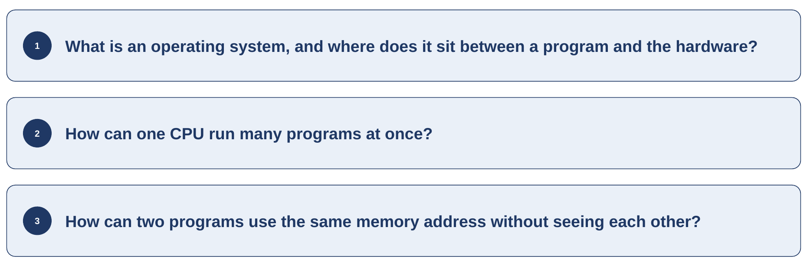{width=100%}
<figcaption markdown="1">Figure 2. The three questions of the first class. From slide 15.</figcaption>
</figure>

The first question is what an operating system is, and where it sits between a program and the hardware ([Chapter 1](#chapter-1), Sections [1.1](#sec-1-1) to [1.5](#sec-1-5)). The answer starts from what the hardware does on its own, shows why that is not enough, and then looks at the operating system from three sides. The second question is how one processor can run many programs at once ([Chapter 2](#chapter-2), Sections [2.1](#sec-2-1) to [2.5](#sec-2-5)). Four copies of one small program run on one processor, and all four make progress. The third question is how two programs can use the same memory address without seeing each other ([Chapter 3](#chapter-3), Sections [3.1](#sec-3-1) to [3.4](#sec-3-4)). Two copies of another small program use the same address, and they never collide. The first class summary collects the three answers. Extras [1](#extra-1) to [5](#extra-5) go deeper on the same questions and can be read later or skipped.

On the slides, every content slide carries its question in the top left corner, written as Q1, Q2 or Q3. If you lose the thread while reading, the question number in a section's figure caption tells you which question that section is working on.

## Chapter 1. What is an operating system, and where does it sit between a program and the hardware? {#chapter-1}

*The question this chapter answers: What is an operating system, and where does it sit between a program and the hardware?*

### 1.1 Concept The fetch-decode-execute loop: what the processor does on its own {#sec-1-1 data-toc-label="1.1 [Concept] The fetch-decode-execute loop: what the processor does on its own"}

Before we can say what an operating system adds, we need to know what the machine does without one. If the hardware alone were enough to run everything we use a computer for, there would be nothing for an operating system to do. So the first step is to strip everything away and look at the processor by itself, running one program.

<figure markdown="1">
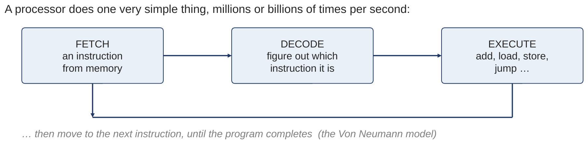{width=100%}
<figcaption markdown="1">Figure 3. The processor's loop: fetch an instruction from memory, decode it, execute it, and move on to the next one. From slide 16, following the opening of textbook chapter 2.</figcaption>
</figure>

Figure 3 is the whole story. A running program does one simple thing: it executes instructions. Many millions of times every second, and on today's machines billions, the processor does three steps. It **fetches** an instruction: it reads the next instruction from memory, at the address the program counter holds (the program counter is the register that says where the next instruction is; Part 0 defined it). It **decodes** the instruction: it works out which instruction this is, an add, a load, a jump. It **executes** the instruction: it does what the instruction says, such as adding two numbers, reading memory, checking a condition, or jumping to another part of the program. Then it moves on to the next instruction, and so on, until the program finishes.

This loop has a name, the **Von Neumann model** of computing, after John von Neumann, one of the early pioneers of computers. Its key idea is that the program and its data both sit in the same memory, and the processor marches through the program one instruction at a time. The name is worth knowing because books use it for exactly this loop.

One honest remark. A modern processor does many strange things underneath to run faster: it works on several instructions at once, and it can even finish them out of order. But it carefully keeps up the appearance that the instructions ran one at a time, in order, and every program is written as if that were true. Remember this trick of keeping up an appearance. The operating system is about to play the same kind of trick one level up.

What this section settled: on its own, the hardware runs one stream of instructions, one program, one instruction after another. What it leaves open: whether that is enough for the way we actually use computers. The next section shows it is not.

### 1.2 Problem One instruction stream, 61 programs, and no referee {#sec-1-2 data-toc-label="1.2 [Problem] One instruction stream, 61 programs, and no referee"}

What we have is [Section 1.1](#sec-1-1): one processor running one stream of instructions, and one memory holding the instructions and data of one program. That is everything the hardware offers a program.

Where it breaks is the way computers are really used. Figure 4 is the deck's problem slide, the first of six in the week. Every problem slide has the same three columns: what we have, where it breaks, and so what we need. The left two columns are in the first figure.

<figure markdown="1">
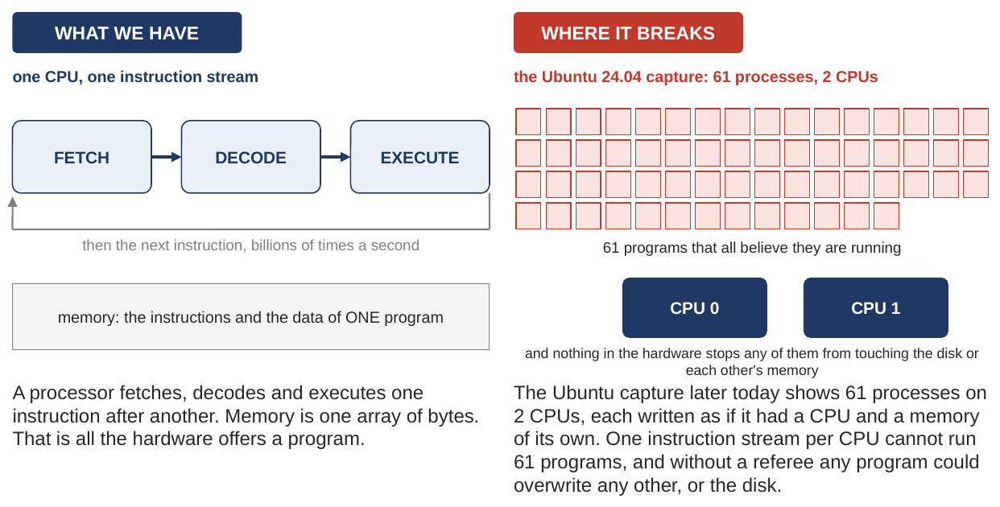{width=99%}
<figcaption markdown="1">Figure 4. The problem of the first question, left and middle columns: what we have (one processor, one instruction stream, one program in memory) and where it breaks (61 programs on 2 processors, and nothing that keeps them apart). From slide 17.</figcaption>
</figure>

The middle column comes from a real machine, an Ubuntu 24.04 machine whose numbers [Section 3.4](#sec-3-4) shows in full. It has 2 processors, labeled CPU 0 and CPU 1 in the drawing, and at the moment the numbers were captured it had about 61 programs going, most of them waiting for something at any given moment ([Section 3.4](#sec-3-4) explains the count). The 61 small red squares are those programs. Each one was written as if it had a processor and a memory of its own. Count what the hardware can do: one instruction stream per processor, so two streams at a time. Two streams cannot carry 61 programs by the rules of the hardware alone: something would have to stop one program and start another, and the bare hardware has nothing that decides to do that. And there is a second problem, written under the two processors: nothing in the hardware described so far stops any of those programs from reading the disk or writing into another program's memory. Any program could overwrite any other, or wipe the disk. A computer used this way would need a referee, and the bare hardware has none.

So what we need is the right column, in Figure 5.

<figure markdown="1">
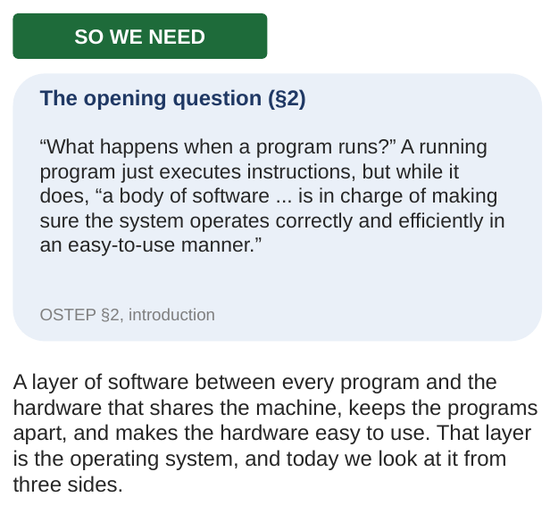{width=49%}
<figcaption markdown="1">Figure 5. The right column of the same slide: so what we need. The chapter's opening question, and the shape of the answer. From slide 17.</figcaption>
</figure>

The textbook opens its chapter with exactly this question: "what happens when a program runs?" Its answer is that while a program runs, a body of software is in charge of making sure the system operates correctly and efficiently in an easy-to-use manner. The shape of the answer, before any detail: a layer of software between every program and the hardware. That layer shares the machine among the programs, keeps the programs apart, and makes the hardware easy to use. That layer is the operating system. A reader who stops here could already guess what it must do: hand the processor to one program after another, and stand between each program and the parts of the machine it must not touch.

What this section settled: the hardware alone cannot run many programs safely. What it leaves open: what exactly that layer is. The next section looks at it from three sides.

### 1.3 Concept The operating system as a virtual machine, a standard library and a resource manager {#sec-1-3 data-toc-label="1.3 [Concept] The operating system as a virtual machine, a standard library and a resource manager"}

[Section 1.2](#sec-1-2) asked for a layer of software between every program and the hardware, and gave it three jobs: share the machine, keep programs apart, make the hardware easy to use. A single name for that layer, "operating system", hides how different those jobs are. The textbook defines the operating system three times, from three angles, and each angle explains one of the jobs. Figure 6 shows the three.

<figure markdown="1">
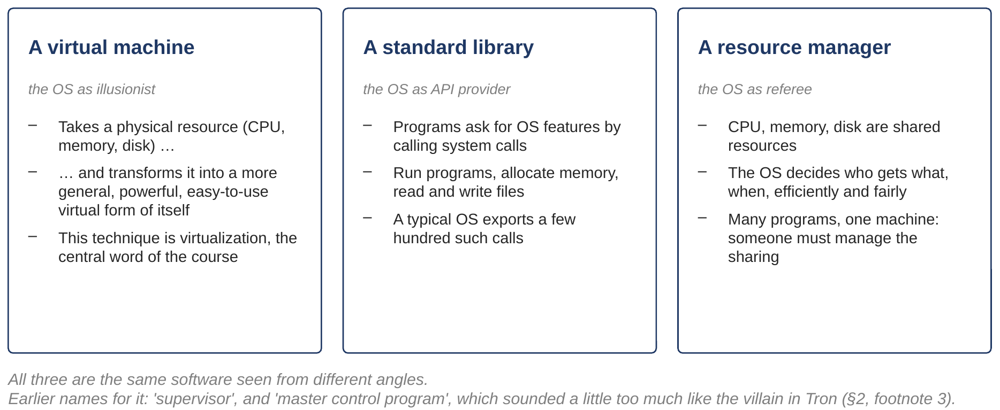{width=100%}
<figcaption markdown="1">Figure 6. The three faces of the operating system: a virtual machine, a standard library, and a resource manager, with the early names for it underneath. From slide 18, following textbook chapter 2.</figcaption>
</figure>

The first face is the operating system as a **virtual machine**, the illusionist. The OS takes a physical resource, such as the processor, the memory or the disk, and transforms it into a more general, more powerful and easier-to-use virtual form of itself. "Virtual" means made to look real by software, like a virtual tour of a museum. The general technique has a name: **virtualization**. It is the central word of the course, and the first half of the course is about it. The four loops of [Section 2.3](#sec-2-3) and the two counters of [Section 3.2](#sec-3-2) are virtualization at work.

The second face is the operating system as a **standard library**, the provider of services. A **library**, in programming, is a collection of ready-made functions that programs can use instead of writing them again (a **function** is a named piece of a program that other parts can run). To use the virtual resources, a program asks the OS: run this program, give me more memory, open this file. Those requests are called **system calls**. A typical operating system offers a few hundred of them. [Section 1.4](#sec-1-4) shows how a system call reaches the OS, and [Section 1.5](#sec-1-5) shows part of the complete list of one real system and names the rest. (The slide calls this face the "API provider"; an **API**, application programming interface, is the set of calls a piece of software offers to programs.)

The third face is the operating system as a **resource manager**, the referee. A **resource** is any part of the machine that programs need and must share: the processor, the memory, the disk. Many programs share one machine, so something must decide who gets what, and when, efficiently and fairly. The OS does that.

These are not three programs. They are the same software, the same kernel, seen from three angles. The note under the cards adds a piece of history: early names for the operating system were the "supervisor" and the "master control program". The second name sounded a little too much like the villain of the film Tron, and "operating system" caught on instead.

What this section settled: the layer has three faces, and each face does one of the three jobs. What it leaves open: where this layer sits in the machine, and how a program reaches it. The next section draws it.

### 1.4 Concept User mode, kernel mode, the trap, and the system call {#sec-1-4 data-toc-label="1.4 [Concept] User mode, kernel mode, the trap, and the system call"}

[Section 1.3](#sec-1-3) said programs ask the operating system for services through system calls. But an ordinary program can already call functions, and a function is just code somewhere in memory. Suppose a system call were an ordinary function call. Then nothing would stop a buggy program from calling into the middle of the OS, or from skipping the OS entirely and touching the disk itself. The referee of [Section 1.2](#sec-1-2) would have no power. So the OS needs a door that every program must use and no program can go around. Figure 7 shows where the OS sits and where that door is.

<figure markdown="1">
{width=100%}
<figcaption markdown="1">Figure 7. Where the kernel sits: programs in user space on top, the kernel in the middle with full hardware privilege, the hardware at the bottom, and the system call as the only way down. The red question is the deck's discussion question. From slide 19, following Figure 1.1 of the xv6 book.</figcaption>
</figure>

The picture has three layers. At the bottom is the hardware: the processor, the memory (labeled DRAM, the kind of chips main memory is made of), the disk and the network. In the middle is the operating system's **kernel**. At the top are your programs: the shell, an editor, a browser, the small demonstration programs of this guide. The right edge names two regions. The programs run in **user space**; the kernel runs in **kernel space**, with full hardware **privilege**, which here means permission to do everything the hardware can do.

The privilege comes from the processor itself. The processor needs a way to know whether the code it is running right now may touch everything. So it has two **modes**, and one bit inside it says which mode it is in. In **user mode**, the hardware restricts what the running code may do: it cannot start a transfer to the disk, it cannot touch memory that is not its own, it cannot send data on the network. In **kernel mode**, the hardware allows everything. Ordinary programs run in user mode. Only the kernel runs in kernel mode, and so only the kernel reaches the bottom layer.

The two arrows between the top two layers are the door. A **system call** is a request from a program to the kernel, and it is made with a special instruction called a **trap**. A trap does two things at the same moment. It jumps into code the kernel installed in advance, called the **trap handler**. And it switches the processor from user mode to kernel mode. When the computer starts, the kernel tells the processor where its handler is, in a register that only kernel mode can change, so the program cannot choose where to land: it always lands at the kernel's chosen entry. Could a program simply jump to the handler's address with an ordinary jump? That would run the kernel's code still in user mode, without the privilege. Worse, user mode cannot reach memory that is not its own (as the paragraph on the two modes says), and the kernel's code is not the program's own memory, so the jump would just fail. Only the trap enters at the chosen place and raises the privilege together. The kernel does the work and then returns with a special return instruction, which switches back to user mode and continues the program right after the trap. So a program alternates between running in user space and running, briefly, in kernel space, and this boundary is the operating system's interface.

The red question on the slide is the deck's discussion question: how is a system call different from a normal function call? Try to answer it before reading on. The answer: a normal function call jumps to code in your own program, at the same privilege. A system call jumps into kernel code, at an entry the kernel chose, and raises the privilege at the same time, and you cannot get one without the other. That pairing is what keeps a buggy program from scribbling on the kernel. Without that line, there would be no operating system, only a library that any program could ignore. Exercise 1 asks you to put this in your own words.

What this section settled: the kernel sits between programs and hardware, and the trap is the only door through. What it leaves open: what is actually behind the door in a real kernel, and how many system calls there are. The next section opens one.

### 1.5 Real kernel The whole interface of a real kernel: xv6's syscall.h {#sec-1-5 data-toc-label="1.5 [Real kernel] The whole interface of a real kernel: xv6's syscall.h"}

[Section 1.4](#sec-1-4) drew the door into the kernel, but a drawing does not show what a program can ask for once it is through. The textbook says a typical operating system offers a few hundred system calls. That is too many to look at, and too many to understand from a list. A small real kernel is better: if its whole interface fits on one page, we can see the library face of [Section 1.3](#sec-1-3) completely. Figure 8 is that page.

<figure markdown="1">
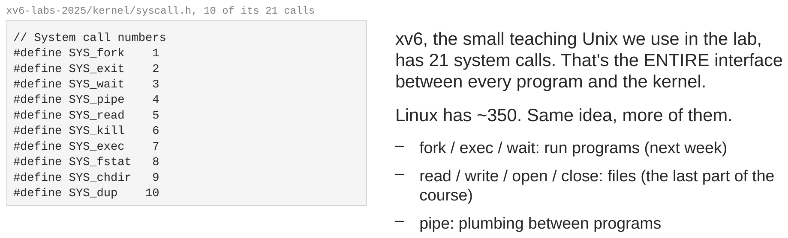{width=100%}
<figcaption markdown="1">Figure 8. The first 10 of the 21 system calls of xv6, from the file kernel/syscall.h in the lab tree, and what the families of calls are for. From slide 20.</figcaption>
</figure>

**xv6** is the small teaching Unix you use in the lab: a teaching operating system from MIT, written in C, that really boots and runs programs (Part 0 named it; [Extra 1](#extra-1) introduces it properly). **Unix** is a family of operating systems that began at Bell Labs in 1969; Linux and macOS both follow its design. The figure's caption names the file: `xv6-labs-2025/kernel/syscall.h`, which means the file `syscall.h` inside the folder `kernel` of the lab tree `xv6-labs-2025`, the copy of xv6 you use in the labs. A file whose name ends in `.h` is a **header file**: a file of names and definitions that other C files pull in.

The file is short, so read it line by line. The first line, `// System call numbers`, is a **comment**: two slashes start a note for human readers that the computer ignores. Each other line has the form `#define SYS_fork 1`. In C, `#define` gives a name to a value, so this line says "the name `SYS_fork` means the number 1". The file gives each system call a number: `fork` is 1, `exit` is 2, `wait` is 3, and so on down to `dup` at 10, the last line the slide shows. The number is how a program names the call it wants when it traps into the kernel. Call 7 means `exec` (the call that loads a program from a file and starts running it); there is nothing more magic to it than that.

The whole file has 21 such lines, so xv6 has 21 system calls, and that is the entire interface between every program and the xv6 kernel. (The slide shows 10 of them; the other 11 are `getpid`, `sbrk`, `pause`, `uptime`, `open`, `write`, `mknod`, `unlink`, `link`, `mkdir` and `close`, numbers 11 to 21. Check: 10 + 11 = 21.) Linux has about 350 (a round figure from the deck; the exact count grows with each version), which is the same idea with many more calls, grown over decades. Old calls are never removed, because old programs still use them.

The right side of the figure sorts the calls into three families. `fork` (make a new process, a copy of the one that calls it), `exec` (load and start a program) and `wait` (wait for a child process, one this process created, to finish) run programs; they are the next week's subject. `read`, `write`, `open` and `close` work with files; they come back in [Section 6.2](class-2.md#sec-6-2) and are the last part of the course. `pipe` connects programs to each other, like plumbing.

**Checkpoint 1.** Settled: an operating system is the layer of software between every program and the hardware. Seen from three sides, it is a virtual machine, a standard library and a resource manager. A program reaches it only through a system call, which raises the privilege level and jumps into the kernel, and xv6 has 21 of them. Still open: one processor runs one instruction stream. How does it run many programs at once, and how does the OS take the processor away from a program that never stops? You should now be able to draw the user space, kernel and hardware picture with the system-call arrow, and say what crosses that line and in which direction.

## Chapter 2. How can one CPU run many programs at once? {#chapter-2}

*The question this chapter answers: How can one CPU run many programs at once?*

### 2.1 Problem Four infinite loops on one CPU {#sec-2-1 data-toc-label="2.1 [Problem] Four infinite loops on one CPU"}

What we have, from [Chapter 1](#chapter-1): an operating system that sits under every program, reached only through system calls. And underneath it, still, a processor that runs one instruction stream at a time. Checkpoint 1 left the obvious question open: the Ubuntu machine of [Section 1.2](#sec-1-2) runs 61 programs on 2 processors, so how does one processor run many programs at once? Figure 9 is the deck's problem slide for this question.

<figure markdown="1">
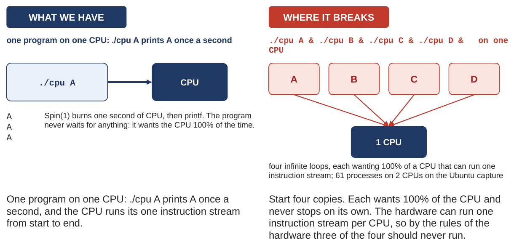{width=98%}
<figcaption markdown="1">Figure 9. The problem of the second question, left and middle columns: one program on one processor, then four copies of it, each wanting the whole processor. From slide 22.</figcaption>
</figure>

The left column is one small program, called `cpu`, on one processor. [Section 2.2](#sec-2-2) shows its code. All it does is keep the processor busy for one second, print a letter, and repeat, forever. The command `./cpu A` runs it with the letter A, so it prints A once a second. The program never waits for anything: no keyboard, no disk. Even its one second of "work" is spent checking the clock in a loop, never resting. It wants the processor 100% of the time. On its own, that is harmless. The processor runs its one instruction stream from start to end, and nothing else needs the processor.

Where it breaks is the middle column. Start four copies at once, with the letters A, B, C and D, on a machine with one processor: `./cpu A & ./cpu B & ./cpu C & ./cpu D &`. The `&` after each command tells the shell to start the program and come back at once, without waiting for it to finish. So all four start, one after another, in a fraction of a second, and keep running "in the background", without the shell waiting for them. Each copy wants 100% of the processor. Each one is an infinite loop that never stops on its own. The hardware runs one instruction stream per processor. So by the rules of the hardware alone, whichever copy gets the processor first should keep it forever, and the other three should never run. And this is not a strange case: the Ubuntu capture of [Section 1.2](#sec-1-2) had about 61 programs on 2 processors, so having many more programs than processors is the normal situation.

So what we need is the right column, in Figure 10.

<figure markdown="1">
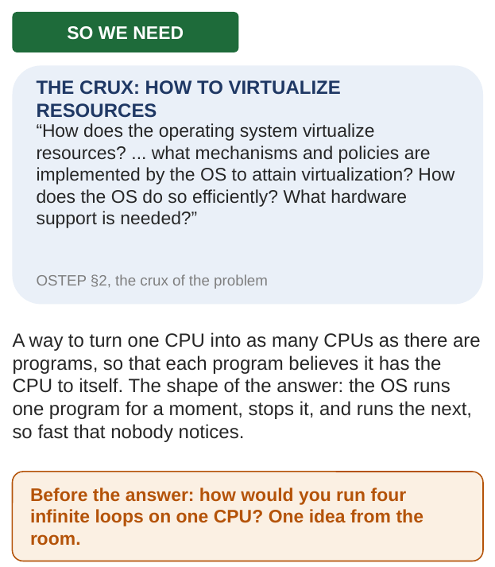{width=50%}
<figcaption markdown="1">Figure 10. The right column: the textbook's first crux (its central question), how to virtualize resources, the shape of the answer, and the question put to the room. From slide 22.</figcaption>
</figure>

The textbook states its central problems as a **crux**, its word for the one sharp question a chapter is built around (the plural is cruces). This is the first crux of the course: how does the operating system virtualize resources? Why it does so is not the interesting part, the textbook says, because the answer is obvious: it makes the machine easier to use. The interesting part is how. What mechanisms and policies does the OS use to achieve virtualization? How does it do so efficiently? What help does it need from the hardware? (The words "mechanism" and "policy" get their meanings in [Section 2.4](#sec-2-4).)

The shape of the answer, before any answer: a way to turn one processor into as many processors as there are programs, so that each program believes it has the processor to itself. The OS runs one program for a moment, stops it, and runs the next, so fast that nobody notices. The orange box was put to the room before the answer, and it is worth a minute of your own now: how would you run four infinite loops on one processor? Exercise 2 asks it again.

### 2.2 Real machine One CPU-bound program alone: cpu.c {#sec-2-2 data-toc-label="2.2 [Real machine] One CPU-bound program alone: cpu.c"}

The problem slide described the `cpu` program in a sentence. To see what four copies of it do, we first need to see exactly what one copy does alone, so that nothing in the four-copy run can be blamed on the program itself. Figure 11 is the program, as the textbook's Figure 2.1 has it, with a few lines left out.

<figure markdown="1">
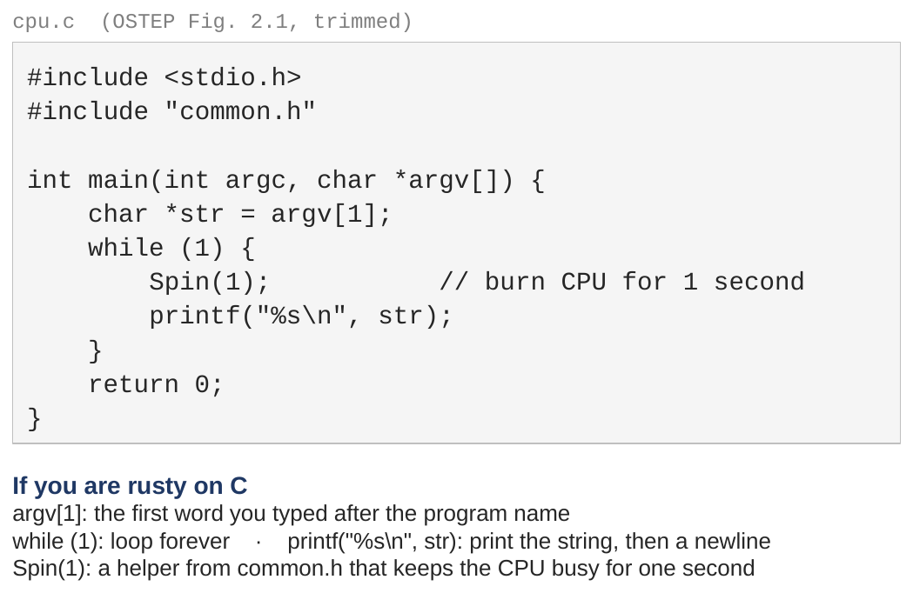{width=84%}
<figcaption markdown="1">Figure 11. cpu.c, the textbook's Figure 2.1 with the argument check and three include lines left out, and the three pieces of C it uses. From slide 23.</figcaption>
</figure>

You do not need to follow every line, and you do not need to know C. Here is what the program does, line by line. The two lines starting with `#include` pull in ready-made code: `stdio.h` is C's standard input and output (it provides `printf`, which prints text), and `common.h` is a small file of helpers that comes with the textbook. The line `int main(int argc, char *argv[]) {` starts **main**, the function where every C program begins. (`int` says main gives back a whole number when it ends, and `argc` counts the words typed, which this shortened program does not use.) The curly braces `{` and `}` mark where a block of code starts and ends. `argv` holds the words typed on the command line after the program's name, and `argv[1]` is the first of them (the square brackets pick one item by its position, starting from 0, and position 0 is the program's own name). So `char *str = argv[1];` keeps the first word, here the letter A, under the name `str`. (`char *` means "a piece of text"; the `*` is explained in [Section 3.2](#sec-3-2).)

Then the loop. `while (1)` means "repeat forever": `while` repeats the block below it for as long as its condition is true, and 1 counts as true and never changes. Inside the loop, `Spin(1);` is a helper from `common.h` that keeps the processor busy for one second: it checks the clock over and over until a second has passed, and does nothing useful while it waits. It stands in for real work. A semicolon ends each statement in C. The text after `//` is a comment. Then `printf("%s\n", str);` prints the word: `%s` is a placeholder that `printf` fills in with the text `str`, and `\n` is the newline character, which moves the output to a new line. The last line inside main, `return 0;`, would end the program with the number 0, which means "no error", but the loop never ends, so it is never reached.

Figure 12 is what happens when it runs.

<figure markdown="1">
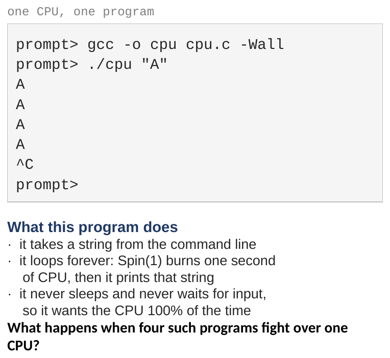{width=61%}
<figcaption markdown="1">Figure 12. The textbook's run of cpu.c on a machine with one processor: compile, run with the letter A, stop with Control-C. From slide 23.</figcaption>
</figure>

The first line compiles the program: `gcc -o cpu cpu.c -Wall` turns the file `cpu.c` into a runnable program named `cpu` (Part 0 explained the compiler; `-Wall` asks it to warn about anything suspicious). The second line runs it with the letter A. The program prints A once a second, four times here, until the user presses Control-C. The `^C` in the output is how the terminal shows Control-C, the key combination that ends the program running in the terminal. Nothing surprising, and nothing to explain: one processor, one program.

The text under the output says the important part in plain words. The program takes a string (a piece of text) from the command line, loops forever, and never sleeps or waits for input, so it wants the processor 100% of the time. That is why four copies of it on one processor make a real fight.

### 2.3 Real machine Four copies on one CPU: virtualizing the CPU {#sec-2-3 data-toc-label="2.3 [Real machine] Four copies on one CPU: virtualizing the CPU"}

[Section 2.2](#sec-2-2) established that one copy of `cpu` prints its letter once a second and never lets go of the processor. Now the experiment of the problem slide: four copies, one processor. If the hardware's rule of one instruction stream per processor were the whole story, only one letter would ever appear. Figure 13 is what really happens.

<figure markdown="1">
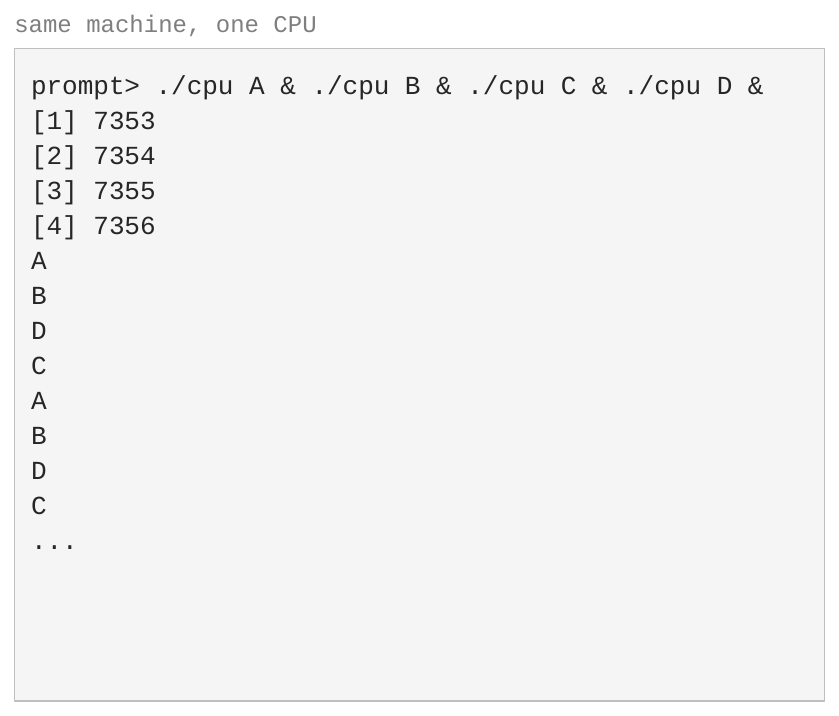{width=67%}
<figcaption markdown="1">Figure 13. The textbook's run of four copies of cpu on one processor: the shell reports four process numbers, then A, B, D and C keep coming. From slide 24, the textbook's Figure 2.2.</figcaption>
</figure>

The first line starts the four copies. The shell answers with four lines, `[1] 7353` to `[4] 7356`, one for each program started in the background. Each line gives the program's job number in square brackets and its process number. A process number is a number the operating system gives every running program ([Section 2.5](#sec-2-5) shows where the kernel keeps it). Then the letters: A, B, D, C, A, B, D, C, and so on. All four letters keep coming, round after round. All four programs make progress.

The hardware still fetches, decodes and executes one instruction stream, and the textbook ran this on a machine with one processor, so the copies cannot be running on separate processors. So the only explanation is that the operating system, with some help from the hardware, switches the processor among the four programs: it runs one for a short moment, stops it, saves where it was, and runs the next. It does this so fast that each program, and you watching the output, cannot tell. That creates an illusion: one real processor looks like a large number of **virtual CPUs**, one for each program. Turning one processor, or a few, into a seemingly unlimited number of processors, so that many programs seem to run at once, is called **virtualizing the CPU**. It is the subject of the first half of the course.

The order is worth a look. It is A, B, D, C, not A, B, C, D. Nothing in the programs decides the order; whatever part of the OS picks the next program decided it. On your own machine the order will be different, and it changes from run to run; on a laptop with several processors the pattern changes again, because several copies really run at the same moment. Any order you get is correct. That is the point of the demo. The moment programs share something, the order of events stops being fixed. That thought comes back, much less pleasantly, in [Chapter 4](class-2.md#chapter-4).

This run raises two questions that the next weeks of the course answer. How does the OS take the processor away from a loop that never stops and never makes a system call? The short answer is the hardware **timer**: a clock in the hardware that, every few milliseconds, raises an **interrupt**, a forced hand-off from whatever program is running to the kernel, through the same kind of door as a trap. The kernel then decides whether to switch. That is a matter of how the switch is done, and the next week of the course takes it apart. Which program should run next, and for how long? That is a matter of choice, and the scheduling weeks take it apart. The next section gives those two kinds of question their names.

### 2.4 Concept Four words: illusion, mechanism, policy, process {#sec-2-4 data-toc-label="2.4 [Concept] Four words: illusion, mechanism, policy, process"}

[Section 2.3](#sec-2-3) watched something happen and described it in a long sentence. The questions it raised, how the switch is done and which program goes next, are of two different kinds, and the thing being switched needs a name too. Without short words for these, every later week would have to repeat the long sentence. Figure 14 gives the four words the deck uses for the rest of the first half of the course.

<figure markdown="1">
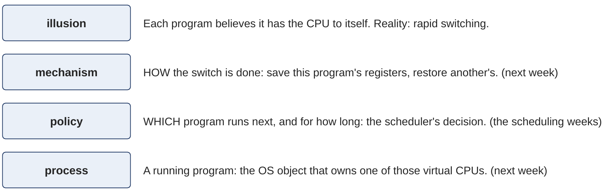{width=100%}
<figcaption markdown="1">Figure 14. Four words: illusion, mechanism, policy, and process, each in one line, with where the course takes each one up. From slide 25.</figcaption>
</figure>

The **illusion** is what virtualization produces: each program believes it has the processor to itself, while in reality the OS is switching rapidly among programs. It is a kind lie; every program sees a private machine.

A **mechanism** is how something is done: the low-level method or machinery. Here, the mechanism is the switch itself. To change from one program to another, the OS saves the first program's registers and loads the other program's registers back. (Part 0: registers are the small storage cells inside the processor that hold the values it is working on.) That saving and loading is called a **context switch**. The next week of the course builds it.

A **policy** is which and when: the rule that makes a decision. Here, the policy decides which program runs next and for how long. The part of the OS that applies it is the **scheduler**. The scheduling weeks study policies.

A **process** is a running program. The textbook calls it the object the OS uses for one of those virtual CPUs. A **program** is a file on the disk, lifeless, a list of instructions. A process is that file brought to life: loaded into memory, with its registers, its own data, and the kernel's records about it. One program can be many processes at once. The demo of [Section 2.3](#sec-2-3) ran four processes of one program, `cpu`. The numbers 7353 to 7356 were their **process IDs**, usually written **PID**: the number the OS gives each process, unique among the running processes.

The split between mechanism and policy comes back all through the course, and its payoff is practical: you can change the policy without rebuilding the mechanism. [Extra 4](#extra-4) gives two more pairs of examples.

### 2.5 Real kernel The process in a real kernel: struct proc {#sec-2-5 data-toc-label="2.5 [Real kernel] The process in a real kernel: struct proc"}

[Section 2.4](#sec-2-4) defined a process as a running program, and said the OS switches processes by saving one set of registers and loading another. Those are words. A kernel is a program, and a program can only remember things it has written down in memory somewhere. So where does a real kernel keep a process, and where do the saved registers go while the process is not running? Figure 15 is the answer in xv6, complete.

<figure markdown="1">
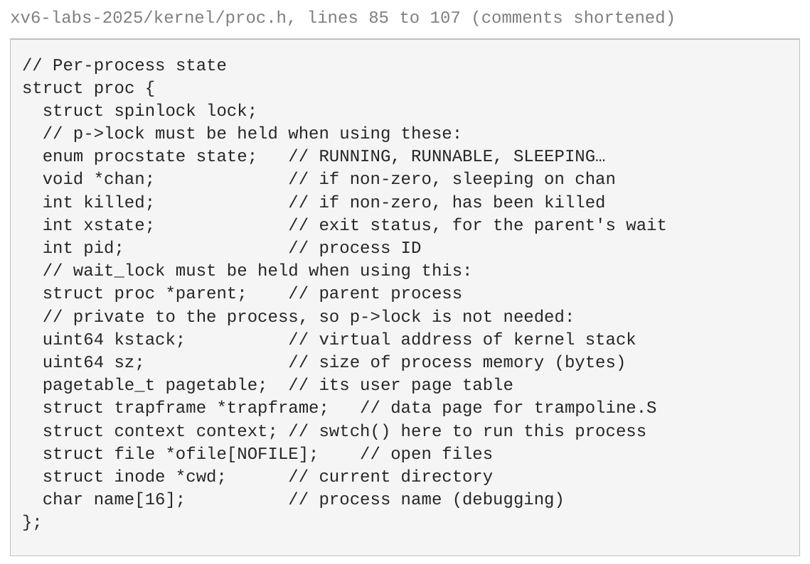{width=91%}
<figcaption markdown="1">Figure 15. xv6's struct proc, every field of it, from kernel/proc.h lines 85 to 107 in the lab tree, with the comments shortened. From slide 26.</figcaption>
</figure>

In C, a **struct** is a named group of variables kept together, like a form with labeled boxes. `struct proc` is xv6's form for one process: every process in xv6 is one of these, and everything the kernel knows about a program fits in it. Each line inside the braces is one **field**, one box of the form, written as a type and a name. You do not need the types; read the names and the comments after `//`. The slide says the comments are shortened; every field is there.

Four fields matter this week. `state` says what the process is doing: running on a processor right now, runnable (ready to run but waiting for a turn), or asleep (waiting for something, such as a key press). It is an actual variable, not a figure of speech. `context` is the saved registers. When xv6 switches away from a process, it stores that process's registers in this field; when it switches back, it loads them from here. Switching processes means saving one context and restoring another, and that is the whole trick of [Section 2.3](#sec-2-3). `pagetable` is the process's private view of memory, which the next chapter explains ([Section 3.3](#sec-3-3)). `ofile` is the list of files the process has open. The `[NOFILE]` after it means it is an **array**, a row of equal slots reached by position number. NOFILE is a name for how many slots there are: 16, a value xv6's authors chose and wrote in one of its settings files. A **file descriptor**, which [Section 6.2](class-2.md#sec-6-2) meets, is a position number in this array.

A few other fields have plain meanings. `pid` is the process ID of [Section 2.4](#sec-2-4). `parent` names the process that created this one. `killed` says whether someone has asked this process to end. `name` is the program's name, kept for debugging. The rest, `lock`, `chan`, `xstate`, `kstack`, `sz` and `trapframe`, belong to later weeks.

Notice the three comment lines inside the struct, such as `// p->lock must be held when using these:`. (`p->lock` means the `lock` field of the struct that `p` points to; `->` reaches a field through a pointer, a word [Section 3.2](#sec-3-2) defines.) They split the fields into groups and say which **lock** protects each group: a lock is a rule that only one piece of code at a time may touch some data. The kernel needs such rules because two processors can run kernel code at the same moment and could otherwise change the same field at once; [Chapter 4](class-2.md#chapter-4) shows what goes wrong then. Even the kernel has rules about who may touch what, and the concurrency part of the course explains why. [Chapter 5](class-2.md#chapter-5) meets the first lock.

**Checkpoint 2.** Settled: the OS switches the processor among the programs so fast that each one, and you, cannot tell, so one real processor becomes many virtual CPUs. The switch is the mechanism; choosing who runs next is the policy. In xv6 a process is one `struct proc`, and its saved registers are the `context` field. Still open: each program also uses memory. The next demo shows two copies of one program using the same memory address without colliding, and one physical memory cannot hold two different values in one place, so something must be translating. You should now be able to explain the four-loops output: what the hardware did, what the OS did, and why the order is not A, B, C, D.

## Chapter 3. How can two programs use the same memory address without seeing each other? {#chapter-3}

*The question this chapter answers: How can two programs use the same memory address without seeing each other?*

### 3.1 Problem One physical memory, and two programs storing at the same address {#sec-3-1 data-toc-label="3.1 [Problem] One physical memory, and two programs storing at the same address"}

What we have: [Chapter 2](#chapter-2) gave every program its own virtual processor by switching one real processor among them. But a running program needs more than a processor. Every instruction it runs and every variable it uses sits in memory, and memory, to the hardware, is plain. Figure 16 is the deck's problem slide for the third question.

<figure markdown="1">
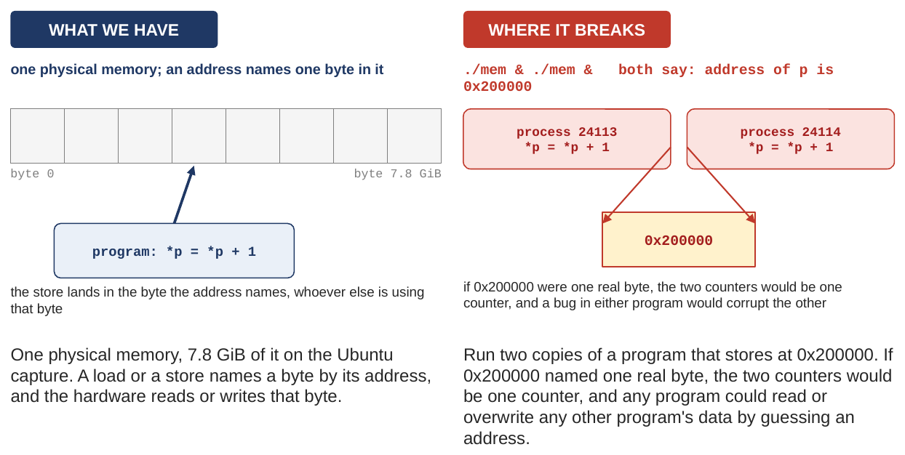{width=100%}
<figcaption markdown="1">Figure 16. The problem of the third question, left and middle columns: one physical memory in which an address names one byte, and two programs that both store at address 0x200000. From slide 28.</figcaption>
</figure>

The left column is memory as the hardware sees it: one long row of bytes, from byte 0 up to the last byte, 7.8 GiB of them on the Ubuntu machine whose numbers [Section 3.4](#sec-3-4) shows. A load or a store names one byte by its address (Part 0 defined load, store and address), and the hardware reads or writes exactly that byte, whoever else is using it. The program in the drawing does `*p = *p + 1`, which [Section 3.2](#sec-3-2) explains; for now it means "add 1 to the number stored at some address".

Where it breaks is the middle column. Run two copies of one program at the same time, written as `./mem & ./mem &` (the `&` from [Section 2.1](#sec-2-1) starts each one in the background). Both copies report that their number lives at address 0x200000 (a hexadecimal number, Part 0; it is about two million, and [Appendix A](appendix.md#appendix-a) converts it). Each copy then adds 1 to the number at that address, once a second. If 0x200000 named one real byte, the two counters would be one counter: both programs would be adding to the same cell, and each would see the other's additions. Worse, any program could read or overwrite any other program's data just by guessing an address, and a bug in one program could corrupt another. [Chapter 1](#chapter-1)'s referee would have nothing to stand on.

So what we need is the right column, in Figure 17.

<figure markdown="1">
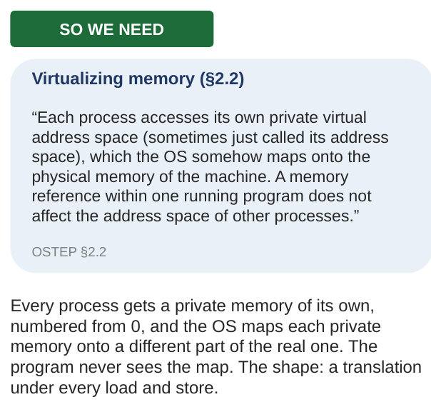{width=48%}
<figcaption markdown="1">Figure 17. The right column: the textbook's answer in section 2.2, and the shape of the answer, a translation under every load and store. From slide 28.</figcaption>
</figure>

The textbook answers in its section 2.2 (textbook section 2.2, not this guide's): each process accesses its own private **virtual address space**, which the OS somehow maps onto the physical memory of the machine. An **address space** is the range of addresses a process can use, numbered from 0, as if it were the only program in memory. **Physical memory** is the real memory chips, and a **physical address** is a real position in them. A memory reference within one running program does not affect the address space of other processes. The shape of the answer: every process gets a private memory of its own, numbered from 0, and the OS maps each private memory onto a different part of the real one. The program never sees the map. That means a translation must happen under every single load and store, turning the address the program used into the real position.

What this section settled: one physical memory cannot hold two different values at one address, so the addresses programs use cannot be the real ones. What it leaves open: proof that this is what happens, which the next section shows.

### 3.2 Real machine Two copies of mem.c: the same address, separate counters {#sec-3-2 data-toc-label="3.2 [Real machine] Two copies of mem.c: the same address, separate counters"}

[Section 3.1](#sec-3-1) argued that two programs cannot really be storing into the same byte, because one byte cannot hold two different counts. An argument is not evidence. The textbook's second program, `mem.c`, makes the situation happen so we can watch it. Figure 18 is the program, shortened.

<figure markdown="1">
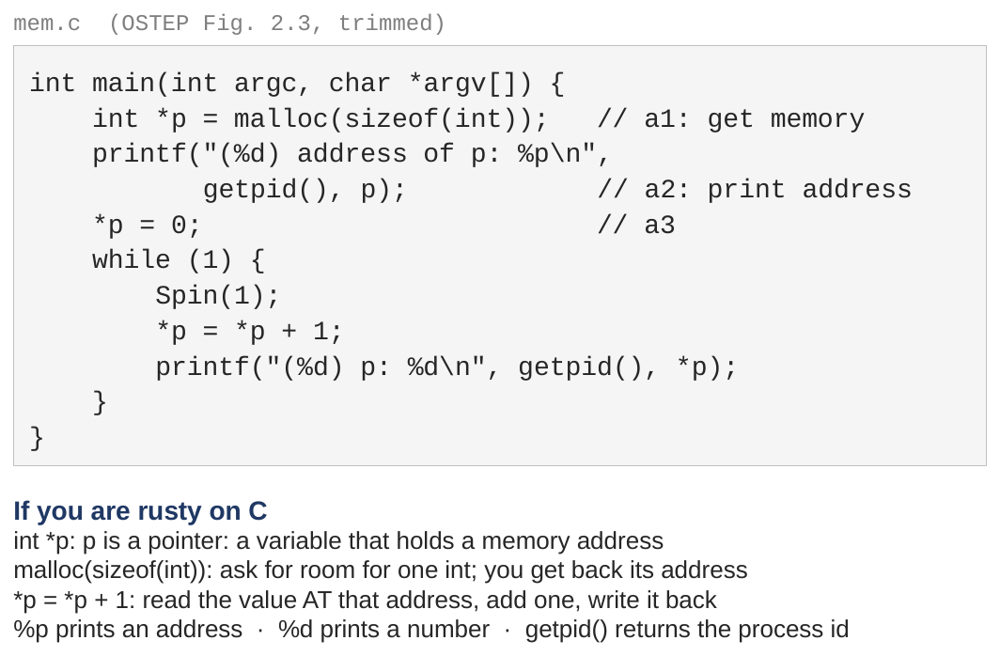{width=85%}
<figcaption markdown="1">Figure 18. mem.c, the textbook's Figure 2.3 shortened, with the four pieces of C it uses. From slide 29.</figcaption>
</figure>

Here is what it does, one line at a time; the box under the code on the slide repeats the C in plain words. The program needs a piece of memory whose address it can print and then store into. **malloc** gives exactly that, and using it needs one new idea. A **pointer** is a variable that holds a memory address. `int *p` declares a pointer named `p`. The `*` in a declaration means "p holds the address of an `int`". An `int` is a whole number, usually 4 bytes in size. `malloc` is the standard function that asks for a piece of memory while the program runs and gives back its address. `sizeof(int)` is the size of an `int` in bytes. So line a1, `int *p = malloc(sizeof(int));`, asks for room for one whole number and keeps its address in `p`.

Line a2 prints that address. `printf` fills its placeholders in order: `%d` with a whole number in decimal, here `getpid()`, which returns this process's PID ([Section 2.4](#sec-2-4)), and `%p` with an address, here `p`. So each copy prints a line like `(24113) address of p: 0x200000`.

Line a3, `*p = 0;`, stores 0 at that address. Outside a declaration, a `*` in front of a pointer means "the value at that address". So `*p = 0` writes 0 into the memory `p` points to, and `*p = *p + 1` reads the value at that address, adds one, and writes it back: a counter. The loop then repeats forever: spin for one second (as in [Section 2.2](#sec-2-2)), add 1, and print the process ID and the counter's value.

Figure 19 is two copies running at once.

<figure markdown="1">
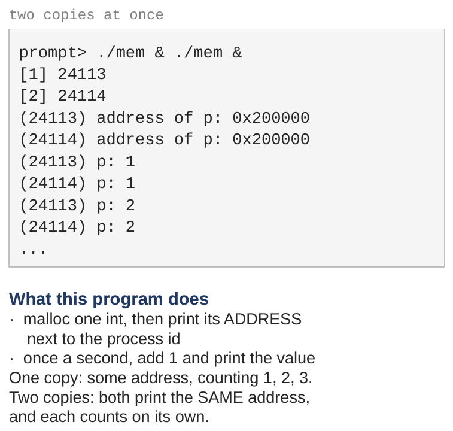{width=61%}
<figcaption markdown="1">Figure 19. The textbook's run of two copies of mem: both print the same address, 0x200000, and each counts on its own. From slide 29, following the textbook's Figure 2.4.</figcaption>
</figure>

The shell starts the two copies; their process IDs are 24113 and 24114. Both report that their number lives at 0x200000. Then each counts on its own: 24113 prints 1, 24114 prints 1, then each prints 2, and so on. If the two copies shared the byte at 0x200000, every addition by either copy would raise the same number. Then they could not both print 1 and then both print 2: after one copy printed 1, the other's next addition would make it 2, not 1. It is not. Same address, different contents.

The red discussion line under the code on the slide asks the question this chapter is about: both processes claim address 0x200000, and their counters do not interfere; how? Exercise 3 asks it again. The answer: 0x200000 is not a real place in the memory chips. Each process has its own private map, and an address is a name inside that map. The OS translates the same name to a different real position for each process.

A note for running it yourself. On your own Linux machine the two addresses will probably differ from each other and from 0x200000. That is **ASLR**, address space layout randomization: a security feature that places a program's memory at a random address each time it runs, so that an attacker cannot predict where things are. It works only because the addresses were names in a private map to begin with. The textbook notes that its own run was made with randomization switched off. The slide gives a command to switch it off for one program, `setarch -R ./mem`, and then both copies print the same address again.

### 3.3 Concept The private address space and the operating system's map {#sec-3-3 data-toc-label="3.3 [Concept] The private address space and the operating system's map"}

[Section 3.2](#sec-3-2) showed the effect: one address, two values. Its answer was a sentence, "each process has a private map". A sentence is easy to repeat without understanding it, and the memory part of the course will build a great deal on this one idea. So it is worth drawing exactly who has what. Figure 20 is the deck's picture.

<figure markdown="1">
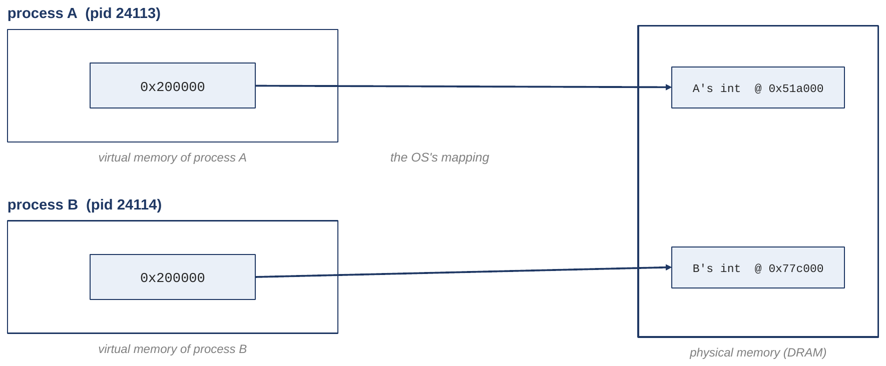{width=100%}
<figcaption markdown="1">Figure 20. Two private address spaces, each with an int at 0x200000, mapped by the operating system to two different places in physical memory. The physical addresses are illustrative. From slide 30, following textbook section 2.2.</figcaption>
</figure>

On the left are the two processes from [Section 3.2](#sec-3-2), A with PID 24113 and B with PID 24114. Each box is that process's **virtual memory**, its private address space, and 0x200000 exists in both. On the right is physical memory, the real chips (labeled DRAM). In between is the OS's mapping. The OS, with help from the hardware, sends A's 0x200000 to one place in physical memory, drawn at 0x51a000, and B's 0x200000 to another, drawn at 0x77c000. Those two physical numbers are made up for the picture; the real ones are chosen by the OS and never shown to the program.

Read the consequence carefully. Neither process can even name the other's memory. Every address A uses goes through A's map, and A's map does not lead to B's physical memory at all. So a bug in A, writing to some wrong address, lands somewhere in A's own memory or nowhere, never in B. Private memory is also **protection**: keeping one program from damaging another program, or the OS itself.

Two more facts close the picture. The arrow in the middle is what the `pagetable` field of `struct proc` holds ([Section 2.5](#sec-2-5)): each process's map. And the translation itself is not done by the OS's code on each access, which would be far too slow. It is done by the hardware inside the processor, on every load and store, using tables the OS sets up in advance. How such a table turns one number into another is the subject of the memory weeks; here it is enough that each process has its own table, which says where each of its addresses really lives. The OS defines the map; the hardware applies it at full speed. That division of work is the mechanism and policy split again, and the memory weeks of the course build this arrow piece by piece.

What this section settled: a private map per process, translated under every access. What it leaves open: whether real machines really do this all day, which the next section checks.

### 3.4 Real machine Many processes on few processors, on a real machine: nproc, ps and free {#sec-3-4 data-toc-label="3.4 [Real machine] Many processes on few processors, on a real machine: nproc, ps and free"}

Sections [2.3](#sec-2-3) and [3.2](#sec-3-2) were small experiments chosen to show one effect each. A skeptic could say they are tricks: nobody really runs four copies of a spinning loop. So the last step of the first class looks at an ordinary machine doing nothing special, and counts. Figure 21 is the count of processors and processes on an Ubuntu 24.04 machine.

<figure markdown="1">
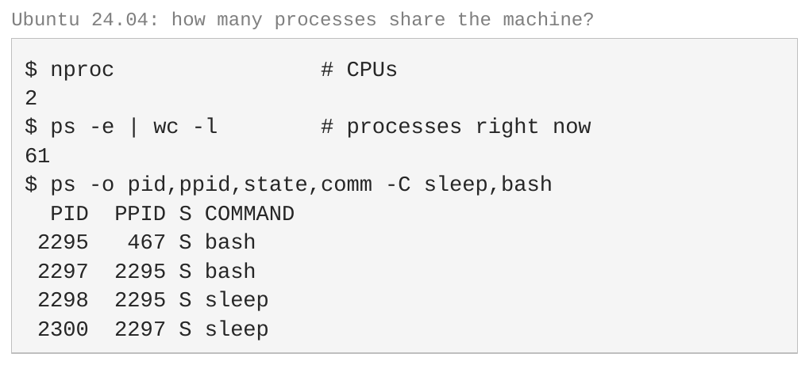{width=82%}
<figcaption markdown="1">Figure 21. An Ubuntu 24.04 machine: 2 processors, 61 lines of process list, and four of its processes with their parents. From slide 31.</figcaption>
</figure>

Each line starting with `$` is a command typed into the shell; the text after `#` on those lines is a comment the deck added. `nproc` prints the number of processors the OS can use: 2. `ps -e` lists every process running right now, one per line, and `| wc -l` passes that list to `wc -l`, which counts lines: 61. (The `|` between two commands, called a pipe, sends the first command's output into the second.) So 61 processes share 2 processors. Check the ratio: 2 processors can run 2 processes at any instant, so for the other 59, someone is faking it, and that someone is the OS. (Most of the 61 are waiting at any moment; the next paragraph shows four of them, all asleep. But each one gets a processor whenever it needs one, and only the OS's switching makes that possible.) (For a precise reader: `ps -e` also prints one header line, and `ps` and `wc` are themselves two of the processes counted, so the machine's own processes number a little under 61. The deck rounds this to 61 processes, and the point does not change.)

The third command asks `ps` for four columns of the `bash` and `sleep` processes only. **bash** is the most common shell, and **sleep** is a tiny program that waits a given number of seconds. **PID** is the process ID. **PPID** is the parent's process ID: the process that created this one. **S** is the state, and S in that column means sleeping, waiting for something. Read the family tree. Process 2295 is a bash whose parent is 467 (the capture does not say which program 467 is). Process 2297 is another bash, and its parent is 2295: a shell started from a shell. Process 2298 is a sleep whose parent is 2295, and 2300 is a sleep whose parent is 2297. Every process comes from another process; following parents upward always ends at the first process the kernel starts (on Linux it has PID 1, a design fact). The system call that grows this tree is `fork`, one of xv6's 21 from [Section 1.5](#sec-1-5), and the next week of the course is about it. All four are asleep, and on a typical machine so are most of the others (the capture shows only these four): most programs spend most of their time waiting.

Figure 22 is the memory of the same machine.

<figure markdown="1">
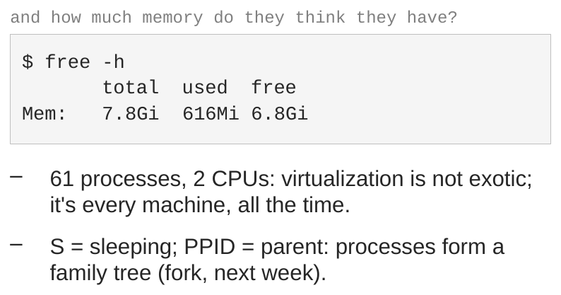{width=64%}
<figcaption markdown="1">Figure 22. The same machine's memory as reported by free -h, and the two conclusions. From slide 31.</figcaption>
</figure>

`free -h` reports memory in units a human can read (the `-h`): 7.8 GiB in total, 616 MiB used, 6.8 GiB free. (Part 0: Mi and Gi are MiB and GiB, multiples of 1024. Used and free do not add up to the total: 0.6 + 6.8 = 7.4, not 7.8. That is because `free` prints more columns than the slide shows. The slide does not show those columns. On Linux, most of such a difference is usually memory the kernel is borrowing to keep copies of recently used files. That is a cache (a store of recent copies, kept for speed), and [Section 6.3](class-2.md#sec-6-3) explains it.) And each of the 61 processes believes it owns a large private address space of its own. On your own machine every number here will differ, because it is a different machine running different programs. Only the ratio matters: far more processes than processors, and every one of them living in its own private memory. Virtualization is not exotic. It is every machine, all the time.

**Checkpoint 3.** Settled: every process has a private address space, numbered from 0. The OS maps each one onto a different part of physical memory, and the program never sees the map. The Ubuntu capture: 61 processes, 2 processors, 7.8 GiB of memory that every process believes is its own. Still open: private memory keeps programs apart. But some programs want to share memory on purpose, and a **thread** is exactly that: a second line of execution inside the same process, sharing its memory ([Section 4.3](class-2.md#sec-4-3) defines it properly). What happens when two of them touch the same byte at the same time? That is the first question of the second class. You should now be able to say why two processes print the same address for `p` and still count separately.

## Summary Summary of the first class: the operating system, the virtual CPU and the private address space {#summary-1 data-toc-label="[Summary] Summary of the first class: the operating system, the virtual CPU and the private address space"}

The first class asked three questions, and each answer opened the next. Here they are again, each with the problem it solved, the way the deck's summary slide puts them.

Question 1: what is an operating system, and where does it sit? The problem: the raw hardware runs one instruction stream and protects nothing, yet a real machine runs dozens of programs that must be kept apart. The answer: a layer of software between every program and the hardware. Seen from three sides, it is a virtual machine (it turns the physical machine into a nicer virtual one), a standard library (it offers system calls), and a resource manager (it decides who gets what). Programs enter it only through system calls, which trap into the kernel and raise the privilege level in one step. xv6 has 21 of them.

Question 2: how does one processor run many programs? The problem: four infinite loops on one processor, each wanting all of it. The answer: the OS switches the processor among them so fast that each believes it owns one. The switch is the mechanism; the choice of who runs next is the policy. A process is a running program, and in xv6 it is one `struct proc` that holds the program's saved state.

Question 3: how do two programs share one memory? The problem: two copies of one program both store at address 0x200000. The answer: each process has a private address space, and the OS maps it onto a different part of physical memory, with the hardware translating every access. Private memory is also how a bug in one program stays in that program.

The words of the class, each of which should now bring a picture to mind: virtualization, operating system, kernel, user mode and kernel mode, system call, process, mechanism, policy, address space. If one of them has no picture, reread its section. Then look back at your own first answer to "what is an operating system?" and see how it has changed.

Before the second class, the deck asks for three things. Read chapters 1 and 2 of the textbook: they are short, and the opening dialogue takes five minutes. Skim section 1.1 of the xv6 book (the short book by xv6's authors that explains its source): you have already seen its Figure 1.1, the layer picture of [Section 1.4](#sec-1-4), and its list of system calls, [Section 1.5](#sec-1-5). And in the lab, install Ubuntu and the tools for xv6, and boot the kernel whose source this class read. The second class takes up the other two pieces of the course: concurrency's nasty surprise, and persistence.

## Going deeper, first class (optional) {#extras-1}

### Extra 1 Deeper, Q1 xv6: a real Unix small enough to read whole {#extra-1 data-toc-label="Extra 1 [Deeper, Q1] xv6: a real Unix small enough to read whole"}

This part and the four after it are the deck's "deeper, if time allows" block: slides the class may have skipped, placed after the summary so that the core reads without them. Each one goes deeper on one of the class's questions.

[Section 1.5](#sec-1-5) used xv6 with a one-line introduction. That raises a fair question: why does a course read a teaching kernel at all, when real systems run Linux? The answer is size. To learn how a kernel works by reading one, the kernel must be small enough to read and real enough to be worth reading. Figure 23 gives the case.

<figure markdown="1">
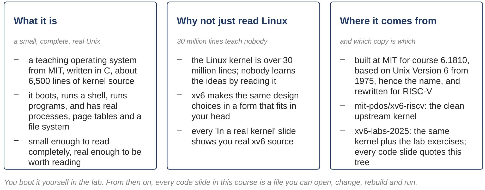{width=100%}
<figcaption markdown="1">Figure 23. xv6: what it is, why not read Linux instead, and where it comes from. From slide 34.</figcaption>
</figure>

What it is: a teaching operating system from MIT, written in C, with about 6,500 lines of kernel source (counted in the lab tree: 6,519). It is not a model of an operating system. It boots, runs a shell, runs programs, and has real processes, page tables (the per-process maps of [Section 3.3](#sec-3-3)) and a file system. Small enough to read completely, and real enough to be worth reading.

Why not just read Linux: the Linux kernel is over 30 million lines (the deck's round figure), and nobody learns the ideas by reading that. xv6 makes the same design choices in a form that fits in your head. Every slide marked "in a real kernel" shows real xv6 source.

Where it comes from: it was built at MIT for a course numbered 6.1810, based on Unix Version 6 from 1975, which is where the name comes from, and rewritten for the RISC-V processor (Part 0). There are two copies to keep apart. `mit-pdos/xv6-riscv` is the clean original kernel, as its authors publish it. `xv6-labs-2025` is the same kernel with the lab exercises added, and every code slide in this course quotes that tree. You boot it yourself in the lab, and from then on every code slide in the course is a file you can open, change, rebuild and run.

### Extra 2 Deeper, Q1 Three hardware facts: the processor's state, the memory hierarchy, and the two privilege modes {#extra-2 data-toc-label="Extra 2 [Deeper, Q1] Three hardware facts: the processor's state, the memory hierarchy, and the two privilege modes"}

[Chapter 1](#chapter-1) leaned on three facts about the hardware without stopping to state them: the processor's state is small enough to save and restore, memory comes in very different speeds, and the processor has two privilege modes. Each of them explains why the operating system is built the way it is, so Figure 24 states them together.

<figure markdown="1">
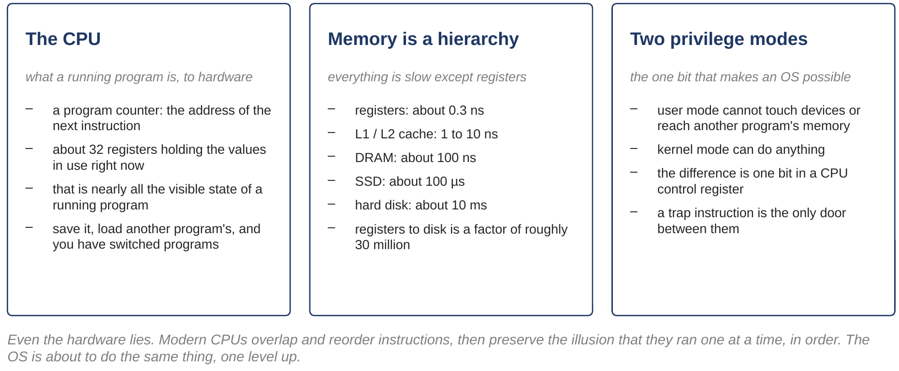{width=100%}
<figcaption markdown="1">Figure 24. Three facts the whole course stands on: what a running program is to the processor, the memory hierarchy with its access times, and the two privilege modes. From slide 35.</figcaption>
</figure>

The processor. To the hardware, a running program is small: a program counter (the address of the next instruction) and about 32 registers (the slide's figure; RISC-V and arm64 processors have 32) holding the values in use right now. That is nearly all the visible state of a running program. Save that bundle, load another program's bundle, and the processor is now running the other program. That is the context switch of [Section 2.4](#sec-2-4), and it is why switching is cheap: only a few dozen numbers have to be saved and loaded, plus, between processes, the pointer to the new process's memory map ([Section 3.3](#sec-3-3)).

Memory is a hierarchy. Every kind of storage is slow except the registers, and the slowness grows by large steps. The numbers are the deck's round figures, typical of today's machines, not measured in this guide. Registers take about 0.3 ns to reach (a nanosecond, ns, is a billionth of a second; Part 0). The **caches**, small fast memories inside the processor that keep copies of recently used data, labeled L1 and L2 for their levels, take 1 to 10 ns. Main memory, DRAM, takes about 100 ns. An SSD takes about 100 µs, and a spinning hard disk about 10 ms. From registers to the hard disk is a factor of roughly 30 million. Check it: 10 ms is 10,000,000 ns, and 10,000,000 ÷ 0.3 is about 33 million. To feel it: if reaching a register took one second, reaching the disk would take about 33 million seconds, which is a little over a year (a year is about 31.5 million seconds). Much of what an operating system does, caching, scheduling around waits, and later moving memory out to the disk (swapping), exists to hide this gap. [Section 6.1](class-2.md#sec-6-1) uses one step of it: an SSD at about 100 µs against DRAM at about 100 ns is 100,000 ns ÷ 100 ns = 1000 times slower.

Two privilege modes. User mode cannot touch devices or reach another program's memory; kernel mode can do anything. The difference is one bit in a control register of the processor, and a trap instruction is the only door between them. This is the fact [Section 1.4](#sec-1-4) is built on, and it is why your program cannot simply ignore the OS.

The note under the cards is the same remark as [Section 1.1](#sec-1-1): even the hardware lies. Modern processors overlap and reorder instructions, then keep up the illusion that they ran one at a time, in order. The operating system does the same thing one level up.

### Extra 3 Deeper, Q1 Where xv6 comes from: a short history of Unix {#extra-3 data-toc-label="Extra 3 [Deeper, Q1] Where xv6 comes from: a short history of Unix"}

[Extra 1](#extra-1) said xv6 is based on Unix Version 6 from 1975. That invites the question why a course in the 2020s reads a design from 1975, and why it reads a rewrite rather than the original. The answer is a history of two lines, one of products and one of teaching, and Figure 25 draws both.

<figure markdown="1">
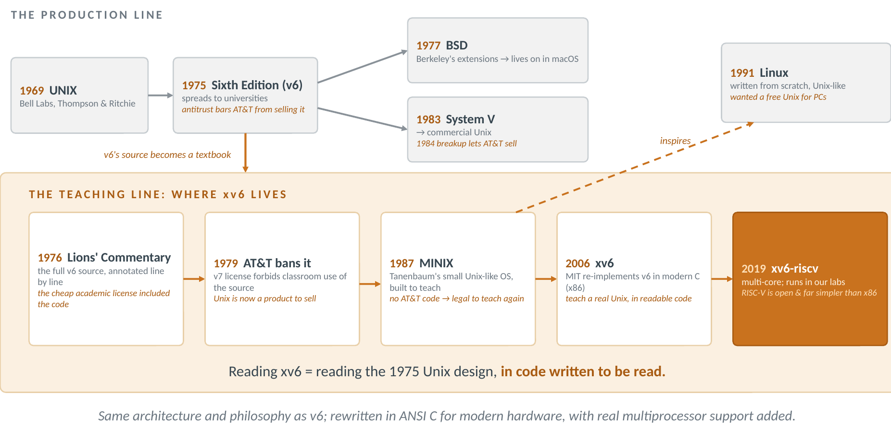{width=100%}
<figcaption markdown="1">Figure 25. The production line of Unix (top) and the teaching line where xv6 lives (bottom). From slide 36.</figcaption>
</figure>

The production line, in the grey row at the top. In 1969 Ken Thompson and Dennis Ritchie built Unix at Bell Labs, the research lab of the telephone company AT&T. The Sixth Edition, v6, came out in 1975 and spread to universities: AT&T was a regulated telephone monopoly and, by antitrust law, could not sell software, so it licensed Unix to universities for a small fee, source code included. From those academic copies grew BSD in 1977, Berkeley's extensions, which lives on inside macOS. System V, released in 1983, became the commercial line, and the 1984 breakup of AT&T freed the company to sell it fully. And in 1991 Linux was written from scratch: Unix-like, sharing no Unix code, by a student who wanted a free Unix for his PC. The dashed arrow says what inspired it.

The teaching line, in the amber band. In 1976 John Lions published the whole v6 source with a line-by-line commentary and taught from it. In 1979 AT&T's license for the next version, v7, forbade teaching from the source, because Unix was now a product to sell. The commentary circulated as photocopies for years. In 1987 Andrew Tanenbaum answered with MINIX, a small Unix-like system built to teach and legal because it held no AT&T code; that is the system that inspired Linux. In 2006 MIT closed the loop by re-implementing v6 itself in modern C, for the x86 processor (the family x86-64 grew out of), so that a real Unix could be taught in readable code. In 2019 it moved to RISC-V, which is open and far simpler than x86, and gained real support for several processors. So reading xv6 is reading the 1975 Unix design, in code written to be read.

### Extra 4 Deeper, Q2 The crux of virtualization, and mechanism against policy {#extra-4 data-toc-label="Extra 4 [Deeper, Q2] The crux of virtualization, and mechanism against policy"}

[Section 2.4](#sec-2-4) introduced mechanism and policy with one pair of examples, the switch and the choice. A split that the course will use all term deserves more than one example, and the textbook's crux of [Section 2.1](#sec-2-1) already names both words. Figure 26 puts the crux and the split side by side.

<figure markdown="1">
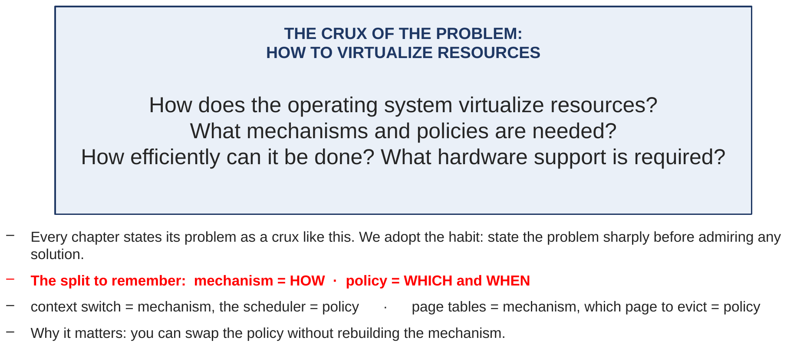{width=100%}
<figcaption markdown="1">Figure 26. The crux of virtualization in the deck's shortened wording, and the split between mechanism and policy with two pairs of examples. From slide 37.</figcaption>
</figure>

The box is the first crux of [Section 2.1](#sec-2-1), in a shorter wording: how does the operating system virtualize resources, what mechanisms and policies are needed, how efficiently can it be done, and what hardware support is required? The lines under it are the habit the course adopts from the textbook: state the problem sharply before admiring any solution. That is why every block of this guide opens with a Problem section.

Then the split, in red: a mechanism is how, a policy is which and when. Two pairs to remember. The context switch is a mechanism, and the scheduler's choice of who runs next is a policy. Page tables are a mechanism (the map of [Section 3.3](#sec-3-3)), and the choice of which piece of a program's memory to move out to the disk when memory is full is a policy (the memory weeks). Why it matters: you can change the policy without rebuilding the mechanism. In one sentence, to virtualize means this: one physical thing, and each user gets a private, nicer-looking copy of it.

### Extra 5 Deeper, Q1 Three pieces, three cruxes, one course {#extra-5 data-toc-label="Extra 5 [Deeper, Q1] Three pieces, three cruxes, one course"}

Part 0 showed the course map: three pieces, five blocks. A map of blocks says what comes when, but not why the pieces belong together. The textbook's title gives the reason, and Figure 27 is the deck's version.

<figure markdown="1">
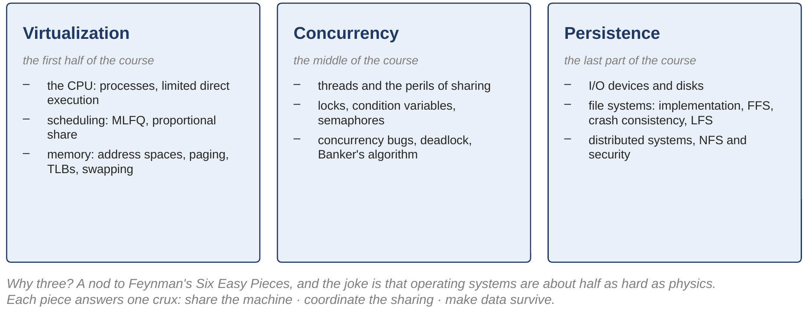{width=100%}
<figcaption markdown="1">Figure 27. The three pieces of the course, what each contains, and why there are three. From slide 38.</figcaption>
</figure>

Virtualization, the first half of the course: the processor (processes, and how the OS runs a program directly on the hardware while keeping control), scheduling, and memory. Concurrency, the middle: threads and the dangers of sharing, locks and the tools for waiting, and the bugs, including **deadlock**, where two threads each wait forever for the other. Persistence, the last part: input and output devices and disks, file systems and how they survive crashes, and distributed systems. Many names on the cards (MLFQ, TLBs, FFS, LFS, NFS, Banker's algorithm) are names of later topics; you do not need them now.

Why three: the title nods to the physicist Richard Feynman's lectures, collected as "Six Easy Pieces". The textbook's joke is that operating systems are about half as hard as physics. Each piece answers one crux: share the machine, keep the sharing correct, and make data survive. The labs follow the same map.
