# Second class: the other two pieces: a shared counter that loses updates, and a write that is not yet on the disk (OSTEP 2) {#class-2}

## Roadmap Recap of the first class, and the three questions of the second {#opening-2 data-toc-label="[Roadmap] Recap of the first class, and the three questions of the second"}

The first class covered virtualization, the pleasant piece of the course, where the operating system hands out comfortable illusions. Each illusion it built was settled, and each left one question open. The second class exists to take up those two open questions: what happens when two of the virtual processors really run at the same time and touch the same data, and what happens when the power goes out. The deck calls them the other two pieces: concurrency, where sharing goes wrong, and persistence, where the power goes out. Figure 28 is the first class in two pictures, with the two open questions under them.

<figure markdown="1">
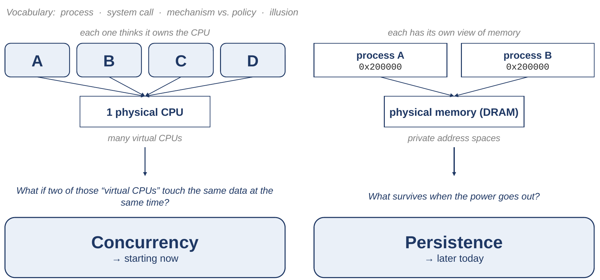{width=100%}
<figcaption markdown="1">Figure 28. The first class in two pictures: four programs on one physical processor, and two processes at the same address mapped to two places in physical memory, with the question each one leaves open. From slide 41.</figcaption>
</figure>

The line at the top lists the words the first class left with. Process: a running program. System call: the only door into the kernel. Mechanism against policy: the how and the which. Illusion: each program believes it owns a machine.

The left picture is [Chapter 2](class-1.md#chapter-2). Four programs, A, B, C and D, share one physical processor, and each one believes it has the processor to itself; the OS switches among them. That much is settled. Left open is the question under it: what if two of those virtual processors touch the same data at the same time? That is **concurrency**, many things happening at once, and the second class goes there first.

The right picture is [Chapter 3](class-1.md#chapter-3). Two processes use the same address, 0x200000, and the OS maps the two to two different places in physical memory. Private memory per process: settled too. Left open is the question under it: what survives when the power goes out? Registers and DRAM are volatile (Part 0): when the power goes, or the system crashes, any data in memory is lost. Keeping data safe across that is **persistence**, and the second half of the class goes there.

So the second class asks three questions. The first two are one bug and its fix; the third is the other piece. Figure 29 is the deck's list.

<figure markdown="1">
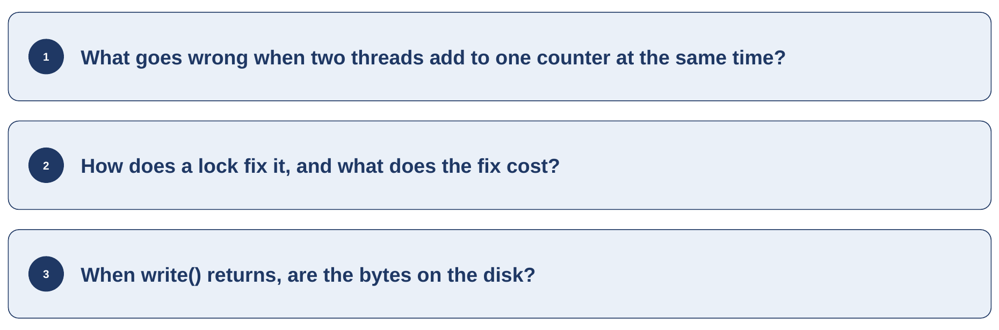{width=100%}
<figcaption markdown="1">Figure 29. The three questions of the second class. From slide 42.</figcaption>
</figure>

First, what goes wrong when two threads add to one counter at the same time ([Chapter 4](#chapter-4), Sections [4.1](#sec-4-1) to [4.6](#sec-4-6))? The counter ends up wrong, and the answer goes down to three machine instructions. Second, how does a lock fix it, and what does the fix cost ([Chapter 5](#chapter-5), Sections [5.1](#sec-5-1) to [5.6](#sec-5-6))? We measure the price, and we check whether the two threads still run in parallel at all. Third, when `write()` returns, are the bytes on the disk ([Chapter 6](#chapter-6), Sections [6.1](#sec-6-1) to [6.6](#sec-6-6))? A program writes 13 bytes to a file, and we trace where those bytes actually are. The week summary answers all six questions of the week. Extras [6](#extra-6) to [10](#extra-10) go deeper.

## Chapter 4. What goes wrong when two threads add to one counter at the same time? {#chapter-4}

*The question this chapter answers: What goes wrong when two threads add to one counter at the same time?*

### 4.1 Problem Two threads, one counter, and a total of 103,902 {#sec-4-1 data-toc-label="4.1 [Problem] Two threads, one counter, and a total of 103,902"}

What we have: the first class kept processes apart, each in its own private memory. But some programs want two lines of work to share data on purpose: a web server answering many requests that all update one count of visitors, a game whose physics and drawing share one world. For that, a process can contain more than one **thread**: a line of execution inside a process, with its own place in the program, that shares all of the process's memory with the other threads ([Section 4.3](#sec-4-3) draws it exactly). Figure 30 is the deck's problem slide for this question.

<figure markdown="1">
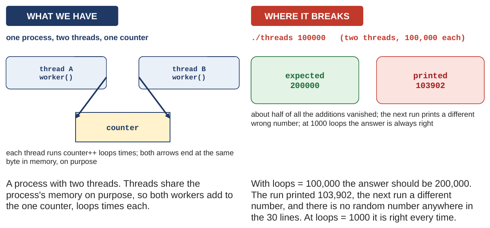{width=100%}
<figcaption markdown="1">Figure 30. The problem of the second class's first question, left and middle columns: one process with two threads that both add to one counter, and the number it printed. From slide 43.</figcaption>
</figure>

The left column is the setup. One process, two threads, A and B, each running the same function, `worker()`. Each thread adds 1 to one shared number, `counter`, a given number of times, called `loops`. `counter++` is C for "add one to counter". Both arrows end at the same byte in memory, on purpose: that is what threads are for.

Where it breaks is the middle column. Run the program with 100,000 loops, so that each thread adds 1 a hundred thousand times. The answer should be 2 × 100,000 = 200,000. The program printed 103,902. Count the damage: 200,000 − 103,902 = 96,098 additions vanished, almost half. Run it again and it prints a different wrong number. There is no random number anywhere in the program ([Section 4.2](#sec-4-2) shows all of it). And at 1000 loops the answer is right every time.

So what we need is the right column, Figure 31.

<figure markdown="1">
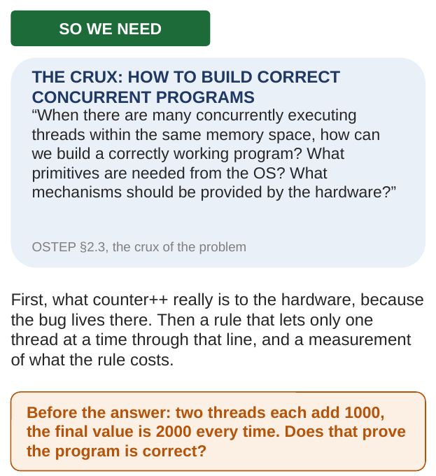{width=50%}
<figcaption markdown="1">Figure 31. The right column: the textbook's second crux, how to build correct concurrent programs, the plan, and the question put to the room. From slide 43.</figcaption>
</figure>

This is the second crux of the course: when there are many threads running at the same time within the same memory space, how can we build a correctly working program? What **primitives** (basic building blocks) are needed from the OS? What mechanisms should the hardware provide? The plan has two steps. First, find out what `counter++` really is to the hardware, because the bug lives there (Sections [4.2](#sec-4-2) to [4.6](#sec-4-6)). Then, a rule that lets only one thread at a time through that line, and a measurement of what the rule costs ([Chapter 5](#chapter-5)).

The orange box was a question to the room, and it is worth answering for yourself before reading on: two threads each add 1000, and the final value is 2000 every time. Does that prove the program is correct? Hold your answer; [Section 4.6](#sec-4-6) settles it, and Exercise 4 asks it again.

### 4.2 Worked example The two-thread counter program: threads.v0.c {#sec-4-2 data-toc-label="4.2 [Worked example] The two-thread counter program: threads.v0.c"}

[Section 4.1](#sec-4-1) described the program in a sentence and showed a wrong number. Before we can explain the number, we need to see that the program does exactly what the sentence says and nothing more: no randomness, no tricks. Figure 32 is the whole program, which is the textbook's Figure 2.5.

<figure markdown="1">
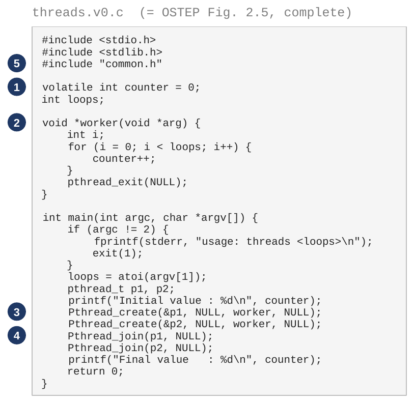{width=65%}
<figcaption markdown="1">Figure 32. threads.v0.c, complete, with five numbered callouts. From slide 44, following the textbook's Figure 2.5.</figcaption>
</figure>

Figure 33 is the deck's five cards that explain the callouts, and the question put to the room.

<figure markdown="1">
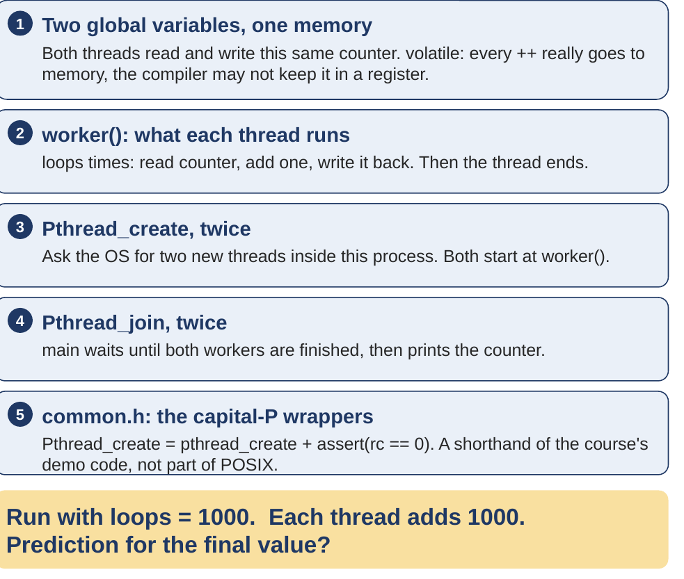{width=79%}
<figcaption markdown="1">Figure 33. The five callouts explained, and the prediction asked before the run. From slide 44.</figcaption>
</figure>

Read it by the callouts.

Callout 1 is two **global variables**: variables declared outside every function, so that every function, and every thread, uses the same single copy. `counter` starts at 0, and `loops` will hold the number typed on the command line. There is exactly one `counter` in memory, and both threads read and write it. The word `volatile` in front of it tells the compiler to really read the value from memory and really write it back on every `counter++`, and never keep it in a register to save time. Without `volatile` the compiler might keep the counter in a register for the whole loop, and the experiment would show something else.

Callout 2 is `worker()`, the function each thread runs. `void *worker(void *arg)` is how C writes a function that the thread library (the ready-made thread functions of callout 5) can start; the `void *` parts mean "a pointer to anything", and this program ignores them. Inside is a loop: `for (i = 0; i < loops; i++)` means "set i to 0; while i is less than loops, run the block and then add one to i". So the block, `counter++;`, runs `loops` times. Then `pthread_exit(NULL)` ends the thread. That is all a thread does here: read counter, add one, write it back, `loops` times.

Then `main`. The lines `if (argc != 2) { ... exit(1); }` check that exactly one word was typed after the program's name (`argc` counts the words, including the name; `!=` means "is not equal to"). If not, the program prints how to use it (`fprintf(stderr, ...)` prints to the error output, a second output channel for messages) and stops with `exit(1)`, where 1 means "something went wrong". `loops = atoi(argv[1]);` turns that word into a number (`atoi` stands for "ASCII to integer", text to whole number). `pthread_t p1, p2;` makes two variables that will name the two threads. Then it prints the counter's starting value.

Callout 3 is `Pthread_create`, twice. Each call asks the OS for one new thread inside this same process, and each new thread starts running `worker`. The `&p1` gives the function the address of `p1` (the `&` means "the address of"), so it can store the new thread's name there. `NULL` means "no address". Here it means "use the default settings" and "no argument for worker".

Callout 4 is `Pthread_join`, twice. Join means wait: `main` waits until both workers have finished, then prints the final value of the counter.

Callout 5 is the capital P. The real functions are `pthread_create` and `pthread_join`, from **POSIX**, the standard that says what a Unix-like system must offer C programs, so that the same code runs on Linux and macOS; **pthreads** is its section on threads. The capital-P versions are tiny wrappers in the textbook's `common.h` that call the real function and check that it returned 0, meaning success, so that an error is not silently ignored. They are a shorthand of the course's demo code, not part of POSIX.

The yellow box is the prediction asked in class, before any run: with `loops` = 1000, each thread adds 1000, so what will the final value be? The natural prediction is 2 × 1000 = 2000. [Section 4.4](#sec-4-4) shows the runs.

### 4.3 Concept What a thread is: a program counter, registers and a stack, sharing one address space {#sec-4-3 data-toc-label="4.3 [Concept] What a thread is: a program counter, registers and a stack, sharing one address space"}

[Section 4.2](#sec-4-2)'s program called `Pthread_create` twice and said "a new thread inside this process". Before reading the results, we need to know exactly what was created, because the results depend on one fact: what the two threads share and what each has to itself. Figure 34 is the deck's drawing of the process after the two calls.

<figure markdown="1">
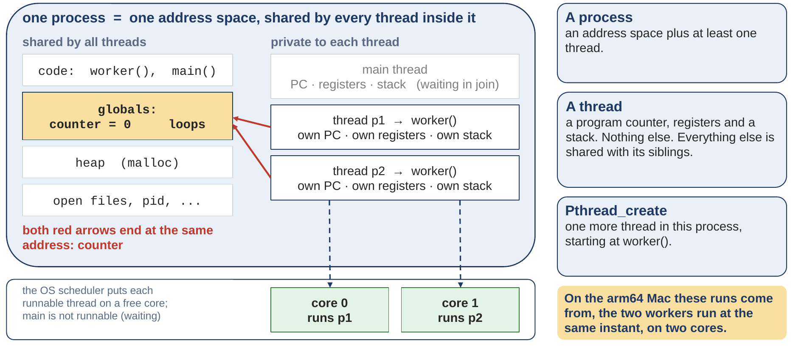{width=100%}
<figcaption markdown="1">Figure 34. One process after two Pthread_create calls: what all threads share, what each thread has to itself, and two cores (processors inside one chip, defined below) running the two workers at the same instant. From slide 45.</figcaption>
</figure>

The whole big box is one process, so everything inside it lives in one address space ([Section 3.1](class-1.md#sec-3-1)). The left column is what all threads share. That is the code (`worker()` and `main()`), the global variables (`counter` and `loops`, highlighted), and the heap (the memory `malloc` hands out, [Section 3.2](class-1.md#sec-3-2)). It is also the rest of the process's records, such as open files and the PID.

The right column is what is private to each thread. There are three threads now: the main thread, which is waiting inside `Pthread_join`, and the two new ones, `p1` and `p2`, both running `worker()`. Each has its own program counter (where it is in the code), its own registers, and its own **stack**, the area of memory that holds a running function's local variables and the record of which function called which. Each thread needs its own stack because each is in the middle of its own function calls; if two threads shared one, their local variables would overwrite each other. Nothing else is private. So a thread is much smaller than a process: a program counter, registers and a stack, and everything else is shared with the other threads of the same process. And a process, seen this way, is an address space plus at least one thread.

The two red arrows are the point of the picture: both end at the same address, `counter`. There is no copy of `counter` per thread. Compare [Chapter 3](class-1.md#chapter-3), where two processes each had their own `p`; here two threads have one `counter`.

The bottom row is what the scheduler does with them. A **core** is one complete processor inside a processor chip; most chips today have several, so several threads can run at the same instant, one per core. When this guide counts processors or CPUs, it counts cores: the 2 that `nproc` printed in [Section 3.4](class-1.md#sec-3-4) were two cores. The scheduler puts each runnable thread on a free core. The main thread is waiting, so it is not runnable. `p1` and `p2` are, and the arm64 Mac these runs come from has at least two cores ([Section 5.3](#sec-5-3)'s capture shows two busy at once), so whenever both are running, the two workers execute at the same instant, on two cores, both reaching for one counter. ([Section 4.6](#sec-4-6) shows that at small loop counts one of them finishes before the other has even been created.) Keep that in mind for the next section.

### 4.4 Real machine Same input, different wrong answers {#sec-4-4 data-toc-label="4.4 [Real machine] Same input, different wrong answers"}

[Section 4.3](#sec-4-3) left two threads on two cores, both adding to one counter. If the hardware simply did one addition after another, the final value would be 2 × loops every time, whatever the order. Figure 35 is what the arm64 Mac printed at three sizes.

<figure markdown="1">
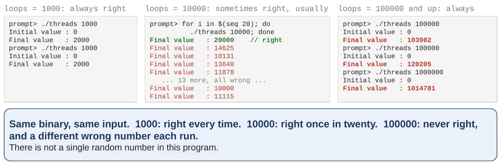{width=100%}
<figcaption markdown="1">Figure 35. threads.v0.c run on the arm64 Mac at three loop counts: always right at 1000, right once in twenty at 10,000, never right at 100,000 and above. From slide 46.</figcaption>
</figure>

Left panel, 1000 loops: the final value is 2000, and again 2000. Exactly the prediction. (Each run first prints `Initial value : 0`, the counter before the threads start.)

Middle panel, 10,000 loops, run 20 times in a row. The first line is a small shell loop: `for i in $(seq 20); do ./threads 10000; done` runs the command 20 times (`seq 20` produces the numbers 1 to 20, and the loop runs once for each). The right answer is 2 × 10,000 = 20,000. The first run gave 20,000. The next ones gave 14,625, 10,131, 13,640 and 11,878, then 13 more wrong values the slide does not print, then 10,000 and 11,115 (10,000 is exactly one thread's total, so it is wrong too). So 1 right and 19 wrong (1 + 4 + 13 + 2 = 20 runs), each wrong one different.

Right panel, 100,000 loops and up: 103,902 instead of 200,000, then 120,205. And at 1,000,000 loops: 1,014,781 instead of 2,000,000.

The blue box says it plainly. Same program, same input. At 1000 it is right every time; at 10,000 it is right once in twenty; at 100,000 it is never right, and a different wrong number each run. There is not a single random number in this program. Everything you know about programs says the same input gives the same output, and that rule just broke.

The bottom line gives two clues. Clue 1: the wrong answers always fall between one thread's total and two threads' total. At 100,000 loops, that is between 100,000 and 200,000, and 103,902 and 120,205 both are. Clue 2: the bigger the loop count, the closer the answer gets to one thread's total. At 1,000,000 loops, one thread's total is 1,000,000 and the answer was 1,014,781, only 14,781 above it. Count the loss: 2,000,000 − 1,014,781 = 985,219 additions vanished, and 985,219 ÷ 2,000,000 ≈ 0.49, nearly half. [Section 4.5](#sec-4-5) explains clue 1, and [Section 4.6](#sec-4-6) explains clue 2.

The grey box at the bottom of the slide tells you how to try it yourself, on a Mac in the Terminal or on Ubuntu: `cc -Wall -pthread -o threads threads.v0.c`, then `./threads 10000`. (`cc` is the C compiler under another name, and `-pthread` adds the thread library.) On Windows, the same two commands work inside Ubuntu running under WSL2, Windows' built-in way of running Linux. PowerShell and cmd, Windows' own command windows, cannot build this program on their own, because it needs POSIX threads. (Terminal is the Mac's command window.) The program also needs `common.h`, the textbook's helper file. Your wrong numbers will differ from these, and so may the loop count at which the answers start going wrong: a machine whose threads start faster or slower moves that boundary ([Section 4.6](#sec-4-6) explains why). The shape will not change: at a large enough loop count, the answer is wrong, and different on every run.

### 4.5 Concept counter++ is three instructions: the lost update {#sec-4-5 data-toc-label="4.5 [Concept] counter++ is three instructions: the lost update"}

Clue 1 of [Section 4.4](#sec-4-4): the wrong answers sit between one thread's work and two threads' work. So increments are being lost, not invented: the counter never ends up higher than it should. Something must let one thread's addition overwrite the other's. In C, `counter++` looks like one indivisible step. To find where an addition can disappear, we have to look at what the processor actually runs for that one line. Figure 36 is what the compiler made of it on the arm64 Mac.

<figure markdown="1">
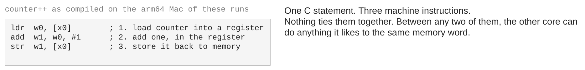{width=100%}
<figcaption markdown="1">Figure 36. counter++ as compiled on the arm64 Mac of these runs: three machine instructions, load, add, store. From slide 47.</figcaption>
</figure>

This is **assembly language**: the machine's own instructions written as short words, one per line. Each line here has an instruction name, its operands (the values or places it works on), and, after the semicolon, a comment the deck added. `w0`, `w1` and `x0` are registers. `[x0]` means "the memory at the address held in register x0", which here is the address of `counter`. `#1` is the constant number 1.

So one C statement became three machine instructions. Line 1, `ldr w0, [x0]`, loads the counter from memory into register w0 (ldr is "load register"). Line 2, `add w1, w0, #1`, adds one to it, inside the processor, and puts the result in register w1; memory is not touched. Line 3, `str w1, [x0]`, stores w1 back to memory (str is "store register"). Nothing ties the three together. Between any two of them, the other core can do anything it likes to the same counter in memory. The textbook's word for "all at once, with no gap" is **atomic**, and these three instructions are not atomic.

Figure 37 is what that allows. It is the four-step, two-core timeline to know by heart.

<figure markdown="1">
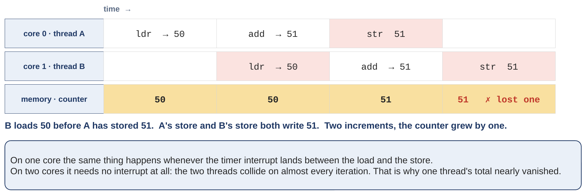{width=100%}
<figcaption markdown="1">Figure 37. Two cores, four time steps, counter starting at 50: both threads load 50, both store 51, and one increment is lost. From slide 47.</figcaption>
</figure>

Time runs to the right, one column per step. The top row is core 0 running thread A, the middle row is core 1 running thread B, and the bottom row is the counter in memory. The counter starts at 50.

Step 1: A loads 50 into its register. B has not touched the counter yet. Memory says 50.

Step 2: A adds one; A's register now holds 51, but memory still says 50, because A has not stored yet. At the same moment B loads, and it reads 50. Nothing in the hardware stops that load: the two cores run independently, and each reads memory whenever its own instruction says to.

Step 3: A stores 51. Memory says 51. Meanwhile B adds one to the 50 it loaded, so B's register also holds 51. B does not notice A's store: B already has 50 in its own register, nothing tells it that memory changed, and its next instruction, add, works on the register.

Step 4: B stores 51. Memory says 51.

Two increments ran, and the counter grew by one: 50 to 51, where it should be 52. B loaded 50 before A had stored 51, so A's addition was overwritten. Nothing detected it: no error, no crash, just a wrong number. This kind of bug, where the result depends on the exact timing of two threads, is called a **race condition**, and this particular kind of damage is a **lost update**.

The blue box at the bottom explains why so many were lost. On a machine with one core, this needs the timer interrupt ([Section 2.3](class-1.md#sec-2-3)) to land exactly between one thread's load and its store, which is rare. The timer fires only every few milliseconds (each operating system chooses its own interval). The gap between a load and its store lasts a few nanoseconds at most ([Section 4.6](#sec-4-6) works out about 2.5 ns for a whole increment, from a measurement in [Section 5.3](#sec-5-3)). On two cores it needs no interrupt at all: the two threads run at the same instant and collide on a large share of the iterations: at 1,000,000 loops nearly half of all the additions were lost ([Section 4.4](#sec-4-4)). That is why, at large loop counts, nearly one thread's whole total vanished. Why close to half? Each collision turns two increments into a rise of one. If the threads collided on nearly every increment, the counter would rise by about one per pair of increments, which is one thread's total. The wrong answers near one thread's total suggest that, at large loop counts, they nearly did.

### 4.6 Concept Why 1000 loops hid the bug: the head start {#sec-4-6 data-toc-label="4.6 [Concept] Why 1000 loops hid the bug: the head start"}

Clue 2 of [Section 4.4](#sec-4-4): the bigger the loop count, the closer the answer gets to one thread's total, and at the other end, at 1000 loops, the program was right every time. Both halves say the same thing: the longer the loops, the more of them go wrong. [Section 4.5](#sec-4-5) showed the program can lose an update on any iteration where the two threads overlap. So at 1000 loops the threads either never overlapped, or overlapped too briefly to lose anything, every single time. The reason is timing, and Figure 38 draws it.

<figure markdown="1">
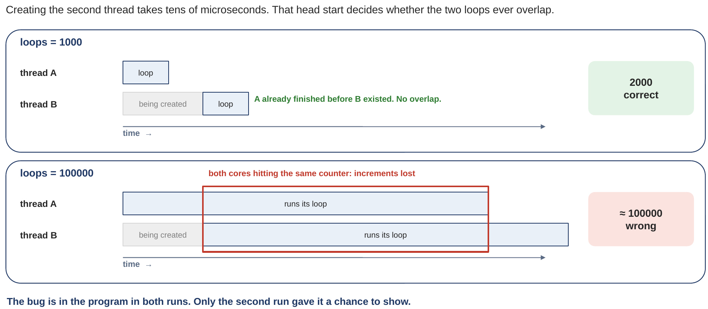{width=100%}
<figcaption markdown="1">Figure 38. The head start: at 1000 loops thread A finishes before thread B exists, so the loops never overlap; at 100,000 loops they overlap for most of the run. From slide 48.</figcaption>
</figure>

The sentence at the top is the key fact: creating the second thread takes tens of microseconds. (That is the deck's figure, not measured in this guide; [Section 5.6](#sec-5-6) finds a check of it in a real run.) `main` creates thread A first and thread B second, so A gets a head start of tens of microseconds before B even exists. That head start decides whether the two loops ever overlap.

How long does a loop take? [Section 5.3](#sec-5-3) will show a measurement on the same Mac: two threads did 100,000,000 increments each, side by side on two cores, in 0.253 seconds. Since each thread did its own 100,000,000 in that time, each took 0.253 ÷ 100,000,000 = 0.00000000253 seconds, about 2.5 nanoseconds, per increment. (Part 0: a nanosecond is a thousandth of a microsecond.) That measurement comes from a much longer run, so it is only a rough guide for a short loop, but the argument needs only the size: a few microseconds against tens. So a loop of 1000 takes about 1000 × 2.5 ns = 2,500 ns = 2.5 µs, a few microseconds. A loop of 10,000 takes about 25 µs, and a loop of 100,000 about 250 µs.

Top panel, 1000 loops: A's whole loop takes a few microseconds, so A is already finished before B has been created. B then runs its loop alone. No overlap, nobody to collide with, and the answer, 2000, is correct.

Bottom panel, 100,000 loops: A's loop takes hundreds of microseconds, so B arrives while A is still running, and from then on the two loops run at the same time on two cores, inside the red box. Every iteration in that stretch can lose an update, and the answer is about 100,000, wrong. The longer the loops, the larger the share of them that runs during the overlap, so more updates are lost and the answer slides toward one thread's total: that is clue 2.

And 10,000, the middle case: a loop of about 25 µs takes about as long as creating a thread. So sometimes B arrives just after A has finished, and the answer is right; usually B arrives in time to collide. That is the "right once in twenty". No simple arithmetic gives the exact 1 in 20: it depends on how long creating the thread happens to take on each run.

The line at the bottom settles the question of [Section 4.1](#sec-4-1). Two thousand every time proves nothing. The bug is in the program in both runs; only the second run gave it a chance to show. A test that passes only tells you that this timing did not trigger the bug.

**Checkpoint 1.** Settled: `counter++` is load, add, store. When the other thread loads between one thread's load and its store, one increment is lost, silently. Creating a thread takes tens of microseconds, so at 1000 loops thread A finishes before B exists and the bug never shows. Still open: the three instructions have to become one step that the other thread cannot get in between. What does the OS give us for that, and what does it cost? You should now be able to draw the four-step, two-core timeline in which two increments raise the counter by one.

## Chapter 5. How does a lock fix it, and what does the fix cost? {#chapter-5}

*The question this chapter answers: How does a lock fix it, and what does the fix cost?*

### 5.1 Problem The three instructions must become one step, at a price {#sec-5-1 data-toc-label="5.1 [Problem] The three instructions must become one step, at a price"}

What we have, from [Chapter 4](#chapter-4): `counter++` is three instructions, load, add and store, and the gaps between them are open. Figure 39 is the deck's problem slide for the second question, and its left column is that picture.

<figure markdown="1">
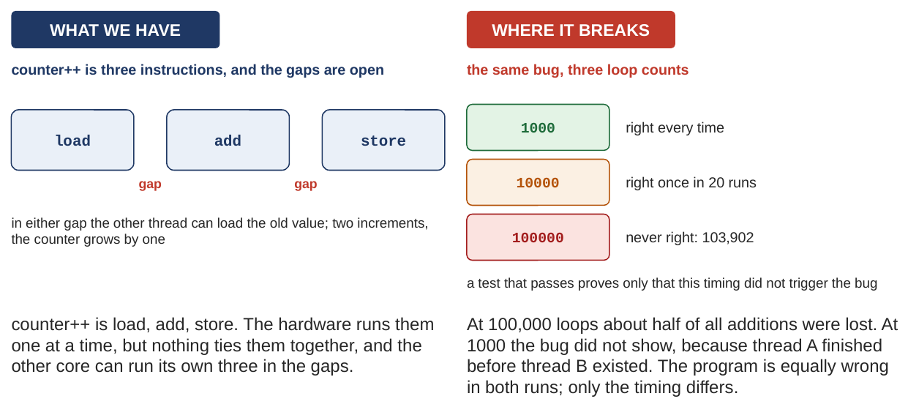{width=99%}
<figcaption markdown="1">Figure 39. The problem of the fix, left and middle columns: three instructions with two open gaps, and the same bug at three loop counts. From slide 50.</figcaption>
</figure>

In either gap, the other thread can load the old value, and then two increments raise the counter by one. The hardware runs the three instructions one at a time, but nothing ties them together, and the other core can run its own three in the gaps.

Where it breaks is the middle column: the same bug at three loop counts. At 1000 loops the program is right every time, at 10,000 it is right once in 20 runs, and at 100,000 it is never right (103,902). [Chapter 4](#chapter-4) explained all three with one bug and three timings. So the middle column's conclusion is the dangerous one: a test that passes proves only that this timing did not trigger the bug. We cannot fix this by testing more, or by hoping the timing stays lucky. The program itself has to change.

So what we need is the right column, Figure 40.

<figure markdown="1">
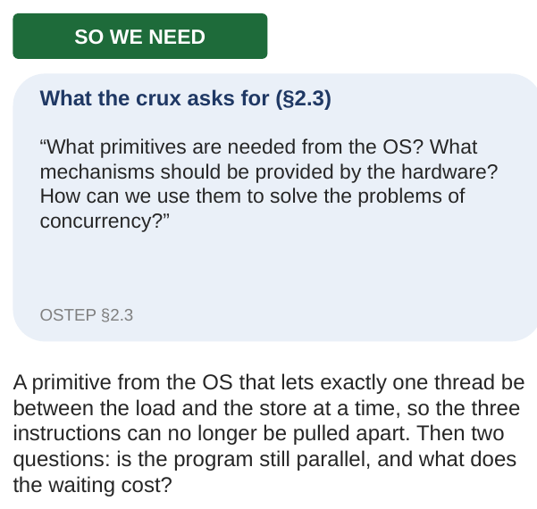{width=48%}
<figcaption markdown="1">Figure 40. The right column: what the crux asks for, the shape of the fix, and the two questions that follow it. From slide 50.</figcaption>
</figure>

The crux of [Section 4.1](#sec-4-1) already asked for it: what primitives are needed from the OS, what mechanisms from the hardware, and how can we use them to solve the problems of concurrency? The shape of the answer: a primitive from the OS that lets exactly one thread be between the load and the store at a time. Then the three instructions can no longer be pulled apart, because the other thread is kept out of the gaps. A reader who stops here can already see two questions this raises. If only one thread at a time may do the increment, is the program still running in parallel at all, that is, with both threads doing work at the same moment on two cores? And while one thread waits for the other, what does the waiting cost? Sections [5.3](#sec-5-3) to [5.6](#sec-5-6) measure both.

### 5.2 Concept The mutex and the critical section: threads.v1.c {#sec-5-2 data-toc-label="5.2 [Concept] The mutex and the critical section: threads.v1.c"}

[Section 5.1](#sec-5-1) asked for a primitive that admits exactly one thread at a time to the three instructions. The thread library offers exactly that, and adding it to the program takes four lines. Figure 41 is the program with the lock added; the green lines are the only lines that changed from [Section 4.2](#sec-4-2)'s program.

<figure markdown="1">
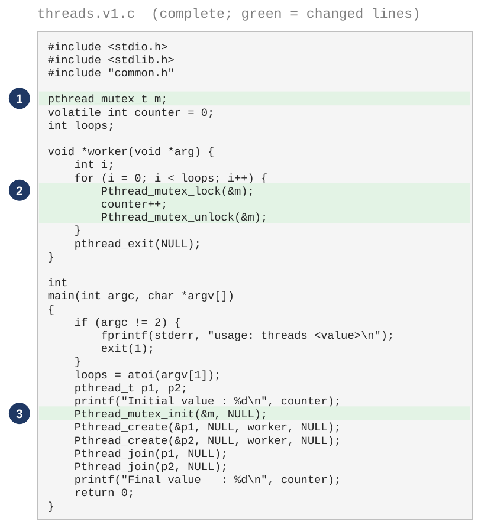{width=65%}
<figcaption markdown="1">Figure 41. threads.v1.c, complete: the counter program with a lock, the changed lines in green, three callouts. From slide 51, with the code lines drawn left-aligned as they appear in PowerPoint.</figcaption>
</figure>

Figure 42 is the deck's cards for the callouts.

<figure markdown="1">
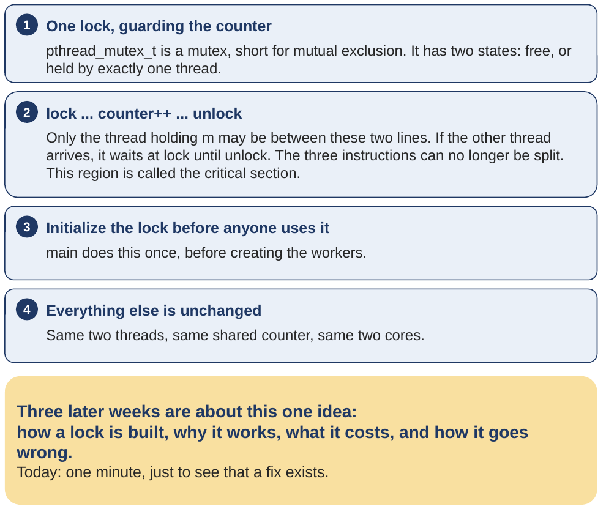{width=79%}
<figcaption markdown="1">Figure 42. The four cards: one lock guarding the counter, lock and unlock around counter++, initialize the lock first, everything else unchanged; and the note that later weeks take this one idea apart. From slide 51.</figcaption>
</figure>

Callout 1 is a new global variable, `pthread_mutex_t m;`. Its type is a **mutex**, short for mutual exclusion: a lock with two states, free, or held by exactly one thread. Because it is global, both threads use the same one.

Callout 2 is the change inside `worker`. Before `counter++`, the thread calls `Pthread_mutex_lock(&m)`; after it, `Pthread_mutex_unlock(&m)`. The rule a mutex enforces: only the thread holding `m` may be between those two lines. If the other thread arrives at the lock call while `m` is held, it waits there until the holder unlocks. So the load, add and store can no longer be split by the other thread: while one thread is anywhere among the three instructions, the other is waiting at the door. Why can the lock itself not lose an update the same way? Because it is built from special hardware instructions that check and change the lock as one atomic step, so two threads cannot both take it. How, is a later week. The code protected by a lock like this is called a **critical section**: a stretch of code that touches shared data and must be run by only one thread at a time.

Callout 3 is `Pthread_mutex_init(&m, NULL)` in `main`: the lock must be set up, once, before anyone uses it. A lock that was never set up holds whatever bytes happened to be in that memory, and could look held when nobody holds it. So `main` does it before creating the workers. (As in [Chapter 4](#chapter-4), the capital P names the textbook's wrappers that check for errors.)

Card 4 says everything else is unchanged: the same two threads, the same shared counter, the same two cores.

The yellow note is honest about how much this hides. Three later weeks of the course are about this one idea: how a lock is built from hardware instructions, why it works, what it costs, and how it goes wrong. Here the only point is that a fix exists.

### 5.3 Real machine Always right, eight times slower: what the lock costs {#sec-5-3 data-toc-label="5.3 [Real machine] Always right, eight times slower: what the lock costs"}

[Section 5.2](#sec-5-2) claimed the lock makes the three instructions one step. A claim about concurrency is worth nothing until it survives the sizes that broke the old program, and [Section 5.1](#sec-5-1) promised a price. Figure 43 is both, measured on the arm64 Mac. The locked program, threads.v1.c, was compiled under the name `threads_locked`.

<figure markdown="1">
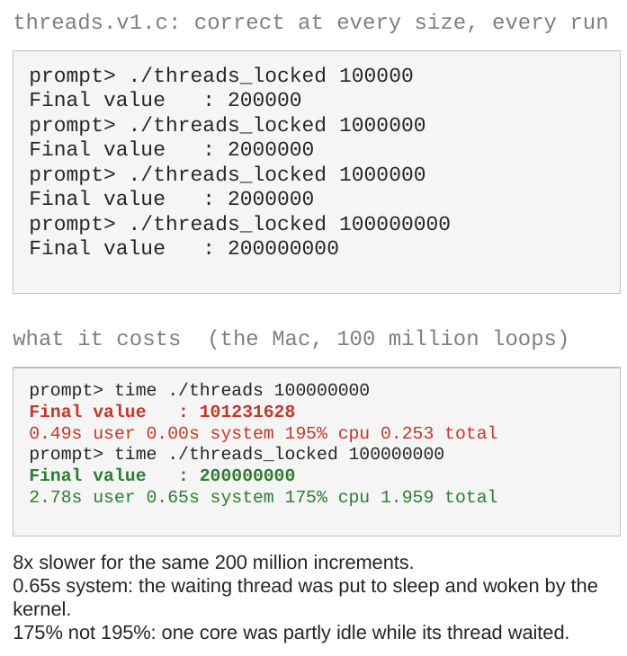{width=56%}
<figcaption markdown="1">Figure 43. Top: the locked program is exact at every size. Bottom: the broken and the locked program timed at 100 million loops, and three readings of the numbers. From slide 52.</figcaption>
</figure>

The top box: at 100,000 loops, 200,000; at 1,000,000, twice, 2,000,000; at 100,000,000, 200,000,000. Exact at every size, every run.

The bottom box is the price. `time` in front of a command runs it and then reports how long it took. Its last line has four numbers. **user** is the processor time spent running the program's own code, added up over all its threads. **system** is the processor time spent inside the kernel on the program's behalf, for example in system calls. **cpu** is how busy the processors were on average, as a percentage of one processor: 200% would mean two processors busy the whole time. **total** is the time on the wall clock, from start to finish, as a person with a stopwatch would measure it.

Read the two runs, both at 100,000,000 loops, so 200,000,000 increments in each run. The broken program, `threads`, printed a wrong value (101,231,628) and took 0.253 seconds. The locked program printed the right value (200,000,000) and took 1.959 seconds. Check the ratio: 1.959 ÷ 0.253 is about 7.7, so about 8 times longer for the same 200 million increments. Check the percentages a second way, as user plus system over total. Broken: (0.49 + 0.00) ÷ 0.253 = 1.94, which is about 195%: two cores busy nearly all the time. Locked: (2.78 + 0.65) ÷ 1.959 = 3.43 ÷ 1.959 = 1.75, which is 175%. Why this formula gives the cpu number: if two cores are busy for the whole wall-clock time, the processor time added up over both is twice the wall-clock time, 200%. So processor time divided by wall-clock time is the average number of busy cores, and 1.75 means that, on average, 1.75 of the 2 cores were busy, so 2 − 1.75 = 0.25 of a core, a quarter of one core's time, went unused.

The three lines under the box read those numbers. 8 times slower for the same 200 million increments. 0.65 seconds of system time, where the broken program had none. The slide reads this as the waiting thread being put to sleep and woken up by the kernel, over and over, which is kernel work. And 175%, not 195%: one core was partly idle while its thread waited.

Figure 44 is the lock working, drawn the same way as [Section 4.5](#sec-4-5)'s timeline.

<figure markdown="1">
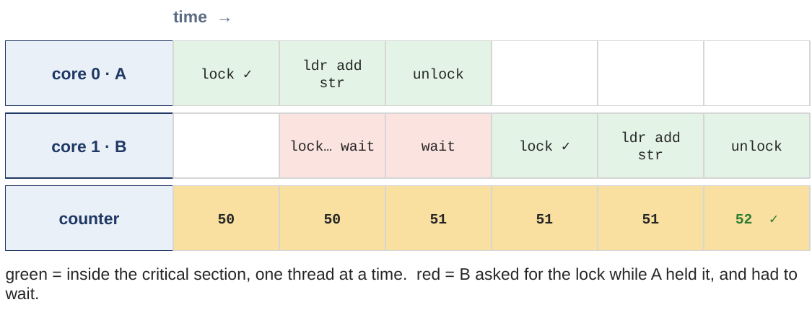{width=90%}
<figcaption markdown="1">Figure 44. The lock at work: A takes the lock, does its three instructions and unlocks; B asks while A holds it and waits; then B's turn. The counter goes 50, 51, 52. From slide 52.</figcaption>
</figure>

A takes the lock (green: inside the critical section), runs `ldr add str`, and unlocks. B asks for the lock while A holds it, so B waits (red), twice as long as one step. When A unlocks, B takes the lock, runs its three instructions, and unlocks. The counter goes 50, then 51 after A's store, then 52 after B's. Nothing is lost.

The blue box on the slide, beside this drawing, says where the time went. While B waits, its core does nothing useful: either it spins, asking for the lock again and again, or the OS puts B to sleep and wakes it at A's unlock. In the traced run of [Section 5.6](#sec-5-6) (100,000 loops; the 100,000,000-loop run was not traced), the lock changed hands about every 2.3 increments, so this waiting happens constantly. If the lock changed hands as often in this longer run, which is likely since only the length changed, then 200,000,000 increments ÷ 2.3 is about 87 million hand-offs, each with a short wait. That is the likely place the 1.96 seconds went. The 0.65 seconds of system time shows the kernel was involved, so at least some of the waiting was sleeping. Some of the 2.78 seconds of user time may be spinning; the capture cannot separate the two. (Time a thread spends spinning is its own code running, so it counts as user time; putting a thread to sleep and waking it is done by the kernel, so that counts as system time.) Correctness has a price. The concurrency weeks ask how to pay less of it.

### 5.4 Check yourself Does the lock remove the parallelism? {#sec-5-4 data-toc-label="5.4 [Check yourself] Does the lock remove the parallelism?"}

[Section 5.3](#sec-5-3) left a doubt in its numbers. The locked program prints exactly 200,000,000 every time. But that is also exactly what we would get if thread A ran its whole loop first and thread B ran its whole loop afterwards, with no overlap at all. So the right answer cannot tell us whether the two threads still run at the same time. The deck stops here and asks. Figure 45 is the question.

<figure markdown="1">
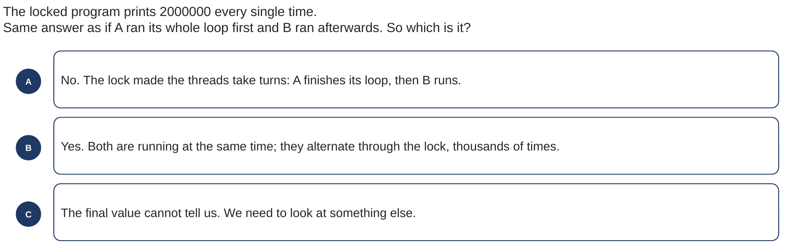{width=100%}
<figcaption markdown="1">Figure 45. The vote: is anything still happening in parallel? Three options. From slide 53.</figcaption>
</figure>

Option A says the lock made the threads take turns: A finishes its loop, then B runs. Option B says both are running at the same time, and they alternate through the lock thousands of times. Option C says the final value cannot tell us, and we need to look at something else. Think for thirty seconds and choose one before reading on; it is also Exercise 6.

Whatever you chose, notice this: 2,000,000 at a million loops is consistent with A and with B. The final value carries no information about the order in which the increments happened. So C is right in one sense: to decide between A and B, we need a different thing to observe. The next section builds it.

### 5.5 Worked example Recording who did each increment: threads.v2.c {#sec-5-5 data-toc-label="5.5 [Worked example] Recording who did each increment: threads.v2.c"}

[Section 5.4](#sec-5-4) needs an observation that shows the order of the increments, not just their total. The simplest one: write down, for every increment, which thread did it. Figure 46 is the locked program with that record added, complete in two columns.

<figure markdown="1">
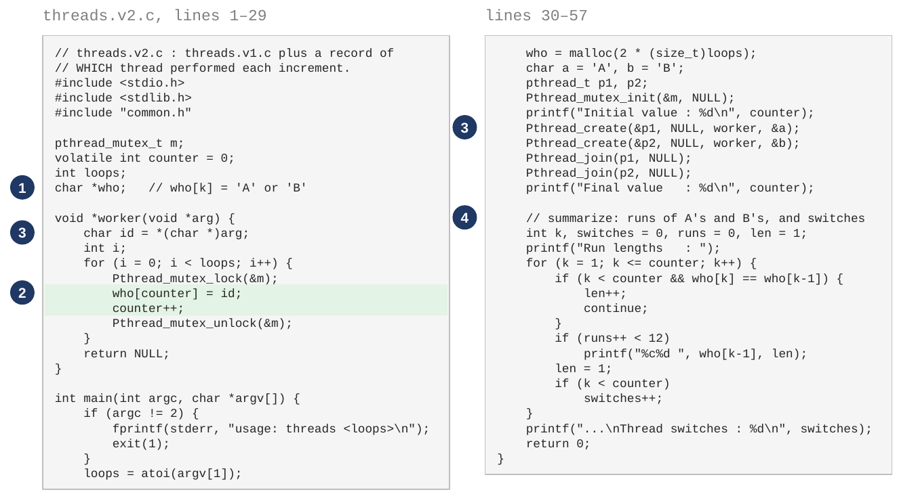{width=100%}
<figcaption markdown="1">Figure 46. threads.v2.c, complete, lines 1 to 29 on the left and 30 to 57 on the right: the locked program plus a record of which thread did each increment. From slide 54, with the code lines drawn left-aligned as they appear in PowerPoint.</figcaption>
</figure>

Figure 47 is the deck's four cards for the callouts.

<figure markdown="1">
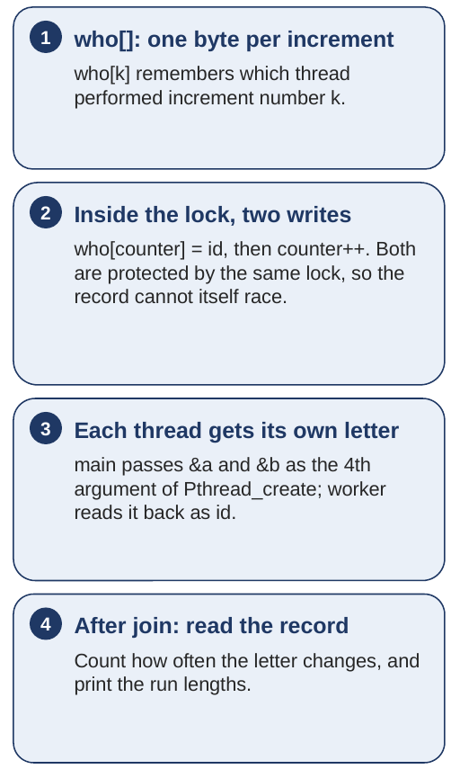{width=45%}
<figcaption markdown="1">Figure 47. The four callouts of threads.v2.c: one byte per increment, two writes inside the lock, a letter for each thread, and reading the record after join. From slide 54.</figcaption>
</figure>

Callout 1: a new global, `char *who;`, a pointer ([Section 3.2](class-1.md#sec-3-2)) to a row of single characters, one byte per increment. The comment says what it will hold: `who[k]` is 'A' or 'B', the thread that performed increment number k. In `main` (right column, first line), `who = malloc(2 * (size_t)loops);` asks for 2 × loops bytes, one for each of the increments the two threads will make. (`(size_t)` converts the number to the type C uses for sizes, so the multiplication cannot overflow. To overflow is to produce a number too big for its type, which then wraps around to a wrong value. You can ignore it.)

Callout 2: inside the lock there are now two writes. `who[counter] = id;` records this thread's letter in the slot for the current increment, and then `counter++` performs it. Both are protected by the same lock, so the record cannot itself race: no other thread can slip in between them.

Callout 3: each thread gets its own letter. `main` makes two characters, `char a = 'A', b = 'B';`, and passes `&a` to the first `Pthread_create` and `&b` to the second, as the fourth argument, the one [Section 4.2](#sec-4-2)'s program left as `NULL`. Each thread receives that pointer as `arg`, and `char id = *(char *)arg;` reads the letter out of it (the `(char *)` tells C that `arg` points to a character; the leading `*` reads the character at that address). So thread one writes 'A' and thread two writes 'B'.

Callout 4: after both joins, `main` reads the record from start to end. It counts how often the letter changes from one increment to the next: each change is a **thread switch**, a moment when the lock passed from one thread to the other. It also prints the first twelve **run lengths**, how many increments in a row one thread did before the other got in, written like A1953 (thread A, 1953 increments in a row). In the loop, `len++` grows the current run while the letter stays the same. When the letter changes, the run is printed (if fewer than 12 have been printed so far), `len` starts again at 1, and `switches++` counts the switch. Everything else is the locked program, unchanged.

### 5.6 Real machine 86,581 switches: the lock only decides where the boundary falls {#sec-5-6 data-toc-label="5.6 [Real machine] 86,581 switches: the lock only decides where the boundary falls"}

[Section 5.5](#sec-5-5) built the record; now it can answer the vote of [Section 5.4](#sec-5-4). If option A were right, the record would show one long run of A's and then one long run of B's: one switch. If option B were right, it would show the letters alternating many times. Figure 48 is the record, from the arm64 Mac, with threads.v2.c compiled under the name `threads_trace`.

<figure markdown="1">
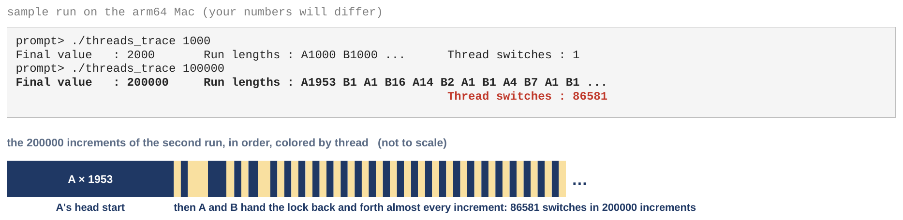{width=100%}
<figcaption markdown="1">Figure 48. Two runs of the recording program: at 1000 loops, one switch; at 100,000 loops, a long head start for A and then 86,581 switches in 200,000 increments, also drawn as a colored strip. From slide 55.</figcaption>
</figure>

At 1000 loops: final value 2000, run lengths A1000 B1000, and 1 thread switch. A did all its 1000 increments, then B did all of its. That is the no-overlap case of [Section 4.6](#sec-4-6): A finished before B existed.

At 100,000 loops: final value 200,000, exact, as the lock promised. The run lengths tell the story: A1953, then B1, A1, B16, A14, B2, A1, B1, A4, B7, A1, B1, and so on. First, A alone for 1953 increments: its head start, while B was being created. This is the check promised in [Section 4.6](#sec-4-6). A ran these increments alone, taking a lock that nobody else wanted. Taking and releasing even a free lock is extra work, and with no other thread there is no waiting, so such an increment costs more than the 2.5 ns of a bare increment ([Section 4.6](#sec-4-6)). It costs less than an increment in the fully contended locked run of 100,000,000 loops (contended: the other thread wants the lock too), because that run includes all the waiting. In that run each thread did its own 100,000,000 increments in 1.959 s (Figure 43), so each thread took 1.959 ÷ 100,000,000 ≈ 0.0000000196 s, about 19.6 ns, per increment of its own. So the 1953 increments took between 1953 × 2.5 ns ≈ 5 µs and 1953 × 19.6 ns ≈ 38 µs: from a few microseconds to a few tens of them, which fits the deck's "tens of microseconds" for creating a thread. It is longer than the loop of 1000 (about 2.5 µs) and much shorter than the loop of 100,000 (about 250 µs), so the head start is a sound explanation. Then the two threads hand the lock back and forth, one, sixteen, fourteen, two increments at a time. The total: 86,581 thread switches. Check what that means: 200,000 ÷ 86,581 is about 2.3, so the lock changed hands about every 2.3 increments. (This is the 2.3 that [Section 5.3](#sec-5-3)'s blue box used.)

The colored strip under the output is the same run as a picture, not to scale: a long navy block for A's head start, then navy and yellow alternating to the end.

So the answer to the vote is B. Both cores were busy the whole time, fighting over one counter. The text at the bottom of the slide says what the lock did and did not do. The lock did not stop the two threads from running at the same time. It only decided where the boundary between them may fall: between two increments, never inside one. Same concurrency as the broken program, same hardware, one rule added. That rule, and what it costs, is what the concurrency part of the course is about.

**Checkpoint 2.** Settled: a lock turns the three instructions into a critical section, which only the lock's holder may be inside. The answer is exact at every size, about 8 times slower, and the two threads still run at the same time; the lock only decides where the boundary between them may fall. Still open: every number so far lived in RAM, and RAM forgets at the first power cut. What survives, and when is a written byte actually safe? You should now be able to say what a lock changes about a program and what it does not change.

## Chapter 6. When write() returns, are the bytes on the disk? {#chapter-6}

*The question this chapter answers: When write() returns, are the bytes on the disk?*

### 6.1 Problem RAM forgets at power off, and the disk is about 1000 times slower {#sec-6-1 data-toc-label="6.1 [Problem] RAM forgets at power off, and the disk is about 1000 times slower"}

What we have: every number in this guide so far, the counters of `mem.c` and of the thread programs, every variable of every program, lived in memory. Figure 49 is the deck's problem slide for the third question, and its left column says where exactly.

<figure markdown="1">
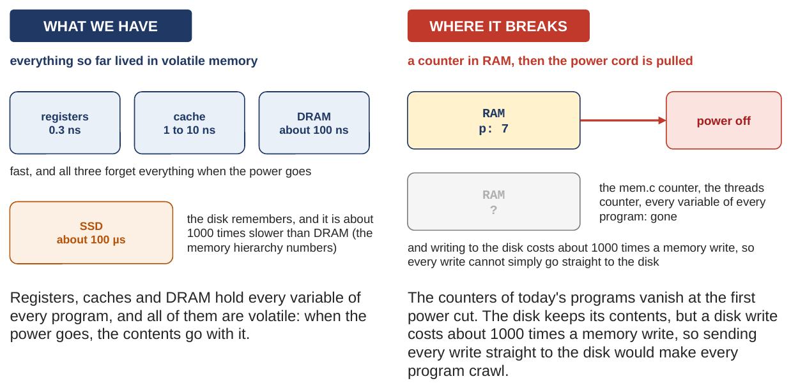{width=99%}
<figcaption markdown="1">Figure 49. The problem of persistence, left and middle columns: the fast memories are all volatile, the disk remembers but is about 1000 times slower, and a counter in RAM vanishes when the power cord is pulled. From slide 57.</figcaption>
</figure>

The left column lists the places a program's data can be, with how long each takes to reach ([Extra 2](class-1.md#extra-2) has the full list). Registers take about 0.3 ns, the caches 1 to 10 ns, and DRAM, main memory, about 100 ns. All three are fast, and all three are volatile (Part 0): they forget everything when the power goes. Below them is the SSD, the kind of disk most machines have now, at about 100 µs. The disk remembers, but it is slow. (A spinning hard disk is slower still, about 10 ms; [Extra 2](class-1.md#extra-2). This chapter's "1000 times" is for the SSD.) Check the slide's "about 1000 times slower than DRAM": 100 µs is 100,000 ns, and 100,000 ÷ 100 = 1000.

Where it breaks is the middle column. A counter sits in RAM with the value 7. Pull the power cord, and when the machine comes back, the RAM holds nothing: the `mem.c` counter, the threads counter, every variable of every program, gone. The obvious fix fails too. Writing every value straight to the disk on every change would make every write about 1000 times slower than a memory write, and every program would crawl.

So what we need is the right column, Figure 50.

<figure markdown="1">
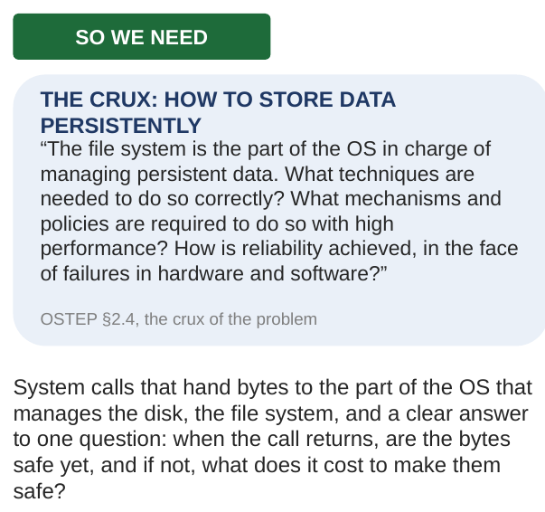{width=48%}
<figcaption markdown="1">Figure 50. The right column: the textbook's third crux, how to store data persistently, and the shape of the answer. From slide 57.</figcaption>
</figure>

This is the third crux of the course, on persistence. The **file system** is the part of the OS in charge of managing data that must last (Part 0 named it). What techniques does it need to do that correctly? What mechanisms and policies does it need to do it fast? And how does it stay reliable when the hardware or the software fails? The shape of the answer: system calls that hand our bytes to the file system, and a clear answer to one question. When the call returns, are the bytes safe yet? And if not, what does it cost to make them safe? Given the two numbers in the left column, a reader can guess the shape of the trade before seeing it: something fast that is not yet safe, and something safe that is not fast.

### 6.2 Worked example open, write, close: the file descriptor and the 13 bytes {#sec-6-2 data-toc-label="6.2 [Worked example] open, write, close: the file descriptor and the 13 bytes"}

[Section 6.1](#sec-6-1) asked for system calls that hand bytes to the file system. Before asking where the bytes go, we need the simplest program that hands some over, so that every later measurement is about something we have read in full. Figure 51 is the textbook's Figure 2.6, complete, and its run.

<figure markdown="1">
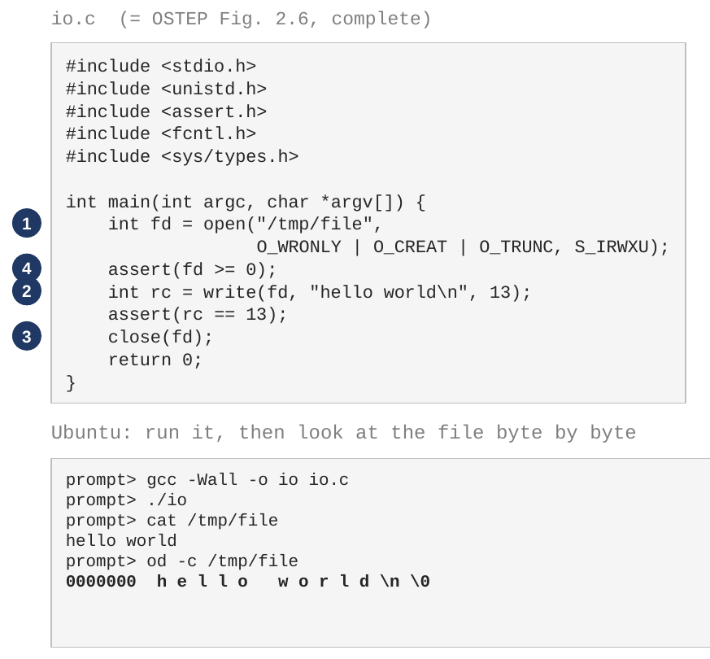{width=70%}
<figcaption markdown="1">Figure 51. io.c, complete (the textbook's Figure 2.6), with four callouts, and its run on Ubuntu: the file's contents, then the same file byte by byte. From slide 58, with the code lines drawn left-aligned as they appear in PowerPoint.</figcaption>
</figure>

Figure 52 is the deck's four cards for the callouts, and the lesson.

<figure markdown="1">
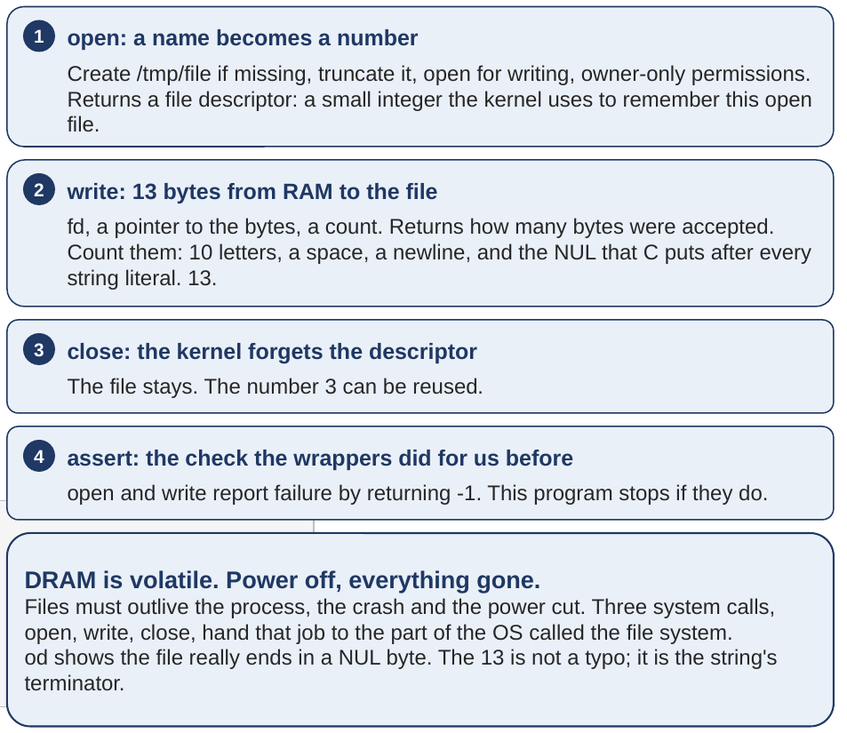{width=76%}
<figcaption markdown="1">Figure 52. The four cards: open turns a name into a number, write hands over 13 bytes, close forgets the number, assert checks for failure; and why files exist at all. From slide 58.</figcaption>
</figure>

The program makes three system calls. Read them by the callouts.

Callout 1 is `open`. It takes a name, `/tmp/file`, and a list of options combined with `|`, a sign that joins the options into one number. `O_WRONLY` opens the file for writing only. `O_CREAT` creates it if it does not exist. `O_TRUNC` truncates it, that is, empties it if it already has contents. The last option, `S_IRWXU`, sets the file's **permissions**, the rules for who may use it, so that only its owner may read, write or run it. Permissions exist because many users and programs share one machine, and a file should not be readable or changeable by everyone. They are often written as three digits: the first for the owner, the second for the owner's **group** (a named set of users), the third for everyone else. Each digit adds 4 for read, 2 for write and 1 for run, so 7 = 4 + 2 + 1 means all three, 6 = 4 + 2 means read and write, 4 means read only, and 0 means nothing. `S_IRWXU` written that way is 700: everything for the owner, nothing for anyone else. Each digit runs from 0 to 7, so a permission number is a number in base 8, called **octal**; that is also the "o" in `od` below. `open` returns a **file descriptor**: a small whole number that the kernel uses to remember this open file. The name becomes a number, and from now on the program uses only the number, which is quicker for the kernel to look up on every later call than a name would be. ([Section 2.5](class-1.md#sec-2-5) showed where the number points: it is a position in the `ofile` array of the process's `struct proc`.) The program keeps it in `fd`.

Callout 2 is `write`. It takes three things: the file descriptor, a pointer to the bytes (here the text `"hello world\n"`), and a count, 13. It returns how many bytes it accepted, kept in `rc`. Count the 13: "hello" is 5 letters, the space makes 6, "world" brings it to 11, and the newline `\n` is the 12th. The 13th byte is the **NUL** byte, a byte whose value is 0, written `\0`, which C puts after the end of every piece of text written in double quotes, so that programs can find where the text ends. So 5 + 1 + 5 + 1 + 1 = 13, and the file really ends with a NUL. (That is ten letters, a space, a newline and the NUL, as the card says.)

Callout 3 is `close`. The kernel forgets the file descriptor. The file stays on the disk, and the number can be reused for the next file the program opens.

Callout 4 is `assert`. `assert(fd >= 0);` stops the program with an error message if the condition is false. `open` and `write` report failure by returning −1, so these two lines stop the program if either call failed. It is the same check the capital-P wrappers did for the thread functions in [Section 4.2](#sec-4-2). (`>=` means "is greater than or equal to", and `==` means "is equal to"; a single `=` stores a value, a double one compares.)

The lower half of Figure 51 is the run on Ubuntu. `gcc -Wall -o io io.c` compiles it, and `./io` runs it; it prints nothing. `cat /tmp/file` prints the file: `hello world`. `od -c /tmp/file` prints the file byte by byte (`od` is "octal dump", and `-c` shows each byte as a character). `0000000` is the position of the first byte shown. Then come h, e, l, l, o, a space, w, o, r, l, d, `\n` and `\0`. Twelve visible characters and then the NUL. The 13 is not a typo; it is the string's terminator.

The blue box is the reason for all of this. DRAM is volatile: power off, everything gone. Files must outlive the process, the crash and the power cut. These three system calls, open, write and close, hand that job to the file system, the part of the OS that manages the disk, whose job is to make sure the bytes are still there tomorrow.

### 6.3 Concept The write path: the inode, the page cache and the dirty page {#sec-6-3 data-toc-label="6.3 [Concept] The write path: the inode, the page cache and the dirty page"}

[Section 6.2](#sec-6-2)'s `write` returned 13: the kernel accepted 13 bytes. [Section 6.1](#sec-6-1) set the trap this has to avoid: a disk write costs about 1000 times a memory write, yet the bytes must end up on the disk. Those two facts cannot both be satisfied at the moment `write` returns, so the kernel must be doing something between "accepted" and "on the disk". Figure 53 is the deck's drawing of the whole path, top to bottom.

<figure markdown="1">
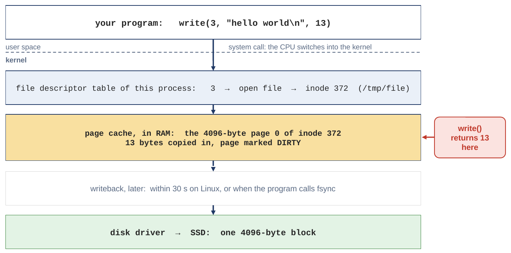{width=100%}
<figcaption markdown="1">Figure 53. What one write call sets in motion: the file descriptor table, the inode, the page cache in RAM where the bytes are copied and the page is marked dirty, the moment write returns, and the later writeback to the SSD. From slide 59.</figcaption>
</figure>

Top box: the program calls `write(3, "hello world\n", 13)`. The 3 is the file descriptor that `open` returned ([Section 6.4](#sec-6-4) shows why it is 3). This is a system call, so the processor switches into the kernel: the dashed line is the user/kernel boundary of [Section 1.4](class-1.md#sec-1-4).

Second box: the kernel looks up descriptor 3 in this process's table of open files, which leads to an **open file** record and from there to the file's **inode**. The kernel needs one record per file that it can reach quickly from the descriptor, without searching the disk by name on every write. That record is the inode. An inode, short for index node, is the file system's record of one file: its size, its owner, its permissions, its times, and where on the disk its bytes are. Everything about the file except its name and its contents. Each inode has a number; this file's is 372 on the Ubuntu machine these captures come from ([Extra 8](#extra-8) shows the number being read off the disk's records).

Third box, in yellow: the kernel copies the 13 bytes into a 4096-byte **page** of RAM that belongs to this file. A page is a fixed-size block of memory; 4096 bytes, 4 KB, is the usual size, a design choice of the hardware and the OS. Keeping file data in RAM in equal-sized pieces lets the kernel find, reuse and write back each piece without tracking sizes byte by byte. This RAM, holding copies of file contents, is the **page cache**. The page now holds data the disk does not have yet, and such a page is called **dirty**.

The red tag on the right: and here `write` returns 13. The 13 means the kernel has your bytes. It does not mean the disk has them.

The two lower boxes are what happens later. **Writeback** is the kernel writing dirty pages to the disk. On Linux it writes a page once the page has been dirty for about 30 seconds (a Linux setting that [Section 6.5](#sec-6-5) reads), so a write normally reaches the disk within about half a minute of being made. It does this in batches, on its own schedule, or sooner if the program asks for it with `fsync` ([Section 6.6](#sec-6-6)). Batching is the reason for the delay. Each trip to the disk has a large fixed cost, whatever its size, the way a delivery truck costs about the same for one box or fifty. So one trip for many writes makes the expensive trip much cheaper per byte. Then the **disk driver**, the part of the OS that knows how to talk to one particular kind of device, sends the page to the SSD, where it lands in one 4096-byte **block** (the unit in which a disk is handed out).

The three cards on the slide's right side sum it up. Fast: `write` returns as soon as the bytes are in the kernel's RAM, with no disk involved yet. Later: Linux writes a dirty page to disk once it is about 30 seconds old, in batches. Risky: a power cut inside that window, and the program was told 13, success, while the bytes are gone. Every database and every file system is about managing that window. The next three slides look at the layers for real: strace for the top layer ([Section 6.4](#sec-6-4)), the file system's records for the second ([Extra 8](#extra-8)), and the kernel's count of dirty memory for the window itself ([Section 6.5](#sec-6-5)).

### 6.4 Real machine strace: watching the system calls cross into the kernel {#sec-6-4 data-toc-label="6.4 [Real machine] strace: watching the system calls cross into the kernel"}

[Section 6.3](#sec-6-3) drew the top layer of the write path, a program making three system calls, as boxes. A drawing could be wrong. On Linux there is a tool that sits exactly on the user/kernel line and prints every system call a program makes, with its arguments and its return value, so the top layer can be checked. Figure 54 is `io` run under that tool, on an Ubuntu 22.04 machine.

<figure markdown="1">
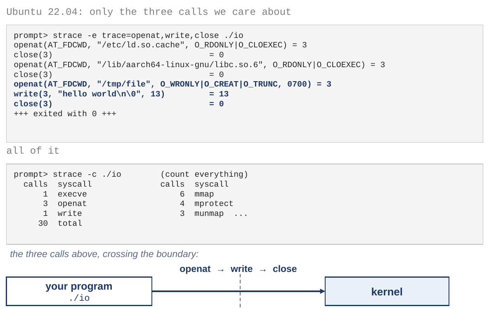{width=95%}
<figcaption markdown="1">Figure 54. strace on io: the open, write and close calls, the three that belong to the program shown in bold, and the count of every call the program made. From slide 60.</figcaption>
</figure>

The tool is **strace**. `strace -e trace=openat,write,close ./io` runs `io` and prints only those three kinds of call. Each line is one system call: its name, its arguments in parentheses, and after the `=` the value it returned.

The last three bold lines are the program's own. `openat(AT_FDCWD, "/tmp/file", O_WRONLY|O_CREAT|O_TRUNC, 0700) = 3` is our `open`. `openat` is the modern Linux name for open. `AT_FDCWD` means "relative to the current folder", the folder the program was started in, which does not matter for a name starting with `/`. The options are the three of [Section 6.2](#sec-6-2), and `0700` is `S_IRWXU` written as the three permission digits of [Section 6.2](#sec-6-2), 700, with a leading 0 that marks the digits as base 8. It returned 3, the file descriptor. Why 3? Because every program starts with three files already open: 0 is **standard input** (where the program reads typed input), 1 is **standard output** (where it prints), and 2 is **standard error** (where it prints error messages). The next free number is 3. `write(3, "hello world\n\0", 13) = 13`: the kernel received exactly the 13 bytes, the NUL included, and accepted all 13. `close(3) = 0`: success. Then `+++ exited with 0 +++`: the program ended with status 0, no error.

The first four lines come with every C program and are not ours. Before `main` runs, the **loader**, the code that prepares a program to run, opens two files. One is `/etc/ld.so.cache`, its list of where libraries are kept. The other is `libc.so.6`, the C library itself, which provides `printf` and the rest. Each gets descriptor 3 and is closed again. The kernel always hands out the lowest free number, which is why our file also got 3. (`aarch64` in the path is another name for arm64: this Ubuntu ran on an arm64 processor.)

The lower box counts everything: `strace -c ./io` gives a total of 30 system calls. `execve`, once, is the call that starts the program. `openat` appears 3 times (the two loader opens and ours), `write` once. `mmap` (6 times), `mprotect` (4) and `munmap` (3) are the loader setting up memory for the library before `main` runs; the slide shows only these rows and the total. They add up to 1 + 3 + 1 + 6 + 4 + 3 = 18. The other 12 calls are kinds the slide leaves out (its `...`). One of them is `close`, which the listing above shows three times (the loader's two and ours). Three of the 30 calls are ours, so 30 − 3 = 27 are setup.

Figure 55 is the deck's three cards, which say the same in short.

<figure markdown="1">
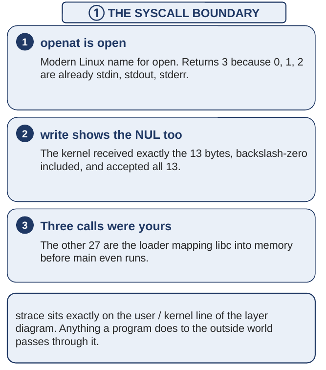{width=53%}
<figcaption markdown="1">Figure 55. The syscall boundary in three cards: openat is open, write shows the NUL too, three calls were yours; and where strace sits. From slide 60.</figcaption>
</figure>

The last card is the point. strace sits exactly on the user/kernel line of the layer diagram of [Section 1.4](class-1.md#sec-1-4). Anything a program does to the outside world passes through that line: every file, every network message, every new process. strace can watch all of it, because the kernel offers a way for one program to watch another program's system calls, and strace uses it. strace exists only on Linux (Ubuntu, or Ubuntu inside WSL2 on Windows); on a Mac, use Ubuntu in a virtual machine.

### 6.5 Real machine Dirty pages measured: /proc/meminfo, dd and sync {#sec-6-5 data-toc-label="6.5 [Real machine] Dirty pages measured: /proc/meminfo, dd and sync"}

[Section 6.4](#sec-6-4) confirmed the top layer: the calls go in, and 13 comes back. The claim that matters most, though, is [Section 6.3](#sec-6-3)'s window: bytes accepted but not yet on the disk. That window is invisible to the program, so it needs a measurement. Linux keeps a running count of exactly those bytes. Figure 56 reads it before and after a large write, on Ubuntu.

<figure markdown="1">
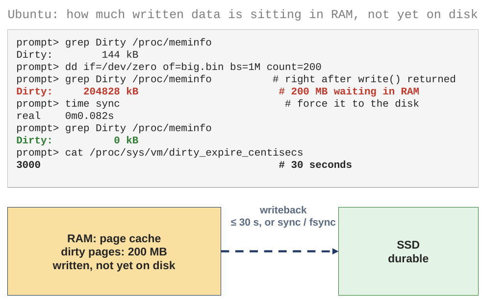{width=79%}
<figcaption markdown="1">Figure 56. The RAM window measured: the kernel's count of dirty memory before and after writing 200 MB, then after sync, and the 30-second rule; the drawing below shows the page cache draining to the SSD. From slide 61.</figcaption>
</figure>

`/proc/meminfo` is a file the kernel makes up on the spot each time it is read: it reports the kernel's memory counters as text. `grep Dirty /proc/meminfo` prints only its `Dirty` line, which counts the kilobytes that programs have written but the disk has not yet received. (A text after `#` in the capture is the deck's comment.)

To see the window clearly, the experiment makes one large write quickly and watches the count. Line by line. Before the experiment, `Dirty: 144 kB`: nearly nothing is waiting. Then `dd if=/dev/zero of=big.bin bs=1M count=200`: **dd** is a program that copies data in blocks. Here it reads from `/dev/zero`, a made-up file that produces zero bytes forever, and writes into a new file `big.bin`, in 200 blocks (`count=200`) of 1 MiB each (`bs=1M`, block size). That is 200 MiB, which is 200 × 1024 = 204,800 kB. The slide's text says dd finished in 0.03 seconds. Right after it returned, `Dirty: 204828 kB`: a little more than the 204,800 kB dd wrote, so all of it is in RAM, the disk has none of it, and dd has already reported success. (Dirty is a count at one moment, so it need not equal 144 + 204,800: some of the earlier 144 kB had probably been written back in the meantime, and other programs may have dirtied a little more. The capture does not say exactly.)

`time sync`: **sync** tells the kernel to write every dirty page to the disk now. It took 0.082 seconds (the `real` line is the wall-clock time). After it, `Dirty: 0 kB`.

The last command reads one of the kernel's settings: `dirty_expire_centisecs` is 3000, in hundredths of a second, so 3000 ÷ 100 = 30 seconds. That is the rule behind "within about 30 seconds": without `sync`, Linux would have written the 200 MB on its own once the data was 30 seconds old. Anything younger than that may still be only in RAM.

The drawing under the capture is the window as a picture. Programs write into the page cache in RAM, 200 MB of dirty pages here. RAM drains to the SSD later, by writeback within 30 seconds, or by `sync` or `fsync` on request. The cards on the slide's right side name the trade. It is fast, because RAM absorbs the writes and the disk sees a few big batches. It is dangerous, because a crash inside the window destroys bytes that the program was told had been written. That window is the whole problem, and the file-system part of the course is about keeping the speed while shrinking the danger.

### 6.6 Real machine fsync: durability at thousands of times the cost {#sec-6-6 data-toc-label="6.6 [Real machine] fsync: durability at thousands of times the cost"}

[Section 6.5](#sec-6-5) measured the window: written bytes sit in RAM for up to 30 seconds. Data is **durable** when it will survive a crash or a power cut; **durability** is that property, and bytes inside the window do not have it yet. Some programs cannot accept that. A bank that tells a customer "your payment is saved" and then loses it in a power cut has broken its promise. So there must be a way for a program to close the window on purpose, and [Section 6.1](#sec-6-1) predicted it would not be free. Figure 57 is a program that measures the price.

<figure markdown="1">
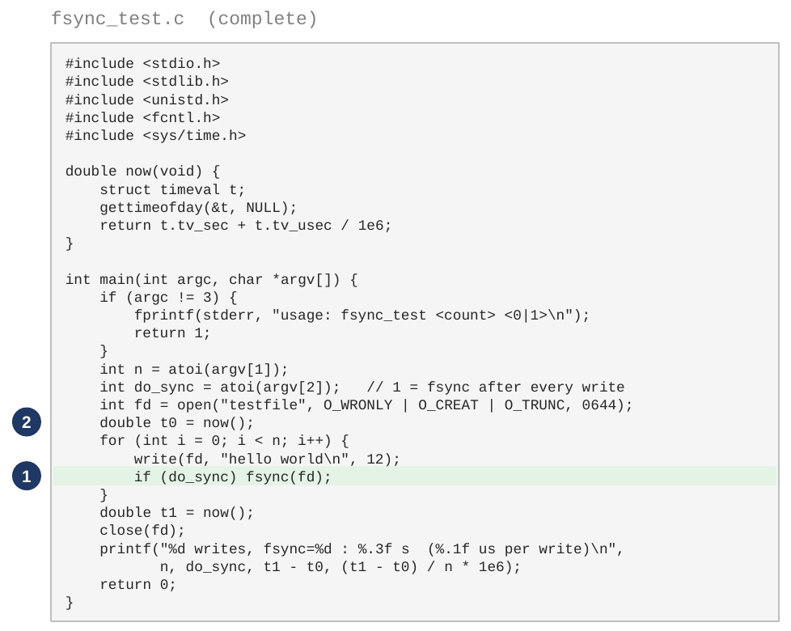{width=78%}
<figcaption markdown="1">Figure 57. fsync_test.c, complete: write 12 bytes N times, with or without fsync after each write, and time only the loop. From slide 62, with the code lines drawn left-aligned as they appear in PowerPoint.</figcaption>
</figure>

The call is **fsync**: `fsync(fd)` does not return until all of this file's data is on the disk. Here is what the program does, in order. The helper `now()` returns the current time in seconds, with a fractional part: `gettimeofday` fills in the time since a fixed date in two parts: `t.tv_sec`, the whole seconds, and `t.tv_usec`, the extra microseconds. `t.tv_sec + t.tv_usec / 1e6` adds them up (`1e6` is 1,000,000, so microseconds become seconds). `main` expects two words after its name (`argc != 3` counts the name too): `n`, how many writes, and `do_sync`, 1 to fsync after every write and 0 not to. It opens a file called `testfile` with the same options as [Section 6.2](#sec-6-2) (`0644` is the three digits of [Section 6.2](#sec-6-2) with a leading 0: 6 lets the owner read and write, and the two 4s let the group and everyone else read). Then, callout 2, it reads the clock, runs the loop, and reads the clock again, so only the loop is timed: open and close are outside the clock, and the number is the cost of the writes alone. The loop writes the 12 bytes of `"hello world\n"` (12 this time, without the NUL) `n` times, and callout 1, the green line, `if (do_sync) fsync(fd);`, waits for the disk after every write when `do_sync` is 1. At the end it prints the number of writes, the setting, the total seconds (`%.3f` prints three decimals) and the microseconds per write, `(t1 - t0) / n * 1e6`; the program writes `us` for µs.

Figure 58 is three runs on Ubuntu, with ext4 on an SSD (**ext4** is the usual Linux file system).

<figure markdown="1">
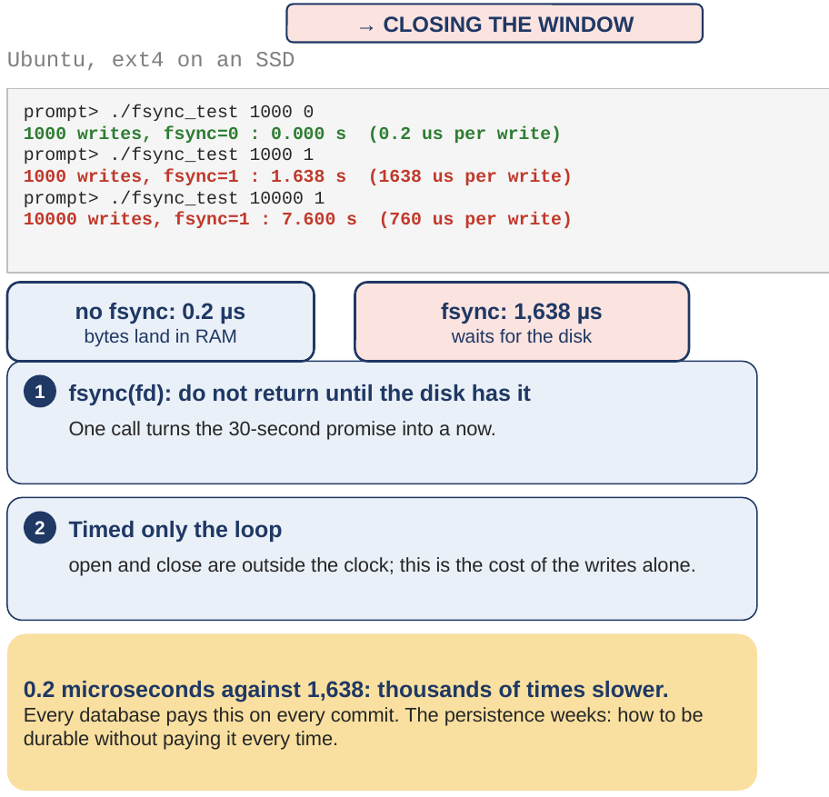{width=73%}
<figcaption markdown="1">Figure 58. Three runs of fsync_test on Ubuntu with ext4 on an SSD: 0.2 µs per write without fsync, 1638 µs with it, 760 µs in the longer run; and the two cards. From slide 62.</figcaption>
</figure>

Without fsync, 1000 writes took 0.2 µs each: they all went into RAM. The total prints as 0.000 s, and that is consistent: 1000 × 0.2 µs = 200 µs = 0.0002 s, which rounds to 0.000 with three decimals. With fsync, 1000 writes took 1.638 seconds, which is 1.638 ÷ 1000 = 0.001638 s, 1638 µs per write. A longer run of 10,000 writes with fsync took 7.600 seconds, 760 µs each (7.600 ÷ 10,000 = 0.00076 s). The capture does not say why the longer run was cheaper per write. Both are thousands of times slower than 0.2 µs, and this guide quotes the first run, 1638 µs.

Why is one fsync'd write so much more than the SSD's 100 µs of [Section 6.1](#sec-6-1)? The likely reason, which the capture does not break down: one fsync is not one disk access. The file system must also write its own records about the file, and the drive must confirm the data is safe, before fsync can return. The capture does not break the time down. Check the ratio: 1638 ÷ 0.2 = 8190, about 8000, and even 760 ÷ 0.2 = 3800. Thousands of times slower, for the same bytes. One call turns the 30-second promise into a now, and that is its price, paid on every write.

The yellow card on the slide names who pays it: every database, on every **commit** (the moment a database promises a change is saved). A database that says "committed" and then loses the row is worthless. The persistence part of the course is about how to be durable without paying this on every write: batching, journaling (writing a short note of a change before making it, [Extra 7](#extra-7)), one disk trip for many writes. The grey note under the slide adds one fact for Mac users: on macOS, `fsync` only pushes data to the drive's own cache, and the call that really waits for the disk is `fcntl(fd, F_FULLFSYNC, 0)`. Same experiment, different numbers.

**Checkpoint 3.** Settled: `write()` returns as soon as the bytes are in the kernel's page cache in RAM; the disk gets them later, within about 30 seconds on Linux. `fsync()` waits for the disk and costs 1638 microseconds a write instead of 0.2, thousands of times more. Still open: how a file system keeps the speed of the cache and still shrinks the window in which a crash loses data. That is the last part of the course. You should now be able to say what `write()` returning 13 promises, and what `fsync()` adds to that promise.

## Summary Summary of the week: six questions, three pieces {#summary-2 data-toc-label="[Summary] Summary of the week: six questions, three pieces"}

The week asked six questions, three in each class, and each answer opened the next question. The deck's last summary slide answers all six in order, each with the problem it solved.

Question 1: what is an operating system, and where does it sit? A layer between programs and hardware: a virtual machine, a library, and a referee, entered only through system calls ([Chapter 1](class-1.md#chapter-1)). Question 2: how does one processor run many programs? The OS switches among them fast, so one processor looks like many. The mechanism switches, the policy chooses, and a process is a struct in the kernel ([Chapter 2](class-1.md#chapter-2)). Question 3: how do two programs share one memory? A private address space per process, mapped by the OS onto physical memory; the program never sees the map ([Chapter 3](class-1.md#chapter-3)).

Question 4: what goes wrong when two threads add to one counter? `counter++` is load, add, store. A load in the gap loses an increment, and a head start hid the bug at 1000 loops ([Chapter 4](#chapter-4)). Question 5: how does a lock fix it, and what does it cost? A lock makes the three instructions a critical section. The answer is exact every time, about 8 times slower, and the threads are still parallel between increments ([Chapter 5](#chapter-5)). Question 6: when `write()` returns, are the bytes on the disk? No. They are in the page cache in RAM and are written back within about 30 seconds; `fsync()` waits for the disk, at thousands of times the cost ([Chapter 6](#chapter-6)).

Three pieces, three cruxes: share the machine, keep the sharing correct, keep the data safe. For each piece you now own one fact, with the demo it came from. Virtualization: four loops ran on one processor, and two programs counted separately at one address. Concurrency: `counter++` is three instructions, and two threads printed 103,902 instead of 200,000. Persistence: `write` returned 13 before the disk had a single one of the bytes.

The week's words, each with a picture to bring to mind. Process: the `struct proc` of xv6. System call: the 21 lines of `syscall.h`, and the strace lines. Kernel space against user space: the layer picture. Mechanism against policy: the switch against the choice. Address space: the two maps of [Section 3.3](class-1.md#sec-3-3). **Race condition**: 103,902. Critical section: the green lines of threads.v1.c. **Atomicity**, the property of happening all at once with no gap ([Section 4.5](#sec-4-5)): what the lock gave the three instructions. File descriptor: the 3 that `open` returned. Page cache: the 204,828 kB of dirty memory. `fsync`: 1638 µs against 0.2.

Three questions to check yourself. Why does the threads program at 100,000 loops give a different answer on every run? Can you draw the layer picture with the system-call arrow? Why does 13 from `write` not mean the bytes are on the disk? If you can do those three, the week is yours. On the reading: read chapters 1 and 2 of the textbook once, all of it; the asides are short and often the best part. What matters is what met the pictures in this guide.

## Going deeper, second class (optional) {#extras-2}

### Extra 6 Deeper, Q1 The concurrency crux in full, and the road ahead {#extra-6 data-toc-label="Extra 6 [Deeper, Q1] The concurrency crux in full, and the road ahead"}

This part and the four after it are the second class's "deeper, if time allows" block. [Chapter 4](#chapter-4) quoted the second crux as a problem to solve today, and [Chapter 5](#chapter-5) solved it for one counter. But one counter is the smallest possible case, and the crux is about every program that shares memory. Figure 59 is the crux in the deck's shorter wording, with where the course takes it.

<figure markdown="1">
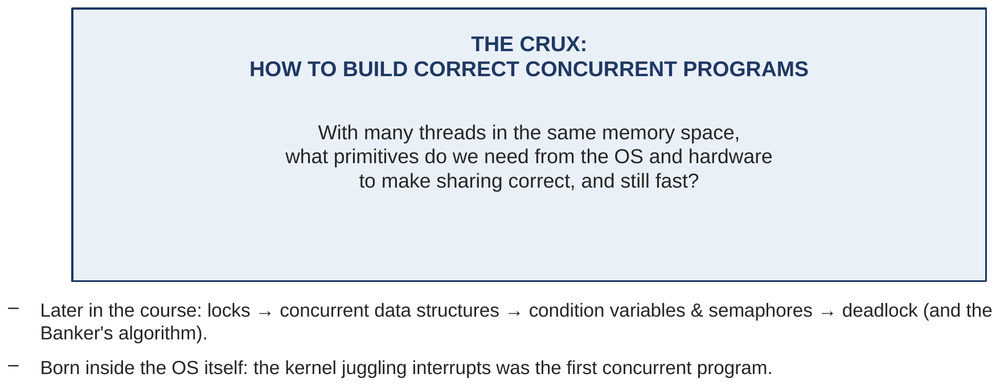{width=100%}
<figcaption markdown="1">Figure 59. The second crux, how to build correct concurrent programs, and the road through the concurrency part of the course. From slide 66.</figcaption>
</figure>

With many threads in the same memory space, what primitives do we need from the OS and the hardware to make sharing correct, and still fast? The road has three stops. First, the lock, which makes a critical section behave as one action ([Chapter 5](#chapter-5) met it). Second, locks inside real data structures, with two more tools for waiting and waking: **condition variables** (a way for a thread to sleep until some condition becomes true) and **semaphores** (a counter that threads can wait on). Third, how it all goes wrong anyway: concurrency bugs and deadlock, two threads each waiting forever for the other ([Extra 5](class-1.md#extra-5)). The Banker's algorithm on the slide is a classic method for avoiding deadlock.

The second line is a piece of history. Concurrency was forced first on the people writing the operating system itself. An interrupt, as [Section 2.3](class-1.md#sec-2-3) defined it, makes the processor stop what it is doing and run kernel code; devices raise them as well as the timer. Even on one processor, an interrupt can arrive at any moment while the kernel is in the middle of updating its own records. The kernel juggling interrupts was the first concurrent program. User programs inherited the problem when threads arrived.

### Extra 7 Deeper, Q3 The four jobs a file system must get right {#extra-7 data-toc-label="Extra 7 [Deeper, Q3] The four jobs a file system must get right"}

[Chapter 6](#chapter-6) followed 13 bytes from `write` to the disk and found one window. A file system has more to worry about than that window, and the third crux names it in general terms. Figure 60 breaks the crux into four jobs.

<figure markdown="1">
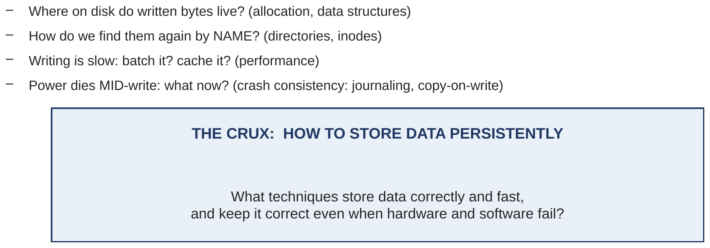{width=100%}
<figcaption markdown="1">Figure 60. The persistence crux as four jobs for the file system: where bytes live, finding them by name, hiding the slowness, and surviving a crash in the middle of a write. From slide 67.</figcaption>
</figure>

Where on disk do written bytes live, and who decides? That is **allocation**, and the file system's data structures. How do we find them again by name? That is **directories** (folders) and inodes, and [Extra 8](#extra-8) shows both. Writing is slow, so should it be batched, or cached? That is performance, and [Chapter 6](#chapter-6) measured one answer. And the hard one: the power dies in the middle of a write; what now? That is **crash consistency**, and its two standard answers have names. **Journaling** writes a note of what is about to change before changing it, so that after a crash the note can be replayed. **Copy-on-write** never overwrites data in place, and writes new versions elsewhere. The box restates the crux: what techniques store data correctly and fast, and keep it correct even when hardware and software fail? The last part of the course answers it in that order, ending with journaling, which runs inside almost every laptop and phone today.

### Extra 8 Deeper, Q3 A name, an inode number, a data block: where the 13 bytes live {#extra-8 data-toc-label="Extra 8 [Deeper, Q3] A name, an inode number, a data block: where the 13 bytes live"}

[Section 6.3](#sec-6-3) said the kernel finds a file's bytes through its inode, numbered 372 on the Ubuntu machine, and that the disk works in 4096-byte blocks. Both claims can be read off the file system's own records. Figure 61 asks the file system about `/tmp/file`.

<figure markdown="1">
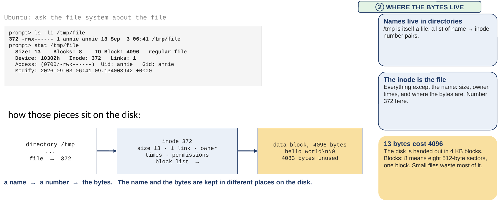{width=100%}
<figcaption markdown="1">Figure 61. ls -li and stat on /tmp/file, the three pieces of a file on disk (directory entry, inode, data block), and the three cards. From slide 68.</figcaption>
</figure>

`ls -li /tmp/file` lists the file in long form (`-l`) with its inode number (`-i`). The extra first column, 372, is the inode number, the file system's internal name for this file. Then the permissions, `-rwx------`: the owner may read, write and execute, and nobody else may do anything, which is the `S_IRWXU` of [Section 6.2](#sec-6-2). Then the number of links, 1 (how many names point at this file; the next paragraph explains); the owner and group, `annie`; the size, 13 bytes; and the time it was last changed.

`stat /tmp/file` prints the inode itself. `Size: 13` and `Blocks: 8` and `IO Block: 4096`. `Inode: 372` and `Links: 1`: one link means exactly one name points at this inode. The permissions again, as the number 0700. The owner, and the time of the last change. Notice what the inode holds: size, owner, permissions, times, and where the bytes are. Notice what it does not hold: the file's name, and the file's contents.

The drawing below puts the three pieces on the disk. A directory is a file too: `/tmp` holds a list of pairs, each a name and an inode number, and its entry for our file says `file → 372`. Inode 372 holds the size, the link count, the owner, times, permissions, and a list of the blocks that hold the bytes. The data block, 4096 bytes, holds `hello world\n\0`, our 13 bytes, and 4096 − 13 = 4083 bytes unused. So: a name, then a number, then the bytes. The name and the bytes are kept in different places on the disk. That is why renaming a file is instant: only the directory's entry changes, and the inode and the bytes stay where they are. It is also why one file can have two names: two directory entries with the same inode number.

The yellow card: 13 bytes cost 4096. The disk is handed out in 4 KB blocks. `stat` counts `Blocks` in units of 512 bytes, a Unix convention kept from old disks whose smallest unit, the **sector**, was 512 bytes. So `Blocks: 8` is 8 × 512 = 4096 bytes: eight sectors, one block. Small files waste most of their block.

### Extra 9 [Deeper, the week] An operating system is judged by four goals {#extra-9}

The week showed what an operating system does. It did not yet say how to judge whether one does it well, and the measurements kept raising that question: the lock was correct and 8 times slower; `fsync` was safe and thousands of times slower. Figure 62 is the textbook's list of design goals.

<figure markdown="1">
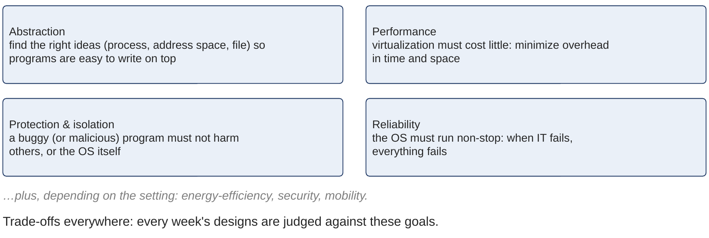{width=100%}
<figcaption markdown="1">Figure 62. Four design goals: abstraction, performance, protection and isolation, reliability; plus energy, security and mobility, depending on the setting. From slide 69.</figcaption>
</figure>

Abstraction: find the right ideas, such as the process, the address space and the file, so that programs are easy to write on top. An **abstraction** is a simple idea that hides a complicated reality; every week of the course introduces one and shows what it hides. Performance: virtualization must cost little, in time and in space. The lock's 8 times is this goal in numbers. Protection and isolation: a buggy or malicious program must not harm others, or the OS itself. Two processes with the same address and different contents is protection at work. Reliability: the OS must run non-stop, because when it fails, everything above it fails. Then, depending on the setting: energy efficiency, security and mobility. Phones care most about energy, banks favor reliability, game consoles favor performance. The goals conflict, and every later week's designs are judged against them.

### Extra 10 [Deeper, the week] A short history: invented, forgotten by the PC, relearned {#extra-10}

The week's ideas, the system call, user and kernel mode, switching among programs, private memory, can look like recent inventions. They are not, and their history explains why some old computers lacked them. Figure 63 is ninety seconds of it.

<figure markdown="1">
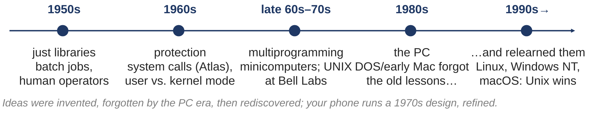{width=100%}
<figcaption markdown="1">Figure 63. A timeline of operating systems: libraries and batch jobs, protection and system calls, multiprogramming and Unix, the PC that forgot, and the systems that relearned. From slide 70, following textbook section 2.6.</figcaption>
</figure>

The 1950s: at first the operating system was just a library of common routines, and jobs ran one at a time in batches, under human operators who decided the order. The 1960s: the big leap was protection. The Atlas computer introduced the system call, a controlled jump into privileged code instead of an ordinary call, and with it user mode against kernel mode: the layer picture of [Section 1.4](class-1.md#sec-1-4) was born here. The late 1960s and 1970s: minicomputers brought **multiprogramming**, switching to another job whenever the current one waits for a slow device, which forced memory protection and forced people to think about concurrency. Around 1970 Ken Thompson and Dennis Ritchie distilled these ideas into Unix at Bell Labs. The 1980s: the personal computer forgot the lessons. DOS and the early Mac OS had no memory protection, so one stuck or buggy program could freeze the whole machine. The 1990s on: the old ideas came back, in Windows NT, in Linux, and in macOS with Unix inside. Your phone runs a 1970s design, refined.
