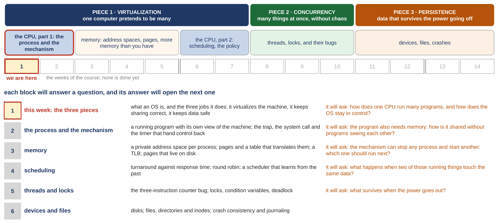

# Introduction: Three Easy Pieces

*COMP3430 Operating Systems*

## Where this guide comes from {#source}

This guide follows *Operating Systems: Three Easy Pieces* (OSTEP) by Remzi H. Arpaci-Dusseau and Andrea C. Arpaci-Dusseau, which the authors publish free at [https://pages.cs.wisc.edu/~remzi/OSTEP](https://pages.cs.wisc.edu/~remzi/OSTEP/). The figures and examples credited to the textbook are theirs. The code the guide reads is from [xv6](https://github.com/mit-pdos/xv6-riscv), the teaching operating system from MIT, and its [xv6 book](https://mit-pdos.github.io/xv6-riscv-book/).

Read with this week:

- [OSTEP chapter 1. A Dialogue on the Book](https://pages.cs.wisc.edu/~remzi/OSTEP/dialogue-threeeasy.pdf)
- [OSTEP chapter 2. Introduction to Operating Systems](https://pages.cs.wisc.edu/~remzi/OSTEP/intro.pdf)
- [Chapter 1](class-1.md#chapter-1) of the xv6 book, and the xv6 source.

## Part 0. Where we are in the course, and what a beginner needs first {#part-0}

This part does two jobs before the new material starts. It shows where this week sits in the whole course. And it gives you the handful of words a beginner needs before the first slide of real content makes sense: what a program is, what memory and an address are, what a processor does, and what a file is. This is the first week, so there is no previous week to rebuild. Everything later in this guide uses these words without stopping to define them, so if one of them is shaky, this is the place to fix it.

#### The course map {#p0-map}

A week of material makes sense only if you know which question it answers and what comes after it. So the first picture is the whole course.

<figure markdown="1">
{width=100%}
<figcaption markdown="1">Figure 0.1. The whole course on one page: the three pieces, the five blocks, the weeks of the course with this one marked, and the question each block will ask. From slide 2.</figcaption>
</figure>

An operating system has three big jobs, and the course takes them in order. The first is **virtualization**: one computer pretends to be many, so every program behaves as if it had its own processor and its own memory. The second is **concurrency**: many things happen at the same time without making a mess of each other. The third is **persistence**: data survives when the power goes off. They are the three colored bands at the top of Figure 0.1. The textbook calls them the three easy pieces, and the title of this guide is the title of the week's deck.

The second row of Figure 0.1 cuts the course into five blocks (groups of weeks). Virtualization takes the first three: the processor from the point of view of a running program, then memory, then the processor again to ask which program should run next. Block 4 is concurrency, and block 5 is devices and files. The strip of boxes under the blocks is the weeks of the course, and the first one is marked "we are here"; nothing is done yet.

The table in the lower half of Figure 0.1 is the plan. Each block answers one question, and its answer opens the next block's question. This week does something different from every later week: it does not go deep into any one block. Instead it says what an operating system is and watches it do each of its three jobs once, with a real program each time. The first class covers the first job, virtualization, twice: once for the processor and once for memory. The second class covers the other two jobs, concurrency and persistence. Each later week then takes one of those jobs apart.

#### What a program is, and what the processor does with it {#p0-program}

A **computer program** is a list of instructions, kept in a file. An **instruction** is one small step the machine knows how to do: add two numbers, copy a number from one place to another, compare two numbers, jump to a different instruction. Programs are written by people in a programming language and then translated into those small steps. The language the operating system and every program in this guide is written in is called **C**. You do not need to know C to read this guide. Every line of C that appears is explained in words, and [Appendix A](appendix.md#appendix-a) collects the marks you will see most often.

The **processor** (also called the **CPU**, for central processing unit) is the part of the computer that runs instructions, one after another, billions of times a second. It has a few dozen tiny storage cells inside it called **registers**, each holding one number the processor is working on right now. One special register, the **program counter**, holds the position of the next instruction to run. That is all the hardware offers a program: fetch the next instruction, do it, move on. [Section 1.1](class-1.md#sec-1-1) draws this loop, because it is where the whole week starts.

A **running program** is a program that the processor is currently working through. The textbook has a word for it, **process**, which [Section 2.4](class-1.md#sec-2-4) defines carefully; until then, "a running program" is the plain phrase. A **compiler** is a program that turns a C file into instructions the processor can run; **compiling** is running it. In the captures of this guide you will see the command `gcc -o cpu cpu.c -Wall` or `cc -Wall -pthread -o threads threads.v0.c`. Both mean "compile this C file into a program": `gcc` and `cc` are the compiler's names, `-o cpu` names the program it produces, and the other words are options you can ignore.

#### Memory and addresses {#p0-memory}

A computer's main memory (**RAM**) is a very long row of **bytes**. A byte is a small unit of storage: eight **bits**, where a bit (a binary digit) is a single 0 or 1. Eight bits can be set in 2 × 2 × 2 × 2 × 2 × 2 × 2 × 2 = 256 different ways, so a byte holds one letter, or a number from 0 to 255. Each byte has a number, its **address**, starting from 0. When a program says "read the byte at address 21", it is naming a position in that row. That is all an address is: a position number. Everything a running program has, its instructions and its data, sits in memory at some address. A **variable** is a named place in memory that holds one value, such as a counter; the program uses the name, and the value can change as it runs. Main memory is built from chips called **DRAM** (dynamic RAM), and slides often label it that way. A **load** is an instruction that reads a value from memory into a register, and a **store** is one that writes a value from a register into memory. "Memory" and "RAM" mean the same thing in this guide.

Memory sizes come in bytes and in multiples of 1024. A **kB** (kilobyte, also written KB) is 1024 bytes, an **MB** (megabyte) is 1024 kB, and a **GB** (gigabyte) is 1024 MB. You will also see these written KiB, MiB and GiB, or, as some programs print them, Mi and Gi. The extra letter is the careful spelling for "a multiple of 1024, not of 1000". In this guide both spellings mean the same thing. Check this: 200 MB is 200 × 1024 = 204,800 kB, a number that comes back in [Section 6.5](class-2.md#sec-6-5).

Addresses are often written in **hexadecimal**, base 16, with `0x` in front so you know. The reason for hex is length: each hex digit stands for exactly four binary digits, so an address is far shorter in hex than in binary ([Appendix A](appendix.md#appendix-a)). In hex the digits run 0 to 9 and then a to f for 10 to 15. One address in this guide, `0x200000`, is read from a captured output in [Section 3.2](class-1.md#sec-3-2); you never have to convert it, but if you want to, [Appendix A](appendix.md#appendix-a) shows how (it is 2,097,152 in decimal, the ordinary base-10 way of writing numbers). RAM forgets everything when the power goes off; the word for that is **volatile**, and it is the reason the second half of the second class exists.

#### What a file is, and what a disk is {#p0-file}

A **disk** is the slower, larger storage where data lives when the power is off: a spinning hard disk or, in most machines now, an **SSD** (solid-state drive, storage built from memory chips that keep their contents without power). A **file** is a named sequence of bytes kept on a disk, such as `cpu.c` or `/tmp/file`. A name with slashes in it, like `/tmp/file`, is a path: the file named `file` inside a folder named `tmp` at the top of the disk. The part of the operating system that keeps files on the disk is called the **file system**; [Section 6.1](class-2.md#sec-6-1) says what it has to do.

#### Hardware, software, and the operating system {#p0-os}

**Hardware** is the physical machine: the processor, the memory chips, the disk, the network connection. **Software** is programs. The **operating system** (the **OS**) is the program that runs the computer and shares it between all the other programs. Its core is called the **kernel**, and this guide uses the two words interchangeably. Linux, macOS and Windows are operating systems. **Linux** is the one on most servers and in the labs of this course. **Ubuntu** is a widely used version of it, and the captures in this guide name two releases of it, "Ubuntu 24.04" and "Ubuntu 22.04". **xv6** is a small teaching operating system from MIT that you boot and change in the labs; [Section 1.5](class-1.md#sec-1-5) shows part of one of its files and [Extra 1](class-1.md#extra-1) introduces it properly. It runs on a simulated computer under a program called **QEMU**, which pretends to be a machine with a **RISC-V** processor. RISC-V, arm64 and x86-64 are three families of processor: the Mac that ran this week's shared-counter programs has an arm64 processor, and most PCs and servers have an x86-64 processor. The family decides what the instructions look like, and [Section 4.5](class-2.md#sec-4-5) shows three real arm64 instructions.

#### Talking to the machine: the shell and the terminal {#p0-shell}

Every capture in this guide starts with a line like `prompt> ./cpu "A"` or `$ nproc`. The **terminal** is the window in which you type commands and read what they print. The **shell** is the program inside it that reads what you type, runs the program you named, and shows its output. `prompt>` and `$` are the shell's way of saying "type here". `./cpu` means "run the program named cpu in the current folder". A **command line** is one such line, and the words after the program's name are its **arguments**, which the program can read. This week the shell runs a few small programs for us. `nproc` counts processors, `ps` lists running programs, `wc` counts lines, and `free` reports memory. `cat` prints a file, `od` prints a file byte by byte, and `grep` picks the lines that contain a word. Each one is explained again where it first appears.

#### Units of time {#p0-time}

This week measures a few things in fractions of a second. A **millisecond** (ms) is a thousandth of a second: 1 s = 1000 ms. A **microsecond** (µs, often written us in program output) is a millionth of a second: 1 ms = 1000 µs. A **nanosecond** (ns) is a billionth of a second: 1 µs = 1000 ns. Check this: 100 ns is a tenth of a microsecond, and 1,638 µs is 1.638 ms, a little over a thousandth and a half of a second. A **percentage** is a fraction of 100: 195% means 1.95 times something, and the `time` command in [Section 5.3](class-2.md#sec-5-3) prints its numbers that way.
