# First class: what a process is, how one is made, and how it runs a different program (OSTEP 4, 5) {#class-1}

## Roadmap Recap and roadmap of the first class {#opening-1 data-toc-label="[Roadmap] Recap and roadmap of the first class"}

Part 0 rebuilt the first week of the course. Here is the short version, the one the first class starts from. Last week the operating system showed two illusions. Four programs ran on one CPU, and all four kept making progress. Two programs used the same memory address, and neither disturbed the other. This class takes the first illusion apart. Its subject is the **process**: a program while it is running. By the end you will know exactly what one is made of, and you will have used the three system calls that create and control one. The second class goes one level lower, to the machinery that keeps the OS in charge while a program runs at full speed.

Every class this week starts from what the last one left open, and every new idea in it answers a question. The first class asks three questions, in this order. Figure 7 is the slide's own list of them.

<figure markdown="1">
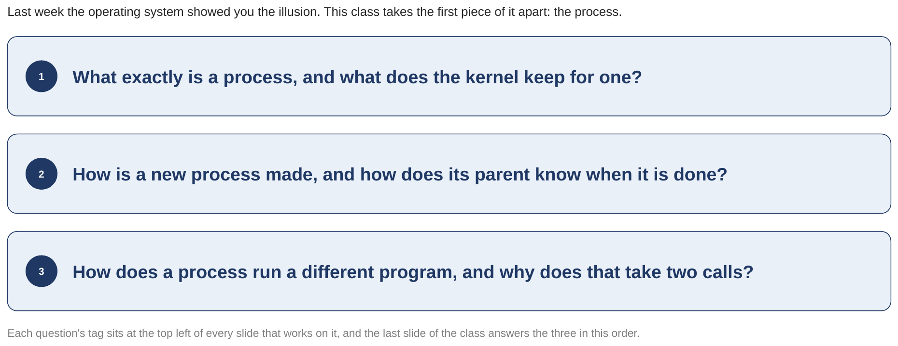{width=100%}
<figcaption markdown="1">Figure 7. The three questions of the first class. From slide 6.</figcaption>
</figure>

The first question is about the thing itself: what exactly is a process, and what must the kernel keep for each one (Sections [1.1](#sec-1-1) to [1.4](#sec-1-4))? The second is about making one. A program cannot build a process by itself, so it has to ask the kernel; how does it ask, and how does the program that asked find out when the new one is done (Sections [2.1](#sec-2-1) to [2.4](#sec-2-4))? The third is about running something different, since an exact copy of the program that asked is rarely what anyone wants. How does a process start running a different program, and why does Unix use two calls for that where one would seem enough (Sections [3.1](#sec-3-1) to [3.4](#sec-3-4))? (Unix is the family of operating systems that Linux, macOS and xv6 all copy their design from.) The first class summary collects the three answers. Extras [1](#extra-1) to [21](#extra-21) go deeper on the same three questions and can be read later or skipped.

## Chapter 1. What exactly is a process, and what does the kernel keep for one? {#chapter-1}

*The question this chapter answers: what exactly is a process, and what does the kernel keep for one?*

### 1.1 Problem Time sharing needs a list of what to save {#sec-1-1 data-toc-label="1.1 [Problem] Time sharing needs a list of what to save"}

What we have is last week's first demo. Four copies of one small program, `cpu.c`, were started on a machine with one CPU. Each copy printed its own letter, over and over: A, B, C or D. The output came out as A B D C A B D C, and all four copies kept advancing. Each copy behaved as if the machine were its own. Last week called the thing that owns such a pretend CPU a process, and noted that xv6 keeps one record, a `struct proc`, for each process.

Where it breaks is the moment the CPU moves from one copy to the next. The CPU runs one stream of instructions at a time. (An **instruction** is one tiny step a CPU can do, such as "add these two numbers" or "copy this value into memory"; a program is a long list of them.) So the OS has to run A for a moment, then stop it and run B, then C, then D, and then come back to A, many times a second. When A runs again, it must continue exactly where it stopped. That only works if everything A was using was put somewhere safe and is brought back. A's loop counter sits in a register. Its variables sit in some piece of memory. Its output goes to a terminal. Leave out any one of those and A resumes wrong: it counts from a wrong number, or it prints somewhere else. And so far nobody has written down the complete list.

<figure markdown="1">
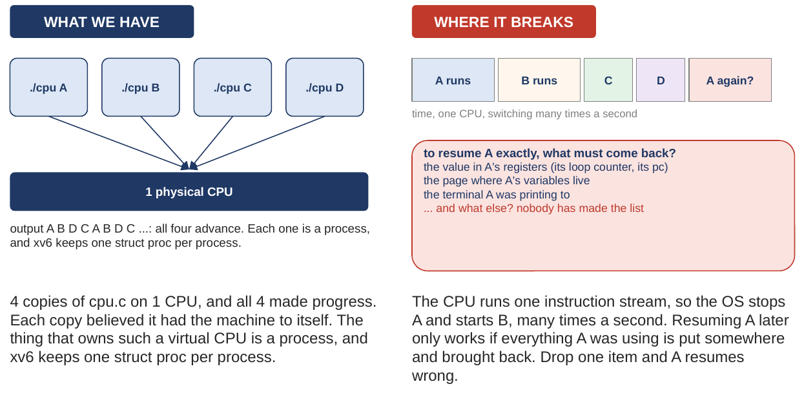{width=100%}
<figcaption markdown="1">Figure 8. What we have (four copies of cpu.c share one CPU) and where it breaks (to resume A exactly, everything A was using must come back, and nobody has made the list). From slide 7, following textbook chapter 4.</figcaption>
</figure>

So we need two things. The first is a precise list of what a running program can read or change. The second is one place in the kernel that holds a copy of that list for every process. The textbook puts the question of the whole chapter this way: although there are only a few physical CPUs available, how can the OS provide the illusion of a nearly-endless supply of said CPUs? Its answer has a name. **Time sharing** means running one process for a little while, then another, then another, so that one CPU serves many. Each process runs more slowly than it would alone, and that is the honest price of the illusion. The list of things a running program can read or change also has a name: its **machine state**.

Before reading on, try the slide's question yourself: name one thing the OS must save to stop a program and resume it later. [Section 1.2](#sec-1-2) gives the full list, and it has exactly three parts.

### 1.2 Concept The three parts of a process: memory, registers and open files {#sec-1-2 data-toc-label="1.2 [Concept] The three parts of a process: memory, registers and open files"}

[Section 1.1](#sec-1-1) left a gap: to pause a program and resume it, the OS needs the complete list of what the program can touch while it runs. The way to build that list is to start from the program. A **program** is a file on disk, and a file on disk does nothing. A **process** is that program running. So to describe a process, list everything it can touch while it runs. There are exactly three things.

<figure markdown="1">
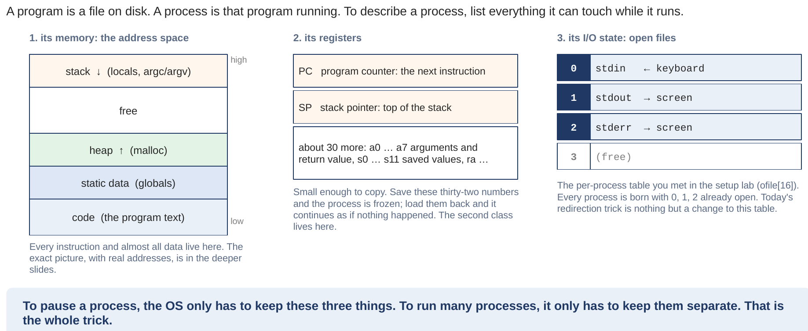{width=100%}
<figcaption markdown="1">Figure 9. The three parts of a process: its memory (the address space), its registers, and its open files. From slide 8, following textbook section 4.1.</figcaption>
</figure>

The first part is its **memory**, which is called its **address space**: the range of memory addresses the process can use, with everything stored at them. The left column of Figure 9 draws it as a strip, with low addresses at the bottom and high addresses at the top. From the bottom up it holds four regions. The **code** is the program's instructions, copied from the file. The **static data** holds the program's **global variables** (values that the whole program can see and that exist for as long as it runs). The **heap** is memory the program asks for while it runs; in C it asks with a function called `malloc` ("memory allocate"), and the heap grows upward each time. At the top is the **stack**. It holds the **local variables** of each function that is currently running: the values that exist only while that function runs. (A **function** is a named piece of a program that other parts can run.) The stack grows downward. The empty middle is free space, so the two can grow toward each other. Every instruction, and almost all the data, live somewhere on this strip. [Extra 3](#extra-3) prints this same picture with real addresses from a real process.

The second part is its **registers**, the few dozen tiny storage cells inside the CPU. Two of them matter most. The **program counter** (PC) holds the address of the next instruction the CPU will run, so it says where in the program the process is. The **stack pointer** (SP) holds the address of the current top of the stack. The rest hold values the program is working on. On RISC-V their names include `a0` to `a7`, which carry the arguments of a function call and its result. (An **argument** is a value handed to a function when it is called.) They also include `s0` to `s11`, which hold saved values, and `ra`, which holds the address to go back to when a function finishes. [Section 2.2](#sec-2-2) needs `a0` and [Section 6.3](class-2.md#sec-6-3) needs the `s` registers and `ra`. The slide counts them like this. RISC-V has 32 general registers, numbered 0 to 31. Register 0 always holds zero, so there is nothing to save in it. That leaves 31, and the program counter makes 31 + 1 = 32 numbers. They are small enough to copy. Save those 32 numbers and the process is frozen; load them back and it continues as if nothing had happened. The second class is about exactly this copy.

The third part is its **open files**, which the textbook calls its I/O state. (**I/O** means input and output: reading from a keyboard, a disk or a network, and writing to a screen, a disk or a network.) A process keeps a small table with one row, or slot, per open file. Each slot has a number, and that number is called a **file descriptor**. Every process starts with three slots already filled in. Slot 0 is **standard input** (written stdin), normally the keyboard. Slot 1 is **standard output** (stdout), normally the screen. Slot 2 is **standard error** (stderr), where error messages go, also normally the screen. Slot 3 is free in the drawing. (The process's current folder belongs to the same I/O state; [Section 1.4](#sec-1-4) meets it.) In xv6 this table is a field called `ofile`, with 16 slots (the slide writes it `ofile[16]`; [Section 1.4](#sec-1-4) reads it in the code). The third question of this class, how the shell sends a program's output into a file, turns out to be nothing more than a change to this table.

The blue bar under the three columns is the point of the section. To pause a process, the OS only has to keep these three things (plus a little bookkeeping that Sections [1.3](#sec-1-3) and [1.4](#sec-1-4) add: its state, its pid, its parent). To run many processes, it only has to keep their copies separate. That is the whole trick. One program can be many processes at once: last week's four copies of `cpu.c` were four processes of one program, four separate copies of this picture.

What this section settled: a process is its memory, its registers and its open files. What it leaves open: a process is not always on the CPU, and the kernel needs a word for where it is at each moment. That is the next section.

### 1.3 Concept Running, ready and blocked: the process states {#sec-1-3 data-toc-label="1.3 [Concept] Running, ready and blocked: the process states"}

[Section 1.2](#sec-1-2) described what a process is made of, but not what it is doing. A process is not always on the CPU. One that has paused itself to wait for something is neither running nor finished. ([Extra 3](#extra-3) shows one: a program called `hold` that stops and waits while we look at its memory.) And one that could run, but whose turn has not come, is not running either. The kernel needs a word for each of these situations, because it has to decide which processes may be given the CPU next. So it keeps, for every process, a **state**: a one-word label for what the process is doing at this moment. There are three main states.

<figure markdown="1">
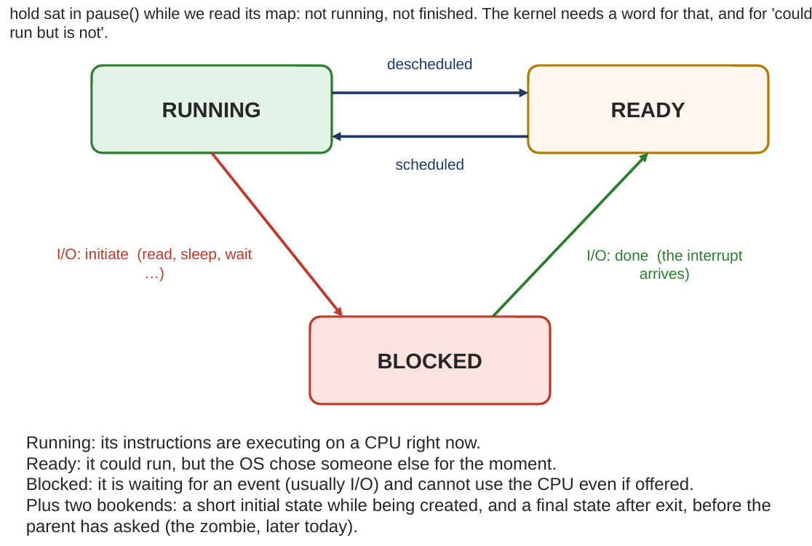{width=89%}
<figcaption markdown="1">Figure 10. The three states of a process and the arrows between them. From slide 9, following the textbook's Figure 4.2.</figcaption>
</figure>

A process is **running** when its instructions are executing on a CPU right now. It is **ready** when it could run and waits for nothing, but the OS has chosen someone else for the moment. It is **blocked** when it is waiting for an event, usually the end of some I/O, and could not use the CPU even if it were offered. A disk read, a pause of a few seconds, or waiting for a child process to finish all block a process.

The arrows in Figure 10 are the ways a process moves. The two arrows between running and ready are the OS's decision. Moving a process from ready to running is called **scheduling** it; moving it from running back to ready is called **descheduling** it. Who makes that decision, and how, is a later week of the course; the machinery that makes the move possible is the second class of this week. The red arrow, "I/O: initiate", is a process blocking itself by asking for something slow. The green arrow, "I/O: done", is the event arriving. When the disk has finished, it sends the CPU an **interrupt**: a signal from a device to the CPU that makes the kernel run a piece of code called its handler, whatever program was running at the time. The kernel's handler then marks the waiting process ready. Not running: ready. It still has to wait for its turn.

Besides the three main states there are two short ones at the ends of a process's life. There is a brief initial state while the process is being created. And there is a final state after the process has exited, before its parent has asked how it ended. That final state is called a **zombie**: a process that has finished but whose record is kept until its parent collects its exit status. It exists because the parent may want to know how the child ended, so the kernel must keep that number somewhere until the parent asks. (An **exit status** is the number a program hands back when it ends; 0 usually means success.) [Section 2.4](#sec-2-4) meets one.

<figure markdown="1">
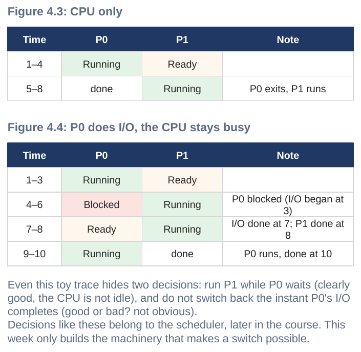{width=56%}
<figcaption markdown="1">Figure 11. The textbook's Figures 4.3 and 4.4: two processes traced tick by tick, first with CPU work only, then with one of them doing I/O. From slide 9.</figcaption>
</figure>

Figure 11 shows the states over time. Time is counted in ticks, equal steps of time numbered 1, 2, 3, and so on; P0 and P1 are process 0 and process 1. In the top table, the textbook's Figure 4.3, both processes only compute. P0 runs for ticks 1 to 4 and finishes; then P1 runs for ticks 5 to 8. Nothing needs deciding. In the bottom table, the textbook's Figure 4.4, P0 starts an I/O at tick 3 and becomes blocked for ticks 4 to 6, so P1 runs while P0 waits. The I/O finishes at tick 7, which makes P0 ready, but P1 is allowed to keep the CPU and finishes at tick 8. P0 then runs ticks 9 and 10 and is done at 10.

The two tables are separate examples, so the amount of work differs: in the second, P0 needs five ticks of CPU (three before its I/O and two after) and P1 needs five (ticks 4 to 8). Even this toy hides two choices. Running P1 while P0 waits is clearly good, because otherwise the CPU would sit idle. Not switching back to P0 the instant its I/O completes is not obviously good or bad. Choices like these belong to the **scheduler**, the part of the kernel that picks which ready process runs next; the course studies it later. This week only builds the machinery that makes a switch possible.

What this section settled: a process is always in one of three states, and two kinds of event (the OS's decision, and I/O starting or finishing) move it between them. What it leaves open: where the kernel writes all of this down. The next section opens the record.

### 1.4 Real kernel struct proc: everything the kernel keeps about one process {#sec-1-4 data-toc-label="1.4 [Real kernel] struct proc: everything the kernel keeps about one process"}

Sections [1.2](#sec-1-2) and [1.3](#sec-1-3) gave the list: three parts and a state. The kernel must keep that list for every process, all the time, somewhere it can find it quickly, including for processes that are not running. So it needs a record with one field for each item on the list, and a place to keep one such record per process. In xv6 that record is a C `struct` named `struct proc` (a struct, from Part 0, is a group of named fields kept together, like one row of a table with a name for each column). Figure 12 is the complete definition, lines 84 to 107 of the file `kernel/proc.h` in the xv6 source tree you use in the labs.

<figure markdown="1">
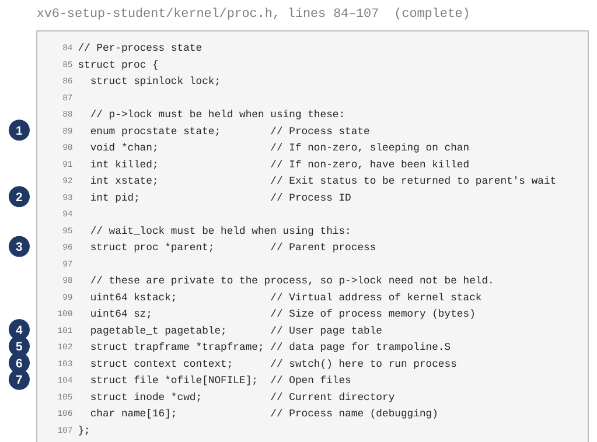{width=82%}
<figcaption markdown="1">Figure 12. struct proc, the complete definition, with seven numbered callouts. From slide 10, following textbook section 4.5.</figcaption>
</figure>

A few marks of C first, so the listing can be read. A line that starts with `//` is a **comment**: a note for people, ignored by the computer. Each field is written as a type followed by a name and a semicolon, such as `int pid;`, which means "a whole number called pid". `uint64` is a 64-bit whole number (a **bit** is a single 0 or 1, and a byte is 8 bits, so 64 bits make 8 bytes) that is never negative. A star, as in `struct proc *parent`, means the field is a **pointer**: it holds the address of something else in memory, here another `struct proc`. Square brackets give an array, a row of equal slots reached by position number: `char name[16]` is 16 characters, and `ofile[NOFILE]` is `NOFILE` slots. `NOFILE` is a name for a fixed number set in another file of the tree (`kernel/param.h`), where it is 16. The fields `lock` and the comments about locks are for running safely on several CPUs at once; the concurrency weeks explain them, and this guide ignores them.

<figure markdown="1">
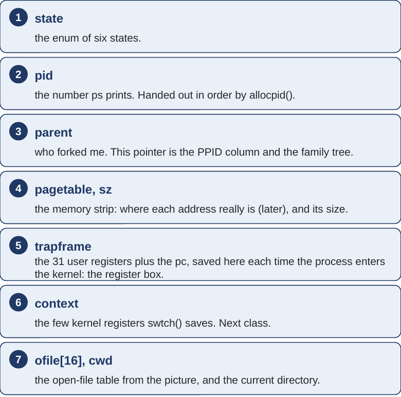{width=62%}
<figcaption markdown="1">Figure 13. The seven fields the slide picks out, one card each. From slide 10.</figcaption>
</figure>

Now the seven callouts, one card each in Figure 13. Callout 1, `state`, is the state of [Section 1.3](#sec-1-3). It is an **enum** (a type whose values are a short fixed list of names), and its six values are `UNUSED`, `USED`, `SLEEPING`, `RUNNABLE`, `RUNNING` and `ZOMBIE`. `SLEEPING` is xv6's word for blocked and `RUNNABLE` its word for ready; `UNUSED` marks a record that holds no process, and `USED` is the short initial state. Callout 2, `pid`, is the process ID, the number `ps` prints; xv6 hands them out in order, 1, 2, 3, and so on, with a function called `allocpid()`. Callout 3, `parent`, points at the process that created this one. Following these pointers from process to parent gives the family tree, and the parent's pid is the PPID column that `ps` can print. Callout 4, `pagetable` and `sz`, describe the memory strip of [Section 1.2](#sec-1-2). `sz` is its size in bytes. The page table records where each address of the strip really is in the computer's memory; the memory weeks of the course take that apart. Callout 5, `trapframe`, points at the register box: each time the process enters the kernel (for a system call or an interrupt; the second class shows how), its 31 registers and its program counter are saved there. Callout 6, `context`, is a smaller set of registers, the ones the kernel saves when it switches the CPU from one process to another (the time sharing of [Section 1.1](#sec-1-1)). Why a second, smaller set is needed is the subject of the second class ([Section 6.1](class-2.md#sec-6-1)). Callout 7, `ofile[16]` and `cwd`, are the open-file table of [Section 1.2](#sec-1-2) and the **current directory** (the folder that file names without a full path are looked up in; its type, `struct inode`, is the kernel's record of a file or folder on disk). The fields without a callout are bookkeeping. `kstack` is the address of a small stack the kernel uses while it works for this process. `chan` and `killed` are used for sleeping and for ending a process, and `name` is the program's name, for debugging.

So every item of the list has a field. (`cwd`, the folder the process works in, belongs with the open files: it is part of the same I/O state, which is why [Section 1.2](#sec-1-2) did not count it separately.) Memory: `pagetable` and `sz`. Registers: `trapframe` and `context`. Open files: `ofile`. State: `state`. And the struct adds the bookkeeping a family of processes needs: `pid`, `parent`, and `xstate`, the exit status that waits for the parent (line 92).

This struct has a general name. A record that holds everything the kernel knows about one process is called a **process control block**, or **PCB**; every operating system has one, under its own name. xv6 keeps 64 of them in one array called `proc`, declared as `proc[NPROC]` with `NPROC` set to 64. That array is the **process list**. There is no magic anywhere: last week's illusion of four CPUs is an array of structs and a loop that walks it ([Extra 7](#extra-7) shows a loop that finds a free record; [Extra 26](class-2.md#extra-26) shows the one that picks the next process to run). [Extra 7](#extra-7) shows the array and the loop.

**Checkpoint 1.** Settled: a process is a running program, made of its memory (code, data, heap, stack), its registers (the program counter and 31 more) and its open files, plus a state: running, ready or blocked. The kernel keeps all of it in one `struct proc`, 64 of them in an array. Still open: when xv6 starts, the 64 records are all empty except two, one for `init` (the first process, started by the kernel itself) and one for the shell. Who fills a free record, and how does a running program ask the kernel for a new process? You should now be able to name the three parts of a process's machine state and say which field of `struct proc` holds each one.

## Chapter 2. How is a new process made, and how does its parent know when it is done? {#chapter-2}

*The question this chapter answers: how is a new process made, and how does the process that asked for it know when it is done?*

### 2.1 Problem A program cannot fill a struct proc itself {#sec-2-1 data-toc-label="2.1 [Problem] A program cannot fill a struct proc itself"}

What we have is the array of [Section 1.4](#sec-1-4): 64 records of type `struct proc` inside the kernel, one per process. Picture it while a small program called `p1` runs from the xv6 shell. Three records are in use: `init`, the shell `sh`, and `p1`. The other 64 − 3 = 61 are `UNUSED`. The shell's whole job is to start programs, so it wants one of those 61 free records to become a new process, with its memory, its registers and its open files already filled in.

<figure markdown="1">
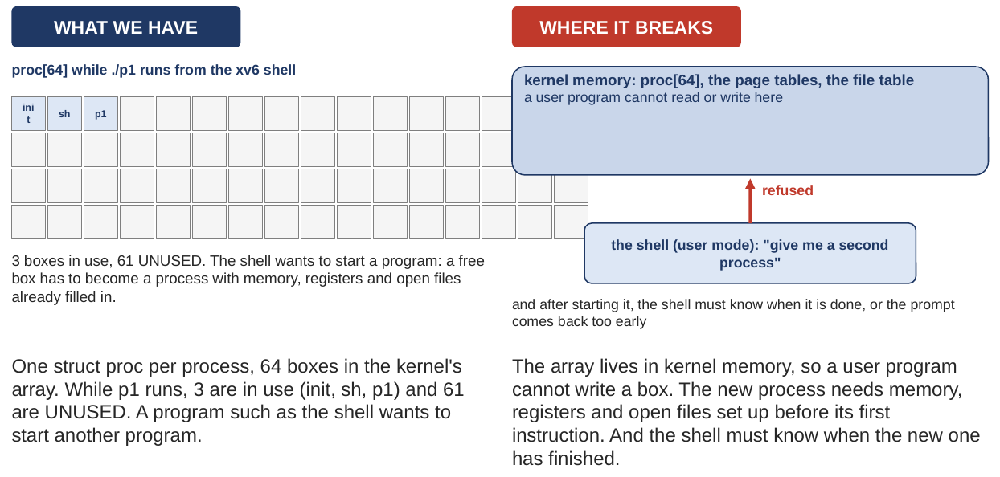{width=100%}
<figcaption markdown="1">Figure 14. What we have (the 64 records while p1 runs: 3 in use, 61 free) and where it breaks (the array lives in kernel memory, and the shell's request to take a record itself is refused). From slide 12, following textbook chapter 5.</figcaption>
</figure>

Where it breaks is where the array lives. It sits in the kernel's own memory, next to the other things the kernel keeps for itself (the page tables and the table of open files). No ordinary program may read or write that memory (how the hardware enforces this is the second class's subject, [Section 4.3](class-2.md#sec-4-3)); if programs could, any program could rewrite any other process's record. So the shell cannot simply take a free record and fill it in. There is a second gap as well. After starting the new program, the shell has to learn when it has finished. Otherwise the next prompt would appear while the program is still printing.

So we need two **system calls** (Part 0: a request from a program to the kernel). One asks the kernel to make a new process; the other waits until that process has finished. The textbook states the chapter's question this way: what interfaces should the OS present for process creation and control, and how should they be designed to enable powerful functionality, ease of use, and high performance? (An **interface** here is the set of calls a program can make, with what each one takes and returns.) Unix's answer to the first half is strange. The kernel makes a copy of the program that asked, and the copy wakes up inside the very same call. The two calls are named `fork()` and `wait()`: **fork** asks the kernel for a new process that is a copy of the caller, and **wait** blocks the caller until one of its children has finished. (The parentheses after a name mark it as a function or a call, something a program runs.)

One puzzle comes with this design, and the slide asks it: if the kernel copies you exactly, how could the copy ever find out that it is the copy? Think about it for a moment. The next section answers it with one number.

### 2.2 Concept fork(): one call, two returns {#sec-2-2 data-toc-label="2.2 [Concept] fork(): one call, two returns"}

[Section 2.1](#sec-2-1) left a puzzle: the kernel makes an exact copy of the caller, so how does the copy know it is the copy? The answer has to be something that differs between the two right after the call, and the only thing a program learns from a call is what the call returns (the value it hands back to the caller). So the two copies must get different return values from the same call. Figure 15 shows how.

<figure markdown="1">
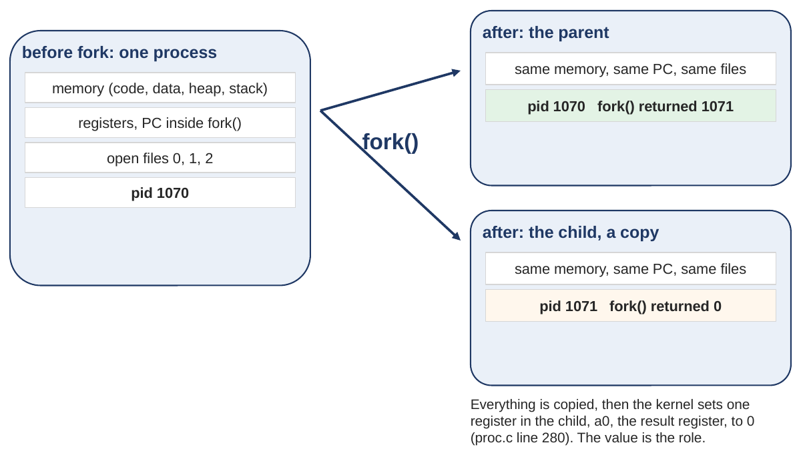{width=96%}
<figcaption markdown="1">Figure 15. fork() as a picture: one process before the call, two after, with the value fork() returned in each. From slide 13, following textbook section 5.1.</figcaption>
</figure>

Before the call there is one process, with pid 1070. Its program counter is inside `fork()`, because it is in the middle of calling it. `fork()` asks the kernel for a copy. When it returns, there are two processes. The original, now called the **parent**, keeps everything it had, and `fork()` returns to it the number 1071, the pid of the new process. The new process, the **child**, gets pid 1071 and is, inside, the same as the parent: the same memory contents, the same program counter, the same open files. But `fork()` returns 0 to it.

The difference comes from one register. On RISC-V, a function leaves its result in the register `a0` ([Section 1.2](#sec-1-2) named it: the register for the result). After copying everything, the kernel writes a 0 into the child's saved copy of `a0`. That is line 280 of the file `kernel/proc.c` in the xv6 tree: `np->trapframe->a0 = 0;`. It reads "in the new process's saved registers, set `a0` to 0". (`np` is the kernel's name there for the new process, and `->` means "the field of the record this pointer points to".) In the parent, `a0` holds the child's pid. The kernel's fork function ends by returning that number, and the return value of a system call is put into the caller's saved `a0` ([Extra 13](#extra-13) and [Section 4.5](class-2.md#sec-4-5) show both steps). When the kernel returns to the program, it loads the saved registers back into the CPU, so the saved `a0` becomes the real one. So the value is the role: 0 means "I am the child"; anything else means "I am the parent, and this is my child's pid".

<figure markdown="1">
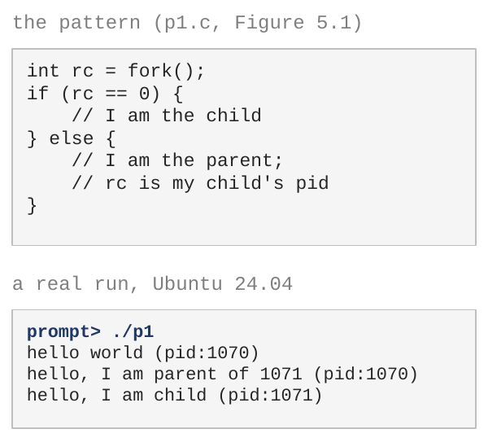{width=48%}
<figcaption markdown="1">Figure 16. The shape every program that forks has, and a real run of p1 on the Ubuntu machine. From slide 13, following the textbook's Figure 5.1.</figcaption>
</figure>

Every program that forks therefore has the shape at the top of Figure 16. Here is how to read it, line by line. `int rc = fork();` calls `fork()` and stores what it returns in a whole-number variable named `rc` ("return code"). `if (rc == 0) {` tests whether `rc` equals 0; in C, `==` asks "is it equal?", while a single `=` stores a value. If it is 0, the lines between that brace and the next run: "I am the child". Otherwise the lines after `} else {` run: "I am the parent, and `rc` is my child's pid". Both processes run these same lines, one after the other or at the same time, but each takes a different branch.

The bottom of Figure 16 is a real run of `p1`, the textbook's first fork program, on the Ubuntu machine. `prompt> ./p1` is the command that starts it (`./p1` means "the program file named p1 in the current folder"). `p1` prints a greeting with its own pid before it forks, then forks, and each branch prints one line. The greeting appears once, with pid 1070. Then the parent prints "hello, I am parent of 1071 (pid:1070)", and the child prints "hello, I am child (pid:1071)". Check the numbers against Figure 15: the parent's pid is 1070, fork returned 1071 to it, and the child's own pid is 1071.

The sentence to keep is in the blue bar at the bottom of the slide. The child does not start at the top of the program. It wakes up inside `fork()`, at the same instruction as the parent, and continues from there. That is why "hello world", printed before the fork, appears only once, while the two lines after it appear once each. Extras [9](#extra-9) to [13](#extra-13) show the complete `p1.c`, what the kernel builds, why the design returns twice, real runs, and the kernel function that does the copy.

What this section settled: `fork()` makes a copy that differs in one register, so one call returns twice with two different values. What it leaves open: the copy and the original are now both ready to run, and nothing has said which one runs first.

### 2.3 Problem After fork(), the order is not promised {#sec-2-3 data-toc-label="2.3 [Problem] After fork(), the order is not promised"}

What we have after `fork()` returns is two processes, the parent and the child, both ready to run, on a machine that may have only one CPU free for them. The question is which one runs first. The smallest program that shows the answer is `p1loop`, at the top of Figure 17. After `fork()`, each side prints three lines, labeled "parent" or "child" with a counter 0, 1, 2.

<figure markdown="1">
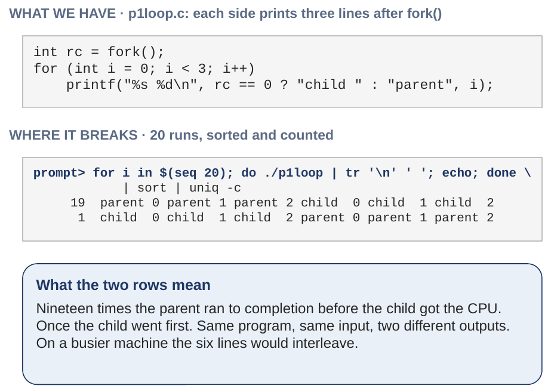{width=74%}
<figcaption markdown="1">Figure 17. What we have (p1loop: each side prints three lines after fork()) and where it breaks (20 runs on the Ubuntu machine give two different outputs). From slide 14, following textbook section 5.1.</figcaption>
</figure>

The program's three lines read like this. `int rc = fork();` forks, as in [Section 2.2](#sec-2-2). `for (int i = 0; i < 3; i++)` is a **loop**: it runs the next line three times, with `i` equal to 0, then 1, then 2 (`i++` adds 1 to `i`, and the loop stops when `i < 3` is no longer true). The line it repeats, `printf("%s %d\n", rc == 0 ? "child " : "parent", i);`, prints one line. `printf` ("print formatted") prints text; `%s` in the text is replaced by a word and `%d` by a whole number, and `\n` ends the line. The word is chosen by `rc == 0 ? "child " : "parent"`, which means "if `rc` is 0, the word child, otherwise the word parent".

Where it breaks is the second box of Figure 17. The program was run 20 times on the Ubuntu machine. The long command is `for i in $(seq 20); do ./p1loop | tr '\n' ' '; echo; done | sort | uniq -c`. It does three things. It runs `p1loop` 20 times (`seq 20` lists the numbers 1 to 20, `$(seq 20)` puts that list into the command, and `for ... do ... done` repeats once per number). It joins each run's six output lines into one line (`tr '\n' ' '` turns line breaks into spaces, and `echo` ends the line). And it puts those 20 lines in order and counts the identical ones (`sort` sorts, `uniq -c` counts lines that repeat). (The `|` sign hands one program's output to the next program as its input; [Section 3.4](#sec-3-4) says how.) The result has two rows. In 19 runs the parent's three lines came before the child's. In 1 run the child's came first. (Because the output goes into the `|`, not to a terminal, each process's lines come out together when it exits, by the buffer rule this section explains two paragraphs below: output to a pipe or a file is held until the program exits. So the count really records which of the two finished first, which is decided by the order in which the scheduler ran them.) Check the count: 19 + 1 = 20 runs. Same program, same input, two different outputs. Printed straight to a terminal on a busier machine, the six lines could even interleave.

<figure markdown="1">
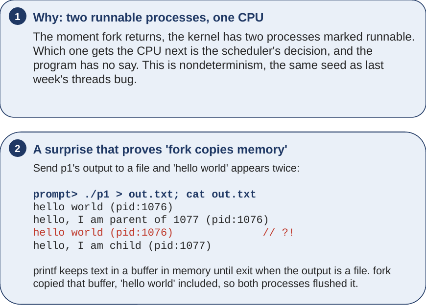{width=70%}
<figcaption markdown="1">Figure 18. Why the order changes, and a surprise that proves fork copies memory. From slide 14.</figcaption>
</figure>

The first card of Figure 18 says why. The moment `fork()` returns, the kernel has two processes marked ready and one CPU. Which one gets the CPU next is the scheduler's decision, and the program has no say in it. A program that can give different results on different runs, with the same input, is called **nondeterministic**. It is the same seed as last week's threads bug, where two threads raced on one counter.

The second card is a surprise that someone always finds. Send `p1`'s output into a file instead of the screen (`./p1 > out.txt` does that; the `>` sign is explained in [Section 3.3](#sec-3-3)), then print the file (`cat out.txt` prints a file's contents to the screen). The greeting appears twice, both times with the parent's pid 1076. The reason is how `printf` behaves. `printf` does not write each line at once. It collects text in a **buffer**, a holding area in the process's own memory, and writes the buffer out (it **flushes** it) at certain moments. When the output is a terminal, it flushes at every end of line. When the output is a file, it flushes only when the buffer is full or the program exits. So in the file case, "hello world" was still sitting in the buffer when `fork()` ran. `fork()` copied the whole memory, buffer included, and both processes flushed it when they exited: two exits, two copies of the greeting. On a terminal the buffer was already empty at the fork. `fork()` copies memory, including things you forgot were there.

So we need a way for a program to ask for an order when it needs one. The call for that is `wait()`.

### 2.4 Concept wait(): block until the child is done {#sec-2-4 data-toc-label="2.4 [Concept] wait(): block until the child is done"}

[Section 2.3](#sec-2-3) showed that after `fork()` either process may run first, and that a program which cares about the order has to ask for it. There was a second gap in [Section 2.1](#sec-2-1), too: the shell has to learn when the program it started has finished. One call can close both gaps, if it makes the parent stop until a child has finished. That call is `wait()`. Figure 19 is `p2.c`, the textbook's program, which is `p1` with the green lines added.

<figure markdown="1">
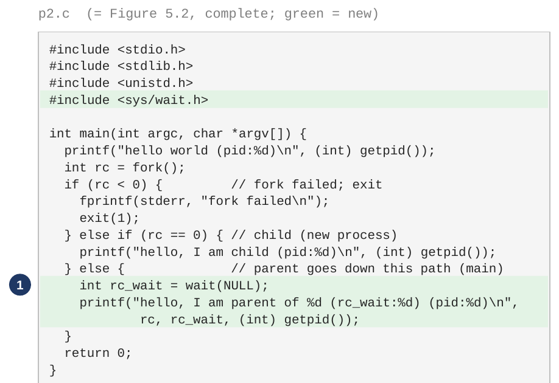{width=73%}
<figcaption markdown="1">Figure 19. p2.c, complete: p1 with wait() added in the parent's branch (the green lines). From slide 15, following the textbook's Figure 5.2.</figcaption>
</figure>

Reading the listing from the top. The `#include` lines bring in the declarations of the library functions the program uses (`<sys/wait.h>`, the green one, is the one for `wait`). `int main(int argc, char *argv[]) {` is where every C program starts; `argc` and `argv` carry the words typed after the program's name, which [Section 3.2](#sec-3-2) uses. The `printf` line prints the greeting with the process's own pid, which `getpid()` returns (`(int)` in front of it just says "treat this as a whole number"). Then `fork()`. If `rc < 0`, the kernel refused, so the program prints a complaint with `fprintf(stderr, ...)`, which prints to standard error, and ends with `exit(1)`; `exit` ends the process at once, and 1 is its exit status, here meaning failure. If `rc == 0`, the child prints its line. Otherwise, the parent's branch: the green line `int rc_wait = wait(NULL);` comes first, and only then the parent prints. `return 0;` ends `main`, and with it the process, with exit status 0.

Callout 1 is the whole change. `wait(NULL)` means: do not return until one of my children has exited. It returns that child's pid, which the program stores in `rc_wait`. (`NULL` is C's word for "no address"; passing it says "I do not need the child's exit status". A program that wants the status passes the address of a variable instead. Either way, `wait()` collects the status from the kernel and frees the child's record; with `NULL` the number is simply not handed to the program.)

<figure markdown="1">
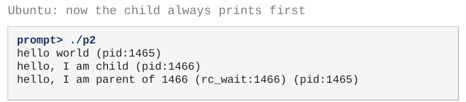{width=74%}
<figcaption markdown="1">Figure 20. The real run of p2 on the Ubuntu machine: now the child always prints first. From slide 15.</figcaption>
</figure>

The run in Figure 20 shows the effect. The greeting has pid 1465. The child, 1466, prints its line. Then the parent prints "hello, I am parent of 1466 (rc_wait:1466) (pid:1465)". The value `wait` returned, 1466, is the child's pid, as promised. And this order is now certain.

<figure markdown="1">
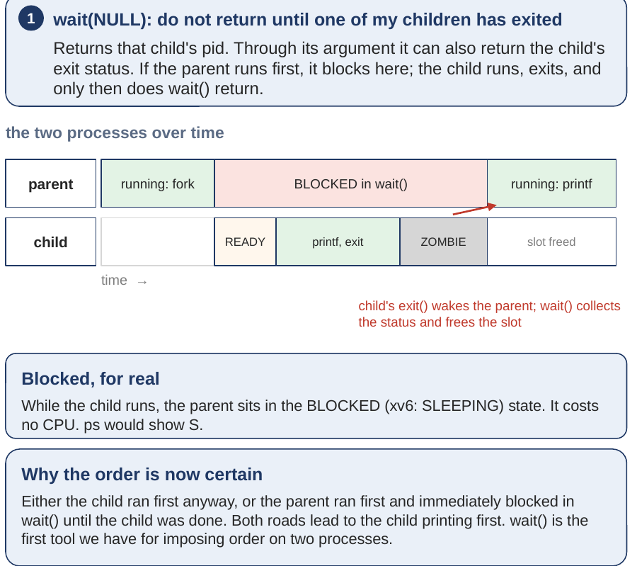{width=72%}
<figcaption markdown="1">Figure 21. wait() over time: the parent blocked until the child exits, the child briefly a zombie, then the slot freed. From slide 15.</figcaption>
</figure>

Figure 21 shows why, with time running to the right. Suppose the parent keeps the CPU after `fork()`. It reaches `wait()` and blocks: the red bar. A blocked process costs no CPU time, so the child, which was ready, runs. It prints and exits. At its exit the child becomes a zombie, the grey bar ([Section 1.3](#sec-1-3): finished, but its record kept until the parent asks). The child's exit wakes the parent. `wait()` returns the child's pid, takes the exit status, and frees the child's record, the "slot freed" at the right. Only then does the parent print.

The last card says why the order no longer depends on luck. Either the child ran first anyway, or the parent ran first and immediately blocked in `wait()` until the child was done. Both roads lead to the child printing first. `wait()` is the first tool we have for putting two processes in order, and a blunt one; the concurrency weeks of the course give finer tools. While the parent waits, its state is blocked, which xv6 calls `SLEEPING`; `ps` on Linux would show it with the letter S, for sleeping ([Extra 6](#extra-6) lists the letters).

**Checkpoint 2.** Settled: `fork()` copies the caller into a free record, with the same memory and the same registers except one, `a0`, set to 0 in the child, so the call returns 0 in the child and the child's pid in the parent. `wait()` blocks the parent until a child exits, and collects the child's exit status. Still open: every child so far runs the same program as its parent. A shell has to run other programs, such as `wc` and `ls` (two standard programs that [Section 3.1](#sec-3-1) describes) and your own, not copies of itself. You should now be able to predict the lines `p1` and `p2` print, and say which register makes `fork()` return twice with different values.

## Chapter 3. How does a process run a different program, and why does that take two calls? {#chapter-3}

*The question this chapter answers: how does a process run a different program, and why does that take two calls?*

### 3.1 Problem fork() only copies the caller, and a shell must run other programs {#sec-3-1 data-toc-label="3.1 [Problem] fork() only copies the caller, and a shell must run other programs"}

What we have so far is a process interface of two calls. `fork()` makes a copy of the caller: the same code, the same program counter, the same open files. `wait()` collects the copy when it exits. That is the whole interface so far.

<figure markdown="1">
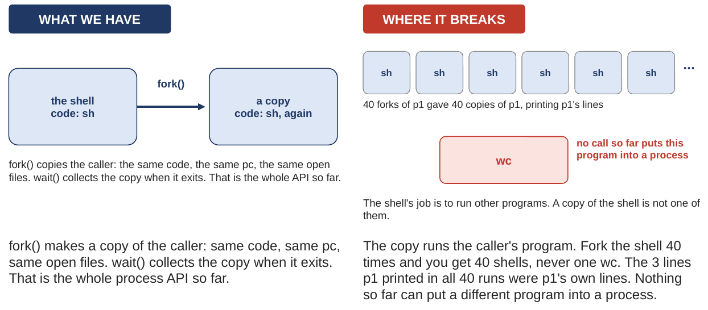{width=100%}
<figcaption markdown="1">Figure 22. What we have (fork() copies the shell; wait() collects the copy) and where it breaks (40 forks give 40 copies, and nothing can put a different program into a process). From slide 17, following textbook sections 5 and 5.3.</figcaption>
</figure>

Where it breaks is the shell's job. A shell exists to run other programs: `wc`, `ls`, your own programs. (**wc**, "word count", is a standard program that prints how many lines, words and bytes a file has; **ls** lists the files in a folder.) A copy of the shell is not one of them. The copy runs the caller's program. `p1` was run 40 times while the deck was being made, and in all 40 runs the three lines it printed were `p1`'s own lines. Fork the shell 40 times and you get 40 shells, never one `wc`. We can copy and we can wait. We cannot load a different program.

So we need a third call. The chapter's question, in [Section 2.1](#sec-2-1), asked for "powerful functionality", and an interface that can only clone the caller is not powerful. The new call has to keep the process (its pid, its parent, its open files) and replace the program inside it. It needs new memory loaded from a program file, a fresh stack holding the new program's arguments, and the program counter set to the new program's first instruction. That call is **exec**: the system call that replaces the calling process's program with one loaded from a file, keeping the pid and the open files.

### 3.2 Concept exec(): become a different program {#sec-3-2 data-toc-label="3.2 [Concept] exec(): become a different program"}

[Section 3.1](#sec-3-1) asked for a call that keeps the process and swaps the program inside it. Figure 23 is that call as a picture, before and after.

<figure markdown="1">
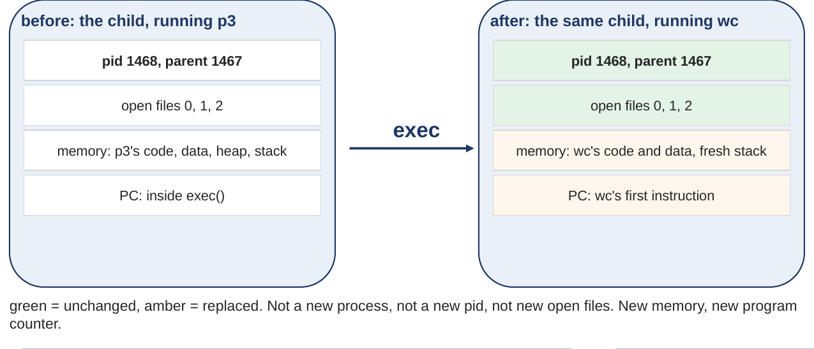{width=100%}
<figcaption markdown="1">Figure 23. exec() as a picture: the same child before and after, with what stayed (green) and what was replaced (amber). From slide 18, following textbook section 5.3.</figcaption>
</figure>

Before the call, on the left, this is a child process running a program called `p3`: pid 1468, parent 1467, open files 0, 1 and 2, memory holding `p3`'s code, data, heap and stack, and a program counter inside `exec()`. After the call, on the right, it is the same child: the same pid, the same parent, the same open files. Those rows are green, unchanged. But the memory now holds `wc`'s code and data with a fresh stack, and the program counter points at `wc`'s first instruction. Those rows are amber, replaced. So `exec()` does not make a new process. It gives the same process a new program.

<figure markdown="1">
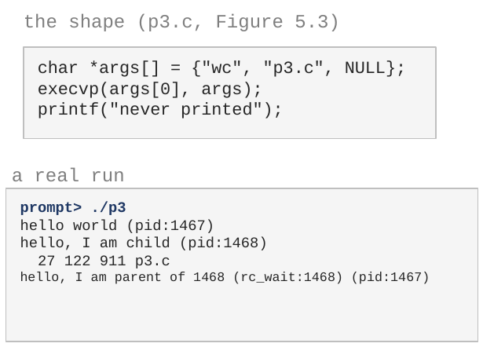{width=49%}
<figcaption markdown="1">Figure 24. The shape of an exec call in p3.c, and a real run of p3 on the Ubuntu machine. From slide 18, following the textbook's Figure 5.3.</figcaption>
</figure>

The top of Figure 24 is how a program calls it. `char *args[] = {"wc", "p3.c", NULL};` builds a list of words: the program's name, its argument, and `NULL` to mark the end of the list. (`char *` is C's way of writing a piece of text, a **string**; `args[]` makes it a list of strings.) `execvp(args[0], args);` asks the kernel to run the program named by the first word, `wc`, and hands it the whole list. Linux has several versions of exec with different letters at the end, which differ only in how the program and its arguments are given ([Extra 16](#extra-16) lists them). In `execvp`, the v means the arguments come as a list (a vector), and the p means "search the usual folders for the program by name". The list becomes the new program's `argc` and `argv`: `argc` is how many words there are (here 2), and `argv` is the list itself. The third line, `printf("never printed");` (the slide's short form of the textbook's message, `this shouldn't print out`), is never reached, and the first card below says why.

The bottom of Figure 24 is a real run of `p3`, the textbook's exec program (the complete listing is [Extra 16](#extra-16)). It prints its greeting as pid 1467, then forks. The child prints "hello, I am child (pid:1468)" and then execs `wc` on the file `p3.c`. The next line is `wc`'s own output: `27 122 911 p3.c`, which means the file `p3.c` has 27 lines, 122 words and 911 bytes. Then the parent, whose `wait` returned 1468, prints its line. Read the order: the line from `wc` sits between the child's hello and the parent's line, and the parent's `rc_wait` is 1468. The process that ran `wc` is the same child that said hello.

<figure markdown="1">
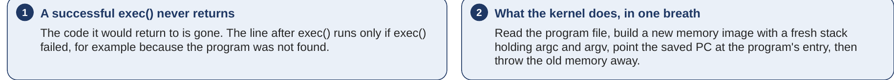{width=100%}
<figcaption markdown="1">Figure 25. Two rules that follow: a successful exec() never returns, and what the kernel does in one breath. From slide 18.</figcaption>
</figure>

Two rules follow, the two cards of Figure 25. First, a successful `exec()` never returns. The code it would return to is gone, replaced by `wc`. The line after `exec()` runs only if `exec()` failed, for example because no program of that name was found. Second, what the kernel does, in one breath: read the program file, build a new memory image with a fresh stack holding `argc` and `argv`, point the saved program counter at the program's entry (its first instruction), then throw the old memory away.

Hold the two verbs apart, as the slide's blue bar does. `fork()` creates a new process with the same program. `exec()` gives the same process a new program. Neither one alone can start a program; it takes both: fork, then exec in the child.

What this section settled: `exec()` loads a new program into an existing process. What it leaves open: why Unix splits the job into two calls when one "create and run" call would seem simpler.

### 3.3 Problem One create-and-run call leaves no moment to redirect {#sec-3-3 data-toc-label="3.3 [Problem] One create-and-run call leaves no moment to redirect"}

What we have is two calls where one would seem to do. With `fork()` and then `exec()`, the child exists for a moment as a copy of the shell, and then `exec()` turns it into `wc`. Other systems use one call. Windows has `CreateProcess`, and the POSIX standard (the shared rulebook that Unix-like systems follow) has `posix_spawn`. Each makes the new process and loads the program in one step, and the child runs `wc` at once. That looks simpler.

<figure markdown="1">
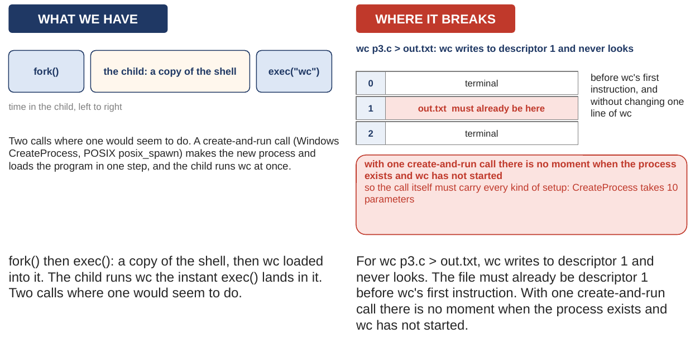{width=100%}
<figcaption markdown="1">Figure 26. What we have (fork, a copy of the shell, exec) and where it breaks (with one create-and-run call there is no moment when the process exists and wc has not started). From slide 19, following textbook section 5.4.</figcaption>
</figure>

Where it breaks is a command like `wc p3.c > out.txt`. The `>` sign asks the shell for **redirection**: sending a program's output (or its input) to a file instead of the terminal, arranged by the shell before the program starts. (The `<` sign does the same for input: `sort < names.txt` makes `sort` read from the file.) Here is what that means for the open-file table of [Section 1.2](#sec-1-2). `wc` writes its result to file descriptor 1, standard output, and never asks where descriptor 1 leads. So for the output to land in `out.txt`, the file must already sit in slot 1 before `wc`'s first instruction runs, and without changing one line of `wc`. With a single create-and-run call there is no such moment. Before the call, the new process does not exist; after it, `wc` is already running. So every kind of setup has to travel inside the call itself, as parameters decided in advance. There is one for the output file, one for the input, one for a pipe (a connection from one program's output to another's input, [Section 3.4](#sec-3-4)), one for the settings the program inherits, and so on. That is why `CreateProcess` takes 10 parameters (a fact of the Windows interface: besides the kinds listed here there are others, such as the program's priority and the settings of its window).

So we need a gap between the copy and the load: a moment in which the child exists, still runs the shell's own code, and can rearrange its own open files with ordinary system calls, before the new program starts. The program about to run never changes by one line. The textbook says it in one sentence: the separation of `fork()` and `exec()` is essential in building a UNIX shell, because it lets the shell run code after the call to `fork()` but before the call to `exec()`.

The slide ends with a question for you. To send `wc`'s output to `out.txt`, where would you put the two steps "close descriptor 1" and "open out.txt": before `fork()`, between `fork()` and `exec()`, or after `exec()`? Decide before reading [Section 3.4](#sec-3-4).

### 3.4 Concept The gap between fork() and exec(): redirection and the lowest free descriptor {#sec-3-4 data-toc-label="3.4 [Concept] The gap between fork() and exec(): redirection and the lowest free descriptor"}

[Section 3.3](#sec-3-3) asked for a moment between the copy and the load, in which the child can rearrange its open files before the new program starts. Two calls give exactly that moment. The answer to the slide's question is: between. Figure 27 is what a shell does for `wc p4.c > out.txt` (the slide uses the file `p4.c` here; any file name works the same way).

<figure markdown="1">
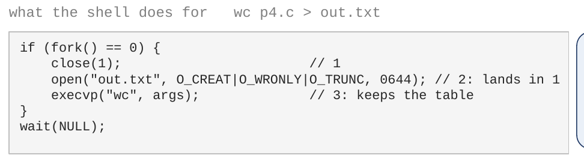{width=78%}
<figcaption markdown="1">Figure 27. What the shell does for wc p4.c > out.txt: fork, then in the child close, open and exec; the parent waits. From slide 20, following textbook section 5.4.</figcaption>
</figure>

Line by line. `if (fork() == 0) {` forks and enters the braces only in the child, where `fork()` returned 0. In the child, comment 1: `close(1);` closes descriptor 1, so slot 1 of the child's table becomes free. Comment 2: `open("out.txt", O_CREAT|O_WRONLY|O_TRUNC, 0644);` opens the file. The words joined by `|` are options: create the file if it is missing (`O_CREAT`), open it for writing only (`O_WRONLY`), and empty it if it already has something in it (`O_TRUNC`). (Inside C code, `|` combines options; it is not the shell's pipe sign.) A newly created file needs permissions, saying who may read or change it, so `open` takes them when it creates one. `0644` sets who may read and write a newly created file (every file belongs to a user, its owner, and to a group of users; a user is an account on the machine, and [Extra 21](#extra-21) says more about users). The last three digits are for three groups of people: the owner, the owner's group, and everyone else. In each digit, 4 means read, 2 means write and 1 means run, added together, so 6 = 4 + 2 is read and write, and 4 is read only. The leading 0 only marks the number as written in base 8. So `0644` lets the owner read and write the file, and everyone else only read it. That number is a fixed code of the system, not something to work out. The comment says where the file lands: in slot 1. Comment 3: `execvp("wc", args);` loads `wc`, and the open-file table stays as it is. After the braces, `wait(NULL);` is run by the parent, the shell, which waits for the child before printing its next prompt.

<figure markdown="1">
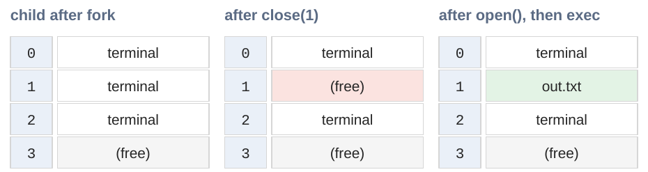{width=74%}
<figcaption markdown="1">Figure 28. The child's open-file table after fork, after close(1), and after open() and exec. From slide 20.</figcaption>
</figure>

Now follow the table in Figure 28, left to right. After `fork()`, the child's slots 0, 1 and 2 all point at the terminal, copied from the shell; slot 3 is free. After `close(1)`, slot 1 is free. Then `open()`. Which slot does the file get? Here is the rule that makes the trick work: `open()` always returns the lowest free descriptor. Slots 1 and 3 are free, and 1 is lower than 3, so the file lands in slot 1. (All of this happens in the child's own table. `fork()` gave the child its own copy of the table, whose slots point at the same open files as the shell's ([Extra 10](#extra-10) calls those files shared). So closing the child's slot 1 leaves the shell's slot 1 leading to the terminal; [Extra 18](#extra-18) shows the parent's table untouched.) And `exec()` keeps the table as it is, so `wc` starts with slot 1 pointing at `out.txt`.

<figure markdown="1">
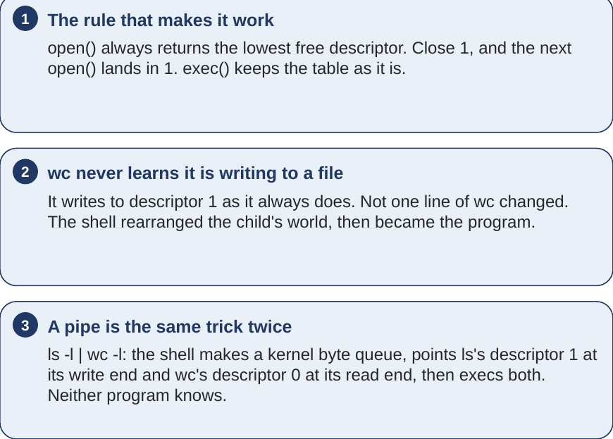{width=70%}
<figcaption markdown="1">Figure 29. The rule that makes it work, why wc never notices, and a pipe as the same trick twice. From slide 20.</figcaption>
</figure>

Card 2 of Figure 29 is the result. `wc` writes to descriptor 1, as it always has, and descriptor 1 is now a file. Not one line of `wc` changed; it never learns it is writing to a file. The shell rearranged the child's world and then became the program.

Card 3 extends the trick. A **pipe** connects the output of one program to the input of another, the way `ls -l | wc -l` counts the lines that `ls -l` prints (`-l` asks `ls` for the long, one-file-per-line listing, and asks `wc` for the line count only). The shell asks the kernel for a pipe, a queue of bytes held inside the kernel with a writing end and a reading end. The system call that makes it, `pipe`, returns two new descriptors, one for each end, and `fork()` copies both into each child. The shell forks twice. In the first child it puts the pipe's writing end into descriptor 1 and execs `ls`; in the second it puts the reading end into descriptor 0 and execs `wc`. It is the same close-then-fill trick, done once per child, with one change. A pipe end has no file name to open, so instead of `open` the child uses a call named `dup`, which copies an already-open descriptor into the lowest free slot ([Extra 19](#extra-19) shows the code). Neither program knows; `ls` writes to 1 and `wc` reads from 0, as always. [Extra 19](#extra-19) shows the program.

The blue bar sums up the design. Between `fork()` and `exec()` the child is running the shell's code in a world it is about to hand to another program. Two ordinary system calls in that gap (close and open), followed by the exec, did what a single create call needs a special parameter for. That gap is the whole reason Unix has two calls. And it gives every piece of a shell: read a line, fork, rearrange in the child, exec in the child, wait in the parent, print the prompt, repeat. [Extra 20](#extra-20) shows the real xv6 shell doing exactly this in 18 lines.

**Checkpoint 3.** Settled: `exec()` replaces the program inside the same process: new memory, a new program counter, the same pid and the same open files. The gap between `fork()` and `exec()` is where the shell redirects, and the shell is a loop of fork, exec and wait. Still open: everything in this class assumed two things that were never shown. That the OS can take the CPU back from a running program, and that a program cannot touch what it should not, such as the disk or another process's memory. The second class asks what makes those two assumptions true. You should now be able to write the three calls the shell makes in the child for `wc p3.c > out.txt`, in order, and say which slot the file lands in.

## Summary Summary of the first class: the process and its three calls {#summary-22 data-toc-label="[Summary] Summary of the first class: the process and its three calls"}

The first class answered three questions, and each answer solved a problem the class had named.

What exactly is a process, and what does the kernel keep for one? A process is a running program: its memory (code, data, heap, stack), its registers (the program counter and 31 more), its open files, and a state: running, ready or blocked. xv6 keeps all of it in one `struct proc`, 64 of them in an array. This solved the problem of time sharing in [Section 1.1](#sec-1-1): the OS now knows exactly what to put away to pause a program and what to bring back to resume it. The cost is one record per process, and in xv6 a ceiling of 64 processes.

How is a new process made, and how does its parent know when it is done? `fork()` copies the caller into a free record, with `a0` set to 0 in the copy, so the call returns 0 in the child and the child's pid in the parent. `wait()` blocks the parent until a child exits and collects its exit status. This solved two problems: a user program cannot touch the kernel's array ([Section 2.1](#sec-2-1)), and two ready processes have no promised order ([Section 2.3](#sec-2-3)). The cost is a full copy of the caller, and a zombie record that stays until someone calls `wait()`.

How does a process run a different program, and why does that take two calls? `exec()` replaces the program inside the same process: new memory from the file, a fresh stack with `argc` and `argv`, the same pid and the same open files. The gap between `fork()` and `exec()` is where the child rearranges its world: close 1, open the file, exec; `wc` never knows. The shell is a loop of the three calls. This solved two more problems: a copy of the shell is never `wc` ([Section 3.1](#sec-3-1)), and a single create-and-run call has no moment to redirect ([Section 3.3](#sec-3-3)).

<figure markdown="1">
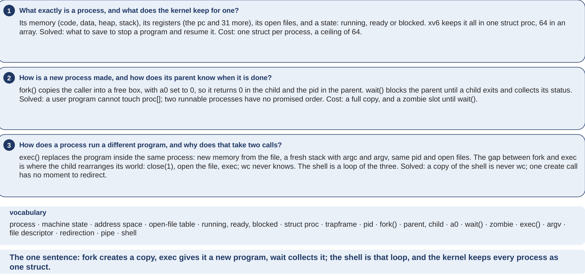{width=100%}
<figcaption markdown="1">Figure 30. The first class on one slide: the three answers, the vocabulary, and the class in one sentence. From slide 22, following textbook sections 4.6 and 5.7.</figcaption>
</figure>

Every word on the vocabulary line of Figure 30 should now have a picture behind it: process, machine state, address space, open-file table, running, ready and blocked, `struct proc`, trapframe, pid, `fork()`, parent and child, `a0`, `wait()`, zombie, `exec()`, `argv`, file descriptor, redirection, pipe, shell. And the whole class fits in one sentence: fork creates a copy, exec gives it a new program, wait collects it; the shell is that loop, and the kernel keeps every process as one struct.

The class left one question for the second, and it is worth reading about before going on. The shell got the CPU back when the child it chose to wait for exited, and the child could not touch the disk directly. Nothing in this class made either of those true. [Chapter 6](class-2.md#chapter-6) of the textbook, on limited direct execution, is the reading for that question; its three figures of the protocol, 6.1, 6.2 and 6.3, are the whole second class. The xv6 book's sections 4.1 to 4.3, on traps (the CPU's way into the kernel, which the second class explains) and system calls, describe the same path in the code. Before that, it is worth finding two lines in the xv6 tree from this class: the line in `kfork`, the kernel function that does the copying for `fork()` (in `kernel/proc.c`), that copies the registers, and the line that sets `a0`; [Extra 13](#extra-13) shows them. If you want more on this class first, Extras [1](#extra-1) to [21](#extra-21) follow.

## Going deeper, first class (optional) {#extras-1}

These sections go deeper into the three questions of the first class. Each one is labeled with the question it deepens (Q1, Q2 or Q3). You can read them now, later, or not at all; the second class can be read without them. Where it mentions one, it is only a pointer for readers who want more.

### Extra 1 Deeper, Q1 Three things from the week before, now with their names {#extra-1 data-toc-label="Extra 1 [Deeper, Q1] Three things from the week before, now with their names"}

The first class defined a process from scratch, but three pieces of it had already been seen in the first week without their proper names. Putting the names on them now ties the new definitions to things you have already watched happen.

<figure markdown="1">
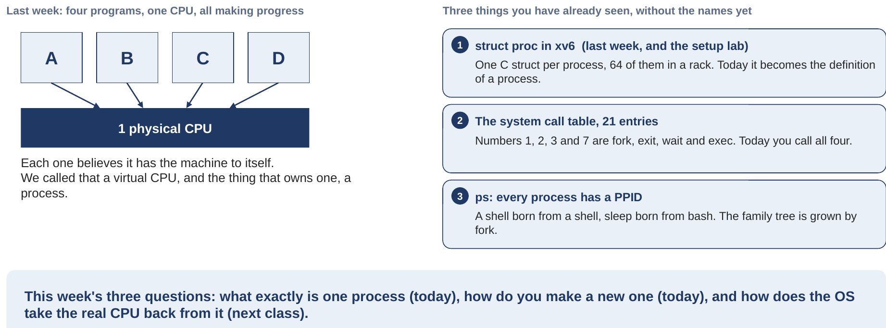{width=100%}
<figcaption markdown="1">Figure 31. Last week's four programs on one CPU, and three pieces of this class already seen without their names. From slide 23.</figcaption>
</figure>

On the left of Figure 31, four copies of one program ran on one CPU and all made progress. Each believed it had the machine to itself. That belief is a virtual CPU, and its owner is a process. On the right are the three pieces. First, `struct proc` in xv6: one C struct per process, 64 of them in a rack; [Section 1.4](#sec-1-4) made it the definition of a process. Second, the system-call table of xv6, which has 21 entries (a count read from the file `kernel/syscall.c` of the tree). Each system call has a number, and numbers 1, 2, 3 and 7 are `fork`, `exit`, `wait` and `exec`, the four calls of this class (the three of the roadmap, plus `exit`, which ends a process). (These numbers are the xv6 designers' choice, listed in the file `kernel/syscall.h`; there is nothing to work out. Why a call is named by a number at all, and not by an address, is [Section 4.4](class-2.md#sec-4-4).) Third, `ps`, which showed that every process has a PPID, a parent's pid. Every shell came from a shell, and a `sleep` command (a program that just waits a number of seconds) came from `bash` (bash is the usual shell on Linux). That family tree is grown by `fork()`, one child at a time.

The blue bar names the whole week in one line: what exactly is one process (the first class), how do you make a new one (the first class), and how does the OS take the real CPU back from it (the second class).

### Extra 2 Deeper, Q1 The first crux: time sharing, and mechanism against policy {#extra-2 data-toc-label="Extra 2 [Deeper, Q1] The first crux: time sharing, and mechanism against policy"}

[Section 1.1](#sec-1-1) quoted the chapter's crux in passing. This extra gives it its own page, because it sets up the vocabulary of the whole first part of the course: what time sharing costs, and the split between how the OS switches and which process it switches to.

<figure markdown="1">
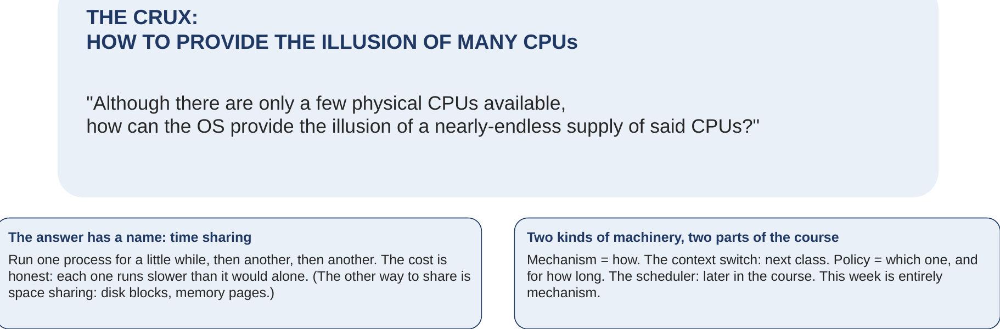{width=100%}
<figcaption markdown="1">Figure 32. The crux of chapter 4, its answer (time sharing) and the two kinds of machinery it needs. From slide 24, following textbook chapter 4.</figcaption>
</figure>

The crux at the top of Figure 32 is last week's demo stated as a problem: there are only a few real CPUs, and the OS has to make every program believe it has one of its own, from a supply that never runs out. The left card is the answer, time sharing ([Section 1.1](#sec-1-1)): one process for a little while, then the next. Its cost is honest, since each process runs slower because it takes turns. There is another way to share a resource, called **space sharing**: divide the resource into pieces and give each user a piece to keep for a while. Disk space is shared that way (a block of the disk belongs to one file until the file is deleted), and so are pages of memory.

The right card names the two kinds of machinery that time sharing needs, which are two parts of this course. A **mechanism** is the how: the low-level method that does a job, here stopping one process and starting another, which is called the context switch and is the second class of this week. A **policy** is the which: the rule that makes a choice, here which process runs next and for how long, which is scheduling, a few weeks later. (Part 0 introduced this pair.) The textbook gives a design tip about them: keep the two separate, so that the policy can be changed without rebuilding the mechanism. This week is entirely mechanism.

### Extra 3 Deeper, Q1 hold.c: every region of the picture has a real address {#extra-3 data-toc-label="Extra 3 [Deeper, Q1] hold.c: every region of the picture has a real address"}

[Section 1.2](#sec-1-2) drew a process's memory as a strip with four regions: code, static data, heap and stack. A drawing is only a claim. This extra checks it on a real process on the Ubuntu machine, by printing one address from each region and comparing them with the kernel's own list of the process's memory.

<figure markdown="1">
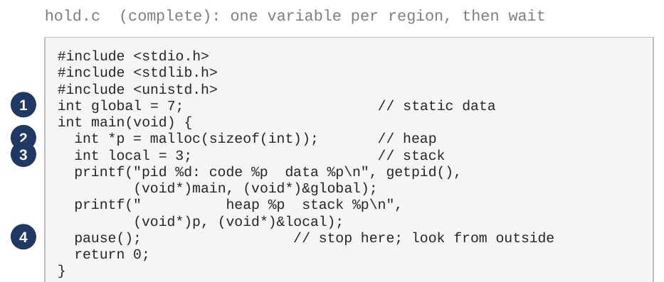{width=75%}
<figcaption markdown="1">Figure 33. hold.c, complete: one variable in each region, then a pause. From slide 25.</figcaption>
</figure>

The program in Figure 33 puts one variable in each region. Callout 1, `int global = 7;`, is a global variable, so it belongs in the static data. Callout 2, `int *p = malloc(sizeof(int));`, asks `malloc` for room for one whole number (`sizeof(int)` is that size, 4 bytes on the Ubuntu machine), so `p` points into the heap. Callout 3, `int local = 3;`, is a local variable of `main`, so it lives on the stack. The two `printf` lines print four addresses: where `main`'s code starts, where `global` is, where `p` points, and where `local` is. In C, `&global` means "the address of `global`"; `%p` prints an address in hexadecimal (base 16; [Appendix A](appendix.md#appendix-a) explains it); and `(void*)` only tells `printf` to treat the value as a plain address. Callout 4, `pause();`, stops the process and keeps it alive, so it can be looked at from outside.

<figure markdown="1">
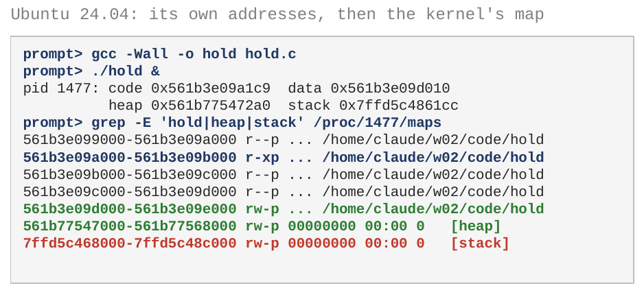{width=75%}
<figcaption markdown="1">Figure 34. The run on the Ubuntu machine: the program's own four addresses, then the kernel's map of the same process. From slide 25.</figcaption>
</figure>

Figure 34 is the run. `gcc -Wall -o hold hold.c` compiles the program: **gcc** is the C **compiler**, the program that turns C source into machine instructions; `-o hold` names the result `hold`, and `-Wall` asks for all warnings. `./hold &` runs it in the background (the `&` gives the prompt back at once), and it prints its pid, 1477, and its four addresses. Then `grep -E 'hold|heap|stack' /proc/1477/maps` prints part of a file the kernel keeps for every process: `/proc/1477/maps` is the kernel's list of process 1477's memory regions, one per line, and `grep` keeps only the lines that contain `hold`, `heap` or `stack`.

Each line of the map starts with a range of addresses, written as start-end in hexadecimal, then four permission letters, and at the end the file the region comes from (or a label such as `[heap]`). The letters mean: `r` readable, `w` writable, `x` executable (may be run as code), and `p` private to this process; a dash means "not allowed".

<figure markdown="1">
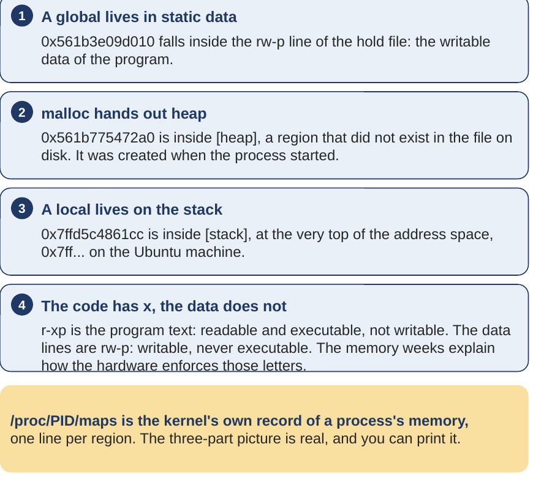{width=70%}
<figcaption markdown="1">Figure 35. What the four addresses prove. From slide 25.</figcaption>
</figure>

Now compare, using the cards of Figure 35. Card 1: the global's address `0x561b3e09d010` falls inside the line `561b3e09d000-561b3e09e000 rw-p`, the writable line of the `hold` file: the program's data. To check, compare digit by digit: both the start and the global's address begin `561b3e09d`, and the end of the range begins `561b3e09e`, so the global lies between them. Card 2: the `malloc` address `0x561b775472a0` falls inside `561b77547000-561b77568000`, the region labeled `[heap]`. That region is not in the file on disk at all; the kernel created it when the process started. Card 3: the local's address `0x7ffd5c4861cc` falls inside `7ffd5c468000-7ffd5c48c000`, labeled `[stack]`, at the very top of the address space (addresses that start `0x7ff...` on the Ubuntu machine). Card 4: the code line says `r-xp`, readable and executable but not writable; the writable data line says `rw-p`, writable but never executable, and the read-only data lines say `r--p`. The hardware enforces those letters; the memory weeks of the course explain how.

So the strip of [Section 1.2](#sec-1-2) is not a metaphor. It is a table the kernel keeps, and on Linux you can print it. Your addresses will differ, and they change on every run. Linux places the regions at random starting addresses on purpose, so that an attacker who finds a bug in a program cannot know in advance where its code and data sit. This security feature is called **ASLR** (address space layout randomization), and it comes later in the course. (`/proc` exists on Linux, including WSL2, the Linux that runs inside Windows; macOS has a command called `vmmap` instead.)

### Extra 4 Deeper, Q1 The real strip: a few small islands in a 128 TiB ocean {#extra-4 data-toc-label="Extra 4 [Deeper, Q1] The real strip: a few small islands in a 128 TiB ocean"}

[Extra 3](#extra-3) showed that each variable sits in the region the drawing predicted. But the drawing of [Section 1.2](#sec-1-2) also suggested something else: one compact strip, regions stacked neatly on top of each other. This extra draws the same process to scale, from its own addresses, and finds that the picture was right about the order of the regions and wrong about the spacing.

<figure markdown="1">
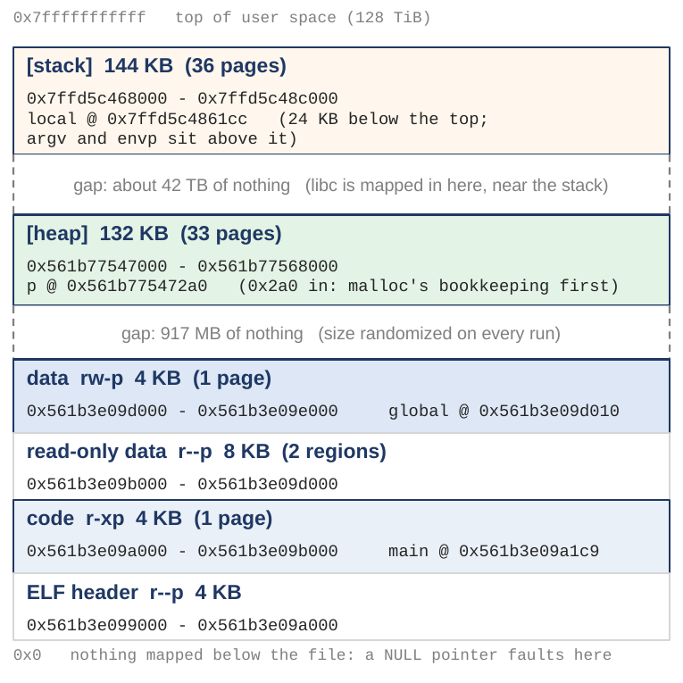{width=61%}
<figcaption markdown="1">Figure 36. The same process (pid 1477) drawn from its addresses: low at the bottom, high at the top, with the gaps marked. From slide 26.</figcaption>
</figure>

Read Figure 36 from the bottom. At the bottom sits the program file. First comes one page for the **ELF header**: ELF is the file format of Linux programs, and its header is the file's table of contents. Then one page of code, two regions of read-only data (constant data the program may read but never change, such as the text of its messages), and one page of writable data holding the global. Then a gap, then the heap, then a much bigger gap, then the stack. Above that, nothing, up to the top of the space a user program may use, `0x7fffffffffff`. That top is 128 TiB (a TiB is 2^40 bytes, as the next sentences use). Each hex digit is exactly four binary digits ([Appendix A](appendix.md#appendix-a)): 7 is 0111 and f is 1111. So `0x7fffffffffff`, a 7 and eleven f's, is 3 + 11 × 4 = 47 ones in a row. Adding 1 to a row of ones turns them all to zeros and carries a 1 to the front, the way 999 + 1 = 1000 in decimal. So the result is a 1 followed by 47 zeros, which is 2^47. So 0x7fffffffffff + 1 = 2^47 bytes, and 2^47 = 2^7 × 2^40 = 128 TiB (a TiB, a tebibyte, is 2^40 bytes; [Appendix A](appendix.md#appendix-a) lists these sizes). The 2^47 is a design fact of the x86-64 processor and Linux.

The sizes on the figure come from the addresses, by subtracting the start of a range from its end. Take the stack, from `0x7ffd5c468000` to `0x7ffd5c48c000`. The two numbers share their first digits, `7ffd5c4`, so only the rest matters: 0x8c000 − 0x68000 = 0x24000. In decimal, 0x24000 is 2 × 16^4 + 4 × 16^3 = 2 × 65,536 + 4 × 4,096 = 131,072 + 16,384 = 147,456 bytes. Divide by 1,024 bytes per KB and you get 147,456 / 1,024 = 144 KB; divide by 4,096 bytes per page (the page size on the Ubuntu machine, a design fact Card 2 comes back to) and you get 36 pages. Check: 36 × 4 KB = 144 KB. The heap, from `0x561b77547000` to `0x561b77568000`: 0x68000 − 0x47000 = 0x21000 = 2 × 65,536 + 1 × 4,096 = 135,168 bytes, which is 132 KB, or 33 pages (33 × 4 = 132).

<figure markdown="1">
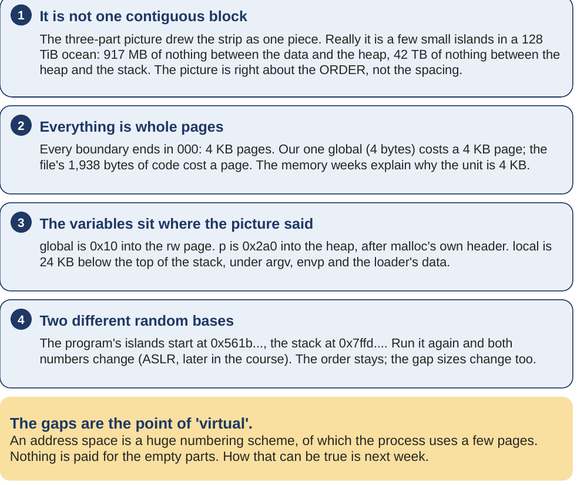{width=79%}
<figcaption markdown="1">Figure 37. What the to-scale strip shows. From slide 26.</figcaption>
</figure>

Card 1 of Figure 37 is the main point. The strip is not one block. It is a few small islands in an ocean: about 917 MB of nothing between the data and the heap, and about 42 TiB of nothing between the heap and the stack. Those two gaps are the same kind of subtraction, only longer, so the digits were done on a calculator; here are the steps. From the end of the data, `0x561b3e09e000`, to the start of the heap, `0x561b77547000`: both start `561b`, so subtract the rest. Converting each to decimal as in [Appendix A](appendix.md#appendix-a), digit by digit, gives two sums. First, 0x77547000 = 7 × 16^7 + 7 × 16^6 + 5 × 16^5 + 4 × 16^4 + 7 × 16^3 = 1,879,048,192 + 117,440,512 + 5,242,880 + 262,144 + 28,672 = 2,002,022,400. Second, 0x3e09e000 = 3 × 16^7 + 14 × 16^6 + 0 × 16^5 + 9 × 16^4 + 14 × 16^3 = 805,306,368 + 234,881,024 + 0 + 589,824 + 57,344 = 1,040,834,560. The difference is 961,187,840. Check it the other way: the calculator's hex difference is 0x394a9000. In decimal that is 3 × 16^7 + 9 × 16^6 + 4 × 16^5 + 10 × 16^4 + 9 × 16^3 = 805,306,368 + 150,994,944 + 4,194,304 + 655,360 + 36,864 = 961,187,840 bytes. And 961,187,840 / 2^20 ≈ 917 MB, counting a MB as 2^20 bytes. From the end of the heap, `0x561b77568000`, to the start of the stack, `0x7ffd5c468000`, the two numbers share no leading digits, so convert each to decimal first. A calculator, or any programming language, does this in one step: typing `print(0x7ffd5c468000)` into Python, for example, prints 140726151577600. The method is the same as in [Appendix A](appendix.md#appendix-a), only longer. `0x7ffd5c468000` is 140,726,151,577,600 and `0x561b77568000` is 94,675,966,263,296. To check by hand, split each into its first four digits and its last eight. Each unit of the first four is worth 16^8 = 4,294,967,296. So `0x7ffd5c468000` = 0x7ffd × 16^8 + 0x5c468000 = 32,765 × 4,294,967,296 + 1,548,124,160 = 140,724,603,453,440 + 1,548,124,160. And `0x561b77568000` = 0x561b × 16^8 + 0x77568000 = 22,043 × 4,294,967,296 + 2,002,157,568 = 94,673,964,105,728 + 2,002,157,568. The difference is 46,050,185,314,304 bytes (0x29e1e4f00000 in hex), and dividing by 2^40 = 1,099,511,627,776 gives about 41.9, so about 42 TiB (the figure writes TB for the same binary unit). The simple picture was right about the order and could not be right about the spacing. Two labels in the figure need a word. The C library, called libc (the code of `printf`, `malloc` and the rest), is placed in the big gap, near the stack. And nothing at all is placed at address 0, so a program that uses a `NULL` pointer by mistake causes a **fault**: an error the hardware reports to the kernel, instead of a silent read of whatever is there.

Card 2: every region starts and ends on an address that ends in `000`. In hexadecimal, three zeros at the end mean a multiple of 16^3 = 4,096. Memory is handed out in whole **pages** of 4 KB (4,096 bytes), because equal-sized pieces are what let the kernel keep track of memory simply (the memory weeks explain why). So a 4-byte global costs a whole page, and so do the file's 1,938 bytes of code (the size of the code in the file, which [Extra 5](#extra-5) reads with the `size` command). The memory weeks explain why the unit is 4 KB.

Card 3: the variables sit where the picture said. The global is `0x10` = 16 bytes into the writable page (`...d010` minus `...d000`). `p` is `0x2a0` into the heap, which is 2 × 256 + 10 × 16 = 672 bytes, because `malloc` keeps some records of its own at the start of the heap (which pieces are free, and how big each piece it hands out is) and hands out space after them. How much room those records take is the C library's own business; in this run they took the first 672 bytes. The local is 0x7ffd5c48c000 − 0x7ffd5c4861cc below the top. Both share `7ffd5c48`, so only the last four digits matter. 0xc000 = 12 × 4,096 = 49,152, and 0x61cc = 6 × 4,096 + 1 × 256 + 12 × 16 + 12 = 25,036. So the local sits 49,152 − 25,036 = 24,116 bytes (0x5e34 in hex), about 24 KB, below the top of the stack. Above it are the program's arguments (`argv`), its environment and data the loader put there. The environment is a list of settings every process inherits; `envp`, short for environment pointer, is the name C gives that list in the figure. The loader is the part of Linux that sets up a new program's memory before `main` runs.

Card 4: the program's islands start at `0x561b...` and the stack at `0x7ffd...`. Run it again and both starting addresses change, and so do the gap sizes. That is ASLR at work ([Extra 3](#extra-3)). The order never changes.

The yellow card is why the word "virtual" fits. An address space is a vast range of names, of which the process uses a few pages. Nothing is paid for the empty parts. How that can be true is the question of the next week of the course.

### Extra 5 Deeper, Q1 A process is born from a file {#extra-5 data-toc-label="Extra 5 [Deeper, Q1] A process is born from a file"}

The strip of Extras [3](#extra-3) and [4](#extra-4) belongs to a running process. A program on the disk has none of it: no stack, no heap, no registers. So something has to turn the file into the strip, and that something is `exec()` ([Section 3.2](#sec-3-2)). This extra follows the textbook's Figure 4.1, redrawn with the `hold` program, to see what is copied from the file and what is made fresh.

<figure markdown="1">
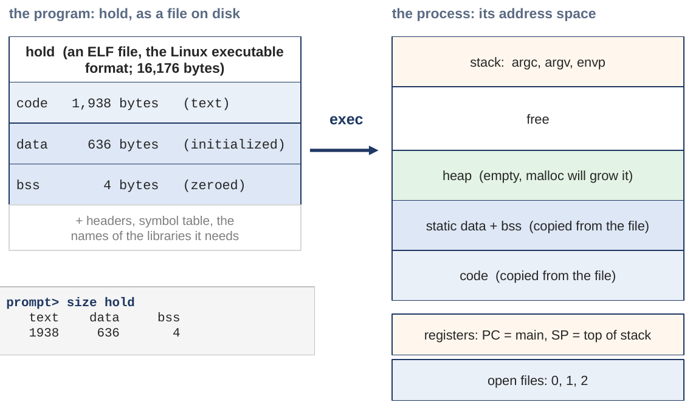{width=91%}
<figcaption markdown="1">Figure 38. The program hold as a file on disk, and the process exec builds from it. From slide 27, following the textbook's Figure 4.1.</figcaption>
</figure>

On the left of Figure 38 is `hold` as a file: an ELF file of 16,176 bytes. Inside it are three parts that matter. The code (often called the text) is 1,938 bytes. The initialized data, the globals that start with a value such as `global = 7`, is 636 bytes. The **bss** is 4 bytes; it holds the globals that start at zero, and since they are all zero the file only records their size. (`hold`'s own global starts at 7, so it is in the data; the 4 bytes of bss and most of the 636 bytes of data are small variables that the compiler and the C library add to every program; this guide does not list them.) The rest, 16,176 − (1,938 + 636 + 4) = 16,176 − 2,578 = 13,598 bytes, is headers, a symbol table (the names of the functions and variables), and the names of the libraries the program needs. The command `size hold` prints the three numbers: `text 1938`, `data 636`, `bss 4`.

On the right is the process that `exec()` builds. Its code and its static data (data plus bss) are copied from the file. Its heap is new and empty, and `malloc` will grow it. Its stack is new, with `argc`, `argv` and the environment at the top. Its registers are set so that the program counter points at the start of the program and the stack pointer at the top of the stack. And its open files 0, 1 and 2 are there from the start.

<figure markdown="1">
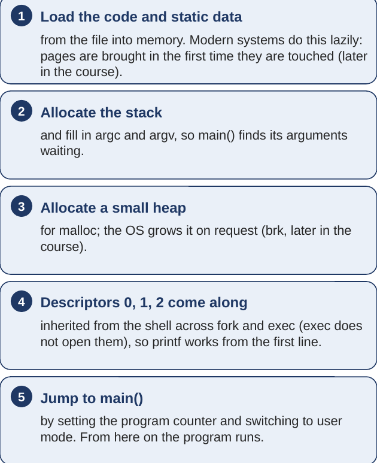{width=50%}
<figcaption markdown="1">Figure 39. The five steps that turn the file into a process. From slide 27.</figcaption>
</figure>

Figure 39 lists the five steps. One: load the code and static data from the file into memory. Modern systems do this lazily, bringing in each page the first time it is touched, so that a program never waits for parts it does not use; that comes later in the course. Two: allocate the stack and fill in `argc` and `argv`, so `main()` finds its arguments waiting. Three: allocate a small heap for `malloc`, which the OS grows on request. Four: descriptors 0, 1 and 2 come along. The shell had them, `fork()` copied them, and `exec()` keeps them (it does not open them), which is why `printf` works on the first line of `main`. Five: jump to `main()` by setting the program counter and switching the CPU to **user mode**, the restricted mode ordinary programs run in (the second class defines it). From there on the program runs.

### Extra 6 Deeper, Q1 Process states on xv6 and on Linux {#extra-6 data-toc-label="Extra 6 [Deeper, Q1] Process states on xv6 and on Linux"}

[Section 1.3](#sec-1-3) gave three states, and [Section 1.4](#sec-1-4) found them in xv6's `enum procstate`. But at work you will mostly look at Linux, where `ps` prints letters such as R, S and Z instead of names. This extra lines the two up, so that what you learn on xv6 transfers to Linux.

<figure markdown="1">
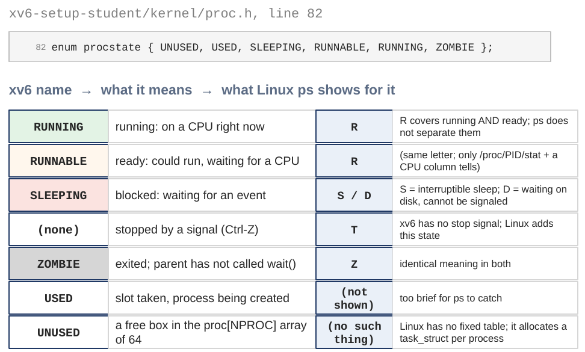{width=78%}
<figcaption markdown="1">Figure 40. xv6's six states, what each means, and the letter Linux's ps shows for it. From slide 28.</figcaption>
</figure>

The top line of Figure 40 is line 82 of `kernel/proc.h`: the six values of the state. The table reads left to right: xv6's name, what it means, and the letter `ps` shows on Linux. `RUNNING` is R. `RUNNABLE` (ready) is also R, because `ps` does not separate running from ready. `SLEEPING` (blocked) is S, or D when the wait is for a disk and cannot be interrupted (the kernel keeps such a process from being disturbed while a disk operation is half done). Linux adds T, for a process stopped by a signal (a short message from the kernel to a process, such as the one Ctrl-Z sends; [Extra 21](#extra-21) explains signals); xv6 has no stop signal and so no such state. `ZOMBIE` is Z on both. `USED` is the short moment of creation, too brief for `ps` to catch, and `UNUSED` is a free box in xv6's array of 64; Linux has no fixed array, and creates one record per process as needed.

<figure markdown="1">
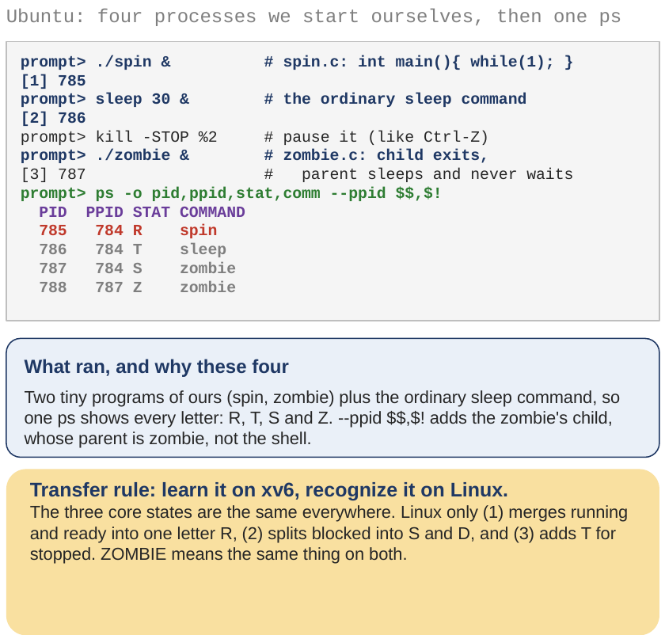{width=67%}
<figcaption markdown="1">Figure 41. Four processes started on the Ubuntu machine, then one ps that shows every letter. From slide 28.</figcaption>
</figure>

Figure 41 starts three processes from one shell on the Ubuntu machine, and one of them, `zombie`, starts a fourth. `spin` is a one-line program that loops forever (`int main(){ while(1); }`, as the comment says; `while(1);` repeats nothing forever, and [Section 5.1](class-2.md#sec-5-1) explains the syntax). `sleep 30` is the ordinary command that waits 30 seconds; `kill -STOP %2` then stops it, like pressing Ctrl-Z (`%2` means "the shell's second background job"). `zombie` is a small program whose child exits at once while the parent sleeps and never calls `wait()` ([Extra 15](#extra-15) shows it). Then one `ps` lists them with their pids, parent pids, state letters and names. The `--ppid $$,$!` part asks for the children of the shell and of the last background job (`$$` is the shell's own pid, and `$!` the pid of the last job started with `&`), so that the zombie's child appears too.

Read the result. 785 `spin` is R, running or ready. 786 `sleep` is T, stopped. 787 `zombie`, the parent, is S, asleep. 788, also named `zombie`, is the child, Z: it has exited and nobody has collected it; its PPID is 787. The shell's own pid is 784, the parent of the first three.

The yellow card is the transfer rule: learn it on xv6, recognize it on Linux. The three core states are the same everywhere. Linux only merges running and ready into one letter R, splits blocked into S and D, and adds T for stopped. Z means the same on both. A `ps` listing at work is the xv6 enum in a different spelling.

### Extra 7 Deeper, Q1 Where the 64 structs live: the proc[NPROC] array {#extra-7 data-toc-label="Extra 7 [Deeper, Q1] Where the 64 structs live: the proc[NPROC] array"}

[Section 1.4](#sec-1-4) said that xv6 keeps 64 `struct proc` records in one array, and [Section 2.1](#sec-2-1) said a new process needs a free one. This extra shows the array in the code, and the loop that finds a free record, because that loop is the first thing `fork()` does inside the kernel, and the same loop shape appears all over the file.

<figure markdown="1">
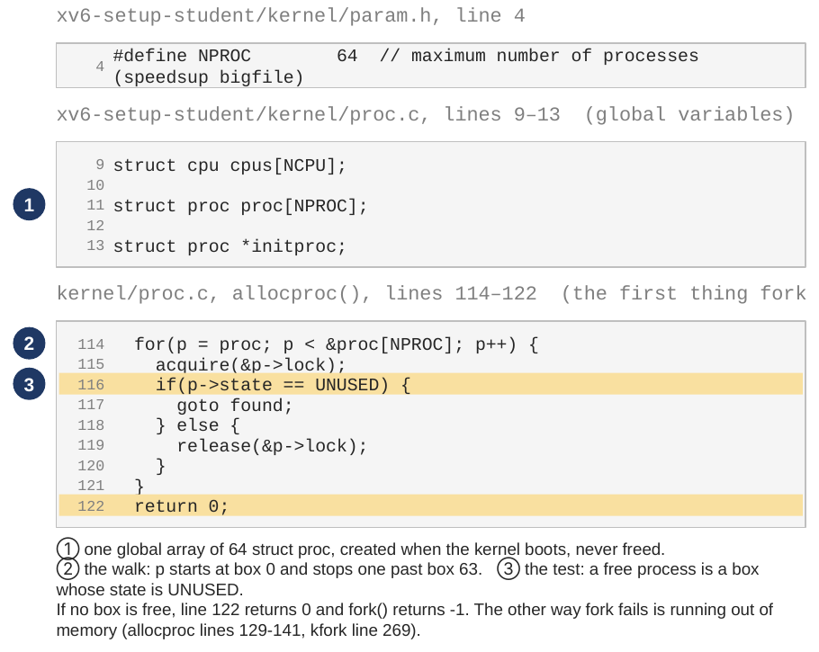{width=73%}
<figcaption markdown="1">Figure 42. The array (param.h line 4, proc.c lines 9 to 13) and the loop in allocproc() that finds a free record (proc.c lines 114 to 122). From slide 29.</figcaption>
</figure>

Figure 42 has three pieces of code. The first, `kernel/param.h` line 4, is `#define NPROC 64`: `#define` gives a name to a constant, so `NPROC` means 64 everywhere in the kernel, fixed when the kernel is compiled. The second, lines 9 to 13 of `kernel/proc.c`, declares the kernel's global variables. Line 9 keeps one record per CPU (`NCPU` is the largest number of CPUs xv6 supports), and line 13 keeps a pointer to `init`'s record. Callout 1 is line 11, `struct proc proc[NPROC];`, the whole process table: one global array of 64 records, all created when the kernel starts and never freed. There is no `malloc` for processes in xv6. (The crop cuts the end of the third heading; it reads "allocproc(), lines 114 to 122 (the first thing fork does)".)

The third is the loop in a kernel function called `allocproc()`. Callout 2, line 114, `for(p = proc; p < &proc[NPROC]; p++)`, walks the array. The variable `p` starts at the first record and moves one record at a time. The walk stops when `p` reaches one past the last record: records are numbered 0 to 63, and `&proc[NPROC]` is the address just after record 63. Callout 3, line 116, `if(p->state == UNUSED)`, is the test: a free process is a record whose state field says `UNUSED`. If it is free, `goto found;` jumps to the code that fills it in. (`acquire` and `release` take and drop the record's lock; ignore them.) If the walk ends without finding one, line 122 returns 0, and `fork()` returns -1 to the program, however much memory is free.

<figure markdown="1">
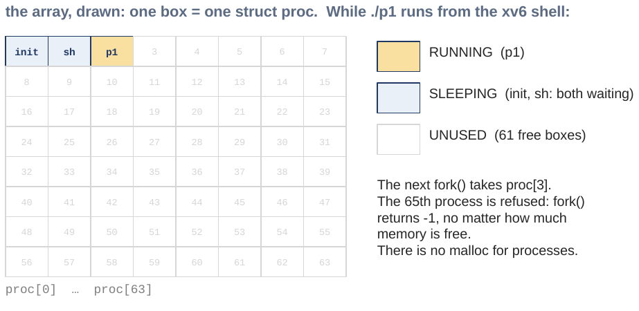{width=74%}
<figcaption markdown="1">Figure 43. The array drawn as 64 boxes while p1 runs from the xv6 shell. From slide 29.</figcaption>
</figure>

Figure 43 draws the array at the moment `p1` runs from the xv6 shell. Box 0 is `init`, asleep. Box 1 is the shell, asleep while it waits for `p1`. Box 2 is `p1`, running. The other 61 boxes say `UNUSED` (64 − 3 = 61). So a free process is not a missing object; it is a box whose state field says unused. The next `fork()` takes box 3. The 65th process is refused.

<figure markdown="1">
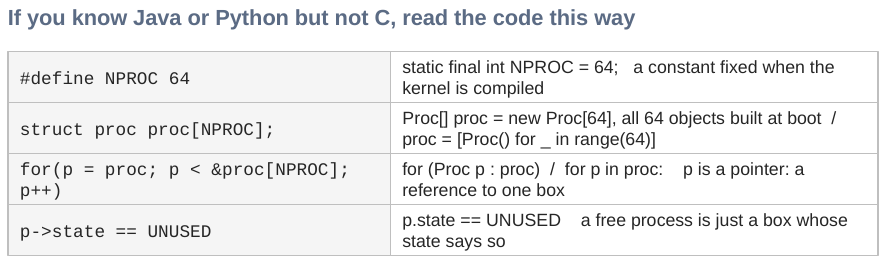{width=71%}
<figcaption markdown="1">Figure 44. The four lines of C, read the way a Java or Python programmer would read them. From slide 29.</figcaption>
</figure>

If you have met Java or Python, Figure 44 translates the four lines. `#define NPROC 64` is a constant. `struct proc proc[NPROC];` builds 64 objects at once, at start-up. The loop is "for each `p` in `proc`", where `p` refers to one box. And `p->state` is what Java or Python write as `p.state`: the arrow is a dot, used when `p` is a pointer.

Several functions walk this array: `fork()` through `allocproc` looks for an `UNUSED` box, the scheduler (line 438) looks for a `RUNNABLE` one, and `wait`, `kill` and `wakeup` (which makes sleeping processes ready again; [Extra 15](#extra-15) shows it) scan it too. Linux does the same job without a fixed size: it creates one record, called a `task_struct`, per process, and links them together. Its only ceiling is the largest pid it will hand out, `pid_max`, which is 32,768 on the Ubuntu machine (a setting read from that machine, not a computed number).

### Extra 8 Deeper, Q2 The second crux, and the five things any process API must offer {#extra-8 data-toc-label="Extra 8 [Deeper, Q2] The second crux, and the five things any process API must offer"}

[Section 2.1](#sec-2-1) quoted the crux of chapter 5 in passing. Before looking at fork in more detail, this extra places it in a list: what any process interface must offer, and which Unix call does each job. That list shows where fork, exec and wait fit, and which jobs the first class has not covered yet.

<figure markdown="1">
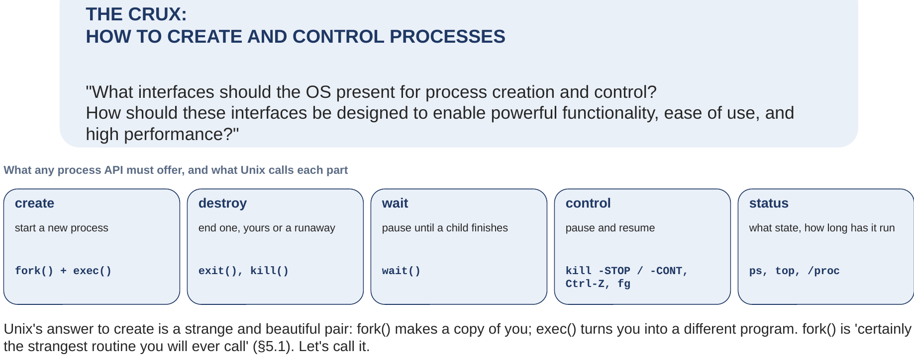{width=100%}
<figcaption markdown="1">Figure 45. The crux of chapter 5, and the five things any process API must offer, with the Unix name of each. From slide 30, following textbook sections 4.2 and 5.</figcaption>
</figure>

The crux at the top of Figure 45 asks what calls the OS should offer for making and controlling processes, so that they are powerful, easy to use, and fast. (**API** stands for application programming interface: the set of calls a program can make, what [Section 2.1](#sec-2-1) called an interface.) Below it are the five things any process interface has to offer, from section 4.2 of the textbook, with the Unix name of each. **Create** a new process: in Unix, the pair `fork()` and `exec()`. **Destroy** one, your own or a runaway: `exit()` ends your own process, and `kill()` asks the kernel to end another. **Wait** until a child finishes: `wait()`. **Control**, which means pause and resume: the stop and continue signals, STOP and CONT, which is what Ctrl-Z and the shell's `fg` command do. (Ctrl-Z sends a close relative of STOP, called SIGTSTP, [Extra 21](#extra-21); `fg` brings a stopped job back to the foreground and lets it continue.) **Status**, what state a process is in and how long it has run: `ps`, `top` (a live, refreshing version of `ps`) and the `/proc` files of [Extra 3](#extra-3).

Create is the strange one: no single call, but a pair. `fork()` makes a copy of you; `exec()` turns you into a different program. The textbook calls `fork()` "certainly the strangest routine you will ever call". [Extra 9](#extra-9) is the complete program that calls it. [Extra 21](#extra-21) covers destroy and control.

### Extra 9 Deeper, Q2 p1.c complete: call fork(), then branch on what it returned {#extra-9 data-toc-label="Extra 9 [Deeper, Q2] p1.c complete: call fork(), then branch on what it returned"}

[Section 2.2](#sec-2-2) showed only the pattern of a fork program and its output. To be sure the output follows from the code, and not from something hidden, here is the textbook's complete program, all 21 lines, read with the four callouts.

<figure markdown="1">
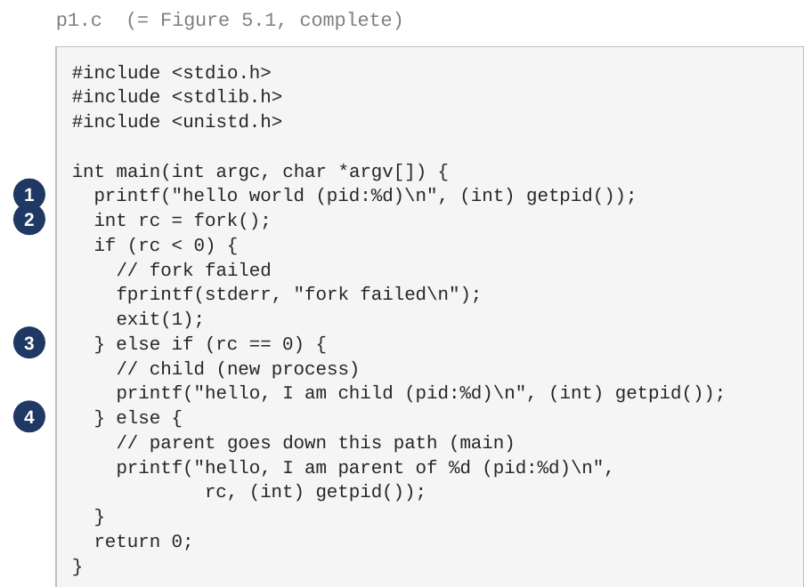{width=72%}
<figcaption markdown="1">Figure 46. p1.c, the textbook's Figure 5.1, complete, with four callouts. From slide 31, following the textbook's Figure 5.1.</figcaption>
</figure>

<figure markdown="1">
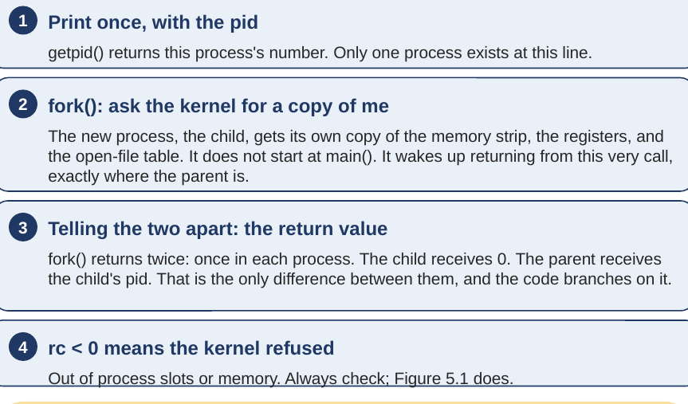{width=69%}
<figcaption markdown="1">Figure 47. The four callouts of p1.c. From slide 31.</figcaption>
</figure>

The program prints a greeting with its pid, calls `fork()`, and then each of the two processes prints one more line. Callout 1: print once, with the pid. `getpid()` returns this process's number, the one `ps` would show, and at this line exactly one process exists. Callout 2: `fork()` asks the kernel for a copy. The child gets its own copy of the memory strip, the registers and the open-file table. It does not start at `main()`; it wakes up returning from this very call, exactly where the parent is. Callout 3: `fork()` returns twice, once in each process. The child receives 0, the parent receives the child's pid, and the code branches on that value, which is the only difference between them. Callout 4: a result below zero means the kernel refused, because it ran out of process records or memory. The program checks for it, prints `fork failed` to standard error and exits with status 1. Always check; the textbook's figure does. (The fourth card's last line, "Out of process slots or memory. Always check; Figure 5.1 does.", is cut at the bottom on the slide.)

<figure markdown="1">
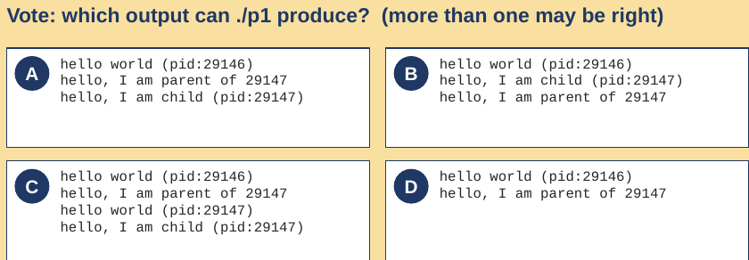{width=67%}
<figcaption markdown="1">Figure 48. The vote: which outputs can ./p1 produce? From slide 31.</figcaption>
</figure>

The slide ends with a vote, Figure 48: which of the four outputs A, B, C, D can `./p1` produce? More than one may be right. The pids 29146 and 29147 are the ones from the textbook's own run. Decide before reading on; this is Exercise 4, and its answer is in the Answers section at the end.

### Extra 10 Deeper, Q2 What fork() builds {#extra-10 data-toc-label="Extra 10 [Deeper, Q2] What fork() builds"}

The vote of [Extra 9](#extra-9) is easy to get wrong if one pictures the child as a fresh start. The way to get it right is to look at what the kernel has built at the instant `fork()` returns, record by record. Figure 49 is that picture, with the textbook's pids.

<figure markdown="1">
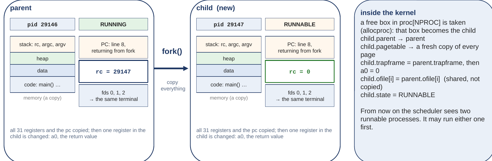{width=100%}
<figcaption markdown="1">Figure 49. The parent and the child at the instant fork() returns, and the kernel's side of the copy. From slide 32, following textbook section 5.1.</figcaption>
</figure>

On the left is the parent, pid 29146, `RUNNING`. Its memory holds a stack (with `rc`, `argc` and `argv`), a heap, the data and the code of `main()`. Its program counter is at line 8 of the program, about to leave `fork()`. Its `rc` will be 29147. Its three open files point at the terminal (the figure writes them as fds, short for file descriptors). In the middle is the child, pid 29147, `RUNNABLE`: a page-for-page copy of the memory, a copy of all 31 registers and the program counter, so it too is about to leave `fork()`, and the same three open files. Then the kernel changes exactly one register in the child, `a0`, the result register, so its `rc` will be 0.

The right-hand box is the kernel's side: the same steps [Extra 13](#extra-13) finds in the code, though the code does them in a slightly different order (it sets the parent near the end). A free record in `proc[NPROC]` is taken, and that record becomes the child. The child's `parent` field points at the parent. The child's page table points at a fresh copy of every page. The child's trapframe (its saved registers) is a copy of the parent's, and then `a0` is set to 0. The child gets its own copy of the open-file table, but its slots point at the same open files as the parent's: the files are shared, not copied. The child's state becomes `RUNNABLE`. From then on the scheduler sees two runnable processes and may run either one first.

The blue bar sums it up: same code, same program counter, same memory contents, same open files; different pid, different parent, and one different register. Everything the child does from there on is its own. The grey line adds the detail that pays off in [Section 3.4](#sec-3-4): because the open files are shared rather than copied, the child's output goes to the same terminal as the parent's, and the same rule makes redirection and pipes work.

### Extra 11 Deeper, Q2 Why fork() returns twice, and where you will meet it at work {#extra-11 data-toc-label="Extra 11 [Deeper, Q2] Why fork() returns twice, and where you will meet it at work"}

[Section 2.2](#sec-2-2) explained how `fork()` returns two different values: one register is changed. It did not say why anyone would design a call this way, when a call that simply creates a process running a named program seems more natural. This extra gives the three reasons and shows where the design appears in real systems.

<figure markdown="1">
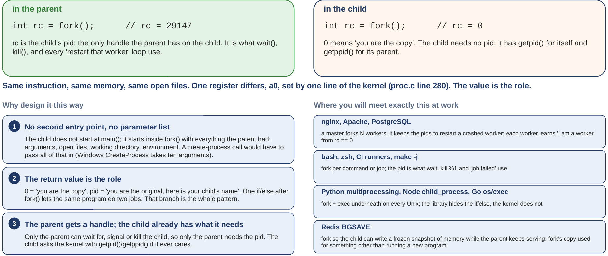{width=100%}
<figcaption markdown="1">Figure 50. Who gets what from fork(), why the design is this way, and where you meet it at work. From slide 33, following textbook sections 5.1, 5.4 and 5.7.</figcaption>
</figure>

The top of Figure 50 is the two returns again. In the parent, `rc` is 29147, the child's pid, which is the parent's only handle on the child: it is what `wait()`, `kill()` and every "restart that worker" loop use. In the child, `rc` is 0, which means "you are the copy". The child needs no pid from `fork()`: it can ask the kernel for its own with `getpid()` and for its parent's with `getppid()`. One register differs, `a0`, set by line 280 of `proc.c`. The value is the role.

Why design it this way, in three reasons. First, there is no second starting point and no parameter list. The child does not start at `main()`; it starts inside `fork()` already holding everything the parent had: its arguments, its open files, its current directory, its environment. A create-process call would have to pass all of that in, which is why Windows `CreateProcess` takes ten arguments. Second, the return value is the role: 0 says "you are the copy", a pid says "you are the original, and here is your child's name", so one if-else after `fork()` lets the same program do two jobs. Third, the parent gets a handle and the child already has what it needs: waiting for, signaling and killing the child are the parent's jobs, so only the parent needs the child's pid.

The right column is where you meet exactly this at work. The slide's examples from industry come next. Web servers and databases such as nginx, Apache and PostgreSQL (programs that serve web pages and store data for many users) run a master process, the one in charge. It forks a number of worker processes, the ones that serve requests, keeps their pids, and forks a replacement when one crashes. Each worker learns "I am a worker" from `rc == 0`. Shells (bash, zsh), automated build-and-test runners and `make -j` (which runs several build steps at once) fork once per command or job, and use the pid for `wait`, for `kill %1`, and to report "job failed". Python's multiprocessing, Node's child_process and Go's os/exec all use fork and exec underneath on Unix (that is how those libraries are built; the guide does not show their code); the library hides the if-else, the kernel does not. And Redis, a database that keeps its data in memory, forks so that the child can write a frozen snapshot of memory to disk while the parent keeps serving requests. There the copy of memory is the point, with no new program at all.

The blue bar is fair to the other side. The other design exists: `CreateProcess` on Windows and `posix_spawn` create and load in one call. They are easier to call, but with no gap, redirection and pipes have to be passed in as parameters ([Section 3.3](#sec-3-3)). Unix pays with a copy of the caller; later in the course, a technique called copy-on-write (sharing the memory until one side writes, and copying a page only then) makes that copy cheap.

### Extra 12 Deeper, Q2 p1 for real: three lines, and two orders in 20 runs {#extra-12 data-toc-label="Extra 12 [Deeper, Q2] p1 for real: three lines, and two orders in 20 runs"}

Sections [2.2](#sec-2-2) and [2.3](#sec-2-3) used pieces of these runs. This extra puts all of them on one page, with the complete `p1loop.c`, so that each claim can be checked against the output that supports it.

<figure markdown="1">
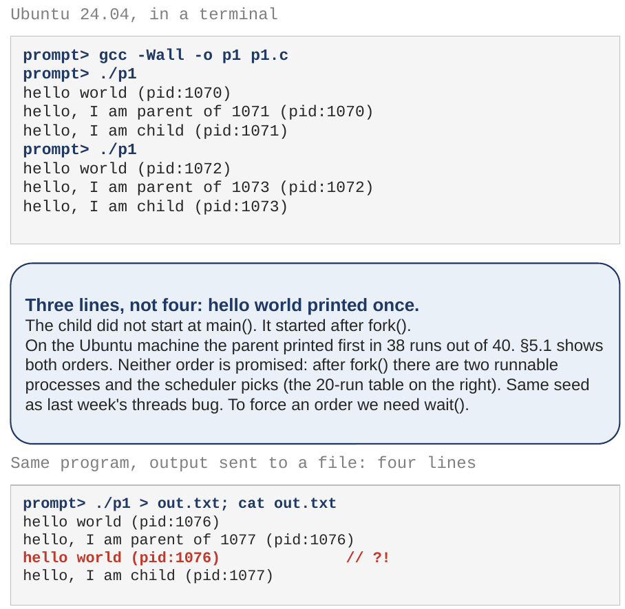{width=73%}
<figcaption markdown="1">Figure 51. The real runs of p1 on the Ubuntu machine: two runs in a terminal, what they prove, and the same program sent to a file. From slide 34.</figcaption>
</figure>

The top box of Figure 51 compiles `p1.c` with `gcc` ([Extra 3](#extra-3)) and runs it twice. Each run prints three lines, not four: the greeting once, then the parent's line, then the child's. The second run got the next pids, 1072 and 1073. The blue box draws the conclusions. Three lines, not four, prove that the child did not start at `main()`; it started after `fork()`. On the Ubuntu machine the parent printed first in 38 runs out of 40 (a count kept from a separate set of 40 runs). The textbook shows both orders. Neither order is promised: after `fork()` there are two runnable processes and the scheduler picks. The bottom box is the four-line file of [Section 2.3](#sec-2-3).

<figure markdown="1">
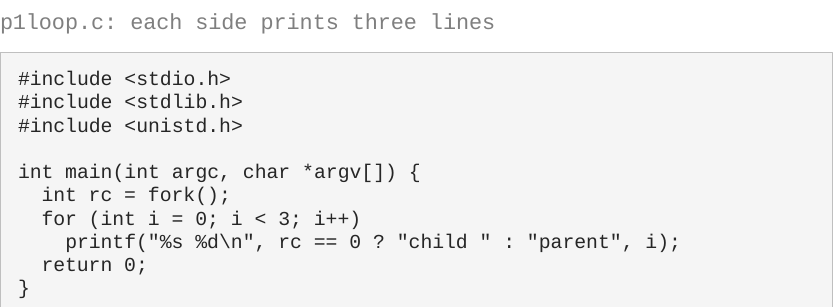{width=67%}
<figcaption markdown="1">Figure 52. p1loop.c, complete: each side prints three lines after fork(). From slide 34.</figcaption>
</figure>

<figure markdown="1">
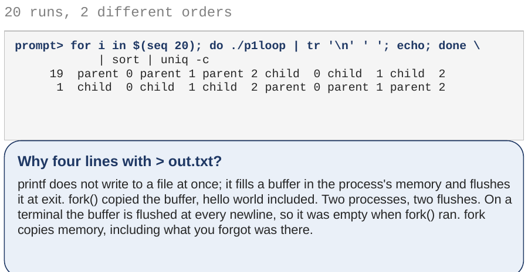{width=72%}
<figcaption markdown="1">Figure 53. The 20 runs of p1loop, sorted and counted, and why the file gets four lines. From slide 34.</figcaption>
</figure>

Figure 52 is the whole of `p1loop.c`, whose middle three lines [Section 2.3](#sec-2-3) read. Figure 53 is its 20 runs, sorted and counted: 19 times the parent's three lines came first, once the child's. Its card repeats the buffer explanation of [Section 2.3](#sec-2-3): on a file, `printf` keeps text in a buffer until exit; `fork()` copied the buffer with the greeting inside; two exits, two flushes.

### Extra 13 Deeper, Q2 kfork(): copy the memory and registers, then set a0 to 0 {#extra-13 data-toc-label="Extra 13 [Deeper, Q2] kfork(): copy the memory and registers, then set a0 to 0"}

[Extra 10](#extra-10) drew what the kernel builds when `fork()` is called. This extra checks the drawing against the kernel's actual code: the function `kfork()` in `kernel/proc.c`, all 48 lines (lines 256 to 303), shown in two columns. Every box of the drawing is one line of this function.

<figure markdown="1">
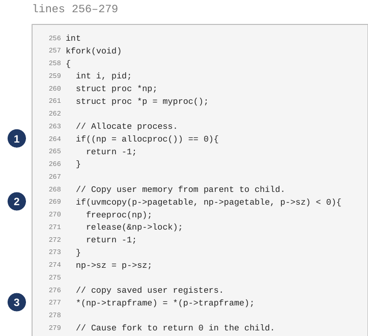{width=58%}
<figcaption markdown="1">Figure 54. kfork(), lines 256 to 279: take a free record, copy the memory, copy the registers. From slide 35.</figcaption>
</figure>

<figure markdown="1">
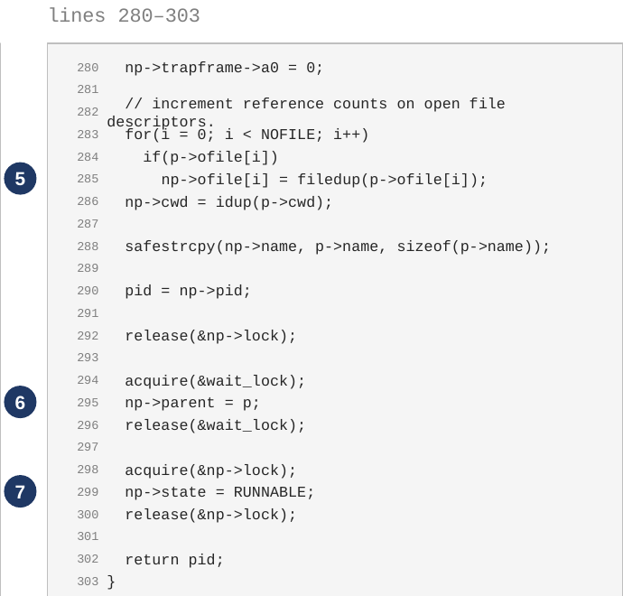{width=55%}
<figcaption markdown="1">Figure 55. kfork(), lines 280 to 303: set a0 to 0, share the open files, set the parent, mark the child runnable. From slide 35.</figcaption>
</figure>

Read it as four moves (take a free record, copy the memory, copy the registers, change one register), with the seven callouts. First, some notation. `struct proc *p = myproc();` sets `p` to the record of the process that called `fork()` (`myproc()` returns the current process's record); `np` will be the new process's record. `if((np = allocproc()) == 0){ return -1; }` stores the result of `allocproc()` in `np` and, if it is 0, gives up and returns -1. Lines with `acquire`, `release` and `lock` are about locks; skip them.

Callout 1, line 264: `allocproc()` walks the array of 64 ([Extra 7](#extra-7)) and takes the first `UNUSED` record. It gives the record a pid, a page for its trapframe and an empty page table. Callout 2, line 269: `uvmcopy(p->pagetable, np->pagetable, p->sz)` copies every page of the parent's memory into the child's page table: the strip, duplicated. If that fails for lack of memory, the record is freed and `fork()` returns -1. Callout 3, line 277: `*(np->trapframe) = *(p->trapframe);` copies the whole trapframe, the register box. (A star in front of a pointer means "the thing it points at", so this copies the parent's saved registers into the child's.) The child's 31 user registers and program counter become the parent's, which is why the child resumes at exactly the same instruction.

Callout 4, line 280, is the one line to remember: `np->trapframe->a0 = 0;`. In the child's saved registers, the result register is set to 0. That line is the entire reason `fork()` returns 0 in the child. Callout 5 covers lines 283 to 286. Lines 283 to 285 loop over the open files: `i` goes from 0 to `NOFILE` − 1, that is 0 to 15. For each open file, `filedup` adds one to the file's count of users, and the child's slot points at the same open file. The count is how the kernel knows when the last process using a file has closed it, so that it frees the file only then. Shared, not copied. (The comment on line 282 wraps on the slide, so its second line sits on top of line 283; the code is unchanged.) Line 286 does the same for the current directory with `idup`, and line 288 copies the name. Callout 6, line 295: `np->parent = p;` records the parent, the family tree. Callout 7, line 299: `np->state = RUNNABLE;` marks the child ready, so the scheduler may pick it now; and line 302 returns the child's pid to the parent.

<figure markdown="1">
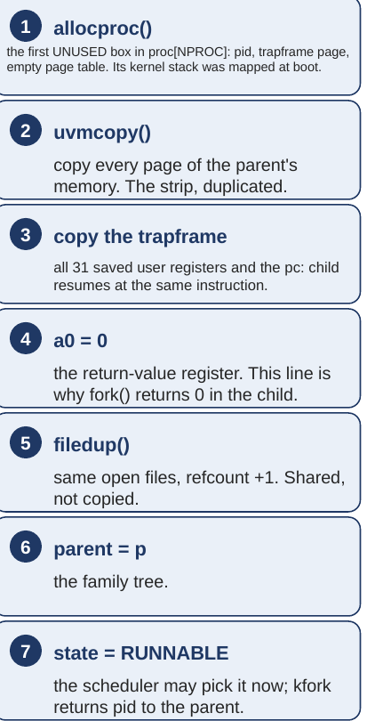{width=45%}
<figcaption markdown="1">Figure 56. The seven callouts as cards. From slide 35.</figcaption>
</figure>

The `fork()` that a C program calls is not this function. It is a three-instruction stub (a tiny function whose only job is to pass the call on) that enters the kernel; the kernel looks up system call number 1 in its table and arrives here. The second class walks every step of that path ([Section 4.6](class-2.md#sec-4-6)). The students' tree calls this function `kfork`; the xv6 book does too, and older tutorials say `fork`.

### Extra 14 Deeper, Q2 The zombie: what exit() leaves for wait() to collect {#extra-14 data-toc-label="Extra 14 [Deeper, Q2] The zombie: what exit() leaves for wait() to collect"}

[Section 2.4](#sec-2-4) showed the child as a zombie for a moment before `wait()` freed its record. That raises a question: why keep a finished process's record at all, instead of freeing it at once? This extra answers it, makes a zombie on purpose, and says why a programmer should care.

<figure markdown="1">
{width=100%}
<figcaption markdown="1">Figure 57. The three steps from exit() to wait(). From slide 36.</figcaption>
</figure>

Figure 57 is the three steps. One: the child calls `exit()`. It closes its files and parks its exit status inside its own record, and its state becomes `ZOMBIE`. It will never run again. Two: the record is kept. The kernel cannot free it yet, because it holds a number, the exit status, that nobody has collected. And a dying process cannot free itself anyway, because at that moment it is still running in the kernel on its own **kernel stack** (a small stack each process has inside the kernel, used while the kernel works on its behalf). Freeing that stack would pull the floor out from under the very code doing the freeing. Three: the parent calls `wait()`, which finds the zombie child, copies its exit status out, frees everything and returns the child's pid. Only then does the Z disappear from `ps`.

<figure markdown="1">
{width=75%}
<figcaption markdown="1">Figure 58. A zombie made on purpose on the Ubuntu machine, and what happens when its parent is killed. From slide 36.</figcaption>
</figure>

Figure 58 makes one on purpose (the program, `zombie.c`, is in [Extra 15](#extra-15)). The child exits at once; the parent prints the two pids, 1488 and 1490, and sleeps for a minute without calling `wait()`. `ps` shows the parent, 1488, with S (asleep), and the child, 1490, with Z, and the child's PPID is 1488. (The `+` after a letter only means the process was in the foreground of the terminal, the job that receives what you type.) Then `kill 1488` kills the parent, and the next `ps` shows nothing: both are gone.

<figure markdown="1">
{width=68%}
<figcaption markdown="1">Figure 59. Orphans go to init, and why a programmer should care. From slide 36.</figcaption>
</figure>

Both are gone because of the rule on the first card of Figure 59. When a parent dies first, the kernel hands its children to `init`, process 1, whose whole job is to call `wait()` in a loop. A child whose parent has died is called an **orphan**. The orphan zombie was adopted by `init`, which collected it at once.

Why care: a server that forks a child per request and never calls `wait()` leaves one zombie per request, and each one holds a record. xv6 has 64 records; Linux allows 32,768 pids by default on the Ubuntu machine. After that many requests, `fork()` returns -1, and the machine looks idle while it happens. The rule for your own code: every `fork()` needs a matching `wait()` somewhere, or a handler for the signal SIGCHLD, which the kernel sends a parent when a child exits ([Extra 21](#extra-21)), that calls `wait()` for you.

### Extra 15 Deeper, Q2 exit() and wait() in xv6: where zombies come from {#extra-15 data-toc-label="Extra 15 [Deeper, Q2] exit() and wait() in xv6: where zombies come from"}

[Extra 14](#extra-14) described the handshake between `exit()` and `wait()` in words. This extra shows the two kernel functions that perform it, the end of `kexit()` and the heart of `kwait()` in `kernel/proc.c`, and then the small program that made the zombie of [Extra 14](#extra-14).

<figure markdown="1">
{width=72%}
<figcaption markdown="1">Figure 60. The end of kexit(), lines 345 to 363, after the process has closed its files. From slide 37.</figcaption>
</figure>

On the left, `kexit()`, read with its four callouts. Callout 1, line 348, `reparent(p);`: first the dying process hands its own children to `init`, so no process is left without a parent. Callout 2, line 351, `wakeup(p->parent);`: it wakes its parent, in case the parent is asleep inside `wait()`; a sleeping process becomes `RUNNABLE`. Callout 3, lines 355 and 356, the two highlighted lines that make a zombie: `p->xstate = status;` parks the exit status in the record, and `p->state = ZOMBIE;` sets the state. In xv6 the files were closed before this point, but nothing else is freed yet, not even the memory. Callout 4, line 361, `sched();`: the process hands the CPU to the scheduler and never comes back. The line after it, `panic("zombie exit");`, should never run; `panic` stops the whole kernel with a message, and it is how kernel code says "this cannot happen". The dying process cannot clean up after itself, because it is still running on its own kernel stack, inside its own record. The parent does the cleanup, inside `wait()`.

<figure markdown="1">
{width=76%}
<figcaption markdown="1">Figure 61. The heart of kwait(), lines 376 to 411, trimmed. From slide 37.</figcaption>
</figure>

On the right, `kwait()`, trimmed. `for(;;){` is a loop that runs forever, until something inside it returns. Callout 5: each round scans the 64 records for processes whose parent is the caller (`pp` walks the array, as in [Extra 7](#extra-7), and `pp->parent == p` tests "is this my child?"). Callout 6: a child in state `ZOMBIE` is found, and its exit status is copied out to the parent. Callout 7: `freeproc(pp)` releases the record (its trapframe page, its page table and its memory) and marks it `UNUSED`; `wait` returns the child's pid. Callout 8: if there are children but none has exited yet, `sleep(p, &wait_lock)` puts the parent to sleep (blocked, `SLEEPING`) on its own address. The kernel uses an address as a label for what a process waits for and keeps it in the `chan` field of [Section 1.4](#sec-1-4); a `wakeup` with the same address wakes it. The `wakeup(p->parent)` of callout 2, run by a child as it exits, is exactly what ends that sleep. The two functions are written for each other.

<figure markdown="1">
{width=100%}
<figcaption markdown="1">Figure 62. The four kexit() callouts as cards. From slide 37.</figcaption>
</figure>

<figure markdown="1">
{width=71%}
<figcaption markdown="1">Figure 63. zombie.c, complete: the child exits at once, the parent never waits. From slide 38.</figcaption>
</figure>

Figure 63 is the program behind the zombie of Extras [6](#extra-6) and [14](#extra-14). Callout 1: the child, where `rc == 0`, calls `exit(0)` at once. Callout 2: the parent prints both pids and calls `sleep(60)`, which blocks it for 60 seconds, and never calls `wait()`. So for that minute the child's record cannot be freed, and `ps` shows Z. Slide 38 repeats the run of Figure 58 and the cards of [Extra 14](#extra-14), with two additions. On Linux a zombie holds only its pid and its record, not its memory; xv6 keeps the memory too, until `wait()`. And on modern Linux the orphan may be handed to a "subreaper", a process that has asked to adopt orphans, instead of `init`.

### Extra 16 Deeper, Q3 p3.c complete: the child builds an argv and becomes wc {#extra-16 data-toc-label="Extra 16 [Deeper, Q3] p3.c complete: the child builds an argv and becomes wc"}

[Section 3.2](#sec-3-2) showed only the three lines of `p3.c` that call exec. Here is the complete program, the textbook's Figure 5.3, so that each line of its output can be traced to the line that printed it.

<figure markdown="1">
{width=73%}
<figcaption markdown="1">Figure 64. p3.c, complete: p2.c with the green lines added in the child. From slide 39, following the textbook's Figure 5.3.</figcaption>
</figure>

<figure markdown="1">
{width=71%}
<figcaption markdown="1">Figure 65. The three callouts and the conclusion. From slide 39.</figcaption>
</figure>

`p3.c` is `p2.c` ([Section 2.4](#sec-2-4)) with the green lines added in the child's branch. Callout 1 builds the argument list for the new program. `char *myargs[3];` makes room for three strings. `strdup("wc")` makes a copy of the text "wc" in the heap and returns its address (`strdup` is "string duplicate"; `#include <string.h>`, the other green line, declares it). So `myargs` becomes `{"wc", "p3.c", NULL}`: the program, its argument (the file to count), and `NULL` to mark the end. That list becomes `wc`'s `argc` and `argv`, exactly as `main()` receives them. Callout 2, `execvp(myargs[0], myargs);`, replaces this process with `wc`: the kernel loads `wc`'s code and data over this process's memory, gives it a fresh stack and heap, and starts it at `wc`'s `main()`. Same pid 1468, same open files, same parent; different program. Callout 3: the line after it, `printf("this shouldn't print out");`, runs only if exec failed, and it did not print.

<figure markdown="1">
{width=73%}
<figcaption markdown="1">Figure 66. The run of p3 on the Ubuntu machine. From slide 39.</figcaption>
</figure>

The run, Figure 66, is the one [Section 3.2](#sec-3-2) read: the greeting (1467), the child's hello (1468), `wc`'s line `27 122 911 p3.c`, and the parent's line with `rc_wait` 1468. The blue card states the conclusion: `exec()` transforms, it does not create. Linux offers six versions of exec (`execl`, `execlp`, `execle`, `execv`, `execvp`, `execvpe`), which differ only in how the arguments and the search for the program are passed. xv6 has one, `exec(path, argv)`, and the lab uses it.

### Extra 17 Deeper, Q3 exec() in the kernel: new memory, same identity {#extra-17 data-toc-label="Extra 17 [Deeper, Q3] exec() in the kernel: new memory, same identity"}

[Section 3.2](#sec-3-2) described what `exec()` does in one breath. This extra opens the kernel function that does it, `kexec()` in `kernel/exec.c`, trimmed to its eight moves, and draws what happens to the memory. The detail answers one question the short version left open: what happens if exec fails halfway?

<figure markdown="1">
{width=88%}
<figcaption markdown="1">Figure 67. The same record before and after exec: what is replaced and what is kept. From slide 40.</figcaption>
</figure>

Figure 67 is the transformation as a picture. Before: the child running `p3`, pid 1468, parent 1467, files 0, 1, 2. Its stack holds `myargs` and `rc`; its heap holds the strings `strdup` made; its data and code are `p3`'s; its program counter is inside `execvp()`. After: the same record in the kernel, with new contents. Same pid, same parent, same three files. But a new stack with `argc` = 2 and `argv` pointing at "wc" and "p3.c", an empty heap, `wc`'s data and code, and the program counter at `wc`'s entry point. The old memory has been freed.

<figure markdown="1">
{width=54%}
<figcaption markdown="1">Figure 68. What kexec() does, trimmed to its eight moves. From slide 40.</figcaption>
</figure>

Figure 68 is the function, trimmed. One, `namei(path)` finds the program file. Two, `readi` reads its ELF header, which says where the code and data are inside the file. Three, `proc_pagetable(p)` makes a new, empty page table. Four, for each segment (each piece of code or data the header lists), `loadseg()` loads it into the new memory. Five, `uvmalloc` allocates a fresh user stack, with a **guard page** below it (a page given no place in memory on purpose, so that a stack that grows too far hits it and causes an error instead of silently overwriting other memory). Six, the argument strings are copied onto the new stack, which is where `argc` and `argv` come from. Seven, the process switches to the new page table, and the saved program counter (`epc` in the trapframe) is set to the program's entry and the saved stack pointer (`sp`) to the new stack. Eight, only now is the old page table, with the old memory, freed. `return argc;` hands back the argument count, which lands in `a0`, the result register, so the new `main` receives it as `argc`. This value never reaches the old program, whose code is gone; it becomes the starting value of `a0` in the new one. That is the sense in which a successful exec never returns. (The path is the one of [Section 4.5](class-2.md#sec-4-5), step 4: the kernel puts a system call's return value into the saved `a0`, and for exec the saved registers now belong to the new program.)

Two lines under the code sum it up. Not a new process, not a new pid, not a new parent, not new open files: only new memory, a new stack, a new heap and a new program counter. And the old memory is freed last. If anything fails on the way (the file is missing, memory runs out), exec can still return -1 into the old program, which is intact. Move seven writes the program counter into the saved registers, not into the live CPU register; the new program begins when the kernel returns to user mode, and that return is the subject of the second class.

### Extra 18 Deeper, Q3 p4.c complete: close 1, open the file, exec wc {#extra-18 data-toc-label="Extra 18 [Deeper, Q3] p4.c complete: close 1, open the file, exec wc"}

[Section 3.4](#sec-3-4) showed the shell's redirection as a sketch. The textbook has a complete program that does it, `p4.c`, and running it confirms the rule of the lowest free descriptor on a real machine.

<figure markdown="1">
{width=72%}
<figcaption markdown="1">Figure 69. p4.c, complete: the green lines are the redirection. From slide 41, following the textbook's Figure 5.4.</figcaption>
</figure>

In the child, callout 1, `close(STDOUT_FILENO);`, closes descriptor 1 (`STDOUT_FILENO` is the standard name for 1). Callout 2, `open("./p4.output", O_CREAT|O_WRONLY|O_TRUNC, S_IRWXU);`, opens the output file: create it, open it for writing, empty it, and give its owner permission to read, write and run it (`S_IRWXU` is the standard name for that permission). Callout 3 builds the argument list `{"wc", "p4.c", NULL}` and execs `wc`. The parent just waits. (`#include <fcntl.h>` declares `open` and its options.)

<figure markdown="1">
{width=73%}
<figcaption markdown="1">Figure 70. Running p4 prints nothing; the file holds wc's line. From slide 41.</figcaption>
</figure>

<figure markdown="1">
{width=72%}
<figcaption markdown="1">Figure 71. The child's open-file table after fork, after close(1), and after open() and exec. From slide 41.</figcaption>
</figure>

Running `./p4` prints nothing at all, because `wc`'s output went into the file. `cat p4.output` shows it: `30 107 783 p4.c`, so `p4.c` has 30 lines, 107 words and 783 bytes. The three tables of Figure 71 are the same as in [Section 3.4](#sec-3-4): slot 1 points at the terminal, is freed by the close, and is filled by the open, because `open()` always returns the lowest free descriptor.

<figure markdown="1">
{width=70%}
<figcaption markdown="1">Figure 72. Three facts behind the trick. From slide 41.</figcaption>
</figure>

The first card of Figure 72 adds a point. The close happens in the child only, and the parent's table is untouched, because `fork()` gave the child its own copy of the table. What the two share are the open files behind the table, not the table itself. The last card is the design principle: the program being run is never edited. The shell sets up the child's world and then turns into the program.

### Extra 19 Deeper, Q3 A pipe: two redirections and a kernel buffer {#extra-19 data-toc-label="Extra 19 [Deeper, Q3] A pipe: two redirections and a kernel buffer"}

[Section 3.4](#sec-3-4) said in one paragraph that a pipe is the redirection trick done twice. This extra shows a complete program that does it by hand, `p5.c`, the shell's `ls -l | wc -l` in 27 lines, and what the kernel holds while it runs.

<figure markdown="1">
{width=76%}
<figcaption markdown="1">Figure 73. p5.c, complete: the shell's ls -l | wc -l written by hand. From slide 42.</figcaption>
</figure>

Three new calls appear. `pipe(p)` asks the kernel for a pipe and gives back two new descriptors in the two-slot array `p`: `p[0]` is the reading end and `p[1]` the writing end. Whatever is written into one end comes out of the other. `dup(fd)` makes a duplicate of descriptor `fd` in the lowest free slot, so both slots then lead to the same open file or pipe end. `execlp("ls", "ls", "-l", NULL)` is the version of exec that takes the arguments one by one instead of as a list.

<figure markdown="1">
{width=65%}
<figcaption markdown="1">Figure 74. The four callouts of p5.c. From slide 42.</figcaption>
</figure>

Now the callouts, as cards in Figure 74. Callout 1: `pipe(p)` makes the two descriptors in this process; `fork()` will copy them into each child. Callout 2: the first child will become `ls`. It closes 1 and calls `dup(p[1])`; slot 1 is the lowest free slot, so slot 1 becomes the writing end. Then it closes the two original pipe descriptors (it no longer needs them) and execs `ls -l`. Callout 3: the second child is the mirror image: close 0, `dup(p[0])` so slot 0 becomes the reading end, close the originals, exec `wc -l`. Callout 4: the parent closes both ends and waits twice, once per child.

<figure markdown="1">
{width=65%}
<figcaption markdown="1">Figure 75. What the kernel holds after both forks. From slide 42.</figcaption>
</figure>

Figure 75 is what the kernel holds after both forks. `ls` writes to descriptor 1 and does not know it is a pipe; `wc` reads from descriptor 0 and does not know either. Between them is the pipe, a queue of bytes held in the kernel, 64 KB on Linux by default (a design choice of Linux). The kernel moves the bytes. If the queue is full, the writer blocks; if it is empty, the reader blocks. Nothing touches the disk. One subtle rule: `wc` sees the end of its input only when every writing end of the pipe is closed. That is why all three processes close `p[1]`, the parent included. If the parent forgot, `wc` would wait forever.

<figure markdown="1">
{width=76%}
<figcaption markdown="1">Figure 76. The run: p5 and the shell's own pipe both print 31. From slide 42.</figcaption>
</figure>

The run, Figure 76, prints 31 for `./p5` and 31 for the shell's own `ls -l | wc -l`: the same 31 lines of `ls -l` output, counted either way. This program is the last homework question of the textbook's chapter 5, written out, and the xv6 shell does the same in its PIPE case (lines 101 to 123 of `user/sh.c`).

### Extra 20 Deeper, Q3 The shell is a loop of fork, exec and wait: sh.c and strace {#extra-20 data-toc-label="Extra 20 [Deeper, Q3] The shell is a loop of fork, exec and wait: sh.c and strace"}

The whole first class was, in the end, about one program: the shell. [Section 3.4](#sec-3-4) listed its pieces in a sentence. This extra draws the shell as a loop, then reads the real loop in the xv6 shell, and then watches Linux's `bash` make the same moves.

<figure markdown="1">
{width=100%}
<figcaption markdown="1">Figure 77. The shell as a loop of fork, exec and wait, and the one command it runs without forking. From slide 43.</figcaption>
</figure>

Follow the arrows in Figure 77. The shell reads one line, say `ls -l`. It forks. The child, the one that got 0, rearranges its world if the line asked for redirection or a pipe, and then execs the program; from that moment the child is `ls`, which runs and exits. The parent, the one that got the pid, goes straight into `wait()`, and when the child is done it prints the next prompt and goes back to reading a line. The first card says why the prompt comes back only when the command is done: the parent is blocked in `wait()` the whole time the child runs.

The second card is the one exception, and a good interview question: `cd`, the command that changes the current directory. The shell does it itself, before any fork. If it forked a child to change directory, the child's directory would change, the child would exit, and the shell would be exactly where it was. That is why `cd` is built into every shell. The lab's `find -exec` (`find` is a program that searches folders for files, and the lab asks you to write a version of it) is this same loop: for every file `find` matches, fork a child, exec the command, wait.

<figure markdown="1">
{width=62%}
<figcaption markdown="1">Figure 78. xv6's shell, main(), lines 160 to 177. From slide 44.</figcaption>
</figure>

Figure 78 is the real loop, lines 160 to 177 of `user/sh.c`. `while(getcmd(buf, sizeof(buf)) >= 0){` reads one line into `buf`, and keeps looping as long as a line came in. The next lines skip leading spaces and tabs. (`*cmd == ' ' || *cmd == '\t'` reads "the character `cmd` points at is a space, or is a tab"; `||` is C's "or", and `'\t'` is a tab.) Then they skip a blank line: `continue` jumps back to the top of the loop. Callout 3: if the line starts with `cd ` (the test is `cmd[0] == 'c' && cmd[1] == 'd' && cmd[2] == ' '`, where `&&` is C's "and"), the shell calls `chdir` (the system call that changes the current directory) itself. The comment in the source says why in one line: "Chdir must be called by the parent, not the child." Otherwise, callout 1: `if(fork1() == 0) runcmd(parsecmd(cmd));` forks, and the child runs the parsed command. `fork1` is `fork` plus a `panic` if it fails. Callout 2: `wait(0);` is the parent waiting, the reason the prompt waits for your command.

<figure markdown="1">
{width=55%}
<figcaption markdown="1">Figure 79. runcmd(), the EXEC and REDIR cases, lines 75 to 92. From slide 44.</figcaption>
</figure>

<figure markdown="1">
{width=45%}
<figcaption markdown="1">Figure 80. The five callouts of the shell as cards. From slide 44.</figcaption>
</figure>

Figure 79 is part of `runcmd()`, the function the child runs (its heading is cut on the right; it reads "runcmd(): EXEC and REDIR, lines 75 to 92"). Callout 4, the EXEC case: it calls `exec(ecmd->argv[0], ecmd->argv)`, and the error message after it, `exec %s failed`, prints only if exec failed. You will see that message in the lab when you forget to add a program to the Makefile (the file that tells the build which programs to compile). Callout 5, the REDIR case: `close(rcmd->fd)`, then `open(rcmd->file, rcmd->mode)`, the same two moves as `p4.c`, then run the rest of the command. (The slide numbers both of these lines 5.)

<figure markdown="1">
{width=100%}
<figcaption markdown="1">Figure 81. bash on the Ubuntu machine making the same four moves, watched with strace. From slide 44.</figcaption>
</figure>

Figure 81 watches `bash` do the same on the Ubuntu machine. `strace` (Part 0: it prints every system call a program makes) traces `bash -c 'ls > out.txt; echo done'` (`bash -c` runs the commands in quotes, and `;` separates two commands; `echo` prints its words), keeping only five kinds of call. Process 1503 is `bash`. `clone(...) = 1504` is Linux's way of doing fork: it returns the child's pid, 1504. `wait4(...)` is Linux's wait, and the parent blocks there (`<unfinished ...>`). In the child, `openat(..., "out.txt", O_WRONLY|O_CREAT|O_TRUNC, 0666) = 3` opens the file, which lands in slot 3 (0666 is another permission code, like the 0644 of [Section 3.4](#sec-3-4)). Then `dup2(3, 1) = 1` copies descriptor 3 into slot 1: bash's way of doing "close 1, then open", in one call. `execve("/usr/bin/ls", ["ls"]) = 0` turns the child into `ls`. The child exits with status 0, and the parent's `wait4` returns 1504. Three names differ between xv6 and Linux, none of them in idea: fork is `clone`, exec is `execve`, wait is `wait4`.

### Extra 21 Deeper, Q3 Control: signals and kill {#extra-21 data-toc-label="Extra 21 [Deeper, Q3] Control: signals and kill"}

[Extra 8](#extra-8) listed five jobs of a process interface, and the first class covered create and wait. Destroy and control were left: how one process ends, stops or resumes another. In Unix both are one mechanism, signals.

<figure markdown="1">
{width=76%}
<figcaption markdown="1">Figure 82. Pausing, resuming and ending a process from another process, on the Ubuntu machine. From slide 45.</figcaption>
</figure>

Figure 82 sends three signals to one process. `sleep 100 &` starts a 100-second sleep in the background; the shell prints `[1] 790`, its job number and pid. `kill -STOP %1` stops it, and `ps` shows its state as T. (`$!` is the shell's name for the pid of the last background job.) `kill -CONT %1` continues it, and `ps` shows S, asleep again. `kill -TERM %1` ends it, and the shell reports `Terminated`. Three different signals to the same process, all sent from another process.

<figure markdown="1">
{width=70%}
<figcaption markdown="1">Figure 83. What a signal is, and the five you already use. From slide 45.</figcaption>
</figure>

A **signal** is a one-word message from the kernel to a process. `kill(pid, sig)` is the system call that asks for one to be sent (xv6 has only the simplest version, `kill(pid)`, and it is always fatal). The receiver either dies, stops, continues, or runs a function it registered in advance with `signal()`, called a handler. The table of Figure 83 lists the ones you already use. Ctrl-C sends SIGINT (interrupt): die, unless the program handles it. Ctrl-Z sends SIGTSTP (stop): the state becomes T, and the shell's `fg` command sends SIGCONT to continue. `kill PID` sends SIGTERM: please exit, which a program can catch and clean up after. `kill -9 PID` sends SIGKILL: die now, which cannot be caught or ignored. And when a child exits, the kernel sends its parent SIGCHLD: "call `wait()` now". The terminal turns Ctrl-C and Ctrl-Z into signals to the program in the foreground, which is why an infinite loop still dies to Ctrl-C: the loop never asked, the kernel delivered.

<figure markdown="1">
{width=67%}
<figcaption markdown="1">Figure 84. Who may signal whom, and where status comes from. From slide 45.</figcaption>
</figure>

The first card of Figure 84: who may signal whom depends on users. You can signal only your own processes; the **superuser**, called root, can signal anyone. That is a big part of why the kernel attaches a user to every process: so the referee knows whose process is whose. The second card: `ps` and `top` read files under `/proc`, such as `/proc/PID/status`, the same kind of file [Extra 3](#extra-3) read for the memory map. Everything `ps` knows, you can print yourself.
