# Second class: how the OS stays in control while the program runs at full speed (OSTEP 6) {#class-2}

## Roadmap Recap and roadmap of the second class {#opening-47 data-toc-label="[Roadmap] Recap and roadmap of the second class"}

Every class this week starts from what the last one left open. Figure 4.1 is the first class in one picture.

<figure markdown="1">
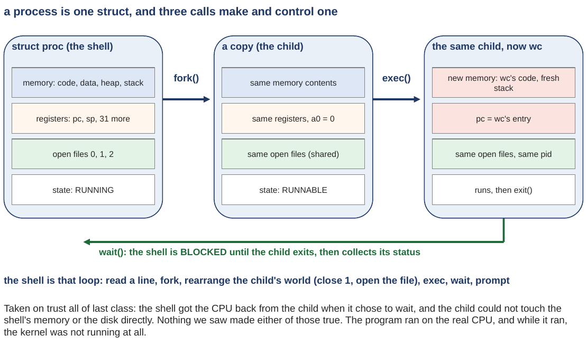{width=89%}
<figcaption markdown="1">Figure 4.1. The first class in one picture: a process is one struct, and three calls make and control one. From slide 47.</figcaption>
</figure>

Read it left to right. A process is one record in the kernel, a `struct proc`, holding three things (its memory, its registers and its open files) plus a state; here the process is the shell. `fork()` asks the kernel to copy that record into a free one: the same memory contents, the same registers, the same open files, with one register different, `a0`, which is why the one call hands 0 to the child and the pid to the parent. `exec()` swaps the program inside the copy: new memory from the program file, a fresh stack, the program counter at `wc`'s first instruction; the pid and the open files stay. The moment before `exec()` is where the shell closes slot 1 and opens a file, and `wc` never knows. And `wait()`, the green arrow, puts the shell to sleep until the child exits, then collects the child's status and frees its record. A shell is that loop.

<figure markdown="1">
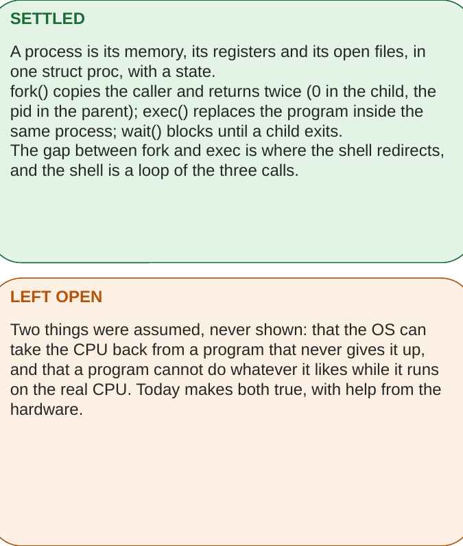{width=54%}
<figcaption markdown="1">Figure 4.2. What the first class settled, and the two things it took on trust. From slide 47.</figcaption>
</figure>

Settled, in the left card of Figure 4.2: what a process is, and the three calls that make and control one. Left open, in the right card: two things were assumed and never shown. The shell got the CPU back from its child when it chose to wait. And the child could not reach into the shell's memory or command the disk directly. Nothing in the first class made either of these true. The child ran on the real CPU, and while it ran, the kernel was not running at all, unless some device happened to interrupt: the kernel is only code sitting in memory until something makes the CPU run it. This class makes both assumptions true, with help from the hardware, and measures what that costs.

So the second class asks three questions. Figure 4.3 is the slide's list.

<figure markdown="1">
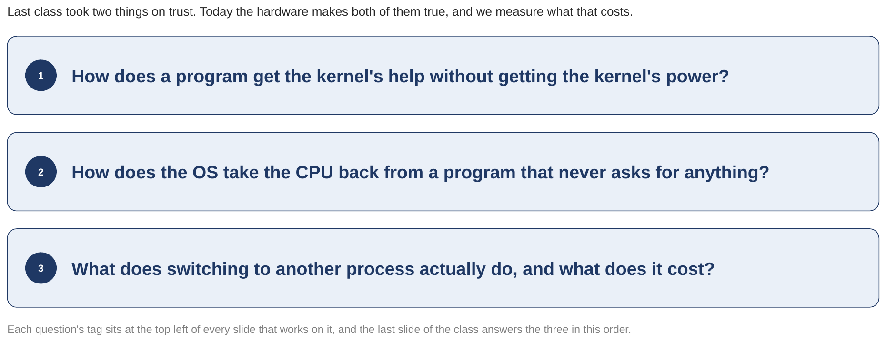{width=100%}
<figcaption markdown="1">Figure 4.3. The three questions of the second class. From slide 48.</figcaption>
</figure>

The first is about asking: a program needs the kernel to read a file for it, but it must not get the kernel's power along with the help. How does a program get the kernel's help without getting the kernel's power (Sections [4.1](#sec-4-1) to [4.7](#sec-4-7))? The second is about a program that never asks: how does the OS take the CPU back from a program that never asks for anything (Sections [5.1](#sec-5-1) to [5.3](#sec-5-3))? The third is about the switch itself: once the kernel is back and has chosen another process, what does switching to it actually do, and what does it cost (Sections [6.1](#sec-6-1) to [6.4](#sec-6-4))? The week summary collects the answers, and Extras [22](#extra-22) to [27](#extra-27) go deeper.

## Chapter 4. How does a program get the kernel's help without getting the kernel's power? {#chapter-4}

*The question this chapter answers: how does a program get the kernel's help without getting the kernel's power?*

### 4.1 Problem Direct execution, and the two questions it cannot answer {#sec-4-1 data-toc-label="4.1 [Problem] Direct execution, and the two questions it cannot answer"}

The fastest way to run a program is to just run it: put its instructions on the real CPU and let them go. The first class's `exec()` did roughly that. So start there, and see how far it gets. The textbook draws this simplest protocol as its Figure 6.1, which Figure 4.4 reproduces. (A **protocol** here is a list of steps, in order, saying who does each one.)

<figure markdown="1">
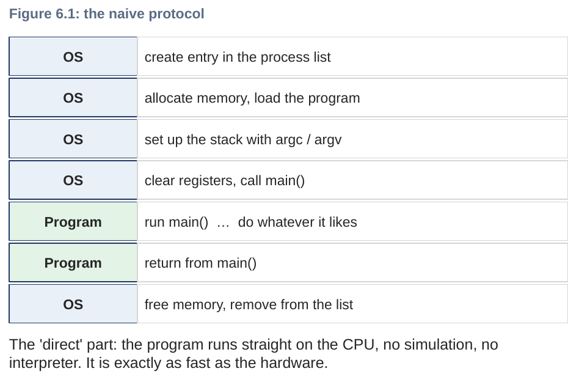{width=74%}
<figcaption markdown="1">Figure 4.4. OSTEP Figure 6.1: the naive protocol, direct execution with no limits. From slide 49.</figcaption>
</figure>

Read it top to bottom. The OS makes an entry in the process list, allocates memory and loads the program, builds a stack with `argc` and `argv`, clears the registers, and calls `main()`. The program runs `main()` and does whatever it likes, then returns from `main()`. The OS frees the memory and removes the process from the list. It is a plain function call and return. This is called **direct execution**: the program runs straight on the CPU, with no simulation and no interpreter (a program that reads another program and carries out its steps one by one, which is slower). It is exactly as fast as the hardware, because it is on the hardware.

<figure markdown="1">
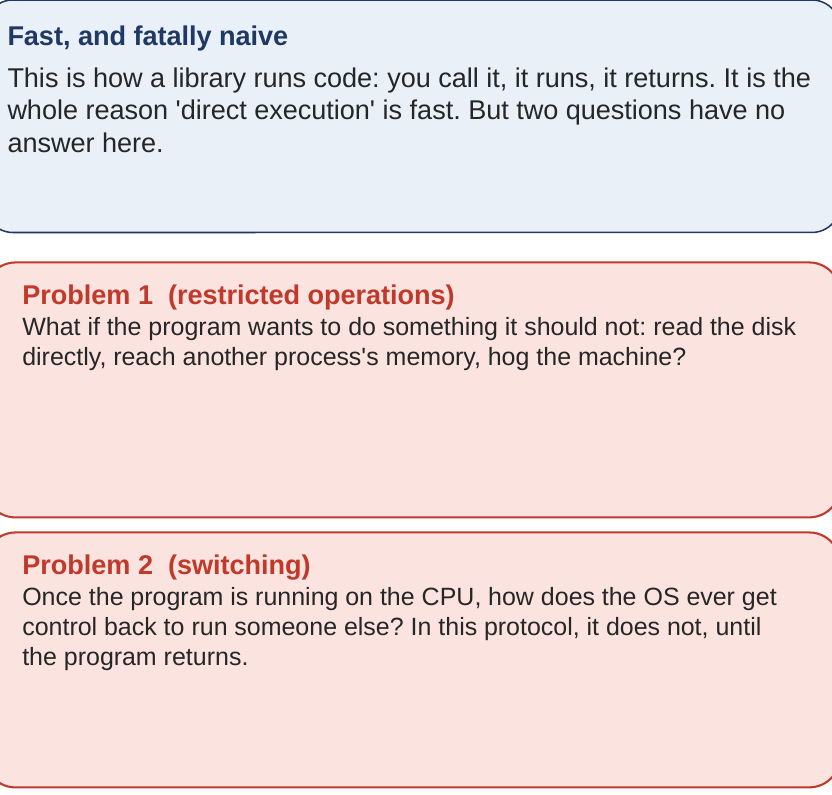{width=67%}
<figcaption markdown="1">Figure 4.5. Fast, and fatally naive: the two questions the naive protocol cannot answer. From slide 49.</figcaption>
</figure>

This is how a library runs code: you call it, it runs, it returns. And it leaves two questions with no answer, the two red cards of Figure 4.5. Problem 1, **restricted operations**: what if the program wants to do something it should not, such as read the disk directly, reach into another process's memory, or keep the machine to itself? While the program runs, nothing in this protocol says no. Problem 2, **switching**: once the program is running on the CPU, how does the OS ever get control back to run someone else? In this protocol it does not, until the program returns from `main()`, and a program in an endless loop never returns. [Chapter 4](#chapter-4) of this guide takes problem 1; [Chapter 5](#chapter-5) takes problem 2.

### 4.2 Problem Run it directly and nothing stops a store to the disk controller {#sec-4-2 data-toc-label="4.2 [Problem] Run it directly and nothing stops a store to the disk controller"}

What we have is direct execution: the OS sets up memory and a stack, calls `main()`, and from then on the program has the real CPU to itself at full speed. The kernel sits in memory as bytes and does nothing.

<figure markdown="1">
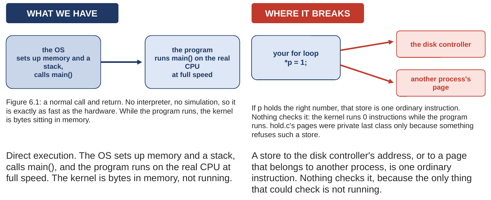{width=100%}
<figcaption markdown="1">Figure 4.6. What we have (direct execution) and where it breaks (one ordinary store reaches the disk controller or another process's page). From slide 50, following textbook section 6.2.</figcaption>
</figure>

Where it breaks is one line of C: `*p = 1;`, a **store** through a pointer (an instruction that writes the value 1 into memory at the address held in `p`). Devices such as the disk are controlled by writing numbers to particular addresses; the disk's **controller**, the small circuit that runs the disk, listens at some of them. If `p` holds the controller's address, that store commands the disk. If `p` holds an address inside a page that belongs to another process, it changes that process's variable. Either way it is one ordinary instruction. And nothing checks it: the kernel runs no instructions while the program runs (apart from a device interrupt now and then, [Section 5.1](#sec-5-1)), so the only thing that could check is not running. Each process's memory is meant to be private to it ([Extra 3](class-1.md#extra-3) prints one process's map). Something must refuse every other process's stores into them, and direct execution has nothing that could.

So we need help from the hardware. The textbook states this section's crux: a process must be able to perform I/O and some other restricted operations, but without giving the process complete control over the system; how can the OS and hardware work together to do so? A **restricted operation** is something a program must not do on its own, such as talking to a disk or touching another process's memory. The shape of the answer has two parts. First, a CPU that runs the program in a limited mode, in which such instructions are refused by the hardware itself, before any kernel code has to run. Second, exactly one guarded way for the program to ask the kernel to do them on its behalf.

### 4.3 Concept Two CPU modes, and one guarded doorway between them {#sec-4-3 data-toc-label="4.3 [Concept] Two CPU modes, and one guarded doorway between them"}

[Section 4.2](#sec-4-2) asked for two things: a limited mode in which dangerous instructions are refused by the hardware, and one guarded way to ask the kernel for help. The CPU provides both, by having two modes and one instruction that moves between them. Figure 4.7 draws them.

<figure markdown="1">
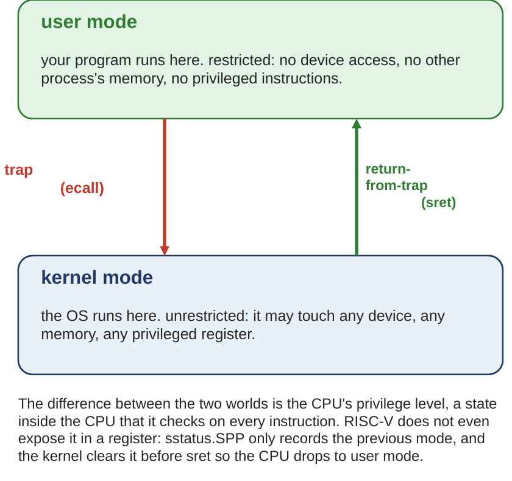{width=67%}
<figcaption markdown="1">Figure 4.7. The two CPU modes, and the two instructions that move between them. From slide 51, following textbook section 6.2.</figcaption>
</figure>

**User mode**, the green box, is where your program runs. It is restricted. It has no access to devices and no access to other processes' memory (how the CPU checks every address a program uses is the subject of the memory weeks; the page table of [Section 1.4](class-1.md#sec-1-4) is part of it). And it may not run **privileged instructions**: the instructions that control the machine itself, such as setting the timer (a hardware clock that can interrupt the CPU, [Section 5.2](#sec-5-2)) or choosing where the CPU jumps when it enters the kernel. **Kernel mode**, the blue box, is where the OS runs. It is unrestricted: it may touch any device, any memory, any privileged register. The difference between the two worlds is the CPU's **privilege level**, a setting inside the CPU that the CPU checks on every instruction.

<figure markdown="1">
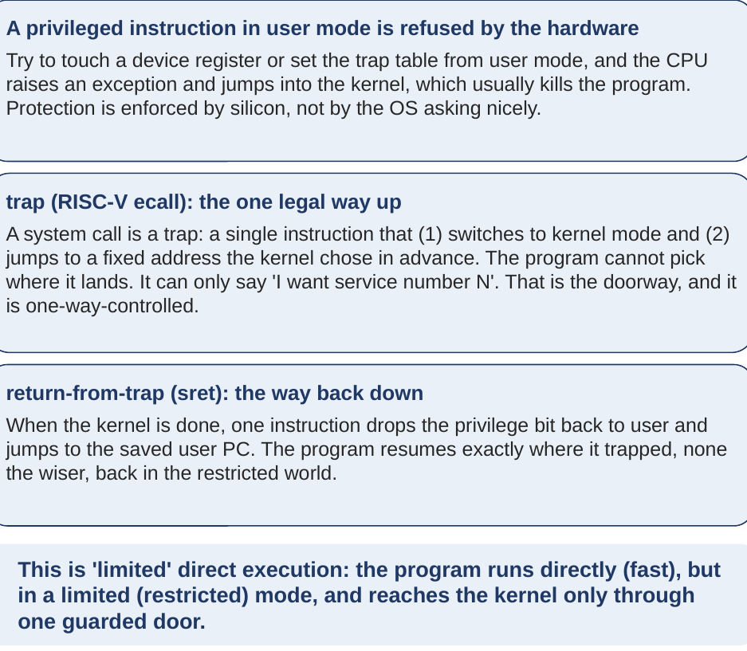{width=75%}
<figcaption markdown="1">Figure 4.8. What the hardware refuses, the one way up, and the way back down. From slide 51.</figcaption>
</figure>

The first card of Figure 4.8 is who enforces this: the hardware, not the kernel. Suppose a program in user mode tries a privileged instruction, such as touching a device register or setting where the CPU enters the kernel ([Section 4.4](#sec-4-4)). Then the CPU itself refuses and raises an **exception**: it stops the program and jumps into the kernel, which usually ends the program. That works even though the kernel was not running, because the check is in the silicon. Protection does not depend on the OS asking nicely.

So how does a program ever read a file, which needs kernel power? Through a **trap**, the second card and the red arrow: an entry into the kernel at an address the kernel chose. A program causes one on purpose with a single instruction that does two essential things at once ([Section 4.5](#sec-4-5) lists everything that one instruction does). It switches the CPU to kernel mode, and it jumps to an address that the kernel chose in advance (and only the kernel can change). On RISC-V that instruction is called **ecall** ("environment call"). The program has no say in where it lands. All it can do first is put a number in a register, meaning "I want service number N". That is the doorway, and it is controlled from one side only.

The way back down is the third card and the green arrow: **return-from-trap**, on RISC-V the instruction **sret**. When the kernel is done, this one instruction drops the privilege back to user mode and jumps to the saved user program counter. The program resumes exactly where it trapped, none the wiser, back in the restricted world.

This is what the textbook calls **limited direct execution**, the subject of its chapter 6. Direct, because the program runs straight on the CPU, so it is fast. Limited, because it runs in a restricted mode, so it is safe, and it reaches the kernel only through one guarded door.

### 4.4 Concept Who decides where a trap lands: the trap table and the system-call number {#sec-4-4 data-toc-label="4.4 [Concept] Who decides where a trap lands: the trap table and the system-call number"}

[Section 4.3](#sec-4-3) said a trap jumps to an address the kernel chose in advance. That raises a question, because the whole protection rests on it: who sets that address, and why can a program not set it to its own code? If a program could choose where a trap lands, it could run its own code in kernel mode and own the machine. The answer comes in two moments in time and two layers of protection.

<figure markdown="1">
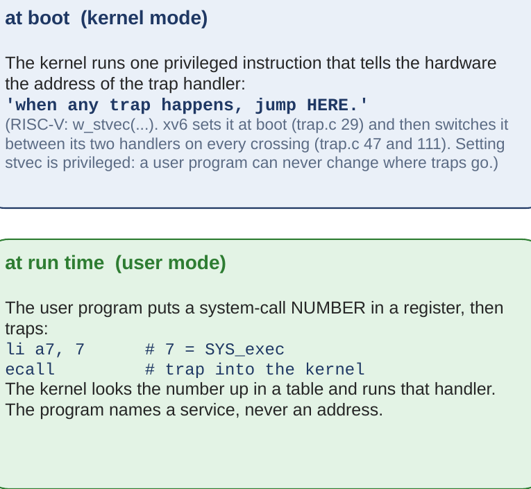{width=61%}
<figcaption markdown="1">Figure 4.9. The two moments: at boot, the kernel installs the trap address; at run time, the program names a service by number. From slide 52, following textbook section 6.2.</figcaption>
</figure>

At boot (when the computer starts and the kernel runs first), in the top box of Figure 4.9, the CPU starts in kernel mode. The kernel runs one privileged instruction that tells the hardware the address of its trap handler: when any trap happens, jump here. (It may run that instruction again later, as xv6 does.) (A **trap handler** is the kernel code that runs when a trap arrives. The textbook calls the set of handler addresses the kernel gives the hardware at boot the **trap table**. On many processors it really is a table, with one entry per kind of event: a system call, a disk interrupt, a timer. RISC-V keeps it simpler, with a single address; the handler then reads a register, `scause` ([Section 4.6](#sec-4-6)), to see which kind of event it was.)

On RISC-V the address goes into a special register called **stvec** ("supervisor trap vector"). xv6 writes it at boot in `kernel/trap.c` line 29. In fact xv6 has two handlers, one for traps that come from user programs (in a page of code that [Section 4.6](#sec-4-6) calls the trampoline) and one for traps that happen while the kernel itself is running. So each time it crosses between user code and kernel code, it points `stvec` at the handler for the side it is about to run. That is the kernel-trap handler just after entering the kernel (line 47), and the user-trap handler just before returning to a user program (line 111). Two handlers are needed because a trap from a user program must first save the program's registers and set up the kernel's own view of memory ([Section 4.6](#sec-4-6) says what that involves), while a trap that happens during kernel code needs neither. At any moment there is exactly one address, and only the kernel sets it.

At run time, in the bottom box, the program is in user mode. It puts a **system-call number** in a register and traps: `li a7, 7` loads the number 7 into register `a7` ("load immediate", the RISC-V instruction that puts a constant into a register), and `ecall` traps. In xv6, 7 is the number of `exec` ([Extra 1](class-1.md#extra-1) listed the numbers; they are the designers' choice). The kernel looks the number up in a table and runs that handler. The program names a service, never an address.

<figure markdown="1">
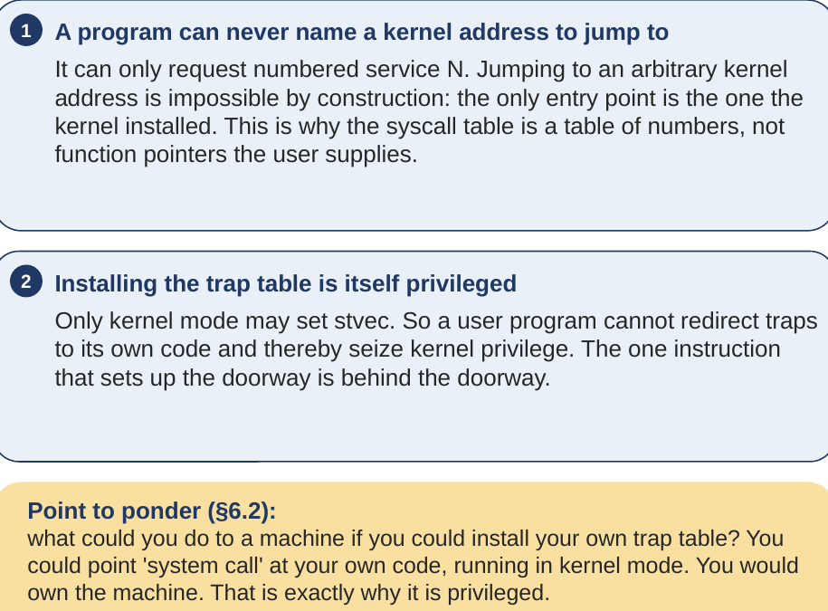{width=73%}
<figcaption markdown="1">Figure 4.10. The two layers of protection, and the textbook's point to ponder. From slide 52.</figcaption>
</figure>

The two cards of Figure 4.10 are the two layers. First: a program can never name a kernel address to jump to. It can only request numbered service N. Jumping to an arbitrary kernel address is impossible by construction, because the only entry point is the one the kernel installed. That is why a system call is named by a number. A second table, the system-call table, turns a call number into the address of its handler, and it lives in the kernel too, and the program supplies only the number, never an address. Second: installing the trap address is itself privileged. Only kernel mode may set `stvec`, so a user program cannot point traps at its own code and seize kernel privilege. The instruction that sets up the doorway is behind the doorway.

The yellow card is the textbook's point to ponder: what could you do to a machine if you could install your own trap table? You could point "system call" at your own code, which would then run in kernel mode. You would own the machine. That is exactly why the instruction is privileged.

### 4.5 Concept A system call in six steps {#sec-4-5 data-toc-label="4.5 [Concept] A system call in six steps"}

Sections [4.3](#sec-4-3) and [4.4](#sec-4-4) built the door (the trap) and the table behind it (the system-call numbers). One question remains before the mechanism is complete: what exactly happens, in order, when a program makes one system call, and which part does the hardware do and which the kernel? Follow one call through, in six steps. Figure 4.11 is the list.

<figure markdown="1">
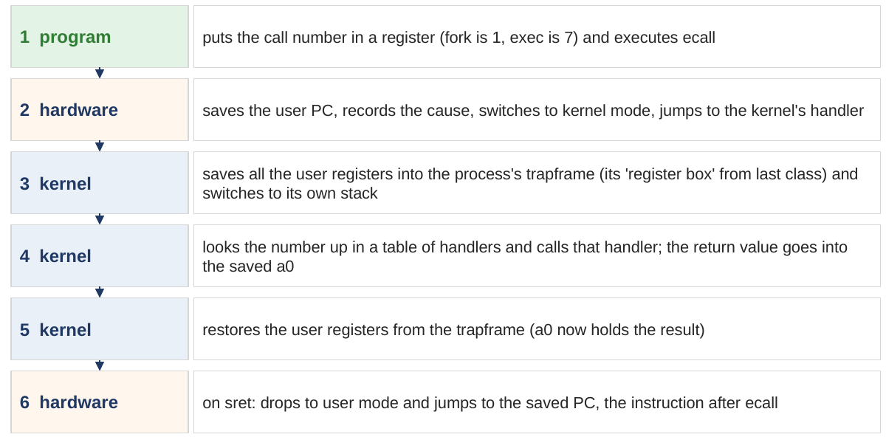{width=96%}
<figcaption markdown="1">Figure 4.11. One system call in six steps: the program does one, the hardware two, the kernel three. From slide 53, following OSTEP Figure 6.2.</figcaption>
</figure>

Step 1, the program: it puts the call number in a register (fork is 1, exec is 7) and executes `ecall`. From the program's side, that is the whole system call. Step 2, the hardware, all within that one instruction: it saves the user program counter, records the cause of the trap, switches to kernel mode, and jumps to the kernel's handler. Step 3, the kernel: before it can run ordinary C code it needs a stack and free registers, so it first saves all the user registers into the process's trapframe (the "register box" of [Section 1.4](class-1.md#sec-1-4)) and switches to its own stack. Step 4, the kernel: it looks the number up in its table of handlers and calls that handler; for `fork` that is the copying function of [Extra 13](class-1.md#extra-13). The handler's return value goes into the saved `a0`, and the kernel moves the saved program counter past the `ecall` ([Section 4.6](#sec-4-6) shows the line), so that the program does not repeat it. Step 5, the kernel: it restores the user registers from the trapframe, with `a0` now holding the result. Step 6, the hardware, on `sret`: it drops to user mode and jumps to the saved program counter, which by now points at the instruction after the `ecall`. The result of `fork` appears in the program's variable `rc`.

<figure markdown="1">
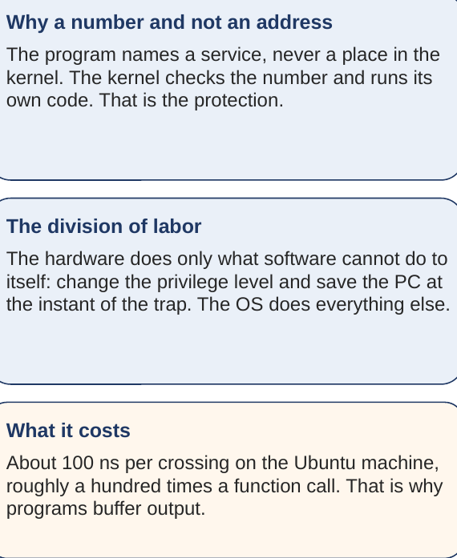{width=46%}
<figcaption markdown="1">Figure 4.12. Why a number, who does what, and what it costs. From slide 53.</figcaption>
</figure>

The cards of Figure 4.12 draw three lessons. Why a number and not an address: the program names a service, and the kernel checks the number and runs its own code; that is the protection. The division of labor: the hardware does only what software cannot do for itself, namely change the privilege level and save the program counter at the very instant of the trap (recording the cause and jumping to the handler come with them, in the same instruction). Everything else is the OS's share. And what it costs: about 100 ns per crossing on the Ubuntu machine (a **nanosecond**, ns, is a billionth of a second). A plain function call takes about 1.2 ns, so one crossing costs about as much as 85 function calls (the measuring program's own figure, [Section 4.7](#sec-4-7); the slide rounds it to "a hundred"). That is why programs buffer their output. [Section 4.7](#sec-4-7) measures it.

The same six steps run for every `printf`, `read` and `write` in your programs. [Section 4.6](#sec-4-6) finds each of them in a file of the xv6 tree.

### 4.6 Real kernel The six stations in four files of xv6 {#sec-4-6 data-toc-label="4.6 [Real kernel] The six stations in four files of xv6"}

[Section 4.5](#sec-4-5) listed six steps in words. Words can hide a gap, and the lab will ask you to add a system call of your own, which means touching this path. So here is the same round trip as six stations in the xv6 tree, each a file you can open. The stations do not line up one to one with the six steps of [Section 4.5](#sec-4-5). The hardware's two steps happen between stations: at the `ecall`, between stations 1 and 2, and at the `sret`, at the end of station 6. The kernel's work is spread over stations 2 to 6. Read Figure 4.13 as a map, not as code to memorize.

<figure markdown="1">
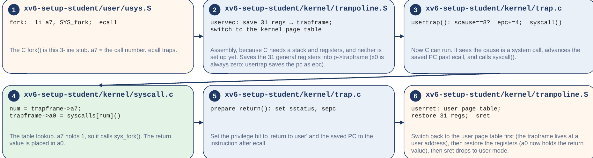{width=100%}
<figcaption markdown="1">Figure 4.13. One system call as a six-station round trip through four files of xv6. From slide 54, following the xv6 book sections 4.2 and 4.3.</figcaption>
</figure>

Station 1, `user/usys.S`: the C function `fork()` that a program calls is this three-line stub (a tiny function whose only job is to pass the call on): `li a7, SYS_fork` puts the call number in `a7`, `ecall` traps, and `ret` returns to the caller. (This file is written in **assembly**, the human-readable form of single machine instructions; it is generated from a script, `user/usys.pl`, when xv6 is built.)

Station 2, `kernel/trampoline.S`: `uservec` saves 31 registers into the trapframe and switches to the kernel's page table, the table that says where the kernel's own memory is. (To **map** a page is to give it a place in memory in such a table, and only mapped pages can be used.) The switch is needed because the user's page table maps the program's own memory and only two pages of the kernel, the trampoline and the trapframe (a design choice of xv6) (so that this code can run at all), so the rest of the kernel's code and data cannot be reached until it is made. The **trampoline** is one page of assembly that is mapped at the same address in every process. It has to be assembly, because at this moment the kernel has no stack and no free registers, and C code cannot run without them. It gets started with one small trick. Its first instruction copies one user register, `a0`, into `sscratch`, a spare control register that holds a value and is used for nothing else. Now `a0` may be overwritten without losing the program's value. The next instruction loads into `a0` the trapframe's address, which is the same fixed address in every process. xv6 places the trapframe page at the same high address in every process's map, just below the trampoline, precisely so that this code can find it. (The memory weeks explain how one address can lead to a different page in each process.) With that address in hand, the trampoline stores the other registers one by one into the trapframe, and finally copies the parked `a0` from `sscratch` there too. Then it loads the stack pointer with the address of this process's kernel stack, which the kernel wrote into the trapframe in advance. Last, it switches to the kernel's page table and jumps to `usertrap`, the C function of station 3. The trampoline must also sit at the same address in every process and in the kernel's own map, because it switches page tables in the middle of its code: the instruction after the switch must be found at the same address in the new map. It saves the 31 general registers; register 0 is always zero and needs no saving, and the program counter was saved by the hardware.

Station 3, `kernel/trap.c`, the function `usertrap()`: now C can run. It reads **scause**, the register where the hardware wrote why the trap happened; the value 8 means "a system call from user mode" (a code fixed by the RISC-V specification). It adds 4 to the saved program counter, `epc`, so that the return lands on the instruction after the `ecall`, and calls `syscall()`. (`epc` is the trapframe's copy of the address the hardware put in a control register called `sepc` at the trap. The `ecall` instruction is 4 bytes long, a fact of the RISC-V design, so +4 is the next instruction.) Station 4, `kernel/syscall.c`: the table lookup. `num = p->trapframe->a7;` reads the number the program put in `a7`, and `p->trapframe->a0 = syscalls[num]();` calls the handler at position `num` of the table `syscalls` and stores its result in the saved `a0`. For `fork`, `a7` holds 1, so this calls `sys_fork()`.

Station 5, `kernel/trap.c`, `prepare_return()`: it sets the two registers that `sret` will use. **sstatus** is set so that `sret` returns to user mode. (On RISC-V, by design, software cannot read the current level directly. When the CPU entered the kernel, it recorded the level it came from in one bit of `sstatus`, called SPP, and `sret` goes back to whatever level that bit names. Clearing the bit means "user", so the kernel clears it.) And **sepc** gets the address to continue at: the saved `epc`, which now points at the instruction after the `ecall`. Station 6, `kernel/trampoline.S`, `userret`: it undoes station 2 in reverse. It switches back to the user page table first (because the trapframe sits at a user address), then restores the 31 registers, with `a0` now holding the return value, then `sret` drops to user mode.

The blue bar sums up the round trip: user, then `ecall`, then kernel, do the work, then `sret`, then user. The two assembly stations, 1 and 2/6, exist for one reason: the C handler needs saved registers and a kernel stack before it can run, and the trampoline sets them up on the way in and tears them down on the way out. And this is the moment when the `trapframe` field of `struct proc`, from [Section 1.4](class-1.md#sec-1-4), is written and read.

### 4.7 Real machine What a system call costs {#sec-4-7 data-toc-label="4.7 [Real machine] What a system call costs"}

All six stations of [Section 4.6](#sec-4-6) run on every system call, and none of them does the program's actual work. So a system call must cost more than an ordinary function call, which is just a jump and a return inside the program. How much more matters, because programs make system calls constantly. The only way to know is to measure, and the measurement needs a fair comparison.

<figure markdown="1">
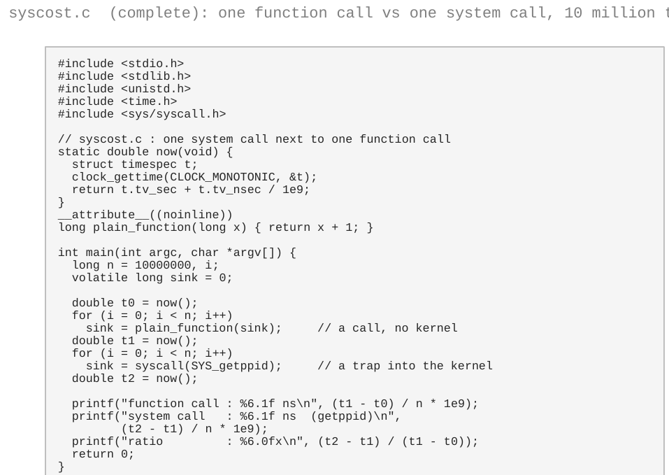{width=77%}
<figcaption markdown="1">Figure 4.14. syscost.c, complete: the same trivial work 10 million times through a function call, then 10 million times through a system call. From slide 55.</figcaption>
</figure>

The program in Figure 4.14 makes that comparison. It needs a clock: `now()` reads the time with `clock_gettime`, a system call that returns the current time in seconds and nanoseconds, and turns it into one number of seconds (`t.tv_nsec / 1e9` divides the nanoseconds by 10^9, a billion, to get seconds). `plain_function(x)` just returns `x + 1`; the line `__attribute__((noinline))` stops the compiler from replacing the call by its body, so that each loop really makes a call. `main` sets `n` to 10,000,000 (ten million). The first loop calls `plain_function` ten million times and the second calls `syscall(SYS_getppid)` ten million times. `getppid` returns the parent's pid, a number already sitting in the kernel, so it does no work at all: what the second loop times is the round trip itself, the trap, the register saves, the mode switches and the return. (`volatile` on `sink`, the variable each loop stores its result in, tells the compiler that the variable matters, so it cannot delete either loop as useless.) Then the program prints the time per call of each kind, in nanoseconds, and their ratio. Each time is (end time − start time) / n × 10^9: the seconds per call, times a billion nanoseconds per second.

<figure markdown="1">
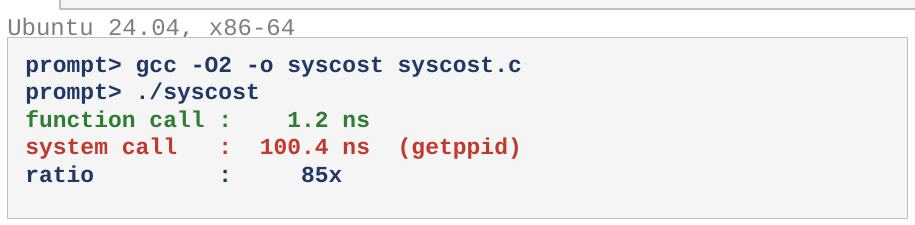{width=73%}
<figcaption markdown="1">Figure 4.15. The run on the Ubuntu machine. From slide 55.</figcaption>
</figure>

The run is Figure 4.15. `gcc -O2` compiles with the usual optimizations turned on (`-O2`), so the comparison is between two well-compiled loops. On the Ubuntu machine, a function call took 1.2 ns and a system call 100.4 ns. Check the ratio a second way: 100.4 / 1.2 ≈ 84. The program printed 85x, because it divides its own unrounded times, which it does not print; the two agree within the rounding of 1.2. (The slides round all of these to "about a hundred".)

<figure markdown="1">
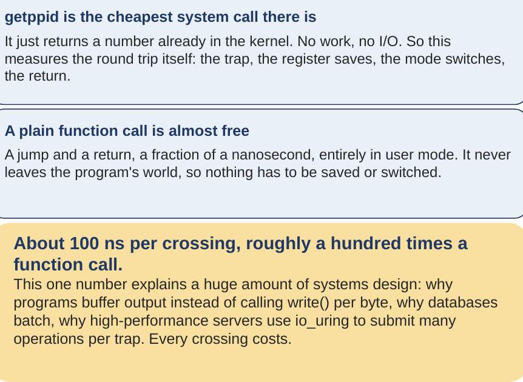{width=69%}
<figcaption markdown="1">Figure 4.16. What the two numbers mean, and why one ratio shapes systems design. From slide 55.</figcaption>
</figure>

The cards of Figure 4.16 draw the lesson. A plain function call is almost free: a jump and a return, entirely in user mode, never leaving the program's world, so nothing has to be saved or switched. A crossing into the kernel costs about 100 ns, about 85 times as much. That one ratio explains a lot of systems design. It is why `printf` buffers its output instead of calling `write()` for every character ([Section 2.3](class-1.md#sec-2-3)'s buffer). It is why databases batch their writes. And it is why fast servers use a Linux interface called io_uring to hand the kernel many operations per trap. Every crossing costs, so good code crosses rarely. Your own machine will give different numbers; the ratio is the lesson.

**Checkpoint 1.** Settled: the CPU has two modes. User code runs restricted; `ecall` raises the mode and jumps to the address the kernel installed (only the kernel can set it); `sret` drops back. One crossing costs about 100 ns on the Ubuntu machine, about 85 function calls. Still open: a trap happens only when the program asks for something. A program that never asks keeps the CPU, and unless some device happens to interrupt, the kernel never runs again. You should now be able to walk one system call through its six steps, and say which two of them the hardware does on its own.

## Chapter 5. How does the OS take the CPU back from a program that never asks for anything? {#chapter-5}

*The question this chapter answers: how does the OS take the CPU back from a program that never asks for anything?*

### 5.1 Problem Trusting the program fails on one short line: while(1); {#sec-5-1 data-toc-label="5.1 [Problem] Trusting the program fails on one short line: while(1);"}

What we have after [Chapter 4](#chapter-4) is a door that the program opens when it asks for something: every system call is a trap that brings the kernel back. And while a program runs, the kernel is not running. So the obvious way to take the CPU back is to trust the program to hand it over. Most programs do, all the time.

<figure markdown="1">
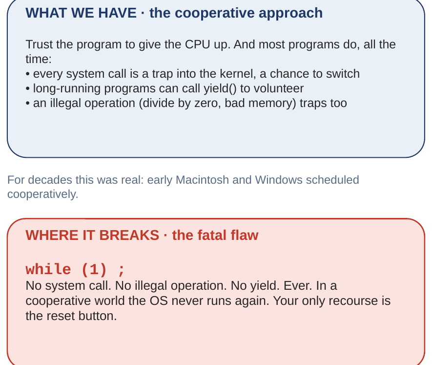{width=71%}
<figcaption markdown="1">Figure 5.1. What we have (the cooperative approach) and where it breaks (while(1);). From slide 57, following textbook section 6.3.</figcaption>
</figure>

The top card of Figure 5.1 is that trust, called the **cooperative approach**. Every system call is a trap into the kernel, and so a chance to switch to another process. A long-running program can call **yield()**, a system call that does nothing except hand the CPU to the OS. And an illegal operation, such as dividing by zero or touching a bad address, traps too. For decades this was real: early Macintosh and Windows systems scheduled processes cooperatively (as the textbook and the slide report).

Where it breaks is the red card, and the flaw is one short line: `while (1) ;`. That is a loop that repeats an empty statement forever (in C, `while (1)` means "repeat as long as 1 is true", which is always, and the lone `;` is a statement that does nothing). It makes no system call, does nothing illegal, and never yields. In a cooperative world the OS never gets the CPU back for good: even when a device interrupt brings the kernel in, the cooperative rule says it returns to the running program, since in that design only the program decides when to give the CPU up. Your only recourse is the reset button.

<figure markdown="1">
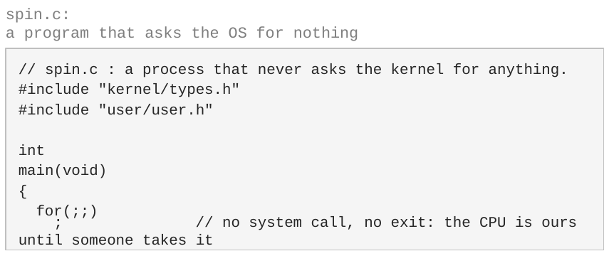{width=68%}
<figcaption markdown="1">Figure 5.2. spin.c, the xv6 version of a program that asks the OS for nothing. From slide 57.</figcaption>
</figure>

In xv6 that program is `spin.c`, Figure 5.2. `for(;;) ;` is the same endless empty loop written another way (a `for` loop with no condition repeats forever). The comment says it all: no system call, no exit; the CPU is ours until someone takes it. (`#include "kernel/types.h"` and `"user/user.h"` are how xv6 programs declare the library functions they could use; this one uses none.)

<figure markdown="1">
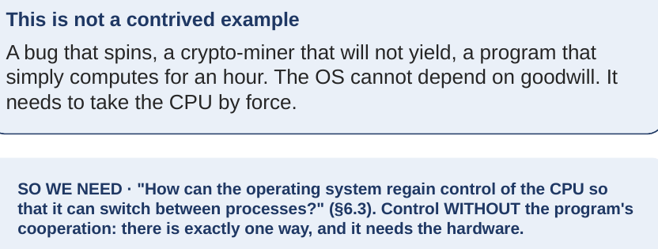{width=67%}
<figcaption markdown="1">Figure 5.3. Not a contrived example, and what we need. From slide 57.</figcaption>
</figure>

The first card of Figure 5.3 says why this is not a contrived example: a bug that spins, a crypto-miner (a program that computes for money for as long as it can run) that will not yield, a program that simply computes for an hour. The OS cannot depend on goodwill. Device interrupts, such as the disk's in [Section 1.3](class-1.md#sec-1-3), do bring the kernel back, but only when some device happens to need attention; a program that only computes may run for a long time without one. What is missing is a device that interrupts on a schedule. So we need, in the words of the textbook's crux for this section: how can the operating system regain control of the CPU so that it can switch between processes? And it must be control without the program's cooperation. There is exactly one way to get it, and it needs the hardware.

### 5.2 Concept The timer interrupt {#sec-5-2 data-toc-label="5.2 [Concept] The timer interrupt"}

[Section 5.1](#sec-5-1) showed that a program which never asks can keep the CPU forever, and that the fix has to come from the hardware, without the program's cooperation. The piece of hardware is a clock that interrupts the CPU on a schedule, whatever the program is doing. Figure 5.4 shows how the OS uses it.

<figure markdown="1">
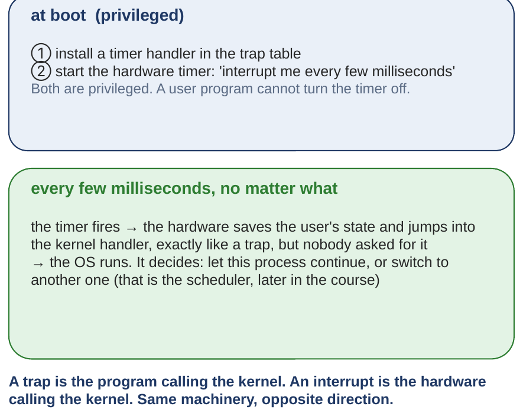{width=71%}
<figcaption markdown="1">Figure 5.4. At boot, the OS installs a timer handler and starts the timer; every few milliseconds the timer fires and the OS runs. From slide 58, following textbook section 6.3.</figcaption>
</figure>

At boot, in the top box, the OS does two things in kernel mode. One: it makes sure its trap handler also handles the timer (on RISC-V, through the same single address of [Section 4.4](#sec-4-4)), so that the hardware knows which kernel code to run when the timer fires. Two: it starts the hardware timer, a device that says "interrupt me every few milliseconds" (a **millisecond**, ms, is a thousandth of a second). Both are privileged, so a user program cannot turn the timer off.

From then on, in the green box, the timer fires every few milliseconds, no matter what. The hardware saves the program counter and jumps into the kernel's handler, which saves the rest of the running program's state, exactly as for a trap, except that nobody asked for it. This is a **timer interrupt**. Now the OS runs, and it decides: let this process continue, or switch to another one. Which one to pick is the scheduler's job, later in the course. The line under the boxes keeps the two words apart: a trap is the program calling the kernel; an interrupt is the hardware calling the kernel. Same machinery, opposite direction. The words overlap, so here is how this guide uses them. An **interrupt** comes from a device, such as the timer or the disk. An exception ([Section 4.3](#sec-4-3)) is an error the CPU finds in the running program. And "trap" is used for the program's own `ecall` and, more loosely, for any of these entries into the kernel; RISC-V's own documents call them all traps.

<figure markdown="1">
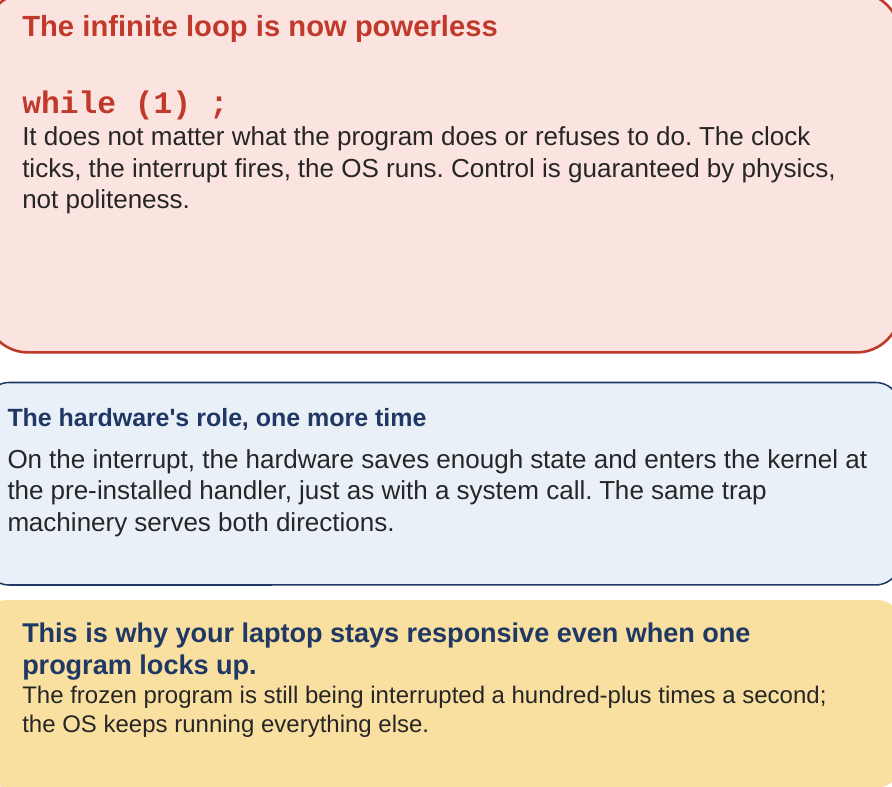{width=71%}
<figcaption markdown="1">Figure 5.5. The infinite loop is now powerless; the hardware's role; why your laptop stays responsive. From slide 58.</figcaption>
</figure>

The red card of Figure 5.5 is the result: the infinite loop is now powerless. It does not matter what the program does or refuses to do. The clock ticks, the interrupt fires, the OS runs. Control is guaranteed by physics, not politeness. The blue card restates the hardware's role: on the interrupt, it saves enough state and enters the kernel at the handler installed at boot, just as for a system call; the same trap machinery serves both directions. And the yellow card is the everyday consequence: this is why your laptop stays responsive when one program locks up. The frozen program is still being interrupted many times a second, and in each of those moments the OS runs everything else.

### 5.3 Real kernel Remove two lines from xv6 and one loop freezes the machine {#sec-5-3 data-toc-label="5.3 [Real kernel] Remove two lines from xv6 and one loop freezes the machine"}

[Section 5.2](#sec-5-2) made a claim: the timer interrupt is what lets the OS take the CPU back. A claim should be tested. If the claim is right, then turning the timer tick into a switch must be done by some specific lines of xv6, and removing them should let one spinning program keep the CPU forever. Figure 5.6 shows the lines.

<figure markdown="1">
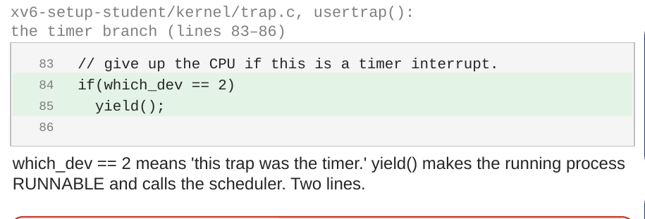{width=73%}
<figcaption markdown="1">Figure 5.6. The timer branch of usertrap(), kernel/trap.c lines 83 to 86. From slide 59.</figcaption>
</figure>

These are lines 84 and 85 of `kernel/trap.c`, inside `usertrap()`, the C function of station 3 in [Section 4.6](#sec-4-6). `which_dev` is a number that says which device caused the trap, and the value 2 means the timer (a code chosen by xv6's own interrupt function, `devintr`). If the trap was the timer, the kernel calls `yield()`, which marks the running process `RUNNABLE` and calls the scheduler. Two lines.

<figure markdown="1">
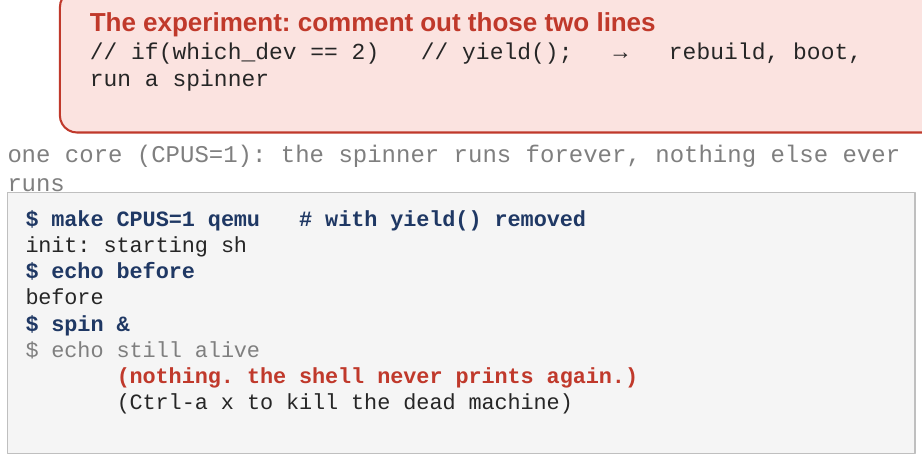{width=74%}
<figcaption markdown="1">Figure 5.7. The experiment: with those two lines removed and one CPU, one spinner freezes the shell. From slide 59.</figcaption>
</figure>

The experiment, Figure 5.7: comment out those two lines (turn them into comments with `//`, so they no longer run), rebuild xv6, boot it with one CPU, and run a spinner. `make CPUS=1 qemu` builds xv6 and starts it under QEMU with one CPU (`CPUS=1` sets the number of CPUs of the simulated machine). The shell prints its `$` prompt. `echo before` prints "before", because `echo` returns. `spin &` starts the spinner in the background, and the shell gives back its prompt. Then `echo still alive`, and nothing: the shell never prints again. The shell printed its prompt and then blocked, waiting for the next line from the keyboard, so the spinner got the CPU. When the line was typed, the shell became ready again. But a ready process runs only when the scheduler is called, and with the two lines removed the timer tick no longer calls it, so the spinner keeps the CPU and the shell never runs again. The only way out is to kill QEMU itself (Ctrl-a, then x).

<figure markdown="1">
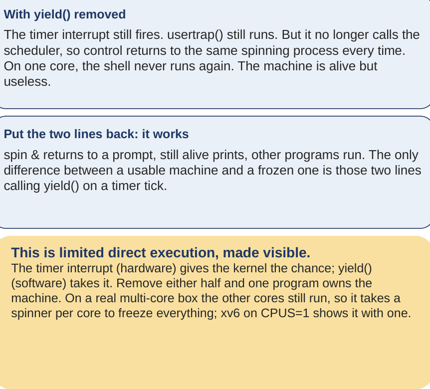{width=69%}
<figcaption markdown="1">Figure 5.8. What the experiment shows. From slide 59.</figcaption>
</figure>

The cards of Figure 5.8 explain it. With `yield()` removed, the timer interrupt still fires, and `usertrap()` still runs. But it no longer calls the scheduler, so control returns to the same spinning process every time. On one CPU, the shell never runs again: the machine is alive but useless. Put the two lines back and it works: `spin &` returns to a prompt, "still alive" prints, other programs run. The only difference between a usable machine and a frozen one is those two lines.

The yellow card says what this proves: this is limited direct execution, made visible. The timer interrupt (hardware) gives the kernel the chance; `yield()` (software) takes it. Remove either half and one program owns the machine. On a real machine with several CPUs the other CPUs still run, so it would take one spinner per CPU to freeze everything; that is why the experiment uses `CPUS=1`. A third captured run used three simulated CPUs (`make CPUS=3 qemu`) with the lines still removed, and there the shell does answer.

**Checkpoint 2.** Settled: a hardware timer, started at boot, interrupts every few milliseconds and lands in the kernel like a trap that nobody asked for. Starting it is privileged. Two lines in `usertrap` turn the tick into a switch; without them, one loop froze xv6. Still open: the kernel is back and has chosen another process, B. But the CPU still holds the kernel registers of the process that was running, A, including A's stack pointer. What does switching actually move? You should now be able to explain why `while(1);` cannot freeze a machine that has a timer, and say what the two removed lines did.

## Chapter 6. What does switching to another process actually do, and what does it cost? {#chapter-6}

*The question this chapter answers: what does switching to another process actually do, and what does it cost?*

### 6.1 Problem The kernel chose B, but the CPU still holds A's registers {#sec-6-1 data-toc-label="6.1 [Problem] The kernel chose B, but the CPU still holds A's registers"}

What we have is the moment just after a timer tick. Process A was running. The tick landed in the kernel, and A's 31 user registers and its program counter were saved into A's trapframe (the hardware saved the program counter in `sepc`, the trampoline saved the registers, and `usertrap` copied the program counter into the trapframe as `epc`). The scheduler then decided to run process B. Up to here, the kernel has only written things into memory.

<figure markdown="1">
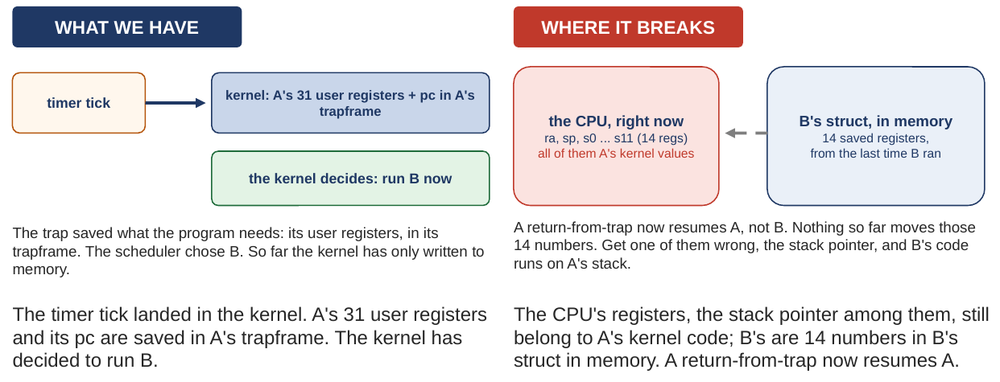{width=99%}
<figcaption markdown="1">Figure 6.1. What we have (the tick saved A's user registers; the kernel chose B) and where it breaks (the CPU still holds A's kernel registers). From slide 61, following textbook section 6.3.</figcaption>
</figure>

Where it breaks: look at the CPU right now. Its registers, the stack pointer among them, still hold A's kernel values, because the code running is the kernel working on A's trap. The kernel registers that matter here are 14 ([Section 6.3](#sec-6-3) explains why only these 14 need saving): the return address `ra`, the stack pointer `sp`, and the 12 saved registers `s0` to `s11` (2 + 12 = 14). B's 14 are numbers sitting in B's record in memory, left there the last time B ran. A return-from-trap right now would wake A, not B. Nothing so far moves those 14 numbers, and getting one wrong matters: with the wrong stack pointer, B's code would run on A's stack.

So we need a routine that stores the CPU's registers into A's record, loads B's from B's record, and returns into B. The textbook says what it must do in one sentence: a context switch is conceptually simple: all the OS has to do is save a few register values for the currently-executing process and restore a few for the soon-to-be-executing process. It can be small, because the user registers were already saved by the trap. Its name is **context switch**: the kernel saving one process's registers and loading another's, so that the return-from-trap resumes a different process.

### 6.2 Concept The context switch: save A, load B, return into B {#sec-6-2 data-toc-label="6.2 [Concept] The context switch: save A, load B, return into B"}

[Section 6.1](#sec-6-1) asked for a routine that moves 14 registers out of the CPU into A's record, and B's 14 from B's record into the CPU, and then returns into B. Figure 6.2 draws it, and it is simpler than its name.

<figure markdown="1">
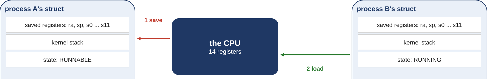{width=100%}
<figcaption markdown="1">Figure 6.2. The context switch: save the CPU's registers into A's struct, load B's into the CPU. From slide 62, following textbook section 6.3.</figcaption>
</figure>

On the left is A's record in the kernel: room for saved registers (`ra`, `sp`, `s0` to `s11`), a kernel stack, and a state, now `RUNNABLE`. In the middle is the CPU with its 14 registers. On the right is B's record, whose state becomes `RUNNING`. Step 1, the red arrow: store the CPU's 14 registers into A's record. Now everything the kernel needs to continue A later is in memory. Step 2, the green arrow: load B's 14 saved registers into the CPU. That is the entire switch. (In xv6 each hand-off actually passes through a separate scheduler on the way, so it takes two of these switches, A to the scheduler and the scheduler to B; [Extra 26](#extra-26) shows it. This guide, like the textbook, counts one hand-off from one process to another as one switch.)

<figure markdown="1">
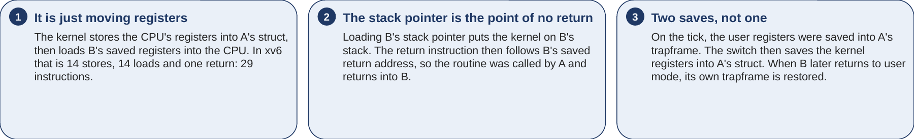{width=100%}
<figcaption markdown="1">Figure 6.3. Three facts about the switch. From slide 62.</figcaption>
</figure>

The three cards of Figure 6.3 add three facts. First, it is just moving registers: in xv6 it is 14 stores, 14 loads and one return, so 14 + 14 + 1 = 29 instructions. Second, the stack pointer is the point of no return. Once B's stack pointer is loaded, the kernel is standing on B's kernel stack. The return instruction that follows uses the return address B saved, so the routine was called by A's kernel code and returns into B's. B continues from where it was switched out last time, which was inside this same routine. (A brand-new process from `fork()` has never been switched out; the kernel prepares its saved registers so that the first switch into it lands at the start of a small kernel function, `forkret`, that sends it on to user mode.) Third, there are two saves, not one. On the tick, A's user registers were saved into A's trapframe ([Section 4.6](#sec-4-6)). The switch then saves the kernel's own registers into A's record. Later, when B goes back to user mode, B's trapframe is restored and B's program continues as if nothing had happened.

The blue bar brings it back to the first week: the illusion of many CPUs comes down to this, copying a few registers to and from memory, many times a second. Each switch costs about a microsecond on the Ubuntu machine ([Section 6.4](#sec-6-4) measures it).

### 6.3 Real kernel swtch.S: 29 instructions that move registers {#sec-6-3 data-toc-label="6.3 [Real kernel] swtch.S: 29 instructions that move registers"}

[Section 6.2](#sec-6-2) claimed the whole switch is 14 stores, 14 loads and a return. That is easy to check, because the code is short: the function `swtch` in `kernel/swtch.S`, all of it, in Figure 6.4.

<figure markdown="1">
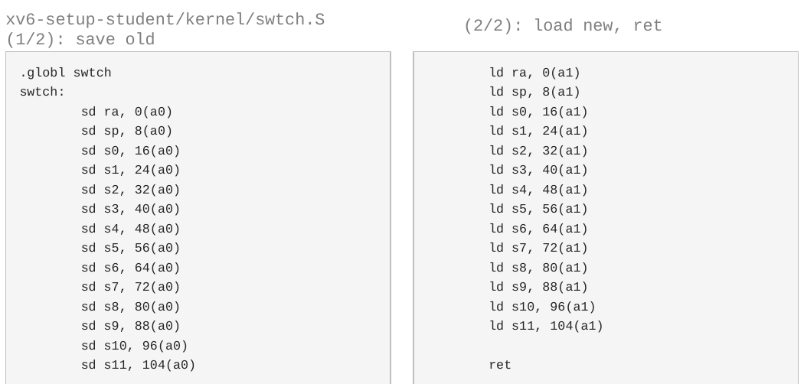{width=84%}
<figcaption markdown="1">Figure 6.4. kernel/swtch.S, complete: 14 stores, 14 loads and ret. From slide 63, following the xv6 book section 8.3.</figcaption>
</figure>

`swtch` is called from C as `swtch(&old, &new)`: two arguments, each the address of a saved-register record. On RISC-V the first argument arrives in register `a0` and the second in `a1`. The left column saves the old registers: `sd` means "store doubleword", that is, store one 8-byte register into memory. `sd ra, 0(a0)` stores `ra` at the address in `a0` plus 0; `sd sp, 8(a0)` stores `sp` 8 bytes further on; and so on, 8 bytes apart, up to `sd s11, 104(a0)`. Check the last offset: `s11` is the 14th register, so it sits 13 places after `ra`, and 13 × 8 = 104. The right column loads the new registers: `ld` means "load doubleword", and `ld ra, 0(a1)` loads `ra` from the address in `a1`, and so on up to `s11`. Then `ret` returns. Count: 14 + 14 + 1 = 29 instructions.

<figure markdown="1">
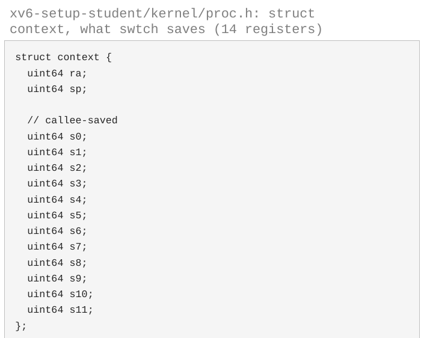{width=56%}
<figcaption markdown="1">Figure 6.5. struct context in kernel/proc.h: the 14 registers swtch saves. From slide 63.</figcaption>
</figure>

What it saves is `struct context`, Figure 6.5, from `kernel/proc.h`: `ra`, `sp`, and `s0` to `s11`, each a `uint64`, a 64-bit number, which is 64 / 8 = 8 bytes because a byte is 8 bits. That is why the offsets go up by 8. This is the `context` field of `struct proc` that [Section 1.4](class-1.md#sec-1-4) promised the second class would read.

<figure markdown="1">
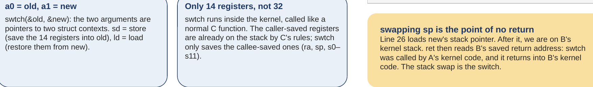{width=100%}
<figcaption markdown="1">Figure 6.6. Why a0 and a1, why only 14, and why loading sp is the switch. From slide 63.</figcaption>
</figure>

The cards of Figure 6.6 answer two questions. Why only 14 registers, when a trap saved 31? Because `swtch` runs inside the kernel and is called like an ordinary C function. The rules every C function follows divide the registers into two kinds. **Caller-saved** registers are ones a function may freely overwrite, so a caller that still needs their values must save them on its stack before the call; C's compiler does that automatically. **Callee-saved** registers are ones a function promises to leave as it found them. So at the moment `swtch` is called, the caller-saved values are already safe on the stack, and `swtch` only needs to save the callee-saved ones: `ra`, `sp` and `s0` to `s11`. B's own caller-saved values are on B's stack, put there by B's code before B called `swtch` the last time; once `sp` points at B's stack, they are back within reach. `ra` is in the list for one more reason: it holds the place in the kernel that `swtch` will return to, and that place is different for A and for B, so it must be saved and swapped with the rest. A trap, in contrast, can land between any two instructions of a program that made no such preparations, so it must save everything.

And the third card: swapping `sp` is the point of no return. Line 26 of the file, `ld sp, 8(a1)`, loads the new stack pointer. Before it, the kernel stands on A's kernel stack; after it, on B's. Then `ret` jumps to B's saved return address: `swtch` was called by A's kernel code, and it returns into B's (in xv6 the two ends are A and the scheduler, then the scheduler and B; [Extra 26](#extra-26)). Swapping the stack is what switches the process. Twenty-nine instructions, no magic. You will not edit this file, but you can now follow it line by line.

### 6.4 Real machine What a context switch costs {#sec-6-4 data-toc-label="6.4 [Real machine] What a context switch costs"}

[Section 6.3](#sec-6-3) counted 29 instructions, but instructions are not the whole cost of a switch: the kernel also has to get there and switch page tables, and the new process starts with none of its data close at hand (the cards below explain that cost). [Section 4.7](#sec-4-7) measured a system call; a switch is harder to measure, because a program cannot simply call "switch". The trick is to force one to happen on every step, and time many of them.

<figure markdown="1">
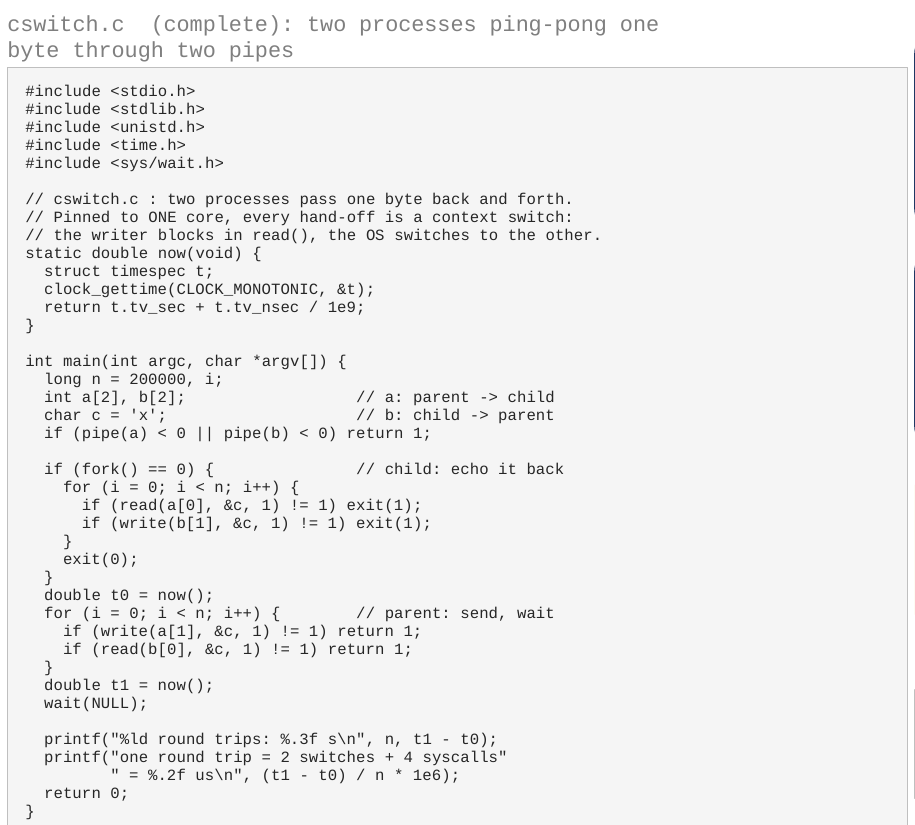{width=73%}
<figcaption markdown="1">Figure 6.7. cswitch.c, complete: two processes pass one byte back and forth through two pipes. From slide 64.</figcaption>
</figure>

The program in Figure 6.7 makes two processes pass one byte back and forth through two pipes, 200,000 times. It creates two pipes, `a` (parent to child) and `b` (child to parent), and forks. The child loops: `read` one byte from `a`, `write` it back into `b`. (`read(fd, &c, 1)` reads 1 byte from descriptor `fd` into the variable `c`, and `write` is the reverse; `!= 1` checks that exactly one byte moved, and `exit(1)` gives up if not.) The parent loops: write the byte into `a`, then read the reply from `b`. Each side sends the byte and then blocks in `read` until the reply comes, which forces the OS to run the other side. The parent times the 200,000 round trips with `now()`, as in [Section 4.7](#sec-4-7), then prints the total and the time per round trip in microseconds (× 10^6).

<figure markdown="1">
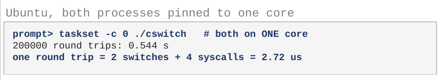{width=72%}
<figcaption markdown="1">Figure 6.8. The run on the Ubuntu machine, both processes pinned to one core. From slide 64.</figcaption>
</figure>

The run, Figure 6.8, uses `taskset -c 0`, a Linux command that pins a program to one chosen **core** (one CPU of a machine that has several; the Ubuntu machine has two, numbered from 0). With both processes on core 0, they cannot run at the same time, so every hand-off of the byte is a real switch. The result: 200,000 round trips in 0.544 s, which the program reports as 2.72 µs per round trip. Check it a second way: 0.544 s / 200,000 = 0.00000272 s = 2.72 µs (a **microsecond**, µs, is a millionth of a second).

<figure markdown="1">
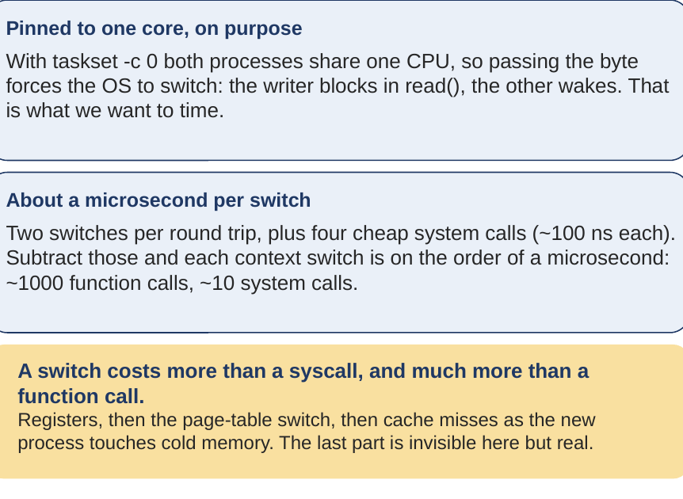{width=69%}
<figcaption markdown="1">Figure 6.9. What the number means: about a microsecond per switch. From slide 64.</figcaption>
</figure>

The cards of Figure 6.9 take the number apart. One round trip holds two switches, counting each hand-off as one switch as [Section 6.2](#sec-6-2) does, (parent to child, child to parent) and four system calls (two writes and two reads), each about 100 ns from [Section 4.7](#sec-4-7). Assume each pipe `read` or `write` costs about as much as the cheap system call of [Section 4.7](#sec-4-7), about 100 ns; they do a little more work, so this is a rough estimate. (A `read` that has to wait for the other side does more than that, so treat the result as an order of magnitude, which is how the slides use it.) Subtract the system calls: 2.72 µs − 4 × 0.1 µs = 2.32 µs for two switches, so each switch costs about 2.32 / 2 ≈ 1.2 µs, on the order of a microsecond. Compared with [Section 4.7](#sec-4-7)'s numbers, that is about 1,160 ns / 1.2 ns ≈ 1,000 function calls, or about 1,160 / 100 ≈ 12 system calls, roughly ten. A switch costs more than a system call, and much more than a function call. Part of that is the registers and the switch of page tables. Often the larger part is invisible here, and this guide does not measure it. After the switch, the new process runs into a cold **cache**: the small, fast memory near the CPU that keeps recently used data, which does not yet hold the new process's data. That cost lands on the new process's own instructions.

The grey line at the bottom of the slide adds a contrast. Without `taskset`, Linux is free to put the two processes on different cores, and it does. Each has a core of its own, so no switch is needed: a process that waits in `read` simply sleeps until the write on the other core wakes it. The same program then measures the delay of passing a byte through a pipe between two cores: about 30 µs per round trip (32.50 µs in the kept run). That is slower than a switch, because each side must be woken up from the other core; this guide does not take that cost apart. A Linux tool called `vmstat` prints system counters while a program runs, and its `cs` column, the number of context switches per second, climbs while the pinned version runs (you can watch this yourself; it was not captured for this guide).

**Checkpoint 3.** Settled: a context switch stores 14 kernel registers into A's record and loads B's; the line that loads the stack pointer is the switch. It costs about 1 µs on the Ubuntu machine, roughly 10 to 12 system calls. Still open: a timer interrupt can arrive while the kernel is in the middle of a system call. Two activities inside the kernel at once is last week's race, one level down ([Extra 27](#extra-27)). You should now be able to say what is saved in the trapframe and what in the context, and which of the hardware, the trampoline and `swtch` saves each.

## Summary Summary of the week: the process, and limited direct execution {#summary-66 data-toc-label="[Summary] Summary of the week: the process, and limited direct execution"}

The week asked six questions, three in each class, and each answer solved a problem the week had named.

What is a process, and what does the kernel keep for one? Its memory, its registers and its open files, in one `struct proc` with a state. Solved: what to save to stop a program and resume it.

How is a new process made, and how does its parent know when it is done? `fork()` copies the caller and returns twice, 0 in the child; `wait()` blocks until a child exits. Solved: a user program cannot touch the kernel's array of records, and the order after `fork()` is the scheduler's to choose.

How does a process run a different program, and why does that take two calls? `exec()` replaces the program in the same process; the gap before it is where the shell redirects. Solved: a copy of the shell is never `wc`, and a single create-and-run call has no moment to redirect.

How does a program get the kernel's help without getting the kernel's power? Two CPU modes. A trap (`ecall`) raises the mode and jumps to the address the kernel installed at boot; `sret` drops back. Solved: a store to a device from user mode is refused by the hardware. Cost: about 100 ns a crossing on the Ubuntu machine.

How does the OS take the CPU back from a program that never asks for anything? A hardware timer, started at boot (a privileged act), interrupts every few milliseconds and lands in the kernel like a trap. Solved: `while(1);` with no system call; two lines in `usertrap` turn the tick into a switch. Cost: a tick's worth of kernel work, many times a second.

What does switching to another process actually do, and what does it cost? A context switch stores 14 kernel registers into A's record and loads B's; loading the stack pointer is the switch; the user registers were already in the trapframe. Solved: the CPU still held A's registers after the kernel chose B. Cost: about 1 µs a switch, plus a cold cache.

<figure markdown="1">
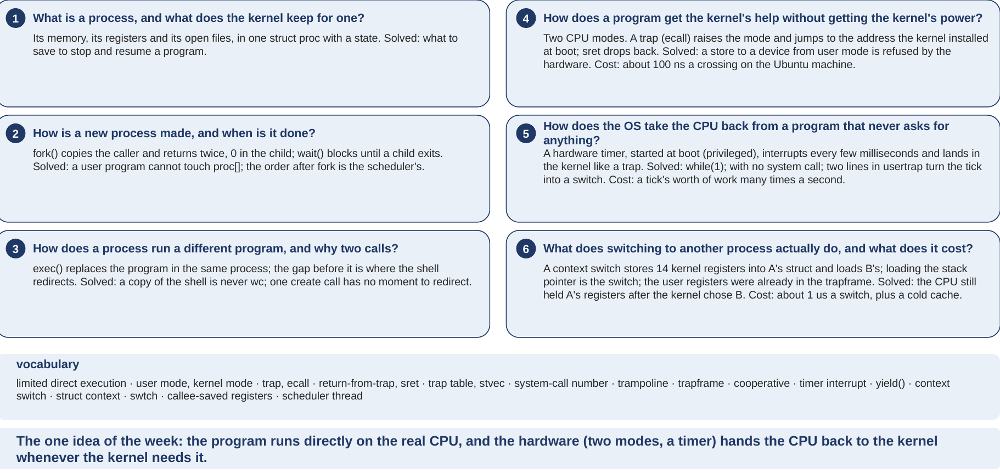{width=100%}
<figcaption markdown="1">Figure 6.10. The week on one slide: six questions, six answers, the vocabulary, and the one idea of the week. From slide 66, following textbook sections 5.7 and 6.5.</figcaption>
</figure>

Every word on the vocabulary line of Figure 6.10 should now have a picture behind it: limited direct execution, user mode and kernel mode, trap and `ecall`, return-from-trap and `sret`, trap table and `stvec`, system-call number, trampoline, trapframe, cooperative, timer interrupt, `yield()`, context switch, `struct context`, `swtch`, callee-saved registers, and the scheduler thread ([Extra 26](#extra-26)). And the one idea of the week: the program runs directly on the real CPU, and the hardware, with its two modes and its timer, hands the CPU back to the kernel whenever the kernel needs it.

## Going deeper, second class (optional) {#extras-2}

These sections go deeper into the three questions of the second class, labeled Q1, Q2 or Q3. You can read them now, later, or not at all.

### Extra 22 Deeper, Q1 The two assumptions, and the crux of the chapter {#extra-22 data-toc-label="Extra 22 [Deeper, Q1] The two assumptions, and the crux of the chapter"}

The second class opened from two things the first class took on trust. This extra states them once more, the way the textbook's chapter 6 opens, because together they make one crux: the OS wants speed and control at the same time, and the two pull against each other.

<figure markdown="1">
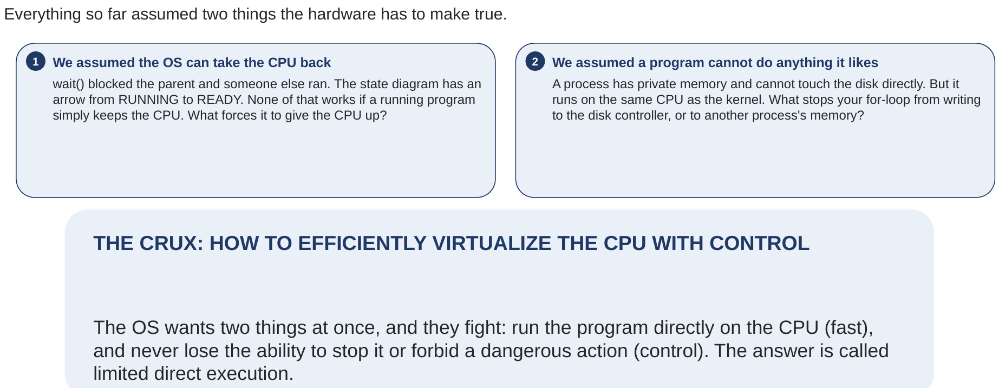{width=100%}
<figcaption markdown="1">Figure E22.1. The two assumptions of the first class, and the crux of chapter 6. From slide 67, following the opening of textbook chapter 6.</figcaption>
</figure>

The first card of Figure E22.1: we assumed the OS can take the CPU back. `wait()` blocked the parent and someone else ran; the state diagram of [Section 1.3](class-1.md#sec-1-3) has an arrow from running to ready. None of that works if a running program simply keeps the CPU. What forces it to give the CPU up? The second card: we assumed a program cannot do anything it likes. A process has private memory and cannot touch the disk directly. But it runs on the same CPU as the kernel. What stops your loop from writing to the disk controller, or into another process's memory?

The crux below them: how to efficiently virtualize the CPU with control. The OS wants two things at once, and they fight. It wants the program on the CPU with the kernel out of the way, because that is the only way to be fast. And it wants never to lose the ability to stop the program or forbid a dangerous action, which needs the kernel in the way. The answer is limited direct execution ([Section 4.3](#sec-4-3)): the program runs directly, the hardware enforces the limits, and the hardware hands the CPU back.

### Extra 23 Deeper, Q1 Who saves what: the hardware and the OS split the work {#extra-23 data-toc-label="Extra 23 [Deeper, Q1] Who saves what: the hardware and the OS split the work"}

Sections [4.5](#sec-4-5) and [4.6](#sec-4-6) walked a system call through six steps and six stations, with the hardware and the kernel taking turns. Which side does which save is a favorite interview question, and the split is not arbitrary. This extra puts it in one table.

<figure markdown="1">
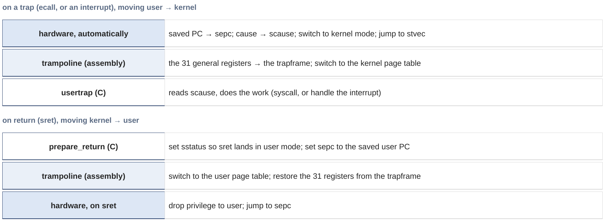{width=100%}
<figcaption markdown="1">Figure E23.1. Who saves what on the way into the kernel and on the way back out. From slide 68, following the xv6 book sections 4.1 and 4.2.</figcaption>
</figure>

The top half of Figure E23.1 is the way up, on any trap (an `ecall` or an interrupt). The hardware, automatically, in one instruction: it copies the program counter into `sepc`, the cause into `scause`, switches to kernel mode, and jumps to the address in `stvec`. Then the trampoline, in assembly: it saves the 31 general registers into the trapframe and switches to the kernel page table. Then `usertrap`, in C: it reads `scause` and does the work (the system call, or the handling of the interrupt).

The bottom half is the way down, on return. `prepare_return`, in C: it sets `sstatus` so that `sret` lands in user mode, and sets `sepc` to the saved user program counter. The trampoline, in assembly: it switches to the user page table and restores the 31 registers from the trapframe. The hardware, on `sret`: it drops the privilege to user mode and jumps to `sepc`.

The rule behind the table is in the blue bar. The hardware does the few things software cannot do for itself: change the privilege level, and save the program counter at the very instant of the trap (recording the cause and jumping to the handler come with them). Any software that tried would have to run instructions first, and running them changes the program counter. The OS does everything else. Neither could do the job alone; that division is the heart of the mechanism.

### Extra 24 Deeper, Q2 The cooperative idea and the timer on one page {#extra-24 data-toc-label="Extra 24 [Deeper, Q2] The cooperative idea and the timer on one page"}

[Chapter 5](#chapter-5) took three sections to reach the timer. This extra is the same argument on one page, for review: the idea that fails, the only answer, and the difference between a trap and an interrupt.

<figure markdown="1">
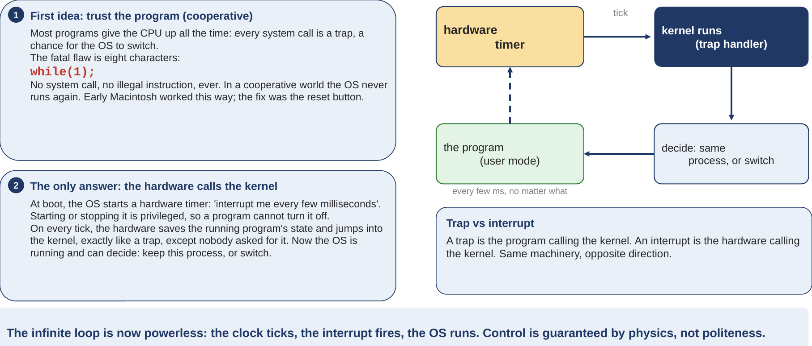{width=100%}
<figcaption markdown="1">Figure E24.1. Problem 2 on one slide: the cooperative idea, its fatal flaw, and the timer. From slide 69, following textbook section 6.3.</figcaption>
</figure>

The top-left card of Figure E24.1 is the first idea, trusting the program: most programs give the CPU up all the time, because every system call is a trap and a chance for the OS to switch. Its fatal flaw is one short line, `while(1);`: no system call, no illegal instruction, ever. In a cooperative world the OS never takes the CPU back; on the early Macintosh (as the textbook reports), the fix was the reset button.

The bottom-left card is the only answer: the hardware calls the kernel. At boot the OS starts a hardware timer, "interrupt me every few milliseconds", and starting or stopping it is privileged, so a program cannot turn it off. On every tick, the hardware saves the program counter and jumps into the kernel, whose handler saves the rest of the program's state, exactly like a trap, except that nobody asked. Now the OS is running and can decide: keep this process, or switch.

The drawing on the right is that cycle: the timer ticks, the kernel's trap handler runs, it decides to keep the same process or switch, and the program runs again in user mode until the next tick a few milliseconds later. The card below the drawing repeats the distinction: a trap is the program calling the kernel; an interrupt is the hardware calling the kernel; same machinery, opposite direction.

### Extra 25 Deeper, Q3 The whole protocol on one timeline {#extra-25 data-toc-label="Extra 25 [Deeper, Q3] The whole protocol on one timeline"}

The second class built three mechanisms one at a time: the trap, the timer interrupt and the context switch. OSTEP Figure 6.3 puts all three on one timeline, with time flowing down, so the order of events and the owner of each step can be read at a glance.

<figure markdown="1">
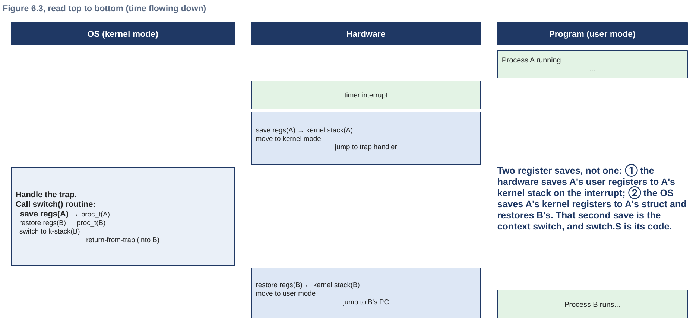{width=100%}
<figcaption markdown="1">Figure E25.1. OSTEP Figure 6.3, redrawn: limited direct execution with a timer interrupt, read top to bottom. From slide 70.</figcaption>
</figure>

Figure E25.1 has three columns, one per actor: the OS in kernel mode, the hardware, and the program in user mode. Read it top to bottom. In the right column, process A is running in user mode at full speed; nobody is watching. In the middle column, the timer interrupt fires; it is a hardware event, which is why it sits in the hardware column. The hardware saves A's registers to A's kernel stack, moves to kernel mode, and jumps to the trap handler. In the left column, the OS handles the trap and decides to switch. (The figure abbreviates: regs are registers, `proc_t` is the textbook's name for the process structure, and k-stack is the kernel stack.) It calls the switch routine, which saves A's registers into A's process structure, restores B's from B's, and switches to B's kernel stack. Then it executes return-from-trap, but now into B. Back in the middle column, the hardware restores B's registers from B's kernel stack, moves to user mode, and jumps to B's program counter. In the right column, process B runs. From B's point of view, no time passed.

The blue note in the figure repeats the point of [Section 6.2](#sec-6-2): there are two register saves, not one. The hardware saves A's user registers on the interrupt, and the OS saves A's kernel registers into A's structure in the switch. The second save is the context switch, and `swtch.S` ([Section 6.3](#sec-6-3)) is its code. One naming difference: the figure, drawn for the x86 processor, says the hardware saves onto the kernel stack; xv6 on RISC-V saves into a separate trapframe page, and does it in software, in the trampoline.

### Extra 26 Deeper, Q3 xv6 always switches through a per-CPU scheduler thread {#extra-26 data-toc-label="Extra 26 [Deeper, Q3] xv6 always switches through a per-CPU scheduler thread"}

Sections [6.2](#sec-6-2) and [6.3](#sec-6-3) drew the switch as A straight to B. xv6 does not quite do that, and the reason shows how a real kernel organizes the switch. Every hand-off goes through a separate scheduler, one per CPU, so that all the switching logic stays in one place. Switching straight from A to B would mean that the code choosing B runs on A's kernel stack, in the middle of A's trap; if A is exiting, that stack is about to be freed. A separate scheduler, with a stack of its own, keeps the choosing code off every process's stack.

<figure markdown="1">
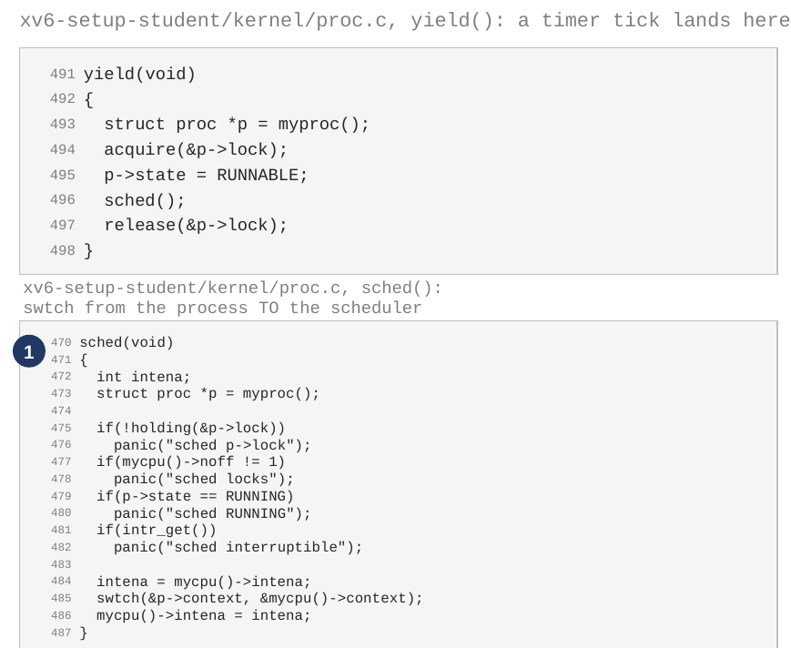{width=70%}
<figcaption markdown="1">Figure E26.1. yield() and sched(): a timer tick lands in yield, which calls sched, which switches out of the process. From slide 71.</figcaption>
</figure>

Start where [Section 5.3](#sec-5-3) ended. A timer tick reaches `yield()` (top of Figure E26.1; the heading reads "a timer tick lands here (from usertrap)", cut on the right in the crop). `yield()` marks the current process `RUNNABLE` and calls `sched()`. `sched()` checks, with its `panic` lines, that nothing is in an unsafe state. Then, at callout 1, it calls `swtch(&p->context, &mycpu()->context)`. That saves the process's registers into the process's `context` and loads the registers of this CPU's scheduler. (`mycpu()` returns the record for the CPU the code is running on, and its `context` is where the scheduler's registers were saved.) The process is now paused inside `sched()`.

<figure markdown="1">
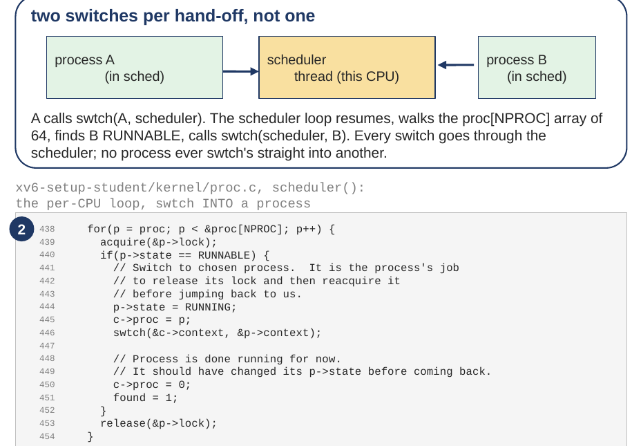{width=73%}
<figcaption markdown="1">Figure E26.2. The scheduler loop: two switches per hand-off, and the loop that switches into the next process. From slide 71.</figcaption>
</figure>

The scheduler, Figure E26.2, was itself paused at its own `swtch`, line 446 of `kernel/proc.c`. It wakes up there and goes round its loop over the 64 records (the loop shape of [Extra 7](class-1.md#extra-7)). At callout 2 it finds a `RUNNABLE` process, marks it `RUNNING`, and calls `swtch(&c->context, &p->context)` to switch into it. That process wakes up inside its own `sched()`, returns up through `yield()`, and eventually goes back to user mode. So one hand-off from A to B is two switches: A into the scheduler, then the scheduler into B. Never A directly into B.

<figure markdown="1">
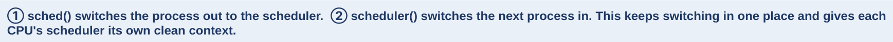{width=100%}
<figcaption markdown="1">Figure E26.3. Why the extra hop exists. From slide 71.</figcaption>
</figure>

Figure E26.3 says why the extra hop is worth it: `sched()` switches the process out to the scheduler, and `scheduler()` switches the next process in. That keeps all the switching decisions in one loop, and gives each CPU's scheduler a clean context of its own to run that loop in. A stream of instructions that runs inside the kernel with its own stack and its own saved registers is called a kernel thread (a thread, from Part 0, is one stream of instructions). That is why the deck calls the scheduler, running on its own context, the "scheduler thread".

### Extra 27 Deeper, Q3 The kernel is itself concurrent: a trap inside a trap {#extra-27 data-toc-label="Extra 27 [Deeper, Q3] The kernel is itself concurrent: a trap inside a trap"}

Checkpoint 3 left one loose end. A timer interrupt fires every few milliseconds, whatever is running, and that includes the kernel itself, in the middle of handling a system call. Then two activities are inside the kernel at once, touching the same kernel data. That is exactly last week's race (two threads, one counter), one level down, inside the OS.

<figure markdown="1">
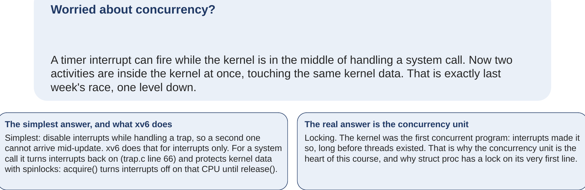{width=100%}
<figcaption markdown="1">Figure E27.1. A trap inside a trap: the problem, the simplest answer and what xv6 does, and the real answer. From slide 72, following textbook section 6.4.</figcaption>
</figure>

The top box of Figure E27.1 is that worry. The left card is the simplest answer: turn interrupts off while handling a trap, so that a second one cannot arrive in the middle of an update. xv6 does that while it handles an interrupt. For a system call, though, it turns interrupts back on (`kernel/trap.c` line 66, `intr_on()`), so that a long system call does not block the timer, and it protects its data with **spinlocks**. A spinlock is a lock that a CPU waits for by looping until it is free; in xv6, taking one (`acquire()`) also turns interrupts off on that CPU until it is given back (`release()`).

The right card is the real answer: locking, which is the concurrency unit of the course. The historical point is worth remembering: the kernel was the first concurrent program (a common observation in the history of operating systems). Interrupts made it so, long before threads existed. That is why the concurrency unit is the heart of this course, and why `struct proc` has a lock as its very first field (line 86 of `kernel/proc.h`, right after the comment and the `struct proc {` line; the field [Section 1.4](class-1.md#sec-1-4) set aside).

The blue bar ends the week: you now know both halves of virtualizing the CPU, the process (the what) and limited direct execution (the how).
