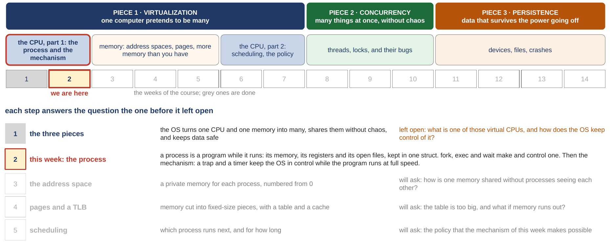
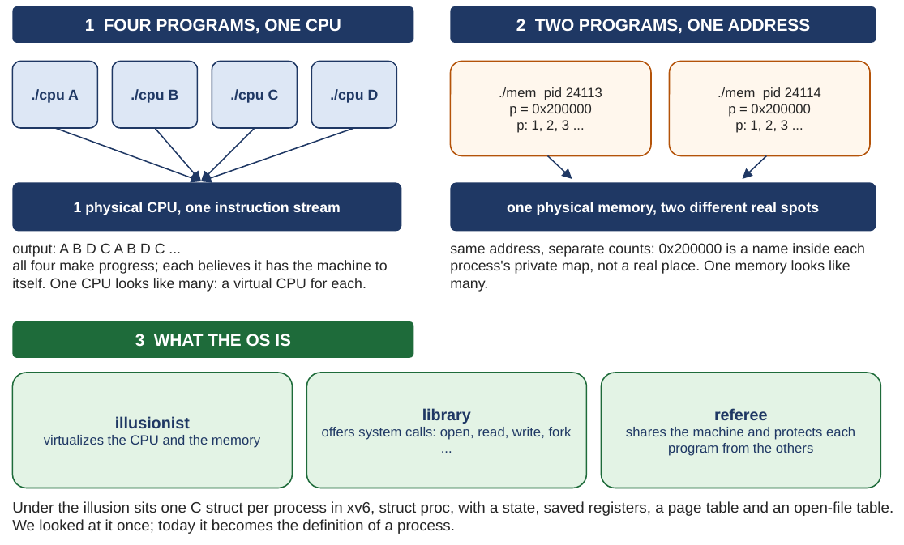
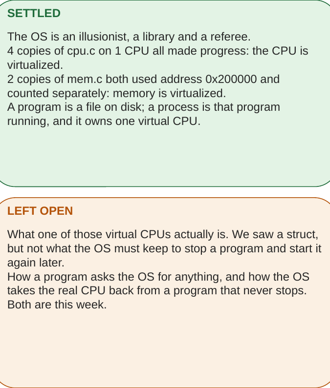
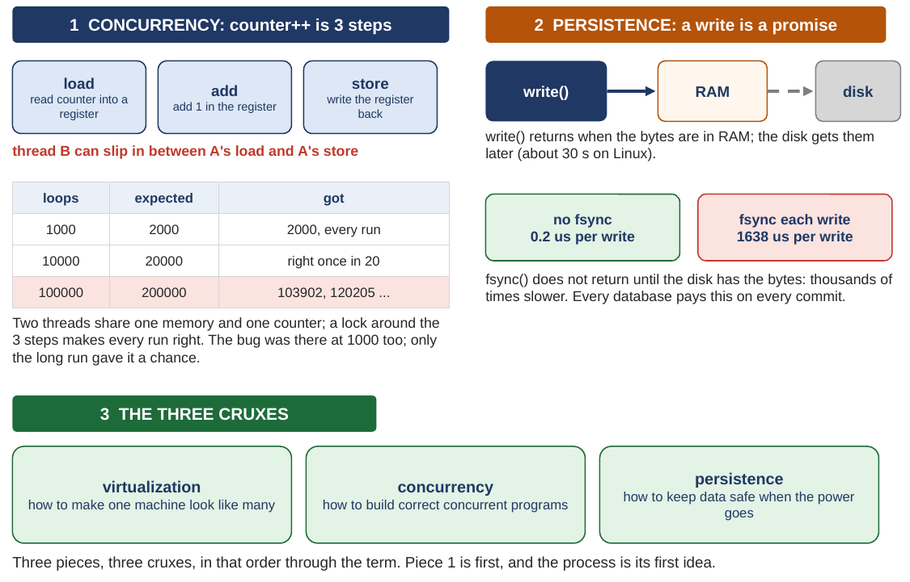
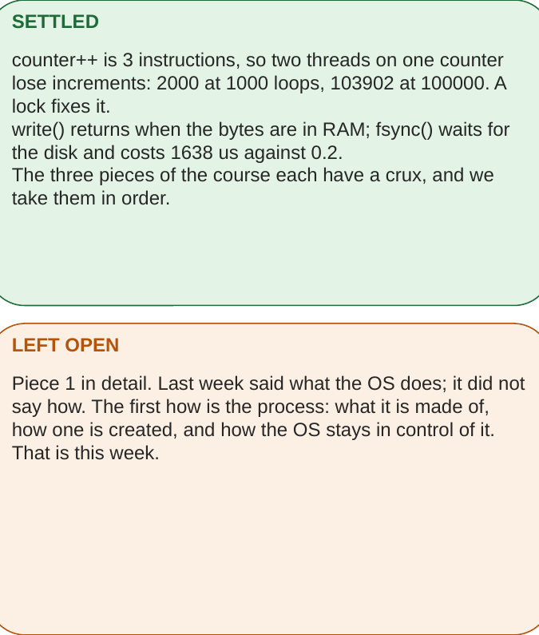
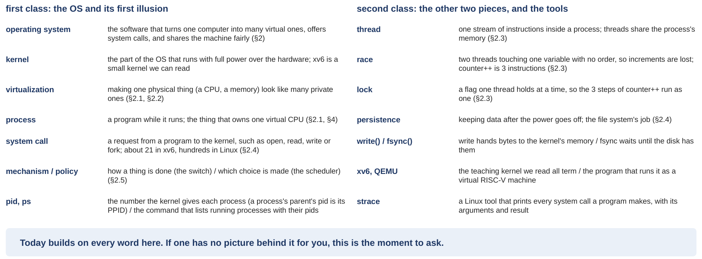

# The Process: fork, exec, wait, and how the OS stays in control

*COMP3430 Operating Systems*

## Where this guide comes from {#source}

This guide comes from chapters 4, 5 and 6 of the textbook (OSTEP: *Operating Systems: Three Easy Pieces*), from chapter 1 and sections 4.1 to 4.3 of the short book that explains the xv6 source code, and from the xv6 source tree you use in the labs. It follows the slides of the week in order, with the same pictures (this guide calls the set of slides the deck). It also comes from small programs that were run on two real machines: an Ubuntu 24.04 x86-64 machine in the cloud, and xv6 under QEMU on RISC-V. (x86-64 and RISC-V are two families of processor. xv6 is the small teaching operating system you read all term, and QEMU is the program that runs it as a pretend RISC-V computer. Part 0 explains the names; until then they are just the names of the two machines.) Where a figure, a number or a line of code comes from one of those, the guide says so, so you can look it up later if you want to go deeper.

## How to read this guide {#contents}

The label in brackets says what kind of section it is: a **Problem** section states what we have, where it breaks and what we need, before any fix; a **Concept** section explains the idea that answers it; a **Real kernel** section reads the xv6 code; a **Real machine** section reads an output captured on a real computer; the **Checkpoint** paragraph at the end of each chapter is for you to test yourself before reading on; **Extra** sections are optional and go deeper on a question already answered, and Q1, Q2 or Q3 in their label names which of the class's three questions they deepen.

The navigation on the left lists every class and chapter of this week; the table of contents on the right lists the sections of the page you are on. Every section number in the text ("Section 3.5", "Extra 4") is a link.

## Part 0. Where we are in the course, and what the first week taught {#part-0}

This part does two jobs before the new material starts. It shows where this week sits in the whole course, and it rebuilds the first week of the course, with every word of it defined again. Everything later in this guide uses those words without stopping to define them, so if one of them is shaky, this is the place to fix it.

A few words first, so the map can be read. A **program** is a file of instructions sitting on a disk; it does nothing by itself. The **operating system** (the **OS**) is the program that runs the computer and shares it between all the other programs. Its core, the part that has full power over the hardware, is called the **kernel**, and this guide uses the two words interchangeably. A **process** is a program while it is running; one program can be running several times at once, and then there are several processes of it. The **CPU** (the processor) is the part of the computer that runs instructions, one after another. **Memory** (RAM) is where a running program's instructions and data live; it is a long row of **bytes**, and an **address** is the position number of one byte in that row. A **disk** is the slower, larger storage where files live when the power is off. **Linux** is the operating system on most servers and many laptops, and **Ubuntu** is a widely used version of it. A **register** is a tiny storage cell inside the CPU; there are only a few dozen of them, and most instructions read or write registers. A **system call** is a request from a program to the kernel, such as "open this file" or "make me a new process". **C** is the programming language operating systems are written in; you do not need to know it, and every line of C in this guide is explained when it appears. A **terminal** is the text window where you type commands. The **shell** is the program that reads what you type there and runs it. A **prompt** is the shell's sign that it is ready for the next command (written `prompt>` in this guide's captures and `$` in the xv6 ones).

### The course map {#part-0-map}

<figure markdown="1">
{width=100%}
<figcaption markdown="1">Figure 1. The whole course on one page: the three pieces, the five blocks, the fourteen weeks with this one marked, and the question each step left open. From slide 2.</figcaption>
</figure>

An operating system has three big jobs, and the course takes them in order. The first is **virtualization**: one computer pretends to be many, so every program behaves as if it had its own CPU and its own memory. The second is **concurrency**: many things happen at the same time without making a mess of each other. The third is **persistence**: data survives when the power goes off. They are the three colored bands at the top of Figure 1.

The second row of Figure 1 cuts the course into five blocks. Virtualization takes the first three. Block 1, in red, is the CPU from the process's point of view: what a process is, and the machinery that lets the OS run one and stay in charge. Block 2 is memory. Block 3 goes back to the CPU to ask which process should run next. Block 4 is concurrency, and block 5 is files and devices. Block 1 takes the first two weeks: the first introduced the three jobs, and this week, the second, is the process, the cell marked "we are here".

The lower half of Figure 1 is the reason the weeks come in this order: each one answers the question the one before it left open. The first week gave the three jobs and showed the first illusion, many CPUs out of one. It did not say what one of those virtual CPUs really is, or how the OS keeps control of it. That is the red row, and it is this week. The grey rows come later: a private memory for each process, memory cut into fixed-size pieces called pages, and the policy, the rule, that decides who runs next.

### The first week, first class: one machine made to look like many {#part-0-c1}

<figure markdown="1">
{width=89%}
<figcaption markdown="1">Figure 2. The first class of the first week, drawn: four copies of one program on one CPU, two programs at the same address, and the three things the OS is. From slide 3.</figcaption>
</figure>

The first class of the course had one question: what an operating system is for. The answer came as two demos and three words, and Figure 2 is all of it.

The first demo was a program called `cpu.c`, which prints a letter once a second forever. Four copies of it were started on a machine with one CPU, each given a different letter. The letters kept coming, A B D C A B D C, and every copy behaved as if it owned the machine. One CPU looked like four. The belief that each copy holds, that the machine is its own, is called a **virtual CPU**, and the thing that owns one is a process.

The second demo was `mem.c`, which asks for a few bytes of memory, prints their address, and counts in them. Two copies printed the same address, `0x200000`, and each counted on its own, 1, 2, 3, without disturbing the other. (`0x` in front of a number means it is written in **hexadecimal**, base 16; [Appendix A](appendix.md#appendix-a) explains how to read such numbers. For now `0x200000` is just the name of one spot in memory.) So an address is only a name inside a process's own private map, not a real place in the memory chips. One memory looked like two.

Then came three words for what the OS is. It is an **illusionist**: it makes one machine look like many. It is a **library**: it answers requests, the system calls such as open, read, write and fork. And it is a **referee**: it shares the machine out and protects each program from the others. Under the illusion, in xv6, every running program is one record in the kernel's memory, a C `struct` named `struct proc`. (A **struct** is a C record: a group of named fields kept together, like one row of a table with a name for each column.) It was only glanced at then. This week it becomes the definition of a process.

<figure markdown="1">
{width=54%}
<figcaption markdown="1">Figure 3. What the first class settled, and what it left open. From slide 3.</figcaption>
</figure>

Figure 3 is the two cards beside the drawing. Settled: the illusions are real, and behind each virtual CPU there is a process. Left open, first: what one of those virtual CPUs actually is. A struct was seen, but not what the OS must keep to stop a program and start it again later. Left open, second: how a program asks the OS for anything, and how the OS takes the real CPU back from a program that never stops. Both are this week.

??? note "The program behind Figure 2: cpu.c and mem.c (you can skip this listing)"

    The two demos of the first week come from the textbook's chapter 2, and the slides show only what they printed. Here are both programs, as the textbook prints them (its Figures 2.1 and 2.3). Every line is explained in the paragraph before each one; [Appendix A](appendix.md#appendix-a) has the marks of C.
    
    `cpu.c` first checks that it was given exactly one word after its name. `argc` counts the words on the command line, the program's name included, so it must be 2, and `argv` is the list of those words, so `argv[1]` is the word after the name. If the count is wrong, the program prints how to use it as an error message (`fprintf(stderr, ...)` prints to the error output) and exits. Then it loops forever: `Spin(1)` waits until one second of time has passed (it is a helper from the textbook's file `common.h`, which keeps checking the clock), and `printf` prints the word it was given. Four copies started at once, each with its own letter, gave the A B D C pattern.
    
    ```c
    #include <stdio.h>
    #include <stdlib.h>
    #include <sys/time.h>
    #include <assert.h>
    #include "common.h"
    
    int
    main(int argc, char *argv[])
    {
        if (argc != 2) {
            fprintf(stderr, "usage: cpu <string>\n");
            exit(1);
        }
        char *str = argv[1];
        while (1) {
            Spin(1);
            printf("%s\n", str);
        }
        return 0;
    }
    ```
    
    `mem.c` asks `malloc` for room for one whole number and keeps its address in `p`. (`malloc` is the C library function that hands out memory while a program runs; [Section 1.2](class-1.md#sec-1-2) says more.) It checks that it got one (`assert` stops the program if the test is false). Then it prints its own pid and that address; a pid, or process ID, is the number the kernel gives each process, and the words section below defines it again. Then it stores 0 there and loops forever: wait a second, add 1 to the number at `p`, print the pid and the number. Two copies printed the same address and counted on their own.
    
    ```c
    #include <unistd.h>
    #include <stdio.h>
    #include <stdlib.h>
    #include "common.h"
    
    int
    main(int argc, char *argv[])
    {
        int *p = malloc(sizeof(int));                    // a1
        assert(p != NULL);
        printf("(%d) address pointed to by p: %p\n",
               getpid(), p);                             // a2
        *p = 0;                                          // a3
        while (1) {
            Spin(1);
            *p = *p + 1;
            printf("(%d) p: %d\n", getpid(), *p);        // a4
        }
        return 0;
    }
    ```
    
    A few marks in the listings: the comments `// a1` to `// a4` are only labels that the textbook's text refers to, not registers. `int *p` makes `p` a pointer, a variable that holds an address, and `*p` is the number stored at that address; `sizeof(int)` is the size of one whole number in bytes. Also, `#include` lines bring in the declarations of library functions, and `//` starts a comment, a note for people. `!=` means "is not equal to", and `NULL` means "no address". `exit(1)` ends the program at once with a failure code, and `return 0;` at the end of `main` (the part of a C program that runs first) ends it normally. In the text that `printf` prints, `%s`, `%d` and `%p` are replaced by a word, a whole number and an address, and `\n` ends the line. [Appendix A](appendix.md#appendix-a) has all of these in one table.
    
    To try them on a Linux machine you need the textbook's `common.h` from its code repository (github.com/remzi-arpacidusseau/ostep-code, folder `intro`). Then compile with `gcc -o cpu cpu.c -Wall`. (`gcc` is the C compiler, the program that turns C into a program the machine can run; `-o cpu` names the result `cpu`, and `-Wall` asks for all warnings.) Start four copies with `./cpu A & ./cpu B & ./cpu C & ./cpu D &`; a `&` after a command runs it in the background, so the prompt comes back at once. Stop them with `kill %1 %2 %3 %4`, which ends the shell's background jobs 1 to 4. Your machine has several CPUs, so all four may print at once. And the same address appears in both copies of `mem` only if address randomization (Linux placing memory at random addresses on purpose, [Extra 3](class-1.md#extra-3)) is turned off. The shape of the lesson is the same.
    
### The first week, second class: two threads, one counter, and fsync {#part-0-c2}

<figure markdown="1">
{width=90%}
<figcaption markdown="1">Figure 4. The second class of the first week, drawn: counter++ as three instructions and the lost increments, a write that returns before the disk has the bytes, and the three cruxes. From slide 4.</figcaption>
</figure>

The second class took the other two jobs, and each came with a surprise. Figure 4 draws both.

The first surprise was about threads. A **thread** is one stream of instructions inside a process; a process can have several, and they share the process's memory. Two threads each added 1 to the same counter many times. `counter++` (C for "add 1 to counter") looks like one step, but the CPU does it as three: load the counter into a register, add 1 in the register, store the register back. If the other thread slips in between the load and the store, one addition is lost. With 1000 loops each the answer was right every time, 2000, because the first thread finished before the second started. With 100,000 loops each the expected 200,000 came out as 103,902 once and 120,205 the next time. That is a **race**: two threads touching one variable with no order, so the result depends on timing. A **lock**, a flag that only one thread can hold at a time, put around the three steps, made every run right. The bug was there at 1000 loops too; only the long run gave it a chance to show.

The second surprise was about files. When the system call `write()` returns, the bytes sit in the kernel's memory, and the disk gets them later (about 30 seconds later on Linux, a default setting of Linux). `fsync()` is the call that does not return until the disk has the bytes. Without it a write cost 0.2 microseconds; with it, 1638 microseconds, about 8,000 times slower (1638 / 0.2 = 8,190) (a **microsecond**, written µs or us, is a millionth of a second; [Appendix A](appendix.md#appendix-a) has the time units). Every database pays that price on every commit (each time it promises that a change is saved), because a promise to keep data is only worth something once the data is on the disk.

Then the three **cruxes**, the textbook's word for the central question a chapter is built around: how to make one machine look like many, how to build correct concurrent programs, how to keep data safe when the power goes. Three pieces, three cruxes, in that order through the term.

<figure markdown="1">
{width=54%}
<figcaption markdown="1">Figure 5. What the second class settled, and what it left open. From slide 4.</figcaption>
</figure>

Figure 5: settled, the three surprises and the three cruxes. Left open: piece 1 in detail. The first week said what the OS does; it did not say how. The first how is the process: what it is made of, how one is created, and how the OS stays in control of it. That is this week.

### The first week's words, in one place {#part-0-words}

<figure markdown="1">
{width=100%}
<figcaption markdown="1">Figure 6. The first week's words, each in one sentence, with the textbook section where each is defined. From slide 5.</figcaption>
</figure>

Figure 6 is the list from the slides. Most of it was defined above; the rest is here. A **pid** is the number the kernel gives each process (a process's parent's pid is its **PPID**; the next sentence says what a parent is). **ps** is the command that lists the running processes with their pids. A process is made by another process, called its **parent**; the new one is the **child**. **Mechanism** and **policy** are a pair: a mechanism is how a thing is done (the switch from one process to another), a policy is which choice is made (which process to switch to). **xv6** is the small teaching kernel read all term; **QEMU** is the program that runs it as a pretend RISC-V computer on your own machine. **strace** is a Linux tool that prints every system call a program makes, with its arguments and its result. These are the words the rest of this guide builds on. Some later parts repeat a definition as a reminder; the meaning never changes.

### What the first week settled, and what it left open {#part-0-settled}

Settled: the OS is an illusionist, a library and a referee; the illusions are real, and behind each virtual CPU there is a process. Left open, two things. What a process really is, meaning what the OS must keep to stop a program and start it again later. And how the OS takes the real CPU back from a program that never stops, and how a program asks the OS for anything without getting the OS's power. This week answers both. The first class defines the process and the three calls that make and control one (from the first class's roadmap to [Extra 21](class-1.md#extra-21)). The second class shows the machinery that keeps the OS in control while a program runs at full speed (from the second class's roadmap to [Extra 27](class-2.md#extra-27)).
