# First class: the address space, and the two calls that grow it (OSTEP 13, 14) {#class-1}

## <span class="lbl lbl-roadmap">Roadmap</span> The three questions of the first class {#opening-1 data-toc-label="[Roadmap] The three questions of the first class"}

Last week the process got its CPU. This week it gets its memory, and the two stories have the same shape: the picture first, then the calls a program makes, then the hardware underneath. The first class is the picture and the calls. The second class is the hardware.

<figure markdown="1">
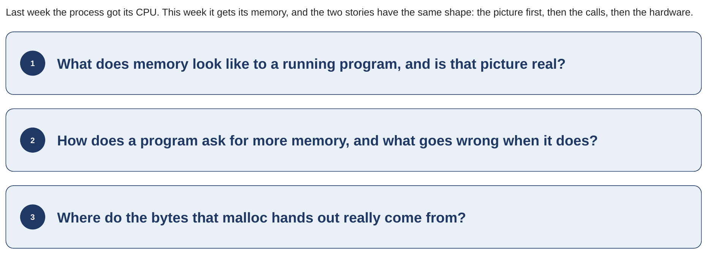{width=100%}
<figcaption markdown="1">Figure 5. The three questions of the first class. From slide 6.</figcaption>
</figure>

The first question is about the picture itself, and whether it is true: what does memory look like to a running program? The guide prints the picture from inside a real process ([Chapter 1](#chapter-1)). The second is about the one part of that picture a program manages by hand: how does a program ask for more memory, and what goes wrong when it does? Two calls, and six ways to misuse them, all compiled and run ([Chapter 2](#chapter-2)). The third is the one people never ask: where do the bytes that `malloc` hands out really come from? (`malloc` is the call a C program makes to ask for memory; [Section 2.1](#sec-2-1) introduces it properly.) It says yes to 100 MB (in the decimal sense: a hundred million bytes) in no time at all, and [Chapter 3](#chapter-3) finds out what that yes is worth. The summary at the end of the class answers the three in this order, and Extras [1](#extra-1) to [12](#extra-12) go deeper on them and can be read later or skipped.

## Chapter 1. What memory looks like to a running program, and whether that picture is real {#chapter-1}

*The question this chapter answers: What does memory look like to a running program, and is that picture real?*

### 1.1 <span class="lbl lbl-problem">Problem</span> Several processes in one memory, and the need for protection {#sec-1-1 data-toc-label="1.1 [Problem] Several processes in one memory, and the need for protection"}

Before any picture, the problem, stated the way the textbook states it and the way every problem in this guide will be stated from now on: what we have, where it breaks, and so what we need. Figure 6 is the deck's problem slide for the first question, with those three columns.

<figure markdown="1">
{width=99%}
<figcaption markdown="1">Figure 6. The problem of the first class in three columns: what we have (the textbook's Figure 13.1, one program alone), and where it breaks (the textbook's Figure 13.2, three programs sharing one memory, with a stray store drawn in red). Left and middle columns. From slide 7.</figcaption>
</figure>

<figure markdown="1">
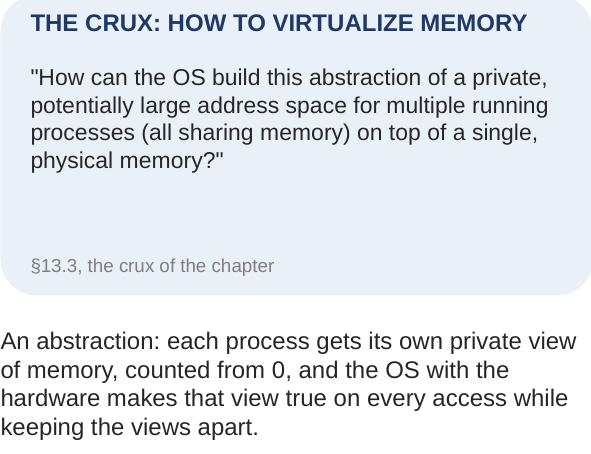{width=47%}
<figcaption markdown="1">Figure 7. The right column of the same slide: so what we need, with the crux of chapter 13. From slide 7.</figcaption>
</figure>

What we have is the left column of Figure 6, an early machine, drawn as the textbook's Figure 13.1. The OS sits at physical address 0, and it is really just a library, a set of routines a program can call. (A **physical address** is a real position in the memory chips, the house number on the real street. The word is there to tell it apart from the other kind of address this section is about to introduce.) The one running program gets everything above the OS, from 64 KB to the top, and does what it likes. (A **KB**, kilobyte, is 1024 bytes. In this guide KB, MB, GB and TB always mean powers of two: 1024 bytes, 1024 KB, 1024 MB, 1024 GB. Where a size is meant in the everyday decimal sense, the text says "decimal". [Appendix A](appendix.md#appendix-a) says why 1024.) Nothing needs protecting, because the program is alone.

Where it breaks is the middle column, the textbook's Figure 13.2. Machines cost millions of dollars, so one program at a time was not acceptable. Several processes came to sit in one memory at once: here A, B and C in a memory of 512 KB, with A at 320 KB. Now A is one bad pointer away from B. A **pointer** is a variable that holds an address; a store through it writes to whatever address it holds. In the deck's drawing, B sits directly below A, from 256 KB to 320 KB. (The textbook's own Figure 13.2 puts B at 192 to 256 KB with a free slot above it; the deck's redraw moved B up so that A's stray store has a neighbor to hit.) If A stores to address 300 KB, the bytes it hits belong to B, and nothing checks it. Nothing crashes, either; B's data is quietly wrong. The first idea anyone has is to copy all of A's memory out to disk on every switch and bring the next process's memory in, so that each process has the whole memory to itself while it runs. It is correct, and far too slow. A whole context switch, registers and all, takes about a microsecond (Part 0). Copying even a few megabytes out to a disk and another few megabytes back takes on the order of a second (a rough estimate for a disk that moves a few megabytes a second). A second is a million microseconds, so the copy is about a million times slower, and a shared machine switches many times a second. So the processes have to stay in memory together, and something must keep them apart.

So what we need is the right column, Figure 7. The textbook states it as a **crux**, its word for the question a chapter is built around: how can the OS build this abstraction of a private, potentially large address space for multiple running processes (all sharing memory) on top of a single, physical memory? (The next paragraph defines its words.) An **abstraction** is a simpler picture that stands in for a complicated reality; the answer here is a new one. Give each process its own private view of memory, counted from 0, and have the OS and the hardware make that view come true on every access while keeping the views apart.

Two new words come with that answer, and the whole week uses them. The **address space** is the running program's own view of its memory, counted from 0; it is what the OS shows each process. A **virtual address** is an address inside that view: a name in the process's private map, not a location in the RAM chips. The view has a standard shape, and the next section draws it.

### 1.2 <span class="lbl lbl-concept">Concept</span> The address space: code, then heap, then stack {#sec-1-2 data-toc-label="1.2 [Concept] The address space: code, then heap, then stack"}

The problem section ended with a promise: each process gets a private view of memory counted from 0. The view has a standard shape, and chapter 13 draws it with a tiny 16 KB so the numbers stay easy.

<figure markdown="1">
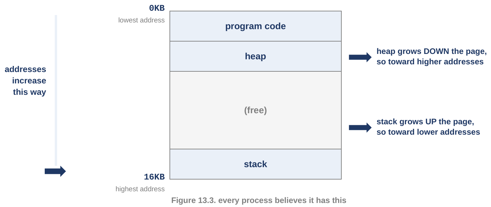{width=100%}
<figcaption markdown="1">Figure 8. The textbook's Figure 13.3: a 16 KB address space with the code at the low end, the heap just after it, the stack at the high end, and free space between. From slide 8.</figcaption>
</figure>

Read the drawing with the arrows. Address 0 is at the top of the page and the highest address, 16 KB, at the bottom; that is upside down compared to the processes week's strip, but the order of the regions is the same. Next to address 0 sits the **program code**, the instructions. Code never grows, so it goes where nothing needs room. Below it is the **heap**: everything you get from `malloc` lives there, and it grows down the page, toward higher addresses. At the far end is the **stack**, with the local variables of your functions (the variables declared inside a function, which exist only while it runs), the arguments passed to them and the addresses to return to, and it grows up the page, toward lower addresses. Between them is free space. So the two growing regions sit at opposite ends and grow toward each other, and that is the whole reason for the layout.

<figure markdown="1">
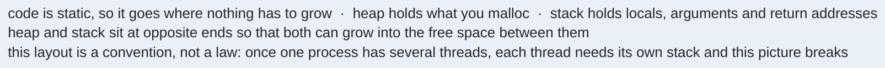{width=100%}
<figcaption markdown="1">Figure 9. The three notes under the drawing: what each region holds, why the heap and the stack sit at opposite ends, and the fine print. From slide 8.</figcaption>
</figure>

The last line of Figure 9 is the fine print. This layout is a convention, not a law. Once one process has several threads (several streams of instructions running inside the same process, which a later week introduces), each thread needs its own stack and the tidy picture breaks. And here is the promise under the drawing: every process believes it has this. That is a large claim, and the next two sections are the evidence, which comes out of one small program.

### 1.3 <span class="lbl lbl-check">Your turn</span> Printing the address space from inside a process {#sec-1-3 data-toc-label="1.3 [Your turn] Printing the address space from inside a process"}

A claim that every process believes it has that picture can be tested from inside a process, because a C program can print an address. Chapter 13 gives a nine-line program that prints three, one from each region, and the deck runs it on the Ubuntu machine.

<figure markdown="1">
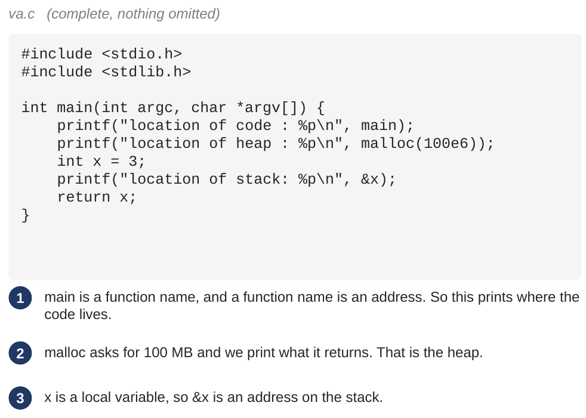{width=79%}
<figcaption markdown="1">Figure 10. The program va.c, complete, with three numbered callouts. From slide 9, following the textbook's aside "Every address you see is virtual".</figcaption>
</figure>

Here is what the program does, line by line, with the words a beginner meets in it. The two `#include` lines pull in the standard library's declarations (descriptions of its functions that the compiler, the program that turns C into machine instructions, needs), so the program may call `printf` (print formatted text) and `malloc`. `int main(int argc, char *argv[])` is the function where every C program starts (`int` is C's type for an integer, a whole number); the two things in the parentheses are the command-line arguments (the words typed after the program's name when it is started) and are not used here. Callout ① prints the address of `main`: a function's name in C is the address where its code lives, so this prints where the code is. `%p` inside the quotes means "print the next value as an address", and `\n` ends the line. Callout ② asks `malloc` for 100e6 bytes (that is C's way of writing 100 × 10^6 = 100,000,000, which is 100 MB in the everyday, decimal sense) and prints the address it returns: that is the heap. Callout ③ declares `x`, a local variable holding 3, and prints `&x`, where `&` means "the address of"; a local variable lives on the stack, so that is the stack. `return x` ends the program with 3 as its **exit status**, the small number every program hands back to whoever started it (0 means success by convention, and [Section 2.3](#sec-2-3) reads several of them).

<figure markdown="1">
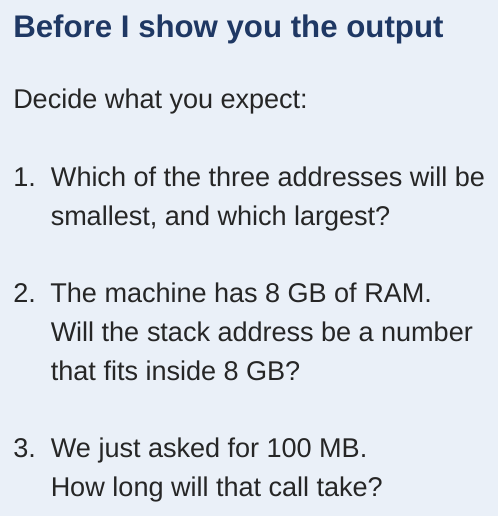{width=45%}
<figcaption markdown="1">Figure 11. The three predictions the deck asks for before showing the output. From slide 9.</figcaption>
</figure>

Before reading on, decide what you expect, on paper. Which of the three addresses will be smallest and which largest? The machine has 8 GB of RAM (that is how it is sold; the kernel reports a little less, 7.8 GB, as usable memory, and [Extra 6](#extra-6) uses that exact figure). (A **GB** is 1024 MB, and an **MB** is 1024 KB, so 8 GB is 8 × 1024 × 1024 × 1024 = 8,589,934,592 bytes, about 8.6 billion.) Will the stack address be a number that fits inside 8 GB? And we just asked for 100 MB; how long will that call take? (These are Exercise 1, and the next section answers them.)

### 1.4 <span class="lbl lbl-machine">Real machine</span> Virtual addresses are not places in RAM {#sec-1-4 data-toc-label="1.4 [Real machine] Virtual addresses are not places in RAM"}

A prediction is only worth something once it is checked. The three questions of the last section each have a number for an answer, and the run below gives all three. Here is what the program printed, a verbatim capture from the Ubuntu machine.

<figure markdown="1">
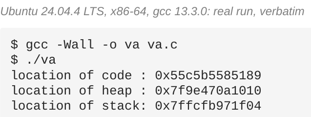{width=51%}
<figcaption markdown="1">Figure 12. The compile line and the run of va.c on the Ubuntu 24.04 x86-64 machine, gcc 13.3.0. From slide 10.</figcaption>
</figure>

The grey line above the capture says "Ubuntu 24.04.4 LTS". 24.04.4 is the Ubuntu release (LTS means long-term support, a release kept up to date for years). Two words about the first line. `gcc` is the C **compiler**, the program that turns C into machine instructions. `-Wall` is a **flag** (an option written after a dash) that turns on the compiler's common warnings; [Section 2.4](#sec-2-4) makes a point of it. `-o va` names the output file, and `./va` runs it. The three printed numbers start with `0x`, which marks a number written in **hexadecimal**: base 16, with the digits 0 to 9 and a to f, each digit worth 4 binary digits. [Appendix A](appendix.md#appendix-a) has the full story, and the next paragraph uses only one fact from it.

<figure markdown="1">
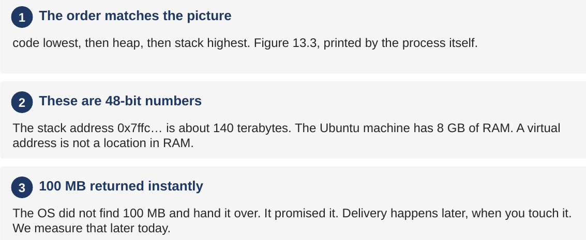{width=91%}
<figcaption markdown="1">Figure 13. The three readings of the run: the order, the size, and the time. From slide 10.</figcaption>
</figure>

Reading ①, the order. Code at 0x55c5..., heap at 0x7f9e..., stack at 0x7ffc...: code lowest, heap above it, stack highest, exactly the drawing. The process printed Figure 13.3 itself.

Reading ②, the size. Read the stack address as a number. 0x7ffcfb971f04 has 12 hexadecimal digits, and each is 4 bits (a **bit** is one binary digit, a 0 or a 1), so it is a 48-bit number (12 × 4 = 48). The processor keeps every address in a 64-bit register, which is 8 bytes. On this processor family only the low 48 bits are used for an address in a program (a design fact of x86-64), so a printed address never has more than 12 hex digits. In short: a program stores an address in 8 bytes, even though only 6 bytes' worth (48 bits) are ever used. Its first digit is 7, so it is a little under 0x800000000000, which is 2^47 (the 1 followed by 11 zeros in hexadecimal is 16^11 = 2^44, times 8 = 2^47). In this guide's units that is exactly 128 TB, because a **TB** is 2^40 bytes and 2^47 = 2^7 × 2^40 = 128 × 2^40. Written out, 2^47 = 140,737,488,355,328 bytes, about 140 trillion in decimal; when the slides say "140 terabytes", that is the decimal reading of the same number. Check it a second way: 2^10 = 1024 is about 10^3, so 2^40 = 2^10 × 2^10 × 2^10 × 2^10 is about 1.024^4 × 10^12, which is about 1.1 × 10^12, and 2^47 = 2^7 × 2^40 = 128 × 1.1 × 10^12, about 1.4 × 10^14. The machine has 8 GB of RAM, about 8.6 × 10^9 bytes. The stack address is sixteen thousand times larger than the whole memory (1.4 × 10^14 / 8.6 × 10^9 ≈ 16,000). As a place in the chips, it does not exist. So a virtual address is not a location in RAM. Run the program again and all three numbers change; [Extra 4](#extra-4) shows three runs. The OS reshuffles them on every run, and that is called **ASLR**, address space layout randomization. It is deliberate: it makes a program harder to attack, because an attacker can no longer know in advance where things are. [Extra 4](#extra-4) shows it and switches it off.

Reading ③, the time. The 100 MB came back instantly. Nobody went and found 100 MB of free chips and handed them over; the OS made a promise, and the bytes arrive later, when the program touches them. That is the third question of the class, and [Section 3.4](#sec-3-4) measures it.

<figure markdown="1">
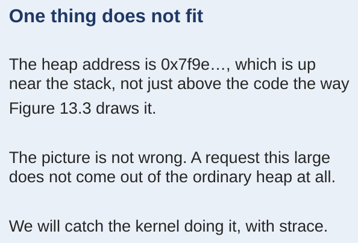{width=48%}
<figcaption markdown="1">Figure 14. The one thing that does not fit the drawing, named rather than hidden. From slide 10.</figcaption>
</figure>

One thing does not fit, and the deck names it rather than hiding it. The heap address is 0x7f9e..., which is up near the stack, not just above the code the way Figure 13.3 draws it. The picture is not wrong: a request this large does not come out of the ordinary heap at all. The C library hands any request above a size it chooses (128 KB by default on Ubuntu, a design choice of the library) to the kernel as a separate region. [Section 3.3](#sec-3-3) catches the kernel doing it, with a tool that watches system calls.

What this section settled: the picture is what every process sees, and it is not a map of the chips. What it leaves open: what any design that keeps that picture has to deliver, which the next section states as three goals.

### 1.5 <span class="lbl lbl-concept">Concept</span> Three goals grade every memory design: transparency, efficiency, protection {#sec-1-5 data-toc-label="1.5 [Concept] Three goals grade every memory design: transparency, efficiency, protection"}

The picture is settled, and so is the fact that it is not a map of the chips. Before building anything that keeps the picture true, the chapter ends by saying what such a design has to deliver. Every mechanism in the memory block will be graded against the same three goals, and when one of them fails, the failure is what produces the next design.

<figure markdown="1">
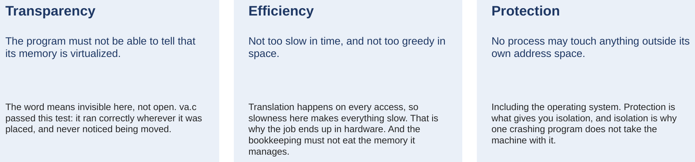{width=100%}
<figcaption markdown="1">Figure 15. The three goals of chapter 13, one card each. From slide 11.</figcaption>
</figure>

The first is **transparency**, and the word is used backwards from what you might expect. Transparent means invisible here, not open: a program must have no way of noticing that its memory is virtualized, and must behave as if it had its own private physical memory. `va.c` passes this test: it runs correctly, and nothing in it can tell where its memory really is. ([Extra 4](#extra-4) runs it three times; the OS put it in three different places, and it ran correctly each time.)

The second is **efficiency**, in two halves. Time, because every single memory access is translated from a virtual address to a real one, so a slow translation slows everything, and that is why the job ends up in hardware. Space, because the records that manage memory must not swallow the memory they manage.

The third is **protection**. A process may not touch anything outside its own address space, the OS included. Protection is what gives you **isolation**, the property that one process can fail without affecting another, and isolation is why one crashing program does not take the machine with it.

<figure markdown="1">
{width=100%}
<figcaption markdown="1">Figure 16. The rubric under the three cards: the same design goals as the first week, now specific to memory, and what happens when two conflict. From slide 11.</figcaption>
</figure>

This is the same kind of rubric an OS is graded by as a whole (the first week of the course listed design goals of this kind for the entire system), now made specific to memory. If two of the three conflict, protection wins, because protection is safety; the engineering question is always how little efficiency you can spend to buy it.

**Checkpoint 1.** Settled: each process gets a private address space counted from 0, code low and the heap and stack growing toward each other. An address in it is a virtual one, a name in the private map, which is why the same program can print three sets of numbers in three runs. Three goals grade whatever follows. Still open: the heap is the one region the program grows by hand, and nothing has said what the two calls are or what goes wrong between them. You should now be able to look at an address such as 0x7ffcfb971f04 and say which region it belongs to, and why the number can differ on the next run. (It is the stack: the highest of the three, just under 2^47, as [Section 1.4](#sec-1-4) worked out.)

## Chapter 2. How a program asks for more memory, and what goes wrong {#chapter-2}

*The question this chapter answers: How does a program ask for more memory, and what goes wrong when it does?*

### 2.1 <span class="lbl lbl-problem">Problem</span> The stack frame, and data that must outlive a function call {#sec-2-1 data-toc-label="2.1 [Problem] The stack frame, and data that must outlive a function call"}

The address space has a stack, and the processes week said what it holds: the local variables of the function that is running. The stack already gives every function its own memory, so the question is why anyone needs more. Figure 17 is the deck's problem slide for the second question.

<figure markdown="1">
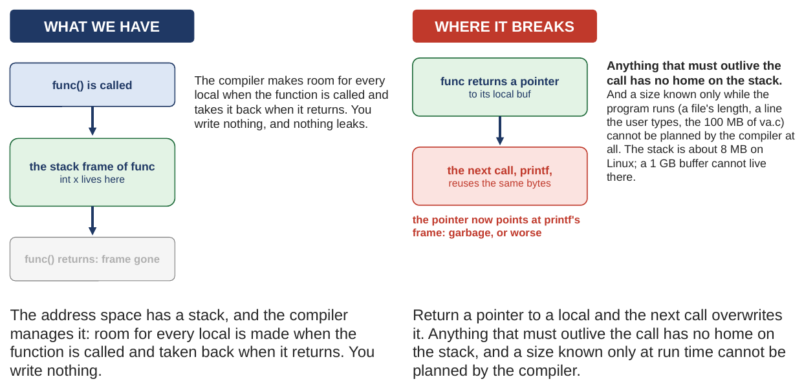{width=99%}
<figcaption markdown="1">Figure 17. The problem of the second question: what we have (the stack frame of a function, made on the call and gone on the return) and where it breaks (a pointer into a dead frame, and a size the compiler cannot plan). From slide 14.</figcaption>
</figure>

<figure markdown="1">
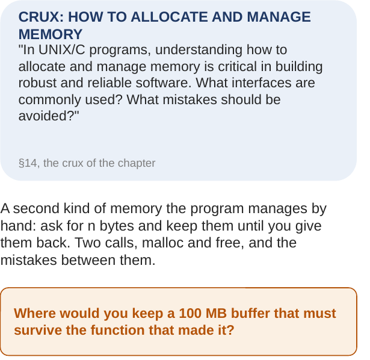{width=49%}
<figcaption markdown="1">Figure 18. The right column of the same slide: the crux of chapter 14, and the question box. From slide 14.</figcaption>
</figure>

What we have is the left column. When a function is called, the compiler makes room on the stack for every local variable of that function; that room is the function's **stack frame**. When the function returns, the frame is gone, and the room is taken back. You write nothing, and nothing leaks.

Where it breaks is the middle column, in two ways. First, let the function hand back a pointer to one of its locals (in the drawing, to a buffer `buf`, a **buffer** being a block of memory used to hold data on its way somewhere). The very next function call, `printf` say, reuses the same bytes for its own frame, and the pointer now points into `printf`'s frame: garbage, or worse. Anything that must outlive the call has no home on the stack. Second, a size known only while the program runs (a file's length, a line the user types, the 100 MB of `va.c`) cannot be planned by the compiler at all. The compiler lays the frame out before the program runs. And the stack is about 8 MB on Linux (a design choice of that operating system, its default limit); a 1 GB buffer cannot live there.

So what we need is the right column, Figure 18. Chapter 14's crux is a practical one: in UNIX/C programs, understanding how to allocate and manage memory is critical in building robust and reliable software; what interfaces are commonly used, and what mistakes should be avoided? (UNIX is the family of operating systems that Linux belongs to.) The answer is a second kind of memory that the program manages by hand: ask for n bytes, keep them as long as you like, give them back when you are done. Two calls do it. **malloc** asks the C library for n bytes of heap and returns a pointer to them (the C **library** is the collection of ready-made functions joined to every C program when it is built, `printf` among them); **free** gives a block back. **Heap memory** is memory a program asks for by hand and must give back by hand; it lives until it is freed. The deck's question box asks where you would keep a 100 MB buffer that must survive the function that made it, and the answer is now one word: on the heap, where it stays until you free it.

### 2.2 <span class="lbl lbl-concept">Concept</span> Two kinds of memory: stack (automatic) and heap (yours) {#sec-2-2 data-toc-label="2.2 [Concept] Two kinds of memory: stack (automatic) and heap (yours)"}

The problem section named a second kind of memory. Two kinds of memory in one program raise a practical question: when you read a line of C, how do you tell which kind it gets, and what each one costs you? Here are the two kinds side by side, one line of code each.

<figure markdown="1">
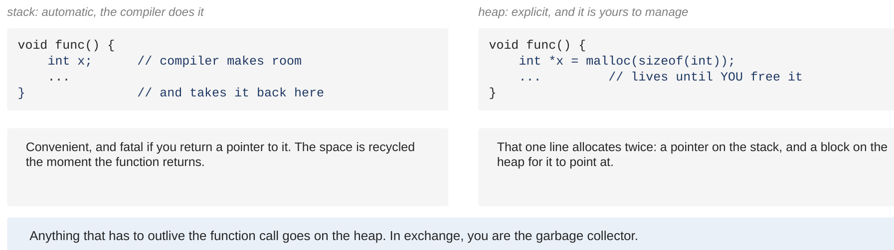{width=100%}
<figcaption markdown="1">Figure 19. The two kinds of memory in one line each: a local integer on the stack, and a pointer to an integer on the heap; with the two notes under them and the rule. From slide 15.</figcaption>
</figure>

The first kind is **stack memory**, and its other name is **automatic** memory. You declare an integer inside a function, `int x;`, and the compiler makes the room when the function is called and takes it back when it returns. You do nothing. It is convenient, and fatal if you return a pointer to it: the space is recycled the moment the function returns.

The second kind is heap memory. You ask for it with `int *x = malloc(sizeof(int));`. Read that line in pieces. `int *x` declares `x` as a pointer to an integer (the `*` in a declaration means "pointer to"). `sizeof(int)` is the number of bytes an integer takes, 4 on the Ubuntu machine (a design fact of the compiler for that machine). `sizeof` is an operator the compiler evaluates while compiling, not a function the program calls. The compiler can do that because the size of a type such as `int` is fixed before the program ever runs; [Extra 9](#extra-9) shows what it cannot know. `malloc` of that many bytes returns the address of a fresh block on the heap, and `x` now holds that address. What you buy is lifetime: the block outlives the call. The price is that nothing is ever freed until you free it. You are the garbage collector (the part of a modern language that finds unused memory and frees it for you; C has none).

There is a detail hiding in that one line, and the right-hand note in Figure 19 names it. The line allocates twice: a pointer variable `x` on the stack, and a block on the heap for it to point at. Telling the pointer apart from the thing it points at is half of being good at C. The rule at the bottom is short: anything that has to outlive the function call goes on the heap, and from then on it is your job.

### 2.3 <span class="lbl lbl-machine">Real machine</span> Errors in getting memory: too little, none at all, never initialized {#sec-2-3 data-toc-label="2.3 [Real machine] Errors in getting memory: too little, none at all, never initialized"}

The two calls look simple, and chapter 14 lists the classic ways people get them wrong. The deck compiled and ran each one on the Ubuntu machine, so every "what happened" line below is a real result. Here are the first three, the mistakes made when getting memory; [Extra 10](#extra-10) runs the other three, the mistakes made when giving it back.

<figure markdown="1">
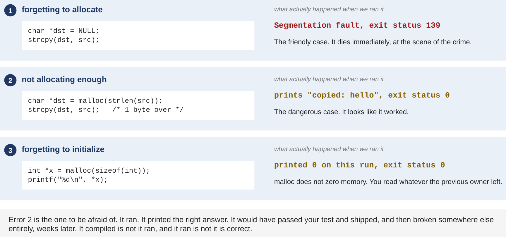{width=100%}
<figcaption markdown="1">Figure 20. Errors 1 to 3, with the two lines that commit each and what actually happened when it ran. From slide 16, following textbook section 14.4.</figcaption>
</figure>

Error 1, forgetting to allocate. `char *dst = NULL;` declares a pointer to a character and sets it to **NULL**, the pointer value that means "points at nothing" (it is the address 0, and [Extra 6](#extra-6) shows that nothing is mapped there: no memory is set up at that address). `strcpy(dst, src)` copies the string `src` to the memory `dst` points at (a **string** in C is a row of characters ending in a zero byte). There is no memory behind `dst`, so the copy kills the program at once: **Segmentation fault**, exit status 139. The name is the hardware's word for an illegal memory access, and the second class shows a simple circuit that raises it (on the Ubuntu machine the circuit is a more elaborate one, called paging, which a later week explains, but the fault is the same kind). The number is 128 + 11, where 11 is the number of the signal the kernel sends (signal numbers are a design fact of Linux on this processor family: SIGSEGV is 11). (A **signal** is a short message from the kernel to a process, and this one is called SIGSEGV. The shell adds 128 to the signal number to make the exit status. That is a shell rule, chosen so that a death by signal can never look like a normal exit status, which programs keep below 128.) This is the friendly case: the program dies right where the damage is done, and a debugger (a tool that runs a program step by step and shows where it stopped; [Extra 3](#extra-3) says more) points at the line.

Error 2, not allocating enough. `malloc(strlen(src))` asks for exactly as many bytes as `src` has characters, and `strlen` does not count the zero byte that ends a C string, so the block is one byte short and the copy writes one byte past its end. A **buffer overflow** is exactly that: a write past the end of the memory that was allocated. And look at the result: it printed "copied: hello" and exited 0, the status that means success. The dangerous case; it looks like it worked.

Error 3, forgetting to initialize. `malloc` hands you bytes; it does not clean them. `printf("%d\n", *x)` prints the integer `x` points at (`*x` in an expression means "the value at the address in x", and `%d` means "print as a decimal integer"). That integer was never assigned, so you read whatever the previous owner of those bytes left. On this run that happened to be 0, which is worse than garbage, because 0 looks right.

The bottom bar says why error 2 is the one to be afraid of. It ran. It printed the right answer. It would have passed your test and shipped, and then broken somewhere else entirely, weeks later. It compiled is not it ran, and it ran is not it is correct. The next section asks whether the compiler could have warned about any of this.

### 2.4 <span class="lbl lbl-problem">Problem</span> Compiler warnings, and the two memory bugs they cannot see {#sec-2-4 data-toc-label="2.4 [Problem] Compiler warnings, and the two memory bugs they cannot see"}

What we have is six classic mistakes (the three above and the three of [Extra 10](#extra-10): forgetting to free, using a block after freeing it, and freeing it twice), and a compiler that reads every line of every program. People say none of these produce a warning, and it used to be said in this course too. So the deck compiled all six with gcc 13, `-Wall` and `-O0` (no optimization: the program is compiled as written, so line numbers match), and Figure 21 is the result.

<figure markdown="1">
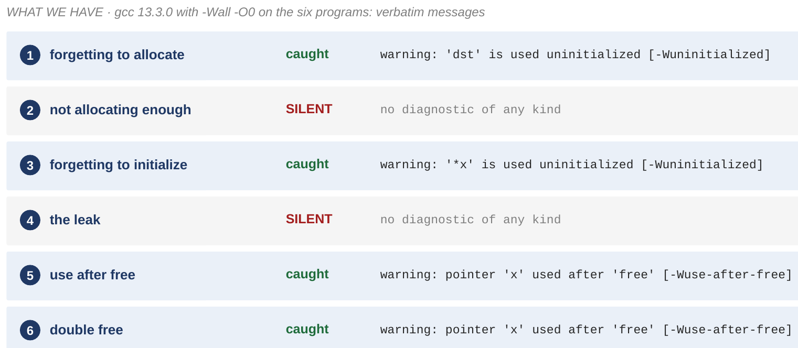{width=100%}
<figcaption markdown="1">Figure 21. The six programs under gcc 13.3.0 with -Wall -O0: which it caught and the exact message. From slide 17.</figcaption>
</figure>

Read the table. Forgetting to allocate: caught, with a warning that `dst` is used uninitialized. This row comes from a second version of error 1, the textbook's, which declares `dst` without setting it to anything; Figure 20 shows the NULL version, the one that was run, and [Extra 10](#extra-10) prints both. Not allocating enough: silent, no diagnostic of any kind. Forgetting to initialize: caught. The leak, a block that is never freed: silent. Use after free and double free: both caught, with a warning that names the variable and points at the free. Those two are lifetime bugs, so the catch has a limit: the warning works only in the obvious case, where the free and the later use sit together in one function, as here. Across functions or files it catches far fewer. Four out of six, for free, from a flag you should already be using. In this course a warning is an error you have not met yet.

<figure markdown="1">
{width=100%}
<figcaption markdown="1">Figure 22. The bottom bar: where it breaks, and so what we need. From slide 17.</figcaption>
</figure>

Where it breaks: look at which two the compiler missed. The one-byte overflow, an **off-by-one** (a mistake of exactly one), that quietly corrupts a neighbor, and the leak that slowly drowns a server over hours. And both of them also run without any visible sign: no crash, no wrong output. (Two other errors do not crash either: error 3, the uninitialized read above, and the use after free of [Extra 10](#extra-10). But the compiler warns about those two.) A compiler knows types (what kind of value each name holds: an integer, a pointer, a character); it cannot track lifetimes or bounds in general, because those depend on what the program does while it runs. So what we need is a tool that stands next to the running program and sees every memory access, for the two the compiler cannot see. That tool exists, and the next section runs it.

### 2.5 <span class="lbl lbl-machine">Real machine</span> Memory leaks, found by watching the running program: valgrind {#sec-2-5 data-toc-label="2.5 [Real machine] Memory leaks, found by watching the running program: valgrind"}

The last section ended with what we need: something that watches the program while it runs, because the two silent bugs depend on what happens at run time. The compiler only reads the text of the program, so it cannot be that something. Such a tool exists, and it is called **valgrind**. It is a free program, already on the lab machines. You put the word `valgrind` in front of the command you were going to run anyway, and that is the entire way of using it. It runs your program on a simulated processor and watches every memory access as it happens, which is why it sees what no compiler can, and why it is slow.

<figure markdown="1">
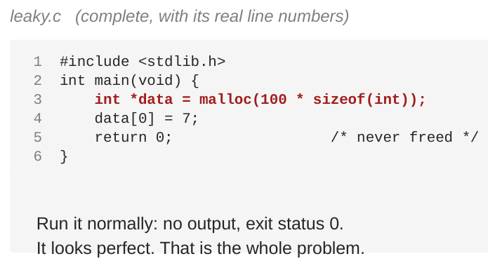{width=56%}
<figcaption markdown="1">Figure 23. The program leaky.c, complete, with its real line numbers, and what happens when it runs normally. From slide 18.</figcaption>
</figure>

Here is the leak, in six lines. Line 3 allocates `100 * sizeof(int)` bytes, which is 100 × 4 = 400 bytes, and stores the address in `data`. Line 4 writes one number into the block (`data[0]` is the first integer in it; square brackets pick an element by position, counting from 0). Line 5 returns without freeing. The line numbers down the left are the file's own, with the `#include` line counted as line 1, because the tool is about to quote them back. Run it normally and there is no output and the exit status is 0. It looks perfect. That is the whole problem.

<figure markdown="1">
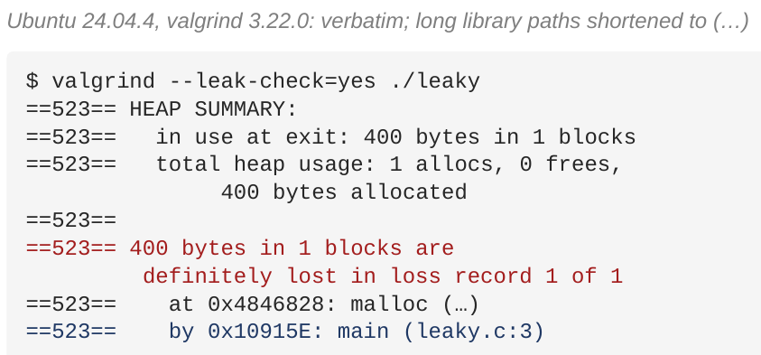{width=67%}
<figcaption markdown="1">Figure 24. The same program under valgrind on the Ubuntu machine (valgrind 3.22.0; long library paths shortened to "(...)"). From slide 18.</figcaption>
</figure>

Now the same program under valgrind, a verbatim capture. The `==523==` at the start of every line is the process id, the number the kernel gave this run of the program; it differs every run and means nothing here. The flag `--leak-check=yes` asks for the leak report.

<figure markdown="1">
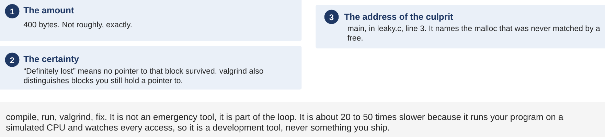{width=100%}
<figcaption markdown="1">Figure 25. The three readings of the report: the amount, the certainty, and the culprit; and the loop to adopt. From slide 18.</figcaption>
</figure>

Reading ①, the amount: 400 bytes, in 1 block. Not roughly; exactly, and you can check it against line 3. Reading ②, the certainty: "definitely lost" means no pointer to that block survived to the end of the run, so nobody could ever have freed it; valgrind also distinguishes blocks you still hold a pointer to. Reading ③, the culprit: `main (leaky.c:3)`, the function and the line of the `malloc` that was never matched by a `free`. The crime, the amount and the line number: a police report.

The bottom bar is the habit to take from this. From this week on the loop has four steps: compile, run, valgrind, fix. It is not an emergency tool; it is part of the loop. It is about 20 to 50 times slower than a normal run, because it runs your program on a simulated CPU and watches every access, so it is a development tool, never something you ship. (The slowdown is a figure its users cite, not one the deck measured.) [Extra 11](#extra-11) runs it on the off-by-one and shows the one overflow it cannot see.

**Checkpoint 2.** Settled: stack memory is automatic; the heap is yours, `malloc(n)` and `free(p)`, with six classic mistakes between the two calls; `-Wall` reports four of them, and valgrind reports the leak, with the amount and the line, and ([Extra 11](#extra-11)) the off-by-one too: the two that `-Wall` misses, which also run without crashing, with the amount and the line. Still open: two facts from this class do not add up yet. `malloc` answered 100 MB in no time, and `free` takes a pointer and no size, so something remembers every block's size. What `malloc` is, and where its bytes come from, is the third question. You should now be able to read a valgrind leak report and point at the line that allocated the lost block. ([Extra 11](#extra-11) shows reports that also name the line that freed a block and the line that touched it afterwards.)

## Chapter 3. Where malloc's bytes really come from {#chapter-3}

*The question this chapter answers: Where do the bytes that malloc hands out really come from?*

### 3.1 <span class="lbl lbl-problem">Problem</span> Where malloc's memory comes from: not a system call, and not memory yet {#sec-3-1 data-toc-label="3.1 [Problem] Where malloc's memory comes from: not a system call, and not memory yet"}

Two facts from this class do not fit together yet. `malloc` answered 100 MB at once, and `free` needs no size. If `malloc` simply asked the kernel for real memory every time, neither fact would make sense, and together the two facts say what `malloc` really is. Figure 26 is the problem slide.

<figure markdown="1">
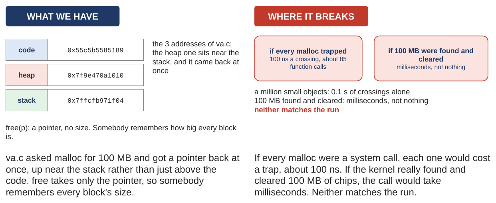{width=99%}
<figcaption markdown="1">Figure 26. The problem of the third question: what we have (the three addresses of va.c, and a free that takes no size) and where it breaks (two things malloc cannot be). From slide 20.</figcaption>
</figure>

<figure markdown="1">
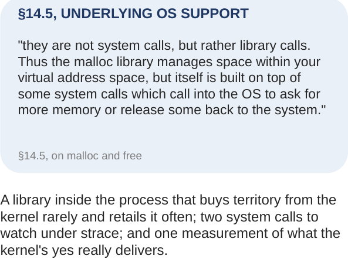{width=47%}
<figcaption markdown="1">Figure 27. The right column of the same slide: the textbook's answer in its own words, and the shape of what we need. From slide 20.</figcaption>
</figure>

What we have is the left column. `va.c` asked `malloc` for 100 MB and had a pointer in hand immediately, and that pointer sat close to the stack, not right after the code. And `free(p)` takes only the pointer, no size, so the size of each block is being remembered for you, somewhere.

Where it breaks is the middle column, two things `malloc` cannot be. Suppose `malloc` trapped into the kernel every time it is called. `va.c` called it only once, but real programs call it millions of times. The processes week measured a trap into the kernel at about 100 nanoseconds, about 85 times the cost of an ordinary function call (both measured in the processes week). Build a million small objects and you would burn 1,000,000 × 100 ns = 0.1 s, a tenth of a second, on the crossings alone. Suppose instead the kernel really found 100 MB of free chips and cleared them: memory can be cleared at a few gigabytes a second, so 100 MB would take some tens of milliseconds (an estimate, not a measurement), not nothing. Neither picture fits: a `malloc` that traps on every call would be too slow for programs that allocate often, and a kernel that hands over real, cleared memory could not have answered at once. So a layer sits in between, and the kernel's answer means less than it sounds.

So what we need is the right column. Chapter 14 says it plainly, and the slide quotes it: `malloc` and `free` are not system calls but library calls. The malloc library manages space within your virtual address space, and is itself built on top of some system calls which ask the OS for more memory or release some back. So the shape of the answer is a library inside the process that buys territory from the kernel rarely and retails it to you often; two system calls to watch; and one measurement of what the kernel's yes really delivers. Two words to fix. A **library call** is a function that lives inside your own process, such as `malloc`: no trap, no kernel. A **system call** is a request to the kernel through a trap, such as the two this chapter watches, at about 100 ns a crossing.

### 3.2 <span class="lbl lbl-concept">Concept</span> Library calls and system calls: malloc is a library {#sec-3-2 data-toc-label="3.2 [Concept] Library calls and system calls: malloc is a library"}

The problem section said the answer has the shape of a library: something inside the process that can answer most requests without a trap. Before watching it work, here is where it sits, between your program and the kernel, drawn as three layers.

<figure markdown="1">
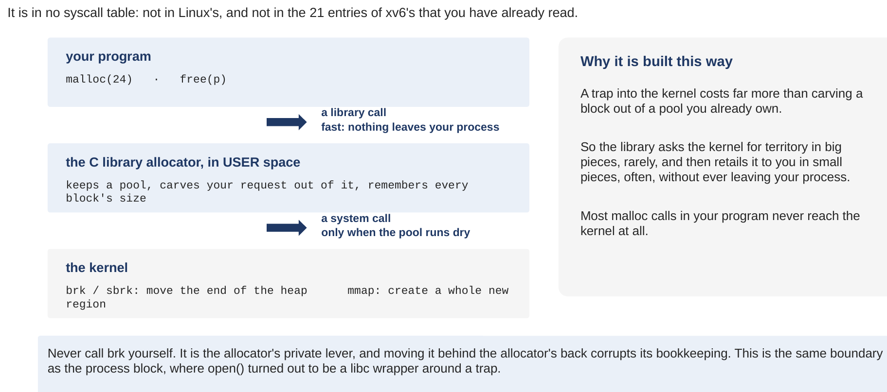{width=100%}
<figcaption markdown="1">Figure 28. Three layers: your program, the C library's allocator in user space, and the kernel with its two system calls; with the reason the library is built this way and the warning. From slide 21.</figcaption>
</figure>

`malloc` appears in no system call table, not in Linux's, and not in the 21 entries of xv6's that the processes week read. (The count is from the students' tree, `kernel/syscall.c`, which lists exactly 21 system calls.) It is a function inside your own address space. Your program calls `malloc` for 24 bytes. That call lands in the C library's **allocator**, the code that hands out and takes back pieces of the heap, ordinary code running in user mode. Usually it already holds memory it got earlier, a pool; it carves your 24 bytes out of that stock, remembers how big the block is, and returns. No trap. No kernel. That arrow is a library call, fast, because the process never leaves itself.

Only when the pool runs dry does the allocator make a real system call. There are two. **brk** (and its cousin **sbrk**) moves the end of the heap: the heap is one stretch of the address space, and `brk` tells the kernel where it now ends, so the heap grows or shrinks. **mmap** creates a whole new region of the address space, anywhere the kernel likes, not attached to the heap at all. (The names are the kernel's; `brk` is short for "break", the old word for the end of the heap, and `mmap` for "memory map".)

The reason it is built this way is cost. A trap into the kernel costs far more than carving a block out of a pool you already own. So the library asks the kernel for territory in big pieces, rarely, and retails it to you in small pieces, often, without ever leaving your process. Most `malloc` calls in your program never reach the kernel at all. One warning at the bottom: never call `brk` yourself. It is the allocator's private lever, and moving it behind the allocator's back corrupts its bookkeeping. It is the same boundary the processes week drew around system calls: the functions a C program calls by name are library functions, and the ones that need the kernel are small wrappers whose only job is to make the trap for you.

That is the claim. The next section watches it happen on the Ubuntu machine.

### 3.3 <span class="lbl lbl-machine">Real machine</span> The two system calls behind malloc, brk and mmap, watched with strace {#sec-3-3 data-toc-label="3.3 [Real machine] The two system calls behind malloc, brk and mmap, watched with strace"}

A claim about what a program asks the kernel is only a claim until we watch the requests go by. They can be watched. **strace** is a Linux tool that runs your program normally, stands next to it, and prints one line every time the program asks the kernel for something, with the request's name, its arguments and the kernel's answer. Here it is on the same nine-line program from the start of the class, filtered down to the memory system calls.

<figure markdown="1">
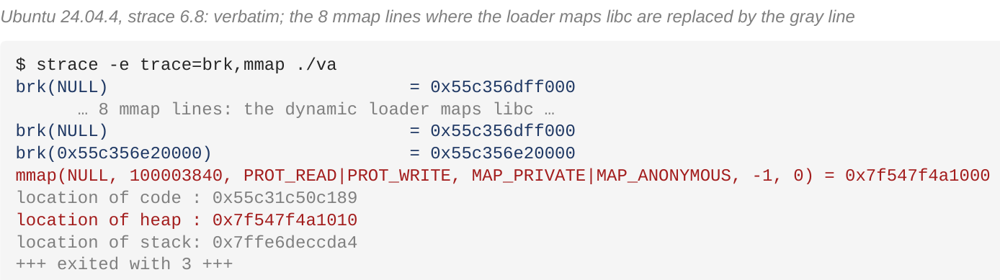{width=100%}
<figcaption markdown="1">Figure 29. strace on va.c, filtered to brk and mmap, on the Ubuntu machine (strace 6.8); the eight mmap lines where the loader maps the C library are replaced by one grey line. From slide 22.</figcaption>
</figure>

Read the command first. `strace -e trace=brk,mmap ./va` says: run `./va`, and print only the `brk` and `mmap` calls, because those are the only two ways a process gets new memory from the kernel. Each printed line is one system call: the name, the arguments in parentheses, and after the `=` what the kernel returned. The eight lines replaced by the grey line are the **dynamic loader** at work, the program that runs before `main` and maps the C library into the process (sets up a region of the address space that holds it); they are not about `va.c` and the slide folds them.

<figure markdown="1">
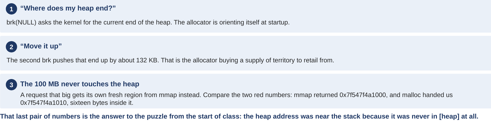{width=100%}
<figcaption markdown="1">Figure 30. The three readings of the capture, and the answer to the puzzle from the start of the class. From slide 22.</figcaption>
</figure>

Reading ①, "where does my heap end?" `brk(NULL)` asks the kernel for the current end of the heap, and the kernel answers 0x55c356dff000. The allocator is orienting itself at startup.

Reading ②, "move it up." `brk(0x55c356e20000)` asks the kernel to move the end of the heap to that address, and the kernel agrees. How much did it grow? Subtract the two addresses. They agree up to 0x55c356, so subtract only what follows: 0xe20000 − 0xdff000. The column-by-column method, borrowing 16 instead of 10, is in [Appendix A](appendix.md#appendix-a), which works this very subtraction; the result is 0x21000. Check it by adding back: 0xdff000 + 0x21000 = 0xe20000. In decimal, 0x21000 = 2 × 65536 + 1 × 4096 = 131,072 + 4,096 = 135,168 bytes, and 135,168 / 1024 = 132 KB. Check it the other way: 132 × 1024 = 135,168. That is the allocator buying a supply of territory to retail from, 132 KB of it, before `va.c`'s own `malloc` call. (The first `printf` in `va.c` runs before that call, and the C library most likely asks the allocator for a buffer to hold printed output; that first small request is what made the allocator stock up. The 132 KB is the allocator's own choice of stock.)

Reading ③, the 100 MB never touches the heap. The `mmap` line asks for 100003840 bytes with no file behind them (`MAP_ANONYMOUS`), readable and writable (`PROT_READ|PROT_WRITE`), private to this process (`MAP_PRIVATE`), and the kernel answers with a fresh region at 0x7f547f4a1000. (strace ran `va.c` once more, so its addresses differ from [Section 1.4](#sec-1-4)'s run: ASLR moves them on every run. Only the differences between numbers carry over from run to run.) Why 100003840 and not 100,000,000? The allocator adds 16 bytes of its own in front of the block, which makes 100,000,016. The kernel hands out address space only in whole **pages**, fixed-size blocks of 4096 bytes on the Ubuntu machine (a design fact of the processor and of Linux; a later week of the course is about pages). So the request is rounded up to the next multiple of 4096: 100,000,016 / 4096 = 24414.07, so 24415 pages, and 24415 × 4096 = 100,003,840. Now compare the two red numbers: `mmap` returned 0x7f547f4a1000, and `malloc` handed the program 0x7f547f4a1010. The difference is 0x10, which is 16 bytes. Those 16 bytes are the allocator's **header**, the small record it writes just in front of every block, where it keeps how big the block is. That is how `free` works with only a pointer: it looks 16 bytes back.

That last pair of numbers is also the answer to the puzzle from [Section 1.4](#sec-1-4): the heap address of `va.c` was near the stack because the 100 MB was never in the heap region at all. It came from `mmap`, which placed it high in the address space, near the stack ([Extra 5](#extra-5) shows that the C library's regions sit up there too). One thing is still outstanding: what it means when the kernel says yes.

### 3.4 <span class="lbl lbl-machine">Real machine</span> Promised memory and delivered memory: VmSize, VmRSS and demand paging {#sec-3-4 data-toc-label="3.4 [Real machine] Promised memory and delivered memory: VmSize, VmRSS and demand paging"}

One loose end is left from [Section 3.1](#sec-3-1): clearing 100 MB of real memory would take milliseconds, yet the answer came back at once. So the kernel's yes cannot mean that real memory was handed over. The chapter's last question is what that yes is worth, and only a measurement can say. Here it is. A program asks for 1 GB with `malloc`, then walks through the block touching every page, and at three moments it reads two numbers the kernel keeps about every process. **VmSize** is how much address space the process has been promised. **VmRSS** is how much of it has actually been given real memory (RSS stands for resident set size, the set of the process's pages that are resident in the chips).

<figure markdown="1">
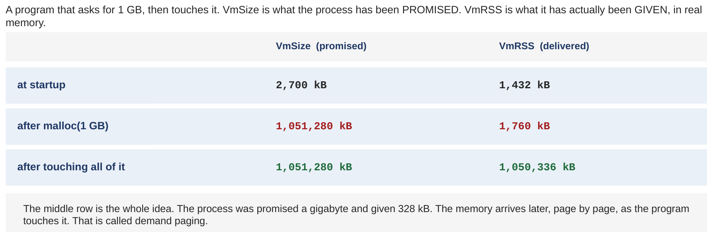{width=100%}
<figcaption markdown="1">Figure 31. VmSize (promised) and VmRSS (delivered) at three moments: at startup, after malloc(1 GB), and after touching all of it, on the Ubuntu machine, in kB. From slide 23.</figcaption>
</figure>

At startup, small numbers: 2,700 kB promised and 1,432 kB delivered (the kB here is the kernel's unit, 1024 bytes). Now the call for 1 GB, and it succeeds. The promise grows from 2,700 to 1,051,280 kB, which is 1,048,580 kB more, and 1 GB is 1024 × 1024 = 1,048,576 kB, so the promise grew by a full gigabyte plus 4 kB. The 4 kB is one page: the allocator's 16-byte header ([Section 3.3](#sec-3-3)) makes the request 16 bytes more than a gigabyte, and rounding up to whole 4 KB pages adds one more page. Delivery grows from 1,432 to 1,760 kB: 1,760 − 1,432 = 328 kB. Something is delivered at all because the allocator writes its header into the first page, which makes that page real, and the C library sets up some bookkeeping of its own. The rest of the 328 kB cannot be split up from these two numbers alone: setting up a new region also costs the kernel a few pages of its own bookkeeping, and the C library may touch a few pages of its own. What matters is the size: 328 kB is about 0.03 percent of the gigabyte promised (328 / 1,048,580 ≈ 0.0003). The exact 328 is this run's measurement, not a rule. Read those two numbers side by side. A gigabyte promised, about a third of a megabyte handed over, and the pointer `malloc` returned is perfectly valid.

Then the program touches all of it, one byte in every 4096-byte page, and delivery catches up: VmRSS goes to 1,050,336 kB, which is 1,050,336 − 1,760 = 1,048,576 kB more, exactly one gigabyte. The memory arrived later, page by page, while the program was using it. That is called **demand paging**: a page of memory is delivered on demand, at the first touch, not at the allocation. It gets its own week later in the memory block. For now, keep the fact: allocation and delivery are two different events, separated in time.

<figure markdown="1">
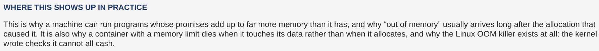{width=100%}
<figcaption markdown="1">Figure 32. Where this shows up in practice: overcommitted promises, containers, and the out-of-memory killer. From slide 23.</figcaption>
</figure>

This is why a machine can run programs whose promises add up to far more memory than it has, and why "out of memory" usually arrives long after the allocation that caused it. It is also why a **container** (a walled-off group of processes with a memory limit, the unit most cloud software ships in) dies when it touches its data rather than when it allocates. And it is why the Linux **OOM killer** (out of memory) exists at all: when the chips really run out, the kernel picks a process and kills it, because the kernel wrote checks it cannot all cash.

**Checkpoint 3.** Settled: `malloc` is a library inside the process. It buys territory from the kernel rarely, with `brk` and `mmap`, and retails it often; the 16-byte header is how `free` knows a block's size. The kernel's yes is a promise: 1 GB promised, 328 kB delivered, until the program touched the rest. Still open: every address printed this class is virtual, so on every access something turns it into a real place in the chips. What that hardware is, and how it works, is the second class. You should now be able to explain why `malloc(100e6)` returns at once, and name the two system calls strace would show.

??? note "The program behind Figure 31 (you can skip this listing)"

    The program that produced the three rows was not kept with the deck, so the listing below was written for this guide to do exactly what the slide describes, and it was compiled and run on an Ubuntu 24.04 x86-64 machine with gcc 13.3.0. Here is what it does, in order. It defines a helper, `report`, that opens `/proc/self/status`, a text file the kernel produces on demand describing the calling process (`/proc` is explained in [Extra 5](#extra-5)), reads it line by line, keeps the `VmSize:` and `VmRSS:` lines, and prints both next to a label. (`fopen`, `fgets` and `fclose` open a file, read one line and close it; `strncmp` compares the first few characters of two strings; `sscanf` pulls a value out of a line of text; `size_t` is C's type for a size in bytes.) `main` reports once at startup, asks `malloc` for 1024 × 1024 × 1024 bytes, reports again, then writes one byte into every 4096-byte page of the block (the loop steps `i` by 4096 and stores a 1 at `p[i]`), and reports a third time.
    
    ```c
    /* promise.c: ask for 1 GB, then touch it, and read what the kernel says
       it has promised (VmSize) and delivered (VmRSS) at three moments. */
    #include <stdio.h>
    #include <stdlib.h>
    #include <string.h>
    
    static void report(const char *moment) {
        FILE *f = fopen("/proc/self/status", "r");   /* the kernel's status page for this process */
        char line[256], size[64] = "?", rss[64] = "?";
        while (fgets(line, sizeof line, f)) {
            if (strncmp(line, "VmSize:", 7) == 0) sscanf(line + 7, " %63[^\n]", size);
            if (strncmp(line, "VmRSS:", 6) == 0)  sscanf(line + 6, " %63[^\n]", rss);
        }
        fclose(f);
        printf("%-22s VmSize %12s   VmRSS %12s\n", moment, size, rss);
    }
    
    int main(void) {
        size_t n = 1024UL * 1024 * 1024;              /* 1 GB = 1024 * 1024 * 1024 bytes */
        report("at startup");
        char *p = malloc(n);
        report("after malloc(1 GB)");
        for (size_t i = 0; i < n; i += 4096)          /* one byte per 4096-byte page */
            p[i] = 1;
        report("after touching it");
        return 0;
    }
    ```
    
    Compile and run with `gcc -Wall -o promise promise.c` and `./promise`; no administrator rights (called root on Linux) are needed. On the guide's run the three rows were 2712 and 1420 kB, then 1051292 and 1740 kB, then 1051292 and 1050312 kB. So the promise grew by 1,048,580 kB and delivery by 320 kB on the call, and delivery by 1,048,572 kB more on the touch. Your numbers will differ by a few kB; the shape will not.
    
## <span class="lbl lbl-summary">Summary</span> Summary of the first class: the address space and the memory API {#summary-25 data-toc-label="[Summary] Summary of the first class: the address space and the memory API"}

The last slide of the class answers its three questions in order, each with the problem it solved. Figure 33 is that slide, with the vocabulary list under it. Every word in the list should now have a picture behind it. If one does not, that is the section to reread.

<figure markdown="1">
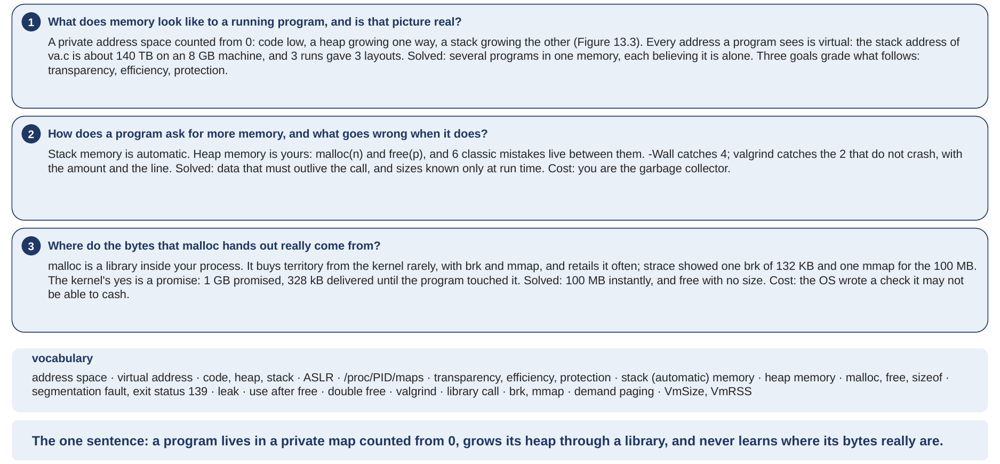{width=100%}
<figcaption markdown="1">Figure 33. The first class on one slide: the three questions, each answered with the problem it solved, the vocabulary, and the one sentence. From slide 25.</figcaption>
</figure>

Question 1, what memory looks like to a running program, and whether that picture is real. A private address space counted from 0: code low, a heap growing one way, a stack growing the other (the textbook's Figure 13.3). Every address a program sees is virtual: the stack address of `va.c` is just under 2^47, 128 TB (140 trillion bytes in decimal), on an 8 GB machine, and three runs gave three layouts. Solved: several programs in one memory, each believing it is alone. Three goals grade what follows: transparency, efficiency, protection.

Question 2, how a program asks for more memory, and what goes wrong. Stack memory is automatic. Heap memory is yours: `malloc(n)` and `free(p)`, with six classic mistakes between them. `-Wall` catches four; valgrind catches the two that `-Wall` misses, which also run without crashing, with the amount and the line. Solved: data that must outlive the call, and sizes known only at run time. Cost: you are the garbage collector.

Question 3, where the bytes that `malloc` hands out really come from. `malloc` is a library inside your process. It buys territory from the kernel rarely, with `brk` and `mmap`, and retails it often; strace showed one `brk` of 132 KB and one `mmap` for the 100 MB, with the 16-byte header in front of the block. The kernel's yes is a promise: 1 GB promised, 328 kB delivered until the program touched it. Solved: 100 MB instantly, and free with no size. Cost: the OS wrote a check it may not be able to cash.

The one sentence: a program lives in a private map counted from 0, grows its heap through a library, and never learns where its bytes really are.

That is what the first class settled. What it left open is the "still open" of Checkpoint 3: every address printed in this class is a name, and on every single access something turns the name into a place. Between the two classes the deck asks for two things. Read OSTEP chapter 15, the mechanism; its Figures 15.1 and 15.2 are the whole first half of the second class, so read them with a finger on the numbers 128, 15 KB and 32 KB (Sections [5.1](class-2.md#sec-5-1) and [5.2](class-2.md#sec-5-2) explain them). Reread section 13.4, the three goals, because the second class grades one design against them. Then try two things on your own Ubuntu or WSL machine (WSL, the Windows Subsystem for Linux, runs Ubuntu inside Windows). Run `va.c` three times and watch the three addresses move, then run it under `setarch x86_64 -R` and watch them stop ([Extra 4](#extra-4) shows both). And write the six errors on purpose, one at a time, and read what valgrind says about each (`leaky.c` is six lines, and [Extra 10](#extra-10) lists all six programs). The question the second class answers: every address we printed is virtual. On every single access, what turns it into a real place, and how fast?

## Going deeper, first class (optional) {#extras-1}

### Extra 1 <span class="lbl lbl-deeper">Deeper, Q1</span> The process and the address space: one shape for the CPU and for memory {#extra-1 data-toc-label="Extra 1 [Deeper, Q1] The process and the address space: one shape for the CPU and for memory"}

This part and the eleven after it are the deck's "deeper, if time allows" block for the first class. They sit after the summary, so the core chain reads without them, and each one goes deeper on one of the three questions. They are worth reading even if the class skipped them, because they hold most of the evidence.

The first class asked a lot of new questions at once, and it helps to see that they are not really new. The course already virtualized one thing, the CPU, and memory is built to the same plan. If you know where each piece of the CPU story sits, you know where to look for its memory twin. Figure 34 lines the two stories up.

<figure markdown="1">
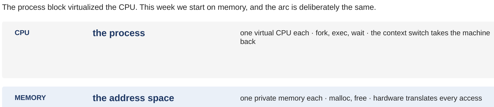{width=100%}
<figcaption markdown="1">Figure 34. The CPU story and the memory story, row by row: the abstraction, the calls a program makes, and the hardware that keeps the OS in charge. From slide 26.</figcaption>
</figure>

Read the top row first. For two weeks the course shared the CPU. Each process got a virtual CPU of its own: it ran as if it had the processor to itself. Programs made processes with `fork` and `exec` and collected them with `wait`. Underneath, the timer and the context switch took the real CPU back whenever the OS wanted it.

Now the second row, which is this week. Each process gets a private memory, the address space. A program asks for pieces of it with `malloc` and gives them back with `free`. Underneath, hardware translates every single access, so the private memory can sit anywhere in the real chips.

The two rows line up column by column: one abstraction, a few calls, and hardware underneath. That is also the order of the week: the picture ([Chapter 1](#chapter-1)), the calls and their mistakes (Chapters 2 and 3), and the hardware (the second class). If you hold on to that parallel, half of the week is already familiar.

### Extra 2 <span class="lbl lbl-deeper">Deeper, Q1</span> Multiprogramming, time sharing, and why swapping all of memory failed {#extra-2 data-toc-label="Extra 2 [Deeper, Q1] Multiprogramming, time sharing, and why swapping all of memory failed"}

[Section 1.1](#sec-1-1) said in two sentences why processes have to share memory. The history behind those sentences is short, and it shows that the address space was forced on the designers, not chosen for looks. Figure 35 is the early machine beside the shared one.

<figure markdown="1">
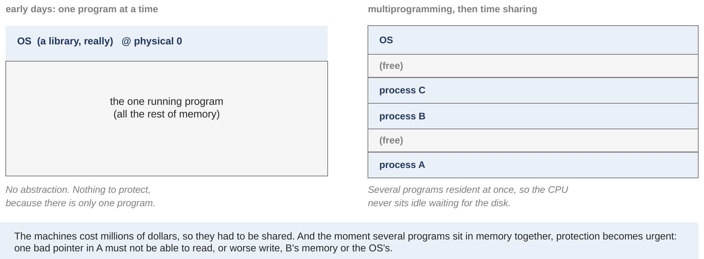{width=100%}
<figcaption markdown="1">Figure 35. Early days, one program at a time (left), and multiprogramming then time sharing, several programs resident at once (right). From slide 27, following the textbook's Figures 13.1 and 13.2.</figcaption>
</figure>

On the left is the early machine. The OS was a set of routines, a library really, sitting at physical address 0. One program got everything above it and used it however it wanted. Nothing needed protecting, because the program was alone.

Then machines began to cost hundreds of thousands, even millions, of dollars, and running one program at a time became unacceptable. The first answer was **multiprogramming**: several programs stay in memory at once, and when one waits for the disk, the OS switches to another, so the CPU stops sitting idle. The second was **time sharing**: several people use the machine at the same time, and each one expects an answer quickly. Both put several programs in memory together, and the bottom line of Figure 35 says the consequence. Once that happens, protection becomes urgent. A is one careless pointer away from B's data, or from the OS itself.

Before protection, there is an obvious way to share memory, and people tried it first. Figure 36 takes it seriously.

<figure markdown="1">
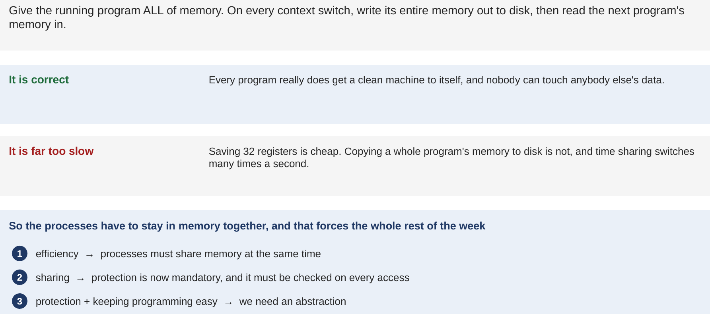{width=100%}
<figcaption markdown="1">Figure 36. The first idea: give the running program all of memory and swap it to disk on every switch. It is correct, it is far too slow, and the chain of three consequences. From slide 28, following textbook section 13.2.</figcaption>
</figure>

Give the running program every byte. On a switch, write all of its memory out to disk and read the next program's memory in. It is correct: each program really does get a clean machine, and nobody can touch anyone else's data, because nobody else is there. And it is hopeless. A context switch, registers and all, takes about a microsecond (Part 0). Copying a memory of even a few megabytes to disk and back takes on the order of a second (a rough estimate, as in [Section 1.1](#sec-1-1)), about a million times slower, and a time-sharing machine switches many times a second. The machine would spend its life moving memory and almost none of it running programs.

So follow the chain at the bottom of Figure 36, because it is the plan of the next three weeks. Efficiency forces the processes to stay in memory at the same time. Sharing forces protection, checked on every access, not once when the program is loaded. And protection, together with keeping programming easy, forces an abstraction: the address space of [Section 1.2](#sec-1-2).

### Extra 3 <span class="lbl lbl-deeper">Deeper, Q1</span> Every address a programmer sees is virtual {#extra-3 data-toc-label="Extra 3 [Deeper, Q1] Every address a programmer sees is virtual"}

The chain at the end of [Extra 2](#extra-2) ended with an abstraction. Before the evidence for it, the textbook states it as a question and the deck adds a claim about your own code. The claim is strong enough to need saying separately, because it covers every address you have ever printed. Figure 37 is the slide.

<figure markdown="1">
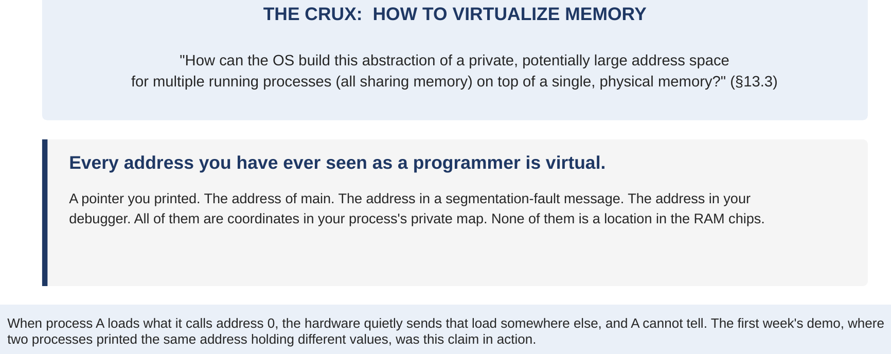{width=100%}
<figcaption markdown="1">Figure 37. The crux of chapter 13, and the claim that every address a programmer sees is virtual. From slide 29, following the textbook's aside "Every address you see is virtual".</figcaption>
</figure>

The crux is the one from [Section 1.1](#sec-1-1): many processes, each believing it has a private address space starting at 0, all packed into one physical memory. Build that illusion.

Then the claim. Think of every pointer you printed, the address of `main`, the number in a crash message, and what a **debugger** shows you. (A debugger is a tool that runs a program step by step and shows its variables and addresses; `gdb` is the common one on Linux.) Each of those is a coordinate in your process's private map. Not one of them is a location in the memory chips. The program is never told where it really lives, and it has no way to find out.

The bottom bar says what that means for a single load. Process A asks for what it calls address 0. The hardware sends the load somewhere else without a word. A gets the right bytes back and never learns that anything happened. The first week of the course showed this once (Part 0 recalls it): two copies of a program printed the same address with different values in it. That demo was this claim at work. The next three extras are the proof: the same program run three times, the randomization switched off, and then the kernel's own map of a process.

### Extra 4 <span class="lbl lbl-deeper">Deeper, Q1</span> Address space layout randomization (ASLR), and switching it off {#extra-4 data-toc-label="Extra 4 [Deeper, Q1] Address space layout randomization (ASLR), and switching it off"}

[Section 1.4](#sec-1-4) claimed the numbers `va.c` printed are names, not places, and said a second run would print different ones. A claim like that should be tested, not trusted. If the addresses were real places in the chips, a program could not survive having them change under it. So run it several times and watch.

<figure markdown="1">
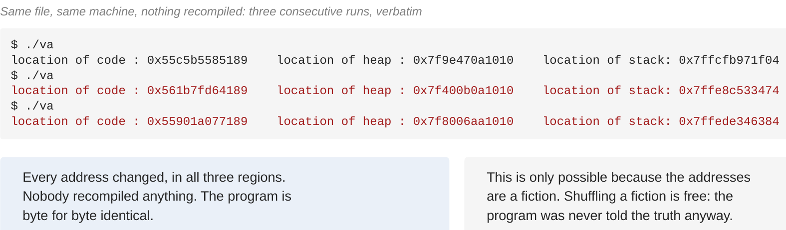{width=100%}
<figcaption markdown="1">Figure 38. The same program, three runs in a row, verbatim, and what the change means. From slide 30.</figcaption>
</figure>

Same file, same machine, nothing recompiled. The first run is the one [Section 1.4](#sec-1-4) read: code at 0x55c5b5585189, heap at 0x7f9e470a1010, stack at 0x7ffcfb971f04. In the second run, every one of the three addresses is different: the code starts 0x561b..., the stack 0x7ffe.... In the third, different again. The file on disk is byte for byte the same file, and it runs correctly every time.

That is only possible if the addresses are names in a private map. Moving a map costs nothing, because the program was never told the truth in the first place. The OS lays out the map at a different random place on every run. This is **ASLR**, address space layout randomization, the name [Section 1.4](#sec-1-4) gave in passing. Is the reshuffling an accident or deliberate? The way to find out is to switch it off.

<figure markdown="1">
{width=63%}
<figcaption markdown="1">Figure 39. `setarch x86_64 -R` runs one command with randomization switched off: two runs, verbatim, identical. From slide 31.</figcaption>
</figure>

`setarch x86_64 -R ./va` runs `./va` with randomization off for that one command (`setarch` is a Linux tool that changes how the next program is started; `-R` is its flag for "no randomization"). Now the two runs print identical addresses in all three regions. The code address, 0x555555555189, is Linux's starting place for a program's code when nothing is randomized (a Linux design choice), and Extras [5](#extra-5) and [6](#extra-6) meet it again.

<figure markdown="1">
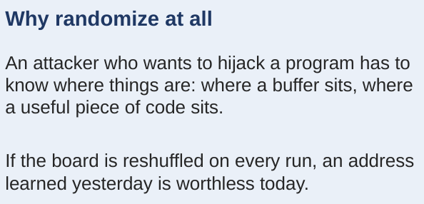{width=48%}
<figcaption markdown="1">Figure 40. Why randomize at all. From slide 31.</figcaption>
</figure>

The reason is security. An attacker who wants to take over a running program needs to know where things are: where a buffer sits, and where some useful piece of code sits. If the layout is reshuffled on every run, an address learned yesterday points at nothing useful today.

<figure markdown="1">
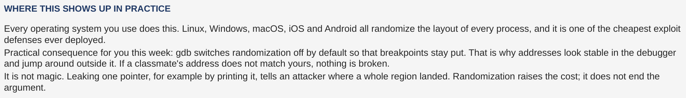{width=100%}
<figcaption markdown="1">Figure 41. Where ASLR shows up in practice: every major operating system, the debugger, and the limit of the defense. From slide 31.</figcaption>
</figure>

Every operating system you use does this: Linux, Windows, macOS, iOS and Android all randomize the layout of every process. It is one of the cheapest defenses against attacks ever deployed. The second paragraph of Figure 41 matters in the lab: `gdb` switches randomization off by default, so that a breakpoint (a place where the debugger stops the program) stays at the same address between runs. That is why addresses look stable in the debugger and jump around outside it. If a classmate's address does not match yours, nothing is broken. And the third paragraph is the honest limit. If a program leaks a single pointer, for example by printing it, the attacker learns where a whole region landed. Randomization makes an attack cost more; it does not end the argument.

### Extra 5 <span class="lbl lbl-deeper">Deeper, Q1</span> The kernel's map of a process: /proc/PID/maps {#extra-5 data-toc-label="Extra 5 [Deeper, Q1] The kernel's map of a process: /proc/PID/maps"}

Three addresses are a keyhole. They show that the order of the regions matches Figure 13.3, but not what else lives in an address space or where each region begins and ends. The kernel keeps a full map of every process, and it will print it. To read it we need a process that holds still long enough to be looked at, so the deck wrote one.

<figure markdown="1">
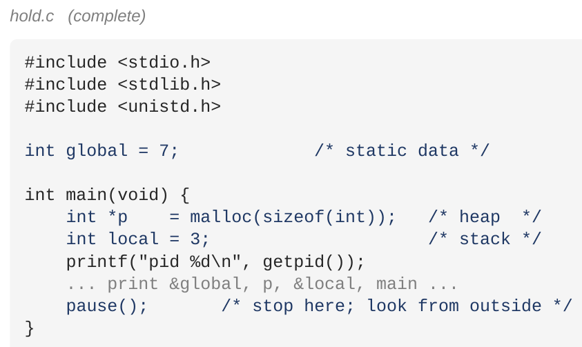{width=67%}
<figcaption markdown="1">Figure 42. hold.c, as the slide shows it, and why it is shaped this way. From slide 32.</figcaption>
</figure>

<figure markdown="1">
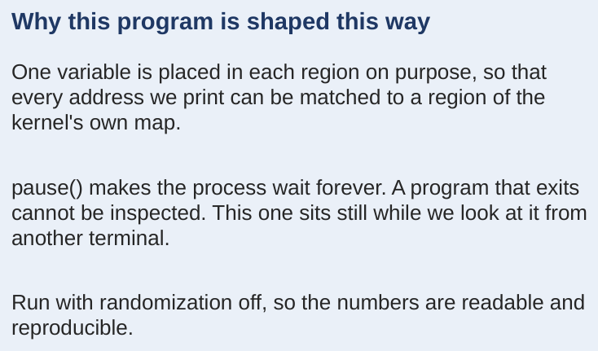{width=59%}
<figcaption markdown="1">Figure 43. Why the program is shaped this way. From slide 32.</figcaption>
</figure>

The program puts one variable in each region on purpose. `int global = 7;` is a **global variable**, declared outside any function, so it lives for the whole run in the program's static data region (the region Figure 13.3 leaves out; the processes week called it the data). `p` points at a block from `malloc`, so it points into the heap. `local` is a local variable of `main`, so it lives on the stack. Then `pause()` makes the process wait forever. A process that has exited leaves nothing to look at; this one sits still while we look at it from outside. (`getpid()` returns the process's **process id**, often written pid, the number the kernel gave this process.) It runs with randomization off, so the numbers stay readable and repeat.

<figure markdown="1">
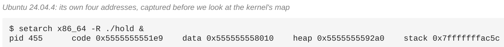{width=100%}
<figcaption markdown="1">Figure 44. Its four addresses, captured on the Ubuntu machine before looking at the kernel's map. From slide 32.</figcaption>
</figure>

The `&` at the end of the command line tells the shell to start the program and give the prompt back at once, so the program keeps running in the background. (The prompt is the `$` the shell prints when it waits for a command.) It printed: process 455; code at 0x5555555551e9; data just above at 0x555555558010; heap at 0x5555555592a0; and the stack far up at 0x7fffffffac5c. Keep those four numbers.

<figure markdown="1">
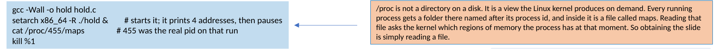{width=100%}
<figcaption markdown="1">Figure 45. The commands that produced the map, and what /proc is. From slide 33.</figcaption>
</figure>

The commands are in Figure 45. `/proc` is not a folder on a disk. It is a view the Linux kernel produces on demand. Every running process gets a folder there named after its process id, and inside it is a file called `maps`. Reading that file asks the kernel which regions of memory the process has at that moment, so `cat /proc/455/maps` (`cat` prints a file) is the whole experiment. `kill %1` stops the background program afterwards (`%1` is the shell's name for the first program it started in the background).

<figure markdown="1">
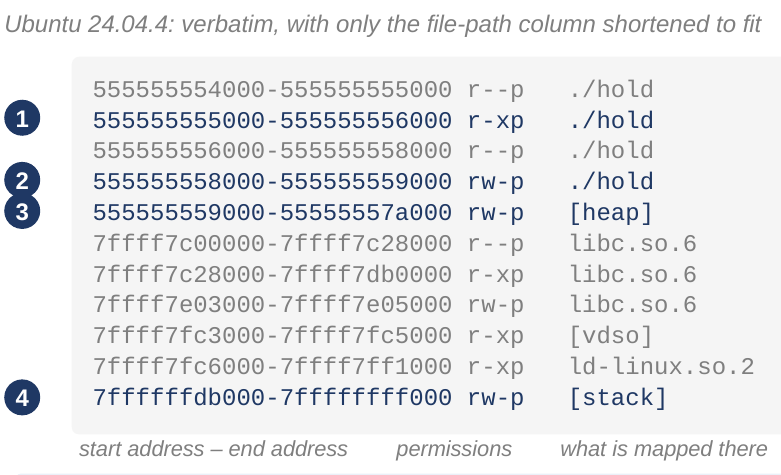{width=62%}
<figcaption markdown="1">Figure 46. /proc/455/maps on the Ubuntu machine, verbatim, with only the file-path column shortened to fit. From slide 33.</figcaption>
</figure>

Read the shape of one line first. A start address, a dash, an end address; four letters of permissions; and the name of what is mapped there. The addresses are in hexadecimal without the `0x`, which is how this file writes them. Each line is one **region**, also called a **mapping**: a stretch of the address space the kernel has set up for the process. The four letters say what the program may do there; [Extra 7](#extra-7) decodes them, and for now `r` means read, `w` write, `x` run as instructions.

<figure markdown="1">
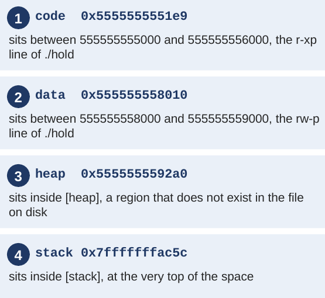{width=45%}
<figcaption markdown="1">Figure 47. Where each of the four addresses falls. From slide 33.</figcaption>
</figure>

Now place the four numbers. The code address, 0x5555555551e9, falls between 555555555000 and 555555556000, the `r-xp` line of `./hold`. The global, 0x555555558010, falls inside the `rw-p` line of the same file: the program's writable data. The heap pointer, 0x5555555592a0, falls inside the region the kernel labels `[heap]`, which does not exist in the file on disk; it was created when the process started. And the local, 0x7fffffffac5c, falls inside `[stack]`, right at the top. All four land where the drawing said. The address space is not a metaphor. It is a table the kernel keeps and will print for you.

<figure markdown="1">
{width=100%}
<figcaption markdown="1">Figure 48. The guests the three-region picture never mentioned. From slide 33.</figcaption>
</figure>

There are also guests the three-region picture never mentioned. `libc.so.6` is the C library, the file that holds `printf`, `malloc` and the rest. `ld-linux` is the **dynamic loader** of [Section 3.3](#sec-3-3), the program that maps the library in before `main` runs. And `[vdso]` is a tiny region the kernel puts into every process so that a call such as `gettimeofday` (ask the time) can be answered without a trap at all. The last line of Figure 48 is a promise: one C library sits inside every running process at the same moment, from a single physical copy. How that can be is what paging, a later week, buys.

??? note "The program behind Figure 44 (you can skip this listing)"

    The slide prints `hold.c` with one line shortened to `... print &global, p, &local, main ...`. Here is the whole file from the demo folder. It allocates one integer on the heap, declares one local integer, prints its process id and then four addresses with `printf` and `%p` (the code address is `main` itself; `(void*)` tells the compiler to print each one as a plain address), forces the output out with `fflush(stdout)` (output is normally held back in a buffer until a line or a block is complete), and then calls `pause()`, which waits until a signal arrives, so the process stays alive to be inspected.
    
    ```c
    #include <stdio.h>
    #include <stdlib.h>
    #include <unistd.h>
    
    int global = 7;                            /* static data */
    
    int main(void) {
        int *p    = malloc(sizeof(int));       /* heap  */
        int local = 3;                         /* stack */
        printf("pid %d\n", getpid());
        printf("  code  %p\n", (void*)main);
        printf("  data  %p\n", (void*)&global);
        printf("  heap  %p\n", (void*)p);
        printf("  stack %p\n", (void*)&local);
        fflush(stdout);
        pause();                               /* stop here, look from outside */
        return 0;
    }
    ```
    
    Compile and run it with `gcc -Wall -o hold hold.c`, then `setarch x86_64 -R ./hold &`, then `cat /proc/$(pgrep -n hold)/maps` (`pgrep -n hold` prints the process id of the newest program named hold, and `$( )` puts that output into the line, so the path becomes `/proc/455/maps` or whatever the id is), then `kill %1`. No `sudo` is needed (`sudo` runs a command with administrator rights). Your process id will differ. With randomization off, the code, data and heap addresses come out the same on any x86-64 Linux built like the Ubuntu machine. The stack address can differ by a few kilobytes, because the stack also holds the environment, the list of settings (such as the current folder) that the shell hands to every program it starts.
    
### Extra 6 <span class="lbl lbl-deeper">Deeper, Q1</span> A sparse address space: the regions drawn to scale {#extra-6 data-toc-label="Extra 6 [Deeper, Q1] A sparse address space: the regions drawn to scale"}

Figure 13.3 draws the address space as one strip with three regions filling it. The map in [Extra 5](#extra-5) gives the real start and end of every region, so we can check whether the strip's proportions are anything like the truth. They are not, and how far off they are is the whole argument of the second class. Figure 49 redraws the same process to scale, low addresses at the bottom, the way the processes week drew its strip.

<figure markdown="1">
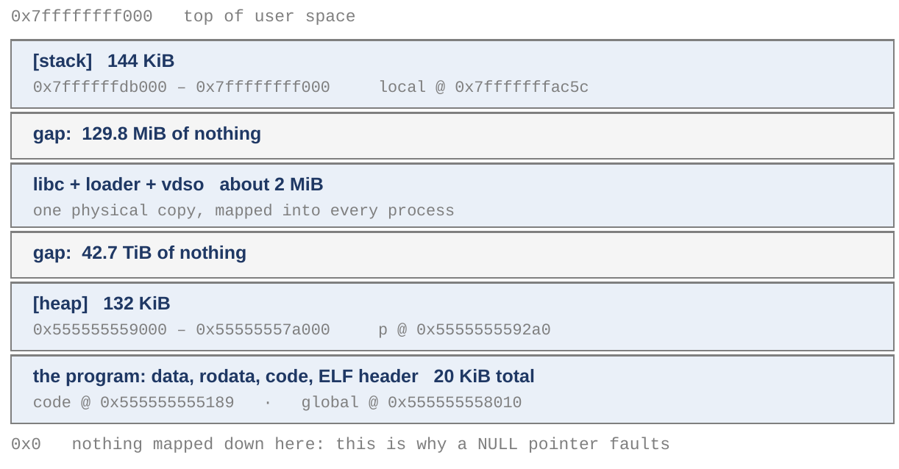{width=98%}
<figcaption markdown="1">Figure 49. The same process to scale: a few small islands in a 128 TiB ocean. From slide 34.</figcaption>
</figure>

(KiB, MiB and TiB in the drawing are the careful spellings of KB, MB and TB; [Appendix A](appendix.md#appendix-a) explains the i.) The sizes in the drawing are worked out from the map's start and end addresses; two of them are checked in the next paragraph. Start at the bottom. At address 0 nothing is mapped. That is why a NULL pointer faults ([Section 2.3](#sec-2-3)'s error 1) instead of quietly damaging something: there is nothing at address 0 to damage, so the hardware refuses. Then comes a long empty stretch that the drawing leaves out: the program's first line in the map starts at 0x555555554000, which is about 85 TB above 0 (0x555555554000 = 93,824,992,231,424 bytes, and 93,824,992,231,424 / 2^40 ≈ 85.3), Linux's choice for a program's place when randomization is off. Above that gap sits the program itself, its code, read-only data and writable data: 20 KiB in total. (The figure's "rodata" is read-only data, and the "ELF header" is the short description at the start of the program file; ELF is the format of program files on Linux.) Then the heap, 132 KiB. Then 42.7 TiB of nothing. Then the C library, the loader and the vdso, about 2 MiB. Another 129.8 MiB of nothing. And at the very top, the stack, 144 KiB.

Two of those numbers can be checked from the map in Figure 46. The heap runs from 555555559000 to 55555557a000. The difference is 0x21000, because 0x57a000 − 0x559000 = 0x21000. In decimal that is 2 × 65,536 + 1 × 4096 = 135,168 bytes, and 135,168 / 1024 = 132 KiB, the same 132 KiB the allocator bought with `brk` in [Section 3.3](#sec-3-3). The stack runs from 7ffffffdb000 to 7ffffffff000, a difference of 0x24000 = 2 × 65,536 + 4 × 4096 = 147,456 bytes, which is 144 KiB. (The units with an i, KiB, MiB, GiB, TiB, are the careful spelling of the powers of two: 1 KiB is 1024 bytes, 1 MiB is 1024 KiB, and so on. This guide's KB, MB, GB and TB mean the same powers of two; [Appendix A](appendix.md#appendix-a) says more.)

<figure markdown="1">
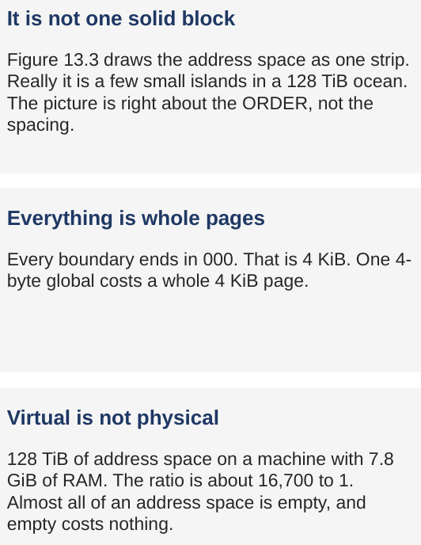{width=45%}
<figcaption markdown="1">Figure 50. The three lessons of the drawing. From slide 34.</figcaption>
</figure>

Three lessons, one per card. First, the address space is not one solid block. It is a few small islands in an enormous empty ocean. Figure 13.3 gets the order right and the spacing wrong, on purpose, because the real spacing does not fit on a page.

Second, every boundary in the map ends in three hexadecimal zeros. Three hex zeros are 12 binary zeros (3 × 4 = 12), so every boundary is a multiple of 2^12 = 4096 bytes, 4 KiB. The kernel hands out the address space only in whole pages of 4 KiB ([Section 3.3](#sec-3-3) met them), so the 4-byte global costs a whole 4 KiB page. Why 4 KiB is a question for a later week.

Third, the number that matters most. The program's half of the address space is 128 TiB. (A 48-bit address names 2^48 bytes, and Linux gives the lower half to the program: 2^47 = 2^7 × 2^40 = 128 × 2^40 bytes, 128 TiB. The split is Linux's design choice.) The machine has 7.8 GiB of RAM. Divide: 128 TiB is 128 × 1024 = 131,072 GiB, and 131,072 / 7.8 is about 16,800; with the machine's exact figure, 7.84 GiB, the ratio is about 16,700 to 1. ([Section 1.4](#sec-1-4) got 16,000 because it rounded the memory up to 8 GB.) Nearly all of those addresses are unused, and the unused ones must cost nothing, or none of this works. That sentence is what the second class tests the first hardware design against.

### Extra 7 <span class="lbl lbl-deeper">Deeper, Q1</span> The permission column, and write XOR execute {#extra-7 data-toc-label="Extra 7 [Deeper, Q1] The permission column, and write XOR execute"}

The map in [Extra 5](#extra-5) has one column we have not read: the four letters such as `r--p`. They are where protection lives, because they say what the program is allowed to do in each region. To someone new to Linux they look like noise, so the first step is to decode them.

<figure markdown="1">
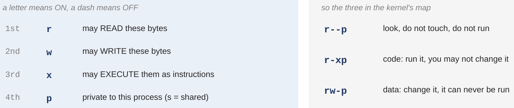{width=100%}
<figcaption markdown="1">Figure 51. The four positions of the permission column, and the three combinations in the map. From slide 35.</figcaption>
</figure>

`r--p` is not a command, and you never type it. The kernel prints it: four characters, always in the same order, like four switches. A letter means on and a dash means off. Position 1 is `r`, read: may this process read these bytes. Position 2 is `w`, write: may it change them. Position 3 is `x`, execute: may the processor run these bytes as instructions. Position 4 is `p`, private: this process has its own copy, and nobody else sees its changes (`s` there would mean shared).

So the three combinations in the map read like this. `r--p` is read only: look, do not touch, do not run. `r-xp` is code: you may run it, you may not change it. `rw-p` is data: change it freely, but it can never be run.

<figure markdown="1">
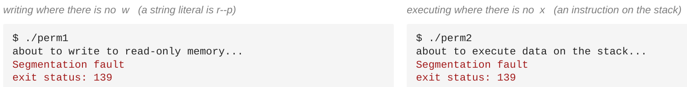{width=100%}
<figcaption markdown="1">Figure 52. Both violations, run for real: a write where there is no w, and a fetch where there is no x. From slide 35.</figcaption>
</figure>

These letters are not advice. The hardware checks them on every access, and breaking one kills the program at once. The deck ran both violations. `perm1` writes one character into a **string literal**, a string written in quotes in the program such as `"hello"`, which lives in a read-only region: Segmentation fault, exit status 139. `perm2` places one valid machine instruction into an **array** on the stack (a row of equal-sized slots reached by position number) and calls it. (A **fetch** is the processor reading its next instruction from memory before running it; the second class uses the word all the time.) The bytes are correct, but the stack has no `x`, so the processor refuses: the same fault and the same exit status. It is the same death as the NULL pointer of error 1. If you have used `ls -l` (a command that lists files) and seen `rwx` next to a file, the notation was borrowed on purpose, with a different subject. That one says who may open a file. This one says what a running program may do to its own memory.

Now read the column for real.

<figure markdown="1">
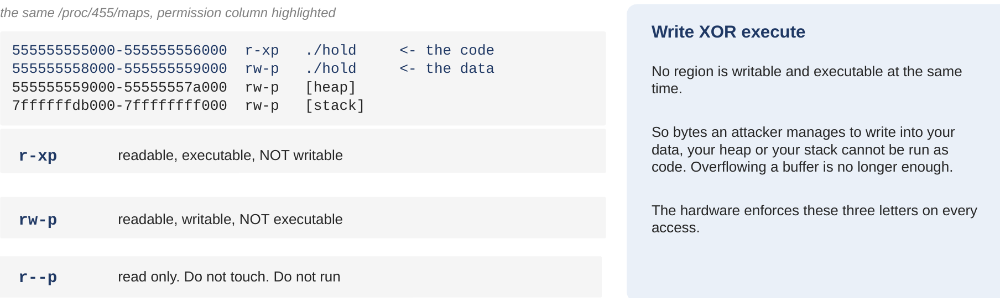{width=100%}
<figcaption markdown="1">Figure 53. The same map with the permission column highlighted, and the rule it follows. From slide 36.</figcaption>
</figure>

The code region says `r-xp`: readable and executable, and notice what is missing, it is not writable. A program cannot change its own code while it runs. The data, the heap and the stack all say `rw-p`: readable and writable, and this time the `x` is missing. None of them can be run. The rule has a name, **write XOR execute**, often written W^X ("XOR" means "one or the other, not both"): no region is both writable and executable. Suppose an attacker finds a bug that lets them write bytes into your buffer, such as the overflow of error 2. Those bytes sit in a region that cannot be run, so the processor refuses to run them. Overflowing a buffer is no longer enough on its own.

<figure markdown="1">
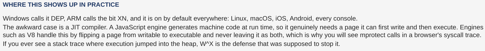{width=100%}
<figcaption markdown="1">Figure 54. Where W^X shows up in practice: every system, and the awkward case of a JIT compiler. From slide 36.</figcaption>
</figure>

This is not a Linux curiosity. Windows calls it DEP (data execution prevention), ARM (the processor family in most phones) calls the bit XN (execute never), and it is on by default everywhere. There is one awkward case, and you use it every day. A **JIT compiler** (just-in-time: a compiler that runs while the program runs), like the JavaScript engine in a web browser (V8, in the figure, is the one in Chrome), writes new machine code while the program runs. So it needs a page it can first write and then execute. Engines flip the page from writable to executable and never leave it as both. That flip is a system call named `mprotect`, which you would see in a browser's strace.

#### The programs behind Figure 52 (you can skip these listings) {#h-the-programs-behind-figure-52-you-can-skip-these-l}

The two programs were not kept with the deck, so the listings below were written for this guide to do what the slide describes, and they were compiled and run on an Ubuntu 24.04 x86-64 machine with gcc 13.3.0. `perm1.c` points `s` at the string literal "hello", prints a line, forces it out with `fflush`, then stores the letter `j` into the first byte of the literal. `perm2.c` puts one byte, 0xc3, into a small array on the stack (0xc3 is the x86-64 instruction `ret`, "return", a design fact of the processor), makes `f` a pointer to a function that starts at that array (the long cast `(void (*)(void))` says "treat this address as the start of a function"), prints a line, and calls `f`.

```c
/* perm1.c: write into a string literal, which lives in a read-only region. */
#include <stdio.h>
int main(void) {
    char *s = "hello";                   /* the bytes of "hello" sit in an r--p region */
    printf("about to write to read-only memory...\n");
    fflush(stdout);
    s[0] = 'j';                          /* a store where there is no w */
    printf("never reached\n");
    return 0;
}
```

```c
/* perm2.c: put one valid machine instruction (ret, 0xc3) in a stack array and call it. */
#include <stdio.h>
int main(void) {
    unsigned char code[1] = { 0xc3 };    /* 0xc3 is the x86-64 "ret" instruction */
    void (*f)(void) = (void (*)(void))code;
    printf("about to execute data on the stack...\n");
    fflush(stdout);
    f();                                 /* a fetch where there is no x */
    printf("never reached\n");
    return 0;
}
```

Compile with `gcc -Wall -o perm1 perm1.c` and `gcc -Wall -o perm2 perm2.c`, run each, and print the exit status with `echo $?` (`$?` is the shell's record of the last exit status). No `sudo` is needed. Both print their first line, then "Segmentation fault", and the exit status is 139 on any x86-64 Linux with the default settings.

### Extra 8 <span class="lbl lbl-deeper">Deeper, Q2</span> Memory without malloc, and the idioms of malloc and free {#extra-8 data-toc-label="Extra 8 [Deeper, Q2] Memory without malloc, and the idioms of malloc and free"}

[Chapter 2](#chapter-2) put every piece of heap memory behind a call to `malloc`, and error 1 is usually described as "forgetting to call malloc". That description makes `malloc` sound like the only way to get memory, and it is not. The question always comes up, and the answer is shorter than people expect. Figure 55 is four ways to get somewhere to put the word "hello", all from one real run.

<figure markdown="1">
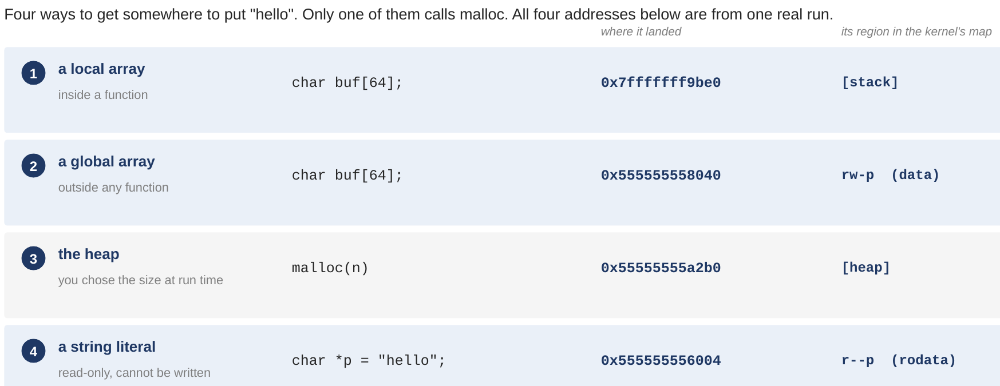{width=100%}
<figcaption markdown="1">Figure 55. Four ways to get memory for "hello", where each one landed, and its region in the kernel's map. From slide 37.</figcaption>
</figure>

Number 1 declares an array ([Extra 7](#extra-7) defined the word) inside a function: `char buf[64];` is 64 characters. No `malloc`; the memory exists because you declared it, and it landed on the stack. Number 2 is the same array outside any function. No `malloc`; it was set aside when the program was loaded, in the data region. Number 3 is `malloc`. This one needs a call, because the size is chosen while the program runs, and it landed on the heap. Number 4 is a pointer to a string literal. No `malloc`, and it is read only.

The right-hand columns are the payoff. Four ways to get memory, and each landed in a different region of the kernel's map: stack, data, heap and read-only data (rodata). Each address can be placed with the method of [Extra 5](#extra-5): 0x555555558040 is inside the `rw-p` line of the program, for example.

<figure markdown="1">
{width=100%}
<figcaption markdown="1">Figure 56. When malloc is needed, and the real rule. From slide 37.</figcaption>
</figure>

So `malloc` is needed in three cases: the data must outlive the function that made it; or the size is unknown until the program runs; or it would not fit on the stack, which is about 8 MB on Linux. The real rule is not "malloc first". It is that every pointer needs real memory behind it. `malloc` is one way to bring memory into existence; declaring an array is another.

When you do call `malloc`, a few habits prevent most of the six errors. Figure 57 lists them.

<figure markdown="1">
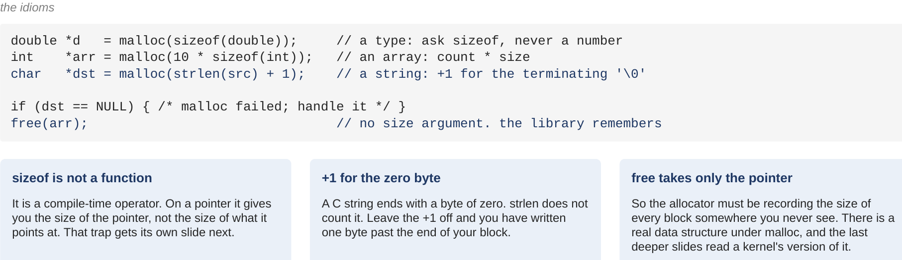{width=100%}
<figcaption markdown="1">Figure 57. The idioms of malloc and free, and three cards of fine print. From slide 38.</figcaption>
</figure>

Allocate by type: write `sizeof(double)` and let the compiler say how big a double is (`double` is C's type for a number with a fractional part). Never write 8 because you believe a double is 8 bytes. For an array, multiply: `10 * sizeof(int)`. For a string, take `strlen` and add 1, for the zero byte that ends it. Check the return value, because `malloc` returns NULL when it fails (`==` tests whether two values are equal, so `dst == NULL` asks "did malloc fail"). And look at `free`: it takes the pointer and nothing else. No size.

The three cards are the fine print. `sizeof` is a compile-time operator, not a function, and on a pointer it gives the size of the pointer rather than the size of what it points at; that trap has its own section, [Extra 9](#extra-9). The +1 is error 2 avoided. And since `free` gets only a pointer, the allocator must keep each block's size in a place you never see. [Section 3.3](#sec-3-3) found that place, the 16-byte header, and [Extra 12](#extra-12) reads a kernel allocator that avoids needing one.

One word on checking for NULL. `malloc` returns `void*`, C's way of writing "an address of no particular type", and NULL when it fails. Checking that is not paranoia. On a machine short of memory it is the difference between an error message and a crash.

??? note "The program behind Figure 55 (you can skip this listing)"

    The program was not kept with the deck, so the listing below was written for this guide to do what the slide describes, and was compiled and run on an Ubuntu 24.04 x86-64 machine with gcc 13.3.0. It declares a global array `gbuf` outside any function and a local array `buf` inside `main`, copies "hello" into each with `strcpy`, asks `malloc` for 6 bytes and copies "hello" there too (five letters and the zero byte), points `lit` at the string literal "hello", and prints each string with its address.
    
    ```c
    /* nomalloc.c: four ways to get somewhere to put "hello"; only one calls malloc. */
    #include <stdio.h>
    #include <stdlib.h>
    #include <string.h>
    
    char gbuf[64];                                   /* 2: a global array, outside any function */
    
    int main(void) {
        char buf[64];                                /* 1: a local array, inside a function */
        strcpy(buf, "hello");
        strcpy(gbuf, "hello");
        char *h = malloc(6);                         /* 3: the heap; the size is chosen at run time */
        strcpy(h, "hello");
        char *lit = "hello";                         /* 4: a string literal, read-only */
        printf("1 stack array   : %s    at %p\n", buf, (void*)buf);
        printf("2 global array  : %s    at %p\n", gbuf, (void*)gbuf);
        printf("3 heap (malloc) : %s    at %p\n", h, (void*)h);
        printf("4 literal       : %s    at %p\n", lit, (void*)lit);
        return 0;
    }
    ```
    
    Compile and run with `gcc -Wall -o nomalloc nomalloc.c` and `setarch x86_64 -R ./nomalloc`; no `sudo` is needed. On the guide's run the global array came out at 0x555555558040, exactly as on the slide, and the other three in the same regions as on the slide (stack 0x7fffffff8db0, heap 0x5555555592a0, literal 0x555555556008). Your addresses will differ a little; the four regions will not.
    
### Extra 9 <span class="lbl lbl-deeper">Deeper, Q2</span> What sizeof measures: a pointer against an array {#extra-9 data-toc-label="Extra 9 [Deeper, Q2] What sizeof measures: a pointer against an array"}

The first card of Figure 57 warned that `sizeof` on a pointer does not give the size of the block it points at. The warning is easy to agree with and easy to forget, because both kinds of name hold the same data and look alike in code. So the deck turned it into a question. Figure 58 is the question; commit to an answer before reading on.

<figure markdown="1">
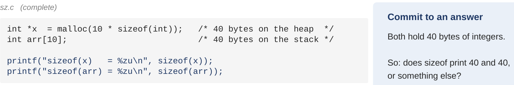{width=100%}
<figcaption markdown="1">Figure 58. sz.c and the question: both hold 40 bytes of integers, so does sizeof print 40 and 40? From slide 39.</figcaption>
</figure>

`x` is a pointer to a block from `malloc` that holds 10 integers, 10 × 4 = 40 bytes, on the heap. `arr` is a real array of 10 integers, also 40 bytes, on the stack. The two `printf` lines print `sizeof(x)` and `sizeof(arr)` (`%zu` prints a size). What you need to decide: what is `sizeof` measuring in each case?

Here is the tool for deciding. `sizeof` is worked out by the compiler, while it compiles, from what the compiler knows about the name you give it ([Section 2.2](#sec-2-2) said this). The compiler knows that `arr` is an array of 10 integers, because the program declared it that way. About `x`, the compiler knows only that it is a pointer, a variable that holds an address; the 10 in the `malloc` call is a number the program passes when it runs. And [Section 1.4](#sec-1-4) said how much room an address takes on the Ubuntu machine. [Section 2.2](#sec-2-2) said how much an `int` takes. With that, you can predict both lines. This question is Exercise 5, and its answer, with the deck's reveal, is at the end of the guide.

??? note "The program behind Figure 58 (you can skip this listing)"

    The slide shows the four lines inside `main`. Here is the whole file, written for this guide around exactly those lines (the original was not kept with the deck) and compiled and run on an Ubuntu 24.04 x86-64 machine with gcc 13.3.0.
    
    ```c
    #include <stdio.h>
    #include <stdlib.h>
    int main(void) {
        int *x  = malloc(10 * sizeof(int));   /* 40 bytes on the heap  */
        int arr[10];                          /* 40 bytes on the stack */
    
        printf("sizeof(x)   = %zu\n", sizeof(x));
        printf("sizeof(arr) = %zu\n", sizeof(arr));
        return 0;
    }
    ```
    
    Compile and run with `gcc -Wall -o sz sz.c` and `./sz`; no `sudo` is needed. The two numbers it prints depend only on the processor family and the compiler, so they come out the same on any x86-64 Linux; Exercise 5 asks you to predict them.
    
### Extra 10 <span class="lbl lbl-deeper">Deeper, Q2</span> Errors in giving memory back: the leak, use after free, the double free {#extra-10 data-toc-label="Extra 10 [Deeper, Q2] Errors in giving memory back: the leak, use after free, the double free"}

[Section 2.3](#sec-2-3) ran the three mistakes made when getting memory. Three more are made when giving it back, and they are harder, because for most of them nothing visible happens at the moment you commit them. (The double free is the exception: the library notices it and stops the program.) Before running them, here is the code of all six, because every file and line number a tool prints should point at something you have seen.

<figure markdown="1">
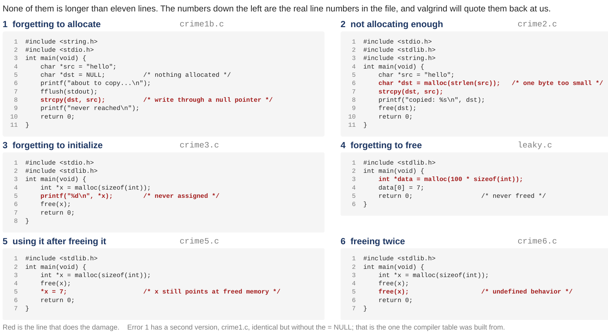{width=100%}
<figcaption markdown="1">Figure 59. The six programs, complete, with their real line numbers. From slide 40.</figcaption>
</figure>

None of them is longer than eleven lines. The numbers down the left are the file's own line numbers, with the `#include` lines counted, because a tool such as valgrind says "leaky.c, line 3", not "the third statement". The line in red does the damage. Error 1, forgetting to allocate (`crime1b.c`): a pointer set to NULL and a string copied through it, line 8 (`fflush(stdout)` forces the earlier line out before the crash, so it is not lost). Error 2, not allocating enough (`crime2.c`): `strlen` of "hello" is 5, the string needs 6 because of the zero byte, so the block is 1 byte short, line 6; the extra byte is actually written by the copy on line 7. That is why valgrind ([Extra 11](#extra-11)) names both lines. Error 3, forgetting to initialize (`crime3.c`): line 5 prints a value that was never stored. Error 4, the leak (`leaky.c`): 400 bytes asked for on line 3 and never given back. Error 5, use after free (`crime5.c`): line 5 writes through a pointer whose block was handed back on line 4. Error 6, freeing twice (`crime6.c`): the same block returned to the allocator two times, lines 4 and 5.

One footnote at the bottom of Figure 59. Error 1 exists in two versions. The one shown sets the pointer to NULL, which faults every time, and that is the version that was run. The textbook's version, `crime1.c`, leaves the pointer **uninitialized** (declared but never given a value, so it holds whatever bytes were there), which is less predictable. That is the version the compiler table of [Section 2.4](#sec-2-4) was built from.

<figure markdown="1">
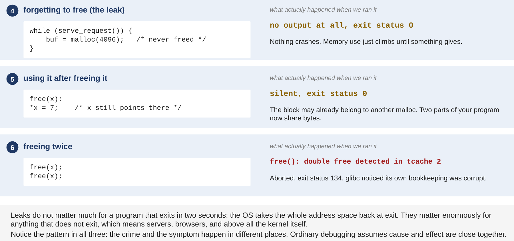{width=100%}
<figcaption markdown="1">Figure 60. Errors 4 to 6, the two lines that commit each, and what actually happened when each ran. From slide 41, following textbook section 14.4.</figcaption>
</figure>

Error 4 is the **memory leak**: memory allocated and never freed, so it cannot be used again while the program runs. The slide's pattern allocates inside a loop that serves requests and never frees (`while` repeats its body as long as the condition holds). Run the leak and there is no output, no crash, exit status 0. Memory use simply climbs.

Error 5 is the **dangling pointer**, a pointer that still holds the address of a block after the block was freed; using it is called **use after free**. Run it and nothing happens, exit status 0. But the block may already belong to a different `malloc`, so two parts of your program now write the same bytes without knowing.

Error 6 is the **double free**. This one speaks up: the C library (on Ubuntu it is glibc, the GNU C library, the name the figures use) printed `free(): double free detected in tcache 2` and stopped the program, exit status 134. The allocator noticed that its own bookkeeping had been damaged. (134 = 128 + 6, where 6 is the number of the signal named SIGABRT (a design fact of Linux), "abort", which the library sends to its own process; the 128 is the same shell rule as in error 1's 139.)

The bottom bar says when a leak matters. For a program that runs two seconds and exits, a leak is harmless, because at exit the OS takes back everything the process had. There are two levels of memory management: the allocator inside your heap, and the OS over whole processes, and the OS's level always wins in the end. So leaks matter for programs that do not exit. A server runs for months. A browser runs until you reboot. And the extreme case is the OS itself: it starts when the machine is switched on and stops when it is switched off, which on a server can be a year. When one of your processes leaks, the OS cleans up after it. Nobody cleans up after the OS; a leak in the kernel builds up until the machine is restarted. That is why kernel code is written with far more care about memory.

Notice the pattern in all three: the damage is done in one place and shows up in another, often in another function, or much later. Ordinary debugging assumes cause and effect sit close together. Memory bugs break that assumption, which is why the next extra needs a tool that records a block's whole history.

??? note "The program behind the compiler table (you can skip this listing)"

    [Section 2.4](#sec-2-4)'s first row was compiled from the textbook's version of error 1, which the slides describe but do not print. Here it is, from the demo folder. It is `crime1b.c` without the `= NULL`, without the two `printf` lines and without `fflush`.
    
    ```c
    #include <string.h>
    int main(void) {
        char *src = "hello";
        char *dst;              /* never allocated */
        strcpy(dst, src);
        return 0;
    }
    ```
    
    `gcc -Wall -O0 -o crime1 crime1.c` prints the warning in Figure 21 (`-O0` means "no optimization", which keeps the program as written). Running it may or may not crash, depending on what bytes happen to sit where `dst` lives; on the Ubuntu machine it did not crash, which is exactly why the deck runs the NULL version.
    
### Extra 11 <span class="lbl lbl-deeper">Deeper, Q2</span> valgrind on the off-by-one and on use after free, and the overflow it cannot see {#extra-11 data-toc-label="Extra 11 [Deeper, Q2] valgrind on the off-by-one and on use after free, and the overflow it cannot see"}

[Section 2.5](#sec-2-5) ran valgrind on the leak. Two of the other errors were left with no witness: error 2, the one-byte overflow that drew no warning and exited 0, and error 5, the use after free whose damage lands somewhere else. If valgrind watches every access, it should catch both while they happen. Figure 61 is the first.

<figure markdown="1">
{width=70%}
<figcaption markdown="1">Figure 61. valgrind on error 2, the off-by-one, built with -g. From slide 42.</figcaption>
</figure>

valgrind calls it an "Invalid write of size 1": one byte written where the program had no right to write. The report then says where: in `strcpy`, called from `main` at `crime2.c:7`. (The `-g` flag tells the compiler to keep the file's line numbers inside the program, which is how valgrind can print `crime2.c:7` instead of a bare address.) Read the last lines: "Address ... is 0 bytes after a block of size 5 alloc'd", and the block was allocated at `crime2.c:6`. That is the missing +1, described exactly. The block was 5 bytes, and the program wrote the byte right after it. So the program that gave the right output and exited cleanly, the one that would have shipped, is caught in the act.

<figure markdown="1">
{width=67%}
<figcaption markdown="1">Figure 62. valgrind on error 5, use after free: three line numbers in one report. From slide 42.</figcaption>
</figure>

Error 5 gives a report with three line numbers. An invalid write of size 4 (one integer) at `crime5.c:5`. The address is inside a block that was freed at `crime5.c:4`. And the block was allocated at `crime5.c:3`. Born, freed, touched: the block's whole history. Ordinary debugging cannot give you that, because by the time a program crashes, all of it is gone.

<figure markdown="1">
{width=100%}
<figcaption markdown="1">Figure 63. Where this shows up in practice: sanitizers in industry, and why use after free matters. From slide 42.</figcaption>
</figure>

Tools of this family are called sanitizers, and Figure 63 also names fuzzers, which feed a program random input until it misbehaves. They are standard practice. (CI in the figure is continuous integration: testing every change automatically.) Large software companies and the Linux kernel run them all the time on every change. A faster cousin is built into the compiler, **AddressSanitizer** (ASan), switched on with the flag `-fsanitize=address`. It slows a program down about 2 to 4 times instead of 20 to 50 (both are figures the tools' users cite, not measured here), cheap enough to leave on while testing. And use after free is not a student mistake. Attackers use it against browsers and operating systems more than almost any other bug, and it is much of the reason the industry argues about languages such as Rust that rule it out.

One honest note about valgrind, because it does not catch everything. Figure 64 is one mistake run three times.

<figure markdown="1">
{width=100%}
<figcaption markdown="1">Figure 64. The same bug, an 8-byte buffer with 19 bytes copied into it, on the heap and on the stack, under valgrind and under AddressSanitizer. From slide 43.</figcaption>
</figure>

The mistake is an 8-byte buffer with 19 bytes copied into it. ("way too long for 8" is 18 characters, plus the zero byte, 19.) First, on the heap, from `malloc`: valgrind catches it exactly, an invalid write, 0 bytes after a block of size 8. Second, change one line so the buffer is a local array on the stack. Same bug, same 19 bytes. And valgrind says "0 errors from 0 contexts". It found nothing at all. The program did still die, but that message came from a guard the C library puts into your function, the **stack canary** (a known value placed next to the stack frame and checked before the function returns), not from valgrind. Third, the same stack bug under AddressSanitizer: "stack-buffer-overflow, WRITE of size 19", at line 5 of the file. Exactly the report we wanted.

The reason is in the blue box of Figure 64. valgrind runs the finished program on a simulated processor and never recompiles anything, so it has no idea where one local variable stops and the next starts. AddressSanitizer is part of the compiler, so it knows, and it puts guard zones between them.

<figure markdown="1">
{width=100%}
<figcaption markdown="1">Figure 65. The two tools compared: setup, slowdown, what each can see. From slide 43.</figcaption>
</figure>

Read the table as a trade. valgrind needs no rebuild, costs 20 to 50 times, finds uninitialized reads, and is blind to overflows of stack and global arrays. AddressSanitizer needs a rebuild, costs 2 to 4 times, sees the stack, and misses uninitialized reads (a third tool, MemorySanitizer, does those). Neither tool is the answer; professionals run both. The habit to keep: when a tool says nothing, ask whether it was looking.

#### The programs behind Figure 64 (you can skip these listings) {#h-the-programs-behind-figure-64-you-can-skip-these-l}

The slide shows lines 4 and 5 of each file. Here are both files, from the demo folder. `heapover.c` asks `malloc` for 8 bytes, copies the 19-byte string into them with `strcpy`, and frees the block. `stackover.c` declares an 8-byte array on the stack, copies the same string into it, and prints it.

```c
#include <stdlib.h>
#include <string.h>
int main(void) {
    char *buf = malloc(8);                 /* on the HEAP this time */
    strcpy(buf, "way too long for 8");
    free(buf);
    return 0;
}
```

```c
#include <stdio.h>
#include <string.h>
int main(void) {
    char buf[8];                       /* on the STACK, not the heap */
    strcpy(buf, "way too long for 8");  /* overflows it */
    printf("%s\n", buf);
    return 0;
}
```

Compile with `gcc -g -o heapover heapover.c` and `gcc -g -o stackover stackover.c`, then run `valgrind -q ./heapover` and `valgrind ./stackover` (`-q` means quiet: print only the errors). For the third column, `gcc -g -fsanitize=address -o stackover_asan stackover.c` and `./stackover_asan`. No `sudo` is needed. gcc 13 also prints a warning while compiling both files, because here the string is a constant whose length the compiler can see; with a string read at run time it could not. Process ids and addresses will differ on your machine; which tool catches which bug will not.

### Extra 12 <span class="lbl lbl-deeper">Deeper, Q3</span> The kernel's page allocator: xv6's free list and kalloc {#extra-12 data-toc-label="Extra 12 [Deeper, Q3] The kernel's page allocator: xv6's free list and kalloc"}

The first class said several times that a real data structure sits under `malloc`, because `free` takes no size and something must remember every block. So far we have only seen its traces, the 16-byte header. Here is one such data structure from a real kernel, small enough to read whole. It also shows what disappears when every block is the same size.

First, one thing to keep apart. This is an allocator, but it is not `malloc`. `malloc` divides up address space that your process already owns, and it gives you any number of bytes you ask for. The xv6 kernel's allocator, `kalloc`, divides up the physical memory of the whole machine, and it only ever gives out one thing: one **page**, 4096 bytes. They are stacked, like a shop and a warehouse. When you call `malloc`, it usually serves you from stock it already has, and the kernel never hears about it. When the shop runs out, `malloc` asks the kernel for more territory (in xv6, with `sbrk`). Inside the kernel that request passes through a chain of functions (`sys_sbrk`, then `growproc`, then `uvmalloc`) that ends in `kalloc`, which takes a page off this list.

<figure markdown="1">
{width=51%}
<figcaption markdown="1">Figure 66. kernel/kalloc.c lines 17 to 24, verbatim: the whole data structure. From slide 44.</figcaption>
</figure>

This is the entire data structure (`struct spinlock` on line 22 is xv6's kind of lock). A struct called `run`, which contains one thing: `next`, a pointer to another `run` (the `*` in a declaration means "pointer to", as in [Section 2.2](#sec-2-2)). Then the allocator's whole state, a struct named `kmem` with two fields: a lock and a pointer named `freelist` to the head of a list. Line 22 is a **lock**, a variable that lets only one processor at a time into a piece of code. Ignore it until the concurrency weeks; all it does is stop two processors from taking the same page at the same moment (a machine can have several CPUs, also called **cores**, running at once).

<figure markdown="1">
{width=74%}
<figcaption markdown="1">Figure 67. The same thing, drawn: each free page holds the pointer to the next one. From slide 44.</figcaption>
</figure>

Now the picture, because this is the idea worth having. The head pointer, `kmem.freelist`, then a page, then another page, then another. A list built this way, each item holding the address of the next, is called a **linked list**, and a list of the free pieces of memory is a **free list**. Here is the trick: the free page itself is the list node. The pointer to the next page is written into its first 8 bytes (an address is stored in 64 bits, 8 bytes, as on the Ubuntu machine in [Section 1.4](#sec-1-4)). The rest of the page just sits there, unused, because the page is free. So keeping track of every free page in the machine costs zero extra memory. Not a little; zero. It lives inside memory that nobody wanted.

The bottom line of the slide is the biggest simplification of all: every page is exactly 4096 bytes. Every request is one page, and every page that comes back is one page. That one fact removes four jobs. The allocator never records how big anything is, so there is no hidden header in front of a page. It never searches for a block big enough, because any page on the list will do. It never cuts a large block into smaller ones and tracks the leftover. And it never notices that two free blocks sit side by side and glues them together. `malloc` has to do all four, for one reason: sizes. You can ask it for 1 byte, or 17, or a megabyte, so it must store each block's size, find a block that fits, split it, and merge neighbors when they come back; otherwise the heap slowly shatters into slivers too small to use. The difference shows in the files: `kalloc.c` is 82 lines from top to bottom (counted in the lab's source tree), comments included, and that is the kernel's entire page allocator; the GNU C library's `malloc.c` is 5,603 lines (as counted for the deck, in the GNU C library's source).

<figure markdown="1">
{width=81%}
<figcaption markdown="1">Figure 68. kalloc, kernel/kalloc.c lines 68 to 82; the comments on lines 74, 76 and 81 were added for the slide. From slide 45.</figcaption>
</figure>

With that picture, handing out a page is three lines. Line 74 takes the head of the list: `r = kmem.freelist`. Line 76 moves the head on to the next page: `kmem.freelist = r->next` (`r->next` means "the `next` field of the record `r` points at"). Line 81 returns the page it took. Line 75's `if(r)` checks that the list was not empty; an empty list gives back 0, which here means "no memory left". The two grey lines, `acquire` and `release`, are the lock again.

<figure markdown="1">
{width=56%}
<figcaption markdown="1">Figure 69. The three callouts: take the head, fill with junk, and what 0x05050505 means. From slide 45.</figcaption>
</figure>

Callout 1: lines 74 and 76 are the whole allocation. No search, no sizes, no fragmentation (wasted memory; here, free space broken into pieces too small to use, which is called external fragmentation; [Section 6.3](class-2.md#sec-6-3) names the other kind, internal), for the reason just drawn. It takes the same tiny time whether ten pages are free or ten million.

Callout 2 is line 80. Before handing over the page, `memset((char*)r, 5, PGSIZE)` fills the whole page with the byte 5 (`memset` fills a block of memory with one byte value; `PGSIZE` is xv6's name for 4096). And when a page is freed, the other function, `kfree`, fills it with the byte 1. Think back to error 3. If your code reads memory it never initialized, the worst outcome is a 0, because then the program looks correct and you never find the bug. So xv6 makes sure a fresh page never contains 0.

Callout 3 is the practical result. Four bytes of 5 in a row, printed in hexadecimal, read 0x05050505. If you see that in a debugger, you are looking at a page the kernel handed out that nobody wrote to. The kernel put that pattern there so the bug would be visible.
