# Second class: the hardware that translates every address, base and bounds (OSTEP 15) {#class-2}

## <span class="lbl lbl-roadmap">Roadmap</span> Recap and roadmap of the second class {#opening-2 data-toc-label="[Roadmap] Recap and roadmap of the second class"}

The second class starts where the first one stopped, with a sentence that has a hole in it. So before the new material, here is the first class in one drawing, with the hole marked.

<figure markdown="1">
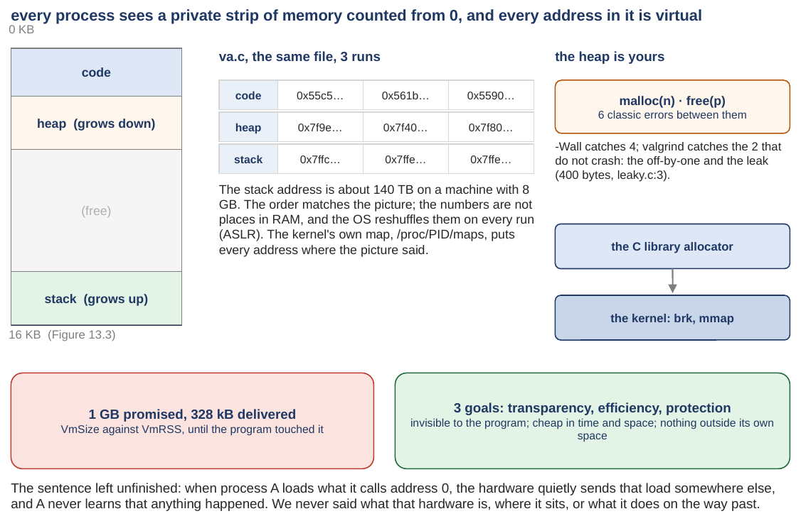{width=90%}
<figcaption markdown="1">Figure 70. The first class in one drawing: the address space, the three runs of va.c, the heap and its two calls, the library over the kernel, the promise, the three goals, what was settled and what was left open. From slide 47.</figcaption>
</figure>

Read it from the top left. Every process sees a private strip of memory counted from 0: code at the top, the heap growing down the page, the stack growing up. We printed that strip from inside a process three times and got three sets of numbers (the small table). The stack address was just under 128 TB (140 trillion bytes in decimal) on a machine with 8 GB. So an address is a name in the process's own map, not a place in the chips. The heap is the part a program grows by hand, with `malloc` and `free`, and six classic mistakes live between them; the compiler catches four and valgrind the other two. `malloc` is a library inside the process that buys from the kernel rarely, with `brk` and `mmap`, and sells to you often. And a yes from the kernel is a promise: 1 GB promised, 328 kB delivered, until the program touched it. Three goals grade whatever we build: the program must not notice (transparency), the cost must stay small (efficiency), and nobody reaches outside their own space (protection).

Now the hole, in the sentence at the bottom of the drawing. When process A loads what it calls address 0, the hardware quietly sends that load somewhere else, and A never learns that anything happened. The first class never said what that hardware is, where it sits, or what it does on the way past. That is the whole of this class. The answer is two registers and one addition, and by the end you will also see the one thing it cannot do.

<figure markdown="1">
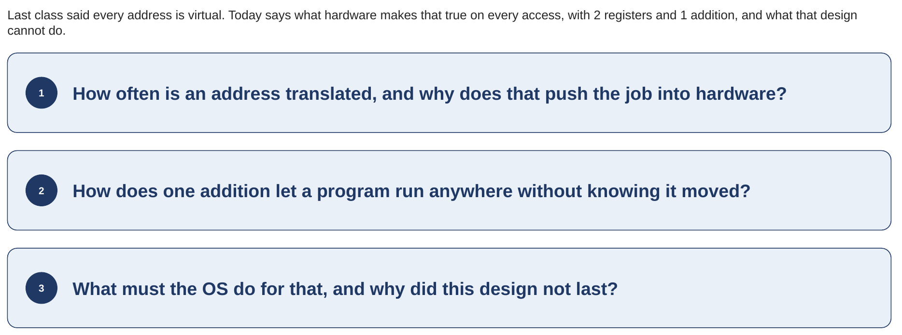{width=100%}
<figcaption markdown="1">Figure 71. The three questions of the second class. From slide 48.</figcaption>
</figure>

So the second class asks three questions, in the order of chapter 15 of the textbook. How often is an address translated, and why does that push the job into hardware ([Chapter 4](#chapter-4))? How does one addition let a program run anywhere without knowing it moved ([Chapter 5](#chapter-5))? What must the OS do for that, and why did this design not last ([Chapter 6](#chapter-6))? The summary of the week answers all six questions of the two classes in order. Extras [13](#extra-13) to [16](#extra-16) go deeper on the same three questions and can be read later or skipped.

## Chapter 4. How often an address is translated, and why that means hardware {#chapter-4}

*The question this chapter answers: How often is an address translated, and why does that push the job into hardware?*

### 4.1 <span class="lbl lbl-problem">Problem</span> Every address is a name, and something must fix every one {#sec-4-1 data-toc-label="4.1 [Problem] Every address is a name, and something must fix every one"}

What we have is the machinery of the processes week, and the picture of the first class. Figure 72 is the deck's problem slide for this question, in the same three columns as every problem slide.

<figure markdown="1">
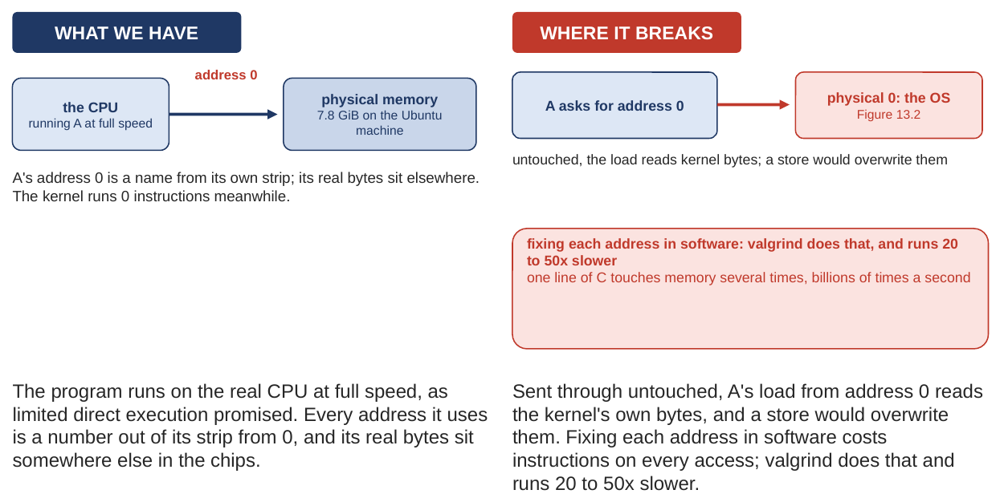{width=100%}
<figcaption markdown="1">Figure 72. The problem of the second class: what we have (A running on the real CPU, its address 0 a name) and where it breaks (the untouched load reads the kernel; fixing it in software is too slow). From slide 49.</figcaption>
</figure>

What we have is the left column. Process A runs directly on the processor at full speed, the way limited direct execution promised in the processes week. Each address it uses is a number from its own strip, counted from 0, and its real bytes are somewhere else in the chips. While A runs, the kernel executes no instructions at all; it only gets the CPU back at a trap or a timer interrupt.

Where it breaks is the middle column. Suppose A's address goes to memory untouched. A asks for address 0. Physical address 0 is where the kernel keeps itself (the textbook's Figure 13.2 put the OS there), so A reads the kernel's own data, and a store would overwrite it. Nothing crashes. Something quieter and worse happens. The obvious repair is software: add an instruction or two before every memory access that fixes the address and checks it. valgrind does exactly that kind of watching, and it runs 20 to 50 times slower ([Section 2.5](class-1.md#sec-2-5)). And one line of C touches memory several times. A processor's clock ticks a few billion times a second (a few gigahertz; one hertz is one tick a second), a design fact of today's chips, and it finishes roughly one instruction per tick or more. So it runs on the order of a billion instructions a second, each of them fetched from memory, so a slowdown on every access is a slowdown on everything.

<figure markdown="1">
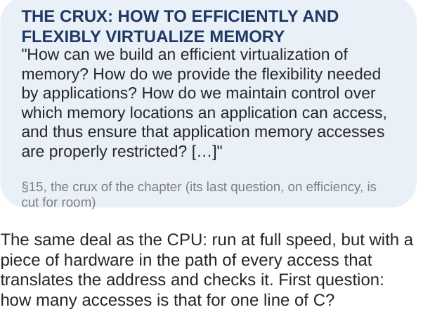{width=48%}
<figcaption markdown="1">Figure 73. The right column: the crux of chapter 15, and the shape of the answer. From slide 49.</figcaption>
</figure>

So what we need is the right column. Chapter 15's crux asks for three things at once: how can we build an efficient virtualization of memory, how do we provide the flexibility needed by applications, and how do we keep control over which memory locations an application can access? **Flexibility** is the new word: programs should be free to use their address space however they like. It is a fourth goal next to the three of [Section 1.5](class-1.md#sec-1-5), and the design built in this class will fail on it.

The shape of the answer is the deal the course made for the CPU. Run at full speed, but put a piece of hardware in the path of every access that changes the address and checks it. That has a name. **Address translation** is the hardware changing the virtual address of every instruction fetch, load and store into the physical address where the bytes really are. (An instruction **fetch** is the processor reading its next instruction from memory before running it.) Before designing that hardware, we should know how much work it has to do, so the first step is to count it for one line of C.

### 4.2 <span class="lbl lbl-check">Your turn</span> Counting the memory accesses of one line of C {#sec-4-2 data-toc-label="4.2 [Your turn] Counting the memory accesses of one line of C"}

The problem section asked how much work the translating hardware has to do. That depends on how many times a program goes to memory, and nobody can see that from the C. So we take one line of C, compile it, and count. Figure 74 is the line, the instructions the compiler made of it, and a small key for reading them.

<figure markdown="1">
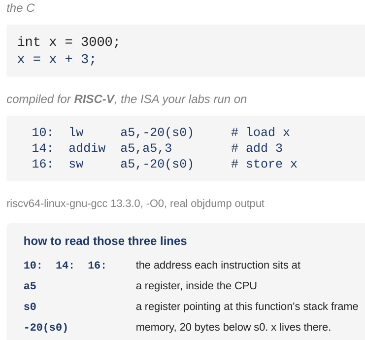{width=59%}
<figcaption markdown="1">Figure 74. The running example int x = 3000; x = x + 3;, compiled for RISC-V, with a key for reading the three instructions. From slide 50.</figcaption>
</figure>

`x` is a local variable holding 3000, and the line adds 3 to it. The compiler turned that line into three **instructions**, the small steps a processor actually runs, written here in **assembly language**, the readable spelling of machine instructions. The instructions are for RISC-V, the **instruction set** (the list of instructions a processor family understands; ISA for short) of the labs. Read them with the key at the bottom of Figure 74. The number at the front of each line (`10:`, `14:`, `16:`) is the address where that instruction itself sits, in hexadecimal. The gaps are uneven because RISC-V has instructions of two lengths: `lw` takes 4 bytes (0x10 to 0x14), and `addiw` is a short 2-byte one, so `sw` starts at 0x16. `a5` is a register inside the processor. `s0` is a register that points at this function's stack frame. And `-20(s0)` means the memory 20 bytes below the address in `s0`, which is where `x` lives. So: `lw` (load word) loads `x` from memory into `a5`; `addiw` adds 3 to `a5`; `sw` (store word) stores `a5` back into `x`. A **word** here is 4 bytes, the size of an `int`.

<figure markdown="1">
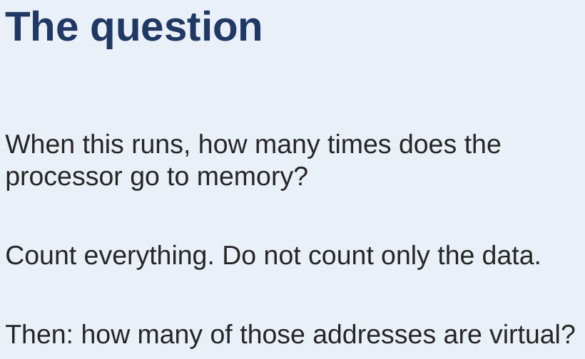{width=66%}
<figcaption markdown="1">Figure 75. The question: how many times does the processor go to memory, and how many of those addresses are virtual? From slide 50.</figcaption>
</figure>

The question is in Figure 75. When this runs, how many times does the processor go to memory? Count everything, not only the data. Then say how many of those addresses are virtual. Figure 76 gives four candidate answers.

<figure markdown="1">
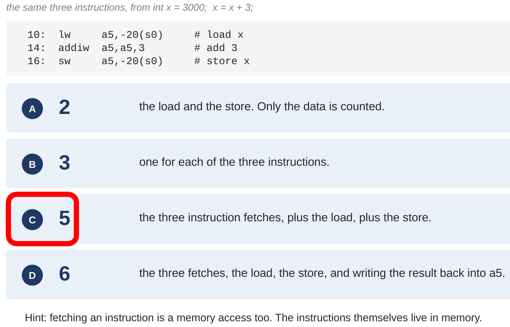{width=99%}
<figcaption markdown="1">Figure 76. Four candidate answers, A to D, and a hint. From slide 51.</figcaption>
</figure>

A is 2: the load and the store, the data and only the data. B is 3: one for each instruction. C is 5: the three instruction fetches, plus the load, plus the store. D is 6: C plus writing the result into `a5`. The hint is the part people miss: the processor has to go and get each instruction before it can run it, and that trip is a memory access too, because the instructions themselves live in memory. Pick one before reading the next section. (This is Exercise 7 at the end.)

??? note "The program behind Figure 74 (you can skip this listing)"

    The slide shows the C line and three lines of the compiler's output. The source file was not kept with the deck, so here is the file as the deck's sources record it, rebuilt for this guide and compiled on an Ubuntu 24.04 x86-64 machine with the RISC-V cross-compiler (a compiler that runs on one processor family and makes programs for another), gcc 13.3.0. It is one function, `f`, that sets a local to 3000 and adds 3.
    
    ```c
    void f(void) {
        int x = 3000;
        x = x + 3;
    }
    ```
    
    Compile it without linking (`-c`; linking is the step that joins a compiled file with the C library into a runnable program) and with no optimization (`-O0`), then print the instructions with `objdump -d` (`objdump` is a tool that reads a compiled file and prints its instructions; `-d` means disassemble):
    
    ```
    riscv64-linux-gnu-gcc -O0 -c addthree.c -o addthree_rv.o
    riscv64-linux-gnu-objdump -d addthree_rv.o
    ```
    
    The output has thirteen lines. The first six set up the function and store 3000 into `x`; lines `10`, `14` and `16` are the three on the slide, `lw a5,-20(s0)`, `addiw a5,a5,3` and `sw a5,-20(s0)`; the last four tidy up and return. No `sudo` is needed. On Ubuntu the cross-compiler is the package `gcc-riscv64-linux-gnu`. The addresses come out the same with the same compiler version; another version may number them differently, but the load, the add and the store will be there.
    
### 4.3 <span class="lbl lbl-example">Worked example</span> Five memory accesses, all of them virtual {#sec-4-3 data-toc-label="4.3 [Worked example] Five memory accesses, all of them virtual"}

The four candidates differ only in what they count as a trip to memory, so settle that first and then count. A trip to memory is any time the processor reads or writes a byte outside itself. A register is inside the processor, so writing a register is not a trip. Fetching an instruction is a read, because the instruction is stored in memory. Now go through the three instructions in the order the processor does them.

<figure markdown="1">
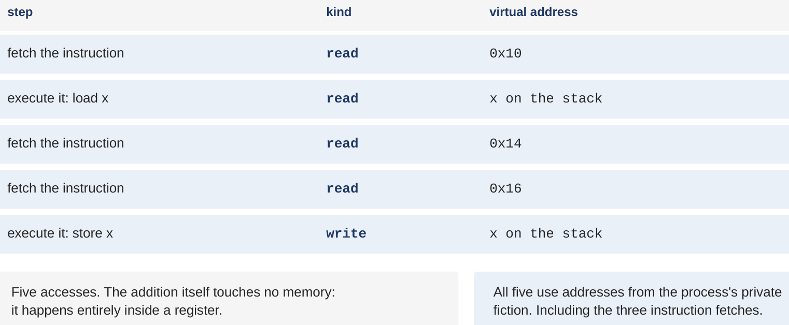{width=100%}
<figcaption markdown="1">Figure 77. One line of C is five memory accesses: the steps, the kind of each, and its virtual address. From slide 52.</figcaption>
</figure>

Fetch the instruction at 0x10: a read, the first access. Execute it: it loads `x` from the stack, a second read. Fetch the next instruction, at 0x14: a third read. Execute it: the addition happens entirely inside the register `a5`, so it touches no memory. Fetch the instruction at 0x16: the fourth read. Execute it: it stores `x` back, a write, the fifth access. Five in total, so the answer is C. The candidates that fail each dropped or added one kind: A forgot the three fetches, B forgot that `lw` and `sw` each go to memory a second time to do their work, and D counted a register as memory.

Now the second half of the question. All five addresses are names from the process's private map, the three instruction fetches included. Code addresses are virtual too; the address of `main` moved on every run in [Extra 4](class-1.md#extra-4). So whatever handles these addresses must handle all five.

That gives the ratio to hold on to: five accesses per line of C, on a machine running hundreds of millions of such lines a second (a billion or more instructions a second, at three instructions a line), which is billions of accesses a second. Whatever ends up handling these addresses has to sit in the path of every single one. Software would run on the same processor that is busy running your program, five times a line. It cannot be software. ([Extra 14](#extra-14) shows the same line on x86-64, where the count is three, and why the shape of the problem does not change.)

**Checkpoint 1.** Settled: one line of C costs five memory accesses, three of them instruction fetches, and all five carry virtual addresses. At billions a second, the translation has to be done by hardware sitting in the path of every access. Still open: what that hardware does to each address. The program believes it starts at 0; the OS has put it somewhere else. You should now be able to count the memory accesses of a load, add, store sequence, and say which of them are instruction fetches.

## Chapter 5. How one addition lets a program run anywhere: base and bounds {#chapter-5}

*The question this chapter answers: How does one addition let a program run anywhere without knowing it moved?*

### 5.1 <span class="lbl lbl-concept">Concept</span> The program's view: virtual addresses counted from 0 (Figure 15.1) {#sec-5-1 data-toc-label="5.1 [Concept] The program's view: virtual addresses counted from 0 (Figure 15.1)"}

[Chapter 4](#chapter-4) showed that every address must be fixed on the way past, but not what "fixed" means. To say what the hardware must do to an address, we need two pictures of the same program at the same moment: the one the program believes, and the one the machine holds. This section is the first picture, drawn with the textbook's tidy numbers so that the arithmetic stays easy.

<figure markdown="1">
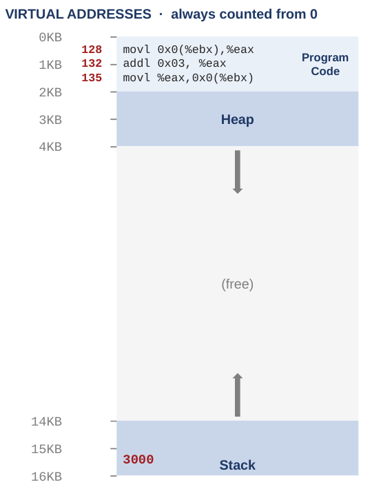{width=45%}
<figcaption markdown="1">Figure 78. The textbook's Figure 15.1: a 16 KB address space with the three instructions at 128, 132 and 135, and x at 15 KB holding 3000. Every address here is virtual. From slide 54.</figcaption>
</figure>

<figure markdown="1">
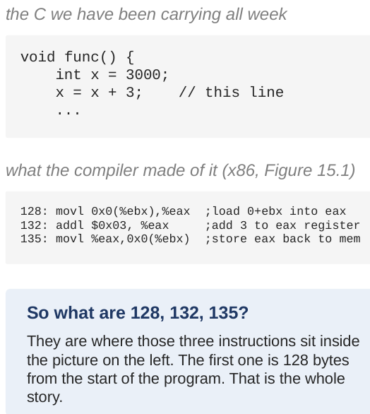{width=45%}
<figcaption markdown="1">Figure 79. The C of the running example, and the textbook's illustration of its x86 instructions, Figure 15.1. From slide 54.</figcaption>
</figure>

The listing in Figure 79 is the same line of C as the textbook shows it for x86. The textbook says the compiler's output "might look something like this", so it is an illustration, not a real compile ([Extra 14](#extra-14) compiles the line for real). The register names differ from the RISC-V of [Section 4.2](#sec-4-2), but the shape is the same: load, add, store. `movl 0x0(%ebx),%eax` loads `x` into the register `eax` (the textbook assumes the address of `x` is already in the register `ebx`); `addl $0x03, %eax` adds 3 to the register; `movl %eax,0x0(%ebx)` stores it back. Now look at the numbers in front of the three lines: 128, 132 and 135. (The gaps, 4 and then 3, are uneven because x86 instructions come in different lengths.) They are where those three instructions sit inside the program's memory, counted in bytes from the start. The first instruction is 128 bytes from the start of the program. That is all the number means.

Figure 78 is the program's memory, all of it, from 0 KB at the top to 16 KB at the bottom. The code sits in the first kilobyte or so, with the three instructions printed inside it. Below the code is the heap. At 15 KB, in the stack, is `x` itself, holding 3000. When the load goes looking for `x`, 15 KB is the address it uses.

<figure markdown="1">
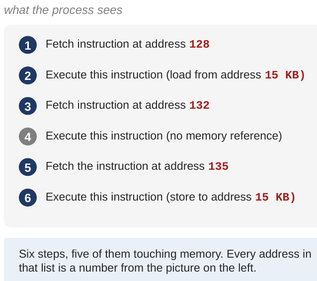{width=51%}
<figcaption markdown="1">Figure 80. What the process sees when the line runs: six steps, five of them touching memory. From slide 54.</figcaption>
</figure>

So run it. Fetch at 128. Execute, which loads from 15 KB. Fetch at 132. Execute, which touches no memory. Fetch at 135. Execute, which stores to 15 KB. Six steps, five of them going to memory, the same five as the RISC-V count. Every one of those addresses came out of the box in Figure 78.

The compiler wrote these numbers assuming the program owns memory starting at 0. It had no idea where the program would really end up, so it counted from 0. These are virtual addresses. What it leaves open: where the program really is in the machine, which is the second picture.

### 5.2 <span class="lbl lbl-problem">Problem</span> Relocation: the program placed at 32 KB, and its address 128 inside the OS {#sec-5-2 data-toc-label="5.2 [Problem] Relocation: the program placed at 32 KB, and its address 128 inside the OS"}

What we have is the program's own picture, counted from 0. Now the machine's picture at the same instant, the textbook's Figure 15.2, and the two do not agree.

<figure markdown="1">
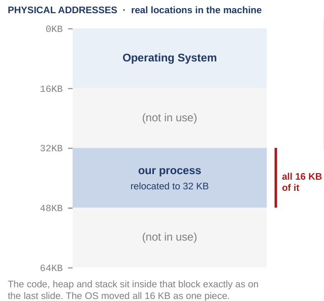{width=51%}
<figcaption markdown="1">Figure 81. The textbook's Figure 15.2: 64 KB of physical memory, the OS in the first 16 KB, and the process relocated to 32 KB. Every address here is physical. From slide 55.</figcaption>
</figure>

Physical memory here is 64 KB. The OS has taken the first 16 KB for itself. Then a free slot. Then, from 32 KB to 48 KB, our process, all 16 KB of it in one piece, with the code, heap and stack inside exactly as in Figure 78. Then another free slot. So the program really sits at 32 KB, and it does not know that; the OS picked that slot while loading it. Keep one rule for the rest of the class: the left column of Figure 81 is physical, and Figure 78 was virtual.

<figure markdown="1">
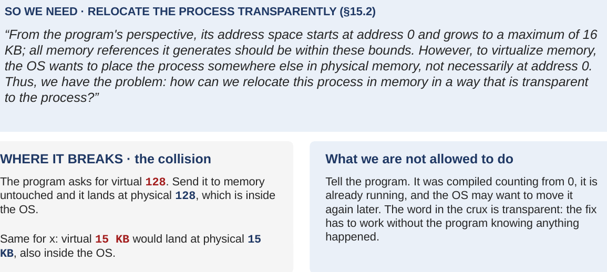{width=92%}
<figcaption markdown="1">Figure 82. Where it breaks (the collision), what we are not allowed to do, and what we need: relocate the process transparently. From slide 55.</figcaption>
</figure>

Where it breaks is the grey card of Figure 82. Put the two pictures together. The program asks for 128, a number out of its own box. Let it through to the chips untouched and it becomes physical 128, which is inside the OS. Same for `x`: virtual 15 KB would land at physical 15 KB, also inside the OS. So the very first instruction of this program would read kernel memory.

And the card beside it says what we may not do: tell the program. It was compiled counting from 0, it is already running, and the OS may want to move it again later. The word that matters is **transparent**, in the sense of [Section 1.5](class-1.md#sec-1-5): the fix has to work without the program knowing anything happened. So what we need is the textbook's question at the top of Figure 82: how can we relocate this process in memory in a way that is transparent to the process? Moving a program to a different place in memory and making its addresses still work is called **relocation**.

<figure markdown="1">
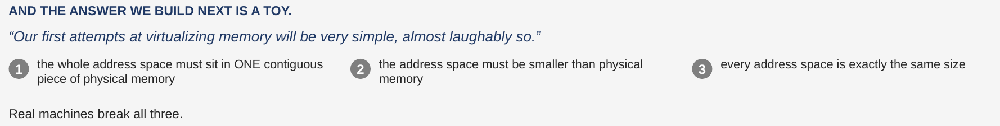{width=100%}
<figcaption markdown="1">Figure 83. The first answer will be a toy: the three simplifying assumptions. From slide 55.</figcaption>
</figure>

The first answer is a toy, and the textbook says so with a laugh: "almost laughably so". Three assumptions keep it simple. The whole address space sits in one unbroken piece of physical memory, which is what Figure 81 shows. An address space is smaller than physical memory. And every address space is exactly the same size. All three are false on your laptop. What we build next is the simplest thing that works, and the following weeks remove the three assumptions one at a time.

There are only two moments to fix an address: once, before the program runs, or every time, as the address leaves the processor. The cheap moment comes first, because it is the one people actually tried.

### 5.3 <span class="lbl lbl-concept">Concept</span> Static relocation: rewriting the addresses once, and why it fails {#sec-5-3 data-toc-label="5.3 [Concept] Static relocation: rewriting the addresses once, and why it fails"}

The cheap moment is load time: fix every address once, before the program runs, and never again. It needs no new hardware, and it really shipped. Seeing why it was abandoned tells us what the real answer must do.

<figure markdown="1">
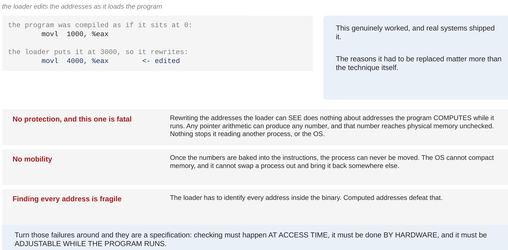{width=100%}
<figcaption markdown="1">Figure 84. Static relocation: the loader edits the addresses as it loads the program; and the three reasons it had to be replaced. From slide 56, following the textbook's aside on software-based relocation.</figcaption>
</figure>

The technique is called **static relocation**, and the word static is doing the work: the fixing happens once, at load time. One piece of software does it all, the **loader** (the part of the OS that copies a program from disk into memory and starts it). The program is compiled as if it lives at 0, so one of its instructions says `movl 1000, %eax`: load from address 1000. When the loader puts the program at 3000 instead, it walks through the program and adds 3000 to every address it can find, so the instruction becomes `movl 4000, %eax`. This worked, and real systems shipped it. Why it was abandoned matters more than the technique.

The first reason is fatal: no protection. The loader can only rewrite the addresses it can see in the file. An address the program computes while it runs (with pointer arithmetic, adding to an address) goes straight to physical memory, unchecked. So the program can read another process's data, or the OS's. The second reason is mobility. With the numbers baked into the instructions, the process is stuck where it was loaded. The OS cannot move it to squeeze memory together, and it cannot write it out to disk and bring it back somewhere else. The third is practical: finding every address inside a program is fragile, because some addresses are computed, not written down.

Turn each failure around and you get a specification, the bottom line of Figure 84. The loader never saw the addresses computed while the program runs, so the check must happen at every access. During an access the OS is not running, so the only thing in the path is hardware. And the correction was burned into the code, so instead it must be a value the OS can change while the program runs. Checked at access time, done by hardware, adjustable while the program runs: the next section builds exactly that.

### 5.4 <span class="lbl lbl-concept">Concept</span> Base and bounds: one check and one addition on every access {#sec-5-4 data-toc-label="5.4 [Concept] Base and bounds: one check and one addition on every access"}

The other moment, then: not once at load time, but every time an address leaves the processor. The specification says what this must be: a check at every access, in hardware, with a number the OS can change. The smallest piece of hardware that fits is two registers and an adder. Figure 85 shows one access going through it.

<figure markdown="1">
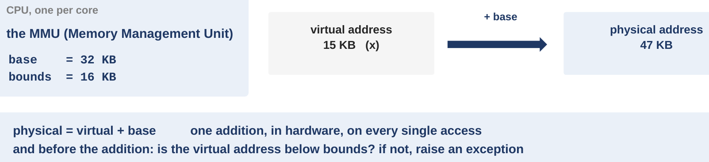{width=100%}
<figcaption markdown="1">Figure 85. Base and bounds: the MMU with its two registers, one access (virtual 15 KB) checked and translated to physical 47 KB, and the formula. From slide 57, following textbook section 15.3.</figcaption>
</figure>

The hardware is two registers per processor, inside the part of the CPU called the **MMU**, the memory management unit: the hardware that translates every address. The **base register** holds where this process really starts in physical memory, 32 KB here. The **bounds register** (also called the limit register) holds how big its address space is, 16 KB.

Now watch one access go through. 15 KB is where `x` lives. The processor puts that address out toward memory, and the MMU catches it on the way. First it checks that 15 is below the bound of 16, which it is. Then it adds the base: 15 KB + 32 KB = 47 KB. So the access lands at physical 47 KB. Check it in bytes: 15 KB is 15 × 1024 = 15,360, 32 KB is 32 × 1024 = 32,768, and 15,360 + 32,768 = 48,128, which is 47 × 1024 = 48,128. The program asked for 15 and got 47, and it has no way of finding out.

Every memory reference goes through the same two steps. Compare against the bound first; then add the base:

physical address = virtual address + base, provided virtual address < bounds.

The first instruction gets the same treatment: its fetch from virtual 128 goes to 128 + 32,768 = 32,896. This design is called **base and bounds**, and also **dynamic relocation**, because the relocation happens while the program runs, on every access, and the OS can change the base later.

<figure markdown="1">
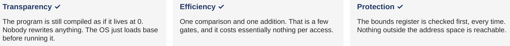{width=100%}
<figcaption markdown="1">Figure 86. Base and bounds graded against the three goals of [Section 1.5](class-1.md#sec-1-5). From slide 57.</figcaption>
</figure>

Grade it against the three goals. Transparency: nothing in the program was rewritten; it is still compiled as if it lives at 0, and the OS just loads the base register before running it. Efficiency: a comparison and an addition are a few logic gates (the smallest switching circuits a chip is built from), and they cost essentially nothing per access. Protection: the bound is checked first, every time, so nothing outside the address space is reachable. And look back at the three requirements of [Section 5.3](#sec-5-3). Checked at access time, done by hardware, adjustable while the program runs: all three, from two registers and an adder. That was the legal access. Next, the other case.

### 5.5 <span class="lbl lbl-concept">Concept</span> Out of bounds: the exception behind a segmentation fault {#sec-5-5 data-toc-label="5.5 [Concept] Out of bounds: the exception behind a segmentation fault"}

Base and bounds has a second job besides adding, and it matters as much: refusing. [Section 1.1](class-1.md#sec-1-1) began with A storing into B's memory, and the bound is what is supposed to stop it. So run the same machine with an address the process does not have.

<figure markdown="1">
{width=100%}
<figcaption markdown="1">Figure 87. The same two registers, and a virtual address of 20 KB in a 16 KB space: the check fails and no address is produced. From slide 58.</figcaption>
</figure>

Same program, same machine, same two registers. This time the program asks for virtual 20 KB, and the space is only 16 KB long. 20 is not below 16, so the comparison fails.

<figure markdown="1">
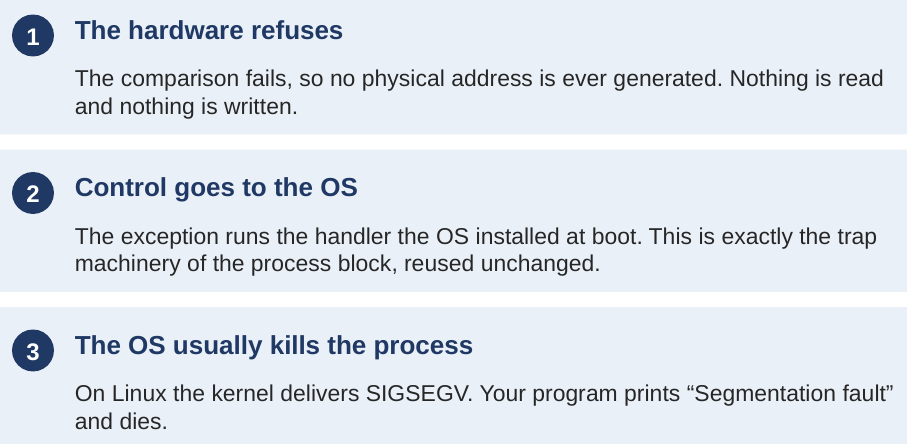{width=73%}
<figcaption markdown="1">Figure 88. The three things that happen next. From slide 58.</figcaption>
</figure>

Three things happen. One: the hardware refuses. It does not compute a wrong address and catch it afterwards. No physical address is ever formed; nothing is read and nothing is written. Two: control goes to the OS. The hardware raises an **exception**, an event that stops the running program and makes the processor jump into the kernel, to a handler the OS installed at boot. That is the trap machinery of the processes week, reused unchanged; only the trigger is new. Three: the OS decides, and for a bad memory access the answer is almost always to kill the process. On Linux the kernel sends the signal SIGSEGV (the "segmentation violation" signal, number 11, from [Section 2.3](class-1.md#sec-2-3)), and the program prints "Segmentation fault" and stops.

<figure markdown="1">
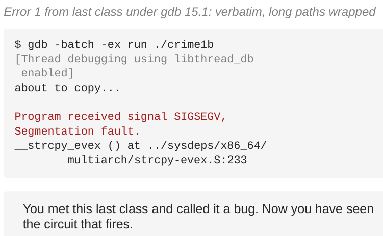{width=60%}
<figcaption markdown="1">Figure 89. Error 1 from the first class under gdb: the debugger reports the signal inside strcpy. From slide 58.</figcaption>
</figure>

And here it is happening: error 1, the NULL pointer, run under the debugger `gdb` (`-batch -ex run` means "run the program once and report"). It reports "Program received signal SIGSEGV, Segmentation fault", inside `strcpy` (the name `__strcpy_evex` is the C library's fast version of `strcpy` for this processor). In the first class this was a bug in your program. Now it is a circuit you have seen. On the Ubuntu machine the circuit is paging hardware, a later week, rather than a bounds register, but the exception is the same kind.

So the name is not a metaphor. A segmentation fault is the name of the hardware exception raised when an address falls outside the segment, the region, the process is allowed to touch. When one process gets several segments instead of one, which is the next week of the course, the name fits perfectly.

### 5.6 <span class="lbl lbl-check">Your turn</span> Translation practice: two processes, eight addresses {#sec-5-6 data-toc-label="5.6 [Your turn] Translation practice: two processes, eight addresses"}

Two worked accesses are not yet a skill. The method has two steps and an order, bounds first and then base, and the order is where people go wrong, so the deck gives eight addresses to translate. Figure 90 is the slide.

<figure markdown="1">
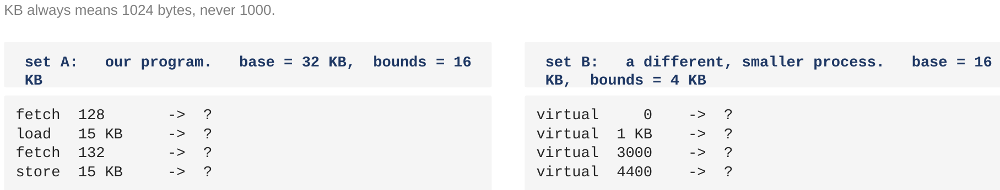{width=100%}
<figcaption markdown="1">Figure 90. Translate these: set A, our program (base 32 KB, bounds 16 KB), and set B, a different, smaller process (base 16 KB, bounds 4 KB). From slide 59.</figcaption>
</figure>

Set A is the program we have been tracing, with the base and bounds of [Section 5.4](#sec-5-4). Its four accesses are four of the five of `x = x + 3` in the textbook's numbering: two of the three instruction fetches (128 and 132; the fetch at 135 works the same way), the load and the store. Set B is a different, smaller process, so you see the arithmetic with a second pair of registers: base 16 KB, bounds 4 KB. In this course a KB is 1024 bytes, never 1000.

The method, from the bottom line of the slide: check the virtual address against the bound first, and only then add the base. Write every number in bytes first (15 KB = 15 × 1024 = 15,360, for example). One of the eight is not like the others; find it, and be ready to say why. This is Exercise 9, and the answers, with the deck's answer slide, are at the end of the guide.

### 5.7 <span class="lbl lbl-example">Worked example</span> Why you add: a virtual address is a distance, not a place {#sec-5-7 data-toc-label="5.7 [Worked example] Why you add: a virtual address is a distance, not a place"}

The formula "physical = virtual + base" can look like a rule somebody made up. If it were arbitrary, you would have to memorize it, and you would not know what to do when the numbers look strange. It is not arbitrary, and one drawing shows why adding is the only thing that could work.

<figure markdown="1">
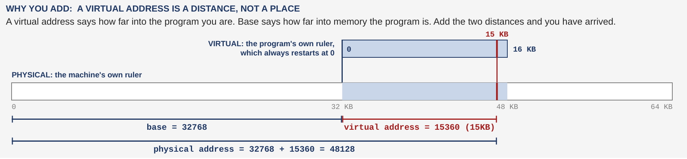{width=100%}
<figcaption markdown="1">Figure 91. Why you add: the program's own ruler, which always restarts at 0, laid over the machine's ruler; base plus virtual address is two distances end to end. From slide 60.</figcaption>
</figure>

The long bar is physical memory, all 64 KB, and the numbers under it are real locations. Our process sits in the shaded part, 32 KB to 48 KB. The short bar above is the same stretch measured with the program's own ruler. Its 0 sits where physical memory says 32 KB. That is the whole trick: the program has its own ruler and its own 0.

So when the program says 15 KB, it names a distance, not a place: 15 KB along its own ruler. From physical 0 to where the program starts is 32,768 bytes; that is the base. From there to `x` is another 15,360 bytes; that is the virtual address. Two distances end to end: 32,768 + 15,360 = 48,128. You are not adding two places. You are walking two distances one after the other. (That is why the textbook calls a virtual address an **offset** into the address space: a distance from its start.)

The same picture explains a fault. The program's ruler is only as long as its address space, the bound. An address past the end of the ruler is not a distance along it at all, so there is nothing to add it to, no physical address exists, and the hardware raises the exception. And it gives two small checks for any translation you do. A load and a store of the same variable must land on the same physical address, because they are the same distance along the same ruler. And a translation that mixes 1024 and 1000 will be off, because both rulers count in the same unit.

**Checkpoint 2.** Settled: on every access the MMU compares the virtual address with the bounds register, then adds the base register: 15 KB + 32 KB = 47 KB. An address at or past the bound is refused before any physical address exists, and that refusal is the segmentation fault. Still open: the hardware only adds. Somebody has to put the right numbers in the two registers, at the start of a process, when it ends, and at every context switch. You should now be able to translate virtual 3000 with base 16 KB and bounds 4 KB, and say what happens to virtual 4400 (Exercise 9 asks exactly that).

## Chapter 6. What the OS must do, and why base and bounds did not last {#chapter-6}

*The question this chapter answers: What must the OS do for that, and why did this design not last?*

### 6.1 <span class="lbl lbl-concept">Concept</span> The hardware column and the OS column {#sec-6-1 data-toc-label="6.1 [Concept] The hardware column and the OS column"}

Checkpoint 2 left one job with no owner. The hardware does the translating, but it adds whatever is in the base register and compares with whatever is in the bounds register. If the wrong numbers are there, the translation is perfectly fast and perfectly wrong. So someone must decide what goes into those two registers, and keep them right as processes start, end and take turns. That someone is the OS, and Figure 92 splits the work in two columns.

<figure markdown="1">
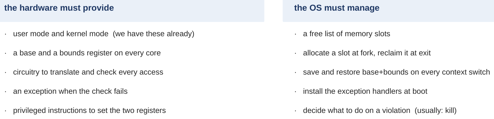{width=100%}
<figcaption markdown="1">Figure 92. What the hardware must provide, and what the OS must manage. From slide 62, following the textbook's Figures 15.3 and 15.4.</figcaption>
</figure>

The hardware column first. It must provide the two CPU modes, user mode and kernel mode (the processes week built these). A base and a bounds register on every core (a machine can have several CPUs running at once, called cores). The circuitry that translates and checks every access. An exception when the check fails. And **privileged instructions** to set the two registers: instructions that only work in kernel mode, and that trap if a user program tries them. (Why they must be privileged comes three paragraphs below.)

Now the OS column, and this is where memory management as a job begins. The OS keeps a **free list**: a list of the slots of physical memory nobody is using. It hands a slot out when a process is created and takes it back when the process exits. Right now that list is trivial, because every address space is the same size (the toy's third assumption); in the next week the sizes vary and the free list becomes a real problem. The OS also installs the exception handlers at boot. And it decides what happens on a violation, which is almost always to kill the process.

<figure markdown="1">
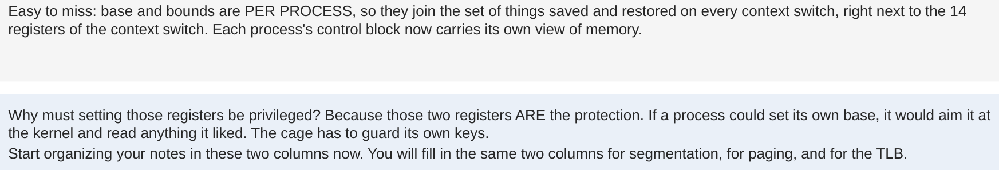{width=100%}
<figcaption markdown="1">Figure 93. The two points people miss: base and bounds are per process, and setting them must be privileged. From slide 62.</figcaption>
</figure>

Now the one people miss, in the grey box of Figure 93. There is one base and bounds pair per CPU, but each process needs its own values. So the pair is part of what the OS saves and restores at every context switch. It sits next to the registers the OS already saves for each process at a switch (Part 0). The figure's "14 registers" are the second of Part 0's two save points, the switch's own context. Each process's struct now carries its own view of memory. Saving and restoring the pair is also what lets the OS move a process, as [Extra 16](#extra-16) shows: stop it, copy its slot elsewhere, change the saved base, and let it run again.

And why must loading those registers be privileged? Because those two registers are the protection. A process that could set its own base would point it at the kernel and help itself to anything. The lock must not hand out its own key. Start organizing your notes in these two columns now, hardware and OS. The same two columns come back for every mechanism of the memory block.

### 6.2 <span class="lbl lbl-kernel">Real kernel</span> xv6's bound: p->sz, growproc and fetchaddr {#sec-6-2 data-toc-label="6.2 [Real kernel] xv6's bound: p->sz, growproc and fetchaddr"}

The two columns are a model. The kernel of the labs is real code, so it is fair to ask where in it the bound lives and where it is checked. It also closes a loop from the first class: `malloc` calls `sbrk` when its pool runs dry ([Section 3.2](class-1.md#sec-3-2)), and here is the other end of that call, inside the kernel.

<figure markdown="1">
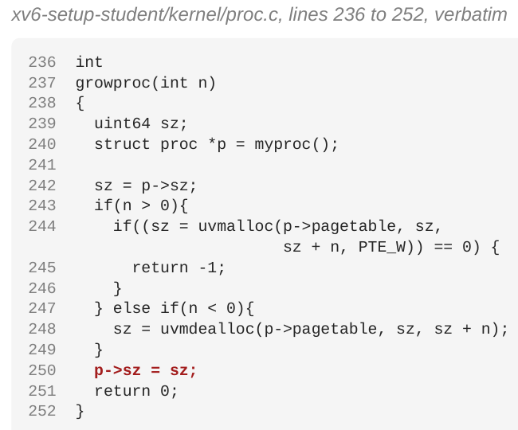{width=52%}
<figcaption markdown="1">Figure 94. kernel/proc.c lines 236 to 252, verbatim: growproc. From slide 63.</figcaption>
</figure>

First, where the bound lives. `p` is the kernel's record for the current process, its `struct proc` (`myproc()` returns it), and `p->sz` means "the `sz` field of the record `p` points at": how much memory this process has, in bytes. That number plays the part of xv6's bounds register (xv6 has no real one; callout 3 below says so). `growproc` is the function `sbrk` reaches when a process grows (or shrinks) its memory by `n` bytes. Line 242 reads the current size. (`PTE_W` on line 244 asks for the new pages to be writable.) If `n` is positive, line 244 asks `uvmalloc` to add real pages for the new bytes. (`uvmalloc` and `uvmdealloc` add and remove memory through the process's **page table**, `p->pagetable`: the table that paging, the translation method of a later week, uses to find each piece of a process's memory.) The call returns 0 when there is no memory left, and then `growproc` returns −1. Line 250 is the only line in the function that changes the bound: `p->sz = sz`. The process just got bigger, and the bound moved with it.

<figure markdown="1">
{width=68%}
<figcaption markdown="1">Figure 95. Callout 1: growproc moves the bound. From slide 63.</figcaption>
</figure>

Notice what is not there: no comparison against an upper limit. Nothing in this function asks whether the process grew too far. `growproc` fails only when `uvmalloc` cannot find physical pages to give.

<figure markdown="1">
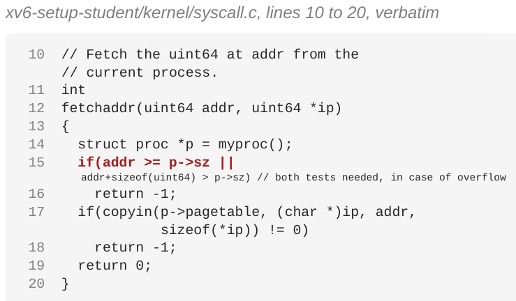{width=59%}
<figcaption markdown="1">Figure 96. kernel/syscall.c lines 10 to 20, verbatim: fetchaddr. From slide 63.</figcaption>
</figure>

The check is somewhere else, in a different file. `fetchaddr` runs whenever a system call hands the kernel an address in user memory and the kernel needs to read 8 bytes from there (`uint64` is xv6's name for a 64-bit, 8-byte unsigned (never negative) number). Line 15 is the bound check: if the address is at or past `p->sz`, or if the 8 bytes starting there would run past `p->sz`, return −1, refused. (`>=` means "greater than or equal to", and `||` means "or": the test fails if either half is true.) The second half of the test, with the comment the file carries, guards against an address so large that adding 8 to it wraps around. The sum would pass the largest number a 64-bit value can hold and come out small. Only if both tests pass does line 17 copy the value in.

<figure markdown="1">
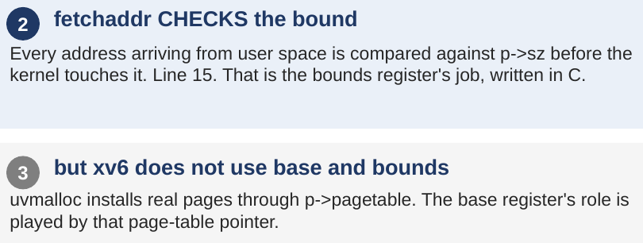{width=65%}
<figcaption markdown="1">Figure 97. Callouts 2 and 3: fetchaddr checks the bound, but xv6 does not use base and bounds. From slide 63.</figcaption>
</figure>

Read line 15 against the MMU of [Section 5.4](#sec-5-4). Below the bound, or refused. That is the bounds register's comparison, written as a line of C, and run on a system call rather than on every access.

One honest caveat, callout 3. xv6 does not implement base and bounds. `uvmalloc` installs real pages through the page table, and that page-table pointer plays the part our base register played. xv6 went straight to paging, like every modern kernel. Base and bounds is the ancestor; paging is the descendant that won, and you will understand it much faster because you understand this one.

### 6.3 <span class="lbl lbl-problem">Problem</span> Internal fragmentation: one slot stores the empty middle {#sec-6-3 data-toc-label="6.3 [Problem] Internal fragmentation: one slot stores the empty middle"}

What we have works: base and bounds scores well on transparency, efficiency and protection. But [Section 4.1](#sec-4-1) added a fourth goal, flexibility, and the design has not been graded on it yet. Grade it honestly, starting from one process's slot.

<figure markdown="1">
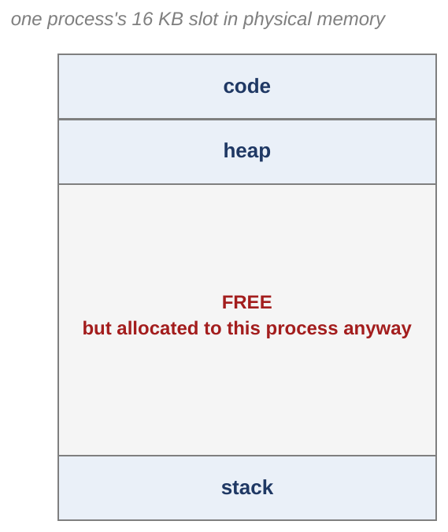{width=46%}
<figcaption markdown="1">Figure 98. One process's 16 KB slot in physical memory: code, heap, the free middle, and stack. From slide 64.</figcaption>
</figure>

Here is the 16 KB block one process occupies in the chips: code at the top, heap under it, stack at the bottom. And the red part in the middle is the problem. That space is free; the process is not using it. But it is inside the block, so it belongs to this process, and no other process can have it. Real chips, holding nothing. Waste inside an allocated unit has a name: **internal fragmentation**. "Internal" because it sits inside the block that was handed out. (Its sibling, external fragmentation, arrives in the next week, when the slots stop being the same size.)

<figure markdown="1">
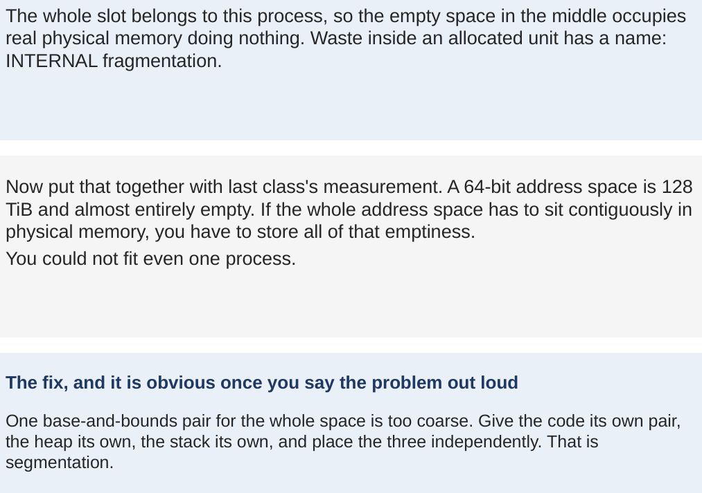{width=81%}
<figcaption markdown="1">Figure 99. What that waste means at real sizes, and the fix. From slide 64.</figcaption>
</figure>

Where it breaks is the grey card, which puts the waste together with the first class's measurement. A program's address space on the Ubuntu machine reaches up to 2^47 bytes, 128 TB: [Section 1.4](class-1.md#sec-1-4) found the stack just below that. Nearly all of it is empty, and the machine has only 7.8 GB, about 16,700 times less ([Extra 6](class-1.md#extra-6) draws the few islands in use). If the whole address space has to sit in one unbroken block of physical memory, the empty middle must be stored too, and 128 TB does not fit in 7.8 GB (the figure writes TiB, the careful spelling of TB). Not even one process fits. That is the flexibility the crux asked for, failed: a program cannot use its address space the way programs really do, as a few small islands spread over a huge range.

So what we need is in the last card, and it is obvious once the problem is said out loud. One base and bounds pair for the whole space is too coarse. Give the code its own pair, the heap its own, and the stack its own, and place the three independently in physical memory; then the emptiness between them costs nothing. That is called **segmentation**, and it is the next week. When we get there, the name "segmentation fault" will finally make complete sense.

**Checkpoint 3.** Settled: the OS keeps the list of free slots, loads the pair on every context switch, installs the handlers at boot, kills on a fault, and can move a process by changing one saved number. xv6 keeps its bound in `p->sz` and checks it in `fetchaddr`. Still open: one contiguous slot stores the empty gap between heap and stack, and with address spaces this sparse that is fatal. The next week cuts the address space into pieces placed independently. You should now be able to write the hardware column and the OS column for base and bounds from memory.

## <span class="lbl lbl-summary">Summary</span> Summary of the week: the address space, the memory API, and base and bounds {#summary-66 data-toc-label="[Summary] Summary of the week: the address space, the memory API, and base and bounds"}

The last slide of the week answers its six questions in order, three from each class, each with the problem it solved. Figure 100 is that slide, with the vocabulary list. Every word in the list should now have a picture behind it. If one does not, that is the section to reread.

<figure markdown="1">
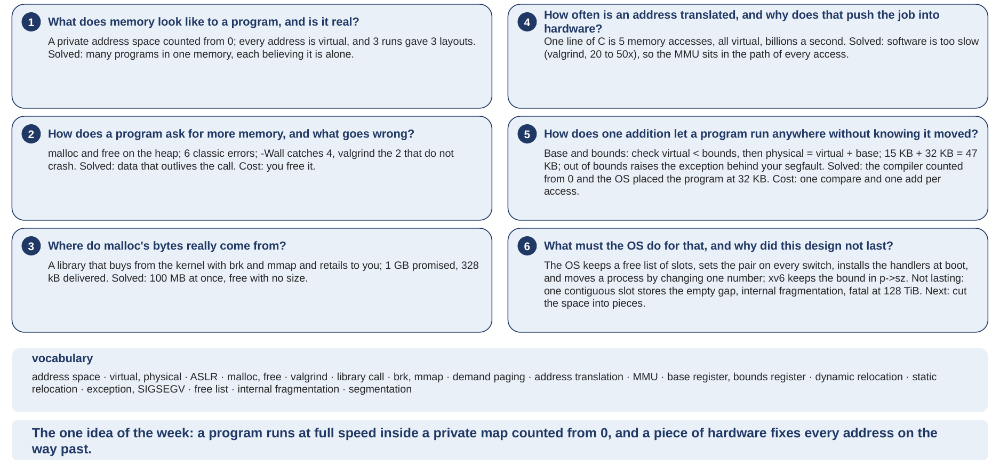{width=100%}
<figcaption markdown="1">Figure 100. The week on one slide: the six questions of the two classes, each answered with the problem it solved, the vocabulary, and the one idea. From slide 66.</figcaption>
</figure>

Question 1, what memory looks like to a running program, and whether that picture is real. A private address space counted from 0: code low, a heap growing one way, a stack growing the other. Every address is virtual, and three runs gave three layouts. Solved: many programs in one memory, each believing it is alone.

Question 2, how a program asks for more memory, and what goes wrong. `malloc` and `free` on the heap, with six classic errors between them; `-Wall` catches four and valgrind the two that `-Wall` misses. Solved: data that outlives the call. Cost: you free it.

Question 3, where `malloc`'s bytes really come from. A library that buys from the kernel with `brk` and `mmap` and retails to you; 1 GB promised, 328 kB delivered. Solved: 100 MB at once, and `free` with no size.

Question 4, how often an address is translated, and why that pushes the job into hardware. One line of C is five memory accesses, all virtual, billions a second. Solved: software is too slow (valgrind, 20 to 50 times), so the MMU sits in the path of every access.

Question 5, how one addition lets a program run anywhere without knowing it moved. Base and bounds: check virtual < bounds, then physical = virtual + base; 15 KB + 32 KB = 47 KB; out of bounds raises the exception behind your segmentation fault. Solved: the compiler counted from 0 and the OS placed the program at 32 KB. Cost: one compare and one add per access.

Question 6, what the OS must do for that, and why the design did not last. The OS keeps a free list of slots, sets the pair on every switch, installs the handlers at boot, and moves a process by changing one number; xv6 keeps the bound in `p->sz`. Not lasting: one contiguous slot stores the empty gap, internal fragmentation, fatal at 128 TB. Next: cut the address space into pieces.

The one idea of the week: a program runs at full speed inside a private map counted from 0, and a piece of hardware fixes every address on the way past.

## Going deeper, second class (optional) {#extras-2}

### Extra 13 <span class="lbl lbl-deeper">Deeper, Q1</span> Limited direct execution for memory, and interposition {#extra-13 data-toc-label="Extra 13 [Deeper, Q1] Limited direct execution for memory, and interposition"}

This part and the three after it are the deck's "deeper, if time allows" block for the second class, placed after the summary so the core chain reads without them. The first one is the old opening of the class. It is worth reading, because it states the strategy of the whole class before any mechanism, the same strategy the course already used for the CPU.

<figure markdown="1">
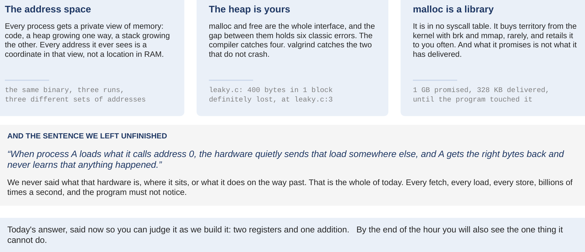{width=100%}
<figcaption markdown="1">Figure 101. The first class in three cards, each with the measurement that proved it, and the sentence left unfinished. From slide 67.</figcaption>
</figure>

The three cards restate the first class: the address space (the same program, three runs, three sets of addresses), the heap is yours (`leaky.c`, 400 bytes, definitely lost), and `malloc` is a library (1 GB promised, 328 kB delivered). Then the unfinished sentence: when A loads its address 0, the hardware sends the load somewhere else, and A never learns anything happened. Every fetch, every load and every store, billions of times a second, and the program must not notice. The bottom bar gives the answer in advance, so you can judge it as it is built: two registers and one addition. It first worked in the late 1950s, and it meets three goals completely; the one thing it cannot do is the next week's subject.

<figure markdown="1">
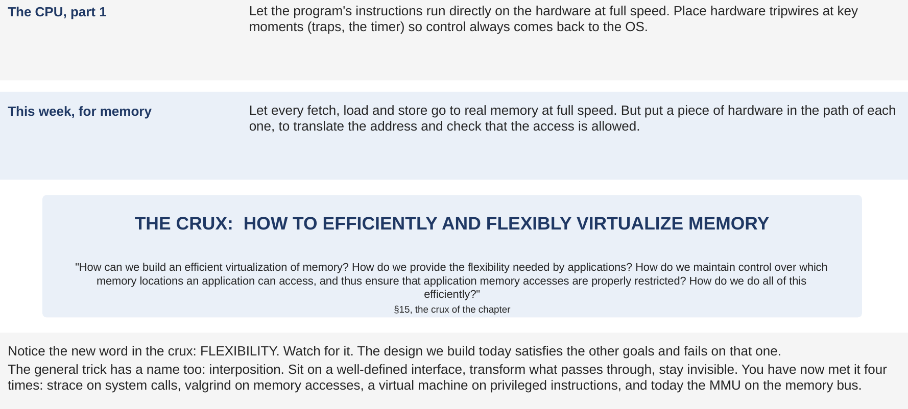{width=100%}
<figcaption markdown="1">Figure 102. Limited direct execution again, now for memory; the crux in full; and interposition. From slide 68.</figcaption>
</figure>

Recall the deal for the CPU, the top row of Figure 102. The program's instructions run directly on the hardware at full speed, because anything else is too slow. But hardware tripwires sit at the key moments, the traps and the timer, and they always bring control back to the OS. Memory signs the same contract. Every fetch, load and store goes to real memory at full speed, but a piece of hardware sits in the path of each one, translates the address and checks that the access is allowed.

The crux in the middle of Figure 102 is chapter 15's, in full, and one word in it was not in the first class's crux: flexibility ([Section 4.1](#sec-4-1)). The design of this class does well on transparency, efficiency and protection and fails on flexibility; [Section 6.3](#sec-6-3) showed how.

The general trick also has a name: **interposition**. It means sitting on a well-defined interface, transforming what passes through it, and staying invisible. You have met three examples already without the word, and this extra adds a fourth. strace interposes on system calls ([Section 3.3](class-1.md#sec-3-3)). valgrind interposes on memory accesses ([Section 2.5](class-1.md#sec-2-5)). A **virtual machine** (a program that pretends to be a whole computer, so another operating system can run inside it) interposes on privileged instructions. And in this class the MMU interposes on the path between the processor and memory.

Why not interpose on memory in software, as valgrind does? Frequency. A busy program makes system calls on the order of ten thousand times a second (a rough figure), so a trap for each is affordable. Memory accesses happen about as often as instructions, around a billion times a second ([Section 4.1](#sec-4-1)). An instruction typically does one useful thing, so adding even one extra instruction in front of every access roughly doubles the work and halves the speed (a rough estimate). valgrind, which does exactly this job in software, measures as 20 to 50 times slower.

### Extra 14 <span class="lbl lbl-deeper">Deeper, Q1</span> Load-store architectures: five accesses on RISC-V, three on x86-64 {#extra-14 data-toc-label="Extra 14 [Deeper, Q1] Load-store architectures: five accesses on RISC-V, three on x86-64"}

[Section 4.3](#sec-4-3) counted five accesses for `x = x + 3`, and the textbook counts the same five on its x86 listing. That agreement is less solid than it looks. The textbook's x86 code is a hand-written example, not compiler output, so the honest test is to compile the same line for both machines and count again.

<figure markdown="1">
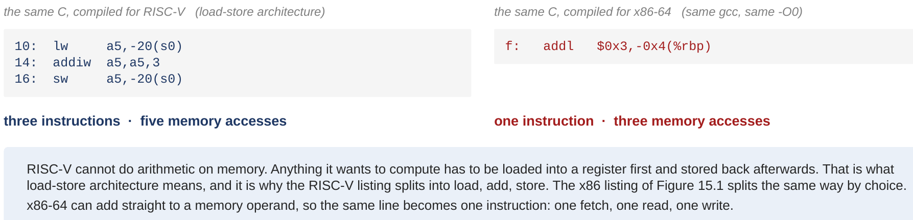{width=100%}
<figcaption markdown="1">Figure 103. The same C compiled for RISC-V (three instructions, five accesses) and for x86-64 (one instruction, three accesses), same gcc, same -O0. From slide 69.</figcaption>
</figure>

For RISC-V the count is exactly as before: load, add, store, three instructions, five accesses. For x86-64, with the same compiler and the same settings, the whole line is one instruction: `addl $0x3,-0x4(%rbp)`, add 3 directly to a memory location (`rbp` points at the stack frame, like `s0` on RISC-V). One fetch, one read of `x`, one write of `x`: three accesses instead of five.

The reason is a real difference between the two machines. RISC-V cannot do arithmetic on memory at all. A value must come into a register first and go back to memory afterwards. A processor built that way is called a **load-store architecture**, and that is why the RISC-V listing has three instructions. x86-64 can add straight to a value in memory, so it does. The textbook's x86 listing (Figure 79) splits the line into load, add and store by choice, to show the load and the store separately.

<figure markdown="1">
{width=100%}
<figcaption markdown="1">Figure 104. Where this shows up in practice: the count depends on the machine and the optimizer; the shape of the problem does not. From slide 69.</figcaption>
</figure>

One more honest point. The count also depends on the **optimizer**, the part of the compiler that rewrites a program to run faster (switched on with flags such as `-O2`). With it on, both compilers would keep `x` in a register, and this line would never touch memory. What stays the same on any machine at any setting is the shape of the problem: each fetch and each data access carries a virtual address out of the processor, and each one has to be translated. And for once the textbook and your lab agree exactly: the textbook's count of five describes a load-store machine, and the labs run on RISC-V, so you can check it yourself with `objdump`.

To reproduce the right half of Figure 103, compile the file of [Section 4.2](#sec-4-2) for the Ubuntu machine itself: `gcc -O0 -c addthree.c -o addthree.o` and `objdump -d addthree.o`. The line `f: 83 45 fc 03  addl $0x3,-0x4(%rbp)` is the one.

### Extra 15 <span class="lbl lbl-deeper">Deeper, Q2</span> Why the compiler's addresses are wrong on arrival: 1000 and 3000 {#extra-15 data-toc-label="Extra 15 [Deeper, Q2] Why the compiler's addresses are wrong on arrival: 1000 and 3000"}

[Section 5.2](#sec-5-2) showed the collision with the textbook's figure: virtual 128 landing inside the OS. It did not say why the compiler writes addresses that are bound to be wrong, which makes it sound like a careless compiler. It is not careless; it has no choice. The textbook tells the story a second time with rounder numbers, and Figure 105 is that telling, in the three columns of a problem slide.

<figure markdown="1">
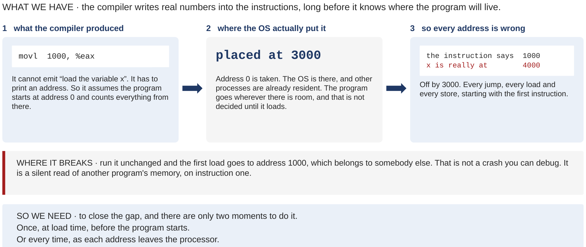{width=100%}
<figcaption markdown="1">Figure 105. What the compiler produced (movl 1000), where the OS actually put the program (3000), and so every address is wrong; where it breaks and what we need. From slide 70, following the textbook's aside on software-based relocation.</figcaption>
</figure>

What we have: when the compiler turns your C into instructions, it has to write down actual numbers. It cannot emit an instruction that says "load the variable x". It has to emit one that says "load from address 1000", a real number printed into the instruction at compile time. But the compiler has no idea where the program will end up. It is compiled once, on somebody's machine, and run tomorrow on a different one, next to whatever else happens to be running. So it does the only thing it can: it assumes the program starts at 0 and counts from there.

That assumption is wrong on arrival. Address 0 is taken by the OS, and by the time your program loads there may be three other processes in memory. So it goes wherever there is room; here, 3000. Now count what broke. The instruction still says 1000, because that number was printed into it long ago. But `x` is really at 1000 + 3000 = 4000. Every jump, every load and every store is off by 3000, starting with the first instruction.

Where it breaks: run the program unchanged and its first load reads address 1000, which belongs to somebody else. Not a crash you can debug, but a silent read of someone else's bytes on the very first instruction. So we need to close the gap, and only two moments exist for that: once, before the program starts (static relocation, [Section 5.3](#sec-5-3)), or on every access, as the address comes out of the processor (base and bounds, [Section 5.4](#sec-5-4)). Doing it once is cheap but permanent. Doing it every time costs a little per access and buys everything else.

### Extra 16 <span class="lbl lbl-deeper">Deeper, Q3</span> Dynamic relocation: moving a process by changing one number {#extra-16 data-toc-label="Extra 16 [Deeper, Q3] Dynamic relocation: moving a process by changing one number"}

[Section 6.1](#sec-6-1) said the OS owns the base register and saves it per process. That has a consequence the word "dynamic" promised but no section has shown yet: the OS can move a running program to a different place in physical memory, and the program never finds out. Static relocation could not do this, which was its second failure in [Section 5.3](#sec-5-3). Figure 106 is the procedure, in four steps.

<figure markdown="1">
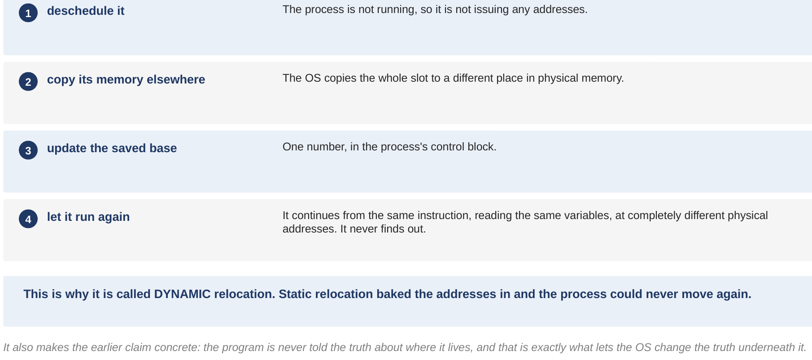{width=100%}
<figcaption markdown="1">Figure 106. Moving a process: deschedule it, copy its memory, update the saved base, let it run again. From slide 71, following textbook section 15.5.</figcaption>
</figure>

Take a process that is not running. It is **descheduled**, taken off the CPU, so it is not issuing any addresses at all. The OS copies its entire slot to another place in physical memory. Then it updates one number: the saved base in that process's struct. Then it lets the process run again. When the process resumes, the context switch loads the new base into the register; the process continues at the same instruction, with the same virtual addresses, and every one of them now lands in a different part of the chips. The process never finds out that it moved.

That is why this is called dynamic relocation: static relocation baked the addresses into the instructions, and the process could never move again. And it makes the first class's claim concrete. A program never learns where it really lives, which is exactly what lets the OS change that underneath it. Moving a process is how the OS squeezes memory together when free space breaks into pieces (a later week), and it is how a process can be written out to disk and come back somewhere else.
