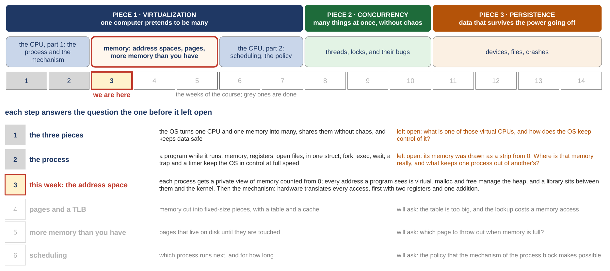
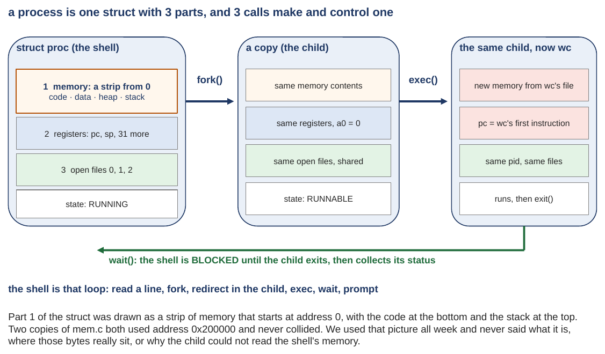
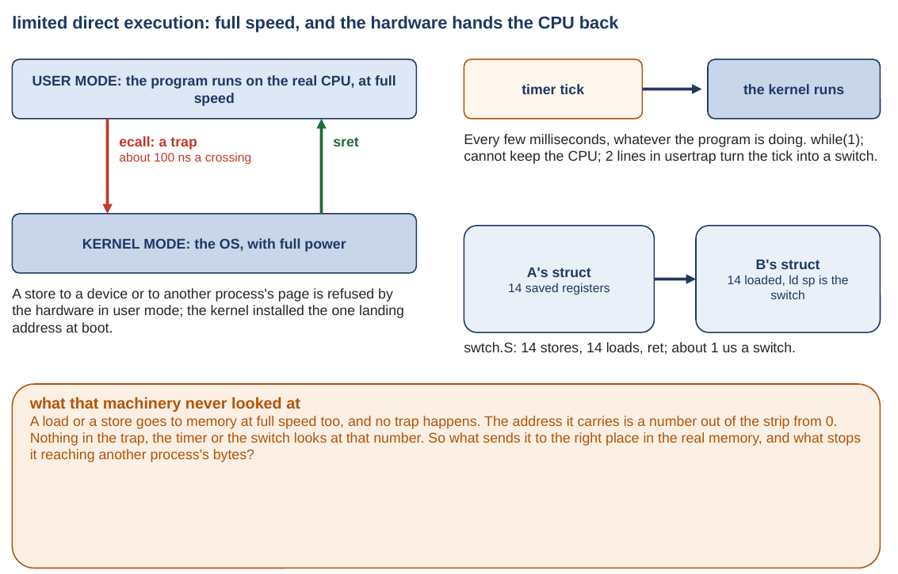
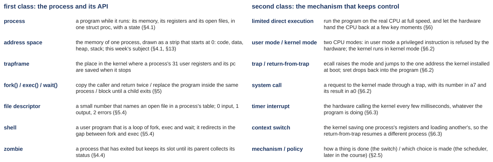

# Memory: the address space and the memory API

*Self-study guide · COMP3430 Operating Systems*

## Where this guide comes from {#source}

This guide comes from chapters 13, 14 and 15 of the textbook (OSTEP: *Operating Systems: Three Easy Pieces*) and from the xv6 source code you use in the labs. It follows the slides of the week in order, with the same pictures (this guide calls the set of slides the deck). The title's "API" (application programming interface) means the set of calls a program uses to ask for a service; for memory, that is `malloc` and `free`, the two calls a C program uses to ask for memory and give it back ([Section 2.1](class-1.md#sec-2-1) introduces them). It also comes from small programs that were run on a real machine: an Ubuntu 24.04 x86-64 machine in the cloud, with 8 GB of memory (8 gigabytes, about 8.6 billion bytes; [Appendix A](appendix.md#appendix-a) gives the exact sizes). (Ubuntu is a widely used version of Linux, the operating system on most servers; x86-64 is the family of processor in most laptops and servers. The second class also reads a few lines of xv6, the small teaching operating system of the labs, which runs on a different processor family called RISC-V.) Where a figure, a number or a line of code comes from one of those, the guide says so. You can look it up later if you want to go deeper.

## How to read this guide {#contents}

The label in brackets says what kind of section it is. A **Problem** section states what we have, where it breaks and what we need, before any fix. A **Concept** section explains the idea that answers it. A **Worked example** runs the idea on small numbers. A **Real kernel** section reads the xv6 code. A **Real machine** section reads an output captured on a real computer. **Check yourself** and **Your turn** are for you to do before reading on. **Extra** sections are optional and go deeper on a question already answered.

The navigation on the left lists every class and chapter of this week; the table of contents on the right lists the sections of the page you are on. Every section number in the text ("Section 3.5", "Extra 4") is a link.

## Part 0. Where we are in the course, and what the processes week taught {#part-0}

This part does two jobs before the new material starts. It shows where this week sits in the whole course, and it rebuilds the previous week, the processes week, with every word of it defined again. Everything later in this guide uses those words without stopping to define them, so if one of them is shaky, this is the place to fix it.

A few words first, so the map can be read. A **program** is a file of instructions, written by a person and turned into a form the machine can run. The **operating system** (the **OS**) is the program that runs the computer and shares it between all the other programs; its core is called the **kernel**, and this guide uses the two words interchangeably. A **process** is a program while it is running. The **CPU** (the processor) is the part of the computer that runs instructions, one after another; inside it are a few dozen **registers**, tiny storage cells that hold the numbers the CPU is working on right now. **Memory** (also called **RAM**, or the chips) is where a running program's instructions and data live; it is a long row of **bytes**, where a byte is the smallest unit of storage, eight binary digits, enough for one letter. An **address** is the position number of one byte in that row, counted from 0, the way a house number names one house on a street. A **disk** is the slower, larger storage where files live when the power is off, and a **file** is a named bundle of bytes kept on a disk. This week is almost entirely about addresses, so [Appendix A](appendix.md#appendix-a) at the end says how they are written and how to read one; you do not need it to start, and the text points to it where it helps.

#### The course map {#h-the-course-map}

<figure markdown="1">
{width=100%}
<figcaption markdown="1">Figure 1. The whole course on one page: the three pieces, the five blocks, the weeks with this one marked, and the question each step left open. From slide 2.</figcaption>
</figure>

An operating system has three big jobs, and the course takes them in order. The first is **virtualization**: one computer pretends to be many, so every program behaves as if it had its own processor and its own memory. The second is **concurrency**: many things happen at the same time without making a mess of each other. The third is **persistence**: data survives when the power goes off. They are the three colored bands at the top of Figure 1.

The second row of Figure 1 cuts the course into five blocks. Virtualization takes the first three. Block 1 is the processor from the process's point of view: the first two weeks. Block 2 is memory, outlined in red: this week and the two after it. Block 3 goes back to the processor to ask which program should run next. Block 4 is concurrency, and block 5 is files and devices. This week is the third of the course, the cell marked "we are here", and the first week of memory.

The lower half of Figure 1 is the reason the weeks come in this order: each step answered the question the one before it left open. The first step said what the three jobs are, and left open what one of those virtual processors is and how the OS keeps control of it. The second step, the processes week, built the process and the machinery that keeps the OS in control. It left open its own drawing: a process's memory was drawn as a strip of bytes that starts at address 0, and nobody said where that memory really is or what keeps one process out of another's. That is the red row, this week. The two rows after it say what this week will leave open in turn: a table that will be needed to find the pieces of memory will be too big, and pieces of memory (pages) will have to live on disk. (The map's row for that later week also names a TLB, a small fast memory inside the processor; nothing in this week needs it.)

#### The processes week, first class: one struct, three calls {#h-the-processes-week-first-class-one-struct-three-ca}

<figure markdown="1">
{width=90%}
<figcaption markdown="1">Figure 2. The first class of the processes week, drawn: the process as one record with three parts, and the three calls that make and control one. From slide 3.</figcaption>
</figure>

A running program can touch exactly three things, and the kernel keeps all three in one record, with a state. In the C language, which operating systems are written in, a record that bundles several named fields together is called a **struct**. xv6's record for a process is `struct proc` (read "struct proc"; the kernel keeps 64 of them in a row, one slot per process; 64 is `NPROC` in xv6's `kernel/param.h`, the most processes xv6 allows at once, a design choice). The three parts are on the left of Figure 2. Part 1 is the process's memory, drawn as a strip that begins at address 0. It holds the **code** (the instructions) and the **data** (the variables that exist for the whole run). It also holds the **heap** (memory the program asks for while it runs; this week says much more about it) and the **stack** (the memory of its function calls; a **function** is a named piece of a program that other parts can run). Part 2 is its registers. The **pc**, the program counter, holds the address of the next instruction to run. The **sp**, the stack pointer, holds the address of the top of the stack. The RISC-V processor of the labs has 32 general registers, numbered x0 to x31, and x0 always reads as zero, so 31 of them hold real values; the sp is one of those 31. The pc is a separate register, outside the 32. (Both are design facts of the processor.) So a process has 31 registers plus the pc worth saving, 32 values in all, and that is what xv6 saves when the process enters the kernel (the next drawing calls that entry a trap). Part 3 is its open files, numbered 0, 1 and 2 for input, output and errors. The **state** says whether the process is running right now, could run, or is waiting.

Three calls make and control a process, and they are the arrows in Figure 2. A **system call** is a request a program makes to the kernel; the next drawing says how it travels. **fork()** copies the calling process, memory included, and the copy is the **child**. The one call returns twice: once in the **parent** (the process that called it) with the child's number (every process has a number, its process id), and once in the child with 0 (the drawing writes that as `a0 = 0`; `a0` is the register that carries a call's result on RISC-V). **exec()** throws the process's memory away and loads a new program into the same process; in the drawing the child becomes `wc`, a word-counting program. **wait()** puts the parent to sleep until a child finishes, then collects how it ended. The **shell**, the program that reads what you type and runs it, is a loop of those three calls: read a line, fork, exec in the child, wait.

Settled by that class: what a process is made of, and the three calls. Left open: part 1 of the struct was only a drawing. Two copies of a small program, a demo from the first week of the course that the processes week recalled, both used the address 0x200000 and never collided. (That is a number written in hexadecimal, the base-16 notation [Appendix A](appendix.md#appendix-a) explains; for now it is just an address.) Nobody said why, or where those bytes really sit, or why the child could not read the shell's memory. That is this week.

#### The processes week, second class: two modes, a timer, and the switch {#h-the-processes-week-second-class-two-modes-a-timer-}

<figure markdown="1">
{width=91%}
<figcaption markdown="1">Figure 3. The second class of the processes week, drawn: the two CPU modes with the trap between them, the timer tick, and the context switch. From slide 4.</figcaption>
</figure>

The second class answered how the OS stays in control while a program runs at full speed. The answer has a name, **limited direct execution**: run the program on the real CPU, at full speed, and let the hardware hand the CPU back to the kernel at a few key moments. Three pieces of hardware do the handing back, and Figure 3 draws them.

The CPU has two **modes**. In **user mode**, where programs run, a dangerous instruction is refused by the hardware itself. In **kernel mode**, where the OS runs, everything is allowed. To get the kernel's help, a program performs a **trap**: on RISC-V the instruction is `ecall`, which raises the mode and jumps to the one address the kernel installed at boot; `sret` is the instruction that drops back into the program. (**Boot** is the moment the machine starts and the kernel sets itself up.) A system call is a trap with the request's number in a register. The processes week measured a crossing at about 100 nanoseconds on the Ubuntu machine (a nanosecond is a billionth of a second).

A program that never asks for anything is interrupted anyway: a hardware **timer** fires every few milliseconds on a typical Linux machine, an interval the kernel chooses (a millisecond is a thousandth of a second), whatever the program is doing, and the kernel runs. That is the **timer interrupt**, and it is why a program stuck in a loop cannot keep the CPU.

When the kernel decides to run a different process, it performs a **context switch**. The registers of the process that was running are saved into its struct, and the registers of the next process are loaded from its struct, so that the return from the trap lands in a different program. The processes week measured one switch at about 1 microsecond on the Ubuntu machine (a microsecond is a millionth of a second). So xv6 saves registers at two moments: at the trap it saves all 32 of the process's values into a part of the struct called the trapframe. At the switch it saves only the 14 registers its own kernel code needs to resume, into a part called the context, which is the "14 saved registers" of Figure 3.

Here is the loose end, in the yellow box at the bottom of Figure 3. A load or a store also runs at full speed, and no trap happens. (A **load** is an instruction that reads a value from memory; a **store** is one that writes a value to memory.) The address it carries is a number out of the strip from 0. Nothing in the trap, the timer or the switch ever looks at that number. So what sends it to the right place in the real memory, and what stops it from reaching another process's bytes? That is the second class of this week.

#### Last week's words, in one place {#h-last-week-s-words-in-one-place}

<figure markdown="1">
{width=100%}
<figcaption markdown="1">Figure 4. The processes week's words, each in one sentence, with the textbook section where each is defined. From slide 5.</figcaption>
</figure>

Figure 4 is the list from the slides. These are the words the rest of this guide builds on. One more from the right column: **mechanism** is how a thing is done (the switch), and **policy** is which choice is made (which process to run next, a question for later in the course). Some later parts repeat a definition as a reminder; the meaning never changes.

#### What the processes week settled, and what it left open {#h-what-the-processes-week-settled-and-what-it-left-o}

Settled: a process is a running program kept in one struct; fork, exec and wait make and control one; two modes, a trap, a timer and a switch keep the kernel in control at full speed. Left open: the memory part of the struct is a drawing. This week makes it real. The first class says what memory looks like to a program and whether that picture is true ([Chapter 1](class-1.md#chapter-1)), how a program asks for more of it and what goes wrong ([Chapter 2](class-1.md#chapter-2)), and where the bytes really come from ([Chapter 3](class-1.md#chapter-3)). The second class says what the hardware does to every address so that the picture can be true (Chapters 4 to 6).
