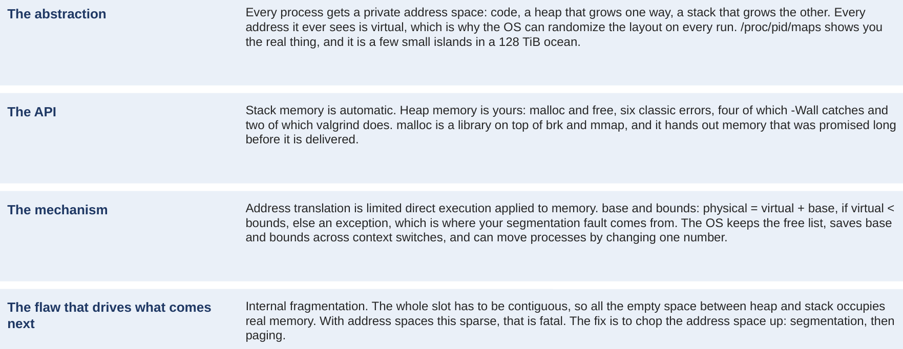
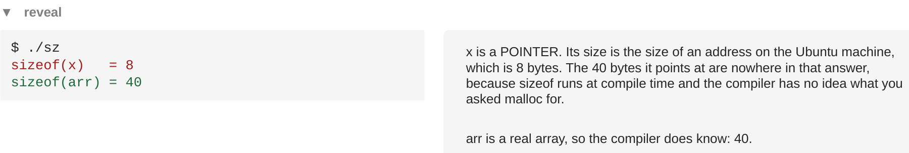
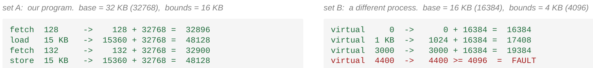
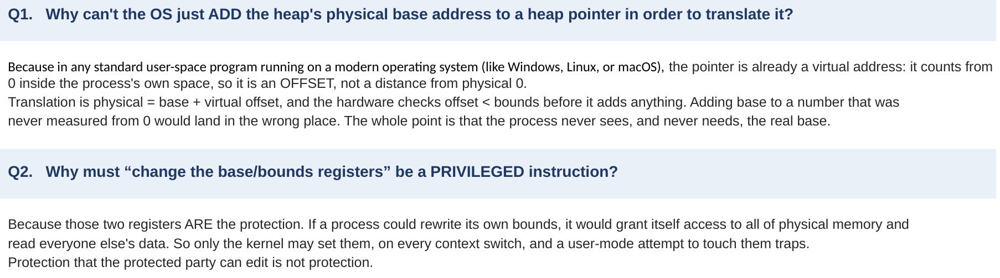

# Exercises and answers

## The week in seventeen sentences {#the-week}

Several programs have to share one memory, because swapping a whole memory to disk on every switch is far too slow, and sharing makes protection urgent. The OS answers with an abstraction, the address space: each process sees a private memory counted from 0, with code at one end and a heap and a stack growing toward each other. Every address a program can print is virtual, a name in that private map, which is why the same program shows different addresses on every run and the stack can sit just under 128 TB on an 8 GB machine. The kernel keeps the real map of every process in `/proc/PID/maps`, and it shows a few small islands in a 128 TB ocean, each with permission letters the hardware enforces on every access. Three goals grade every memory design: transparency, efficiency and protection, and a fourth, flexibility, arrives with chapter 15. Stack memory is automatic and dies when its function returns, so data that must outlive a call, or whose size is known only at run time, goes on the heap, through `malloc` and `free`. Six classic mistakes live between those two calls; `-Wall` reports four, and valgrind, which watches the running program, reports the two that `-Wall` misses, the off-by-one and the leak. `malloc` is not a system call but a library inside the process that buys address space from the kernel rarely, with `brk` and `mmap`, and retails it often. It keeps a small header in front of each block so `free` knows its size. The kernel's yes is a promise: a gigabyte can be promised while a third of a megabyte is delivered, and the rest arrives page by page as the program touches it. One line of C is five memory accesses, all of them virtual, billions a second, so translation must be done by hardware in the path of every access. Base and bounds is that hardware at its simplest: check that the virtual address is below the bounds register, then add the base register. A virtual address is a distance along the program's own ruler, so adding the base is walking two distances end to end, and an address past the end of the ruler raises the exception behind every segmentation fault. The OS owns the two numbers: it keeps a free list of slots, saves and restores the pair at every context switch, installs the handlers at boot, and can move a process by changing one saved number. Setting them is privileged, because they are the protection. xv6 keeps a process's bound in `p->sz` and checks it in `fetchaddr`, but translates through a page table, the descendant of base and bounds. One contiguous slot stores the empty middle of the address space, internal fragmentation, which is fatal for spaces this sparse, so the next step is to cut the address space into pieces placed independently.

The deck's last deeper slide says the same week in four lines, one for the abstraction, the interface, the mechanism and the flaw. It is Figure 107, and it is a good test: each line should now unfold into a paragraph you could write yourself.

<figure markdown="1">
{width=100%}
<figcaption markdown="1">Figure 107. The week in four lines: the abstraction, the API, the mechanism, and the flaw that drives what comes next. From slide 73.</figcaption>
</figure>

## Exercises {#exercises}

Do these with a pencil, and with the figures of the sections they name beside you. The answers follow, worked in full. Try each one before you look. Most exercises use only the core sections. Four also use optional extras, so read those first (about ten minutes each): Exercise 4 uses the valgrind messages of [Extra 11](class-1.md#extra-11), Exercise 5 uses [Extra 9](class-1.md#extra-9), Exercise 6 uses Extras [5](class-1.md#extra-5) and [7](class-1.md#extra-7), and Exercise 10 uses [Extra 16](class-2.md#extra-16).

**Exercise 1.** Before reading [Section 1.4](class-1.md#sec-1-4), the deck asked three questions about `va.c` (Figure 10). Answer them now, with reasons. Which of the three printed addresses (code, heap, stack) will be smallest and which largest? Will the stack address be a number that fits inside the machine's 8 GB of RAM? And how long will the call `malloc(100e6)` take?

**Exercise 2.** Here is a second run of the strace command of [Section 3.3](class-1.md#sec-3-3), on the same machine, filtered the same way:

```
brk(NULL)                               = 0x5648ad319000
brk(0x5648ad33a000)                     = 0x5648ad33a000
mmap(NULL, 100003840, PROT_READ|PROT_WRITE, MAP_PRIVATE|MAP_ANONYMOUS, -1, 0) = 0x7f1bd4aa1000
location of heap : 0x7f1bd4aa1010
```

By how many bytes, and how many KB, did the second `brk` grow the heap? How many bytes separate the region `mmap` returned from the pointer `malloc` handed to the program, and what is in them? Compare both answers with [Section 3.3](class-1.md#sec-3-3)'s run, and say what changed between the two runs and what did not.

**Exercise 3.** The program of [Section 3.4](class-1.md#sec-3-4) is changed to ask for 2 GB and then to touch only the first quarter of the block, one byte per 4096-byte page. Using the startup numbers of Figure 31 (2,700 kB promised, 1,432 kB delivered) and the 328 kB that the `malloc` call itself delivered, predict VmSize and VmRSS after the `malloc`, and after the touching. Assume the promise grows by the size asked plus 4 kB, as in Figure 31.

**Exercise 4.** For each fragment, say which of the six classic mistakes of [Chapter 2](class-1.md#chapter-2) it is, whether you expect it to crash, and which tool of [Chapter 2](class-1.md#chapter-2) would report it and with what kind of message. (`a[5]` is the integer at position 5, counting from 0. `%s` prints a string. `for` repeats its body 1000 times, counting `i` from 0 to 999; `i++` adds 1 to `i`.)

```c
/* (a) */  int *a = malloc(5 * sizeof(int));  a[5] = 1;  free(a);
/* (b) */  char *p = malloc(10);  strcpy(p, "hi");  free(p);  printf("%s\n", p);
/* (c) */  for (int i = 0; i < 1000; i++) { char *line = malloc(80); /* used, never freed */ }
```

**Exercise 5.** The question of [Extra 9](class-1.md#extra-9) (Figure 58): `x` points at 40 bytes from `malloc`, and `arr` is an array of 10 integers, also 40 bytes. What do the two lines print on the Ubuntu machine, and why are the two numbers different?

**Exercise 6.** A reading of a real capture. Use the map of `hold` in Figure 46 ([Extra 5](class-1.md#extra-5)) and four addresses: 0x555555556004, 0x7ffff7d00000, 0x555555570000, and 0x400000. For each, say which line it falls in, what the program may do with the bytes there (read, write, run), and what happens on a store to it.

**Exercise 7.** The deck's counting question (Figures 74 to 76): when the three instructions `lw a5,-20(s0)`, `addiw a5,a5,3`, `sw a5,-20(s0)` run, how many times does the processor go to memory? Pick one of A (2), B (3), C (5) or D (6), say what each wrong answer forgot or added, and say how many of the addresses are virtual.

**Exercise 8.** A different line of C, `z = x + y;` with all three variables on the stack, compiled for RISC-V without optimization, gives four instructions: `lw a5,-20(s0)`, `lw a4,-24(s0)`, `addw a5,a5,a4`, `sw a5,-28(s0)`. Count the memory accesses with the method of [Section 4.3](class-2.md#sec-4-3) and say which are fetches.

**Exercise 9.** The deck's translation drill (Figure 90). Set A, our program, base 32 KB, bounds 16 KB: fetch 128, load 15 KB, fetch 132, store 15 KB. Set B, a different process, base 16 KB, bounds 4 KB: virtual 0, 1 KB, 3000, 4400. Translate all eight in bytes, bounds first, and find the one that is not like the others.

**Exercise 10.** A third process has base 20 KB and bounds 8 KB. Translate virtual 0, 2 KB, 5000, 8191 and 8192, in bytes, bounds first. Then the OS moves the process to base 40 KB, as in [Extra 16](class-2.md#extra-16); translate virtual 5000 again.

**Exercise 11.** The two official discussion questions of the deck (slide 72). First: imagine an OS that knows where in physical memory a process's heap region begins, and tries to translate a heap pointer by adding that number to it. Why can't the OS just add the heap's physical base address to a heap pointer in order to translate it? Second: why must "change the base or bounds register" be a privileged instruction?

**Exercise 12.** In your own words, in about six sentences, explain three things to a friend who has not taken this course. First, why a program can print an address that is far larger than the computer's memory, and nothing is wrong. Second, what base and bounds does on every memory access, and why the program never notices. Third, why base and bounds was not the end of the story.

## Answers {#answers}

**Answer 1.** Smallest and largest: the code is lowest and the stack highest, with the heap between. The reason is the layout of Figure 13.3: code at the low end, where nothing needs room; the heap and the stack at opposite ends so they can grow toward each other. [Section 1.4](class-1.md#sec-1-4)'s run confirms it: 0x55c5... < 0x7f9e... < 0x7ffc.... (Compare first digits: 5 < 7; then for the two that start 0x7f, compare the next digits, 9 < f.) The stack address does not fit inside 8 GB. It has 12 hexadecimal digits and starts with 7, so it is just under 0x800000000000 = 2^47, about 1.4 × 10^14 bytes. 8 GB is 8 × 2^30, about 8.6 × 10^9 bytes. So the address is about 16,000 times larger than the whole memory. That is possible only because it is a virtual address, a name and not a place. The time: the call came back at once. `malloc` asked the kernel for a region with `mmap`, and the kernel only promised the memory; nothing was found or cleared until the program touched it (Sections [3.3](class-1.md#sec-3-3) and [3.4](class-1.md#sec-3-4)).

**Answer 2.** Heap growth: subtract the two `brk` addresses. They agree in every digit up to `5648ad3`, so subtract what follows: 0x3a000 − 0x19000 = 0x21000. In decimal, 0x21000 = 2 × 65,536 + 1 × 4096 = 131,072 + 4,096 = 135,168 bytes, and 135,168 / 1024 = 132 KB. Check: 132 × 1024 = 135,168. Header: 0x7f1bd4aa1010 − 0x7f1bd4aa1000 = 0x10 = 16 bytes, the allocator's header, where it records the block's size so that `free` can find it. Comparison: [Section 3.3](class-1.md#sec-3-3)'s run had different addresses everywhere (0x55c356dff000 and 0x7f547f4a1000), because of ASLR, but exactly the same two differences, 0x21000 and 0x10, and the same `mmap` size, 100,003,840. The addresses are names chosen at random on each run; the amounts are the allocator's own fixed behavior.

**Answer 3.** After the `malloc`: the promise grows by 2 GB plus 4 kB. 2 GB is 2 × 1024 × 1024 = 2,097,152 kB, so VmSize = 2,700 + 2,097,152 + 4 = 2,099,856 kB. Delivery grows by about the same 328 kB as before: VmRSS = 1,432 + 328 = 1,760 kB. After touching the first quarter: a quarter of 2 GB is 512 MB, which is 512 × 1024 = 524,288 kB, so VmRSS ≈ 1,760 + 524,288 = 526,048 kB; VmSize is unchanged at 2,099,856 kB. The method is [Section 3.4](class-1.md#sec-3-4)'s: the promise moves on the `malloc`, delivery moves on the touch, one page per page touched.

**Answer 4.** (a) Not allocating enough, a buffer overflow: the block holds positions 0 to 4, and `a[5]` writes the integer just past its end. It will probably not crash, which is what makes it dangerous (error 2 printed the right answer and exited 0). valgrind reports it as an "Invalid write of size 4", 0 bytes after a block of size 20 (5 × 4 = 20), with the line number of the write and of the `malloc`. (b) Use after free, a dangling pointer: `printf` reads the block after `free` gave it back. It may print "hi", garbage, or nothing harmful; it will probably not crash. valgrind reports an "Invalid read" inside a block that was freed, with three line numbers: where it was allocated, freed and read (as in Figure 62). (c) A memory leak: 1000 blocks of 80 bytes are allocated and never freed, 80,000 bytes in all. No crash, no output; the program just uses more memory. valgrind with `--leak-check=yes` reports 80,000 bytes in 1,000 blocks definitely lost, at the line of the `malloc` (as in Figure 24). As for `-Wall`: it does warn about (b), "pointer 'p' used after 'free'", the same kind of warning it gave error 5 in [Section 2.4](class-1.md#sec-2-4) (checked with gcc 13.3.0). The free and the use sit together in one place, where the compiler can see both. It says nothing about (a) or (c), which depend on sizes and lifetimes.

**Answer 5.** It prints 8 and 40. Figure 108 is the deck's reveal. `sizeof` is worked out by the compiler from what it knows about the name. `x` is a pointer, so `sizeof(x)` is the size of a pointer, which is the size of an address on the Ubuntu machine: 8 bytes, because, as [Section 1.4](class-1.md#sec-1-4) said, the Ubuntu machine keeps every address in 64 bits, which is 8 bytes, even though only 48 of those bits are used. The 40 bytes it points at appear nowhere, because the 10 passed to `malloc` is only known when the program runs. `arr` is an array the compiler declared, so it knows its size: 10 × 4 = 40. The practical rule: never use `sizeof` on a pointer from `malloc` to get the block's size; keep the length in a separate variable.

<figure markdown="1">
{width=100%}
<figcaption markdown="1">Figure 108. The deck's reveal for Exercise 5: sizeof(x) = 8 and sizeof(arr) = 40, and why. From slide 39.</figcaption>
</figure>

**Answer 6.** 0x555555556004 lies between 555555556000 and 555555558000, the third `./hold` line, `r--p`: the program's read-only data. It may be read, not written and not run; a store there is refused by the hardware, a segmentation fault, as with `perm1` in [Extra 7](class-1.md#extra-7). 0x7ffff7d00000 lies between 7ffff7c28000 and 7ffff7db0000, the `r-xp` line of `libc.so.6`: the C library's code. It may be read and run, not written; a store faults. 0x555555570000 lies between 555555559000 and 55555557a000, the `[heap]` line, `rw-p`: it may be read and written, not run; a store succeeds. 0x400000 is below the first line of the map, 555555554000, and inside no line at all. Nothing is mapped there, so any access, a load or a store, faults. (To place an address, compare it digit by digit from the left with each start and end, as in [Extra 5](class-1.md#extra-5).)

**Answer 7.** C, five. Figure 77 is the deck's answer. In order: fetch at 0x10 (read), the load of `x` (read), fetch at 0x14 (read), the addition (no memory, it happens in the register `a5`), fetch at 0x16 (read), the store of `x` (write). A counted the data only and forgot that each instruction must be fetched. B counted one access per instruction and forgot that `lw` and `sw` each go to memory a second time to do their work. D counted writing into `a5` as memory, but a register is inside the processor. All five addresses are virtual, the three fetches included.

**Answer 8.** Seven. Four instructions means four fetches. The two `lw` instructions each read memory once (x and y), the `addw` adds two registers and touches no memory, and the `sw` writes memory once (z). 4 + 2 + 1 = 7 accesses, four of them fetches, all seven virtual.

**Answer 9.** Write every number in bytes: 32 KB = 32,768, 16 KB = 16,384, 15 KB = 15,360, 4 KB = 4,096, 1 KB = 1,024. Set A: 128 < 16,384, so 128 + 32,768 = 32,896. 15,360 < 16,384, so 15,360 + 32,768 = 48,128. 132 + 32,768 = 32,900. The store of `x` goes to the same 48,128 as the load, because it is the same variable. Set B: 0 < 4,096, so 0 + 16,384 = 16,384. 1,024 + 16,384 = 17,408. 3,000 < 4,096, so 3,000 + 16,384 = 19,384. 4,400 is not below 4,096, so the check fails, no physical address is formed, and the hardware raises an exception: a fault. That is the odd one out. Figure 109 is the deck's answer slide. Two checks: the load and store of set A agree, and 19,384 comes out right only if KB means 1024 (with 1000 you would get 19,000).

<figure markdown="1">
{width=100%}
<figcaption markdown="1">Figure 109. The deck's answers to Exercise 9, written as sums: set A all inside its bound, set B ending in a fault at 4400. From slide 60.</figcaption>
</figure>

**Answer 10.** Base 20 KB = 20,480 and bounds 8 KB = 8,192. Virtual 0: 0 < 8,192, so 20,480. 2 KB = 2,048: 2,048 + 20,480 = 22,528. 5000: 5,000 + 20,480 = 25,480. 8191: 8,191 < 8,192, so it is the last legal byte: 8,191 + 20,480 = 28,671. 8192: not below 8,192, so a fault; an address equal to the bound is already one past the end. After the move, base 40 KB = 40,960: 5,000 + 40,960 = 45,960. The virtual address did not change; only the base did.

**Answer 11.** Figure 110 is the deck's slide with its answers. First: because the heap pointer is already a virtual address. It is a distance along the program's own ruler, counted from the start of the address space, not from physical 0. Translation adds one base, the address space's own, after checking the distance against the bound. Take the process of Figure 78, placed at base 32 KB. Under base and bounds the whole space moves as one block, so its heap, which starts at virtual 2 KB, starts physically at 32 KB + 2 KB = 34 KB. A heap pointer such as virtual 3 KB already counts from the start of the whole address space, not from the start of the heap. The right translation is 32 KB + 3 KB = 35 KB. Adding the heap's physical start instead gives 34 KB + 3 KB = 37 KB: the 2 KB from 0 to the heap is counted twice, and the access lands in the wrong place. And the process never sees, and never needs, any physical base. Second: because those two registers are the protection. A process that could rewrite its own bounds would give itself all of physical memory and read everyone else's data. So only the kernel may set them, at every context switch, and a user-mode attempt traps. Protection that the protected party can edit is not protection.

<figure markdown="1">
{width=100%}
<figcaption markdown="1">Figure 110. The deck's two official discussion questions, with their answers. From slide 72.</figcaption>
</figure>

**Answer 12.** A model answer. Every program gets its own private map of memory that starts at 0 and is far larger than the real memory. The addresses it prints are positions in that map, not in the chips, so a huge number is perfectly normal, and most of the map is simply never used. On every memory access the processor's MMU first checks that the address is smaller than the bounds register, the size of the program's space, and then adds the base register, where the program really sits in memory. The program was written as if it started at 0, and the addition happens in hardware after the address leaves the program, so the program never sees the real address and cannot tell where it was put. If the check fails, no memory is touched, and the OS is called and usually ends the program: that is a segmentation fault. The OS sets the two registers for each program, and only the OS may set them, which is what keeps programs apart. But one base and one bound per program means the whole map must sit in one unbroken block of real memory, empty middle included. With maps of 128 TB that are almost entirely empty, that wastes everything, so real systems cut the map into pieces placed separately: first segments, then pages.
