# First class: segments, and the holes they leave behind (OSTEP 16, 17) {#class-1}

## <span class="lbl lbl-roadmap">Roadmap</span> The question of the week, and the three questions of the first class {#opening-1 data-toc-label="[Roadmap] The question of the week, and the three questions of the first class"}

(Part 0 rebuilt last week in detail. This part is the short version the slides use just before the new material.)

Last week ended with one complaint about base and bounds. The whole address space moves as one block, so its empty middle takes real memory, and a 128 TiB address space cannot be loaded into a 7.8 GiB machine at all. The whole week is one story about that complaint, told in two halves. Behind both halves sits one question: how do you cut a process's memory into pieces without wasting memory and without slowing the machine down?

In the first class the pieces are few and big. They are called segments, and we find out what goes wrong with them. Then we go inside `malloc`, which has the same trouble on a small scale. In the second class the pieces are many, small and equal. They are called pages, and a small piece of hardware called the TLB keeps them from being too slow. (Both words are defined when they arrive, in Sections [1.2](#sec-1-2), [4.1](class-2.md#sec-4-1) and [6.2](class-2.md#sec-6-2).)

So the first class asks three questions, in this order, and each one is opened by the answer to the one before it. Figure 7 is the deck's own list.

<figure markdown="1">
{width=100%}
<figcaption markdown="1">Figure 7. The three questions of the first class. From slide 6.</figcaption>
</figure>

The first question is last week's complaint: how can the empty middle of an address space stop costing real memory ([Chapter 1](#chapter-1))? The answer is to cut the address space into a few big pieces and place each one on its own. The second question is the bill for that answer: what do pieces of different sizes cost, and what can an allocator do about it ([Chapter 2](#chapter-2))? (An **allocator** is any code whose job is to hand out pieces of memory and take them back; `malloc` is one.) Pieces of different sizes leave holes between them, and your heap has the same holes every time you call `malloc`. The third question takes us to two files in your xv6 tree: what does the allocator in your own tree keep, and when is none of it needed ([Chapter 3](#chapter-3))? One of the files is the `malloc` your lab programs use, with every trick of [Chapter 2](#chapter-2) in it. The other hands out pieces of one size and needs none of them. The first class summary collects the three answers, and Extras [1](#extra-1) to [12](#extra-12) go deeper on the same questions.

## Chapter 1. How can the empty middle of an address space stop costing real memory? {#chapter-1}

*The question this chapter answers: How can the empty middle of an address space stop costing real memory?*

### 1.1 <span class="lbl lbl-problem">Problem</span> Base and bounds carries the empty middle into memory {#sec-1-1 data-toc-label="1.1 [Problem] Base and bounds carries the empty middle into memory"}

Before any fix, the problem, stated the way the textbook states it and the way every problem in this guide is stated: what we have, where it breaks, and so what we need. What we have is base and bounds, and it is good. Every address the program issues is checked against the bound and moved by the base: one add and one compare, in hardware. It is transparent, fast and protected, last week's whole scorecard. Figure 8 is the deck's problem slide for this question, the three cards on its right.

<figure markdown="1">
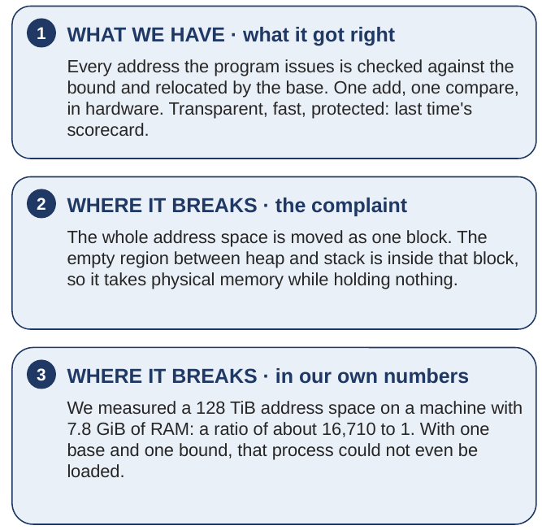{width=53%}
<figcaption markdown="1">Figure 8. What base and bounds got right, and two ways it breaks: the complaint, and the complaint in our own numbers. From slide 7.</figcaption>
</figure>

Where it breaks is the second card. The whole address space is moved as one block. The empty region between heap and stack is inside that block, so it takes physical memory while holding nothing, and no other process can use that memory either. Figure 9 draws it.

<figure markdown="1">
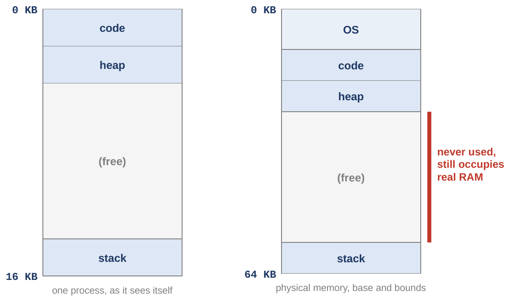{width=92%}
<figcaption markdown="1">Figure 9. Left: one process's 16 KB address space, as it sees itself. Right: the same space placed in a 64 KB physical memory by base and bounds; the red bar marks the free middle, never used and still occupying real RAM. From slide 7.</figcaption>
</figure>

On the left is the address space as the process sees it, the 16 KB drawing used all week: code, heap, a big free region, stack. On the right is physical memory with the OS at the bottom of the addresses (0 KB is at the top of the drawing). Base and bounds moves the whole strip, free region included, to wherever the base register says. So the free middle occupies physical memory too. The third card of Figure 8 says how bad that is at real sizes. The address space we measured last week was 128 TiB on a machine with 7.8 GiB of RAM, about 16,710 to 1 (Part 0 does the division). With one base and one bound, that process could not even be loaded.

So what we need is the bar at the bottom of the slide, Figure 10. The strip has three used pieces and one empty one. Move the three used pieces separately, and never move the empty one.

<figure markdown="1">
{width=100%}
<figcaption markdown="1">Figure 10. So we need: a way to move the process in pieces. From slide 7.</figcaption>
</figure>

The shape of the answer, before the answer: instead of one pair of registers for the whole address space, some way to describe each used piece on its own, so that each can be put anywhere in physical memory and the empty part is described by nothing at all.

### 1.2 <span class="lbl lbl-concept">Concept</span> Segmentation: one base and bounds pair per segment {#sec-1-2 data-toc-label="1.2 [Concept] Segmentation: one base and bounds pair per segment"}

The previous section ended with the shape of the answer: describe each used piece on its own. Chapter 16 of the textbook states the problem as its **crux**, its word for the one question a chapter is built around: how do we support a large address space with (potentially) a lot of free space between the stack and the heap? Figure 11 has the crux and the idea that answers it.

<figure markdown="1">
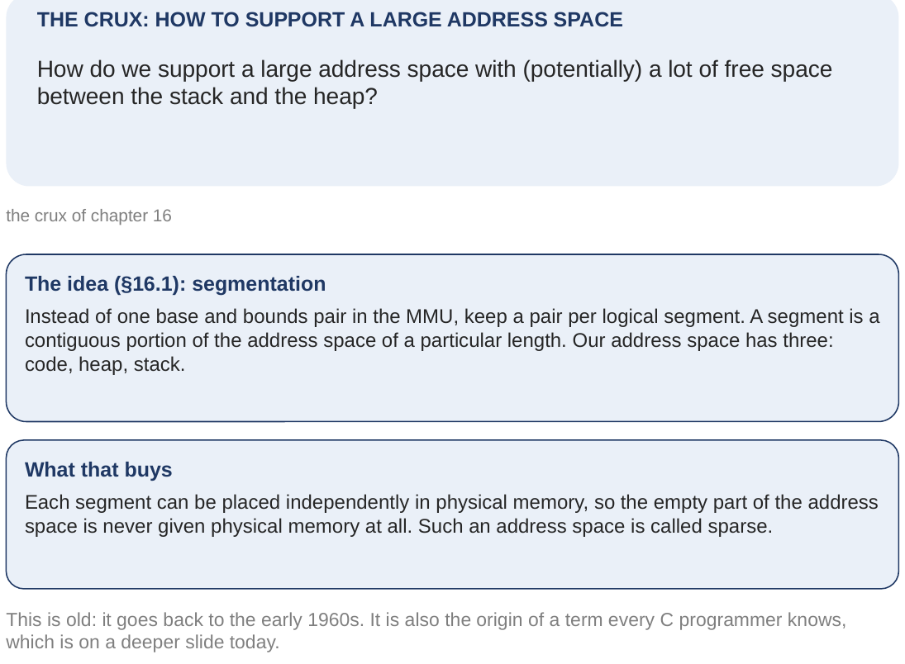{width=88%}
<figcaption markdown="1">Figure 11. The crux of chapter 16, the idea that answers it, and what that idea buys. From slide 8, following textbook section 16.1.</figcaption>
</figure>

The idea is called **segmentation**. Instead of one base and bounds pair in the MMU, keep one pair for each logical segment of the address space. A **segment** is a contiguous portion of the address space (one unbroken stretch of addresses) of a particular length. Our address space has three: the code, the heap and the stack. Each segment gets its own base, saying where that segment starts in physical memory, and its own bound, saying how long it is. So each used piece can be put anywhere in physical memory on its own, and the empty part between heap and stack is never given physical memory at all.

<figure markdown="1">
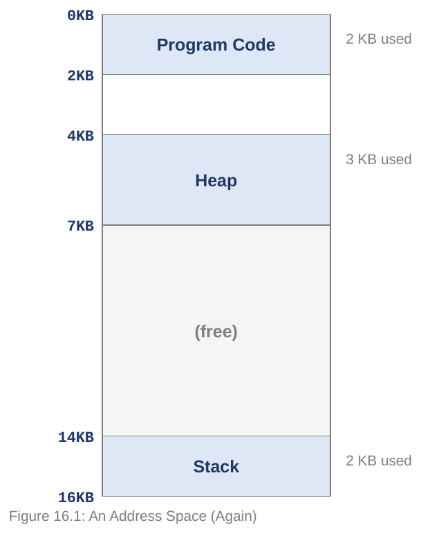{width=49%}
<figcaption markdown="1">Figure 12. The textbook's Figure 16.1: the 16 KB address space to scale, with how much of each segment is used. From slide 8.</figcaption>
</figure>

Figure 12 is the textbook's Figure 16.1, drawn to scale (KB is written without a space in the textbook's figures: 2KB means 2 KB). The code takes 0 to 2 KB, 2 KB used. The heap starts at 4 KB and uses 3 KB, up to 7 KB. The stack takes the last 2 KB, from 14 KB to 16 KB. From 7 KB to 14 KB nothing is there: 14 − 7 = 7 KB of the 16 KB is empty, plus the 2 KB gap between code and heap (4 − 2 = 2). With a pair per segment, the 7 KB hole never gets memory. An address space with big empty regions like this is called **sparse**, and segmentation is what makes a sparse address space cheap.

The last line of Figure 11 says the idea is old: it goes back to the early 1960s. It also gave C programmers a famous word, segmentation fault, which [Extra 2](#extra-2) explains. What segmentation still has to settle is the arithmetic: given an address, which pair does the hardware use, and what does it add the base to? The next section asks you to try it before it is explained.

### 1.3 <span class="lbl lbl-check">Your turn</span> Translating two addresses with the segment registers {#sec-1-3 data-toc-label="1.3 [Your turn] Translating two addresses with the segment registers"}

The idea of the previous section is now a table of three register pairs, and the question it leaves is the arithmetic. Last week one base and bound covered the whole process, and the rule was "physical = virtual + base". Try the obvious extension of that rule on two addresses before the next section explains the right one. Figure 13 is the deck's exercise.

<figure markdown="1">
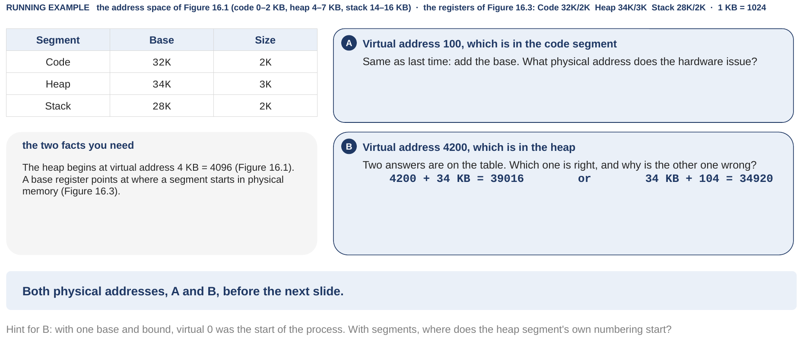{width=100%}
<figcaption markdown="1">Figure 13. Two addresses to translate with the register table of the textbook's Figure 16.3, and the two facts you need. From slide 9.</figcaption>
</figure>

The table on the left is the textbook's Figure 16.3. Code: base 32K, size 2K. Heap: base 34K, size 3K. Stack: base 28K, size 2K. (In this table K means KB, and 1 KB = 1024 bytes, so 32K is 32 × 1024 = 32,768 bytes.) The size is the old bounds register under a new name: how many bytes of that segment are valid.

Address A is virtual address 100, inside the code, which runs from 0 to 2 KB. Same as last week: add the code base. Address B is virtual address 4200, inside the heap, which runs from 4 KB to 7 KB. Two answers are printed on the slide: "4200 + 34 KB = 39016" adds the heap base to the whole address, and "34 KB + 104 = 34920" adds it to 104. Decide which is right, and be ready to say where the 104 comes from. The two facts you need are in the gray box: the heap begins at virtual address 4 KB = 4096, and a base register points at where a segment starts in physical memory. (For the code and the heap that is the segment's lowest physical address. The stack is the exception: it grows toward smaller addresses, so its base names its top end, 28K, and the stack occupies 26K to 28K; [Extra 3](#extra-3) explains.) And the hint at the bottom: with one base and bound, virtual 0 was the start of the process; with segments, where does the heap segment's own numbering start?

Write both physical addresses down before reading [Section 1.4](#sec-1-4). This is Exercise 1 at the end of the guide too.

### 1.4 <span class="lbl lbl-example">Worked example</span> The offset: subtract the segment's start, then add its base {#sec-1-4 data-toc-label="1.4 [Worked example] The offset: subtract the segment's start, then add its base"}

The previous section left two candidates for address 4200. The obvious rule from last week, "add the base to the address", gives 39016. The problem with it shows up as soon as the result is drawn. Figure 14 draws both addresses and both candidates.

<figure markdown="1">
{width=92%}
<figcaption markdown="1">Figure 14. Left: the 16 KB address space with addresses 100 and 4200. Right: physical memory from 24K to 40K, where the three segments landed. Navy: A. Green: B done right. Red dashed: B with the base added to the whole address, landing past the heap's end. From slide 10, following textbook section 16.1.</figcaption>
</figure>

First the numbers, because they hide in the K's. 1 KB is 1024 bytes, so the code base, 32K, is 32 × 1024 = 32,768, and the heap base, 34K, is 34 × 1024 = 34,816. The heap's size, 3K, is 3 × 1024 = 3,072 bytes, so the heap's last physical byte is just before 34,816 + 3,072 = 37,888.

Address A, 100, is in the code, and the code starts at virtual address 0. So the distance from the start of the code is 100 − 0 = 100. That is under the code's size, 2K = 2,048, so it is in bounds. Add the code base: 32,768 + 100 = 32,868, inside the code segment (navy arrow). Both rules agree here, because this segment starts at 0.

Address B, 4200, is in the heap, and the heap starts at virtual address 4096. So the distance from the start of the heap is 4200 − 4096 = 104 (the green bracket on the left strip). That is under 3,072, in bounds. Add the heap base: 34,816 + 104 = 34,920 (green arrow), 104 bytes into the physical heap.

Now the trap. Add the base to the whole address and you get 34,816 + 4,200 = 39,016. The red dashed arrow lands at 39,016, which is 39,016 − 37,888 = 1,128 bytes past the heap's end, in memory that belongs to nobody (or to somebody else). That is why the subtraction comes first.

The distance of an address from the start of its segment has a name: the **offset**. Figure 15 says why last week never needed the word.

<figure markdown="1">
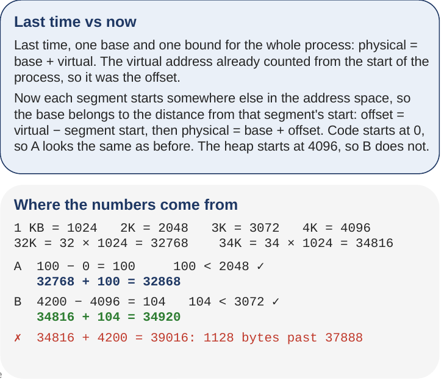{width=58%}
<figcaption markdown="1">Figure 15. Last week's rule against this week's, and where every number on the slide comes from. From slide 10.</figcaption>
</figure>

Last week one base and one bound covered the whole process, and virtual addresses counted from the start of the process. So the virtual address already was the offset, and "physical = base + virtual" was right. Now each segment starts somewhere else in the address space. The code starts at 0, so for address A the offset equals the address and nothing looks different. The heap starts at 4096, so for address B it does not. Check both results a second way, by the rule card under the numbers: 32,868 − 32,768 = 100, the offset of A; 34,920 − 34,816 = 104, the offset of B.

<figure markdown="1">
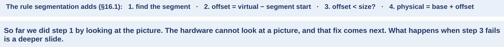{width=100%}
<figcaption markdown="1">Figure 16. The rule segmentation adds, in four steps, and the step still done by eye. From slide 10.</figcaption>
</figure>

Figure 16 is the rule in four steps. First, find the segment. Second, offset = virtual address − segment start. Third, check offset < size. Fourth, physical address = base + offset. (The textbook draws one more detail in its Figure 16.2: where the three segments sit in a 64 KB physical memory; [Extra 1](#extra-1) shows it. And the right strip of Figure 14 puts the stack at 26 KB to 28 KB, because the stack's base, 28K, is the top of its segment: the stack grows toward smaller addresses, which [Extra 3](#extra-3) explains.)

What this section leaves open is the first step. We found the segment by looking at the picture. The hardware cannot look at a picture, and the next section gives it a rule.

### 1.5 <span class="lbl lbl-concept">Concept</span> Which segment: the top two bits of the address {#sec-1-5 data-toc-label="1.5 [Concept] Which segment: the top two bits of the address"}

The rule of the previous section has four steps, and the first one, "find the segment", was done by eye. The hardware needs a rule it can apply to the address alone, billions of times a second, with no picture. The usual rule is to put the segment number inside the address itself. Figure 17 writes address 4200 in bits.

<figure markdown="1">
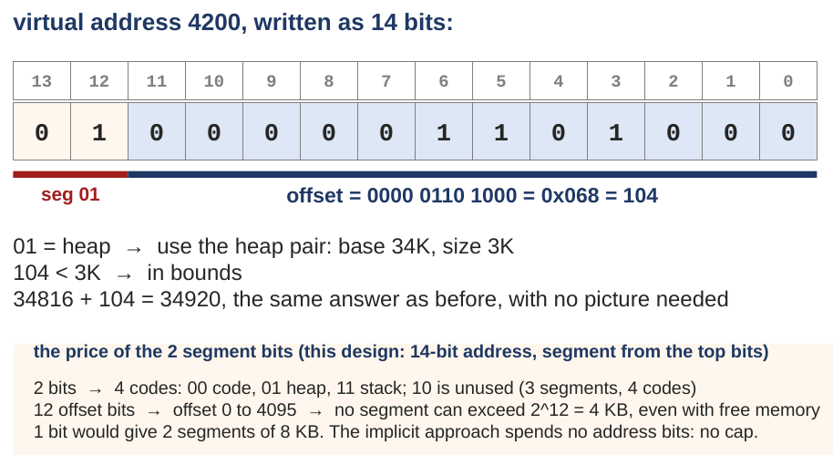{width=73%}
<figcaption markdown="1">Figure 17. Virtual address 4200 written as 14 bits: the top 2 bits name the segment, the bottom 12 are the offset; and the price of spending 2 bits this way. From slide 11, following textbook section 16.2.</figcaption>
</figure>

This needs binary: a number written with the digits 0 and 1 only, where each position is worth twice the one to its right (1, 2, 4, 8, and so on, reading from the right). A single 0 or 1 is a **bit**, and bits are numbered from the right starting at 0, so bit 0 is worth 1 and bit 12 is worth 2^12 = 4096. [Appendix A](appendix.md#appendix-a) teaches binary from the beginning, with examples.

The address space is 16 KB, which is 16 × 1024 = 16,384 = 2^14 bytes, so an address needs 14 bits, numbered 13 down to 0. Address 4200 is 4096 + 104, and 104 is 64 + 32 + 8. So bit 12 is 1 (worth 4096), and bits 6, 5 and 3 are 1 (worth 64, 32 and 8); every other bit is 0. That is the row of boxes in Figure 17: 01 0000 0110 1000. The top 2 bits, 13 and 12, are 01. The bottom 12 bits are 0000 0110 1000, which is 64 + 32 + 8 = 104, the offset of [Section 1.4](#sec-1-4). The figure also writes the offset as 0x068, which is the same number in **hexadecimal**: base 16, written with `0x` in front, where each hex digit stands for exactly four bits (0110 is 6 and 1000 is 8, so 0110 1000 is 0x68, and 6 × 16 + 8 = 104; [Appendix A](appendix.md#appendix-a) explains hex).

So the address carries its segment number in its top 2 bits. In this design 00 means code, 01 means heap and 11 means stack. 01 means heap, so the hardware takes the heap pair: base 34K, size 3K. 104 is below 3K, in bounds. 34,816 + 104 = 34,920, the answer of [Section 1.4](#sec-1-4), with no picture needed. The textbook calls this the **explicit approach**: the address itself says which segment it belongs to.

How does hardware "take the top 2 bits"? With two operations on bits, which Figure 18 uses.

<figure markdown="1">
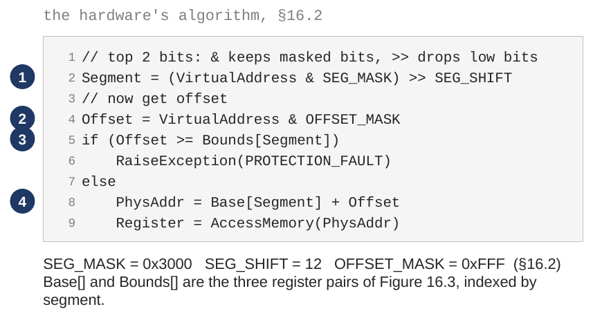{width=69%}
<figcaption markdown="1">Figure 18. The hardware's algorithm of textbook section 16.2, nine lines, with its three constants. From slide 11.</figcaption>
</figure>

| written | name | what it does | example on 14 bits |
|---|---|---|---|
| `x & m` | and, with a mask | keeps only the bits where the mask `m` has a 1; every other bit becomes 0 | 01 0000 0110 1000 & 11 0000 0000 0000 = 01 0000 0000 0000 |
| `x >> n` | shift right | drops the lowest n bits; the rest slide down n places | 01 0000 0000 0000 >> 12 = 00 0000 0000 0001 (the bits keep their 14-bit width; the value is 1) |

A **mask** is a pattern of 1 bits placed exactly where the wanted bits are. A **shift** slides bits down so they read as a small number. Figure 18 is **pseudocode**: code written to be read by people, not run by a machine. A few marks in it need glossing. A line starting with `//` is a comment, a note the machine ignores. `=` stores the value on its right under the name on its left. `if (...)` tests a condition; `>=` means "is greater than or equal to"; the line under `else` runs when the test is false. `Base[Segment]` means "the entry of the list `Base` at position `Segment`": `Base` and `Bounds` are the three register pairs of Figure 16.3, numbered by segment. `AccessMemory(PhysAddr)` reads memory at that address, and `Register` is the processor register that receives the value. `RaiseException(PROTECTION_FAULT)` is the trap of Part 0, with a name for the reason. (The textbook's pseudocode calls this failed bounds check a protection fault; the program experiences it as the segmentation fault of [Extra 2](#extra-2). Both are labels for the same trap. In [Chapter 6](class-2.md#chapter-6) the book's pseudocode for pages uses two names for two different reasons: no page at all, and a page that forbids this kind of access.)

The three constants are design facts of this example, given at the bottom of the figure. `SEG_MASK` = 0x3000: in binary 0011 0000 0000 0000, that is, 1s in bits 13 and 12 only (3 is 0011 in the top hex digit, which covers bits 15 to 12). `SEG_SHIFT` = 12, the number of offset bits below the segment bits. `OFFSET_MASK` = 0xFFF: three hex digits of F, each F being 1111, so twelve 1s, bits 11 to 0.

Now the nine lines, in order. Line 2 masks out the top 2 bits and shifts them down: (4200 & 0x3000) >> 12 = 01 = 1, segment 1, the heap. Line 4 masks out the offset: 4200 & 0xFFF = 0000 0110 1000 = 104. Line 5 compares the offset with that segment's bound, 3K; it is smaller, so line 6 does not run. Line 8 adds that segment's base: 34,816 + 104 = 34,920. Line 9 reads memory there. The four steps of the rule are now four lines of hardware: mask, mask, compare, add. None of them is slow. Notice what happened to the subtraction of [Section 1.4](#sec-1-4). The heap starts at 4096, which in 14 bits is 01 followed by twelve 0s: the heap's segment number with every offset bit 0. So subtracting the heap's start from a heap address only clears the top two bits, and that is exactly what the offset mask does. "Offset = address − segment start" is still what the offset means, and [Section 1.4](#sec-1-4)'s picture is still the right way to think about it; but in this design the hardware gets the offset from the low bits and never subtracts. (The stack, which grows the other way, is the one exception; [Extra 3](#extra-3) shows the one real subtraction it needs.) So the rule, as the hardware runs it: the top bits pick the segment, the low bits are the offset, compare the offset with the size, add the base.

The yellow card of Figure 17 is the price of the 2 segment bits. Two bits give 2^2 = 4 codes for 3 segments, so code 10 is wasted: a quarter of the address space can never be used. And 14 − 2 = 12 bits remain for the offset, so an offset runs from 0 to 2^12 − 1 = 4095, and no segment can be bigger than 2^12 = 4096 bytes = 4 KB, however much memory is free. With 1 segment bit instead of 2 there would be 2 segments of 2^13 = 8 KB each (some systems put code and heap in one segment to do this).

<figure markdown="1">
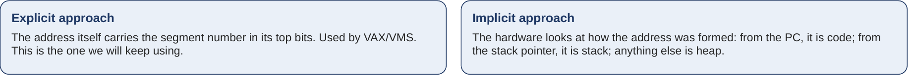{width=100%}
<figcaption markdown="1">Figure 19. The two ways to choose the segment. From slide 11, following textbook section 16.2.</figcaption>
</figure>

Figure 19 names the alternative. In the **implicit approach** the hardware looks at how the address was formed. If it came from the **program counter** (the PC, the register that holds the address of the next instruction), the access is an instruction fetch, so it is code. If it came from the **stack pointer** (the register that holds the address of the top of the stack), it is stack. Anything else is heap. That approach spends no address bits, so it has no 4 KB cap. The explicit approach is the one the textbook, and this guide, keeps using. VAX/VMS, an operating system of the late 1970s, used it.

That answers the first question of the class. Figure 20 is the checkpoint.

<figure markdown="1">
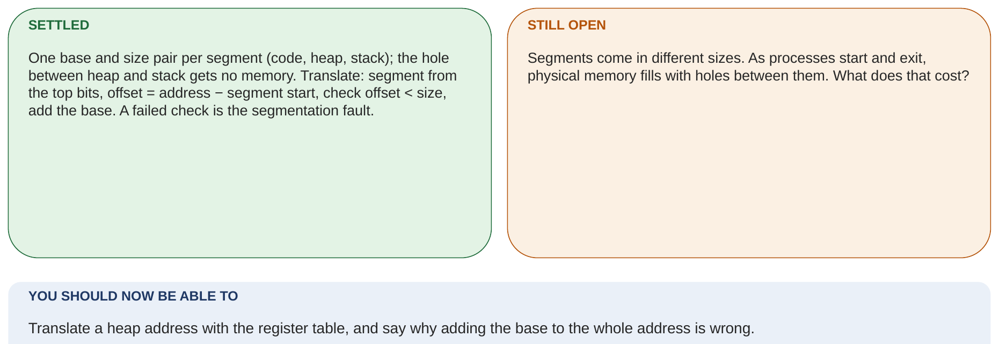{width=100%}
<figcaption markdown="1">Figure 20. Checkpoint 1: what the first question settled, what it left open, and what you should now be able to do. From slide 12.</figcaption>
</figure>

Settled: one base and size pair per segment (code, heap, stack), and the hole between heap and stack gets no memory. Translate by taking the segment from the top bits and the offset from the low bits (the offset is address − segment start, but in this design a mask computes it), checking offset < size, and adding the base. A failed check is the segmentation fault ([Extra 2](#extra-2) shows one). Still open: segments come in different sizes. As processes start and exit, physical memory fills with holes between them. What does that cost? You should now be able to translate a heap address with the register table, and say why adding the base to the whole address is wrong.

## Chapter 2. What do pieces of different sizes cost, and what can an allocator do about it? {#chapter-2}

*The question this chapter answers: What do pieces of different sizes cost, and what can an allocator do about it?*

### 2.1 <span class="lbl lbl-problem">Problem</span> External fragmentation: holes between segments {#sec-2-1 data-toc-label="2.1 [Problem] External fragmentation: holes between segments"}

What we have is segmentation working: a pair of registers per segment, and the empty middle of every address space costs nothing. Segmentation also gives the OS three new jobs, and the top row of the deck's problem slide, Figure 21, lists them.

<figure markdown="1">
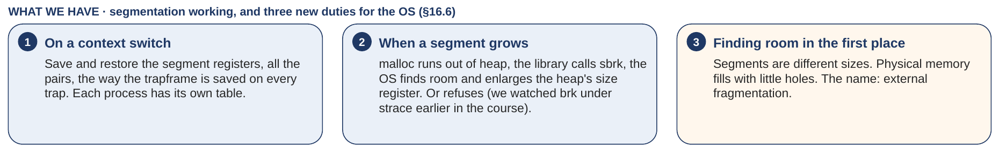{width=100%}
<figcaption markdown="1">Figure 21. What we have: segmentation working, and three new duties for the OS. From slide 13, following textbook section 16.6.</figcaption>
</figure>

First, on a context switch: the segment registers belong to one process, so all the pairs must be saved and restored when the OS switches processes, the way a process's other registers are saved on every trap. Second, when a segment grows: when `malloc` runs out of heap, the library calls `sbrk`, and the OS finds room and enlarges the heap's size register, or refuses. Third, and this is the real bill: finding room in physical memory in the first place.

Here is where it breaks. Segments are of different sizes, and as processes start and exit, physical memory fills with little holes of free space between the segments still in use. Figure 22 is the textbook's example.

<figure markdown="1">
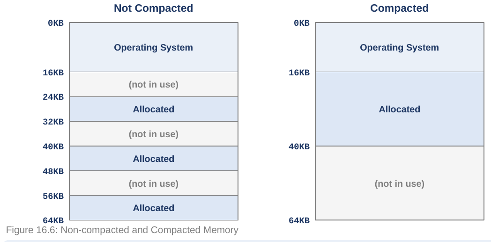{width=84%}
<figcaption markdown="1">Figure 22. The textbook's Figure 16.6: a 64 KB physical memory, not compacted (left) and compacted (right). From slide 13.</figcaption>
</figure>

On the left, the OS takes the first 16 KB, and the rest is three allocated segments of 8 KB with three free holes of 8 KB between them: 16 to 24 KB, 32 to 40 KB and 48 to 56 KB. That is 3 × 8 = 24 KB free. Now a process asks for a 20 KB segment. The card of Figure 23 spells out what happens.

<figure markdown="1">
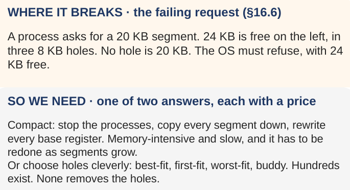{width=55%}
<figcaption markdown="1">Figure 23. Where it breaks: the failing request; and so what we need: one of two answers, each with a price. From slide 13.</figcaption>
</figure>

24 KB is free, but no single hole is 20 KB, and a segment must be one unbroken stretch of physical memory, because the hardware adds one base to every offset. So the OS must refuse, with 24 KB free. This has a name. **External fragmentation** is free space chopped into pieces of different sizes, so that a request fails even though the total free space would be enough. "External" means the waste is outside the pieces handed out, in the holes between them. (Internal fragmentation, from Part 0, was the opposite: waste inside a piece.)

So what we need is one of two answers, and each has a price. The first is **compaction**: stop the running processes, copy every segment down so that they sit next to each other, and rewrite every base register to the new place. The right side of Figure 22 is the result: one free region of 24 KB at the end, and the 20 KB request now fits. But copying segments takes a lot of memory traffic and processor time, nothing runs meanwhile, and the next segment that grows may force it all again. The second answer is to choose holes cleverly: rules with names like best-fit, first-fit, worst-fit and buddy (Extras [9](#extra-9) and [10](#extra-10) explain them). Hundreds of such rules exist. None of them removes the holes; a good one only keeps them small.

<figure markdown="1">
{width=100%}
<figcaption markdown="1">Figure 24. The sentence that connects the two halves of the class. From slide 13.</figcaption>
</figure>

The bar at the bottom of the slide, Figure 24, is the point of this section. Holes are not a segmentation problem. They appear whenever pieces of different sizes are handed out and given back. And you have used such an allocator in almost every C program you wrote: `malloc`. So the class leaves segments here, with one unsolved problem, and goes inside `malloc`, where the same problem lives.

### 2.2 <span class="lbl lbl-problem">Problem</span> The same holes inside one heap: the free-space problem {#sec-2-2 data-toc-label="2.2 [Problem] The same holes inside one heap: the free-space problem"}

The previous section ended on a claim: holes are not a segmentation problem but a fact about pieces of different sizes, and `malloc` lives with the same fact inside your heap. This section checks the claim at the scale of one heap. The textbook makes this a chapter of its own, chapter 17, "Free-space management", with a short promise: the heap between `malloc` and `free` is a strip of bytes with holes in it, somebody has to keep track of the holes, hand pieces out and take pieces back, using only the strip itself, and this is how. Its tricks (splitting, coalescing, headers, a list kept inside the free space) are the same tricks a kernel uses for physical memory. Figure 25 is the whole problem in a picture 30 bytes wide.

<figure markdown="1">
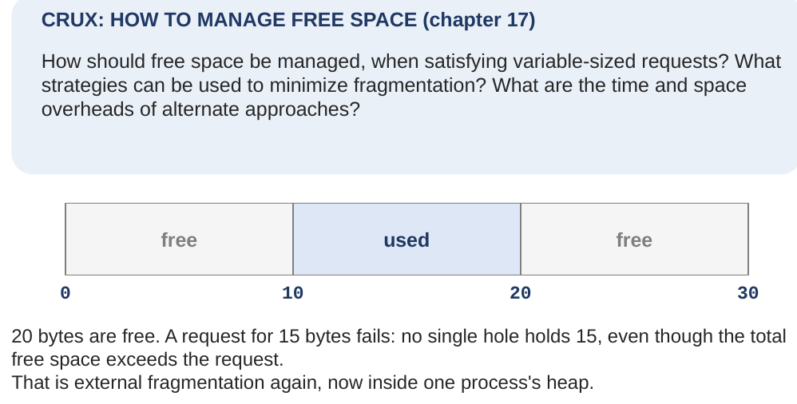{width=80%}
<figcaption markdown="1">Figure 25. The crux of chapter 17, and a 30-byte heap where 20 bytes are free and a request for 15 still fails. From slide 15, following the textbook's chapter 17 introduction.</figcaption>
</figure>

The heap is 30 bytes. Bytes 0 to 10 are free (the drawing's labels are the boundaries, so "0 to 10" means the ten bytes 0 through 9), bytes 10 to 20 are in use, and bytes 20 to 30 are free. So 10 + 10 = 20 bytes are free. A request for 15 bytes fails: neither hole holds 15, even though the total free space, 20, is more than 15. That is the 20 KB segment of [Section 2.1](#sec-2-1) again, inside one process. The chapter's crux, at the top of the figure, asks the three questions the rest of this class answers: how should free space be managed when requests come in different sizes, what strategies keep fragmentation small, and what do those strategies cost in time and space?

Some words for the rest of the class. A **chunk** is one piece of the heap, either handed out or free. An allocator **allocates** a chunk when it hands it to the program, and the program **frees** it when it gives it back. Figure 26 then fixes two words and the rules of the game.

<figure markdown="1">
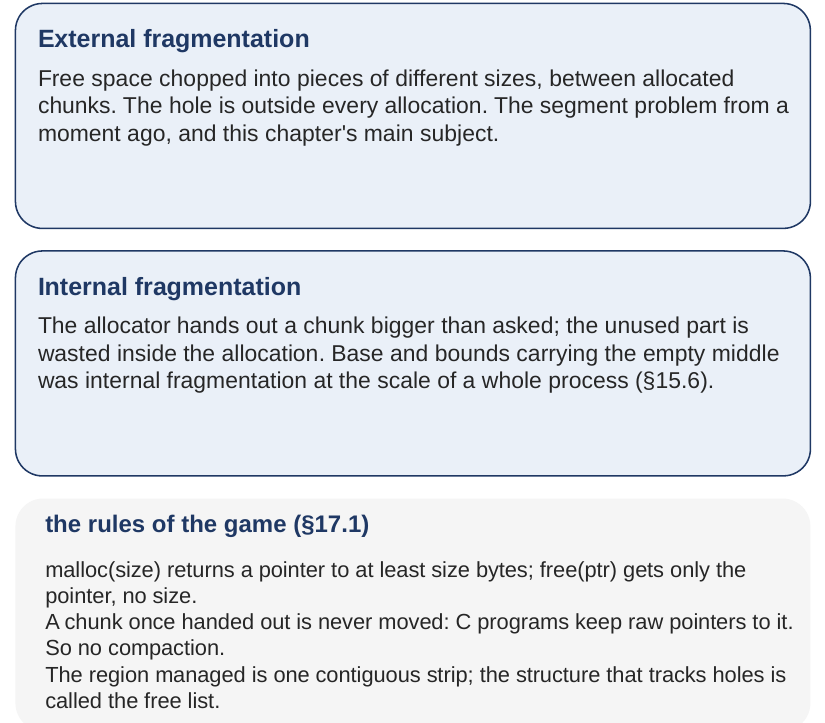{width=66%}
<figcaption markdown="1">Figure 26. External and internal fragmentation, and the rules of the game of textbook section 17.1. From slide 15.</figcaption>
</figure>

**External fragmentation**, the first card, is the strip: free space in pieces between the allocated chunks. The hole is outside every allocation. **Internal fragmentation**, the second card, is extra space inside a chunk: the allocator handed out more than was asked for, and the unused part is wasted inside the allocation. Base and bounds carrying the empty middle was internal fragmentation the size of a whole process. The two words to keep apart all week: external, holes between chunks; internal, waste inside a chunk.

The third card is the rules. `malloc(size)` returns a pointer to at least `size` bytes. `free(ptr)` gets only the pointer, no size; hold on to that, because the end of [Section 2.3](#sec-2-3) has to solve it (and [Chapter 3](#chapter-3) shows the real code). A chunk once handed out is never moved, because a C program keeps raw pointers to it and nobody could find and fix them all; so compaction is out. And the region managed is one contiguous strip. The structure that keeps track of the holes is called the **free list**: a list with one entry for each free chunk, saying where it starts and how long it is. (The textbook says it need not literally be a list; any structure that tracks the free chunks will do.)

So what an allocator needs is a way to work with holes it cannot remove: rules for cutting a hole when a request is smaller than any hole, and for taking a chunk back so that holes next to each other become one again. The next section gives those two moves.

### 2.3 <span class="lbl lbl-concept">Concept</span> Splitting and coalescing {#sec-2-3 data-toc-label="2.3 [Concept] Splitting and coalescing"}

The previous section left an allocator two jobs it cannot avoid. A request is usually smaller than the hole it gets, so something must happen to the rest of the hole. And a chunk that comes back may sit right next to other free chunks, so something must stop the free list from describing one big free region as several small ones. Every allocator you will ever meet does both, and Figure 27 draws them on the 30-byte heap.

<figure markdown="1">
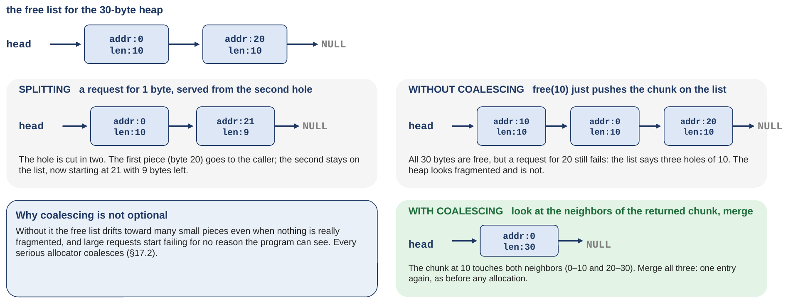{width=100%}
<figcaption markdown="1">Figure 27. The free list of the 30-byte heap; splitting a hole for a 1-byte request; freeing the middle chunk without and with coalescing. From slide 16, following textbook section 17.2.</figcaption>
</figure>

At the top is the free list of the 30-byte heap (headers ignored for now). Each box is one entry: `addr` is where a free chunk starts and `len` how many bytes it has. The arrows go from each entry to the next; `head` names the first entry, and **NULL** (the null pointer, "no address", the value 0) marks the end of the list. So the list says: free 10 bytes at 0, then free 10 bytes at 20, then nothing more.

**Splitting**, the left box. A request for 1 byte is smaller than either hole. The allocator cuts a hole in two: one part goes to the caller, and the rest stays on the list. Say it uses the hole at 20. Byte 20 goes out (`malloc` returns 20, the address of the 1-byte chunk), and the list entry now starts at 21 with 9 bytes. Check: 20 + 1 = 21, and 10 − 1 = 9.

**Coalescing**, the right boxes. They start again from the list at the top, before the 1-byte split, with the middle chunk, bytes 10 to 19, still in use. First the mistake. The program frees the chunk at 10. If the allocator only pushes it onto the front of the list, the list has three entries of 10 bytes: 10, 0 and 20. Every byte of the heap is free, yet a request for 20 bytes walks the list, finds no entry of 20, and fails. The list is lying: the heap looks fragmented and is not. So allocators coalesce (the word means "grow together", pronounced coh-uh-LESS). When a chunk comes back, look at the free chunks around it in address order, and merge the ones that touch it. The chunk at 10 runs from 10 to 20; it touches the free chunk 0 to 10 below it and the free chunk 20 to 30 above it. So all three merge into one entry: address 0, length 30, exactly the list before any allocation.

The card on the lower left says why coalescing is not optional. Without it the free list drifts toward many small pieces even when nothing is really fragmented, and large requests start failing for no reason the program can see. Every serious allocator coalesces. The bar at the bottom of the figure puts the two moves side by side: splitting protects big holes from small requests, and coalescing protects big holes from small returns.

One thing is still hidden in the rules of [Section 2.2](#sec-2-2). Coalescing needs the size of the chunk that comes back, and `free` gets no size. So the allocator keeps the size itself, in a small **header**: a few bytes it writes just before every pointer `malloc` hands out, holding the chunk's size. A request for N bytes therefore needs a hole of N plus the size of the header. [Section 3.1](#sec-3-1) draws the header, and [Extra 5](#extra-5) reads one out of a real heap. Figure 28 is the checkpoint of the second question.

<figure markdown="1">
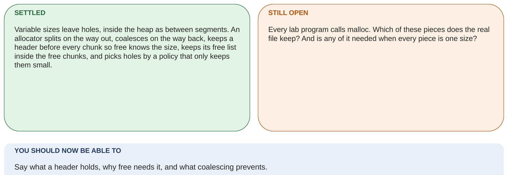{width=100%}
<figcaption markdown="1">Figure 28. Checkpoint 2: what the second question settled, what it left open, and what you should now be able to do. From slide 17.</figcaption>
</figure>

Settled: pieces of different sizes leave holes, inside the heap as between segments. An allocator splits on the way out and coalesces on the way back. It keeps a header before every chunk so that `free` knows the size. The card also counts two things this guide shows a little later, so read them as promises for now: the free list is kept inside the free chunks themselves ([Extra 7](#extra-7) shows how), and holes are picked by a fit policy ([Section 3.1](#sec-3-1)) that only keeps them small. Still open: every lab program you wrote calls `malloc`, and nobody has said which of these pieces the real file keeps. And nobody has tried the escape the textbook hints at: one size for everything. You should now be able to say what a header holds, why `free` needs it, and what coalescing prevents.

## Chapter 3. What does the allocator in your own tree keep, and when is none of it needed? {#chapter-3}

*The question this chapter answers: What does the allocator in your own tree keep, and when is none of it needed?*

### 3.1 <span class="lbl lbl-problem">Problem</span> The toolkit, the fit policies, and the slivers no policy removes {#sec-3-1 data-toc-label="3.1 [Problem] The toolkit, the fit policies, and the slivers no policy removes"}

What we have, at the end of [Chapter 2](#chapter-2), is a complete toolkit for living with holes. The left column of the deck's problem slide, Figure 29, draws a heap as chapter 17 leaves it.

<figure markdown="1">
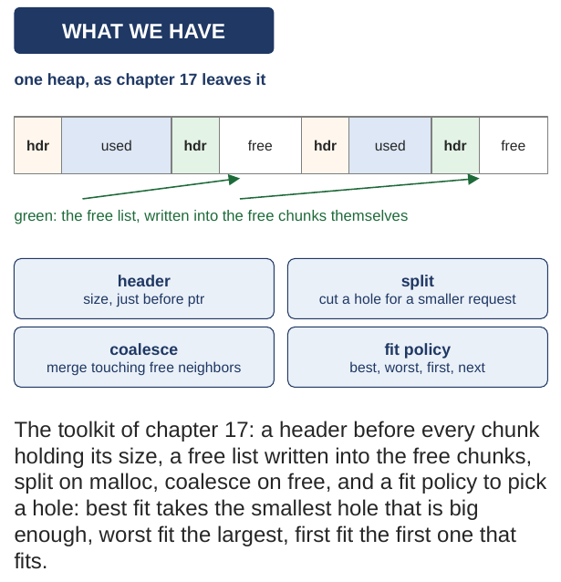{width=49%}
<figcaption markdown="1">Figure 29. What we have: one heap with a header before every chunk and the free list written into the free chunks, and the four tools. From slide 18.</figcaption>
</figure>

Every chunk begins with a header (`hdr`), holding its size, just before the pointer the program gets. The free chunks carry the free list inside themselves: the green arrows go from one free chunk to the next, and no separate memory is needed to describe free memory ([Extra 7](#extra-7) shows how a list can live inside the very space it describes). Holes are split on `malloc` and neighbors merged on `free`. And when several holes are big enough, a **fit policy** picks one. **Best fit** takes the smallest hole that is big enough. **Worst fit** takes the largest hole. **First fit** walks the list from the front and takes the first hole that is big enough.

Where it breaks is the middle column, Figure 30.

<figure markdown="1">
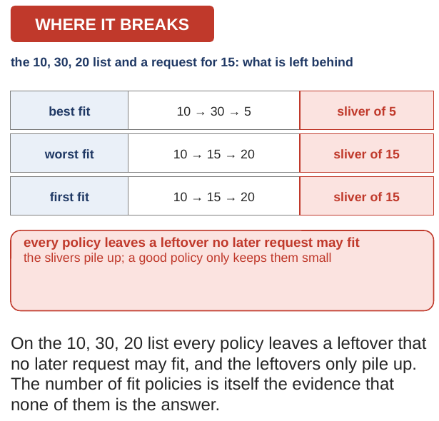{width=49%}
<figcaption markdown="1">Figure 30. Where it breaks: on the 10, 30, 20 list, every policy leaves a leftover that no later request may fit. From slide 18, following textbook section 17.3.</figcaption>
</figure>

Take the textbook's list: holes of 10, 30 and 20 bytes, in that order, and a request for 15 (headers ignored here). Best fit looks at all three, finds that 20 is the smallest hole that holds 15, and takes it: 20 − 15 = 5 bytes are left, so the list reads 10, 30, 5. Worst fit takes the largest, 30, and leaves 30 − 15 = 15: 10, 15, 20. First fit walks from the front: 10 is too small, 30 fits, stop; it also leaves 15, so the list is again 10, 15, 20. Every policy leaves a leftover, called a **sliver** when it is too small to be useful, that may never fit a later request. And the leftovers only pile up. A good policy keeps the slivers small; none gets rid of them. The fact that so many policies exist is itself the evidence that none of them is the answer.

So what we need is the right column, Figure 31.

<figure markdown="1">
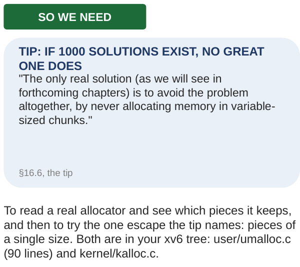{width=48%}
<figcaption markdown="1">Figure 31. So we need: the tip of textbook section 16.6, and the two files in your xv6 tree that the rest of the chapter reads. From slide 18.</figcaption>
</figure>

The textbook ends chapter 16 with a tip whose title is the whole argument: if 1000 solutions exist, no great one does. Its last sentence names the only way out: the only real solution is to avoid the problem altogether, by never allocating memory in variable-sized chunks. Two things are left to do. First, read a real allocator and see which of the tools it keeps. Then try the escape the tip names, pieces of a single size. Both are in the xv6 tree you use in the labs: `user/umalloc.c`, which is 90 lines, and `kernel/kalloc.c`.

### 3.2 <span class="lbl lbl-kernel">Real kernel</span> umalloc.c: the malloc your lab programs link {#sec-3-2 data-toc-label="3.2 [Real kernel] umalloc.c: the malloc your lab programs link"}

The previous section asked which of the tools a real allocator keeps. Every user program in your xv6 tree, including the lab programs you wrote, gets its `malloc` from one file, `user/umalloc.c`: when a program is built, the code of that file is **linked** into it, that is, joined to the program's own compiled code. It is the allocator from the classic book on the C language by Kernighan and Ritchie, 90 lines long, and every idea of [Chapter 2](#chapter-2) is in it. Figure 32 is its first part: the header and the list head.

<figure markdown="1">
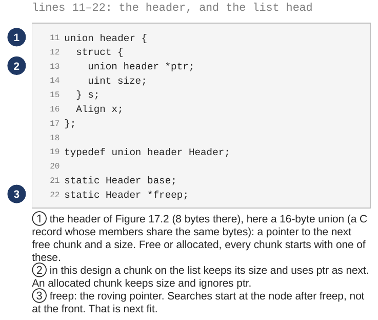{width=59%}
<figcaption markdown="1">Figure 32. user/umalloc.c, lines 11 to 22: the header as a 16-byte union, the anchor of the list, and the roving pointer freep. From slide 19.</figcaption>
</figure>

Some C first, because the file is written in it. **C** is the programming language xv6 and most operating systems are written in; you do not need to know it, and every line this guide shows is explained in words. A `struct` is a record: several named fields stored one after another. A `union` is a record whose fields share the same bytes, so it is as big as its biggest field. `typedef` gives a type a shorter name: line 19 lets the file write `Header` for `union header`. `uint` is a whole number that is never negative, 4 bytes on RISC-V; `long` is a whole number of 8 bytes, and line 9 of the file (not shown) names it `Align`. A star after a type, as in `union header *ptr`, means "a pointer to one of these": a variable holding the address of a `Header`. `static` on lines 21 and 22 means the variable belongs to this file and lives as long as the program does.

Now the callouts. Circle 1, lines 11 to 17, is the header of [Section 2.3](#sec-2-3), as a union. The `struct s` inside it has two fields: `ptr` (a pointer, 8 bytes, because it holds an address and addresses on 64-bit RISC-V are 64 bits, which is 8 bytes) and `size` (a 4-byte `uint`), 8 + 4 = 12 bytes. A processor reads an 8-byte value fastest (on some machines, only) when its address is a multiple of 8; a value placed that way is called **aligned**. So the compiler pads the struct with 4 unused bytes, to 12 + 4 = 16, so that in a row of headers every `ptr` starts on a multiple of 8. The `Align x` field, an 8-byte `long`, makes the union ask for the same 8-byte alignment. So every header in this file is 16 bytes (the textbook's header in Figure 17.2 is 8 bytes; [Extra 5](#extra-5) shows it). Free or allocated, every chunk starts with one of these. Sizes in this file are counted in header units of 16 bytes, not in bytes. Counting in units keeps every chunk a whole number of headers long, so every header lands on a multiple of 16 and stays aligned, and splitting a chunk at any unit boundary leaves room for a new header there.

Circle 2: on the free list, a chunk uses both fields: `ptr` points to the next free chunk and `size` is the chunk's length in units. A chunk handed out to the program keeps its `size` (so `free` can find it later) and ignores `ptr`.

Circle 3: `base` is an empty header that anchors the list (with a size of 0 it can never be handed out, and it means the list is never empty: even before the first `malloc` there is one node to start a walk from and to come back to), and `freep` is the **roving pointer**: it remembers where the last search ended, and the next search starts at the **node** after it (a node is one entry of a list; here, one free chunk with its header), not at the front of the list. The list is **circular**: the last free chunk's `ptr` points back to `base`, so a walk that keeps following `ptr` comes around to where it started instead of running off an end. And it is kept in **address order**, lowest address first, which is what later lets `free` merge neighbors ([Extra 11](#extra-11)). That policy has a name, **next fit**: first fit, but starting where the previous search stopped, so that the front of the list is not chewed into slivers by every search. (First fit always starts at the front, so every request smaller than the first hole splits it again, and the front of the list fills with small leftover pieces, **slivers**, that every later search must step over; next fit spreads that wear around the list. [Extra 9](#extra-9) compares the policies.) Figure 33 is `malloc` itself, complete.

<figure markdown="1">
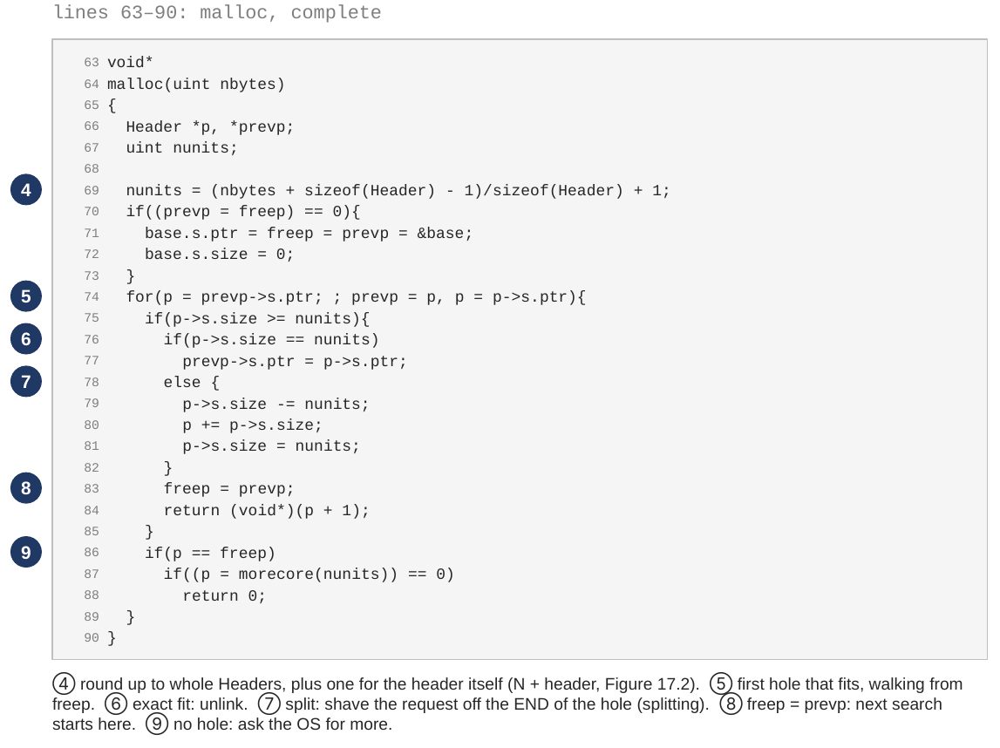{width=92%}
<figcaption markdown="1">Figure 33. user/umalloc.c, lines 63 to 90: malloc, complete, with callouts 4 to 9. From slide 19.</figcaption>
</figure>

More C. `p->s.size` means "follow the pointer `p` to the header it points at, then take field `s`, then its field `size`": `->` goes through a pointer and `.` picks a field. `&base` is the address of the variable `base`. `==` tests whether two values are equal (one `=` stores; two compare). `>=` is "greater than or equal to". `a -= b` means "subtract b from a" and `a += b` "add b to a". `sizeof(Header)` is the size of a header in bytes, 16. A `for(start; test; step)` loop runs `start` once, then repeats its body for as long as `test` is true, running `step` after each pass; an empty test, as on line 74, means "forever, until a `return` leaves". `return` hands a value back to the caller and leaves the function. `(void*)` turns a pointer into a plain address of no particular type. And dividing two whole numbers in C throws away the remainder: 35 / 16 is 2.

Circle 4, line 69, is the header rule: `nunits = (nbytes + sizeof(Header) - 1)/sizeof(Header) + 1`. It rounds the request up to whole units, then adds 1 unit for the header. Work it for `malloc(20)`: (20 + 16 − 1) / 16 = 35 / 16 = 2 units, plus 1 = 3 units, 48 bytes. Check it the other way: 2 units are 32 bytes, the smallest whole number of units that holds 20, and the third unit is the header. Why add 16 − 1 before dividing? Division in C throws the remainder away, so it rounds down; adding one less than the divisor first makes it round up instead. 20 + 15 = 35, and 35 / 16 = 2: 20 bytes round up to 2 units. 32 + 15 = 47, and 47 / 16 = 2: 32 bytes are already 2 whole units and are not rounded further. Lines 70 to 73 run only on the very first call, when `freep` is still 0 (a `static` variable starts at 0 when the program starts): they make `base` a list of one empty node that points to itself.

Circle 5, lines 74 and 75: walk the list with the two pointers declared at the top of `malloc`: `p`, the node being looked at, and `prevp`, the node just before it (needed to unlink a node and to remember where the search stopped). The walk starts at the node after `freep` (`prevp` is set to `freep` on line 70, and `p = prevp->s.ptr`), steps `prevp` and `p` along together, and stop at the first chunk with at least `nunits` units. Circle 6, lines 76 and 77: an exact fit is unlinked from the list, by pointing the previous node past it. Circle 7, lines 78 to 81, is splitting, done from the end: the hole's size shrinks by `nunits` (line 79), `p` moves to the start of the tail that is cut off (line 80: adding a number to a pointer moves it by that many headers, not bytes), and that tail gets its own header saying `nunits` (line 81). Cutting from the end means the hole's own header never moves. Circle 8, line 83: `freep = prevp` parks the roving pointer just before the chunk used, and line 84 returns `p + 1`, the address one header past the chunk's start: the program gets the space after the header and never sees the header itself. Circle 9, lines 86 to 88: if the walk comes all the way around to `freep` with nothing found, `morecore` asks the OS for more memory with `sbrk` (Part 0). It never asks for less than 4096 units, 4096 × 16 = 65,536 bytes = 64 KB, because each `sbrk` is a system call, which costs far more than a walk down a list; one big request then serves many small `malloc` calls. It gives the new block to `free`, which puts it on the list in address order, and the walk goes on and finds it there. If even `sbrk` fails, `malloc` returns 0.

So the real file keeps every piece of the toolkit: a header, a list in the free chunks, splitting from the end, next fit through a roving pointer, and growing the heap. `free`, which coalesces in both directions, and `morecore` are [Extra 11](#extra-11). That was a lot of work for a list of holes. The next section is the same job when every piece is one size.

### 3.3 <span class="lbl lbl-kernel">Real kernel</span> kalloc.c: pieces of one size, and a free list with no search {#sec-3-3 data-toc-label="3.3 [Real kernel] kalloc.c: pieces of one size, and a free list with no search"}

The previous section showed what variable sizes cost in real code: a header, a list walk, splitting, a roving pointer, coalescing, 90 lines, and holes that still never go away. The tip of [Section 3.1](#sec-3-1) says the only real fix is to stop handing out pieces of different sizes. The opening paragraph of the textbook's chapter 17, which this guide skipped on purpose until now, says what happens then. Figure 34 is that sentence.

<figure markdown="1">
{width=100%}
<figcaption markdown="1">Figure 34. The opening paragraph of the textbook's chapter 17: free-space management is easy when every unit has the same size. From slide 20.</figcaption>
</figure>

It is easy when the space you are managing is divided into fixed-size units: keep a list of the units, and when a client asks for one, return the first entry. The xv6 kernel has exactly such an allocator, `kernel/kalloc.c`, which you met earlier in the course as the allocator of physical memory. It hands out whole pages of 4096 bytes and nothing else. (Strictly, a 4096-byte block of physical memory is a **frame**, and a **page** is a 4096-byte piece of an address space; the second class keeps the two words apart from [Section 4.2](class-2.md#sec-4-2) on. xv6's code and comments say "page" for both, so this section does too. What `kalloc` hands out is a physical frame, which the kernel then maps in as some process's page or uses for itself.) Figure 35 is its list.

<figure markdown="1">
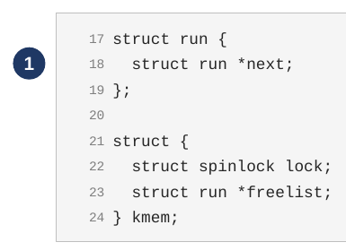{width=45%}
<figcaption markdown="1">Figure 35. kernel/kalloc.c, lines 17 to 24: a list node is one pointer, and the list head sits beside a lock. From slide 20.</figcaption>
</figure>

Circle 1: a node of the list, `struct run`, is one pointer, `next` (8 bytes, an address on 64-bit RISC-V), and nothing else. There is no size field, because every unit is 4096 bytes, so nothing needs to say so. The list head, `kmem.freelist`, sits in a struct beside a `spinlock`: a **lock** is a flag that makes sure only one processor at a time changes the list. (A machine can have several processors, or cores, running kernel code at the same moment; without the lock, two of them could pop the same page.) (`acquire` takes the lock and `release` gives it back; locks are a later block of the course, and here they can be read as "one at a time, please".)

<figure markdown="1">
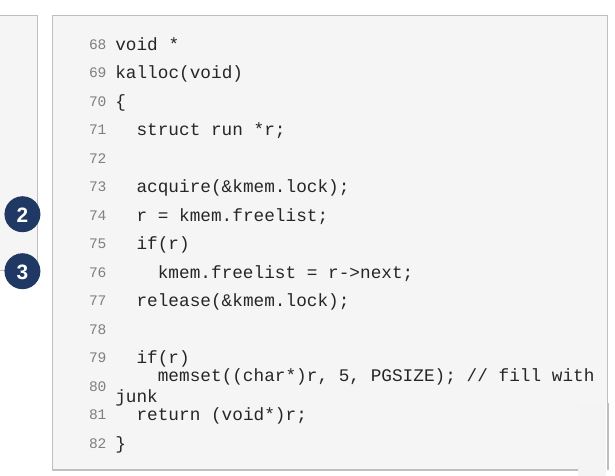{width=49%}
<figcaption markdown="1">Figure 36. kernel/kalloc.c, lines 68 to 82: kalloc takes the first page off the list. From slide 20.</figcaption>
</figure>

Circles 2 and 3, Figure 36: `kalloc` returns the first entry, in three lines under the lock. Line 74, `r = kmem.freelist`, takes the first free page. Line 75 tests `if(r)`, "if the list was not empty" (a pointer of 0 counts as false). Line 76, `kmem.freelist = r->next`, makes the next page the new first entry. No search, no fit policy, no split, because no request is ever smaller than a unit. And line 76 reads the `next` pointer out of the free page itself: the node lives in the first 8 bytes of the free page, because a free page holds nothing else ([Extra 7](#extra-7) calls this the list inside the free space). Line 80, `memset((char*)r, 5, PGSIZE)`, fills the whole page with the byte 5 before handing it out (`memset` sets every byte of a block to one value; `PGSIZE` is 4096, the page size, defined in `kernel/riscv.h`), so that a program that wrongly reads a page it did not fill sees obvious junk rather than somebody's old data.

<figure markdown="1">
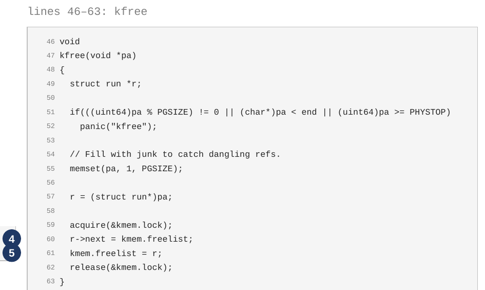{width=76%}
<figcaption markdown="1">Figure 37. kernel/kalloc.c, lines 46 to 63: kfree pushes the page onto the front of the list. From slide 20.</figcaption>
</figure>

Circles 4 and 5, Figure 37: `kfree` pushes the page onto the front, in two lines. Line 60, `r->next = kmem.freelist`, makes the freed page point at the old first entry, and line 61, `kmem.freelist = r`, makes it the new first entry. Line 55 first fills the page with the byte 1, for the same reason as line 80. Line 51 refuses a bad address. It uses three new marks: `%` is the remainder after division, so `pa % PGSIZE != 0` means "the address is not a multiple of 4096" (`!=` is "is not equal to"); `||` means "or"; and `(uint64)pa` only tells C to treat the address as a plain 64-bit number. `end` is the first address after the kernel's own code and data, and `PHYSTOP` is the top of the RAM xv6 uses. If the address is not on a page boundary, or below `end`, or at or above `PHYSTOP`, `panic` prints a message and stops the whole machine, because that can only be a kernel bug.

There is no coalescing in `kfree`, and Figure 38 says why.

<figure markdown="1">
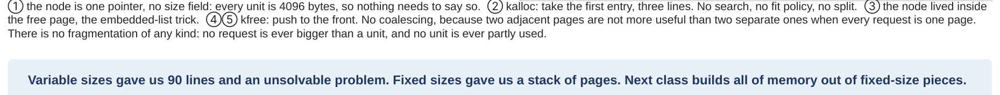{width=100%}
<figcaption markdown="1">Figure 38. The five callouts in words, and the sentence the slide ends on. From slide 20.</figcaption>
</figure>

When every request is one page, two free neighbors are no better than two pages anywhere else, so there is nothing to gain by merging them. And there is no external fragmentation at all. No request is ever bigger than a unit, so no request can fail while enough pages are free: no holes between chunks. Inside a unit, the kernel wastes nothing as long as it needs whole pages, and for its own uses it does. A client that needed only a few bytes would waste the rest of its page; that is internal fragmentation ([Section 2.2](#sec-2-2)), the price of having one size, and the second class meets it again (Answer 12). Variable sizes gave us 90 lines and a problem with no solution. One size gives a stack of pages. The second class builds all of memory out of pieces of one size, and this file is the free list under it.

That answers the third question. Figure 39 is the checkpoint.

<figure markdown="1">
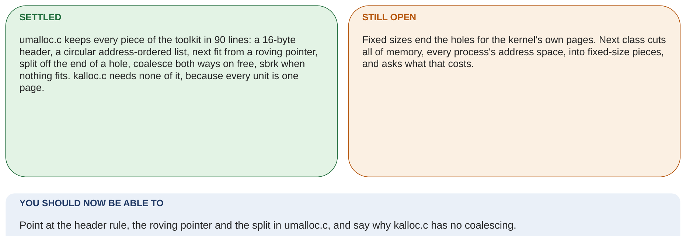{width=100%}
<figcaption markdown="1">Figure 39. Checkpoint 3: what the third question settled, what it left open, and what you should now be able to do. From slide 21.</figcaption>
</figure>

Settled: `umalloc.c` keeps every piece of the toolkit in 90 lines: a 16-byte header, a circular list kept in address order, next fit from a roving pointer, splitting off the end of a hole, coalescing both ways on `free`, and `sbrk` when nothing fits (the code of `free` and `morecore` is [Extra 11](#extra-11)). `kalloc.c` needs none of it, because every unit is one page. Still open: fixed sizes ended the holes for the kernel's own pages. The second class cuts all of memory, every process's address space, into fixed-size pieces, and asks what that costs. You should now be able to point at the header rule, the roving pointer and the split in `umalloc.c`, and say why `kalloc.c` has no coalescing.

## <span class="lbl lbl-summary">Summary</span> Summary of the first class: segments, holes, and the escape from them {#summary-1 data-toc-label="[Summary] Summary of the first class: segments, holes, and the escape from them"}

The last slide of the class answers its three questions in order, each with the problem it solved and the price it carries. Figure 40 is that slide, with the vocabulary of the class under it. Every word in the list should now have a picture behind it; if one does not, that is the section to reread.

<figure markdown="1">
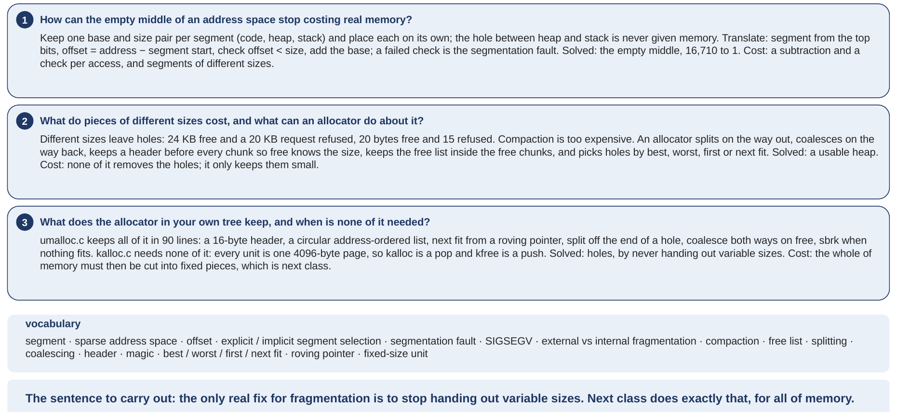{width=100%}
<figcaption markdown="1">Figure 40. The first class on one slide: the three questions, each answered with the problem it solved and its cost, and the vocabulary. From slide 22.</figcaption>
</figure>

Question 1, how the empty middle of an address space stops costing real memory. Keep one base and size pair per segment (code, heap, stack) and place each segment on its own; the hole between heap and stack is never given memory. Translate by taking the segment from the top bits of the address and the offset from the low bits, checking offset < size, and adding the base. A failed check is the segmentation fault. That solved the 16,710 to 1 of last week. The price is a check and an addition on every access, and segments of different sizes. (The summary slide says "a subtraction": the offset is address − segment start, but [Section 1.5](#sec-1-5) showed that the top-bits design gets it with a mask, so the real work is the compare and the add.)

Question 2, what pieces of different sizes cost and what an allocator can do about it. They cost holes: 24 KB free and a 20 KB request refused between segments, 20 bytes free and a 15-byte request refused inside one heap. Compaction is too expensive. An allocator splits on the way out, coalesces on the way back, keeps a header before every chunk so that `free` knows the size, keeps the free list inside the free chunks, and picks holes by best, worst, first or next fit. That gave a usable heap. The price is that none of it removes the holes; it only keeps them small.

Question 3, what the allocator in your own tree keeps, and when none of it is needed. `umalloc.c` keeps all of it in 90 lines: a 16-byte header, a circular address-ordered list, next fit from a roving pointer, splitting off the end of a hole, coalescing both ways on `free`, `sbrk` when nothing fits. `kalloc.c` needs none of it: every unit is one 4096-byte page, so `kalloc` is a pop and `kfree` is a push. That solved the holes, by never handing out variable sizes. The price comes in the second class: all of memory must then be cut into fixed pieces.

Two words in the vocabulary belong to the optional extras that follow this summary. **SIGSEGV** is the name of the message the kernel sends a process that touched memory outside its own, the one that kills it with "Segmentation fault" ([Extra 2](#extra-2)). The **magic** number is a fixed value an allocator writes into every header so that `free` can check the header was not damaged ([Extra 5](#extra-5)).

The one sentence to carry out of the first class: the only real fix for external fragmentation is to stop handing out variable sizes. (The waste inside a piece, internal fragmentation, stays.) The second class does exactly that, for all of memory.

Before the second class, the deck asks for two things, in Figure 41. First, read chapter 18 (paging) and chapter 19 (the TLB) of the textbook; the second class starts from chapter 18's tiny 64-byte example. Second, some practice: open `user/umalloc.c` and `kernel/kalloc.c` and find each mechanism of the first class in them, one line at a time: header, free list, splitting, coalescing, fit policy, growing the heap. Where a mechanism is missing, say why. The vocabulary is the checklist.

<figure markdown="1">
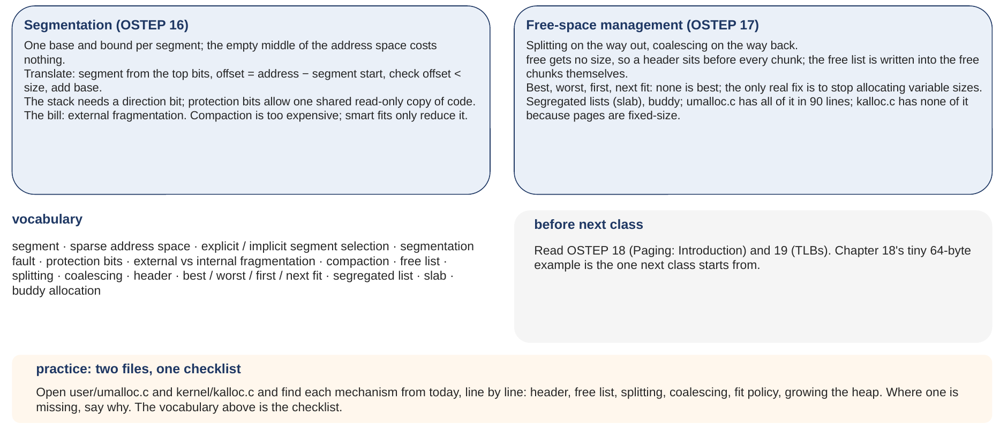{width=100%}
<figcaption markdown="1">Figure 41. The first class in two cards, its vocabulary, the reading, and the practice with the two files. From slide 41.</figcaption>
</figure>

## Going deeper, first class (optional) {#extras-1}

### Extra 1 <span class="lbl lbl-deeper">Deeper, Q1</span> Placing the segments, and the registers that describe them {#extra-1 data-toc-label="Extra 1 [Deeper, Q1] Placing the segments, and the registers that describe them"}

This part and the eleven after it are the deck's "deeper, if time allows" block of the first class: slides the class may have skipped, placed after the summary so that the core chain reads without them. Each goes deeper on one of the three questions; the tag Q1, Q2 or Q3 in its heading says which.

[Section 1.2](#sec-1-2) said each segment can be placed in physical memory on its own, and [Section 1.4](#sec-1-4) used the register table without drawing where the segments actually sit. Figure 42 draws the placement, and Figure 43 is the table that describes it.

<figure markdown="1">
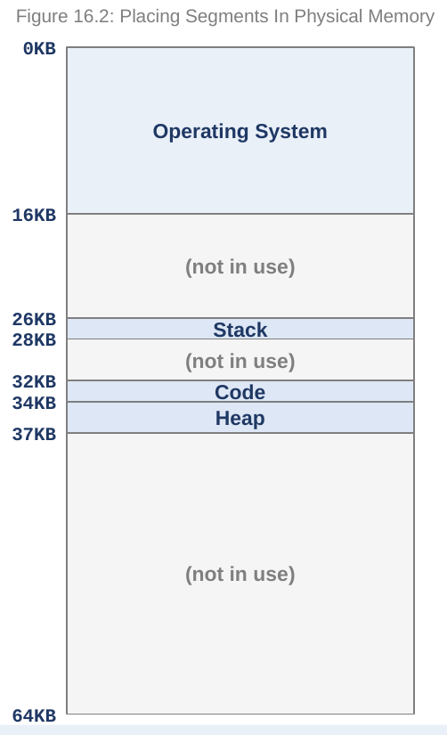{width=45%}
<figcaption markdown="1">Figure 42. The textbook's Figure 16.2: the three segments placed in a 64 KB physical memory. From slide 23.</figcaption>
</figure>

Physical memory here is 64 KB. The OS keeps the first 16 KB. Reading down: the stack sits at 26 to 28 KB, the code at 32 to 34 KB, and the heap right behind it at 34 to 37 KB. Everything else is not in use. Look at what is missing: the 7 KB hole of the address space appears nowhere. Only used memory got physical memory.

<figure markdown="1">
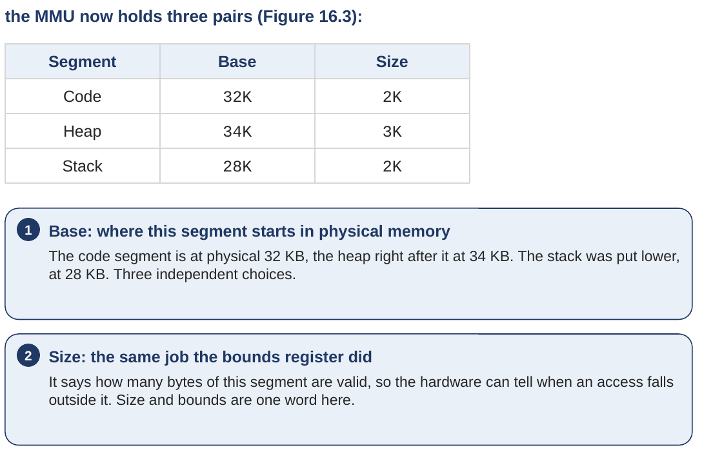{width=87%}
<figcaption markdown="1">Figure 43. The textbook's Figure 16.3, the three register pairs the MMU now holds, and what base and size mean. From slide 23.</figcaption>
</figure>

The MMU now holds three pairs instead of one. Each base says where its segment begins in physical memory, and the three are chosen independently: the code happens to sit right next to the heap here (32 + 2 = 34), while the stack is somewhere else entirely. Each size is the old bounds register under a new name: it says how many bytes of the segment are valid, so the hardware notices an access outside it. (The stack's base, 28K, is the top of its segment rather than the bottom, because the stack grows toward smaller addresses; [Extra 3](#extra-3) explains.)

### Extra 2 <span class="lbl lbl-deeper">Deeper, Q1</span> A failed check is the segmentation fault: exit status 139 {#extra-2 data-toc-label="Extra 2 [Deeper, Q1] A failed check is the segmentation fault: exit status 139"}

Step 3 of the rule of [Section 1.4](#sec-1-4) is the check "offset < size", and the guide has said several times that a failed check is the segmentation fault. This extra shows the same kind of failure on the Ubuntu 24.04 x86-64 machine, and what happens in between, in order. That machine does not use segments for memory; it uses the pages of the second class, and the check it makes is the page-table check of [Chapter 5](class-2.md#chapter-5). But the outcome is the one this section is about: the hardware finds no valid region for the address, refuses, and the process dies with "Segmentation fault". Figure 44 is a complete C program and its run.

<figure markdown="1">
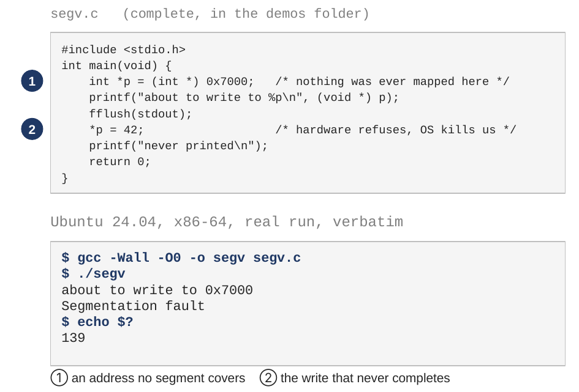{width=76%}
<figcaption markdown="1">Figure 44. segv.c, complete, and its run on the Ubuntu 24.04 x86-64 machine, verbatim. From slide 24.</figcaption>
</figure>

The program takes the address 0x7000 (hexadecimal; the 7 sits in the fourth hex place from the right, which is worth 16 × 16 × 16 = 4096, so 0x7000 = 7 × 4096 = 28,672, which is 28 KB), announces that it is about to write there, and writes the number 42 there. Some C: `#include <stdio.h>` pulls in the standard input and output functions; `int main(void) { ... }` is the function every C program starts in. `int *p = (int *) 0x7000` makes `p` a pointer to an integer (`int` is C's ordinary whole number, 4 bytes) holding the address 0x7000; the `(int *)` tells C to treat the number as such an address. `printf` prints text, filling in the `%p` with the pointer's value; `fflush(stdout)` makes sure the text is really printed before the next line runs. `*p = 42` stores 42 at the address `p` holds: a `*` in front of a pointer means "the thing at that address". `return 0` ends the program with status 0, "all went well". Nothing was ever placed at 0x7000 in this process, so no region of its address space covers it.

The **terminal** (the window where you type commands and see what programs print) shows the run. `gcc -Wall -O0 -o segv segv.c` compiles it (`gcc` is the C compiler; `-Wall` turns on its warnings, `-O0` turns off its optimizations, and `-o segv` names the result). `./segv` runs it: the first line prints, then the shell says `Segmentation fault`. `echo $?` prints the exit status of the last command, a number every program leaves behind when it ends: 139. And the second `printf`, "never printed", never ran. Figure 45 says what happened between those two lines.

<figure markdown="1">
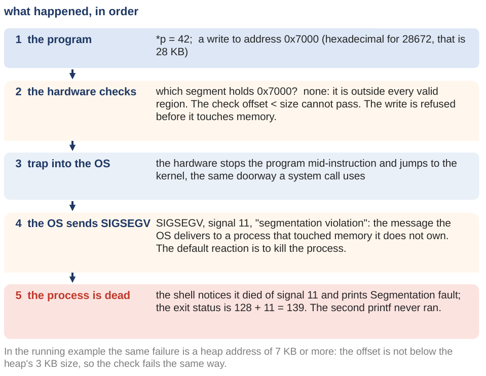{width=77%}
<figcaption markdown="1">Figure 45. What happened, in order: the store, the check, the trap, the signal, the death. From slide 24.</figcaption>
</figure>

Step 1, the program executes the store of 42 to 0x7000. Step 2, the hardware looks for a valid region holding 0x7000 (on the Ubuntu machine, a valid page-table entry) and finds none; the check cannot pass, so the write is refused before it touches memory. Step 3, the hardware traps: it stops the program in the middle of the instruction and enters the kernel, through the same door a system call uses. Step 4, the OS answers with a **signal**: a short numbered message the kernel delivers to a process. **SIGSEGV** is signal 11, "segmentation violation", the message for a process that touched memory outside its own. A process may catch it, but almost none do, so the default reaction runs: the process is killed. Step 5, the process is dead. The shell started the program as its **child** (a process started by another process), so the shell sees that its child died of signal 11, prints `Segmentation fault`, and reports the exit status as 128 + 11 = 139 (adding 128 to the signal number is the shell's convention for "killed by a signal").

In the running example of [Chapter 1](#chapter-1) the same failure is a heap address of 7 KB or more: its offset, 7 KB − 4 KB = 3 KB or more, is not below the heap's size of 3 KB, so the check fails the same way.

<figure markdown="1">
{width=64%}
<figcaption markdown="1">Figure 46. Where the name comes from, the aside of textbook section 16.1. From slide 24.</figcaption>
</figure>

The name is older than this hardware, as Figure 46 says. It meant an illegal access on a segmented machine, and it stuck, even on machines that stopped using segments for memory decades ago, like the Ubuntu machine and your laptop. So read "segmentation fault" today as: an address outside every valid region.

To run it yourself on any Linux machine: `gcc -Wall -O0 -o segv segv.c`, then `./segv; echo $?`. No `sudo` is needed (`sudo` runs a command with administrator rights, which some later programs need). The address printed and the 139 will be the same on any x86-64 Linux.

### Extra 3 <span class="lbl lbl-deeper">Deeper, Q1</span> The stack grows the other way, so it needs one more bit {#extra-3 data-toc-label="Extra 3 [Deeper, Q1] The stack grows the other way, so it needs one more bit"}

[Section 1.4](#sec-1-4) translated a code address and a heap address, and left the third segment alone. The stack is awkward for one reason: it grows toward smaller addresses. Its base, 28K, is the top of the segment, and the segment hangs below it. So "base + offset" cannot be right for the stack as it stands. Figure 47 is the hardware's fix.

<figure markdown="1">
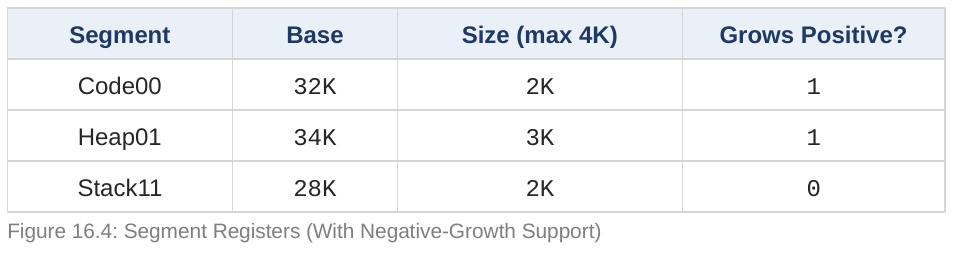{width=77%}
<figcaption markdown="1">Figure 47. The textbook's Figure 16.4: the register table with one more column, grows positive. From slide 25.</figcaption>
</figure>

The register table gets one more column, "grows positive": 1 for the code and the heap, which grow toward bigger addresses, and 0 for the stack. That is one bit of hardware per segment. (The segment names now carry their 2-bit codes: Code00, Heap01, Stack11, and the size column says "max 4K", the cap of [Section 1.5](#sec-1-5).)

<figure markdown="1">
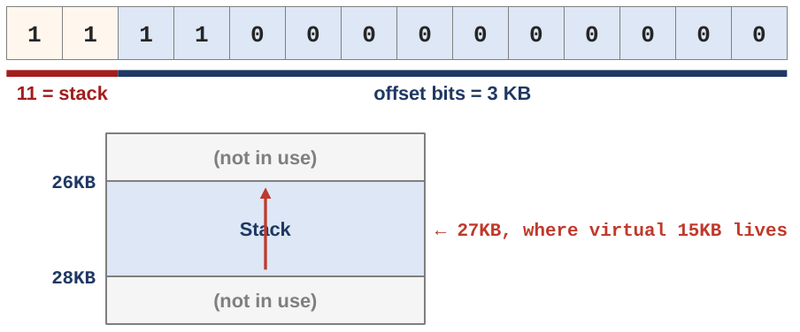{width=72%}
<figcaption markdown="1">Figure 48. Virtual 15 KB in 14 bits: segment 11, offset bits worth 3 KB, landing at physical 27 KB. From slide 25.</figcaption>
</figure>

Take virtual address 15 KB, which is 15 × 1024 = 15,360, hex 0x3C00 (3 × 4096 + 12 × 256 = 12,288 + 3,072 = 15,360). In 14 bits it is 11 1100 0000 0000. The top 2 bits are 11, the stack. The offset bits are 1100 0000 0000 = 2048 + 1024 = 3072, which is 3 KB. Figure 49 finishes the translation.

<figure markdown="1">
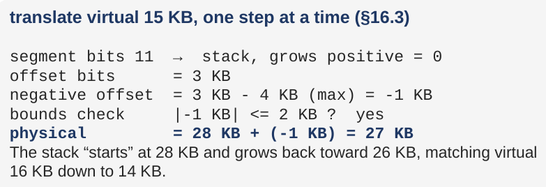{width=63%}
<figcaption markdown="1">Figure 49. Translating virtual 15 KB one step at a time. From slide 25, following textbook section 16.3.</figcaption>
</figure>

But 3 KB is measured from the wrong end. The stack's slot is 4 KB wide (the maximum segment size), and the stack hangs from its top. So the real offset is 3 KB − 4 KB = −1 KB, a **negative offset**: 1 KB below the top. The bounds check now asks whether the size of the negative offset, 1 KB, is at most the stack's size, 2 KB: it is. And the physical address is the base plus the negative offset: 28 KB + (−1 KB) = 27 KB. Check it on the picture: in physical memory the stack sits between 26 KB and 28 KB and grows from 28 toward smaller addresses; virtual 16 KB matches physical 28 KB, so virtual 15 KB, 1 KB below the top of the address space, lands 1 KB below 28, at 27. A backwards segment costs one bit and one subtraction, and the rest of the rule stays.

### Extra 4 <span class="lbl lbl-deeper">Deeper, Q1</span> Protection bits, and one shared copy of the code {#extra-4 data-toc-label="Extra 4 [Deeper, Q1] Protection bits, and one shared copy of the code"}

The register table has a base, a size and a direction. One more column turns out to matter a great deal: it is why your machine can run a hundred programs with one copy of the **C library** in memory (`libc`, the standard set of functions every C program uses, `printf` and `malloc` among them). The problem it solves: every process uses the same library code, and giving each process its own copy of it would waste memory. Sharing one copy is safe only if no process can change it. Figure 50 is the column that makes that guarantee.

<figure markdown="1">
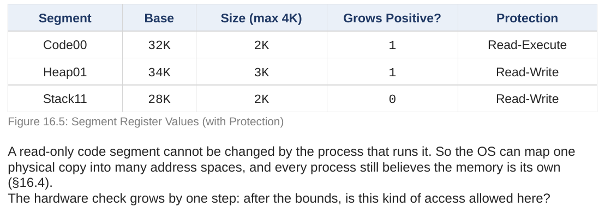{width=89%}
<figcaption markdown="1">Figure 50. The textbook's Figure 16.5: the register table with a protection column, and what read-only code makes possible. From slide 26, following textbook section 16.4.</figcaption>
</figure>

**Protection bits** say, per segment, which kinds of access are allowed: read, write, and execute (run the bytes as instructions). Code is read and execute; heap and stack are read and write. The hardware check gains one step: after the bounds, is this kind of access allowed in this segment? If not, the hardware raises an exception, as for a failed bounds check. And a read-only code segment makes something new possible. If a process cannot change its code, the OS can **map** the same physical copy into many address spaces (to map memory into an address space is to make a range of that process's addresses lead to it), and every process still believes the copy is its own.

Here is that idea on the Ubuntu machine, in Figure 51.

<figure markdown="1">
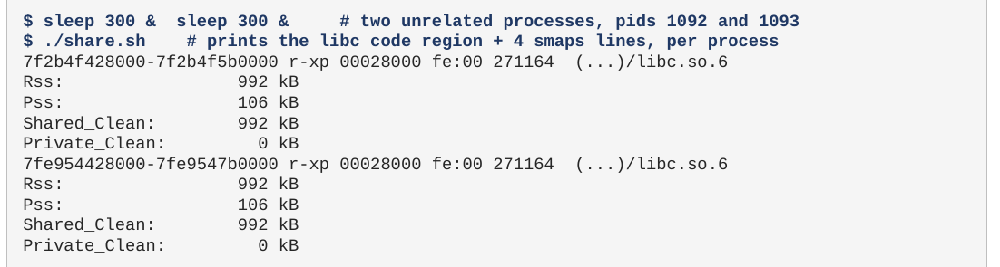{width=88%}
<figcaption markdown="1">Figure 51. Two unrelated sleep processes and the C library's code region in each, with four lines of the kernel's accounting, verbatim (the library path shortened). From slide 26.</figcaption>
</figure>

The first line starts two unrelated processes running `sleep 300` (a program that does nothing for 300 seconds; the `&` runs each in the background, so the shell does not wait). Their process IDs were 1092 and 1093. The second line runs a small **script** (a file of shell commands, run one after another), `share.sh`, listed at the end of this extra, which prints, for each process, the region holding the C library's code and four lines of the kernel's report on it. (`libc.so.6` is the C library's file.) The report comes from `/proc/PID/smaps`, the kernel's per-region memory report, a longer version of last week's `/proc/PID/maps`.

The first line of each block is the region: its start and end address, then `r-xp`. That column is the protection column of the textbook's Figure 16.5, read on a real machine: `r` read, `x` execute, no `w`, so no process may write it (`p` means private; for a region nobody writes, that changes nothing). Figure 52 reads the four numbers.

<figure markdown="1">
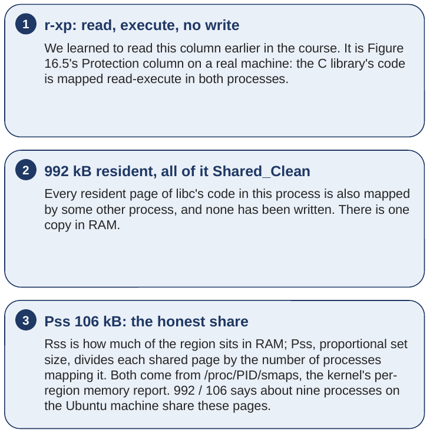{width=59%}
<figcaption markdown="1">Figure 52. Reading the capture: r-xp, all 992 kB shared and clean, and Pss, each process's honest share. From slide 26.</figcaption>
</figure>

**Rss** (resident set size) is how much of the region sits in RAM right now: 992 kB in each process (Linux writes kB with a small k for the same 1024 bytes). **Shared_Clean** is how much of that is also mapped by some other process (shared) and has never been written (clean): all 992 kB of it. **Private_Clean** is 0 kB: nothing in the region belongs to this process alone. So there is one copy of the library's code in RAM, and both processes point at it. **Pss** (proportional set size) is the honest number: each shared page is divided by the number of processes sharing it, and each process is billed its share. In this capture each process's Pss for the region is 106 kB, and 992 ÷ 106 is about 9.4, so about nine processes on the Ubuntu machine share these pages, and each is billed about a ninth. Figure 53 draws it.

<figure markdown="1">
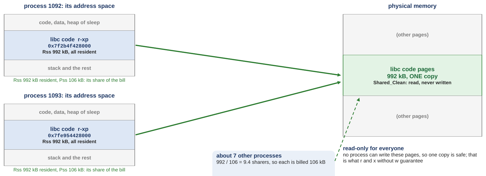{width=100%}
<figcaption markdown="1">Figure 53. One copy of the library's code, two address spaces: two virtual addresses, one set of physical pages, read-only for everyone. From slide 27.</figcaption>
</figure>

The two processes have the library at different virtual addresses (0x7f2b4f428000 in one, 0x7fe954428000 in the other; Linux shuffles them, as Part 0 said), and both arrows end on the same physical pages. (The slide's second region line ends in 7b0000. That is a typo on the slide. In the captured run the first region is 0x7f2b4f428000 to 0x7f2b4f5b0000 and the second 0x7fe954428000 to 0x7fe9545b0000: both are 0x5b0000 − 0x428000 = 0x188000 bytes long (1,605,632 bytes, 1568 KB), as they must be for the same part of the same file. The slide's 7b0000 would make the second region 0x388000 bytes, twice as long. The numbers that matter are the same.) Sharing is safe only because nobody may write: read and execute without write means no process can change what the others run. Segments gave the vocabulary, read-only and shared. Linux does the sharing per page, which is the second class's mechanism, but the idea has not changed since the 1960s.

??? note "The program behind Figure 51 (you can skip this listing)"

    The slide shows what `share.sh` prints, not the script. Here is what it does, in order. It starts two `sleep 300` processes in the background and remembers their process IDs (`$!` is the ID of the last background process; `P1=$!` saves it). It waits 0.3 seconds so both are running. Then, for each of the two IDs, it prints the command it is about to run and runs it. The command is `awk`, a small text-processing tool: it reads `/proc/ID/smaps` line by line, starts printing at the line of the library's `r-xp` region, prints the region line and the `Rss`, `Pss`, `Shared_Clean` and `Private_Clean` lines after it, and stops at the next region's `VmFlags` line. At the end it kills both `sleep` processes. Lines starting with `#` are comments.
    
    ```bash
    #!/bin/bash
    # Two unrelated processes, one copy of libc's code in RAM.
    sleep 300 & P1=$!
    sleep 300 & P2=$!
    sleep 0.3
    for P in $P1 $P2; do
      echo "\$ awk '/r-xp .*libc.so.6/{f=1} f&&/^(Rss|Pss|Shared_Clean|Private_Clean):|libc/{print} /^VmFlags/{f=0}' /proc/$P/smaps"
      awk '/r-xp .*libc.so.6/{f=1} f&&/^(Rss|Pss|Shared_Clean|Private_Clean):|libc/{print} /^VmFlags/{f=0}' /proc/$P/smaps
    done
    kill $P1 $P2
    ```
    
    To run it on any Linux machine: save it as `share.sh`, then `chmod +x share.sh` (mark it as runnable) and `./share.sh`. No `sudo` is needed, because a process may read its own user's `smaps`. The addresses and the Pss will differ on your machine (Pss depends on how many processes share the library at that moment); the 0 kB of Private_Clean and the equality of Rss and Shared_Clean will not.
    
### Extra 5 <span class="lbl lbl-deeper">Deeper, Q2</span> The header: how free learns a chunk's size {#extra-5 data-toc-label="Extra 5 [Deeper, Q2] The header: how free learns a chunk's size"}

[Section 2.2](#sec-2-2) set a rule of the game: `free(ptr)` gets the pointer and nothing else. But coalescing needs the size of the chunk that comes back, and so does putting it back on the list at all. [Section 2.3](#sec-2-3) said the answer in one sentence; Figure 54 draws it.

<figure markdown="1">
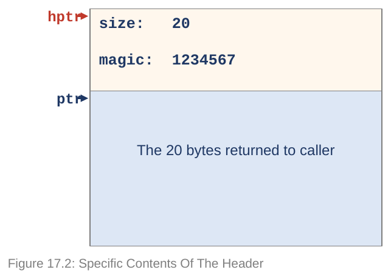{width=51%}
<figcaption markdown="1">Figure 54. The textbook's Figure 17.2: the header just before the 20 bytes returned to the caller. From slide 28.</figcaption>
</figure>

When `malloc` hands out 20 bytes, it quietly writes a small header right before them. In the textbook's example the header has two fields: the size, 20, and a **magic number**, 1234567. The caller gets `ptr`, pointing at the 20 bytes, and never sees the header above it. `hptr` (header pointer) marks where the header starts. Figure 55 is the header in C and how `free` finds it.

<figure markdown="1">
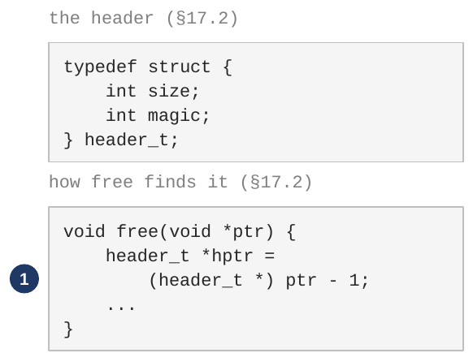{width=47%}
<figcaption markdown="1">Figure 55. The header as a C struct, and how free steps back to it. From slide 28, following textbook section 17.2.</figcaption>
</figure>

The header is a `struct` of two `int` fields, 4 bytes each, so 8 bytes. `free` finds it with one subtraction: `hptr = (header_t *) ptr - 1`. The `(header_t *)` tells C to treat `ptr` as a pointer to headers, and subtracting 1 from a pointer moves it back by one whole header, 8 bytes, not by one byte. So `hptr` lands exactly on the header. Figure 56 reads the rest.

<figure markdown="1">
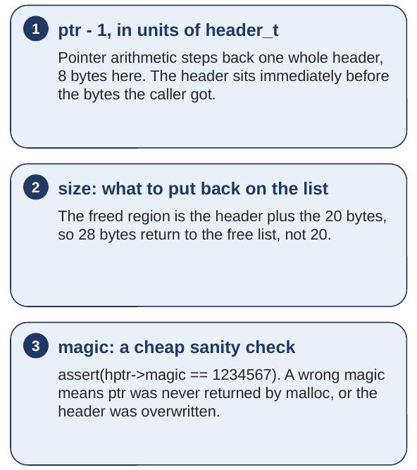{width=47%}
<figcaption markdown="1">Figure 56. ptr − 1 in units of the header; the size and what it puts back; the magic number as a sanity check. From slide 28.</figcaption>
</figure>

Card 2: the size says how much goes back on the free list, and the region returned includes the header: 20 + 8 = 28 bytes, not 20. Card 3: the magic number is a cheap sanity check. It carries no information by itself; it is a fixed constant that `malloc` writes there, so that its absence can be noticed later. When `free(ptr)` runs, it steps back to the header and checks that the magic number is still 1234567 (`assert` stops the program with an error message if the condition after it is false). If something else is there, one of two things happened: either the pointer never came from `malloc`, or a program wrote past the end of the chunk before this one and destroyed the header. Either way, `free` refuses to trust the size beside it. "Magic number" is general programming jargon for any fixed constant that marks "this is what you think it is"; the value is arbitrary, and any unlikely number would do.

<figure markdown="1">
{width=87%}
<figcaption markdown="1">Figure 57. The consequence for malloc: N plus the size of the header. From slide 28, following textbook section 17.2.</figcaption>
</figure>

Hence the rule for `malloc`, Figure 57: a request for N bytes needs a free chunk of N plus the size of the header. `malloc(20)` needs a 28-byte hole. That is the same rule as line 69 of `umalloc.c` in [Section 3.2](#sec-3-2), in bytes instead of units. The header is not a textbook convenience: the next extra reads one out of a real heap.

### Extra 6 <span class="lbl lbl-deeper">Deeper, Q2</span> Reading glibc's header out of your own heap {#extra-6 data-toc-label="Extra 6 [Deeper, Q2] Reading glibc's header out of your own heap"}

[Extra 5](#extra-5) claimed every allocator keeps a header just before the pointer it hands out. That can be checked on a real machine: allocate two chunks, look at the bytes just before each pointer, and see whether they hold a size. Figure 58 is a complete program that does exactly that on the Ubuntu machine, whose `malloc` is glibc's (**glibc** is the GNU C library, the C library of most Linux systems).

<figure markdown="1">
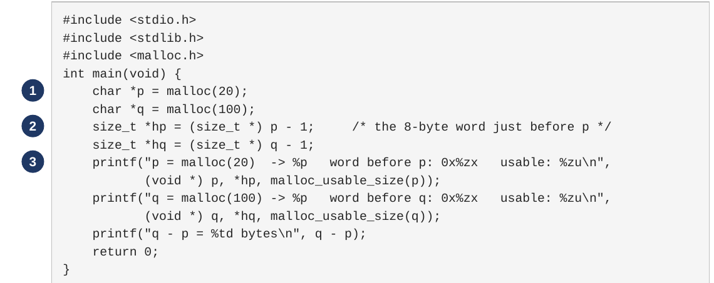{width=91%}
<figcaption markdown="1">Figure 58. hdr.c, complete: two allocations, then a look at the 8-byte word before each pointer. From slide 29.</figcaption>
</figure>

Some C, line by line. Circle 1: `char *p = malloc(20)` and `char *q = malloc(100)` ask for two chunks; `char *` is a pointer to bytes. Circle 2: `size_t *hp = (size_t *) p - 1`. **`size_t`** is C's type for sizes, an 8-byte whole number that is never negative on x86-64. The line treats `p` as a pointer to 8-byte words and steps back one word, exactly the `ptr - 1` of [Extra 5](#extra-5) with an 8-byte header; `*hp` is then the word just before `p`. Circle 3: `printf` prints each pointer (`%p`), the word before it in hex (`%zx`), and `malloc_usable_size(p)` (`%zu`), a glibc function that says how many bytes the chunk can really hold. The last `printf` prints `q - p`, the distance between the two pointers in bytes (`%td`). (Peeking before a pointer like this is not something a real program may rely on; it is a look under the hood.)

<figure markdown="1">
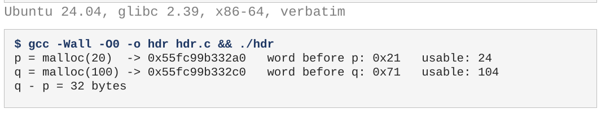{width=85%}
<figcaption markdown="1">Figure 59. The run on Ubuntu 24.04, glibc 2.39, x86-64, verbatim. From slide 29.</figcaption>
</figure>

Before `p` the word is 0x21. Before `q` it is 0x71. And the two pointers are exactly 32 bytes apart. Figure 60 reads the numbers.

<figure markdown="1">
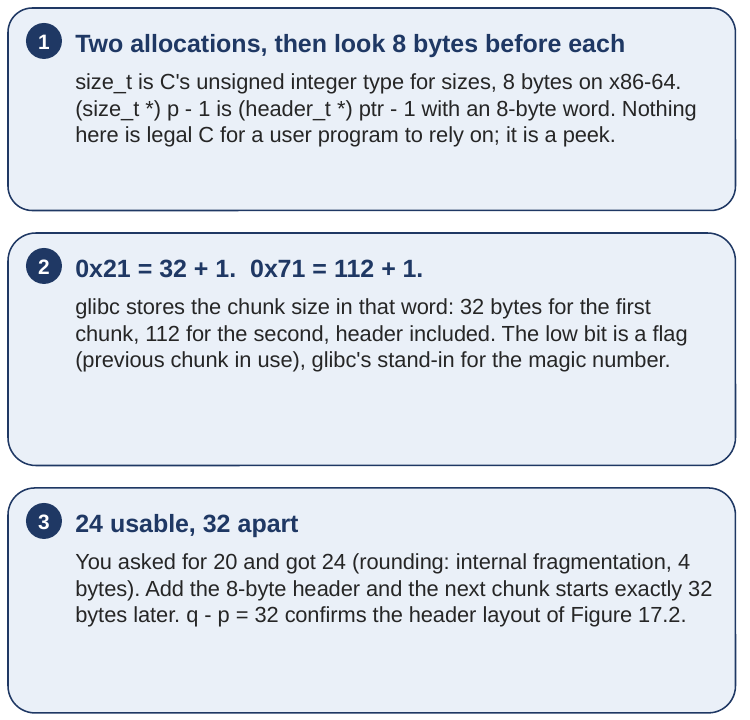{width=60%}
<figcaption markdown="1">Figure 60. Reading the run: what the program does, what 0x21 and 0x71 mean, and why 24 usable bytes and 32 apart. From slide 29.</figcaption>
</figure>

0x21 is 2 × 16 + 1 = 33, which is 32 + 1. 0x71 is 7 × 16 + 1 = 113, which is 112 + 1. glibc keeps the chunk's size in that word, header included: 32 bytes for the first chunk, 112 for the second. The low bit, the + 1, is a flag meaning "the chunk before this one is in use"; it is glibc's stand-in for the magic number, the same kind of bookkeeping. You asked for 20 bytes and got 24 usable: 4 bytes of rounding, internal fragmentation. The rule behind both numbers is that glibc's chunks, size word included, are whole multiples of 16 bytes: 20 + 8 = 28, rounded up to the next multiple of 16, is 32; and 100 + 8 = 108 rounds up to 112. 24 usable bytes plus the 8-byte size word is 32, which is exactly where `q` begins. Figure 61 draws those bytes.

<figure markdown="1">
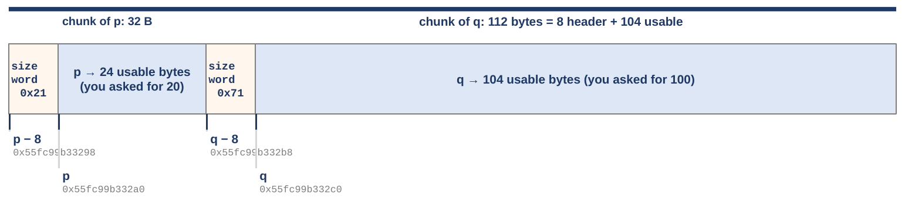{width=100%}
<figcaption markdown="1">Figure 61. The bytes around p and q as glibc laid them out, addresses growing to the right. From slide 30.</figcaption>
</figure>

Reading left to right: 8 bytes holding 0x21; then 24 bytes that are yours, starting at `p`; then 8 bytes holding 0x71; then 104 bytes starting at `q` (q's size word, below, says 112 for the whole chunk, and 112 − 8 for the size word = 104). `p` is 0x55fc99b332a0, and its size word sits 8 bytes before it, at 0x55fc99b33298. `q` is 32 bytes after `p`: 0x2a0 + 0x20 = 0x2c0 in the last three hex digits (0x20 is 32), which is 0x55fc99b332c0, the value printed. So `q`'s size word sits at `p` + 24. Figure 62 says what the two readings mean.

<figure markdown="1">
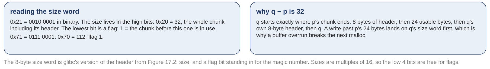{width=100%}
<figcaption markdown="1">Figure 62. Reading the size word bit by bit, and why q − p is 32. From slide 30.</figcaption>
</figure>

In binary 0x21 is 0010 0001 (2 is 0010, 1 is 0001). The size lives in the high bits: 0010 0000 is 0x20 = 32, the whole chunk including its header. The lowest bit is the flag: it says that the chunk just before this one is in use, so `free` can tell, without looking at that chunk, whether it may merge backward. Likewise 0x71 is 0111 0001: 0x70 = 112, flag 1. glibc's chunk sizes are always multiples of 16, so the low 4 bits of the size word are always free for flags. And here is why a heap overflow is dangerous: the first thing after your 24 bytes is `q`'s size word. A program that writes past the end of its **buffer** (a block of memory that holds data, here the 24 bytes at `p`) lands on the next chunk's header, and the allocator believes whatever it finds there. The header is a real 8-byte word right before every pointer `malloc` gives you.

To run it yourself on the Ubuntu machine (or any x86-64 Linux with glibc): `gcc -Wall -O0 -o hdr hdr.c && ./hdr` (the `&&` runs the second command only if the first succeeded). No `sudo` is needed. Your addresses will differ, because Linux places the heap at a different address on every run; 0x21, 0x71, 24, 104 and 32 will not.

### Extra 7 <span class="lbl lbl-deeper">Deeper, Q2</span> The free list lives inside the free space itself {#extra-7 data-toc-label="Extra 7 [Deeper, Q2] The free list lives inside the free space itself"}

An allocator needs a list of its free chunks, and the list has to be stored somewhere. Inside `malloc` there is nothing to allocate it with: you cannot call `malloc` for a list node from inside `malloc`. The trick: a free chunk is empty by definition, so write the list node into its own first bytes. Figure 63 is the node and the code that builds the first one.

<figure markdown="1">
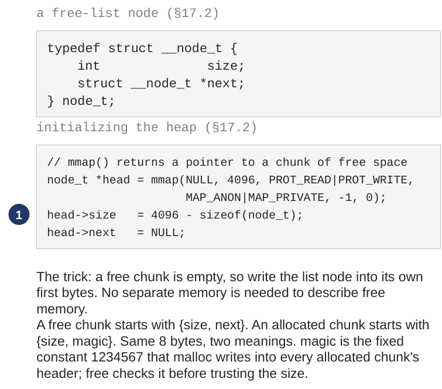{width=60%}
<figcaption markdown="1">Figure 63. A free-list node, the code that makes one 4 KB chunk into a heap with a one-node list, and the trick in words. From slide 31, following textbook section 17.2.</figcaption>
</figure>

A node of the list has two fields: `size`, the size of the free chunk, and `next`, a pointer to the next node. The heap is one 4 KB region, obtained here with **mmap**, a system call that gives a process a fresh region of memory (the arguments ask for 4096 bytes, readable and writable, not backed by any file; `NULL` lets the kernel choose the address). Then circle 1: the code treats the first bytes of that region as a node, writes size 4096 − 8 = 4088 (the textbook assumes a 32-bit machine, where a pointer and an `int` are 4 bytes each, so its node is 8 bytes; on the 64-bit machines of this course the same node would take 16 bytes, like the header of [Section 3.2](#sec-3-2)) and `next` = `NULL`. One list entry, and it cost no memory of its own. The text under the code says the second half of the trick: a free chunk starts with {size, next}, and an allocated chunk starts with {size, magic}. The same 8 bytes carry two meanings, depending on who holds the chunk.

<figure markdown="1">
{width=92%}
<figcaption markdown="1">Figure 64. The textbook's Figures 17.3 and 17.4: the 4 KB heap at 16384 with one free chunk, then after malloc(100). From slide 31.</figcaption>
</figure>

The heap sits at virtual address 16 KB, which is 16 × 1024 = 16,384. On the left (Figure 17.3) is one green node at the top, size 4088, next 0, and the rest of the 4 KB free below it. On the right (Figure 17.4) the program has called `malloc(100)`. The allocator needs 100 + 8 = 108 bytes, splits the chunk, and writes an amber header at 16,384 with size 100 and the magic number. The caller's pointer is 8 bytes later, 16,392. The green node moves down by 108 bytes to 16,384 + 108 = 16,492 and shrinks to 4088 − 108 = 3980. The next two drawings keep this layout: allocated chunks blue, free chunks gray, headers of allocated chunks amber, free-list nodes green. Only the numbers move.

### Extra 8 <span class="lbl lbl-deeper">Deeper, Q2</span> Freeing chunks, with and without coalescing {#extra-8 data-toc-label="Extra 8 [Deeper, Q2] Freeing chunks, with and without coalescing"}

[Extra 7](#extra-7) built a heap with one free node. This extra makes two more allocations, frees one chunk in the middle, then frees the rest the wrong way on purpose, to show what a free list looks like without coalescing. Figure 65 is the first half.

<figure markdown="1">
{width=100%}
<figcaption markdown="1">Figure 65. The textbook's Figures 17.5 and 17.6: three 100-byte chunks allocated, then the middle one freed. From slide 32.</figcaption>
</figure>

After three calls of `malloc(100)` (left, Figure 17.5), the first 3 × 108 = 324 bytes are taken: a header and 100 bytes, three times, at 16,384, 16,492 and 16,600 (each 108 after the last). The free list is still one node, now at 16,384 + 324 = 16,708, with 4088 − 324 = 3764 bytes. Figure 66 says what happens next.

<figure markdown="1">
{width=45%}
<figcaption markdown="1">Figure 66. Three splits and one list entry; free(16500); insert at the head. From slide 32.</figcaption>
</figure>

The program frees the middle chunk. Its pointer is 16,500: the start of the heap, 16,384, plus the 108 of the first chunk, plus the 8-byte header of this one (16,384 + 108 + 8 = 16,500; `sptr` in the figure). `free` steps back 8 bytes to the header at 16,492, and those 8 bytes change meaning from {size, magic} to {size, next}. This allocator inserts at the head of the list, so `head` now points at 16,492, whose `next` is the old head, 16,708 (right, Figure 17.6). Two entries at last: a small hole of 100, then the big chunk. That is the normal state of a heap: holes of assorted sizes, in the order they happened to be freed.

<figure markdown="1">
{width=45%}
<figcaption markdown="1">Figure 67. The textbook's Figure 17.7: the last two chunks freed without coalescing. From slide 33.</figcaption>
</figure>

Now the last two allocated chunks come back, and the allocator makes the classic mistake: it only pushes each onto the list, with no coalescing. Every byte of the heap is free. But the list (Figure 67) has four green nodes, 100, 100, 100 and 3764, and `head` points into the middle, at 16,600, because that chunk was freed last. Figure 68 draws the same list as a list.

<figure markdown="1">
{width=91%}
<figcaption markdown="1">Figure 68. The same list drawn as a list, and what a request for 3800 bytes meets. From slide 33.</figcaption>
</figure>

It reads 16,600, 16,384, 16,492, 16,708: free order, not address order, so neighbors do not even sit next to each other in the list. The free bytes add up to 100 + 100 + 100 + 3764 = 4064, which is 4096 minus four 8-byte headers (4096 − 32 = 4064). Compare it with the 4088 free bytes of the single chunk at the start: each of the three chunks handed out brought a header of its own, 3 × 8 = 24 bytes, and those headers stay in place after the chunks are freed, so 4088 − 24 = 4064. Coalescing would merge the four chunks and win those 24 bytes back. A request for 3800 bytes walks the list and fails: no hole holds 3800, though 4064 bytes are free. A request for 200 would succeed from the 3764-byte chunk, but only after skipping three useless holes first. The textbook calls this a big mess, and Figure 69 is the fix.

<figure markdown="1">
{width=81%}
<figcaption markdown="1">Figure 69. The fix is coalescing; and what an allocator does when the heap itself runs out. From slide 33.</figcaption>
</figure>

Coalesce: walk the list and merge chunks whose addresses touch. 16,384 + 108 = 16,492, 16,492 + 108 = 16,600, and 16,600 + 108 = 16,708, so all four touch, end to start. Merged, one node at 16,384 with size 4088 remains, exactly Figure 17.3: the heap is whole again. The gray card adds one last mechanism. When the whole heap is too small, an allocator may return `NULL`, which is honest if unhelpful. Most instead ask the OS for more with a system call, `sbrk` on Unix (the family of systems Linux belongs to): the OS finds free physical memory, adds it to the end of the address space, and reports where the heap now ends. That is heap growth seen from the library's side. A free list is only as honest as its coalescing, and `umalloc.c` coalesces on every free ([Extra 11](#extra-11)).

### Extra 9 <span class="lbl lbl-deeper">Deeper, Q2</span> Fit policies: best, worst, first and next fit, with a verdict on each {#extra-9 data-toc-label="Extra 9 [Deeper, Q2] Fit policies: best, worst, first and next fit, with a verdict on each"}

[Section 3.1](#sec-3-1) ran three policies on one list to show that each leaves a sliver. When several holes fit, though, the choice also has a price in time, and the textbook gives each policy a verdict. Figure 70 is the deck's exercise; do it before reading the table.

<figure markdown="1">
{width=100%}
<figcaption markdown="1">Figure 70. Three holes and one request: which hole does each strategy take? From slide 34, following textbook section 17.3.</figcaption>
</figure>

The list from the head holds holes of 10, 30 and 20 bytes, and a request arrives for 15 (headers ignored). Best fit scans every hole and takes the smallest one that is big enough. Worst fit scans every hole and takes the largest. First fit walks from the head and stops at the first hole that fits. For each, write the list as it looks afterwards. Then two more things: which strategies walked the whole list and which could stop early, and whether each leftover is a useful hole or a sliver nobody will ask for.

<figure markdown="1">
{width=100%}
<figcaption markdown="1">Figure 71. The answers, the search cost, and the textbook's verdict on each strategy, with the tip of section 16.6. From slide 35.</figcaption>
</figure>

Best fit takes the 20 and leaves 5: 10, 30, 5. Least waste on this request, a 5-byte sliver nobody will want, and a scan of every hole. Worst fit takes the 30 and leaves 15: 10, 15, 20. The hope is to keep big holes big, but studies are blunt: worst fit leads to more fragmentation and still has the cost of a full scan. First fit walks: 10 is too small, 30 fits, stop. The same list as worst fit here, by accident, but cheaper: two holes examined instead of three. Its weakness is that slivers collect at the front of the list, where every search starts. **Next fit** is first fit with a roving pointer: each search begins where the previous one stopped, so the front of the list is not chewed up; its performance is similar to first fit. `umalloc.c` does exactly this ([Section 3.2](#sec-3-2)).

The text under the table adds one more fact: keeping the list in address order makes first fit's coalescing easy (neighbors in memory are neighbors in the list) and tends to lower fragmentation. And the blue bar is the tip once more: if 1000 solutions exist, no great one does; the one real way out is never to allocate memory in variable-sized chunks.

### Extra 10 <span class="lbl lbl-deeper">Deeper, Q3</span> Segregated lists and buddy allocation, both running inside Linux {#extra-10 data-toc-label="Extra 10 [Deeper, Q3] Segregated lists and buddy allocation, both running inside Linux"}

Sections [3.1](#sec-3-1) and [3.3](#sec-3-3) drew a sharp line: variable sizes need a whole toolkit and still leave holes, while one fixed size needs almost nothing. Real kernels live between the two. They cannot hand out only one size, because their requests come in many sizes; but most requests come in a few popular sizes, and memory can be cut so that splitting and merging are cheap. The end of the textbook's chapter 17 describes two such ideas, and both run inside the Linux kernel on the Ubuntu machine right now. Figure 72 is the first.

<figure markdown="1">
{width=74%}
<figcaption markdown="1">Figure 72. Segregated lists, one list per popular size, and Linux's slab caches read from /proc/slabinfo. From slide 36, following textbook section 17.4.</figcaption>
</figure>

**Segregated lists**: when a program keeps asking for one or two sizes, give each popular size its own free list. Inside such a list every chunk has the same size, so there is no search, no splitting, and no fragmentation within it; all other requests go to a general allocator. The **slab allocator**, written by Jeff Bonwick for the Solaris kernel, does this for kernel objects (an **object** here is one record the kernel keeps, such as a lock or a description of a file). It keeps one cache per object type, made of **slabs**: runs of whole pages cut into equal slots. And it keeps freed objects already initialized, ready to hand out again. (Setting up a kernel object, filling in its fields and preparing its lock, costs time on every creation; keeping freed ones in a ready state skips that work.)

Linux has the same thing, and lists it in `/proc/slabinfo` (readable only by the administrator, hence `sudo`; `grep -E` prints only the lines matching a pattern, here five cache names). Each line is one cache; the columns are the number of objects in use (`active_objs`), the number of slots in all its slabs (`num_objs`), the size of one object in bytes (`objsize`), how many objects fit in one slab (`objperslab`), and how many pages one slab takes (`pagesperslab`). The `task_struct` line is the kernel's record for one running task (a process, or one **thread** of a process: a process can run several streams of instructions at once, each called a thread, all sharing one address space; a later block of the course covers them): 5824 bytes each, 5 in every slab of 8 pages, 110 in use out of 120 slots. `kmalloc-64` is a **size class**: a cache for every request between 33 and 64 bytes (the next smaller class, `kmalloc-32`, takes everything up to 32), whatever kind of object it is; 64 slots of 64 bytes fill one 4 KB page exactly (64 × 64 = 4096). Figure 73 draws both.

<figure markdown="1">
{width=80%}
<figcaption markdown="1">Figure 73. One task_struct slab drawn to scale, and one kmalloc-64 page. From slide 37.</figcaption>
</figure>

One `task_struct` slab is 8 pages, 8 × 4096 = 32,768 bytes. Five objects of 5824 bytes take 5 × 5824 = 29,120, so 32,768 − 29,120 = 3,648 bytes are left over in every slab: internal fragmentation, the price of a fixed slot count. 120 slots ÷ 5 slots per slab = 24 slabs. Of the 120 objects, 110 are in use, so 10 objects are pre-initialized and waiting (the amber one is free right now, ready before the next process is created). The `kmalloc-64` page is the other extreme: 64 slots, nothing left over. No search, no split, and no external fragmentation, because every object in the page has the same size; only internal fragmentation, inside a slot: a 40-byte request wastes 64 − 40 = 24 bytes. Figure 74 is the second idea.

<figure markdown="1">
{width=76%}
<figcaption markdown="1">Figure 74. Buddy allocation: only powers of two, the textbook's Figure 17.8, and Linux's /proc/buddyinfo. From slide 36, following textbook section 17.4.</figcaption>
</figure>

**Buddy allocation** hands out only blocks whose size is a power of two. Memory starts as one block of 2^N bytes. A request splits it in halves until the piece just fits: a 7 KB request from a 64 KB block splits 64 into 32 and 32, one 32 into 16 and 16, one 16 into 8 and 8, and hands out an 8 KB block (the dark box in the textbook's Figure 17.8). 8 − 7 = 1 KB is wasted inside it: the price of powers of two. The payoff is on `free`. When the 8 KB block comes back, the allocator checks its **buddy**, the other half of the 16 KB block it was split from. If the buddy is free, the two merge into 16 KB; then that block's buddy is checked, and so on up. Finding the buddy is easy, because a block and its buddy differ in exactly one bit of their address (for 8 KB blocks, the bit worth 8 KB). For example, the 8 KB block at address 16 KB = 16,384 is 0100 0000 0000 0000 in binary, and its buddy at 24 KB = 24,576 is 0110 0000 0000 0000: they differ only in the bit worth 8192, and together they make the 16 KB block that starts at 16 KB. Linux keeps all of physical memory this way, and `/proc/buddyinfo` lists, per **zone** of memory (Linux divides physical memory into a few zones by address range; Normal is the main one), how many free blocks it has of each size. Figure 75 draws the Normal zone's line.

<figure markdown="1">
{width=67%}
<figcaption markdown="1">Figure 75. The zone Normal free lists, one per order, from /proc/buddyinfo. From slide 37.</figcaption>
</figure>

Each **order** k holds free blocks of 2^k pages. Order 0 is single pages, 4 KB: 619 free. Order 3 is 2^3 = 8-page blocks, 32 KB: 1581 free. Order 10 is 2^10 = 1024-page blocks, 1024 × 4 KB = 4 MB: 257 free. A request for 3 pages takes an order-2 block (4 pages) and wastes one page inside it. When a freed block's buddy (the other half of the same block one order up) is also free, the two merge up one order. The 257 free 4 MB blocks are the big contiguous runs the kernel keeps for requests that need them, such as **huge pages** (pages of 2 MB instead of 4 KB, which some programs ask for) and devices that read memory directly.

So the Ubuntu machine runs a buddy system for pages, with slab caches for objects on top of it. Fixed sizes everywhere: slabs for objects, size classes for small requests, powers of two for pages. None of them ever searches a list of holes.

### Extra 11 <span class="lbl lbl-deeper">Deeper, Q3</span> umalloc.c's free and morecore, and the whole file drawn {#extra-11 data-toc-label="Extra 11 [Deeper, Q3] umalloc.c's free and morecore, and the whole file drawn"}

[Section 3.2](#sec-3-2) read `malloc` from `umalloc.c` and promised the other half: `free`, which must coalesce or the list will lie ([Extra 8](#extra-8)), and `morecore`, which grows the heap when nothing fits. Figure 76 is `free`, complete.

<figure markdown="1">
{width=92%}
<figcaption markdown="1">Figure 76. user/umalloc.c, lines 24 to 44: free, complete, with callouts 1 to 3. From slide 38.</figcaption>
</figure>

Circle 1, line 29: `bp = (Header*)ap - 1` steps back one header from the caller's pointer: the `hptr = ptr - 1` of [Extra 5](#extra-5), with this file's 16-byte header. Lines 30 to 32 then walk the list, which is kept in address order, and stop at the node `p` such that the returned chunk `bp` lies between `p` and the node after it (`!` means "not", `&&` means "and", `||` means "or"). Line 31 handles the one place where the circular list wraps around from its highest address back to its lowest, so a chunk beyond either end also finds its spot.

Circle 2, lines 33 to 35: if `bp` ends exactly where the next free chunk begins (`bp + bp->s.size == p->s.ptr`, adding the size in headers), that chunk is absorbed into `bp`: its size is added and its `next` pointer taken over. Coalescing toward larger addresses. Circle 3, lines 38 to 40: if the previous free chunk ends exactly where `bp` begins, `bp` is absorbed into it. Coalescing toward smaller addresses. So `free` merges both ways on every call, and the big mess of [Extra 8](#extra-8) cannot happen here. Line 43 parks the roving pointer at `p`. Figure 77 is the other function.

<figure markdown="1">
{width=59%}
<figcaption markdown="1">Figure 77. user/umalloc.c, lines 46 to 61: morecore, with callouts 4 to 6. From slide 38.</figcaption>
</figure>

Circle 4, lines 52 and 53: never ask for less than 4096 units, because each `sbrk` is a system call and costs far more than a list walk ([Section 3.2](#sec-3-2)). Circle 5, line 54: `sbrk`, the system call that pushes the end of the heap out, asked for `nu * sizeof(Header)` bytes, at least 4096 × 16 = 65,536 bytes = 64 KB. If it fails, `morecore` returns 0. Circle 6, line 59, is the elegant part. The new memory gets a header with its size (line 58), and then it is treated as a chunk being freed: `free` is called on it. Coalescing files it into the list, next to the old end of the heap if they touch, with no special case. Figures 78 and 79 draw the whole file.

<figure markdown="1">
{width=100%}
<figcaption markdown="1">Figure 78. One header, two fields; and the free list: circular, in address order, with base as the zero-size anchor and freep one node before the hole the next search finds. From slide 39.</figcaption>
</figure>

A header is 16 bytes: the next pointer and a size in units. A free chunk uses both; a chunk in use keeps only the size. The list is circular and in address order: `base`, size 0, is an empty anchor so that the list is never empty, then chunks at units 100 (size 6), 300 (size 10) and 900 (size 4), and back to `base`. `freep` is the roving pointer, here over the node at unit 100, and a search begins at the node after it.

<figure markdown="1">
{width=100%}
<figcaption markdown="1">Figure 79. malloc of 3 units split off the end of the hole at unit 300; free merging with touching neighbors; and morecore. From slide 39.</figcaption>
</figure>

`malloc` of 3 units starts at the node after `freep`, the hole at unit 300 with size 10, which fits. (The hole at unit 100, size 6, would fit too, but the search starts after `freep`, so it is not looked at: that is next fit.) The split shrinks the hole from 10 to 10 − 3 = 7 (`p->s.size -= nunits`), and the hole's header does not move. The last 3 units, 307 to 309, get a header at 300 + 7 = 307 with size 3, and the program receives unit 308, one header past it (`return p + 1`). On the right, `free` steps back one header from the returned pointer, finds the spot between its two free neighbors, and merges with each neighbor that touches: first the free chunk at the larger address (lines 33 to 35), then the one at the smaller address (lines 38 to 40). The drawing does not label the three sizes, so its closing "one chunk of size 9 remains" cannot be checked from it; read it as "three touching chunks become one chunk whose size is the sum of the three". And when the walk comes back to `freep` without a fit, `morecore` asks `sbrk` for at least 4096 units (64 KB), writes a header on the new memory, and frees it into the list. Splitting, coalescing, headers, a list inside the free space, next fit, growing the heap: chapter 17 complete, in the 90 lines every lab build links.

### Extra 12 <span class="lbl lbl-deeper">Deeper, Q3</span> kalloc's free list, drawn: free pages that describe themselves {#extra-12 data-toc-label="Extra 12 [Deeper, Q3] kalloc's free list, drawn: free pages that describe themselves"}

[Section 3.3](#sec-3-3) read `kalloc.c` as code. Drawn as the chain of pages it really is, it also shows the moment where the first class meets the second: the pages it hands out become the memory of a running program. Figure 80 is the list.

<figure markdown="1">
{width=100%}
<figcaption markdown="1">Figure 80. The free list before a program's sbrk: a chain of free pages whose first 8 bytes hold the address of the next. From slide 40.</figcaption>
</figure>

`kmem.freelist` points at the first free page, at physical address 0x87f32000. The first 8 bytes of that page hold the address of the next free page, 0x87f24000, whose first 8 bytes point at 0x87f23000, and so on. The list costs no memory of its own: a free page is empty, so its first bytes can hold the pointer. The same trick as the free list inside the free space ([Extra 7](#extra-7)), one level down. Figure 81 is the two operations.

<figure markdown="1">
{width=100%}
<figcaption markdown="1">Figure 81. kalloc pops the head; kfree pushes at the head. From slide 40.</figcaption>
</figure>

`kalloc` takes the first page, points the head at the next, and fills the page with the byte 5, so that reading a page before writing it gives obvious junk rather than a stale copy of its previous owner's data. `kfree` fills the page with the byte 1 and pushes it on the front. Nothing is merged, because every request is one page. The lock around both is the only cost: many processors share one list. Figure 82 shows the list at work.

<figure markdown="1">
{width=100%}
<figcaption markdown="1">Figure 82. What one program's request for three pages took off the head, in order. From slide 40.</figcaption>
</figure>

In the second class a small program, `pgdemo`, asks `sbrk` for three more pages of memory ([Section 5.3](class-2.md#sec-5-3) shows it). Each new page needs a free page of physical memory, and `kalloc` popped them off the head in order: 0x87f32000 first, then 0x87f24000, then 0x87f23000. Each became the home of one page of the program, at virtual addresses 0x4000, 0x5000 and 0x6000, and the kernel wrote one row for each in that program's **page table**, the kernel's record of where each page of the program sits in physical memory. (The second class defines the page table in [Section 4.2](class-2.md#sec-4-2). The table's last column uses its vocabulary: `memset 0` zeroes the page, `mappages` is the kernel function that writes the row, a PTE is one such row, and `rw-u` are its permission letters, read, write and user; [Section 5.2](class-2.md#sec-5-2) explains them.) Fixed-size units turn the whole allocator into push and pop, and that is why paging can afford to hand out memory one page at a time.
