# Second class: pages, and the cache that makes them affordable (OSTEP 18, 19) {#class-2}

## <span class="lbl lbl-roadmap">Roadmap</span> Recap and roadmap of the second class {#opening-2 data-toc-label="[Roadmap] Recap and roadmap of the second class"}

The second class picks up exactly where the first ended, on one sentence: the only real fix for external fragmentation is to stop handing out variable sizes. Figure 83 is the first class in one picture, the way the deck opens the second.

<figure markdown="1">
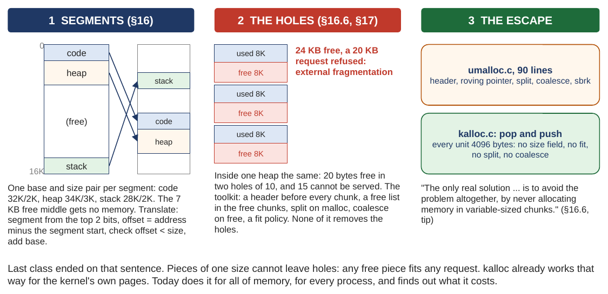{width=90%}
<figcaption markdown="1">Figure 83. The first class in three steps: segments, the holes they leave, and the one escape. From slide 43.</figcaption>
</figure>

Step 1 was the segment: one contiguous piece of the address space, placed on its own with a base and a size. Follow the three arrows: the empty middle has none, so it costs nothing (one base and size pair per segment: code 32K/2K, heap 34K/3K, stack 28K/2K; translate by the top 2 bits, offset from the low bits, check offset < size, add base). Step 2 was the price. Segments differ in size, so memory ends up with small holes between the used parts: 24 KB free in three holes, and a 20 KB request refused. That is external fragmentation. One heap has the same trouble: 20 bytes free in two holes of 10, and 15 cannot be served. An allocator copes with a header, a free list, splitting, coalescing and a fit policy, and the holes stay. Step 3 was the two files in your xv6 tree: `umalloc.c` has the whole toolkit in 90 lines, and `kalloc.c` has none of it, because its units are all one page. And the sentence the first class closed on, the tip of the textbook's section 16.6: the only real solution is to avoid the problem altogether, by never allocating memory in variable-sized chunks.

<figure markdown="1">
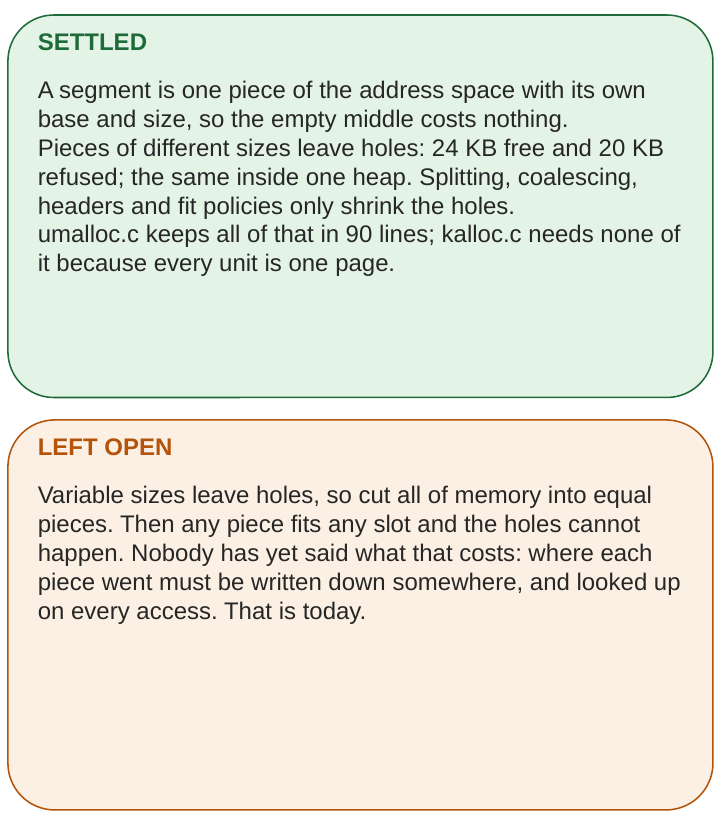{width=58%}
<figcaption markdown="1">Figure 84. What the first class settled, and what it left open. From slide 43.</figcaption>
</figure>

Settled: the empty middle costs nothing, and we know exactly what holes cost. Left open: pieces of one size cannot leave holes, because any free piece serves any request, and `kalloc` already does this for the kernel's own pages. Doing it for all of memory, for every process, has a price nobody has named yet: a record of where every piece went, consulted on every access. That price is the second class.

So the second class asks three questions, in the order chapters 18 and 19 of the textbook ask them. Figure 85 is the deck's list.

<figure markdown="1">
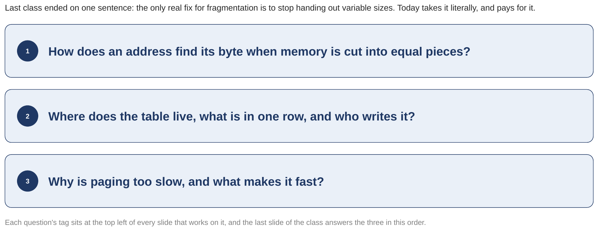{width=100%}
<figcaption markdown="1">Figure 85. The three questions of the second class. From slide 44.</figcaption>
</figure>

The first is the mechanism: if equal pieces can go anywhere, how does an address the program uses find its byte ([Chapter 4](#chapter-4))? The answer is arithmetic on bits plus one table. The second is the table itself: it is far too big to sit in the processor, so where does it live, what is in one row, and who writes the rows ([Chapter 5](#chapter-5))? The guide reads a real one out of a running xv6. The third is the cost: a table in memory means every access first reads the table, so paging doubles the work; what makes it fast ([Chapter 6](#chapter-6))? The answer is a small hardware cache of recent rows, and the guide counts how well it works. The summary of the week collects the answers, and Extras [13](#extra-13) to [24](#extra-24) go deeper.

## Chapter 4. How does an address find its byte when memory is cut into equal pieces? {#chapter-4}

*The question this chapter answers: How does an address find its byte when memory is cut into equal pieces?*

### 4.1 <span class="lbl lbl-problem">Problem</span> Variable sizes leave holes, so cut memory into equal pieces {#sec-4-1 data-toc-label="4.1 [Problem] Variable sizes leave holes, so cut memory into equal pieces"}

What we have is pieces of different sizes: segments, and `malloc` chunks. The one allocator that never struggled, `kalloc.c`, deals in a single size: every unit is one page. Where it breaks is the holes: 24 KB free in three 8 KB holes, and a 20 KB request refused. Compaction is too expensive, and clever fits only shrink the holes. Figure 86 is the deck's problem slide, with the tip that closed the first class written across its top.

<figure markdown="1">
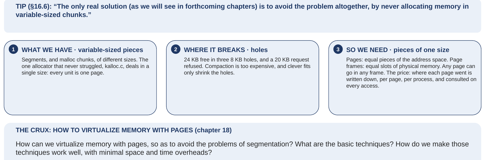{width=100%}
<figcaption markdown="1">Figure 86. The tip of textbook section 16.6, the problem in three cards, and the crux of chapter 18. From slide 45.</figcaption>
</figure>

So what we need is to take the tip literally, for all of memory. Cut the address space into equal pieces; each one is a **page**, a fixed-size unit of the address space. Cut physical memory into slots of exactly the same size; each one is a **page frame** (or just **frame**), a fixed-size slot of physical memory that holds one page. Any page may sit in any free frame, so a hole can never be too small again: every free frame fits every page. Using pages this way is called **paging**. The price, on the third card: if pieces can go anywhere, somebody must remember where each one went, for every page of every process, and that record must be consulted on every access.

That is the crux of chapter 18, on the lower card: how can we virtualize memory with pages, so as to avoid the problems of segmentation; what are the basic techniques; and how do we make those techniques work well, with minimal space and time overheads? (To **virtualize** memory is to give each process the illusion of its own private memory, the job of the whole memory block of the course.) The gray line under it is the textbook's framing: there are two approaches to any space-management problem, variable-sized pieces or fixed-sized pieces. The first class tried the first. Paging is the second, and it goes back to the Atlas, a British computer of the early 1960s. The plan is the usual one: a tiny example first, so the arithmetic is visible; then the real kernel; then the cost.

### 4.2 <span class="lbl lbl-concept">Concept</span> The page table: any page in any frame, and a table that says which {#sec-4-2 data-toc-label="4.2 [Concept] The page table: any page in any frame, and a table that says which"}

The previous section ended on the price of paging: a record of where each page went. This section draws that record for an address space small enough that every number fits on one page. Figure 87 is the textbook's example.

<figure markdown="1">
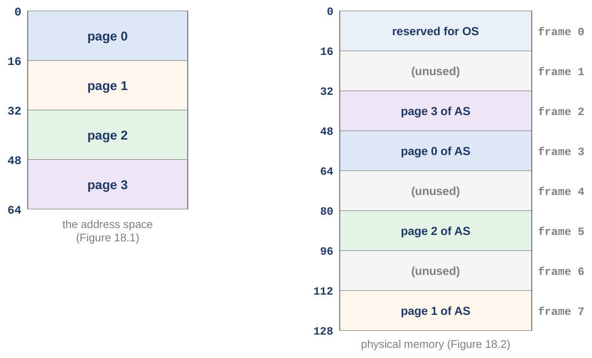{width=89%}
<figcaption markdown="1">Figure 87. The textbook's Figures 18.1 and 18.2: a 64-byte address space cut into four 16-byte pages, placed in a 128-byte physical memory of eight frames. From slide 46.</figcaption>
</figure>

On the left is the address space of one process: 64 bytes, addresses 0 to 63, cut into 4 pages of 16 bytes (64 ÷ 16 = 4). Page 0 is bytes 0 to 15, page 1 is bytes 16 to 31, page 2 is 32 to 47, and page 3 is 48 to 63. Each page has a color so you can follow it. In the middle is physical memory: 128 bytes, cut into 8 frames of the same 16 bytes (128 ÷ 16 = 8), numbered 0 to 7. Frame 0 is reserved for the OS (the kernel's own code and data have to be somewhere). The labels in the middle column use the textbook's abbreviation **AS** for address space, so "page 3 of AS" in frame 2 means "page 3 of this process's address space lives in frame 2". Look where the colors went: page 0 is in frame 3, page 1 in frame 7, page 2 in frame 5, and page 3 in frame 2. Scattered, out of order, and that is allowed. Frames 1, 4 and 6 are unused.

<figure markdown="1">
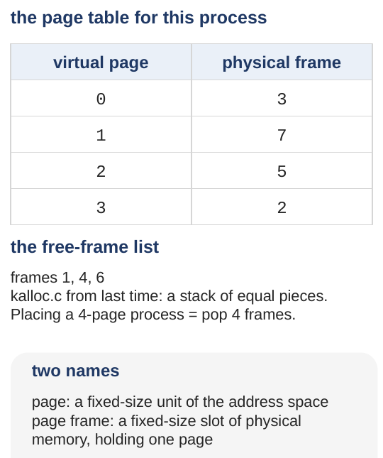{width=45%}
<figcaption markdown="1">Figure 88. The page table for this process, the free-frame list, and the two names. From slide 46.</figcaption>
</figure>

The record of where each page went is called the **page table**: a per-process data structure with one entry per virtual page, saying which physical frame holds that page. For this process it has four entries: 0 → 3, 1 → 7, 2 → 5, 3 → 2. Every process has its own page table, because every process has its own address space: another process's page 0 is a different page, in a different frame, and that process's table says where.

The free-frame list under the table is where the first class pays off. The OS keeps a list of the frames nobody is using: 1, 4 and 6 here. Placing this 4-page process meant popping 4 frames off such a list, which is exactly what `kalloc.c` does ([Section 3.3](class-1.md#sec-3-3)): a stack of equal pieces, pop one when someone needs a page. And the two names to keep apart: a page is a piece of the address space; a frame is a slot in the chips. The bar at the bottom of the slide adds one more advantage the textbook names: flexibility. Paging makes no assumption about which way the heap and the stack grow, or how a process uses its address space.

### 4.3 <span class="lbl lbl-example">Worked example</span> Translating address 21: split, look up, glue {#sec-4-3 data-toc-label="4.3 [Worked example] Translating address 21: split, look up, glue"}

The table of the previous section says where each page lives. What is still missing is how one access uses it: the program says an address, and the hardware must find the right byte in the chips. Suppose the program executes an instruction that loads the byte at virtual address 21. Figure 89 shows the whole calculation.

<figure markdown="1">
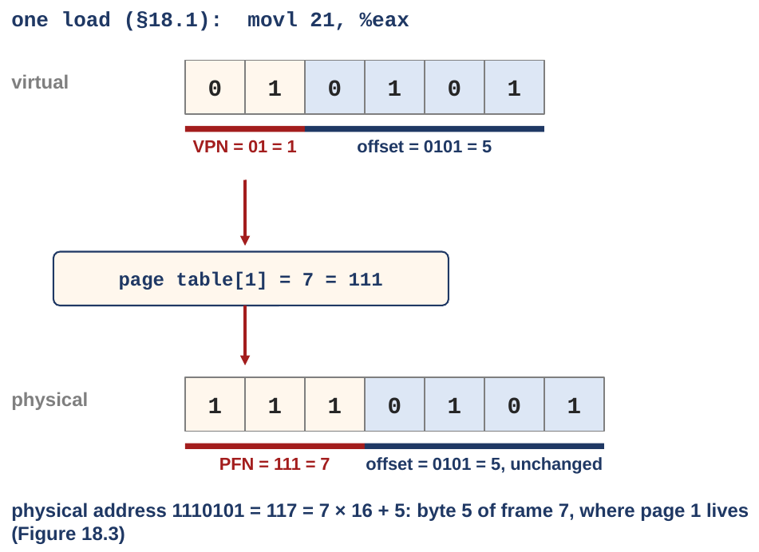{width=76%}
<figcaption markdown="1">Figure 89. Virtual address 21 split into a page number and an offset, the page number looked up in the table, and the frame number glued onto the offset. From slide 47, following textbook section 18.1.</figcaption>
</figure>

The line at the top, `movl 21, %eax`, is the textbook's example instruction, written for x86: "load the value at address 21 into the register called eax" (`movl` is x86's instruction for moving a 4-byte value; the textbook only cares that it reads address 21).

Step 1: write the address in binary, using six bits, because the address space has 64 = 2^6 bytes. 21 = 16 + 4 + 1, so it is 010101.

Step 2: split it. The address space has four pages, so two bits are enough to say which page (2^2 = 4). Each page holds sixteen bytes, so four bits are enough to say which byte inside the page (2^4 = 16). So the top two bits are the page number and the bottom four bits are the position inside the page. The top two bits of 010101 are 01, which is page 1. The bottom four bits are 0101, which is 4 + 1 = 5. So virtual address 21 is byte 5 of page 1. Check this: page 1 starts at byte 16, and 16 + 5 = 21.

Now the names. The page number, taken from the virtual address, is the **virtual page number**, written **VPN**. The position inside the page is the **offset**, the same word as in [Chapter 1](class-1.md#chapter-1): the distance from the start of the piece. The frame number that comes out of the table is the **physical frame number**, written **PFN**. You will see these three for the rest of the guide, so say them once: VPN, offset, PFN.

Step 3: look up the VPN in the page table. Row 1 of the table says frame 7. In binary, with three bits because there are eight frames (2^3 = 8), 7 is 111. Notice that the frame number is one bit wider than the page number. That is because physical memory in this example (128 bytes, eight frames) is twice the size of the address space (64 bytes, four pages), so a physical address needs one more bit than a virtual one. The offset keeps the same four bits on both sides, since a page and a frame are the same size.

Step 4: glue. Put the frame number where the page number was, and keep the offset exactly as it is. 111 followed by 0101 gives 1110101. That is 64 + 32 + 16 + 4 + 1 = 117. Check this another way: frame 7 starts at byte 7 × 16 = 112, and byte 5 of that frame is 112 + 5 = 117. Same answer. So virtual address 21 is physical address 117: the program said 21; the memory chips see 117. Figure 90 states the three things to notice as rules.

<figure markdown="1">
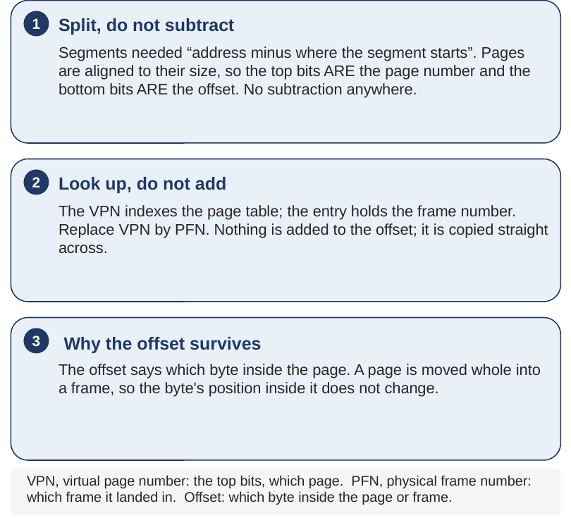{width=65%}
<figcaption markdown="1">Figure 90. The three rules of paged translation: split, do not subtract; look up, do not add; why the offset survives. From slide 47.</figcaption>
</figure>

First, **split, do not subtract**. Segments needed "address minus where the segment starts" ([Section 1.4](class-1.md#sec-1-4)); the top-bits design of [Section 1.5](class-1.md#sec-1-5) already turned that subtraction into a mask, and pages carry the same idea to all of memory. Pages start at multiples of their size, 0, 16, 32 and 48 here, so the top bits *are* the page number and the bottom bits *are* the offset. Splitting is free; there is no subtraction anywhere. Second, **look up, do not add**. The table gives you a frame number, and you replace the VPN with the PFN. You do not add the two together. Third, **the offset survives**. A page is moved into a frame whole, so a byte's position inside it does not change, and the offset is copied straight across, untouched.

Three verbs, then: split, look up, glue. Every translation in this guide is those three verbs. The bar at the bottom of the slide puts the three designs side by side: base and bounds, one add; segments, subtract, compare, add; paging, split, look up, glue. (The segments' "subtract" is the meaning of the offset; [Section 1.5](class-1.md#sec-1-5) showed the hardware does it with a mask. What paging removes for good is the compare against a size and the add.) The look-up is the new cost, because the table is somewhere in memory, and that cost is the rest of the class.

### 4.4 <span class="lbl lbl-check">Your turn</span> Translating 50, 63 and 64 {#sec-4-4 data-toc-label="4.4 [Your turn] Translating 50, 63 and 64"}

The three steps of the previous section are easy to follow when someone else does them; the way to own them is to do them on a different address. Before you read further, translate three more addresses in the same 64-byte address space, with the same page table (0 → 3, 1 → 7, 2 → 5, 3 → 2). Figure 91 is the deck's exercise, with the steps left blank.

<figure markdown="1">
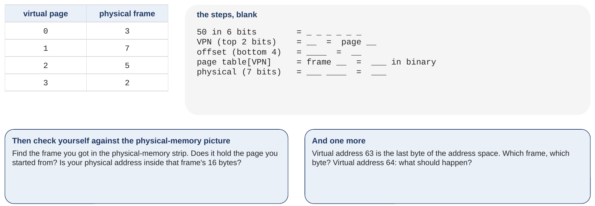{width=100%}
<figcaption markdown="1">Figure 91. Translate virtual address 50 with the steps left blank, then check against the physical-memory picture; and two more, 63 and 64. From slide 48.</figcaption>
</figure>

Five blanks, in the order the hardware fills them: 50 in six bits; the VPN, the top two bits; the offset, the bottom four; the frame from the table, in binary; and the physical address in seven bits. Binary first, then the table, then glue. Then check yourself against the physical-memory picture of Figure 87: the frame you got should hold the page you started from, and your physical address should be inside that frame's 16 bytes. And one more pair: virtual address 63 is the last byte of the address space; which frame, which byte? And virtual address 64: what should happen? (That last one is a trick; think about how many bits it needs.)

These are Exercises 6, 7 and 8 at the end of the guide, and the worked answers, with the deck's answer drawings, are in the answers section. Do them first. The answer to the last one leads into a question this chapter cannot answer yet: what if an address fits in six bits but its page was never given a frame? The table then needs a way to say "nothing here", and [Section 5.2](#sec-5-2) gives it one.

### 4.5 <span class="lbl lbl-machine">Real machine</span> Four neighboring pages of a real process land in scattered frames {#sec-4-5 data-toc-label="4.5 [Real machine] Four neighboring pages of a real process land in scattered frames"}

Everything so far was the 64-byte toy, and a fair question is whether a real machine really scatters a process's pages, and really copies the offset through. The deck answers it on the Ubuntu 24.04 x86-64 machine, where a page is 4 KB and an address has 48 bits (both design facts of the x86-64 processor; [Section 5.1](#sec-5-1) says more about the 48), with a program that reads its own page table. Figure 92 is the part of the program that matters.

<figure markdown="1">
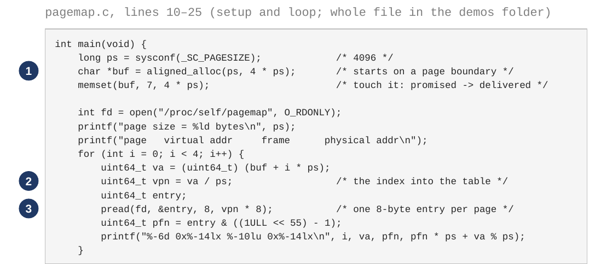{width=87%}
<figcaption markdown="1">Figure 92. pagemap.c, lines 10 to 25: ask for four pages, touch them, then ask Linux which frame holds each one. From slide 50.</figcaption>
</figure>

You do not need to follow every line; the whole file is listed at the end of this section, with every C word explained. Here is what it does. Circle 1: it asks for a piece of memory that starts exactly at a **page boundary** (an address that is a multiple of 4096, the first byte of some page) and is four pages long. That is the `aligned_alloc` call: its two arguments are the boundary to line up on, 4096, and the size, 4 × 4096 = 16,384 bytes. (`sysconf(_SC_PAGESIZE)` on the line above asks the OS for the page size, 4096.) Then it writes the value 7 into every one of those bytes with `memset`, because Linux does not actually give you a physical frame until you touch the page: a promise is not a delivery (Part 0). Then, for each of the four pages, it asks Linux "which frame is this page in?" and prints the answer.

How can a program ask that? Circles 2 and 3. Linux lets a process read its own page table through a file called `/proc/self/pagemap` (`self` means "the process reading the file"), read-only. The file holds one 8-byte entry per virtual page, indexed by VPN, exactly like the toy table. (It only looks like one long flat table. Linux builds each entry from its real page tables at the moment the file is read; [Section 5.1](#sec-5-1) shows why a real flat table that size could not exist.) The program computes the VPN of each page, the address divided by 4096 (`vpn = va / ps`), reads entry number VPN from the file (`pread`, "read at a chosen position", reads 8 bytes at position VPN × 8), and keeps the low 55 bits of the entry, which hold the frame number. That 55 is Linux's choice for the layout of this file: an 8-byte entry is 64 bits, numbered 0 to 63 from the right, and Linux puts the frame number in bits 0 to 54 (54 − 0 + 1 = 55 bits) and uses the top bits as single yes-or-no **flags**; bit 63 says whether the page is in RAM at all. In the code, `(1ULL << 55) - 1` is a mask of 55 ones (`1ULL` is the number 1 as a 64-bit value, `<<` shifts it left 55 places, which is 2^55, and subtracting 1 turns that single 1 followed by 55 zeros into 55 ones), and `&` keeps those 55 bits.

<figure markdown="1">
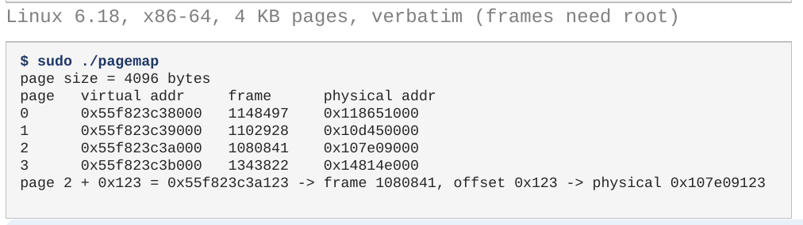{width=81%}
<figcaption markdown="1">Figure 93. The program's output on Ubuntu 24.04 x86-64 with 4 KB pages, verbatim. Reading real frame numbers needs administrator rights, which is why the command starts with sudo. From slide 50.</figcaption>
</figure>

Read the output line by line. `page size = 4096 bytes`: so the offset is 12 bits (2^12 = 4096). Four rows, one per page, with four columns: the page's number in the program (0 to 3), its virtual address, its frame number in decimal, and the physical address of that frame in hex. The virtual addresses go up by 0x1000 each time (0x1000 = 4096, one page): 0x55f823c38000, then ...39000, ...3a000, ...3b000 (the three dots stand for the leading digits, which do not change). Four pages in a row, side by side in the address space, just as the program asked.

The frames do **not** go up in a row: 1148497, then 1102928, then 1080841, then 1343822. Four pages that are neighbors in virtual memory are scattered across physical memory. This is the toy example's lesson, page 0 in frame 3 and page 1 in frame 7, on a real machine. Any page can go in any frame.

The last line does one full translation. Take the address 0x55f823c3a123. Its bottom 12 bits are its last three hex digits (each hex digit is four bits, and 3 × 4 = 12): 0x123, which is 1 × 256 + 2 × 16 + 3 = 291 bytes into the page. That is the offset. Everything above those three digits is the VPN, 0x55f823c3a, which is page 2 of the four (the one at ...3a000). Page 2's frame is 1080841, which in hex is 0x107e09. Slide that up 12 bits, which in hex means writing three zeros after it: 0x107e09000. Glue the offset in: 0x107e09123. That is the physical address the memory chips see.

Check this: 0x107e09 in decimal is 1 × 16^5 + 0 × 16^4 + 7 × 16^3 + 14 × 16^2 + 0 × 16 + 9 = 1,048,576 + 28,672 + 3,584 + 9 = 1,080,841 (e is 14). It matches the frame number in the table, and the `physical addr` column of the same row, 0x107e09000, is that frame number in hex with the three zeros already added. Going the other way, from decimal to hex, is the same idea run backwards, and Exercise 9 asks you to do it. Divide by 16 over and over and write down each remainder: 1,080,841 ÷ 16 = 67,552 remainder 9; 67,552 ÷ 16 = 4,222 remainder 0; 4,222 ÷ 16 = 263 remainder 14, the hex digit e; 263 ÷ 16 = 16 remainder 7; 16 ÷ 16 = 1 remainder 0; 1 ÷ 16 = 0 remainder 1. Read the remainders from the last to the first: 1, 0, 7, e, 0, 9. That is 0x107e09.

Notice how easy hex makes it: with 4 KB pages, the offset is always the last three hex digits and the VPN is everything else. Figure 94 puts the three points of the slide in words.

<figure markdown="1">
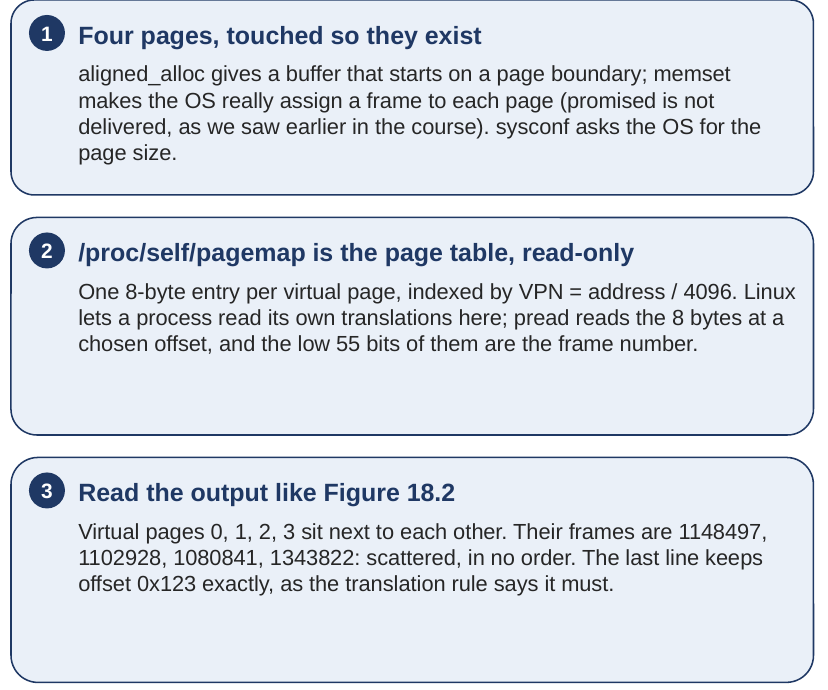{width=66%}
<figcaption markdown="1">Figure 94. Four pages, touched so they exist; /proc/self/pagemap is the page table, read-only; read the output like the textbook's Figure 18.2. From slide 50.</figcaption>
</figure>

Why does the command need `sudo`? Since version 4.0, Linux hides real frame numbers from ordinary programs (they read as 0), because knowing where data physically sits helps certain attacks on memory chips (one is called Rowhammer). An administrator can still see them, which is how this capture was made.

And the bar at the bottom of the slide notes one quiet problem. The program indexed a table that covers the whole address space, one row per page, and on the Ubuntu machine that table is 2^35 rows wide. [Section 5.1](#sec-5-1) does that number. That answers the first question of the class; Figure 95 is the checkpoint.

<figure markdown="1">
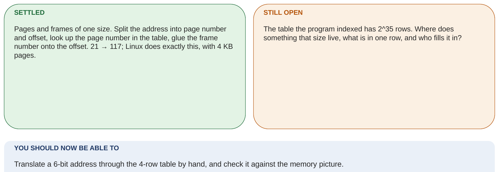{width=100%}
<figcaption markdown="1">Figure 95. Checkpoint 1 of the second class: what the first question settled, what it left open, and what you should now be able to do. From slide 51.</figcaption>
</figure>

Settled: pages and frames of one size. Split the address into page number and offset, look up the page number in the table, glue the frame number onto the offset; 21 becomes 117, and Linux does exactly this, with 4 KB pages. Still open: the table the program indexed has 2^35 rows. Where does something that size live, what is in one row, and who fills it in? You should now be able to translate a 6-bit address through the 4-row table by hand, and check it against the memory picture.

??? note "The program behind Figures 92 and 93 (you can skip this listing)"

    The slide shows lines 10 to 25; here is the whole file, 32 lines. In order, it does this: it asks the OS for the page size; it asks for four page-aligned pages and writes 7 into all of their bytes so that each page really gets a frame; it opens its own pagemap file; it prints a header line; for each of the four pages it computes the page's virtual address and VPN, reads that VPN's 8-byte entry from the file, keeps the low 55 bits as the frame number, and prints one row; and finally it does the same for one byte inside page 2, 0x123 bytes in, and prints the full translation.
    
    The C words you have not met yet: `#include <...>` lines pull in parts of the standard library. `long`, `uint64_t` and `int` are whole-number types (`uint64_t` is exactly 64 bits and never negative). `open` opens a file and returns a small number that names it (`fd`, the file descriptor); `O_RDONLY` means read-only. `printf` prints, filling in each `%` code: `%ld` and `%lu` a long number, `%d` an int, `0x%lx` a number in hex, and the `-6`, `-14`, `-10` set column widths; `\n` ends the line. `for (int i = 0; i < 4; i++)` runs its body four times, with `i` = 0, 1, 2, 3. `buf + i * ps` is the address `i` pages into the buffer. `va % ps` is the remainder after dividing by the page size, which is the offset. `pfn * ps + va % ps` is frame × 4096 + offset, the physical address. Text between `/*` and `*/` is a comment.
    
    ```c
    /* Print where four consecutive virtual pages really live in physical memory.
       Uses /proc/self/pagemap (frame numbers need root on a modern kernel). */
    #include <stdio.h>
    #include <stdlib.h>
    #include <stdint.h>
    #include <string.h>
    #include <fcntl.h>
    #include <unistd.h>
    
    int main(void) {
        long ps = sysconf(_SC_PAGESIZE);             /* 4096 */
        char *buf = aligned_alloc(ps, 4 * ps);       /* starts on a page boundary */
        memset(buf, 7, 4 * ps);                      /* touch it: promised -> delivered */
    
        int fd = open("/proc/self/pagemap", O_RDONLY);
        printf("page size = %ld bytes\n", ps);
        printf("page   virtual addr     frame      physical addr\n");
        for (int i = 0; i < 4; i++) {
            uint64_t va = (uint64_t) (buf + i * ps);
            uint64_t vpn = va / ps;                  /* the index into the table */
            uint64_t entry;
            pread(fd, &entry, 8, vpn * 8);           /* one 8-byte entry per page */
            uint64_t pfn = entry & ((1ULL << 55) - 1);
            printf("%-6d 0x%-14lx %-10lu 0x%-14lx\n", i, va, pfn, pfn * ps + va % ps);
        }
        uint64_t va = (uint64_t) (buf + 2 * ps + 0x123);   /* a byte inside page 2 */
        uint64_t entry; pread(fd, &entry, 8, (va / ps) * 8);
        uint64_t pfn = entry & ((1ULL << 55) - 1);
        printf("\npage 2 + 0x123 = 0x%lx -> frame %lu, offset 0x%lx -> physical 0x%lx\n",
               va, pfn, va % ps, pfn * ps + va % ps);
        return 0;
    }
    ```
    
    To build and run it on the Ubuntu 24.04 x86-64 machine (or any Linux): `gcc -O2 -o pagemap pagemap.c`, then `sudo ./pagemap`. Without `sudo` every frame prints as 0. (The program prints a blank line before its last line, which the slide leaves out.) Your frames and virtual addresses will differ on every run; four neighboring pages in four unrelated frames, and the offset 0x123 copied through, will not.
    
## Chapter 5. Where does the table live, what is in one row, and who writes it? {#chapter-5}

*The question this chapter answers: Where does the table live, what is in one row, and who writes it?*

### 5.1 <span class="lbl lbl-problem">Problem</span> A row for every possible page is too big for the processor {#sec-5-1 data-toc-label="5.1 [Problem] A row for every possible page is too big for the processor"}

What we have is a table with one row per virtual page, indexed by the page number: 4 rows in the 64-byte example, and the row says which frame. `pagemap.c` read the same kind of table on the Ubuntu machine, at VPN × 8 bytes into a file with one row for every page of the whole address space. Figure 96 is the left column of the deck's problem slide.

<figure markdown="1">
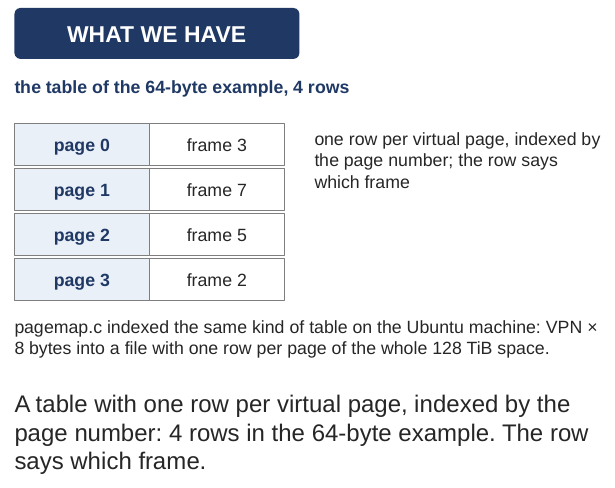{width=49%}
<figcaption markdown="1">Figure 96. What we have: the 4-row table of the 64-byte example, and the same kind of table that pagemap.c read. From slide 52.</figcaption>
</figure>

Where it breaks is the size, because a row exists for every page the process could ever have, used or not. The table's size depends on the address space, not on the program. Figure 97 does the multiplication twice.

<figure markdown="1">
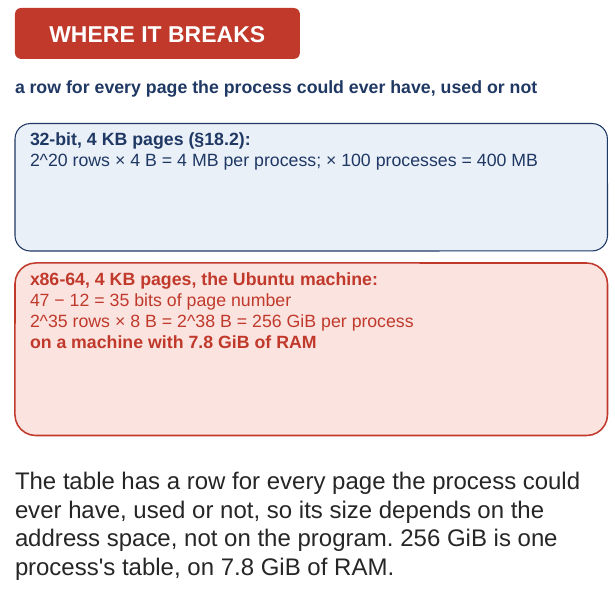{width=49%}
<figcaption markdown="1">Figure 97. Where it breaks: a row for every page the process could ever have, at 32 bits and on the Ubuntu x86-64 machine. From slide 52, following textbook section 18.2.</figcaption>
</figure>

First the textbook's 32-bit machine. A 32-bit address names 2^32 bytes, and a page is 4 KB, which is 2^12 bytes. So the offset is 12 bits and 32 − 12 = 20 bits are left for the VPN: 2^20 rows, about a million (2^20 = 1024 × 1024 = 1,048,576). The textbook allows 4 bytes per row, enough for a 20-bit frame number plus a few flag bits. So one table is 2^20 × 4 = 2^20 × 2^2 = 2^22 bytes, which is 4 × 2^20 bytes = 4 MB. Check it a second way: 1,048,576 × 4 = 4,194,304 bytes, and 4,194,304 ÷ 1,048,576 = 4. And that is per process: with 100 processes running, 400 MB of memory holds nothing but tables.

Now the Ubuntu x86-64 machine. Its addresses are 48 bits long: that is a design fact of the x86-64 processor family (the processor does its arithmetic on 64-bit numbers, but only the low 48 bits of an address are used). Linux cuts the 48-bit space in half, the low half for the program and the high half for the kernel; that is Linux's choice. So a program gets 2^48 ÷ 2 = 2^47 bytes, and 2^47 = 2^7 × 2^40 = 128 × 2^40 bytes, which is the 128 TiB measured last week (a TiB is 2^40 bytes). Take away the 12 offset bits: 47 − 12 = 35 bits of VPN, so 2^35 rows. Each row is 8 bytes on the Ubuntu machine (it has to hold a bigger frame number plus flags; [Section 5.2](#sec-5-2) draws the 8-byte RISC-V entry, which has the same size and the same idea). So the table is 2^35 × 8 = 2^35 × 2^3 = 2^38 bytes, and 2^38 = 2^8 × 2^30 = 256 × 2^30 bytes = 256 GiB. Per process. The machine has 7.8 GiB of RAM in total, so one process's table, built this simple way, would need about 256 ÷ 7.84 ≈ 33 times all the memory in the machine. This cannot be how it is really done.

So what we need is the right column, Figure 98.

<figure markdown="1">
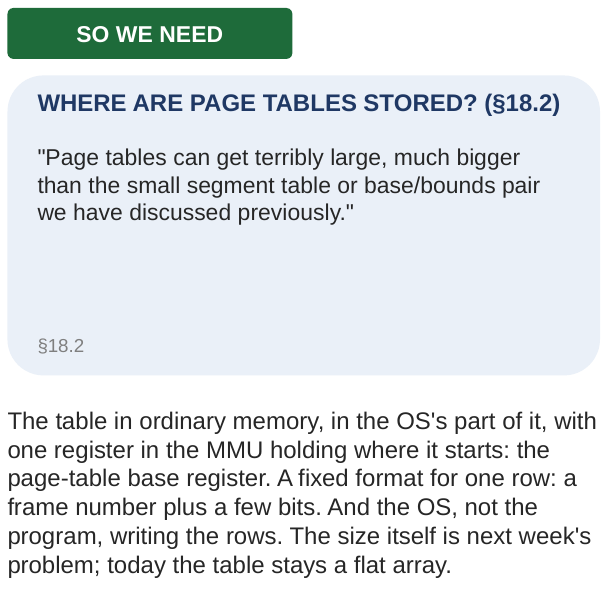{width=49%}
<figcaption markdown="1">Figure 98. So we need: where are page tables stored (textbook section 18.2), and the three things the table needs. From slide 52.</figcaption>
</figure>

Three things. First, the table must sit in ordinary memory, in the OS's part of it, because nothing that size fits inside the processor. The MMU keeps just one register that says where the current process's table starts. That register is the **page-table base register**, **PTBR** in the textbook; on x86 it is called CR3, and on RISC-V, and so in xv6, it is called **satp**. The address in that register is a physical address, and so is every frame number inside the table, so when the MMU reads a row it uses physical addresses directly; the read of the table is never itself translated, which is why the process cannot loop. Second, a fixed format for one row: a frame number plus a few bits. Third, the OS, not the program, writes the rows.

Two words for that. A table kept as one long array, with one entry per virtual page, indexed by the VPN, is a **linear page table**: entry 0 for page 0, entry 1 for page 1, and so on. One row of it is a **page-table entry**, a **PTE**. Because the array starts at the address in the PTBR and every entry has the same size, the hardware finds entry number VPN by arithmetic: PTBR + VPN × (size of one entry). With 8-byte entries, page 1's entry is at PTBR + 8, and page 1000's at PTBR + 8000. The processor computes that address, then reads the entry from memory. Hold on to that last sentence; it is the reason for [Chapter 6](#chapter-6).

The size itself is next week's problem. On a real machine the table is not stored as one flat array but as a tree of small tables, and only the parts in use exist; xv6's function `walk` in `kernel/vm.c` already climbs such a tree, three levels deep. For this week you can keep thinking of the page table as a flat list with one entry per page, and nothing you learn will be wrong. Here is why. The tree answers the same question the flat list answers, which frame holds page N, and gives the same answer. Each entry in the tree looks exactly like an entry in the flat list: a frame number plus flags. Everything this week says about entries (the flag bits, what happens when a page is missing, the shortcut of [Chapter 6](#chapter-6)) works the same way with a tree. The only thing the tree changes is how the hardware finds the entry, and that is the part postponed to next week. So from here on, "the address the hardware starts from" means the PTBR under either picture.

### 5.2 <span class="lbl lbl-kernel">Real kernel</span> The page-table entry: a frame number plus a few permission bits {#sec-5-2 data-toc-label="5.2 [Real kernel] The page-table entry: a frame number plus a few permission bits"}

The previous section asked for a fixed format for one row. Until now a row has been just a frame number, but a row can do more: the empty pages of a sparse address space need a way to say "nothing here" (the virtual 64 of [Section 4.4](#sec-4-4), and every unused page of a real process), and protection needs a place to live now that segments are gone. Figure 99 is the textbook's x86 entry.

<figure markdown="1">
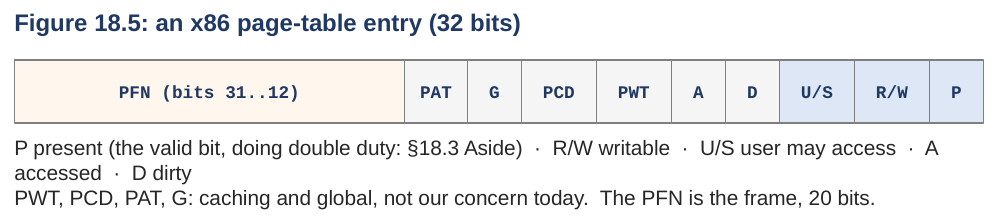{width=80%}
<figcaption markdown="1">Figure 99. The textbook's Figure 18.5: a 32-bit x86 page-table entry. The frame number takes the top 20 bits; the bottom bits are flags. From slide 53.</figcaption>
</figure>

The frame number, PFN, takes bits 31 down to 12, which is twenty bits (31 − 12 + 1 = 20). That is the same width as the VPN of [Section 5.1](#sec-5-1), and not by accident: with 4 KB pages, a 32-bit physical address also splits into a 20-bit frame number and a 12-bit offset, so twenty bits can name any frame of a 4 GB memory (2^20 frames × 2^12 bytes each = 2^32 bytes = 4 GB). The low twelve bits are flags: single bits, each answering one yes-or-no question about the page. Three matter this week.

**P, the present bit**, doing the job of a **valid bit**: if it is 1, this page exists and the frame number means something. If it is 0, there is nothing here: the process never got this page. The hardware checks this bit on every translation, and if it is 0 the hardware refuses the access and traps to the OS. **R/W, read/write**: if it is 0 the page can be read but not written. Pages that hold the program's code are usually read-only, so that a bug, or an attacker, cannot overwrite the program's instructions. **U/S, user/supervisor**: if it is 1 an ordinary program may touch the page; if it is 0 only the OS may. This is how the OS keeps its own pages out of reach.

Two more are worth knowing by name. **A, accessed**, is set to 1 by the hardware itself the first time the page is read or written. **D, dirty**, is set to 1 the first time it is written. The OS reads these later, when it must choose which pages to push out to disk (a later week). The rest, PWT, PCD, PAT and G, control caching and are not our concern this week. Figure 100 is the RISC-V entry that xv6 writes.

<figure markdown="1">
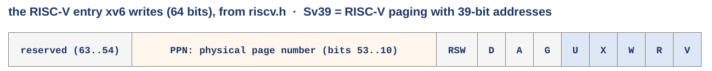{width=100%}
<figcaption markdown="1">Figure 100. The RISC-V entry xv6 writes, 64 bits, as defined in riscv.h. From slide 53.</figcaption>
</figure>

It is the same idea, twice as wide, in a different order. (**Sv39** is the name of the RISC-V paging mode xv6 uses, with 39-bit virtual addresses: a design fact of RISC-V.) The frame number, which RISC-V calls the **PPN** (physical page number, the same thing as the PFN), sits in bits 53 down to 10, which is 44 bits (53 − 10 + 1 = 44). Bits 63 to 54 are reserved and kept 0. The ten low bits, 9 down to 0, are flags: V (valid) at bit 0, R, W, X (read, write, execute) at bits 1, 2 and 3, U (user) at bit 4, G (global) at 5 (it marks a mapping that is the same in every address space, such as the kernel's; xv6 never sets it, and [Extra 23](#extra-23) shows what it is for), A (accessed) at 6, D (dirty) at 7, and two bits called RSW at 8 and 9, reserved for the OS to use however it likes. Figure 101 is the part of `kernel/riscv.h` that names them.

<figure markdown="1">
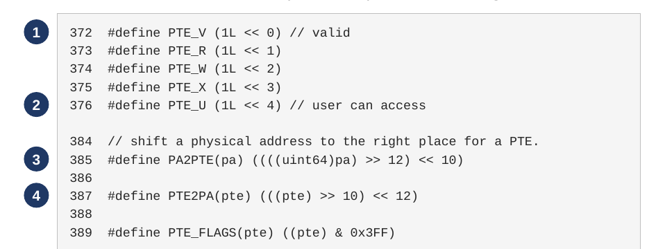{width=76%}
<figcaption markdown="1">Figure 101. kernel/riscv.h, lines 372 to 376 and 384 to 389, verbatim: the flag bits and the macros that move the frame number into and out of its place. From slide 53.</figcaption>
</figure>

Some C. `#define NAME value` gives a name to a value: a **macro**, a named shorthand that the compiler replaces with its definition wherever the name appears. A macro with a parameter, like `PA2PTE(pa)`, works like a small function. In `(1L << 0)`, the `1L` is the number 1 written as a 64-bit value (the L stands for `long`), and `<<` is shift left: slide the bits left by that many places and fill with zeros. So `(1L << 0)` is a 1 in bit 0, and `(1L << 4)` is a 1 in bit 4, which is the number 16. `>>` is shift right, which drops the lowest bits, and `&` keeps only the bits where the mask has a 1, as in [Section 1.5](class-1.md#sec-1-5). [Appendix A](appendix.md#appendix-a) has a table of all four operators.

Circle 1, line 372: `PTE_V` is bit 0, the valid bit. Clear it (make it 0) and a touch of that page traps. In the small example of [Section 4.2](#sec-4-2) all four pages had frames, so the question never came up; if the table had marked page 2 as having no frame, then address 40 (101000 in six bits, so page 10 = 2) would fit in the address bits, land on page 2's row, find the valid bit 0, and trap. Address 64 of Exercise 8 is a different failure: it does not fit in six bits at all, so there is no row to look at. Circle 2, line 376: `PTE_U` is bit 4: user mode (an ordinary program, as opposed to the kernel) may use this page. The kernel's own pages leave it clear, and so does one page under every program's stack. That page is called the **guard page**: it is mapped to a frame, but with U cleared, so a program that pushes past the bottom of its one stack page lands on it and traps, instead of silently overwriting whatever lies below. [Section 5.3](#sec-5-3) shows one in a real table.

Circle 3, line 385: `PA2PTE(pa)` turns a physical address into an entry: shift right 12 to drop the 12 offset bits (leaving the frame number), then shift left 10 to make room for the ten flag bits. The frame number lands in bits 10 and up, exactly as the drawing shows. (`(uint64)` only tells C to treat `pa` as a plain 64-bit number.) Circle 4, line 387: `PTE2PA(pte)` undoes it: shift right 10 to drop the flags, shift left 12 to turn the frame number back into an address. And line 389, `PTE_FLAGS`, keeps just the bottom ten bits with the mask 0x3FF: in binary 11 1111 1111, ten 1s (3 is 0011, so 0x3FF is 0011 1111 1111 with the top two 0s dropped), which is 3 × 256 + 15 × 16 + 15 = 1023. The two macros contain the whole layout of the drawing. The card on the right says the same in words and adds what the other bits do; Figure 102.

<figure markdown="1">
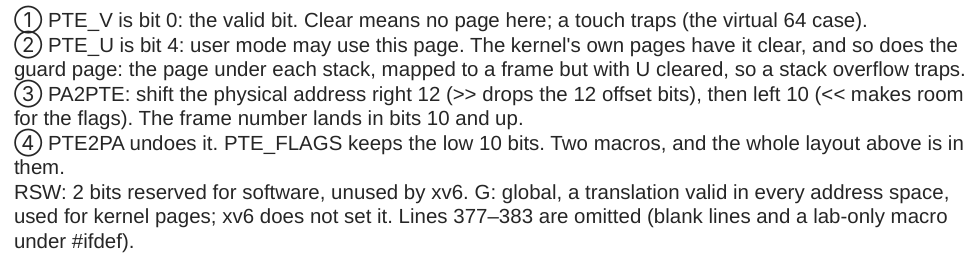{width=78%}
<figcaption markdown="1">Figure 102. The four callouts in words, and the remaining bits: RSW, G, and the lines left out. From slide 53.</figcaption>
</figure>

So one entry answers three questions about one page: which frame, may I touch it, and in what ways. The valid bit answers "is there a page here at all". Last week protection came from one base and bounds pair for the whole process, and the first class of this week gave each segment its own protection bits ([Extra 4](class-1.md#extra-4)); now it lives in every row, a much finer grain.

### 5.3 <span class="lbl lbl-machine">Real machine</span> A real xv6 page table: nine rows describe a whole process {#sec-5-3 data-toc-label="5.3 [Real machine] A real xv6 page table: nine rows describe a whole process"}

The previous two sections said what a row holds and that the OS writes the rows; the last of the three needs, who writes them, deserves a look at the real thing. In xv6 the writer is a kernel function called `mappages`, and the path from a program's `sbrk` call down to it is [Extra 16](#extra-16). This section runs that path and stops the machine to look at the table it produced. Figure 103 is a tiny xv6 program that grows its heap by three pages and then spins in a loop, so that the machine can be paused while the program is running.

<figure markdown="1">
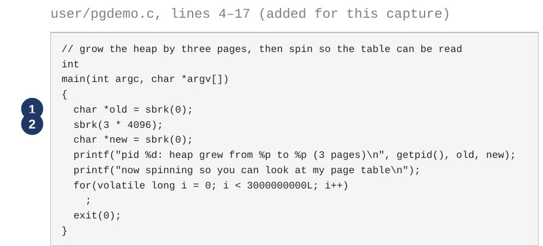{width=71%}
<figcaption markdown="1">Figure 103. user/pgdemo.c, added to the xv6 tree for this capture: grow the heap by three pages, then spin. From slide 54.</figcaption>
</figure>

The program calls `sbrk(0)` to learn where its memory ends (circle 1; asking to grow by 0 bytes just reports the current end), calls `sbrk(3 * 4096)` to grow by three pages (circle 2), calls `sbrk(0)` again, and prints both numbers and its process ID (`getpid()`). Then it counts to three billion in a loop that does nothing (`volatile` stops the compiler from deleting the useless loop), which keeps it running for a while. Figure 104 is what it printed on the **console**, the text window where xv6 prints.

<figure markdown="1">
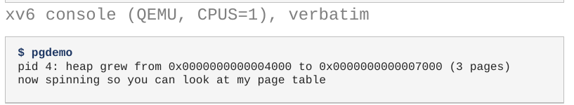{width=65%}
<figcaption markdown="1">Figure 104. The xv6 console under QEMU, with one processor, verbatim. From slide 54.</figcaption>
</figure>

The heap grew from 0x4000 to 0x7000. That is 0x7000 − 0x4000 = 0x3000 bytes, and 0x3000 = 3 × 4096 = 12,288 bytes: three pages, as asked. While the program spins, QEMU (the program that simulates the RISC-V computer xv6 runs on) can be paused from its **monitor**, a small command window built into QEMU, and the monitor command `info mem` prints every valid entry of the page table that satp currently points to. Figure 105 is the complete output.

<figure markdown="1">
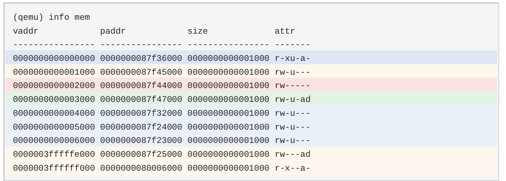{width=82%}
<figcaption markdown="1">Figure 105. The QEMU monitor's info mem, verbatim: every valid entry of the current satp. From slide 54.</figcaption>
</figure>

Four columns: `vaddr` is the virtual address of the page, `paddr` the physical address of its frame, `size` is 0x1000 (one page, 4096 bytes), and `attr` is the flags, one letter per set bit, in the order r w x u g a d, with a dash for each bit that is 0. (There is no letter for the valid bit, because `info mem` only prints entries that have it. The addresses are printed as sixteen hex digits, 64 bits, so 0000000000001000 is just 0x1000.) Read the rows in order. This is the whole memory of one small xv6 process.

0x0000, in the frame at physical address 0x87f36000, flags `r-xu-a-`: readable, executable, user, accessed. Not writable. This is the program's code. The kernel loaded it here and marked it read-only so the program cannot change its own instructions by accident.

0x1000, frame 0x87f45000, `rw-u---`: readable, writable, user. This is the program's data: its global variables (variables declared outside every function, which live for the whole run).

0x2000, frame 0x87f44000, `rw-----`: no `u`. An ordinary program may not touch this page at all. This is the **guard page** of [Section 5.2](#sec-5-2). The stack is the page at the next higher address, 0x3000, and items are pushed onto it toward lower addresses. xv6 gives the stack this one page and never a second one, so if a program pushes past the lowest address of its one stack page (by calling functions too deeply, say), the next address it touches is in this guard page. The guard page has no u bit, so the hardware refuses and traps to the OS, and the OS catches the overflow instead of letting it silently overwrite the data page below at 0x1000. A page with a missing bit, used as a fence: that is protection done with one flag.

0x3000, frame 0x87f47000, `rw-u-ad`: the stack itself. Note the `a` and `d`: it has been read and written, because the program has been running and calling functions.

0x4000, 0x5000, 0x6000, frames 0x87f32000, 0x87f24000, 0x87f23000, all `rw-u---`: the three heap pages that `sbrk` just added, written by `mappages`. They are `rw-u` because the kernel asked for read, user and write ([Extra 16](#extra-16) shows the line). They have no `a` bit because the program has not touched them yet. (The kernel did write zeros into those frames, but the kernel reaches physical memory through a page table of its own, separate from every process's table, so this process's three entries were never used and their `a` bits stayed 0.)

Look at those three frames again: 0x87f32000, 0x87f24000, 0x87f23000, or, dropping the three offset zeros, frame numbers 0x87f32, 0x87f24, 0x87f23. Three consecutive virtual pages, three scattered frames, in decreasing order even (they came off `kalloc`'s free list in that order; [Extra 12](class-1.md#extra-12)). The pagemap picture of [Section 4.5](#sec-4-5), inside xv6. Notice also that xv6 does not use the layout of Part 0, with the heap at low addresses growing toward larger ones, the stack at the high end growing toward smaller ones, and free space between them. xv6's stack is one fixed page that never grows, placed below the heap, and only the heap grows, toward larger addresses, with `sbrk`. With pages the layout is the OS's choice, because any page can go anywhere; the textbook's layout is one common choice, not a rule.

The last two rows are at the very top of the address space. 0x3fffffe000, `rw---ad`, no u: the **trapframe**, a page where the kernel saves the program's registers when it takes over on a trap. 0x3ffffff000, `r-x--a-`, no u: the **trampoline**, the page of kernel code that runs first whenever the program enters the kernel. Both are kernel-only; a program cannot read or write them. The trampoline's frame, 0x80006000, is far from the others: it is part of the kernel's own code, and the same one frame is mapped into every process's table at this same top address, because it is the code that switches page tables (it writes satp, the register that names the table in use; [Section 6.5](#sec-6-5) reads those lines), and it must be findable through both the old table and the new one: the very next instruction after the satp write is fetched through the new table, so the switching code must sit at the same virtual address, in the same frame, in both. Figure 106 is the slide's reading of the nine rows.

<figure markdown="1">
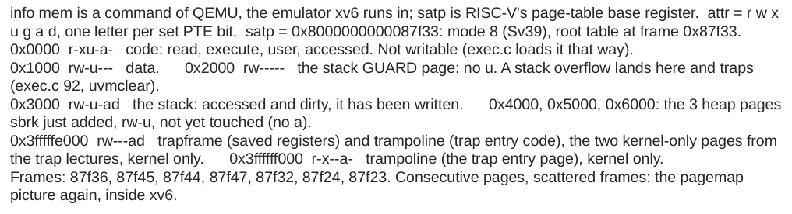{width=81%}
<figcaption markdown="1">Figure 106. The nine rows read on the slide: info mem, satp, the attribute letters, and each row's meaning. From slide 54.</figcaption>
</figure>

One more number from it: satp = 0x8000000000087f33. The 8 in the top hex digit says "Sv39 mode" (a design fact: RISC-V assigns the value 8 to Sv39). The low digits, 0x87f33, are the frame number of the page where this process's table starts, so the table's physical address is 0x87f33000; a page table always starts at a page boundary, so the register saves space by leaving out the twelve zero bits. That is the PTBR of [Section 5.1](#sec-5-1), read straight out of the register: the address the hardware starts from when it looks for an entry.

Between 0x7000 and 0x3fffffe000 there is nothing: no valid entries at all. That gap is nearly the whole address space. xv6 lets a process use addresses up to 2^38 = 256 GiB (one bit below the 2^39 that Sv39 allows, a choice of xv6's authors), and this process uses seven pages at the bottom and two at the top. Nine entries describe the whole process, and the empty space costs nothing, because a page that is never mapped has no valid row and no frame. (In the flat-array picture of [Section 5.1](#sec-5-1) every page has a row, and an unmapped page's row has its valid bit at 0. xv6's real table is a tree, and for most of that gap the parts of the tree that would hold the rows are never built at all; next week shows the tree. Either way the hardware finds no valid entry, and that is all that matters for this week.) And one byte past the heap, 0x7000, has no valid row either (xv6's lowest-level table that covers 0x7000 is the same one that holds the rows for 0x0000 to 0x6000, so that table exists and its row for 0x7000 is present with V = 0; for most of the gap above it, the higher-level tables that would lead to such rows are simply absent), so a touch there traps and the process dies, just as on Linux; [Extra 18](#extra-18) shows that trap on the console. That answers the second question of the class; Figure 107 is the checkpoint.

<figure markdown="1">
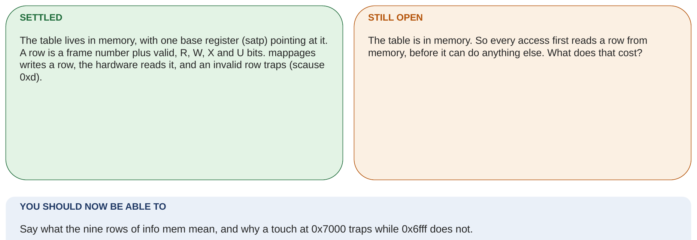{width=100%}
<figcaption markdown="1">Figure 107. Checkpoint 2 of the second class: what the second question settled, what it left open, and what you should now be able to do. From slide 55.</figcaption>
</figure>

Settled: the table lives in memory, with one base register (satp) pointing at it. A row is a frame number plus valid, R, W, X and U bits. `mappages` writes a row, the hardware reads it, and an invalid row traps. The "scause 0xd" on the card is how RISC-V reports that trap: **scause** is a register in which the hardware writes the reason for a trap, and the value 0xd (13) means "load page fault", a read from a page with no valid entry (the RISC-V specification assigns the codes; [Extra 18](#extra-18) shows a real one). Still open: the table is in memory, so every access first reads a row from memory, before it can do anything else. What does that cost? You should now be able to say what the nine rows of `info mem` mean, and why a touch at 0x7000 traps while 0x6fff does not.

??? note "The program behind Figures 103 and 104 (you can skip this listing)"

    The slide shows the program from its comment line down; the whole file adds two `#include` lines at the top, which pull in xv6's type names and its user library (`sbrk`, `printf`, `getpid`, `exit`). In order, the program asks where its memory ends, grows it by three pages, asks again, prints the two ends and its process ID, announces that it is spinning, counts to three billion doing nothing, and exits. `%p` prints an address in hex, `%d` a number. `exit(0)` ends the process.
    
    ```c
    #include "kernel/types.h"
    #include "user/user.h"
    
    // grow the heap by three pages, then spin so the table can be read
    int
    main(int argc, char *argv[])
    {
      char *old = sbrk(0);
      sbrk(3 * 4096);
      char *new = sbrk(0);
      printf("pid %d: heap grew from %p to %p (3 pages)\n", getpid(), old, new);
      printf("now spinning so you can look at my page table\n");
      for(volatile long i = 0; i < 3000000000L; i++)
        ;
      exit(0);
    }
    ```
    
    To run it yourself in the lab's xv6: save it as `user/pgdemo.c`, add `$U/_pgdemo\` to the `UPROGS` list in the `Makefile`, run `make qemu CPUS=1` (`make` is the tool that builds xv6 by following the recipe in the file called `Makefile`; `UPROGS` is the list in that file of user programs to build; `make qemu CPUS=1` builds xv6 and starts it under QEMU with one processor), and type `pgdemo` at the xv6 prompt. While it spins, press Ctrl-a then c to reach the QEMU monitor, type `stop`, then `info mem` (and `info registers` for satp), then `cont`, and Ctrl-a c again to return to the console. The frame numbers come out the same on every run of the same build, because xv6's allocator hands out pages in the same order from boot; they change if the kernel is rebuilt with different code.
    
## Chapter 6. Why is paging too slow, and what makes it fast? {#chapter-6}

*The question this chapter answers: Why is paging too slow, and what makes it fast?*

### 6.1 <span class="lbl lbl-problem">Problem</span> Every access reads the table first: twice the memory references {#sec-6-1 data-toc-label="6.1 [Problem] Every access reads the table first: twice the memory references"}

What we have is the table in memory and a register that names where it starts. To translate one address, the MMU works out the row's position, PTBR + VPN × 8, and reads the row; only after that does it touch the byte the program wanted. Figure 108 is the left column of the deck's problem slide.

<figure markdown="1">
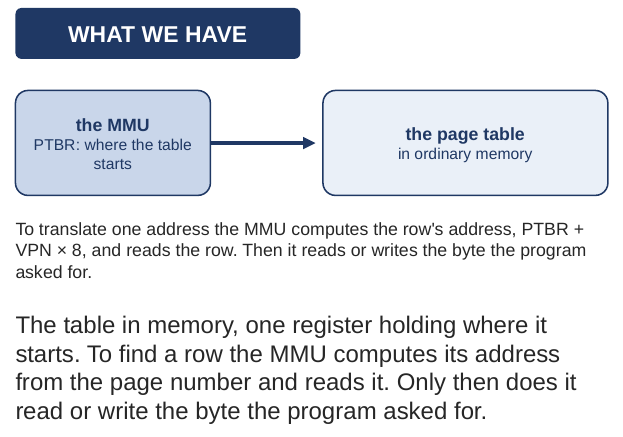{width=50%}
<figcaption markdown="1">Figure 108. What we have: the MMU with its base register, and the page table in ordinary memory. From slide 56.</figcaption>
</figure>

Where it breaks: reading the row is itself a memory access, and it must finish before the program's own access can start. A **memory reference** is any one read or write of memory. A program makes more of them than it seems, because the processor must also read each instruction from memory before running it (an **instruction fetch**): instructions live in pages too. Figure 109 counts the references of a small loop.

<figure markdown="1">
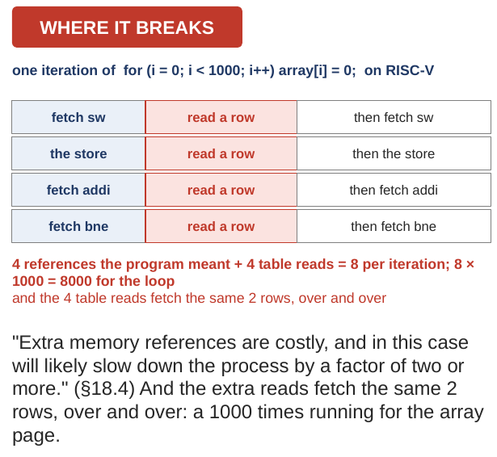{width=49%}
<figcaption markdown="1">Figure 109. Where it breaks: one iteration of a loop that zeroes an array, compiled for RISC-V, with a table read before every reference. From slide 56.</figcaption>
</figure>

The loop is the textbook's: `for (i = 0; i < 1000; i++) array[i] = 0;` sets 1000 array elements to zero. (In C, `for (i = 0; i < 1000; i++)` runs the body 1000 times with `i` = 0, 1, ..., 999, and `array[i]` is element number `i` of the array.) Compiled for RISC-V, the loop body is three machine instructions: `sw`, which stores the 0 into `array[i]`; `addi`, which adds 4 to the address so it points at the next element (each element is a 4-byte integer); and `bne`, which jumps back to the top unless the end has been reached. So one trip around the loop makes 4 references of the program's own: fetch `sw`, do the store, fetch `addi`, fetch `bne`. (Of these, only the store is what the C line asked for; the three fetches come with running any compiled code. All four belong to the program, as opposed to the table reads below, which the hardware adds.) And before each of them the hardware reads a row of the table: 4 more. That is 4 + 4 = 8 references per iteration, and 8 × 1000 = 8000 for the loop, half of them overhead. The textbook says it plainly: extra memory references are costly, and in this case will likely slow down the process by a factor of two or more.

And look at what those extra reads fetch. The three instruction fetches all read the same row, the code page's, three times per trip. The store reads the array page's row, and since an integer is 4 bytes and a page is 4096 bytes, the loop stays on the same array page for 4096 ÷ 4 = 1024 trips in a row (or fewer, if the array starts partway into a page). The hardware is reading the same two rows over and over, a thousand times running.

So what we need is the right column, Figure 110.

<figure markdown="1">
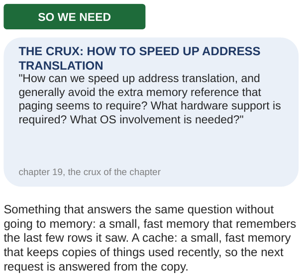{width=49%}
<figcaption markdown="1">Figure 110. So we need: the crux of chapter 19, and something that answers the same question without going to memory. From slide 56.</figcaption>
</figure>

The crux of chapter 19: how can we speed up address translation, and generally avoid the extra memory reference that paging seems to require? What hardware support is required? What OS involvement is needed? Whenever a computer reads the same thing again and again, the fix is a **cache**: a small, fast memory that keeps copies of things used recently, so the next request is answered from the copy instead of from the slow original. Here the things are rows of the page table. So we need a small, fast memory that remembers the last few rows it saw.

### 6.2 <span class="lbl lbl-concept">Concept</span> The TLB: a small cache of translations inside the MMU {#sec-6-2 data-toc-label="6.2 [Concept] The TLB: a small cache of translations inside the MMU"}

The previous section asked for a small, fast memory that remembers the last few rows of the table. It exists in every processor that does paging. Figure 111 first puts the two problems of paging side by side, so it is clear which one this fixes.

<figure markdown="1">
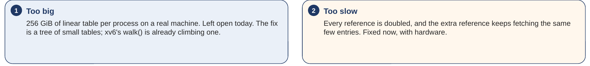{width=100%}
<figcaption markdown="1">Figure 111. The two problems of paging: too big (left open until next week) and too slow (fixed now, with hardware). From slide 57.</figcaption>
</figure>

Too big: 256 GiB of linear table per process on a real machine. That waits until next week, when the flat table becomes a tree of small tables (xv6's `walk` already climbs one). Too slow: every reference is doubled, and the extra reference keeps fetching the same few entries. That one is fixed now, with hardware. Figure 112 shows where the fix sits.

<figure markdown="1">
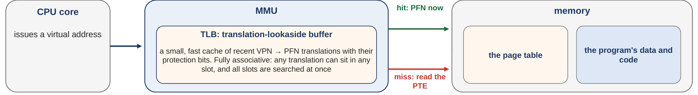{width=100%}
<figcaption markdown="1">Figure 112. Where the TLB sits: inside the MMU, between the processor core and memory. A hit gives the frame number at once; a miss reads the entry from the page table in memory. From slide 57.</figcaption>
</figure>

The **CPU core** on the left is the processor itself, the part that runs instructions (a chip today has several cores, each running its own stream of instructions); it issues a virtual address. The MMU in the middle translates it. Inside the MMU sits the cache for translations: the **TLB**, the **translation-lookaside buffer**. It holds recent translations, each a VPN with its PFN and its protection bits. The name is historical and not very helpful; the textbook says a better name would be an address-translation cache, and that is exactly what it is.

Two words for the rest of the guide. A **hit** is when the VPN you need is already in the TLB: the frame number comes out at once, and the page table is never read. We are back to one memory reference, the one the program asked for. A **miss** is when it is not: the slow path runs once, reading the entry from the table in memory, and the result is put into the TLB so that the next access to that page hits.

The TLB is small: a few dozen to a few thousand slots, each holding one translation. It is **fully associative**: a translation can sit in any slot (there are no fixed positions), and a lookup compares the VPN with all slots at once, in one step, which makes it fast. It is also why it must stay small: comparing with every slot at once needs a separate comparing circuit for every slot, all working together, and those circuits take chip area and power and get slower as their number grows. The bar at the bottom of the slide carries the textbook's strong claim: because of their tremendous performance impact, TLBs in a real sense make virtual memory possible. The next section writes the TLB's behavior as an algorithm.

### 6.3 <span class="lbl lbl-concept">Concept</span> The TLB algorithm: ask the cache first, and retry after a miss {#sec-6-3 data-toc-label="6.3 [Concept] The TLB algorithm: ask the cache first, and retry after a miss"}

The previous section said what the TLB does in words. The hardware's exact procedure matters for one detail the words hide: what happens after a miss, once the entry has been read. The textbook writes it as a short piece of pseudocode, its Figure 19.1, which is the lookup of [Chapter 5](#chapter-5) with a cache wrapped around it. Figure 113 shows it with the pieces marked.

<figure markdown="1">
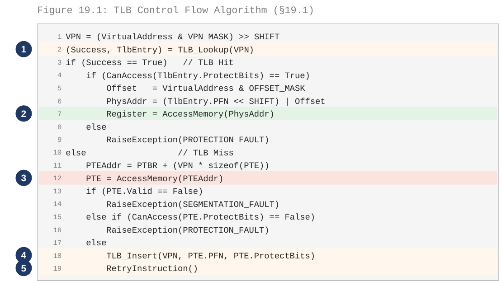{width=89%}
<figcaption markdown="1">Figure 113. The textbook's Figure 19.1, the TLB control flow algorithm, with five callouts. From slide 58, following textbook section 19.1.</figcaption>
</figure>

A few marks in it need glossing ([Section 1.5](class-1.md#sec-1-5) glossed `//`, `=`, `if ... else`, `&` and `>>`). `==` is "is equal to", a test, not a store. `TLB_Lookup(VPN)` asks the TLB for that VPN and gives back two things: `Success`, true or false, and `TlbEntry`, the translation it found. `CanAccess(...ProtectBits)` checks the protection bits (read, write, execute, user) against what the instruction wants to do. `<<` is shift left and `|` is "or", which here glues the frame number and the offset together ([Appendix A](appendix.md#appendix-a)). `AccessMemory(addr)` reads memory at an address. `RaiseException(...)` is a trap to the OS, with a name for the reason: `SEGMENTATION_FAULT` means the page does not exist (the name is a leftover from segments), and `PROTECTION_FAULT` means the page exists but this kind of access is not allowed. `TLB_Insert` puts a translation into the TLB, and `RetryInstruction()` runs the same instruction again from the start.

Line 1: split the virtual address and take the VPN, as always. Circle 1, line 2: ask the TLB. One search over all its entries, in parallel, done in hardware in a few clock ticks (a processor runs on a clock that ticks billions of times a second, and one tick is the smallest step it works in); no memory is touched. Circle 2, lines 3 to 7, the **hit path**. The TLB had it. Check the protection bits (they are stored in the TLB entry too, so the check needs no table), take the PFN, shift it up past the offset, glue in the offset, and access memory: one memory reference, the one the program asked for. This is the common case, and it is the case that makes paging affordable.

Circle 3, lines 10 to 16, the **miss path**. The TLB did not have it. Now do what [Chapter 5](#chapter-5) described: compute the entry's address from the PTBR (line 11), read the entry from memory (line 12, the expensive line), check valid (line 13) and protection (line 15). Circle 4, line 18: `TLB_Insert` puts the translation into the TLB. Circle 5, line 19: `RetryInstruction` starts the instruction over from the top; this time line 2 hits, and the access goes through the fast path. That is why a miss costs one extra memory reference, not a second mechanism, and every later access to the same page costs none. Figure 114 says the same in four cards.

<figure markdown="1">
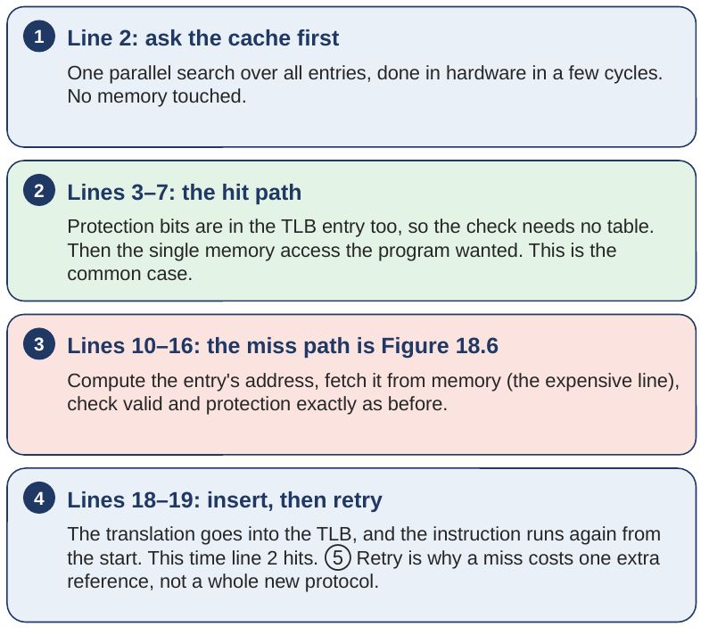{width=64%}
<figcaption markdown="1">Figure 114. The callouts in words: ask the cache first; the hit path; the miss path; insert, then retry. From slide 58.</figcaption>
</figure>

Check this with the loop of [Section 6.1](#sec-6-1): which of the eight references would hit, once the TLB has warmed up? After the very first trip, both the code page's and the array page's translations are in the TLB. So the four table reads become TLB hits and cost no memory reference, and the loop is back to four memory references per trip, the four the program meant to make. A hit costs what memory costs without any virtualization; a miss costs one table read. Everything depends on how often each happens: the whole game is the hit rate.

One distinction to keep straight, because the two are easy to confuse. A **TLB miss** is not an error: the hardware reads the entry from the table, fills the TLB, retries, and the program never knows; the cost is one extra memory reference. A **page fault** is the table itself saying no, a valid bit of 0 or a forbidden kind of access, and the hardware traps into the OS. A fault is always preceded by a miss, since the entry has to be read before it can be found bad, but almost every miss ends in a hit on the retry, not in a fault.

### 6.4 <span class="lbl lbl-check">Your turn</span> Hit or miss: ten array elements on sixteen-byte pages {#sec-6-4 data-toc-label="6.4 [Your turn] Hit or miss: ten array elements on sixteen-byte pages"}

The previous section ended on the hit rate: the share of accesses that hit. Whether a TLB pays off depends entirely on that number, so the textbook's next example counts it for a small array. Figure 115 sets it up; the reveal is Exercise 10, so predict before reading the answer at the end.

<figure markdown="1">
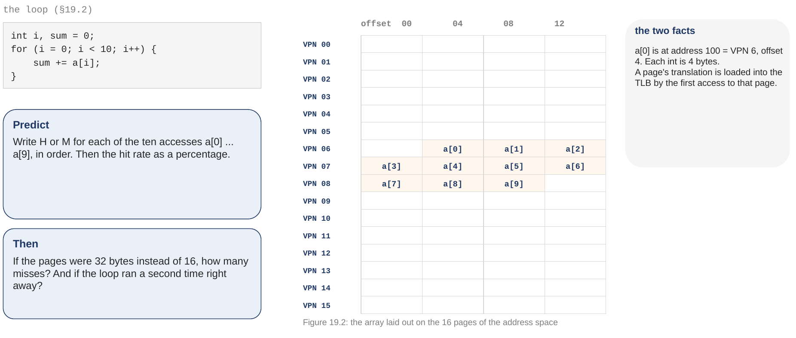{width=100%}
<figcaption markdown="1">Figure 115. The textbook's Figure 19.2: an array of ten 4-byte integers laid out on the 16 pages of an 8-bit address space; predict hit or miss for each access. From slide 59, following textbook section 19.2.</figcaption>
</figure>

The setup. The address space is 256 bytes (8-bit addresses, 2^8 = 256), and pages are 16 bytes, so there are 256 ÷ 16 = 16 pages, VPN 00 to VPN 15; an address splits into a 4-bit VPN and a 4-bit offset. An array `a[]` of ten integers, 4 bytes each, starts at virtual address 100. 100 in binary is 0110 0100 (64 + 32 + 4 = 100): VPN 0110 = 6, offset 0100 = 4. So `a[0]` sits at byte 4 of page 6. The next two integers fill the rest of page 6 (bytes 8 and 12 hold `a[1]` and `a[2]`), then `a[3]` through `a[6]` fill page 7, and `a[7]` through `a[9]` are on page 8. The grid of the figure draws exactly that: the column labels 00, 04, 08 and 12 are the offsets inside a page.

The program is the loop on the left, which adds up all ten elements (`sum += a[i]` adds `a[i]` to `sum`). Assume the TLB starts empty, and count only the ten array reads, `a[0]` through `a[9]`: ignore `i`, `sum` and the instruction fetches. The two facts you need are in the gray box: `a[0]` is at address 100 = VPN 6, offset 4, each integer is 4 bytes, and a page's translation is loaded into the TLB by the first access to that page.

Exercise 10: for each of the ten accesses, write H (hit) or M (miss), in order, then the hit rate as a percentage (hits divided by ten). Then the two questions under "Then": if the pages were 32 bytes instead of 16, how many misses? And if the loop ran a second time right away, with the TLB still holding what it has?

Do it now, then check at the end. The idea it teaches has a name: **locality**. Programs tend to touch addresses near the ones they just touched; that is **spatial locality**, nearness in space, like the next element of an array. And they tend to touch the same addresses again soon; that is **temporal locality**, nearness in time, like the instructions of a loop. A TLB is a bet on locality. Caches work because programs have locality, and they must be small to be fast, so the textbook's tip for this section is to use caching when possible, and the question is never "why not cache everything" but "how to use a small cache well". A program with no locality gets no help from the TLB, and [Extra 24](#extra-24) measures one, on the Ubuntu machine, running fifteen times slower.

### 6.5 <span class="lbl lbl-kernel">Real kernel</span> Who handles a miss: RISC-V walks the table, and xv6 only flushes the TLB {#sec-6-5 data-toc-label="6.5 [Real kernel] Who handles a miss: RISC-V walks the table, and xv6 only flushes the TLB"}

The algorithm of [Section 6.3](#sec-6-3) says that on a miss, something reads the page table and fills the TLB. It does not say who. There are two designs, and they decide what a kernel has to do; Figure 116 shows both.

<figure markdown="1">
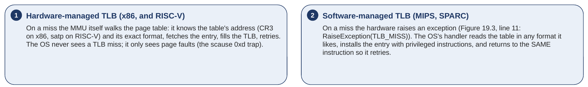{width=100%}
<figcaption markdown="1">Figure 116. The two ways to handle a TLB miss: hardware-managed (x86 and RISC-V) and software-managed (MIPS and SPARC). From slide 61, following textbook section 19.3.</figcaption>
</figure>

Design 1, a **hardware-managed TLB**. On a miss, the MMU itself walks the page table: it knows where the table is (from the register called CR3 on x86, satp on RISC-V) and exactly what an entry looks like, so it fetches the entry, fills the TLB, and retries, with no help. The OS never even finds out a miss happened. It hears only about the failures, an invalid entry or a forbidden kind of access, which arrive as a trap (the "scause 0xd trap" of the card is one; [Section 5.3](#sec-5-3) explained scause). This is how x86 works, and how RISC-V works, and so how xv6 works.

Design 2, a **software-managed TLB**. On a miss, the hardware raises an exception, a trap into the OS (the card's "Figure 19.3, line 11" is the textbook's version of Figure 19.1 for this design, where line 11 is `RaiseException(TLB_MISS)`). The OS's own handler reads the table, installs the entry into the TLB with special instructions that only the kernel may use (**privileged instructions**), and returns to the same instruction, so that it retries and hits. MIPS and SPARC, two older processor families the textbook uses as examples, work this way. The advantage is freedom: the OS can keep its table in any shape it likes, because the hardware never reads it. The cost is that every miss is a trap into the kernel.

Before the code, the problem it has to handle. The TLB caches translations from whatever table satp names, and when satp changes to another table the cached translations may be wrong for the new one. Two processes can both use virtual page 10, each in its own frame. If the TLB still holds the first process's "page 10 is in frame 100" when the second process runs, the second process's page 10 would be sent to the first process's frame, and it could read memory that is not its own ([Extra 22](#extra-22) draws the two tables). xv6 meets this problem far more often than at a switch of process, because the kernel has a table of its own: every trap from a user program into the kernel changes satp to the kernel's table, and every return changes it back, even when the same program continues. A plain TLB entry does not say which table it came from, so after any change of satp the hardware cannot tell a still-correct entry from a wrong one. So when the table changes, the TLB's old entries must either be thrown away or be marked with whose they are.

Because xv6 runs on RISC-V, it has no miss handler at all. What it does have is the code that tells the hardware where the table is, and the moment the TLB's contents stop being true. Figure 117 is the first place that happens, when xv6 starts.

<figure markdown="1">
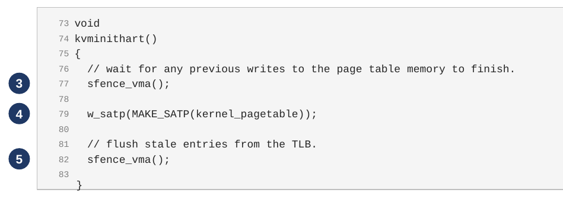{width=76%}
<figcaption markdown="1">Figure 117. kernel/vm.c, lines 73 to 83: kvminithart, run at boot. From slide 61.</figcaption>
</figure>

The function is `kvminithart`, "kernel virtual memory, initialize this hart". A **hart** is RISC-V's word for one processor core (the name is short for "hardware thread"; for this course a hart is simply a core). It runs at **boot**, when the computer starts up. Circle 4, line 79, is the one that matters: `w_satp(MAKE_SATP(kernel_pagetable))`, "write the satp register with the value that names the kernel's page table" (`w_satp` is a tiny function that writes satp; the kernel has a page table of its own, separate from every process's; xv6 keeps it separate so that the kernel sees all of physical memory at the same addresses whatever process is running, and so that a process's table holds nothing of the kernel beyond the two top pages of [Section 5.3](#sec-5-3)). That is the OS setting the PTBR of [Section 5.1](#sec-5-1). Around it are two calls of `sfence_vma()`, circles 3 and 5. **`sfence.vma`** is the RISC-V instruction that tells the TLB its contents may be stale. Written `sfence.vma zero, zero`, as xv6 always writes it, one instruction does two things: it waits until every earlier write to page-table memory has finished, and it drops every translation the TLB holds. xv6 runs it on both sides of the satp write, each time for one of those two jobs. The one before is there for the waiting: the table the kernel just wrote must be complete in memory before the hardware starts reading it. The one after is there for the dropping: every translation still in the TLB describes the old table, including any the hardware cached between the first fence and the satp write, and all of them must go. Figure 118 is the second place.

<figure markdown="1">
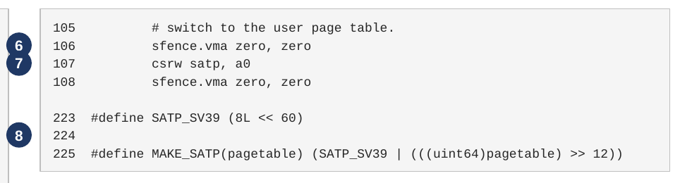{width=77%}
<figcaption markdown="1">Figure 118. kernel/trampoline.S, lines 105 to 108 (userret), and kernel/riscv.h, lines 223 to 225. From slide 61.</figcaption>
</figure>

On the left are lines 105 to 108 of `trampoline.S`, which run on every return from the kernel to a **user program** (an ordinary program, as opposed to the kernel). This file is written in RISC-V assembly language, one machine instruction per line. Circle 7, line 107, `csrw satp, a0`, writes satp with the user process's table (`csrw` means "write a control register"; the kernel computed the value in `trap.c`, lines 90 to 93, and handed it over in the register called `a0`). Circle 6 and line 108 are the same pair of fences as at boot. The two words after the instruction name, `zero, zero`, mean "every address, and the entries of every process" (a TLB entry can carry a tag saying which process it belongs to, the ASID of the last paragraphs of this section; `zero, zero` ignores the tag), so each of these fences empties the TLB completely. And these three lines run on every return to **user space** (the user program, as opposed to the kernel), every time; the mirror image, `uservec` at lines 89 to 95 of the same file, runs on every trap into the kernel and switches to the kernel's table between two fences.

Circle 8 is the macro that builds the satp value in both places. `SATP_SV39` is `8L << 60`: 8 is 1000 in binary, shifted left 60 places, so bit 63 is 1, which puts 8 in the top hex digit, the Sv39 mode of [Section 5.3](#sec-5-3). `MAKE_SATP(pagetable)` glues that mode (with `|`) to the table's address shifted right 12, its frame number, the same move as `PA2PTE` in [Section 5.2](#sec-5-2). Compare the satp value of [Section 5.3](#sec-5-3), 0x8000000000087f33: mode 8, frame 0x87f33.

Now look at what is missing. On RISC-V, bits 44 to 59 of satp (59 − 44 + 1 = 16 bits; a design fact of the RISC-V specification) are an **address-space identifier**, an **ASID**: a tag saying which process a translation belongs to. `MAKE_SATP` never sets them, so they are always 0. With a tag, a process's entries could survive a trip through the kernel; without one, every switch of table must empty the TLB, a **flush**. Why old entries are dangerous after a switch of process, and what a tag changes, is [Extra 22](#extra-22). RISC-V walks the table in hardware, so xv6 never handles a miss. What xv6 does do is tell the TLB when its contents are no longer true: `sfence.vma`.

That answers the third question of the class. Figure 119 is the last checkpoint of the week.

<figure markdown="1">
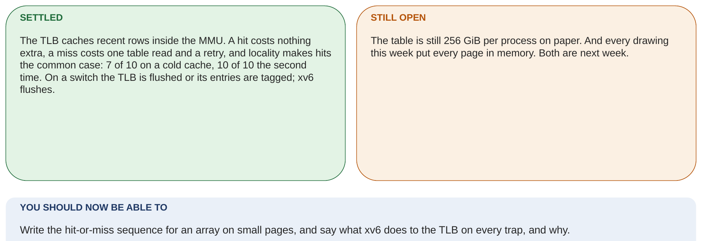{width=100%}
<figcaption markdown="1">Figure 119. Checkpoint 3 of the second class: what the third question settled, what it left open, and what you should now be able to do. From slide 62.</figcaption>
</figure>

Settled: the TLB caches recent rows inside the MMU. A hit costs nothing extra, a miss costs one table read and a retry, and locality makes hits the common case: 7 of 10 on a cold cache, 10 of 10 the second time (Exercise 10's answer). On a switch of table the TLB is flushed or its entries are tagged; xv6 flushes. Still open: the table is still 256 GiB per process on paper. And every drawing this week put every page of every process in memory. Both are next week. You should now be able to write the hit-or-miss sequence for an array on small pages, and say what xv6 does to the TLB on every trap, and why.

## <span class="lbl lbl-summary">Summary</span> Summary of the second class, and the week on one slide {#summary-2 data-toc-label="[Summary] Summary of the second class, and the week on one slide"}

The last slide of the second class answers all six questions of the week, three from each class, in order. Each answer names the problem it solved and the price it carries, because every answer of the week left a new problem behind it. Figure 120 is that slide, with the vocabulary of the week and the one sentence to keep.

<figure markdown="1">
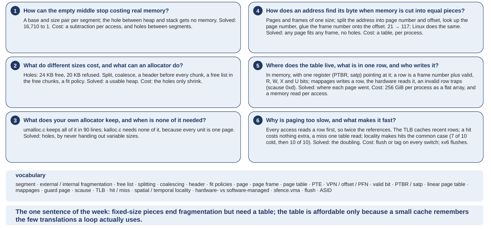{width=100%}
<figcaption markdown="1">Figure 120. The week on one slide: six questions, each answered with what it solved and what it cost, the vocabulary, and the one sentence of the week. From slide 63.</figcaption>
</figure>

The left column is the first class, summed up in the first class's summary; read its three cards as a reminder. Segments stopped the empty middle from costing memory, at the price of holes between them. An allocator keeps the holes small but never removes them. And `kalloc.c` showed the only real fix: hand out pieces of one size.

The right column is the second class.

Question 4, how an address finds its byte when memory is cut into equal pieces. Pages and frames all have one size. The hardware splits the address into a page number and an offset, looks the page number up in the table, and glues the frame number onto the unchanged offset. Virtual 21 became physical 117, and Linux's own table did the same thing on a real machine. Any page fits in any free frame, so the holes are gone. The price is a table, one per process.

Question 5, where the table lives, what one row holds, and who writes it. The table lives in ordinary memory, and one register (the PTBR, called satp on RISC-V) holds the address where it starts. A row is a frame number plus a few bits: valid, R, W, X and U. The OS writes rows (`mappages` in xv6), the hardware reads them, and a row without the valid bit traps; on RISC-V the trap's reason code is scause 0xd. The table records where each page went. The price is size, 256 GiB per process as a flat array on the Ubuntu machine, and a memory read before every access.

Question 6, why paging is too slow and what makes it fast. Every access reads a row first, so the memory references double. The TLB keeps recent rows inside the MMU. A hit costs nothing extra, a miss costs one table read, and locality makes hits the common case: 7 of 10 on a cold TLB in Exercise 10, then 10 of 10 the second time. The price is that the TLB must be flushed, or its entries tagged, whenever the table changes, and xv6 flushes.

The vocabulary at the bottom is long, and every word in it was defined in a section of this guide. If one of them has no picture behind it, find it and reread that section. Two notes on it. "PTBR / satp" is one idea under two names, the textbook's and RISC-V's. "Hardware- vs software-managed" names the two answers to "who fills the TLB on a miss" ([Section 6.5](#sec-6-5)).

The one sentence of the week, in the blue bar: fixed-size pieces end fragmentation but need a table; the table is affordable only because a small cache remembers the few translations a loop actually uses. "Fragmentation" there means the external kind, holes between pieces; the internal kind, the part of a page a program does not use, remains, as Answer 12 notes. Two problems are still open, and both are the next chapters of the textbook. The flat table is far too big. And every drawing this week kept every page of every process in memory at once.

## Going deeper, second class (optional) {#extras-2}

### Extra 13 <span class="lbl lbl-deeper">Deeper, Q4</span> The recipe, written as three lines of C for any page size {#extra-13 data-toc-label="Extra 13 [Deeper, Q4] The recipe, written as three lines of C for any page size"}

This part and the eleven after it are the deck's "deeper, if time allows" block of the second class: slides the class may have skipped, placed after the summary so that the core chain reads without them. Each goes deeper on one of the second class's questions, numbered 4 to 6 as in the summary; the tag Q4, Q5 or Q6 in its heading says which. (On the slides themselves the tag reads Q1, Q2 or Q3, counted within the class.)

[Chapter 4](#chapter-4) translated addresses by hand: split, look up, glue. The textbook writes the same three steps as three lines of C, because that is how the hardware's designers think of them, and because the lines work for any page size once one constant changes. Figure 121 puts each step three ways side by side: in words, in bits, and in C. The bits are the address 50 of Exercise 6, so do that exercise first if you have not.

<figure markdown="1">
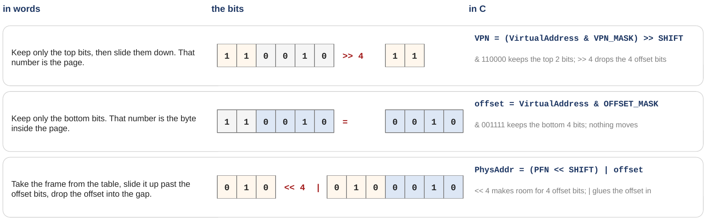{width=100%}
<figcaption markdown="1">Figure 121. The three steps in words, in bits and in C, on the 64-byte example: VPN_MASK = 0x30, OFFSET_MASK = 0xF, SHIFT = 4. From slide 64, following textbook section 18.4.</figcaption>
</figure>

The three lines are:

```
VPN      = (VirtualAddress & VPN_MASK) >> SHIFT
offset   =  VirtualAddress & OFFSET_MASK
PhysAddr = (PFN << SHIFT) | offset
```

They use four operators. [Section 1.5](class-1.md#sec-1-5) met two of them, and [Appendix A](appendix.md#appendix-a) has all four in a table; Figure 122 is the slide's own short list.

<figure markdown="1">
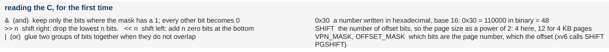{width=100%}
<figcaption markdown="1">Figure 122. Reading the C for the first time: the four operators, and what 0x30, SHIFT and the two masks mean. From slide 64.</figcaption>
</figure>

`&` is "and", one bit at a time: it keeps a 1 only where both numbers have a 1. Used with a **mask**, a pattern of 1s placed exactly where the bits you want are, it keeps those bits and turns every other bit to 0. `>> n` is shift right: every bit slides n places toward the low end, the n bits that fall off are gone, and n zeros come in at the high end; the number keeps its width. `<< n` is shift left: the mirror image, with n zeros coming in at the low end. `|` is "or": a bit is 1 if it is 1 in either number. When two numbers never have a 1 in the same place, `|` simply glues them together.

Line 1 keeps only the top bits and slides them down. In the 64-byte example the page number is the top 2 of 6 bits, so the mask has 1s there and 0s in the four offset places: 110000. In hex, pad it to eight bits, 0011 0000, and read the two groups of four: 3 and 0, so 0x30 (that is 3 × 16 = 48, and 32 + 16 = 48 checks it). On address 50 = 110010: 110010 & 110000 = 110000, the offset bits are now 0. Then 110000 >> 4 = 000011, which is 3 (the number keeps its six-bit width; zeros come in at the left). Page 3.

Line 2 keeps only the bottom bits. The mask is 001111 = 0xF. 110010 & 001111 = 000010 = 2. Nothing moves, because the offset already sits at the bottom.

Line 3 needs the frame from the table first. That lookup is not one of the three lines; in the textbook's notation it is `PFN = PageTable[VPN]`, "row number VPN of the table". Page 3 is in frame 2 = 010. Then 010 << 4 = 0100000: four zeros make room for the offset. And 0100000 | 0000010 = 0100010 = 32 + 2 = 34. Check: frame 2 starts at 2 × 16 = 32, and byte 2 of it is 34.

Look at what the three lines do not contain: no subtraction and no addition. The segment rule of [Chapter 1](class-1.md#chapter-1) compared the offset with a size and added a base: an adder on every access. Pages start at multiples of the page size, so the split is a mask and the glue is an or. That is the whole reason pages are a power of two in size.

Why is `SHIFT` 4? Because the page is 16 = 2^4 bytes, so the offset is 4 bits. For 4 KB pages, 4096 = 2^12, so `SHIFT` is 12, and `OFFSET_MASK` is twelve 1s, 0xFFF. In xv6 that constant is `PGSHIFT`, defined as 12 in `kernel/riscv.h`. Only `SHIFT` and the masks change with the page size; the three lines never do. Check them on a real address from [Section 4.5](#sec-4-5), 0x55f823c3a123. Shifting right by 12 drops the last three hex digits (each hex digit is 4 bits, and 3 × 4 = 12): the VPN is 0x55f823c3a. The offset is 0x55f823c3a123 & 0xFFF = 0x123. That page's frame was 1080841, which is 0x107e09 in hex (the next extra shows the conversion). Shifting it left by 12 appends three hex zeros, 0x107e09000, and or-ing in the offset fills them: 0x107e09123.

### Extra 14 <span class="lbl lbl-deeper">Deeper, Q4</span> Figure 18.2 again, with a real machine's numbers {#extra-14 data-toc-label="Extra 14 [Deeper, Q4] Figure 18.2 again, with a real machine's numbers"}

[Section 4.5](#sec-4-5) read four rows of a real page table on the Ubuntu machine and printed them as a table of numbers. The textbook draws the same thing as a picture, its Figure 18.2: pages of the address space on the left, frames of physical memory on the right, arrows between them ([Section 4.2](#sec-4-2) showed it). Figure 123 draws the real capture the same way.

<figure markdown="1">
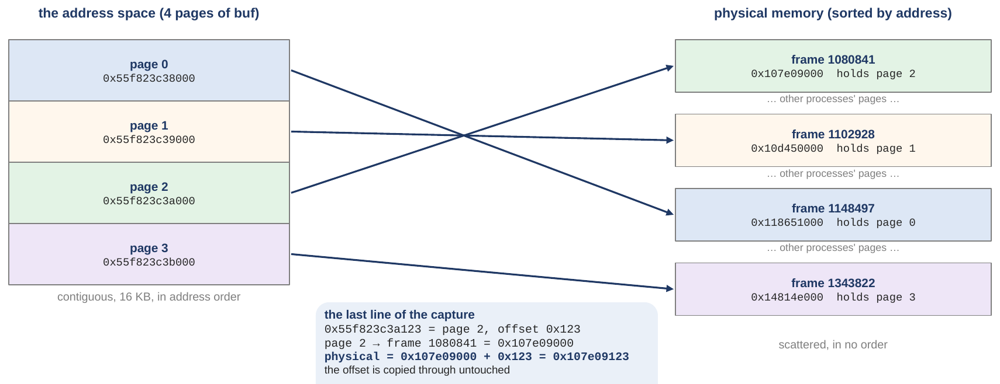{width=100%}
<figcaption markdown="1">Figure 123. The pagemap capture drawn like the textbook's Figure 18.2: four consecutive pages of buf on the left, four scattered frames on the right, and the last line of the capture worked. From slide 65.</figcaption>
</figure>

On the left, the four pages of the buffer, in address order: 0x55f823c38000, ...39000, ...3a000, ...3b000. Each is 0x1000 = 4096 bytes after the one before, so together they are 16 KB with no gaps. On the right, physical memory, sorted by address, and only the four frames that hold these pages. To place each frame you need its physical address, which is the frame number times 4096, or, in hex, the frame number with three zeros appended.

Convert one frame number by hand, with the divide-by-16 method of [Appendix A](appendix.md#appendix-a). Page 2's frame is 1080841. 1,080,841 ÷ 16 = 67,552 remainder 9. 67,552 ÷ 16 = 4,222 remainder 0. 4,222 ÷ 16 = 263 remainder 14, which is e. 263 ÷ 16 = 16 remainder 7. 16 ÷ 16 = 1 remainder 0. 1 ÷ 16 = 0 remainder 1. Reading the remainders from last to first: 1, 0, 7, e, 0, 9, so 1080841 = 0x107e09, and the frame starts at 0x107e09000. The other three, the same way: 1102928 = 0x10d450, 1148497 = 0x118651, 1343822 = 0x14814e.

Now sort them: 0x107e09000 (page 2), 0x10d450000 (page 1), 0x118651000 (page 0), 0x14814e000 (page 3). So in physical memory the order is 2, 1, 0, 3, and the arrows cross. Between them sit gaps the drawing labels "other processes' pages": between frame 1080841 and frame 1102928 alone there are 1102928 − 1080841 − 1 = 22,086 frames that do not belong to this buffer. Order in the address space says nothing about order in the memory chips.

The blue box works the last line of the capture with the three-line recipe of [Extra 13](#extra-13). 0x55f823c3a123 is page 2 (the row at ...3a000), offset 0x123. Page 2 is in frame 0x107e09, which starts at 0x107e09000. Physical = 0x107e09000 + 0x123 = 0x107e09123, which is what the kernel reported. The offset is copied through untouched. Consecutive pages, scattered frames, offsets untouched: this is the textbook figure, read back from a real process's page table.

### Extra 15 <span class="lbl lbl-deeper">Deeper, Q5</span> Where page tables live, and how big they get {#extra-15 data-toc-label="Extra 15 [Deeper, Q5] Where page tables live, and how big they get"}

[Section 5.1](#sec-5-1) did this arithmetic as the problem of the second question; this is the slide it came from, kept in the deeper block because it also draws where the table sits. Figure 124 is the arithmetic twice.

<figure markdown="1">
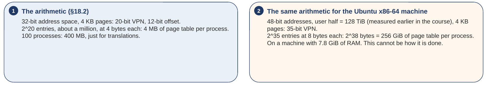{width=100%}
<figcaption markdown="1">Figure 124. The table-size arithmetic for the textbook's 32-bit machine and for the Ubuntu x86-64 machine. From slide 66, following textbook section 18.2.</figcaption>
</figure>

Left card, the textbook's machine. 32-bit addresses and 4 KB pages: the offset is 12 bits (4096 = 2^12), so the VPN is 32 − 12 = 20 bits, and there are 2^20 rows, about a million. At 4 bytes a row, 2^20 × 2^2 = 2^22 bytes = 4 MB per process. With 100 processes, 400 MB holds nothing but translations.

Right card, the Ubuntu machine. 48-bit addresses, of which the user half is 2^47 bytes = 128 TiB; minus 12 offset bits leaves a 35-bit VPN. At 8 bytes a row, 2^35 × 2^3 = 2^38 bytes = 256 GiB per process, on a machine with 7.8 GiB of memory: about 33 times all of it (256 ÷ 7.84 ≈ 32.7). This cannot be how it is done, and next week shows how it is really done.

So where does a table of even 4 MB go? Not into the processor: it is far too big for the handful of registers on the chip. It goes into ordinary memory. Figure 125 is the textbook's picture of that, for the 64-byte example.

<figure markdown="1">
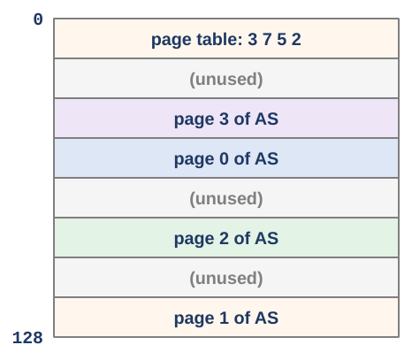{width=45%}
<figcaption markdown="1">Figure 125. The textbook's Figure 18.4: the page table lives in OS memory, here in physical frame 0, holding 3 7 5 2. Physical addresses 0 at the top and 128 at the bottom. From slide 66, following textbook section 18.2.</figcaption>
</figure>

The physical memory of the toy machine is 128 bytes, eight frames of 16 bytes each, drawn from address 0 at the top to 128 at the bottom. Frame 0 is the OS's, and the page table lives there: four entries, holding the frame numbers 3, 7, 5 and 2. Read the rest of the strip against that table. Page 0 of the address space is in frame 3, page 1 in frame 7, page 2 in frame 5, page 3 in frame 2, and frames 1, 4 and 6 are unused. The table describes the memory it sits in. Figure 126 says what follows from it.

<figure markdown="1">
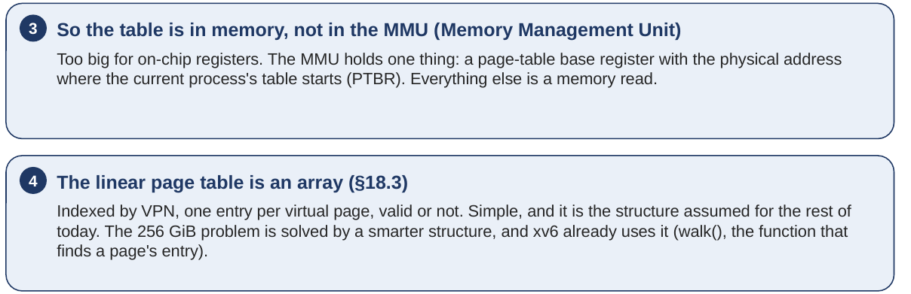{width=97%}
<figcaption markdown="1">Figure 126. So the table is in memory, not in the MMU; and the linear page table is an array. From slide 66.</figcaption>
</figure>

Card 3. The MMU holds only one thing about the table: a register with the physical address where the current process's table starts, the PTBR. In Figure 125 the PTBR would hold 0, the start of frame 0. Everything else is a memory read. Card 4. The simplest layout is the linear page table of [Section 5.1](#sec-5-1), an array indexed by VPN with one entry per virtual page, valid or not. It is the structure assumed for the rest of this week. The 256 GiB problem is solved by a smarter structure, and xv6 already uses it: `walk()`, the function that finds a page's entry, climbs a tree of small tables. That is next week's topic.

The bar at the bottom names the two problems the textbook leaves at the end of chapter 18: page tables are too big, and paging is too slow. The second class closed the second one with the TLB.

### Extra 16 <span class="lbl lbl-deeper">Deeper, Q5</span> Who writes a row: from sbrk to one line of xv6 {#extra-16 data-toc-label="Extra 16 [Deeper, Q5] Who writes a row: from sbrk to one line of xv6"}

[Section 5.3](#sec-5-3) said the OS writes the rows and named the function, `mappages`. This part follows one request all the way down to that function in your own xv6 tree. A program asks for more memory, and at the bottom, one line of C writes one row.

The request first. A program's **heap** is where it keeps data whose size it learns only while running. When the heap is full, the program asks the OS to make it bigger. In xv6 the call is **`sbrk(n)`**: "grow my memory by n bytes"; Linux has a call with the same name, and `malloc` uses it ([Section 3.2](class-1.md#sec-3-2)'s `morecore` does). `sbrk` is a **system call**: a request from a program to the kernel. The program cannot write its own page table, because the table lives in kernel memory, so it asks. Figure 127 shows the five functions the request passes through.

<figure markdown="1">
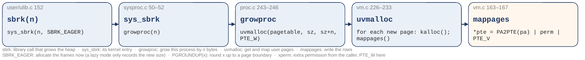{width=100%}
<figcaption markdown="1">Figure 127. From a program's sbrk call down to the line that writes one entry, with the file and line of each hop, and a gloss of every name. From slide 67.</figcaption>
</figure>

Read the chain left to right. `sbrk(n)` in the user library (`user/ulib.c`, line 152) calls `sys_sbrk(n, SBRK_EAGER)`, which switches the processor into the kernel, as every system call does. In the kernel, `sys_sbrk` (`kernel/sysproc.c`) calls `growproc(n)`, "grow this process by n bytes" (`kernel/proc.c`). That calls `uvmalloc`, "user virtual memory allocate": get the new pages and map them (`kernel/vm.c`). And `uvmalloc` calls `mappages` once per page, which writes the rows. The two thin lines under the chain gloss the names. `SBRK_EAGER` means "give me the frames now"; the students' xv6 also has a lazy mode that only records the new size and gives each frame when its page is first touched, which saves memory when a program asks for more than it uses. `PGROUNDUP(x)` rounds x up to the next page boundary. `xperm` is extra permission passed by the caller, here `PTE_W`. Figure 128 is `uvmalloc` in full.

<figure markdown="1">
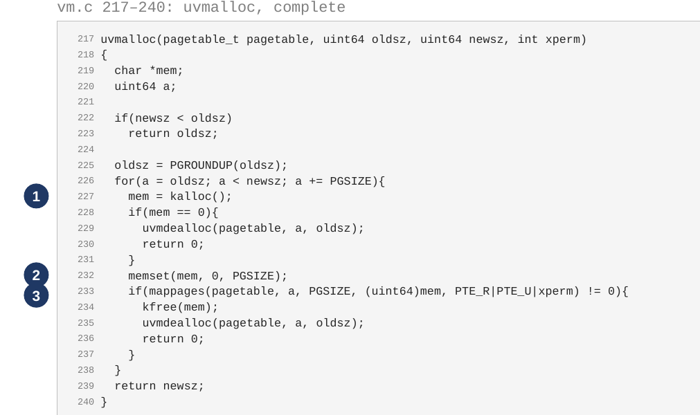{width=81%}
<figcaption markdown="1">Figure 128. kernel/vm.c, lines 217 to 240: uvmalloc, complete, with circles 1 to 3. From slide 67.</figcaption>
</figure>

You do not need every line. `uvmalloc` gets the process's page table, its old size (`oldsz`), the new size it wants (`newsz`), and the extra permission (`xperm`). Line 225 rounds `oldsz` up to a page boundary, so the loop starts on a fresh page. Line 226 loops from the old size to the new size one page (`PGSIZE`, 4096) at a time. For each page:

Circle 1, line 227: `mem = kalloc()`. Take one free frame off the free list. This is `kalloc` from [Section 3.3](class-1.md#sec-3-3): one pop from `kmem.freelist`.

Circle 2, line 232: `memset(mem, 0, PGSIZE)`. Fill the frame with zeros. Without this line the new page would still hold whatever the frame's last owner left in it, possibly another process's private data. (Lines 228 to 231 handle `kalloc` failing: undo what was mapped so far with `uvmdealloc` and return 0.)

Circle 3, line 233: `mappages(pagetable, a, PGSIZE, (uint64)mem, PTE_R|PTE_U|xperm)`. Map the virtual address `a` to this frame, one page long, readable, user-accessible, plus the caller's write permission. (`(uint64)` only tells C to treat the frame's address as a plain 64-bit number; the `|` glues three flag bits into one set.) Figure 129 is the loop inside `mappages`.

<figure markdown="1">
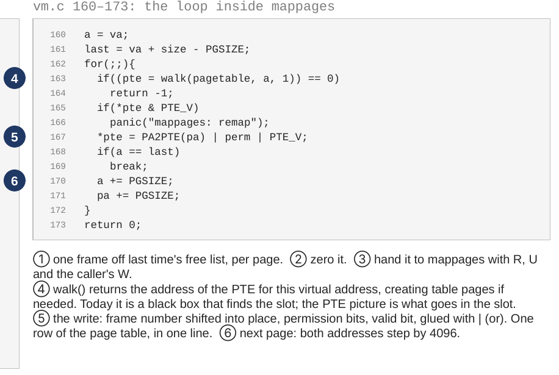{width=73%}
<figcaption markdown="1">Figure 129. kernel/vm.c, lines 160 to 173: the loop inside mappages, with circles 4 to 6 and the slide's notes on all six circles. From slide 67.</figcaption>
</figure>

Circle 4, line 163: `pte = walk(pagetable, a, 1)`. `walk` returns the address of the entry for virtual address `a`; the `1` means "create the table pages on the way if they do not exist yet". The returned address is a **pointer**, a variable that holds an address. For this week `walk` is a black box that finds the slot; it is the "PTBR + VPN × 8" of [Section 5.1](#sec-5-1), done for a tree instead of a flat array. Lines 165 and 166 check that the slot is not already valid: `*pte & PTE_V` is nonzero exactly when the valid bit is set, and mapping the same page twice is a kernel bug, so xv6 stops the machine with `panic`.

Circle 5, line 167: `*pte = PA2PTE(pa) | perm | PTE_V`. This is the line. `PA2PTE(pa)` shifts the frame's physical address into the frame-number position of the entry ([Section 5.2](#sec-5-2)). `perm` is the flags from circle 3. `PTE_V` is the valid bit. The `*` in front of `pte` means "the thing at that address", so the result goes into the slot itself. One row of the page table, written in one line.

Circle 6, lines 170 and 171: step the virtual address and the physical address forward by one page each and go around again; line 168 stops after the last page. In `uvmalloc`'s case `mappages` maps one page per call, so the loop runs once.

The bar at the bottom of the slide puts it in one sentence: `kalloc` pops a frame, `mappages` writes one PTE. Chapter 17's free list feeds chapter 18's page table, five function calls apart. Figure 130 is the same thing done for real, on the `pgdemo` run of [Section 5.3](#sec-5-3).

<figure markdown="1">
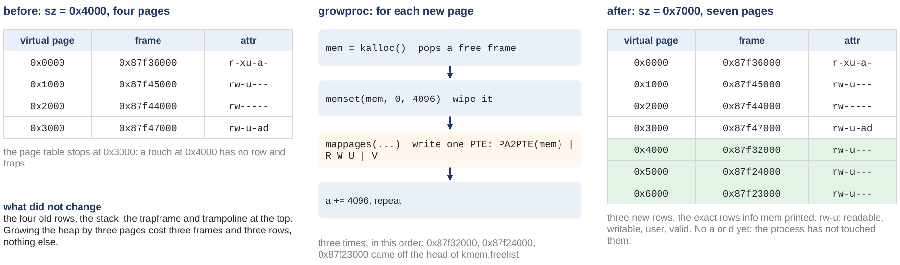{width=100%}
<figcaption markdown="1">Figure 130. sbrk(3 × 4096) in pgdemo: the table before (four pages), the loop three times, and the table after (seven pages). From slide 68.</figcaption>
</figure>

Before: the process size is 0x4000, and the table has four user rows, 0x0000 to 0x3000 (code, data, guard, stack). The table simply ends there; a touch at 0x4000 finds no valid row (the entry is there, with its valid bit 0) and traps. In the middle, `uvmalloc`'s loop runs three times: pop a frame, wipe it, write one row with R, W, U and V, step 4096. The three frames came off the head of `kmem.freelist` in this order: 0x87f32000, 0x87f24000, 0x87f23000. After: the size is 0x7000, and the table has seven user rows. The three new ones are exactly the rows `info mem` printed in [Section 5.3](#sec-5-3), `rw-u---`: readable, writable, user, valid. They have no `a` or `d` yet, because the process has not touched them. Nothing else changed: the four old rows, and the trapframe and trampoline at the top, are as they were. One system call, three pops from the free list, three rows in the table. That is the whole of `sbrk` under paging.

### Extra 17 <span class="lbl lbl-deeper">Deeper, Q5</span> The nine rows of info mem, drawn {#extra-17 data-toc-label="Extra 17 [Deeper, Q5] The nine rows of info mem, drawn"}

[Section 5.3](#sec-5-3) read the nine rows of `pgdemo`'s page table as text. Text hides the one thing a picture shows at once: the arrows cross. Figure 131 draws every row as an arrow from a virtual page to a physical frame.

<figure markdown="1">
{width=100%}
<figcaption markdown="1">Figure 131. pgdemo's nine page-table rows as arrows: the address space on the left, from 0x0000 at the top of the drawing to the trampoline at the bottom; the frames on the right, sorted by address. Colors: green code, blue data, gray guard, amber stack, purple heap, red kernel-only. From slide 69.</figcaption>
</figure>

On the left is the address space, from 0x0000 at the top of the drawing. Code, data, the guard page (no u), the stack, and the three heap pages that `sbrk` added. Then a long box with no rows at all. Then, at the very top of the address space, the trapframe and the trampoline, both kernel-only. On the right are the nine frames, sorted by physical address. The trampoline's frame, 0x80006000, is first, far below the rest, because it is part of the kernel's own code. Between it and the next frame, 0x87f23000, lie 0x87f23000 − 0x80006000 = 0x7f1d000 bytes, about 127 MB, of frames that belong to the kernel or to nobody yet. (In decimal, 0x7f1d000 = 7 × 16^6 + 15 × 16^5 + 1 × 16^4 + 13 × 16^3 = 117,440,512 + 15,728,640 + 65,536 + 53,248 = 133,287,936 bytes, and 133,287,936 ÷ 1,048,576 ≈ 127 MB.) The other eight frames sit close together near the top of memory, which ends at 0x88000000 (xv6's `PHYSTOP` in `kernel/memlayout.h`: 0x80000000, where RAM starts on xv6's QEMU machine, plus 128 MB, which is 0x8000000). At boot the kernel frees every page from the end of its own code toward higher addresses, and each `kfree` pushes onto the head of the list ([Section 3.3](class-1.md#sec-3-3)), so the list starts with the highest frames, and every frame in this table lies within the top 0x88000000 − 0x87f23000 = 0xdd000 bytes of memory, which is 0xdd = 13 × 16 + 13 = 221 pages of 0x1000 bytes each. Inside that top region the order is no longer simple. Every frame a process gives back, when it exits or when `exec` replaces its program, is pushed onto the head again, so the list hands out recently freed frames first, in whatever order they came back.

The arrows cross because the frames came off the free list in whatever order it had. Read the three heap pages: 0x4000 went to 0x87f32000, 0x5000 to 0x87f24000, 0x6000 to 0x87f23000. Neighbors in the address space, not neighbors in memory, and in decreasing order even. The trapframe's frame, 0x87f25000, sits between two heap frames, although it was popped earlier, when the process was created. So the first heap frame, 0x87f32000, is higher than a frame popped before it: it must have been given back to the list in between (the process's old program image, freed by `exec`, is the likely source). That is the stack of [Section 3.3](class-1.md#sec-3-3) at work, last in, first out, not a sorted list.

The gray note says what the letters `a` and `d` mean in practice: the hardware sets `a` itself on the first read of a page and `d` on the first write. The stack has both, because the program has been running. The fresh heap pages have neither, because nothing has touched them yet.

The bar at the bottom is the payoff. Nine rows describe the whole process. Everything between 0x7000 and the trapframe has no valid row, no frame, and no cost: a sparse address space, for free. That gap is nearly all of the 2^38 = 256 GiB a process could name. (The gap label on the slide prints its end as 0x3fffdfff; the last empty byte is 0x3fffffdfff, one byte below the trapframe at 0x3fffffe000.)

### Extra 18 <span class="lbl lbl-deeper">Deeper, Q5</span> xv6's segmentation fault: one byte past the last valid entry {#extra-18 data-toc-label="Extra 18 [Deeper, Q5] xv6's segmentation fault: one byte past the last valid entry"}

[Section 5.3](#sec-5-3) ended on a claim: one byte past the last page has no row, so a touch there traps and the process dies. This part shows that happening on the console of your own xv6, with every number the hardware reported. The program is `badaddr.c`, in Figure 132: it asks where its memory ends, then reads one byte past that point.

<figure markdown="1">
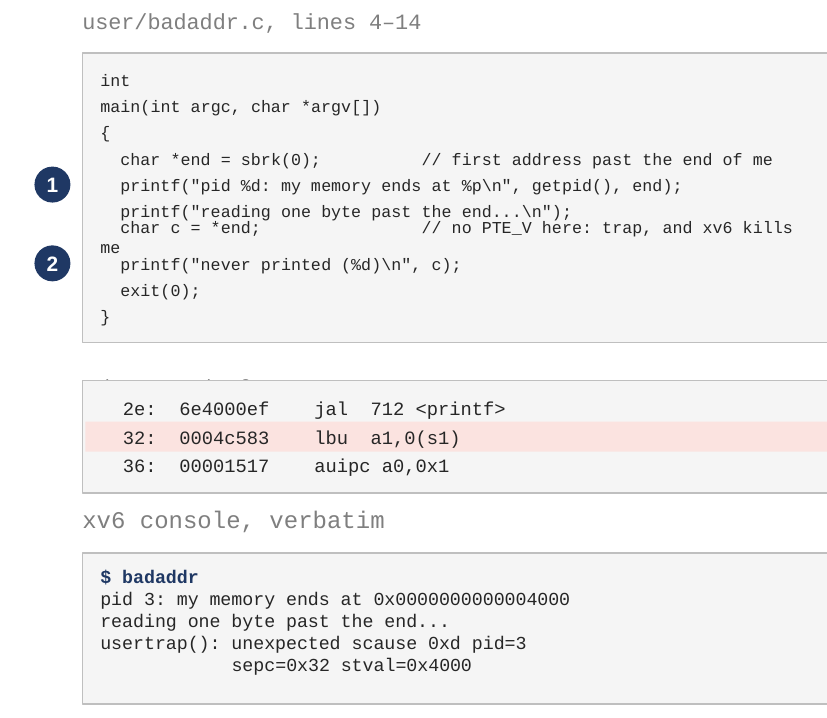{width=66%}
<figcaption markdown="1">Figure 132. user/badaddr.c, added to the xv6 tree for this capture; the machine instruction that faulted, from objdump; and the xv6 console, verbatim. From slide 70.</figcaption>
</figure>

Circle 1: `char *end = sbrk(0)`. As in [Section 5.3](#sec-5-3), `sbrk(0)` grows nothing and returns the first address past the end of the process. The console shows it: 0x4000. So this process has pages 0x0000 through 0x3000 (code, data, guard, stack) and nothing at 0x4000. Address 0x3fff, the last byte of the stack page, is legal. Address 0x4000, one byte later, is not.

Circle 2: `char c = *end`. Read one byte from 0x4000. The middle box is the compiled program, printed by **objdump**, a tool that lists a program's machine instructions one per line with their addresses. The highlighted line is the load: `lbu a1,0(s1)` at address 0x32, "load one byte, unsigned, from the address in register s1 into register a1". Register s1 holds 0x4000.

The hardware does what [Chapter 4](#chapter-4) says: split 0x4000 into VPN 4 and offset 0, and look up entry 4. Entry 4 has its valid bit at 0. (In xv6's real three-level table the hardware climbs the tree and reaches a real entry for 0x4000, in the same last-level table that holds the four pages below it, and that entry's valid bit is 0. For an address far out in the empty gap the climb would stop earlier, at a level with no valid entry. The result is the same either way: no valid entry, no access.) So the hardware refuses: it stops the program in the middle of that instruction, reads no memory, and jumps into the kernel. That jump is a **trap**, the same mechanism as a system call, triggered here by a bad access instead of by a request. A trap caused by an access the page table does not allow is a **page fault**. On the way in, RISC-V fills three registers: **scause**, a code that says why; **sepc**, the address of the instruction that was running; and **stval**, the address that caused the trouble. Figure 133 is the kernel code that reads them.

<figure markdown="1">
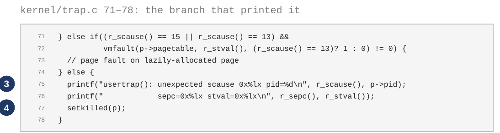{width=88%}
<figcaption markdown="1">Figure 133. kernel/trap.c, lines 71 to 78: the branch of usertrap that printed the message. From slide 70.</figcaption>
</figure>

Circle 3: the kernel's trap handler is `usertrap` in `kernel/trap.c`. Line 71 tests `r_scause() == 15 || r_scause() == 13` (`r_scause()` reads the scause register; `==` means "is equal to"; `||` means "or"). The RISC-V specification fixes the codes: 13 is a load page fault (a read hit a page it may not read), 15 a store page fault (a write did), and 12 an instruction page fault (fetching an instruction did). If the code is 13 or 15, line 72 calls `vmfault` to ask one question: is this a page the kernel promised the process but has not handed out yet? The students' xv6 can grow the heap lazily, raising the size and handing out each frame only on first touch, and `vmfault` exists for that case. Its rule is simple: it says yes only if the address is below the process's size, `p->sz`. Here the size is 0x4000 and the address is 0x4000, equal to it, not below it. So `vmfault` says no, and the kernel falls into the `else` at line 74.

Circle 4: lines 75 to 77 print the two lines you see on the console and call `setkilled(p)`, which marks the process for death (`p` is the kernel's record for the current process). Figure 134 is the slide's own reading of the four circles.

<figure markdown="1">
{width=85%}
<figcaption markdown="1">Figure 134. The four circles in words, and the cliff at 0x3fff. From slide 70.</figcaption>
</figure>

Now read the console of Figure 132. `usertrap(): unexpected scause 0xd pid=3`: 0xd is 13, the load page fault, and `pid=3` is this process's ID. `sepc=0x32`: the instruction at 0x32, which is the `lbu` in the middle box. `stval=0x4000`: the address that had no page. The kernel saw exactly what the program did, down to the instruction. And the line "never printed" was never printed: the process was killed before it got there.

On Linux the same program prints `Segmentation fault` and the shell reports exit status 139, as in [Extra 2](class-1.md#extra-2). That is 128 + 11: the kernel kills the process with signal number 11, the one for a bad memory access, and the **shell** (the program that reads the commands you type) reports death by signal n as 128 + n. Same event, same cause, a different message. Figure 135 puts the five steps in order.

<figure markdown="1">
{width=100%}
<figcaption markdown="1">Figure 135. One byte past the end, in order: the program's load, the MMU's refusal, the trap, usertrap's decision, and the process's death. From slide 71.</figcaption>
</figure>

Step 1, the program: one load from 0x4000. Step 2, the MMU: VPN 4, valid bit 0, no frame and no permission bits; the load is refused and no memory is read. Step 3, the trap: scause, sepc and stval are filled and the processor jumps into the kernel, first to `uservec` (the trampoline code of [Section 6.5](#sec-6-5)) and then to `usertrap`. Step 4, `usertrap` decides: not below `p->sz`, so not a lazy page; print and mark killed. Step 5: on its way back toward user mode, `usertrap` checks the mark (lines 80 and 81, `if(killed(p)) kexit(-1)`), so the process exits instead of returning, and the shell gets its prompt back.

The lesson is in the bottom bar. The valid bit is a cliff, not a slope: 0x3fff is fine, 0x4000 kills you. And the page table is not only a map. It is also the fence, and the hardware, not the program and not the OS, checks it on every single access.

??? note "The program behind Figure 132 (you can skip this listing)"

    The slide shows the program from `int main` down; the whole file adds the same two `#include` lines as `pgdemo.c` in [Section 5.3](#sec-5-3). In order: ask where memory ends, print it with the process ID, announce the read, read one byte from the end, and (never) print it.
    
    ```c
    #include "kernel/types.h"
    #include "user/user.h"
    
    int
    main(int argc, char *argv[])
    {
      char *end = sbrk(0);          // first address past the end of me
      printf("pid %d: my memory ends at %p\n", getpid(), end);
      printf("reading one byte past the end...\n");
      char c = *end;                // no PTE_V here: trap, and xv6 kills me
      printf("never printed (%d)\n", c);
      exit(0);
    }
    ```
    
    To run it in the lab's xv6: save it as `user/badaddr.c`, add `$U/_badaddr\` to the `UPROGS` list in the `Makefile`, run `make qemu` (the same steps as for `pgdemo` in [Section 5.3](#sec-5-3)), and type `badaddr` at the xv6 prompt. The `pid` may differ from 3, depending on what ran before; the scause, sepc and stval will not. To see the disassembly, run `riscv64-linux-gnu-objdump -d user/_badaddr` on the host (or the `riscv64-unknown-elf-` version, whichever toolchain the lab uses) and look for the `lbu` near address 0x32.
    
### Extra 19 <span class="lbl lbl-deeper">Deeper, Q6</span> Figure 18.6: one extra memory reference, every time {#extra-19 data-toc-label="Extra 19 [Deeper, Q6] Figure 18.6: one extra memory reference, every time"}

[Section 6.1](#sec-6-1) counted the cost of paging on a loop; [Section 6.3](#sec-6-3) gave the TLB's algorithm. Between them sits the textbook's own statement of what the hardware does on every access when there is no TLB, its Figure 18.6. It is the algorithm of [Section 6.3](#sec-6-3) with the cache taken out, and it shows exactly where the extra reference comes from. Figure 136 is the figure with four circles.

<figure markdown="1">
{width=88%}
<figcaption markdown="1">Figure 136. The textbook's Figure 18.6, accessing memory with paging, 19 lines, with circles at lines 5, 8, 11 and 19. From slide 72, following textbook section 18.4.</figcaption>
</figure>

Lines 1 and 2: take the VPN out of the virtual address, with the mask and shift of [Extra 13](#extra-13).

Circle 1, line 5: `PTEAddr = PTBR + (VPN * sizeof(PTE))`. Find the entry's address. `sizeof(PTE)` is the size of one entry in bytes, 4 on the textbook's 32-bit machine and 8 on RISC-V and x86-64. This line is arithmetic on a register and touches no memory.

Circle 2, line 8: `PTE = AccessMemory(PTEAddr)`. Read the entry. The table is in ordinary memory, so this is a real memory access, and it must finish before the program's own access can start. This one line is the whole problem.

Circle 3, lines 11 to 14: check the entry. If its valid bit is 0, raise an exception (line 12); that is where `badaddr` was stopped in [Extra 18](#extra-18). If the entry is valid but the kind of access is not allowed, raise a different exception (line 14): a write to `r-x` code, or a user program touching a page with no u bit, such as the guard page.

Circle 4, lines 17 to 19: only now form the physical address, with the offset mask and the shift-and-or of [Extra 13](#extra-13) (`PFN_SHIFT` is the same number as `SHIFT`), and do the access the program asked for. Figure 137 says the four circles in words.

<figure markdown="1">
{width=66%}
<figcaption markdown="1">Figure 137. The four circles: where the entry is, fetch it (reference one), check it, then the program's access (reference two). From slide 72.</figcaption>
</figure>

Count the memory accesses: line 8 and line 19. Two for every one the program asked for. And "every one" means every load, every store, and every instruction fetch, because instructions live in pages too. The bottom bar quotes the textbook: extra memory references are costly, and in this case will likely slow down the process by a factor of two or more. [Section 6.3](#sec-6-3)'s Figure 19.1 is this same figure with one change: before line 5, ask the TLB, and skip lines 5 to 14 when it answers.

### Extra 20 <span class="lbl lbl-deeper">Deeper, Q6</span> Counting the references of the textbook's loop, on x86 and on RISC-V {#extra-20 data-toc-label="Extra 20 [Deeper, Q6] Counting the references of the textbook's loop, on x86 and on RISC-V"}

[Section 6.1](#sec-6-1) counted 8 memory references for one trip around the array loop. That count was made on RISC-V; the textbook makes it on x86 and gets 10. This part puts the two side by side and then walks one iteration reference by reference. Figure 138 is the program, compiled both ways.

<figure markdown="1">
{width=100%}
<figcaption markdown="1">Figure 138. array.c, complete; the loop compiled for RISC-V, from objdump; and the same loop on x86, from the textbook's section 18.5. From slide 73.</figcaption>
</figure>

On the left, `array.c`: an array of 1000 integers and a loop that sets each one to 0. In the middle, the loop as the RISC-V compiler wrote it, three instructions at addresses 0x10, 0x14 and 0x16: `sw zero,0(a5)` stores 0 at the address in register a5; `addi a5,a5,4` adds 4 to a5, so it points at the next integer; `bne a5,a4,10` goes back to 0x10 unless a5 has reached the end, held in a4. (The `addi` is a 2-byte instruction, which is why the next one starts at 0x16, not 0x18.) On the right, the textbook's x86 version, four instructions: `movl` stores 0 into the array, `incl` adds 1 to the index i, `cmpl` compares i with 0x03e8 = 3 × 256 + 14 × 16 + 8 = 1000, and `jne` jumps back unless they are equal. x86 needs one more instruction because it compares in a separate step. Figure 139 counts.

<figure markdown="1">
{width=100%}
<figcaption markdown="1">Figure 139. One iteration of the loop, memory references counted: x86 (the textbook's Figure 18.7) 5 + 5 = 10; the RISC-V build 4 + 4 = 8. From slide 73.</figcaption>
</figure>

x86: 4 instruction fetches plus 1 data access (the `movl` writing `array[i]`) is 5 references the program makes. Each needs one page-table read first: 5 more. Total 10 per iteration. RISC-V: 3 fetches plus 1 data access (the `sw`) is 4, plus 4 table reads, total 8. The RISC-V count is smaller only because it has one fewer instruction; the doubling is identical. Only one of the program's references, the store, is what the C source asked for; the instruction fetches come with running the compiled code. All of them are still the program's own references, the "4 references of the program's own" of [Section 6.1](#sec-6-1); only the table reads are the hardware's addition.

The textbook draws its 10 references for the first five iterations as a picture, Figure 18.7, with three bands: page-table reads on top, array writes in the middle, instruction fetches at the bottom. Its assumptions are deliberately small: 1 KB pages, a 64 KB address space, a linear table at physical address 1024 with 4-byte entries. The code is at virtual address 1024, which is VPN 1 (1024 ÷ 1024 = 1), in frame 4. The array runs from virtual 40000 to 44000, which is VPNs 39 to 42 (39 × 1024 = 39,936 ≤ 40,000 and 42 × 1024 = 43,008 ≤ 43,999 < 44,032), in frames 7 to 10. So the table entry for the code is at physical 1024 + 1 × 4 = 1028, and the entry for the first array page at 1024 + 39 × 4 = 1180.

Now the point of the count, in the yellow box. Half of all memory traffic is page-table reads, and they keep reading the same few entries. In the textbook's trace, every fetch reads the code's entry, VPN 1. The stores read VPN 39's entry for as long as the loop stays on that page: the array starts at offset 40000 − 39936 = 64 into page 39, so (1024 − 64) ÷ 4 = 240 stores in a row land there, then 256 on each of VPNs 40 and 41, then the last 248 on VPN 42 (240 + 256 + 256 + 248 = 1000). With the 4 KB pages of the RISC-V build, a page holds 1024 integers, so the store's entry stays the same for up to 1024 trips. Figure 140 walks one RISC-V iteration in order.

<figure markdown="1">
{width=100%}
<figcaption markdown="1">Figure 140. One iteration of the RISC-V loop, reference by reference: four table reads (amber) and four references the program meant. From slide 74.</figcaption>
</figure>

Read the table on the right, eight rows. Row 1: find the frame of the code page, reading the entry at PTBR + c × 8 (c is the code page's VPN). Row 2: fetch `sw` from 0x10, 4 bytes. Row 3: find the frame of the array page, at PTBR + a × 8 (a is the array page's VPN). Row 4: the store itself, `array[i] = 0`, writing 4 bytes. Row 5: the code page's entry again. Row 6: fetch `addi` from 0x14, 2 bytes. Row 7: the code page's entry again. Row 8: fetch `bne` from 0x16 and jump back. The amber rows, 1, 3, 5 and 7, are pure overhead. Rows 1, 5 and 7 read the same entry three times in one trip. Row 3 reads the same entry trip after trip for up to 1024 trips. The hardware keeps asking the same two questions, and a small cache in front of the table can answer them: that is the TLB of [Section 6.2](#sec-6-2).

### Extra 21 <span class="lbl lbl-deeper">Deeper, Q6</span> When xv6 empties the TLB: a timeline {#extra-21 data-toc-label="Extra 21 [Deeper, Q6] When xv6 empties the TLB: a timeline"}

[Section 6.5](#sec-6-5) found `sfence.vma` in three places in xv6: at boot, on every trap into the kernel, and on every return to user space. Figure 141 lays those three places on a line of time, with the state of the TLB under each.

<figure markdown="1">
{width=100%}
<figcaption markdown="1">Figure 141. When xv6 empties the TLB, left to right: boot, user program, trap, kernel, return; the TLB empty after every switch of table and warm in between. From slide 75.</figcaption>
</figure>

Read it left to right. At **boot**, `kvminithart` runs: fence, write satp with the kernel's table, fence. The TLB is empty. Then a **user program runs**, and the TLB fills with its translations as it misses on each page for the first time: warm. Then a **trap**, which may be a system call, a page fault, or a **timer interrupt** (an alarm from a hardware timer, many times a second, which lets the kernel take the processor back from a program so that other programs get a turn). The trap enters `uservec`: fence, write satp with the kernel's table, fence. Empty again. The **kernel runs** and fills the TLB with its own translations. Then the **return to user** through `userret`: fence, write satp with the user's table, fence. Empty again, and the program starts cold. The trap-and-return pair repeats on every system call and every timer tick, for the whole life of every process. Figure 142 gives the two reasons behind the picture.

<figure markdown="1">
{width=100%}
<figcaption markdown="1">Figure 142. Why the fence twice, and what an ASID would change. From slide 75.</figcaption>
</figure>

Why the fence twice? Each `sfence.vma zero, zero` does the same two things ([Section 6.5](#sec-6-5)): it waits for earlier page-table writes to finish, and it drops every cached translation. The first one is there for the waiting, so the hardware never reads a half-written table once satp changes. The second is there for the dropping: every TLB entry left at that point describes the old table. So each crossing empties the TLB twice, and the second emptying is the one that keeps the translations correct.

What would an ASID change? With a nonzero ASID in satp (the 16 bits of [Section 6.5](#sec-6-5)), the hardware could keep the user's entries across the trap and tell them apart from the kernel's. xv6 leaves the field 0 and flushes. That is correct and simple, and it costs a cold TLB on every crossing. The bar at the bottom sums it up: RISC-V walks the table in hardware, so xv6 never handles a miss; what it does, four times per system call (two fences on the way in, two on the way out), is empty the TLB.

### Extra 22 <span class="lbl lbl-deeper">Deeper, Q6</span> Context switch: the TLB still holds the last process {#extra-22 data-toc-label="Extra 22 [Deeper, Q6] Context switch: the TLB still holds the last process"}

A **context switch** is when the OS stops running one process and starts another. Every process has its own page table, so on a switch the OS points the base register at the new process's table. But the TLB is a cache, and the cache still holds the old process's translations. Figure 143 shows why that is dangerous, and the two ways out.

<figure markdown="1">
{width=73%}
<figcaption markdown="1">Figure 143. Top: P1 and P2 both have a VPN 10, in frames 100 and 170, and the TLB cannot tell them apart. Bottom: the same entries tagged with an address-space identifier. From slide 76, following textbook section 19.5.</figcaption>
</figure>

In the top table, process P1 has its VPN 10 in frame 100, and process P2 has its VPN 10 in frame 170. Both entries are in the TLB (the dots mark empty slots, whose valid bit is 0). When P2 runs and touches its page 10, the TLB sees VPN 10 and may answer "frame 100". P2 would then read P1's memory. Protection, one of the three goals on last week's scorecard (Part 0), would be gone. Figure 144 gives the answers.

<figure markdown="1">
{width=76%}
<figcaption markdown="1">Figure 144. Answer 1, flush on every switch; xv6 chose it; the lookalike that is fine, sharing; and x86's name for the ASID. From slide 76.</figcaption>
</figure>

Answer 1, **flush** on every switch: set every TLB valid bit to 0 whenever the base register changes. The hardware can do it by itself when the base register is written, or the OS does it with a privileged instruction. Simple and safe. The cost: every process starts cold each time it runs, and misses again on every page it uses. (Each TLB slot has its own valid bit, which says whether the slot holds a translation. It is a different bit from the valid bit in a page-table entry; [Extra 23](#extra-23) compares the two.)

xv6 chose answer 1, card 2. It is the `sfence.vma zero, zero` of [Section 6.5](#sec-6-5). xv6 flushes on every trip into and out of the kernel, even when the same process continues afterwards. That is not a mistake. The kernel has a table of its own and xv6 uses no ASIDs, so every trap changes tables twice, and under that design every change of table must flush. It is simply more often than a smarter design would need: with ASIDs, or with the kernel mapped into every process's table (as Linux did for many years), most of those flushes go away. xv6 chose the simpler design.

Answer 2, the bottom table of Figure 143: an **address-space identifier**, an **ASID**, in every TLB entry. It is a short process number, 8 bits in the textbook's example, stamped on each entry when the entry is filled. On a switch, the OS writes the new process's ASID into a privileged register, and the TLB only accepts an entry whose stamp matches it. P1's "VPN 10 is in frame 100" carries a 1; P2's "VPN 10 is in frame 170" carries a 2. Both can stay. No cold start. The cost is one more field per entry. RISC-V has the field, bits 44 to 59 of satp ([Section 6.5](#sec-6-5)), and xv6 leaves it 0.

Card 3 is a case not to confuse with the problem. If P1's VPN 10 and P2's VPN 50 both map to frame 101, `r-x`, two entries point at one frame. That is sharing on purpose: one copy of library code in memory, used by two processes, as in the first class's capture of the shared C library ([Extra 4](class-1.md#extra-4)). Nothing is wrong. A frame shared on purpose is a feature; a TLB that mistakes one process's page for another's is a bug.

Card 4: x86 calls its ASID a **PCID**, a process-context identifier, and Linux uses it so that switching processes, and switching between user and kernel tables, does not empty the TLB. The card points at the deck's closing slide on jobs, which this guide leaves out. The short story: since 2018, to defend against a processor flaw called Meltdown, Linux on x86 gives the kernel a page table of its own, so every system call switches tables, just as xv6 always did. Without PCIDs every system call would then empty the TLB.

The bar at the bottom: flush is correct and slow; ASIDs are correct and fast and need one more field per entry. RISC-V offers the field; xv6 keeps things simple and flushes.

### Extra 23 <span class="lbl lbl-deeper">Deeper, Q6</span> Which entry to evict, how big a TLB is, and what a real entry looks like {#extra-23 data-toc-label="Extra 23 [Deeper, Q6] Which entry to evict, how big a TLB is, and what a real entry looks like"}

Three loose ends of the TLB, one card each, and then a word that means two different things. Figure 145 is the first two cards.

<figure markdown="1">
{width=74%}
<figcaption markdown="1">Figure 145. Replacement, LRU or random; and the sizes of a typical TLB. From slide 77, following textbook sections 19.6 and 19.4.</figcaption>
</figure>

Card 1, replacement. A full TLB must throw one entry out to put a new one in. Which one? **LRU**, least recently used, throws out the entry unused for the longest time. It bets on temporal locality: what was used long ago is the least likely to be used again soon. **Random** throws out any entry. Random sounds careless, but the textbook warns that LRU has a bad case. Take a TLB with 3 entries and a loop over 4 pages, 1, 2, 3, 4, 1, 2, 3, 4, and so on. The first three accesses miss and fill the TLB with 1, 2, 3. Page 4 misses, and LRU evicts page 1, the oldest. The next access is page 1: miss, evict 2. Then page 2: miss, evict 3. Every access misses, forever, because LRU always throws out exactly the page that is needed next. Random would sometimes keep it, and does much better. The same policies come back later in the course, for pages kept on disk.

Card 2, sizes. A typical TLB, in the textbook's words, has 32, 64 or 128 entries and is fully associative ([Section 6.2](#sec-6-2)): any translation in any slot, all slots searched at once. That number is for a first-level TLB; modern processors put a larger second-level TLB behind it, with a thousand or more entries, and [Extra 24](#extra-24) measures one. Each entry holds a VPN, a PFN, a valid bit, protection bits, and often an ASID and a dirty bit. Figure 146 is a real one.

<figure markdown="1">
{width=73%}
<figcaption markdown="1">Figure 146. The textbook's Figure 19.4: a MIPS R4000 TLB entry, 64 bits, simplified, with the slide's notes on every field. From slide 77, following textbook section 19.7.</figcaption>
</figure>

The **MIPS R4000** is a processor from the early 1990s with 32-bit addresses and 4 KB pages, and a software-managed TLB ([Section 6.5](#sec-6-5)). Its entry has two rows. The first row: a VPN of 19 bits, a G bit, an 8-bit ASID, and unused bits. Why 19 and not 32 − 12 = 20? User addresses come from only half the address space, the other half being the kernel's, so the top bit of a user VPN is always the same and need not be stored. The second row: a PFN of 24 bits, so frame numbers up to 2^24, and with 4 KB pages that is 2^24 × 2^12 = 2^36 bytes = 64 GB of physical memory. Then C, three bits that say how the page is cached; D, dirty; V, valid.

G is **global**: for pages shared by every process, such as the kernel's own, the hardware ignores the ASID, so one entry serves everyone. And because the TLB is software-managed, the OS fills it itself, with four privileged instructions: TLBP probes for an entry, TLBR reads one, TLBWI writes a chosen slot, TLBWR writes a random slot. The OS can also **wire** a few slots, reserving them for translations that must always hit, such as the code of the miss handler itself. Otherwise the handler could miss on its own code. Figure 147 is the word that means two things.

<figure markdown="1">
{width=100%}
<figcaption markdown="1">Figure 147. Aside: the TLB valid bit is not the page-table valid bit. From slide 77, following textbook section 19.3.</figcaption>
</figure>

Page-table valid bit clear: this page does not exist for this process. Touching it is an error, and the process is usually killed; that was the scause 0xd trap of [Extra 18](#extra-18). TLB valid bit clear: this slot holds no translation right now. That is normal at boot and normal after every flush. Nothing is wrong; the next access misses and fills the slot. Same word, two meanings: the first is about the process, the second about the cache.

The bar at the bottom: that is the whole TLB. A few dozen entries, searched in parallel, filled on a miss, emptied or tagged on a switch. The last extra asks what it costs when it fails.

### Extra 24 <span class="lbl lbl-deeper">Deeper, Q6</span> Measuring the TLB: the chapter 19 homework, done {#extra-24 data-toc-label="Extra 24 [Deeper, Q6] Measuring the TLB: the chapter 19 homework, done"}

Everything so far says the TLB is small and that missing it is expensive. The textbook's chapter 19 homework asks you to measure both. Figure 148 is the measurement, on the Ubuntu 24.04 x86-64 machine with an Intel Xeon processor whose clock ticks 2.8 billion times a second (2.8 GHz, gigahertz).

<figure markdown="1">
{width=81%}
<figcaption markdown="1">Figure 148. Time per access, in nanoseconds (billionths of a second), against the number of pages touched in the loop, from 1 to 32768 pages: flat at about 1.3 ns, a jump between 1536 and 2048 pages, then about 6 to 8 ns. From slide 78.</figcaption>
</figure>

The program, `tlb2.c` (listed in full below), touches one integer on each of N pages, in a loop, and measures the average time per access. Then it repeats with a bigger N. The horizontal axis is N, the number of pages the loop touches; each step to the right doubles it or nearly so. The vertical axis is **nanoseconds** per access. A nanosecond, ns, is one billionth of a second; this processor's clock ticks 2.8 billion times a second, so one tick ([Section 6.3](#sec-6-3)) is about 0.36 ns. Figure 149 is the heart of the program.

<figure markdown="1">
{width=84%}
<figcaption markdown="1">Figure 149. The chapter 19 homework loop, as the textbook gives it, and how tlb2.c was run. From slide 78.</figcaption>
</figure>

`jump` is the number of integers in one page: 4096 ÷ 4 = 1024. The loop steps through the array 1024 integers at a time, so each step lands on the next page, and `a[i] += 1` touches one integer there. One access per page, N pages, repeated many times and timed. `tlb2.c` adds one twist, in the gray line: inside each page it picks a slightly different spot, so that the processor's **data cache** (a small fast copy of recently used memory, next to the core, which keeps memory in 64-byte pieces called cache lines) does not add steps of its own to the graph. `taskset -c 0` pins the run to one processor core, so it always uses the same TLB. Figure 150 reads the graph.

<figure markdown="1">
{width=63%}
<figcaption markdown="1">Figure 150. Reading the graph, and what it says about that Xeon's second-level TLB. From slide 78.</figcaption>
</figure>

Card 1. From 2 pages to 1536 pages the line is flat at about 1.3 ns (the measured values run from 1.24 to 1.59). Every translation hits: the TLB holds all of them. (The single page at the far left costs a little more, 2.2 ns, for reasons that have nothing to do with the TLB; a one-page loop is too short to time well.) Look closely and the line rises a little between 64 and 128 pages, from 1.34 to 1.49 ns. That is most likely the small first-level TLB of [Extra 23](#extra-23), about 64 entries, running out: its misses are caught by the second level, which answers in a few clock ticks, and the processor hides most of that short wait by working on other instructions meanwhile. The big jump comes when the second level runs out too. Between 1536 and 2048 pages the line jumps. At 3072 pages each access costs 6.17 ns, and it keeps rising slowly beyond that, to 6.5 at 4096 pages and about 7 to 8 at the far right. The TLB is full. The loop touches more pages than it can hold, so each new translation pushes an old one out, and by the time the loop comes back around to a page, its translation is gone. Every access is now a miss, and every miss walks the page table in memory.

Card 2. So the graph reveals a fact about the chip: its TLB has room for about 1536 to 2048 translations, because that is where the misses begin. (Real processors have two levels of TLB, a tiny very fast one and a larger one behind it; this graph measures the larger, second-level one.) Turn slots into bytes. One slot covers one 4 KB page, so 1536 slots cover 1536 × 4 KB = 6144 KB = 6 MB, and 2048 slots cover 2048 × 4 KB = 8192 KB = 8 MB. That is the TLB's **reach**: the most memory it can hold translations for at once. And the factor of "two or more" from [Section 6.1](#sec-6-1) is real here: 6.2 ÷ 1.3 ≈ 4.8, about five.

That gives a rule you can use. What counts is the number of different pages a loop keeps revisiting, not the number of bytes. If they fit in the TLB's reach, every pass hits. If they do not, every access misses, even though each access looks the same in the code. Touching one byte on each of 3000 pages makes as many TLB misses per pass, 3000, as reading all 12 MB of them (3000 × 4 KB = 12,000 KB, about 11.7 MB). Reading every byte only spreads those 3000 misses over far more work, one miss per 4096 bytes instead of one per byte touched, which is why the row-order loop below is fast. Figure 151 shows the same effect in a shape you will actually meet.

<figure markdown="1">
{width=63%}
<figcaption markdown="1">Figure 151. matrix.c: a 64 MB matrix of integers summed twice, along rows and along columns, verbatim. From slide 78.</figcaption>
</figure>

`matrix.c` sums every element of a table of 4096 rows and 4096 columns of 4-byte integers: 4096 × 4096 = 16,777,216 integers, times 4 bytes = 67,108,864 bytes = 2^26 bytes = 64 MB. It does it twice. In C a table is stored one row after another, so neighbors in a row are 4 bytes apart, and neighbors in a column are one whole row apart: 4096 × 4 = 16,384 bytes = 16 KB. **Row order** walks along each row, 4 bytes at a time, and stays on one page for 4096 ÷ 4 = 1024 elements. **Column order** walks down each column, jumping 16 KB on every step: a new page on every access. One column visits 4096 different pages, more than the TLB's roughly 2000 slots, so by the time the next column comes back to those pages their translations are gone. Same additions, same answer: the sum printed at the end, 33,554,432, is exactly 2 × 16,777,216, one from each pass. Row order took 0.010 seconds; column order took 0.155 seconds. Figure 152 says it in one card.

<figure markdown="1">
{width=63%}
<figcaption markdown="1">Figure 152. Same additions, 15x slower: column order jumps 16 KB per step. From slide 78.</figcaption>
</figure>

0.155 ÷ 0.010 = 15.5: fifteen times slower, for touching the same numbers in a different order. Both the TLB and the data cache are defeated on every step, since each has a limited reach. The bar at the bottom of the slide gives the textbook's name for the lesson, a tip it calls Culler's Law: RAM isn't always RAM. Random-access memory sounds as if every byte costs the same, and it does not. Two loops, same arithmetic, same memory, fifteen times apart; the only difference is which addresses come in which order. The practical rule, in any language: walk memory in the order it is laid out.

??? note "The program behind Figure 148, and the one behind Figure 151 (you can skip these listings)"

    You do not need these listings to follow the guide. They are here so you can see that the graph and the two times came from ordinary short programs, and run them yourself. A few C words you have not met: `argv` is the list of words typed after the program's name, and `atoi` and `atol` turn such a word into a number; `calloc` asks for a block of memory filled with zeros; `clock_gettime` reads a clock that counts in nanoseconds; `sysconf(_SC_PAGESIZE)` asks Linux for the page size (4096 here); `printf` prints. Everything between `/*` and `*/` is a comment for people.
    
    What `tlb2.c` does. It takes two numbers from the command line: how many pages to touch (`numpages`) and how many times to go around (`trials`). It asks for a block big enough for that many pages, and touches one integer on every page once before the clock starts. That way Linux has given every page its frame ([Section 4.5](#sec-4-5): a page gets a frame when it is first touched), and that work is not timed. Then it reads the clock, runs the loop `trials` times, reads the clock again, and divides the elapsed nanoseconds by the number of accesses, `trials` × `numpages`. That quotient is one point on the graph. The spot inside each page is `(p % 64) * 16` integers in: a different 64-byte cache line for each page (16 integers × 4 bytes = 64 bytes), which keeps the graph about the TLB alone. The `volatile int sink` line stops the compiler from deleting a loop whose result is never used.
    
    ```c
    /* Same as tlb.c, but each page is touched at a different cache line
       (line = page number mod 64) so the steps come from the TLB, not the L1 cache sets. */
    #include <stdio.h>
    #include <stdlib.h>
    #include <time.h>
    #include <unistd.h>
    
    int main(int argc, char *argv[]) {
        int numpages = atoi(argv[1]);
        long trials  = atol(argv[2]);
        long pagesize = sysconf(_SC_PAGESIZE);
        int jump = pagesize / sizeof(int);
        int *a = calloc((size_t) numpages * jump, sizeof(int));
        for (int p = 0; p < numpages; p++) a[(long) p * jump + (p % 64) * 16] = 1;
    
        struct timespec t0, t1;
        clock_gettime(CLOCK_MONOTONIC, &t0);
        for (long t = 0; t < trials; t++)
            for (int p = 0; p < numpages; p++)
                a[(long) p * jump + (p % 64) * 16] += 1;
        clock_gettime(CLOCK_MONOTONIC, &t1);
    
        double ns = (t1.tv_sec - t0.tv_sec) * 1e9 + (t1.tv_nsec - t0.tv_nsec);
        volatile int sink = a[0]; (void) sink;
        printf("%6d pages  %9.2f ns per access\n", numpages, ns / (trials * (double) numpages));
        return 0;
    }
    ```
    
    What `matrix.c` does. It keeps the table `m[N][N]` with N = 4096. It first writes a 1 into every cell, so every page has its frame before timing starts. Then it adds up all the cells twice: first with the inner loop running along `j`, through a row, 4 bytes at a time; then with the inner loop running along `i`, down a column, 16 KB at a time. Each pass prints its seconds, and the last line prints the total of both passes.
    
    ```c
    /* Sum a 4096 x 4096 int matrix twice: along rows, then along columns.
       Same 16.8 million additions; the only difference is the order of the addresses. */
    #include <stdio.h>
    #include <stdlib.h>
    #include <time.h>
    #define N 4096
    static int m[N][N];
    
    static double now(void) { struct timespec t; clock_gettime(CLOCK_MONOTONIC, &t); return t.tv_sec + t.tv_nsec * 1e-9; }
    
    int main(void) {
        for (int i = 0; i < N; i++) for (int j = 0; j < N; j++) m[i][j] = 1;   /* touch everything first */
        long sum = 0; double t;
    
        t = now();
        for (int i = 0; i < N; i++) for (int j = 0; j < N; j++) sum += m[i][j];   /* row by row */
        printf("row-major     m[i][j]: %.3f s   (next address is 4 bytes away)\n", now() - t);
    
        t = now();
        for (int j = 0; j < N; j++) for (int i = 0; i < N; i++) sum += m[i][j];   /* column by column */
        printf("column-major  m[i][j]: %.3f s   (next address is 16 KB away: a new page every step)\n", now() - t);
        printf("sum = %ld (both orders)\n", sum);
        return 0;
    }
    ```
    
    Running them yourself. On any Linux machine (no `sudo` needed), compile with `gcc -O2 -Wall -o tlb2 tlb2.c` and `gcc -O2 -Wall -o matrix matrix.c`. Run `taskset -c 0 ./tlb2 1024 40000` (pages × trials is about 40 million accesses; keep that product roughly constant as you change the page count), and try other page counts to find your machine's jump. Run `taskset -c 0 ./matrix` for the two times. Your numbers will differ from the figures; the flat, jump, flat-again shape and the gap between the two orders will not.
