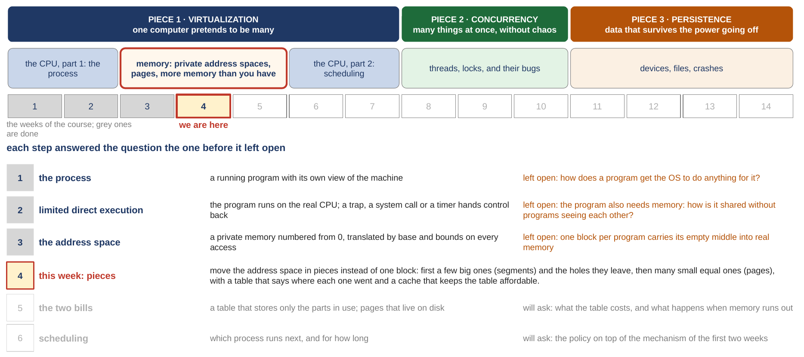
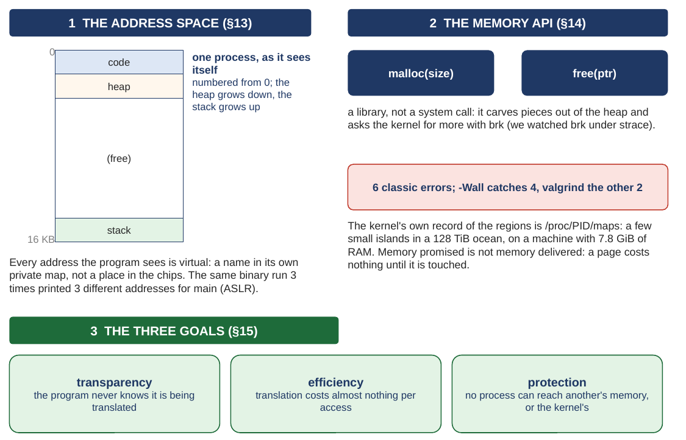
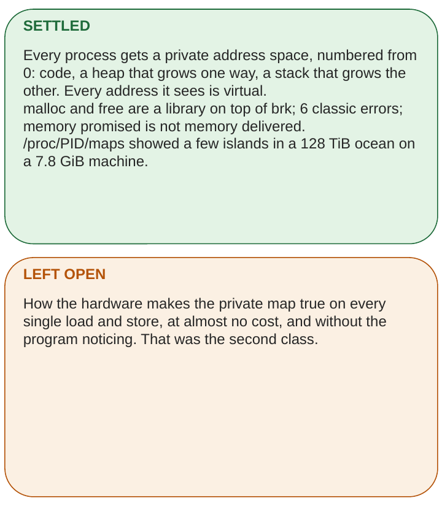
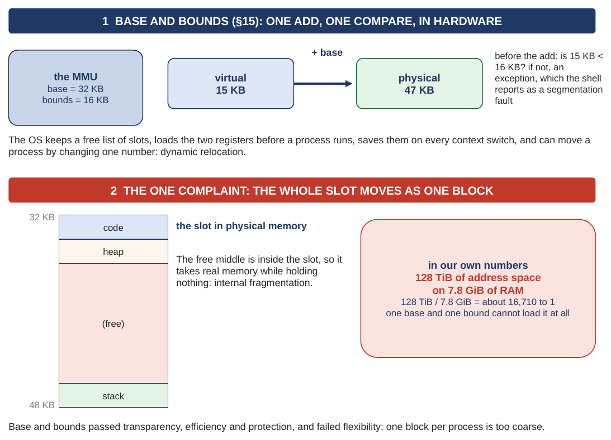
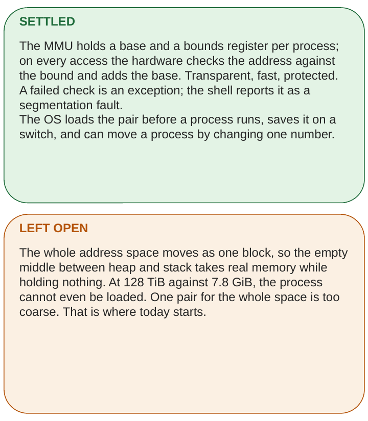
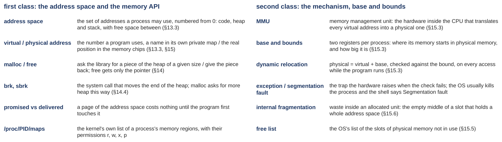

# Memory: chopping the address space into pieces

*COMP3430 Operating Systems*

## Where this guide comes from {#source}

This guide comes from chapters 16, 17, 18 and 19 of the textbook (OSTEP: *Operating Systems: Three Easy Pieces*) and from the xv6 source code you use in the labs, and it follows the slides of the week in order, with the same pictures (this guide calls the set of slides the deck). It covers both classes of the week, so you can read it after class or instead of class. It also comes from small programs that were run on two real machines: an Ubuntu 24.04 x86-64 machine in the cloud, and xv6 under QEMU on RISC-V. (x86-64 and RISC-V are two families of processor, the chip that runs a computer's instructions. Ubuntu is a widely used version of Linux, the operating system on most servers. xv6 is the small teaching operating system of the labs, and QEMU is the program that pretends to be a RISC-V computer so that xv6 can run on it. Until the guide uses them, these are just the names of the two machines.) Where a figure, a number or a line of code comes from one of those, the guide says so, so you can look it up later if you want to go deeper.

## How to read this guide {#contents}

The label in brackets says what kind of section it is: a **Problem** section states what we have, where it breaks and what we need, before any fix; a **Concept** section explains the idea that answers it; a **Worked example** runs the idea on small numbers; a **Real kernel** section reads the xv6 code; a **Real machine** section reads an output captured on a real computer; **Check yourself** and **Your turn** are for you to do before reading on; **Extra** sections are optional and go deeper on a question already answered.

The navigation on the left lists every class and chapter of this week; the table of contents on the right lists the sections of the page you are on. Every section number in the text ("Section 3.5", "Extra 4") is a link.

## Part 0. Where we are in the course, and what last week built {#part-0}

This part does two jobs before the new material starts. It shows where this week sits in the whole course, and it rebuilds last week, with every word of it defined again. Everything later in this guide uses those words, so if one of them is shaky, this is the place to fix it. This week also does a lot of arithmetic with binary numbers (numbers written in 0s and 1s), hexadecimal numbers and powers of two. [Appendix A](appendix.md#appendix-a) at the end of the guide teaches all of it from the beginning. If any of those words is unfamiliar, read [Appendix A](appendix.md#appendix-a) now, before [Chapter 1](class-1.md#chapter-1); it takes about twenty minutes.

A few words first, so the map can be read. A computer runs **programs**: lists of instructions, such as "add these two numbers" or "copy this value". The **processor** (also called the **CPU**, central processing unit) is the hardware that carries out those instructions, one after another, billions of times a second. (A processor chip today holds several **cores**, each able to run its own stream of instructions; [Section 6.2](class-2.md#sec-6-2) comes back to that.) The **operating system** (the **OS**) is the program that runs the computer and shares it between all the other programs; its core is called the **kernel**, and this guide uses the two words interchangeably. A **process** is a running program. Anything built into the chips themselves, rather than written as a program, is called **hardware**.

**RAM** is the computer's main memory, a long row of bytes. A **byte** is a small unit of storage, enough for one letter of text or one number from 0 to 255 (a byte is 8 bits, and 8 bits can write 2^8 = 256 different numbers, 0 to 255; [Appendix A](appendix.md#appendix-a)). An **address** is the position number of one byte in that row, counted from 0. Memory sizes are counted in powers of two: a **KB** (kilobyte) is 1024 bytes, an **MB** is 1024 KB, a **GB** is 1024 MB, and a **TB** is 1024 GB. You will also see them spelled KiB, MiB, GiB and TiB; the extra "i" is the careful spelling for "the power of two", and in this guide both spellings mean the same thing ([Appendix A](appendix.md#appendix-a) says more). A **register** is a tiny storage cell inside the processor itself, much faster than RAM; there are only a few dozen of them.

#### The course map

<figure markdown="1">
{width=100%}
<figcaption markdown="1">Figure 1. The whole course on one page: the three pieces, the five blocks, the weeks with this one marked, and the question each step left open. From slide 2.</figcaption>
</figure>

An operating system has three big jobs, and the course takes them in order. The first is **virtualization**: one computer pretends to be many, so every program behaves as if it had the processor and the memory to itself. The second is **concurrency**: many things happen at the same time without breaking each other. The third is **persistence**: data survives when the power goes off. They are the three colored bands at the top of Figure 1.

The second row cuts the course into five blocks, and the first three belong to virtualization. Block 1 is the processor, seen from one process. Block 2 is memory, the red box. Block 3 goes back to the processor to ask which program should run next. Block 4 is concurrency, and block 5 is files and devices. The row of numbered cells is the weeks of the course, and memory takes three of them. This week is the middle one, the cell marked "we are here".

The table in the lower half of Figure 1 reads like a chain. Each row is one step of the course, and the orange text on its right is the question that step could not answer, which the next step then takes up. Step 3 is last week: every process got a private memory of its own, moved into place by two registers. Its orange text is where we stopped: one block per program drags its empty middle into real memory. Step 4 is this week. The block becomes pieces: first a few big ones (segments) and the holes they leave, then many small equal ones (pages), with a table that says where each piece went and a cache that keeps the table affordable. Each of those words is defined when it arrives.

#### Last week, first class: the address space, and malloc

<figure markdown="1">
{width=90%}
<figcaption markdown="1">Figure 2. Last week's first class, drawn: one process's address space, the memory API, and the three goals every memory design is scored on. From slide 3.</figcaption>
</figure>

Last week's first class asked what memory looks like to a running program. The answer was the **address space**: the set of addresses a process may use, numbered from 0, private to that process. Box 1 of Figure 2 draws a small one, 16 KB. It holds three things. The **code** is the program's instructions, which also live in memory. The **heap** is memory the program asks for while it runs, for data whose size it only learns then. The **stack** holds the working data of the program's **functions** (a function is a named piece of a program that other parts can call; each call needs a little memory for its own values, and gets it on the stack). Between the heap and the stack there is free space, so that both can grow. In this drawing address 0 is at the top and addresses increase downward. So on the page the heap grows downward, which is toward larger addresses, and the stack grows upward, which is toward smaller addresses. Because "up" and "down" depend on how a picture is drawn, the rest of this guide always says the direction in addresses: the heap grows toward larger addresses, and the stack grows toward smaller ones. The two grow toward each other, into the free middle.

The text under box 1 is the key word of last week. Every address a program uses is **virtual**: a name in its own private map, not a position in the chips. The real position in the memory chips is the **physical address**. Turning one into the other, on every single access, is called **address translation**. Linux even shuffles the map on every run (a defense called ASLR, address space layout randomization, which makes attacks that need to know where code sits in memory much harder), so the same program run three times printed three different addresses for its own `main` function, the function every program written in C starts in (C is the programming language of the operating system and of this week's programs; [Section 3.2](class-1.md#sec-3-2) says more).

Box 2 is the memory API (API is application programming interface: the set of functions a program calls to get something done). `malloc(size)` asks for a piece of the heap of a given size, in bytes, and returns a **pointer** to it: the address of the first byte of the piece. `free(ptr)` gives the piece back; it receives only the pointer, not the size. Both are **library** code, ready-made functions that come with the C language and run inside the program, not in the kernel. When the heap runs out, the library asks the kernel for more with a **system call**, a program's request to the OS. The call that moves the end of the heap is called **brk**, and its friendlier form is **sbrk** ("grow my memory by n bytes"). We watched those calls with **strace**, a tool that prints every system call a program makes. The red box recalls the six classic mistakes programs make with `malloc` and `free` (such as freeing a piece twice); the warnings of the **compiler** (the program that turns C source code into machine instructions), turned on with its `-Wall` option, catch four of them, and a checking tool called **valgrind** catches the other two.

The text under box 2 is two facts we measured. The kernel keeps its own list of a process's memory regions, and lets anyone read it as a text file named `/proc/PID/maps` (PID is the process ID, the number the kernel gives each process). On the Ubuntu machine that list was a few small regions in an address space of 128 TiB, on a machine with 7.8 GiB of RAM. (128 TiB comes from the processor's design and Linux's choice, which the second class's [Section 5.1](class-2.md#sec-5-1) explains; 7.8 GiB is how much RAM that machine has.) And memory promised is not memory delivered: a **page** of the address space, a 4 KB piece of it, costs nothing until the program first touches it. (4 KB is the page size the processors in this course use, a design fact; the second class makes "page" exact in Sections [4.1](class-2.md#sec-4-1) and [4.2](class-2.md#sec-4-2).) That is true of Linux on today's hardware, which uses the pages of the second class. With last week's base and bounds, and with the segments of the first class, a whole region gets physical memory the moment it exists, used or not; [Section 1.1](class-1.md#sec-1-1) starts from exactly that problem.

Box 3 is the scorecard. Every memory design is judged on three goals: **transparency** (the program never notices that it is being translated), **efficiency** (translation costs almost nothing per access), and **protection** (no process can reach another process's memory, or the kernel's).

<figure markdown="1">
{width=58%}
<figcaption markdown="1">Figure 3. What last week's first class settled, and what it left open. From slide 3.</figcaption>
</figure>

Settled: every process has a private address space, and every address it sees is virtual. Left open: how the hardware makes that private map true on every load and store (a **load** is an instruction that reads a value from memory, a **store** one that writes a value to memory), at almost no cost, without the program noticing. That was last week's second class.

#### Last week, second class: base and bounds, and its flaw

<figure markdown="1">
{width=87%}
<figcaption markdown="1">Figure 4. Last week's second class, drawn: base and bounds in the MMU, and the one complaint about it. From slide 4.</figcaption>
</figure>

The second class gave the first mechanism. The **MMU** (memory management unit) is the part of the processor that translates addresses. For **base and bounds** it holds two registers per process: the **base**, where the process's memory starts in the chips, and the **bounds**, how big it is. Follow the one access drawn in box 1 of Figure 4. The program asks for virtual address 15 KB. The hardware first checks that 15 KB is below the bound, 16 KB, then adds the base, 32 KB, and lands at physical 15 + 32 = 47 KB. Doing this add and this check on every access, while the program runs, is called **dynamic relocation**.

When the check fails, the hardware raises an **exception**: it stops the program and hands control to the OS, which usually ends the program. Last week's word for "hands control to the OS" was a **trap**, and a system call reaches the kernel the same way. The **shell** (the program that reads the commands you type) reports such a death as **Segmentation fault**. The text under box 1 lists the OS's duties: it keeps a free list of slots (a **free list** is a list of the pieces of memory not in use), loads the two registers before a process runs, saves them on every **context switch** (the moment the OS stops one process and starts another), and can move a process by copying it and changing one number.

Box 2 is the complaint. The whole address space moves as one block, so the free middle between heap and stack sits inside that block in physical memory, taking real RAM while holding nothing. Waste inside a piece that was handed out whole is called **internal fragmentation**. And in our own numbers it is worse than waste. The address space measured on the Ubuntu machine was 128 TiB, and the machine has 7.8 GiB. 128 TiB is 128 × 1024 = 131,072 GiB. Linux reports the machine's RAM as 8,225,104 KB, which is 8,225,104 ÷ 1,048,576 = 7.844 GiB (a GiB is 1024 × 1024 = 1,048,576 KB). And 131,072 ÷ 7.844 is about 16,710. Check it the other way: 16,710 × 7.844 is about 131,073 GiB. One base and one bound cannot even load that process.

<figure markdown="1">
{width=58%}
<figcaption markdown="1">Figure 5. What last week's second class settled, and what it left open. From slide 4.</figcaption>
</figure>

Settled: translation on every access, with one add and one compare in hardware, passing transparency, efficiency and protection. Left open: one pair of registers for the whole address space is too coarse. The process has to move in pieces. That is where this week starts.

#### Last week's words, in one place

<figure markdown="1">
{width=100%}
<figcaption markdown="1">Figure 6. Last week's words, each in one sentence, with the textbook section that defines it. From slide 5.</figcaption>
</figure>

Figure 6 is the list from the slides. The left column is the first class and the right column the second; the section numbers in brackets are the textbook's. Two of the words come back this week in a new form. The free list returns as the central data structure of the first class. And internal fragmentation, waste inside a piece, gets a sibling: external fragmentation, waste between pieces, which [Section 2.1](class-1.md#sec-2-1) defines.

#### What last week settled, and what this week answers

Settled: every process has a private address space, and the hardware translates every address with one add and one compare. Left open: the address space moves as one block, so its empty middle costs real memory, and a big address space cannot be loaded at all. This week answers that in two steps. The first class cuts the address space into a few big pieces, finds out what pieces of different sizes cost, and reads the two allocators in your own xv6 tree (your tree is your copy of xv6's source files, the one your labs build). The second class cuts all of memory into many small pieces of one size, and pays for it with a table and a cache.
