# Your questions, answered: paging and the TLB

*COMP3430 Operating Systems · follow-up to the self-study guide "Memory: chopping the address space into pieces"*

These are the questions you sent in after working through the paging guide, quoted as you wrote them. I grouped them by topic, because several of you were stuck on the same thing from different sides. Each group starts with a short recap of the concept it rests on, then takes the questions one at a time. Every answer says where in the guide to reread, and the figures are drawn fresh for this page.

Read the recap boxes even if your own question is in a later group. Most of the confusion came from one of five ideas, and the recaps are those five ideas.

## A. Bits, hex and shifts {#a}

!!! abstract "Recap"

    A register holds a fixed number of bits. Shifting right by n (`x >> n`) slides every bit n places toward the low end; the n bits that fall off the right are gone, and n zeros come in on the left. It is the same as dividing by 2^n and dropping the remainder. Shifting left (`x << n`) is the opposite, and the same as multiplying by 2^n. A mask with `&` keeps only the bits where the mask has a 1. One hex digit is exactly four bits, so hex and binary convert digit by digit, in groups of four counted from the right. Leading zeros never change a value. (Guide: Appendix A.)

### Q1. "In my mind I am asking 'how is shifting 110000 >> 4 is 11, I thought the result would be 000011 which in binary is 3. It does state this, I'm just confused why the example calls it 11.'" {#q1 data-toc-label="Q1. Why does the guide call `110000 >> 4` '11'?"}

Where to reread: [Appendix A, the four bit operators](appendix.md#appendix-a-operators); [Extra 13](class-2.md#extra-13).

You had it right. The "11" in the example is a binary number, so it is the same number as 000011, which is 3. Writing 11 and writing 000011 is like writing 7 and 007: the leading zeros carry no value. The example dropped them, which made it look like a different answer. It is not.

Think of it the way the hardware does. A register has a fixed width, six bits in this toy example. When you shift right by four, every bit moves four places toward the low end. The four bits that fall off the right are gone. Four zeros come in at the left. So 110000 becomes 000011. The two 1s that were in the top positions, worth 32 and 16, now sit in the bottom positions, worth 2 and 1. That is exactly "take the top two bits and read them as a plain number", which is what the recipe needs.

<figure markdown="1">
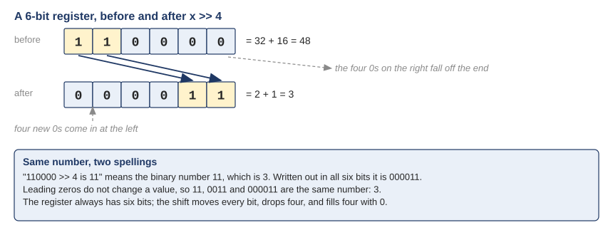
<figcaption markdown="1">Figure Q.1. In a 6-bit register, 110000 shifted right by 4 is 000011. The example wrote it as 11; same number, 3.</figcaption>
</figure>

A second check, with arithmetic instead of pictures: 110000 is 48, shifting right by 4 is dividing by 16, and 48 / 16 = 3. The guide's tables now write all six bits, so this cannot trip anyone again.

### Q2. "Why are the first 3 of the PNF hexadecimal and the latter 4 binary?" {#q2 data-toc-label="Q2. Why are the first 3 bits of the PFN hex and the last 4 binary?"}

Where to reread: [Section 4.3](class-2.md#sec-4-3), step 3.

They are all binary. Nothing in that step is hex. What you saw was a 7-bit physical address drawn as two groups, three bits and then four bits, and the question is why the groups have those sizes.

The four bits on the right are the offset, the position of the byte inside its page. A page in this example holds 16 bytes, and naming one of 16 things takes 4 bits (2^4 = 16). The offset is copied straight across from the virtual address, because a page is moved into a frame whole, so a byte keeps its position.

The three bits on the left are the frame number. Physical memory in the example is 128 bytes, which is 8 frames of 16, and naming one of 8 things takes 3 bits (2^3 = 8). The virtual page number needed only 2 bits, because the address space is 64 bytes, 4 pages, and naming one of 4 things takes 2 bits. So the frame number is one bit wider than the page number, simply because physical memory is twice as big as the address space.

<figure markdown="1">
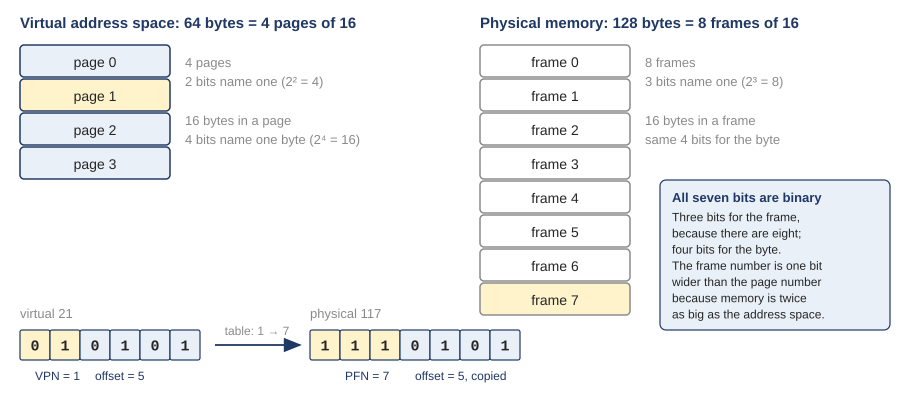
<figcaption markdown="1">Figure Q.2. The address space has 4 pages, so 2 bits name a page; memory has 8 frames, so 3 bits name a frame. The 4-bit offset is the same on both sides. Virtual 21 becomes physical 117.</figcaption>
</figure>

Real machines work the same way, only wider. On xv6's RISC-V, a virtual address is 39 bits and a physical address can be up to 56 bits, and the whole difference is in the frame-number part. The offset is 12 bits on both sides, because the page size, 4 KB, is the same on both sides.

### Q3. "I'm still building speed at converting between hex and binary and at regrouping bits, such as decoding the PTE 0x21fcd85b in Exercise 8, where 10 flag bits don't line up with the hex digits." {#q3 data-toc-label="Q3. Decoding the entry `0x21fcd85b` when 10 flag bits do not line up with hex digits"}

Where to reread: [Answer 13](review.md#answers) (this was [Exercise 8](review.md#exercises) in the earlier edition), and the macros in [Section 5.2](class-2.md#sec-5-2).

They do not line up, and that is the whole difficulty: 10 is not a multiple of 4, so the cut between "flags" and "frame number" falls in the middle of a hex digit. Two ways to handle it.

On paper, turn only the last three hex digits into binary. Three hex digits are 12 bits. The low 10 of those 12 are the flags, and the top 2 belong to the frame number. Then take everything above those 10 bits, regroup it in fours from the right, and read the groups back as hex. Figure Q.3 does it for 0x21fcd85b.

<figure markdown="1">
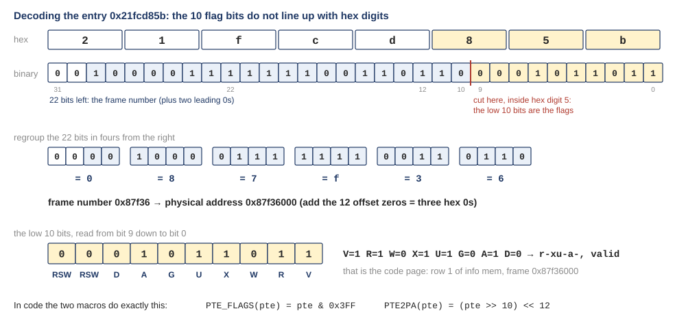
<figcaption markdown="1">Figure Q.3. The entry 0x21fcd85b in binary. The low 10 bits are the flags (r-xu-a-, valid); the 22 bits above them, regrouped in fours, read 0x87f36, the frame number, so the frame's physical address is 0x87f36000. That is row 1 of info mem, the code page.</figcaption>
</figure>

In code, let the shifts do the work, and this is why xv6 writes two macros instead of thinking about hex digits at all. `PTE_FLAGS(pte)` is `pte & 0x3FF`: the mask 0x3FF is ten 1s (11 1111 1111), so it keeps the low 10 bits and nothing else. `PTE2PA(pte)` is `(pte >> 10) << 12`: shift right 10 to drop the flags, then shift left 12 to put the frame number back in the place of a physical address. The shifts move by 10 and by 12 without caring where the hex digits are. That is the general lesson: when a field boundary is not on a hex boundary, think in bits and let a shift do the regrouping.

It helps to memorize two masks once. 0x3FF is ten 1s. 0xFFF is twelve 1s, the offset of a 4 KB page. After that, the pattern repeats all week.

## B. The page-table entry and its flag bits {#b}

!!! abstract "Recap"

    A page-table entry (a "row") on RISC-V is 64 bits: the frame number in bits 53 down to 10, and ten flag bits at the bottom, V R W X U G A D plus two spare bits. V says the row is real. R, W, X say what kind of access is allowed. U says a user program (not only the kernel) may touch the page. A and D are set by the hardware itself the first time the page is read or written. The MMU checks the flags on every access, and a failed check is a trap into the OS. (Guide: Sections 5.2 and 5.3.)

### Q4. "I couldn't tell what the attr column (r-xu-a-, rw-----, and so on) meant. I'm still unsure why a and d are set by the hardware, why the heap pages have no a bit even though the kernel zeroed them, and why the guard page works just by missing the u bit." {#q4 data-toc-label="Q4. What the `attr` letters mean, why `a` and `d` are hardware-set, why the heap pages have no `a`, and why the guard page works without `u`"}

Where to reread: [Section 5.3](class-2.md#sec-5-3), [Section 5.2](class-2.md#sec-5-2), and [Answer 14](review.md#answers).

Four questions in one, so four answers.

**The letters.** The `attr` column of `info mem` prints the flag bits of the row, one letter per bit, always in the order r w x u g a d. A letter means that bit is 1; a dash means it is 0. There is no letter for the valid bit because `info mem` only prints rows that are valid. So `r-xu-a-` reads: readable, not writable, executable, user, not global, accessed, not dirty. That is a code page that has been run but never written.

<figure markdown="1">
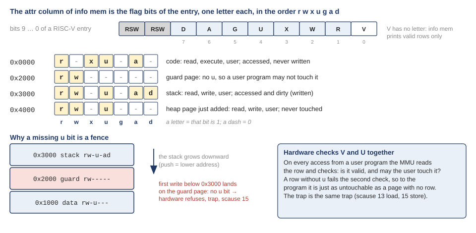
<figcaption markdown="1">Figure Q.4. The attr letters are the flag bits of the entry in order. Four rows of the capture read out. Below: why a row with no u bit works as a fence under the stack.</figcaption>
</figure>

**Why a and d are set by the hardware.** Only the hardware sees every access. If the OS wanted to know which pages had been read or written, the alternative would be a trap on every single access so the OS could write the bit itself, and that would make every memory access many times slower. So the MMU does it: on the first read or write through a row it sets a, and on the first write it sets d, with no help from the OS. The OS reads the bits later, when it has a decision to make. Next week that decision is which page to push out to disk: a page with no a bit has not been used lately, and a page with no d bit can be dropped without writing it back, because the copy on disk is still correct.

**Why the heap pages have no a bit even though the kernel zeroed them.** Because the a bit belongs to the row, not to the frame. The kernel did write zeros into those three frames. But the kernel reaches memory through a page table of its own, which maps all of RAM, and that is the table the MMU used during the `memset`. The process's three rows (0x4000, 0x5000, 0x6000) were never used for any access, so their a bits stayed 0. The first time the process itself reads one of those pages, the MMU goes through the process's row, and the a bit appears.

<figure markdown="1">
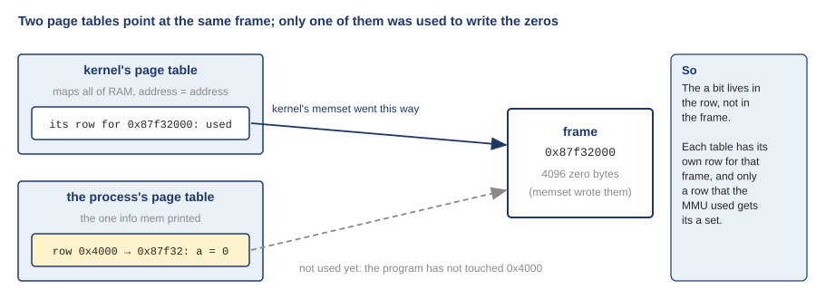
<figcaption markdown="1">Figure Q.5. Two page tables point at the same frame. The kernel wrote the zeros through its own row; the process's row has not been used yet, so its a bit is still 0.</figcaption>
</figure>

**Why the guard page works just by missing the u bit.** On every access from a user program, the MMU checks the row's valid bit and its u bit in the same step. A row without u fails that check for a user program, so to the program the page is just as untouchable as a page with no row at all, and the trap is the same trap: scause 13 for a load, 15 for a store. The stack page is at 0x3000 and the stack grows downward, so the first write that overflows the stack lands at 0x2fff or below, inside the guard page at 0x2000. The hardware refuses, and the OS catches the overflow at the exact instruction, instead of letting it silently scribble over the data page at 0x1000. The only difference from an unmapped page is that the guard has a frame behind it, because xv6 allocates the stack and the guard together and then clears u on the guard. An OS could save that frame by leaving the row invalid instead; the trap would be identical.

## C. The TLB itself {#c}

!!! abstract "Recap"

    Every access first needs the row for its page, and the row is in memory, so without help every access costs two memory references. The TLB (translation-lookaside buffer) is a small cache of recent rows inside the MMU. On a hit, the frame number comes out of the TLB and the page table is not read. On a miss, the hardware reads the row from the table, puts it in the TLB, and retries the instruction, which now hits. A TLB is fully associative: a translation may sit in any slot, and a lookup compares against all slots at once. (Guide: Sections 6.1 to 6.3.)

### Q5. "I wasn't sure what a TLB actually is and where it sits. My current understanding is that it's a small cache inside the MMU that stores recent VPN to PFN translations, so a hit skips the page-table read. I'd like more detail on why it's called 'fully associative' and what the hardware does to check every slot at once." {#q5 data-toc-label="Q5. What a TLB is, where it sits, and what 'fully associative' means"}

Where to reread: [Section 6.2](class-2.md#sec-6-2).

Your current understanding is correct, so first the picture of where it sits. The CPU core issues a virtual address. The MMU, the hardware that translates, sits between the core and memory. Inside the MMU is the TLB: a few dozen to a few thousand slots, each holding one translation, a VPN, the frame it maps to, and the permission bits. On a hit the page table in memory is never touched, and the one memory access is the program's own.

<figure markdown="1">
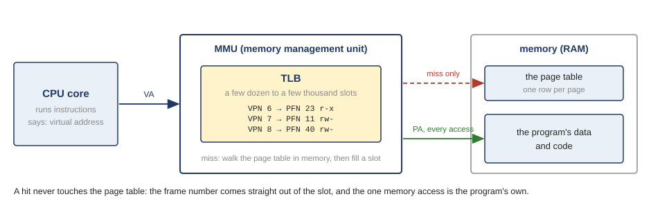
<figcaption markdown="1">Figure Q.6. The TLB sits inside the MMU, between the core and memory. On a hit the page table is not read.</figcaption>
</figure>

Now "fully associative". In many caches each item has a fixed home: VPN 7 would go in slot 7, so a lookup checks one slot. A fully associative cache has no such rule. A translation can sit in any slot, which is good because the cache never has to throw out VPN 7 just because another page also wanted slot 7. The price is that a lookup cannot know which slot to check, so it has to check all of them.

The hardware does that by giving every slot its own small comparing circuit, a comparator. The VPN being looked up is sent to all of them at the same time. Each comparator checks its slot's VPN against it, in the same clock tick. At most one matches, and that slot hands out its frame number. There is no loop and no searching, which is why a lookup takes a few clock ticks and no memory access.

<figure markdown="1">
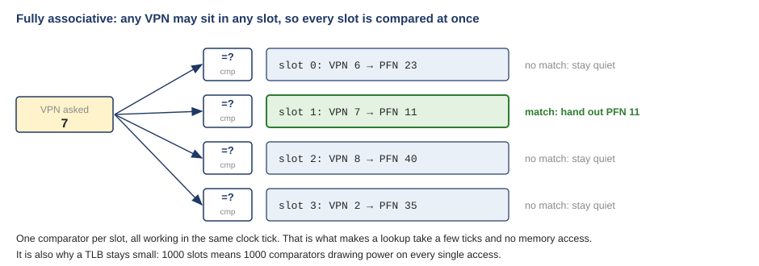
<figcaption markdown="1">Figure Q.7. Fully associative: the VPN is broadcast to one comparator per slot, all working in the same clock tick; the slot that matches hands out its frame number.</figcaption>
</figure>

This is also why a TLB has to stay small. A thousand slots means a thousand comparators, all drawing power on every access, and the wiring that fans one VPN out to all of them gets slower as the count grows. So real chips keep a tiny first-level TLB (around 64 slots) that answers fastest, and a larger second-level one behind it (a thousand or two). The measurement in Q13 shows both.

### Q6. "I didn't understand what decides which memory references are 'wanted' and which are 'hardware overhead.' My current understanding is that a reference is overhead if it only exists to read a PTE, and wanted if the program's own instruction caused it." {#q6 data-toc-label="Q6. What decides which memory references are 'wanted' and which are 'overhead'"}

Where to reread: [Section 6.1](class-2.md#sec-6-1).

That is exactly the rule. A memory reference is any one read or write of memory. It is wanted if the program's own instruction caused it: fetching the instruction itself, or the load or store that instruction does. It is overhead if its only purpose is to read a row of the page table so that some other reference can be translated. The program never asked for that read; the hardware added it.

<figure markdown="1">
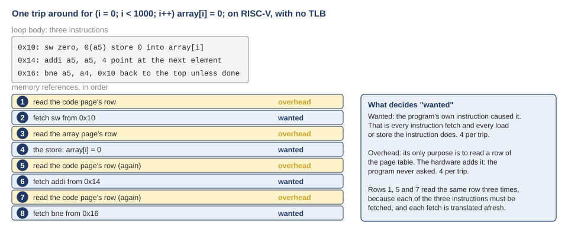
<figcaption markdown="1">Figure Q.8. One trip around the array loop on RISC-V with no TLB: 8 memory references, 4 wanted and 4 overhead. The code page's row is read three times, once per instruction fetch.</figcaption>
</figure>

In the loop of [Section 6.1](class-2.md#sec-6-1), one trip makes four wanted references (fetch `sw`, do the store, fetch `addi`, fetch `bne`) and four overhead references (a row read before each of them). Note that only one of the four wanted references, the store, is what the C line `array[i] = 0` literally asked for. The three instruction fetches come with running any compiled code. They still count as the program's own, because they exist to run the program. Only the row reads are the hardware's addition. The TLB turns those four row reads into four hits, and the loop is back to the four references the program meant to make.

### Q7. "I'd like more detail on why the code page's PTE is read three times per loop trip, and why reading the PTE doesn't itself need translating." {#q7 data-toc-label="Q7. Why the code page's entry is read three times per loop trip, and why reading an entry needs no translation"}

Where to reread: [Section 6.1](class-2.md#sec-6-1), [Section 5.1](class-2.md#sec-5-1), and [Extra 20](class-2.md#extra-20).

**Three times** because the loop body is three instructions, and each instruction has to be fetched from memory before it can run. Every fetch is a memory reference with a virtual address, so every fetch needs a translation. Without a TLB the hardware has no memory of what it translated a moment ago. So it reads the code page's row for `sw`, reads the same row again for `addi`, and reads it a third time for `bne`. Figure Q.8 above shows the three reads as rows 1, 5 and 7. Reading the same row over and over is precisely the waste the TLB removes: after the first trip, that row is in the TLB and the next 999 trips never read it from memory again.

**No translation** because the register that names the table, satp on RISC-V, holds a physical address. In the capture of [Section 5.3](class-2.md#sec-5-3), satp = 0x8000000000087f33: the leading 8 is the paging mode, and 0x87f33 is the frame number of the page that holds the table, so the table starts at physical address 0x87f33000. To find a row, the MMU computes 0x87f33000 + VPN × 8, and that is a physical address plus a number, so it is a physical address. The MMU reads memory there directly. The frame numbers stored inside the rows are physical as well.

<figure markdown="1">
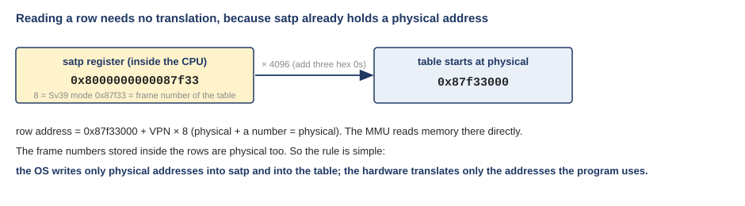
<figcaption markdown="1">Figure Q.9. satp holds the physical frame number of the table, so the address of any row is physical, and the MMU reads it with no translation.</figcaption>
</figure>

So the rule is simple and worth keeping: the OS only ever writes physical addresses into satp and into the table, and the hardware only ever translates the addresses the program uses. If the table's own address were virtual, the hardware would need the table to find the table, and nothing could start. (Next week, when the flat table becomes a tree, every pointer inside the tree is physical for the same reason.)

### Q8. "I would also like to understand how the TLB decides which translations to remove when it becomes full." {#q8 data-toc-label="Q8. How the TLB decides which translation to throw out"}

Where to reread: [Extra 23](class-2.md#extra-23), card 1.

That decision is the replacement policy, and it is built into the chip; the OS does not take part. Two policies are common.

LRU, least recently used, throws out the slot that has gone unused for the longest time. It bets on temporal locality: what has not been touched for a while is the least likely to be needed next. Random throws out any slot. Random sounds careless, but LRU has a bad case that is worth seeing once, because it comes back later in the course for pages on disk.

<figure markdown="1">
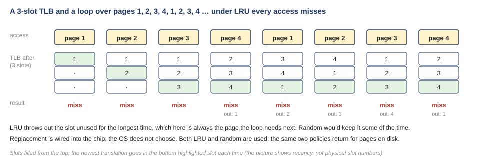
<figcaption markdown="1">Figure Q.10. A 3-slot TLB under LRU, with a loop that touches 4 pages in order. Every access misses, because LRU always evicts the page the loop needs next.</figcaption>
</figure>

Take a TLB with 3 slots and a loop over pages 1, 2, 3, 4, 1, 2, 3, 4, and so on. The first three accesses miss and fill the slots. Page 4 misses and LRU evicts page 1, the oldest. The next access is page 1: miss, evict 2. Then page 2: miss, evict 3. Every access misses, forever, because the loop touches one page more than the TLB holds and LRU always throws out exactly the one that is coming next. Random would keep that page some of the time and would do noticeably better. Neither policy is best for every program, which is why both exist.

### Q9. "Another thing I would appreciate clarification on is the difference between a TLB miss and a page fault, since both seem to involve difficulties accessing memory." {#q9 data-toc-label="Q9. The difference between a TLB miss and a page fault"}

Where to reread: the end of [Section 6.3](class-2.md#sec-6-3); page faults in [Section 5.3](class-2.md#sec-5-3) and [Extra 18](class-2.md#extra-18).

They happen at different stages, and only one of them is an error.

A TLB miss means the cache does not have the translation yet. The hardware reads the row from the page table in memory, puts it in a slot, and retries the instruction, which now hits. The program never notices. The cost is one extra memory read and nothing else. Every page misses the first time it is touched; that is normal, and it is how the TLB fills.

A page fault means the page table itself says no. Either the row's valid bit is 0, or the access is of a kind the row forbids: writing a read-only page, running data as code, or a user program touching a page with no u bit (the guard page of Q4). Then the hardware cannot complete the instruction. It stops and traps into the OS, with the reason in scause. The OS decides what happens next. In xv6, as in [Extra 18](class-2.md#extra-18), that is to kill the process. In a real OS it is often to bring the page in from disk and retry, which is next week.

<figure markdown="1">
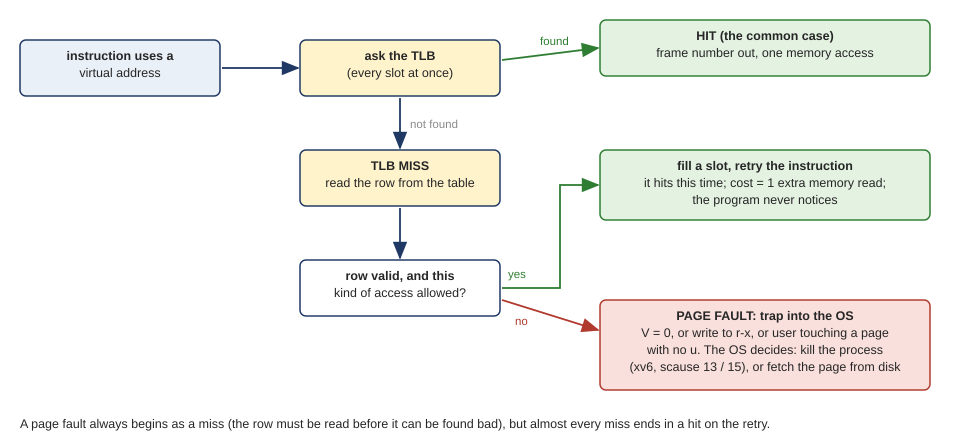
<figcaption markdown="1">Figure Q.11. A TLB miss is handled by the hardware and ends in a retry that hits. A page fault is the table saying no, and ends in a trap to the OS.</figcaption>
</figure>

The two are related in one way: a page fault always starts with a TLB miss, because the row has to be read before it can be found bad. But almost every miss ends with a hit on the retry, not with a fault. Miss: slow but fine. Fault: the OS has to step in.

## D. Context switches and ASIDs {#d}

!!! abstract "Recap"

    Every process has its own page table, and on a context switch the OS points satp at the new process's table. But the TLB is a cache, and it still holds the old process's translations. A plain TLB entry does not say which table it came from, so after a switch the hardware cannot tell a still-correct entry from a wrong one. Either the entries are thrown away (flush) or they are stamped with a process number (ASID) so the lookup can tell them apart. (Guide: Section 6.5, Extras 21 and 22.)

### Q10. "I don't quite understand everything happening with the TLB when it's doing context switches. I think it's confusing me just because there's so many things happening at the same time with caching, address spaces, etc." {#q10 data-toc-label="Q10. Everything that happens to the TLB on a context switch"}

Where to reread: [Extra 22](class-2.md#extra-22) first, then [Section 6.5](class-2.md#sec-6-5), then [Extra 21](class-2.md#extra-21).

It does feel like several things at once, so take it in four steps and stop after each one.

**Step 1, the problem.** There is one TLB. Process P1 has its virtual page 10 in frame 100. Process P2 has its virtual page 10 in frame 170. The OS switches from P1 to P2 by changing satp, but the TLB still holds P1's entry "VPN 10 → frame 100". If P2 now touches its page 10, the TLB sees VPN 10, matches, and answers frame 100. P2 reads P1's memory. Protection, which is the whole point of having separate address spaces, is gone.

**Step 2, two fixes.** Fix 1: empty the TLB on every switch, by clearing every slot's valid bit. Safe, but every process starts cold each time it runs and misses again on every page it uses. Fix 2: stamp each TLB entry with a short process number, the ASID, and make the lookup accept only entries whose stamp matches the running process. Nothing is thrown away, so no cold start. The price is one more field per slot.

<figure markdown="1">
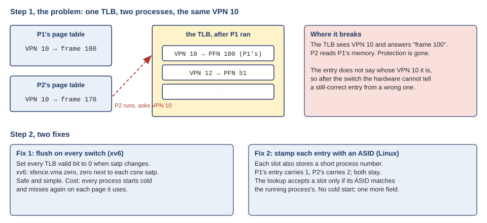
<figcaption markdown="1">Figure Q.12. Step 1: one TLB, two processes with the same VPN 10, and the wrong answer. Step 2: flush, or stamp each entry with an ASID.</figcaption>
</figure>

**Step 3, what xv6 does.** Fix 1. The instruction `sfence.vma zero, zero` next to every write of satp is the flush. You can find it in `kernel/trampoline.S`: line 95, right after `csrw satp, t1` on the way into the kernel, and lines 106 and 108, around `csrw satp, a0` on the way back to the user program. The fence before the write is there so the hardware never reads a half-written table; the fence after the write is the one that drops every stale translation.

**Step 4, an xv6 detail you can skip the first time.** xv6 also has a page table for the kernel itself, and it switches to it on every trap and back on every return. So xv6 flushes the TLB on every trip into and out of the kernel, every system call and every timer interrupt, not only when the process changes. Even when the same program continues afterwards, it starts cold. That is correct, simple, and slow. Linux avoids most of those flushes with Fix 2.

<figure markdown="1">
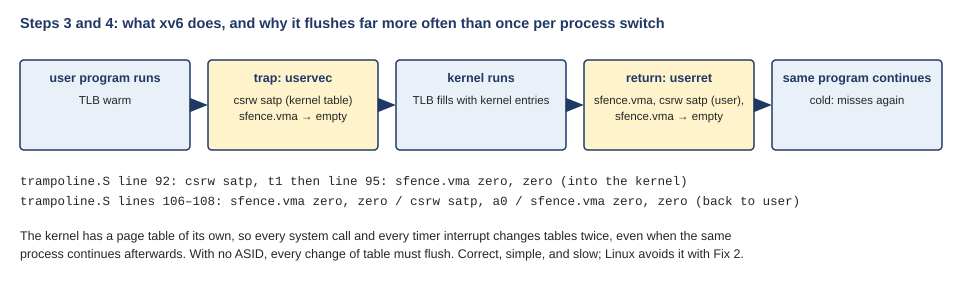
<figcaption markdown="1">Figure Q.13. Steps 3 and 4: where the flushes are in xv6, and why a trip through the kernel empties the TLB twice even when the same process continues.</figcaption>
</figure>

If it still feels like a lot, keep only Steps 1 and 2. They are the idea; Steps 3 and 4 are what one particular kernel chose.

### Q11. "I understood that two processes can both have a virtual page 10 in different frames, so the TLB needs a way to tell them apart. What confused me was how an ASID does that. I'm still working on how the TLB uses the ASID during a lookup, why xv6 leaves it at 0 (the MAKE_SATP macro never sets bits 44 to 59), and what happens when the OS runs out of ASIDs." {#q11 data-toc-label="Q11. How an ASID works in a lookup, why xv6 leaves it 0, and what happens when the OS runs out"}

Where to reread: [Extra 22](class-2.md#extra-22), [Section 6.5](class-2.md#sec-6-5), and the global bit in [Extra 23](class-2.md#extra-23).

**How the lookup uses it.** With ASIDs, each TLB slot stores an ASID together with the VPN and the frame. The comparators of Q5 now check two things instead of one: the slot's VPN must equal the VPN asked for, and the slot's ASID must equal the ASID of the running process, which the OS wrote into satp when it switched. A slot stamped with another process's ASID simply does not match. It is not thrown away; it sits there until that process runs again, and then it matches and saves a miss. So P1's "VPN 10 → 100" with stamp 1 and P2's "VPN 10 → 170" with stamp 2 live in the TLB side by side, and each process only ever sees its own.

<figure markdown="1">
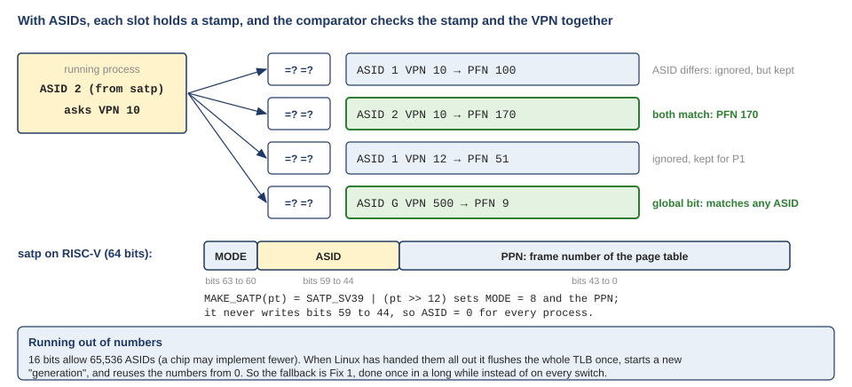
<figcaption markdown="1">Figure Q.14. With ASIDs the comparator checks the stamp and the VPN together. The satp layout on RISC-V, and the macro that leaves the ASID field at 0.</figcaption>
</figure>

One exception is the global bit, G, in the row. A slot marked global matches whatever the ASID. That is how pages shared by every process, the kernel's own, get by with one slot instead of one per process.

**Why xv6 leaves it at 0.** The macro is the how; the why is a design choice. On RISC-V the ASID is bits 59 down to 44 of satp, 16 bits. `MAKE_SATP` builds satp from the mode (8, in the top digit) and the table's frame number, and never writes those 16 bits, so every process runs as ASID 0. Using ASIDs would mean the kernel has to hand out the numbers, remember who has which, write the right one into satp at every switch, and flush just that number's entries when a process exits. xv6 is a teaching kernel and keeps all of that out: everyone is 0, and the whole TLB is flushed at every switch. Less code, more misses.

**Running out.** 16 bits allow 65,536 ASIDs, though a particular chip may implement fewer, and a busy machine can create more processes than that over time. The usual answer, which Linux uses on RISC-V and on ARM, is a generation counter. The kernel hands out numbers from a pool. When the pool is empty, it flushes the whole TLB once, starts a new generation, and hands the numbers out again from the beginning. So the fallback is Fix 1, done once in a long while instead of on every switch, which is cheap enough not to matter.

## E. Access patterns and performance {#e}

!!! abstract "Recap"

    A TLB only helps a program that keeps touching the same pages. Spatial locality: the next access is near the last one, so it lands on the same page and hits. Temporal locality: the same page is touched again soon, before its slot is reused. A loop that jumps to a new page on every step, over more pages than the TLB has slots, gets no help at all, and every access pays the miss. (Guide: Section 6.4, Extra 24.)

### Q12. "A practical example showing how the TLB handles consecutive memory accesses would help me better understand why memory access patterns matter for program performance." {#q12 data-toc-label="Q12. A practical example of the TLB on consecutive accesses"}

Where to reread: [Section 6.4](class-2.md#sec-6-4), [Exercise 10](review.md#exercises) and [Answer 10](review.md#answers).

Here is the example from the guide, worked all the way through. An array of ten 4-byte integers starts at virtual address 100 on a machine with 16-byte pages and an empty TLB. 100 in binary is 0110 0100: VPN 6, offset 4. So `a[0]` is byte 4 of page 6; `a[1]` and `a[2]` fill the rest of page 6; `a[3]` to `a[6]` fill page 7; `a[7]` to `a[9]` are on page 8. A loop reads them in order.

<figure markdown="1">
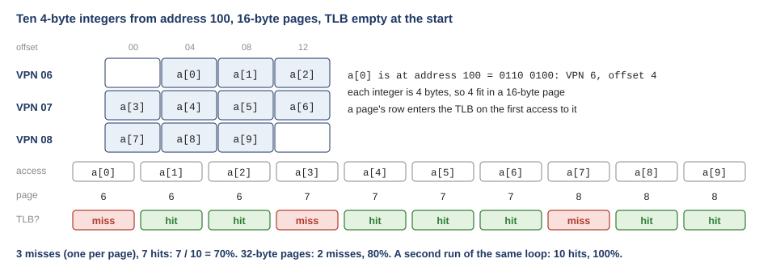
<figcaption markdown="1">Figure Q.15. Ten array reads on 16-byte pages. The first access to each page misses; the rest hit. 3 misses, 7 hits, 70%.</figcaption>
</figure>

`a[0]`: page 6 is not in the TLB, miss, and page 6's row goes in. `a[1]`, `a[2]`: page 6, hit, hit. `a[3]`: page 7, miss. `a[4]`, `a[5]`, `a[6]`: hit, hit, hit. `a[7]`: page 8, miss. `a[8]`, `a[9]`: hit, hit. Three misses, one per page, and seven hits: 7 / 10 = 70%. That is spatial locality at work. The elements are next to each other, so most of them share a page with the one before, and only the first element on each page pays.

Two variations show the rest. With 32-byte pages, eight integers share a page, so the ten elements span two pages: 2 misses, 80%. Bigger pages mean more neighbors per translation. And if the loop runs a second time right away, pages 6, 7 and 8 are all still in the TLB: 10 hits, 100%. That is temporal locality: what was used a moment ago is used again.

Now flip it around. Imagine the same ten reads, but each one on a different page, say `a[0]` on page 6, `a[1]` on page 20, `a[2]` on page 33, and so on. Ten misses, 0%. Same number of reads, same amount of data, and every single one pays the table read. That is the whole reason access order matters, and Q13 measures it.

### Q13. "I would like more details on why accessing the same data in a different order can cause such a significant difference in execution time. I understand that this has something to do with TLB misses, but I am still confused about why accessing different pages causes such a large performance difference." {#q13 data-toc-label="Q13. Why the same data in a different order runs so much slower"}

Where to reread: [Extra 24](class-2.md#extra-24).

Start with the measurement that isolates the TLB. The program `tlb2.c` touches one integer on each of N pages, around and around, and times the average access. The graph in Figure Q.16 is that time against N on the Ubuntu 24.04 x86-64 machine the captures come from (one core of an Intel Xeon at 2.8 GHz). From 2 pages to 1536 pages the line is flat at about 1.3 ns: every access hits, because the TLB holds all N translations. Between 1536 and 2048 pages it jumps, and from 3072 pages on it sits at about 6.2 ns and rises slowly. The TLB is full. Each new translation pushes an old one out, and by the time the loop comes back around to a page, its slot is gone. Every access misses, and every miss walks the page table in memory. So on that chip a miss costs about 6.2 / 1.3 ≈ 5 times a hit, and the TLB holds roughly 2000 translations, which is 2000 × 4 KB = 8 MB of reach.

<figure markdown="1">
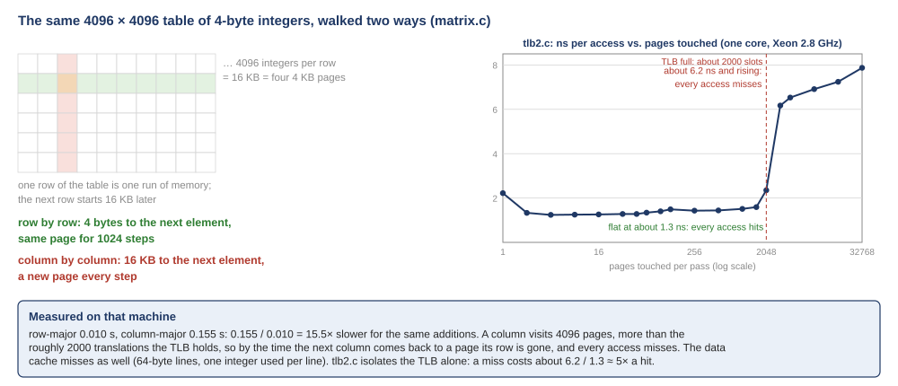
<figcaption markdown="1">Figure Q.16. Left: the 4096 × 4096 matrix in memory, walked by row (4 bytes apart) and by column (16 KB apart). Right: the tlb2.c sweep; flat while the pages fit in the TLB, five times slower once they do not.</figcaption>
</figure>

Now the matrix. `matrix.c` sums every element of a 4096 × 4096 table of 4-byte integers, twice. In C a table is stored one row after another, so neighbors in a row are 4 bytes apart and neighbors in a column are one whole row apart, 4096 × 4 = 16 KB. Walking a row, the program stays on one 4 KB page for 1024 elements, so only one access in 1024 can miss. Walking a column, every step jumps 16 KB, which is four pages away, so every single access is on a new page. One column visits 4096 different pages, more than the roughly 2000 the TLB holds, so by the time the next column comes back to those pages, every one of their slots has been reused. Every access misses. Same additions, same answer (the printed sum is identical), and the column walk took 0.155 s against 0.010 s for the row walk: 0.155 / 0.010 = 15.5 times slower.

Why 15 and not 5? Because two caches miss at once in the column walk. The TLB is one. The other is the data cache, the small fast memory next to the core that keeps copies of recently used memory in 64-byte lines. Walking a row, one fetched line gives 16 integers. Walking a column, one fetched line gives one integer and then the program jumps away, so every access fetches a fresh line too. `tlb2.c` is written so that only the TLB is in play, and there the penalty is about 5×; `matrix.c` pays both penalties, and gets 15×.

The lesson is the same either way, and it is one you will use in any language: walk memory in the order it is laid out. Memory is called random-access, as if every byte cost the same, and it does not.

## The five ideas, in one place {#five}

1. **Bits first, hex second.** A register has a fixed width; shifts move every bit and fill with zeros; leading zeros carry no value. When a field does not end on a hex digit, convert to binary and let a shift or a mask do the cut. `PTE_FLAGS` and `PTE2PA` are that cut written in C.
2. **A row is a frame number plus flags, and the flags belong to the row.** V, R, W, X, U are checked by the MMU on every access; A and D are set by the MMU, because only it sees every access. A row that was never used has no A, whatever happened to its frame through some other table.
3. **The TLB is a cache of rows inside the MMU.** Fully associative means any row in any slot, checked by one comparator per slot in one clock tick. A hit skips the page table; a miss reads one row, fills a slot, and retries. A page fault is different: the row says no, and the OS steps in.
4. **After a switch of table, old TLB entries are wrong, and the hardware cannot tell.** So either flush (xv6, `sfence.vma`, on every trap and return) or stamp each entry with an ASID and let the comparator check the stamp too (Linux, with a whole-TLB flush once per generation when the numbers run out).
5. **A TLB only helps a program with locality.** One miss per page touched, so walk memory in the order it is laid out. Jumping to a new page on every access, over more pages than the TLB has slots, makes every access a miss, and on a real machine that was 5× from the TLB alone and 15× with the data cache.
