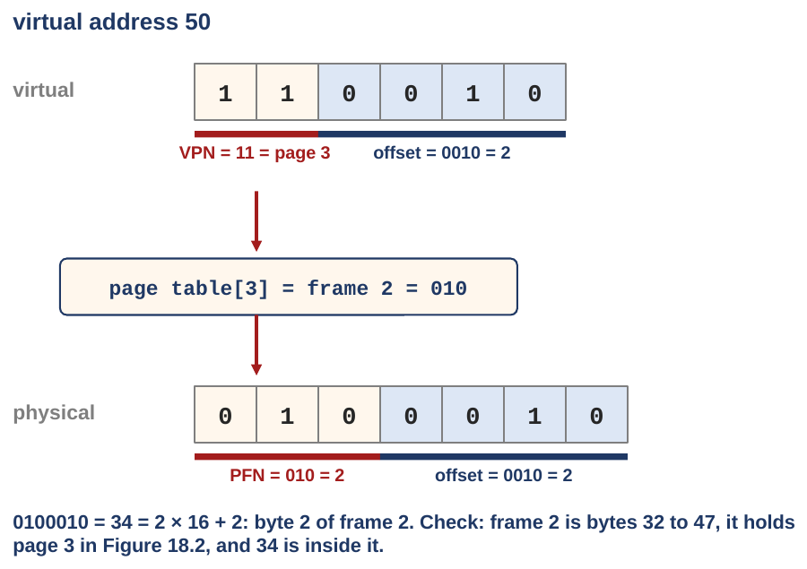
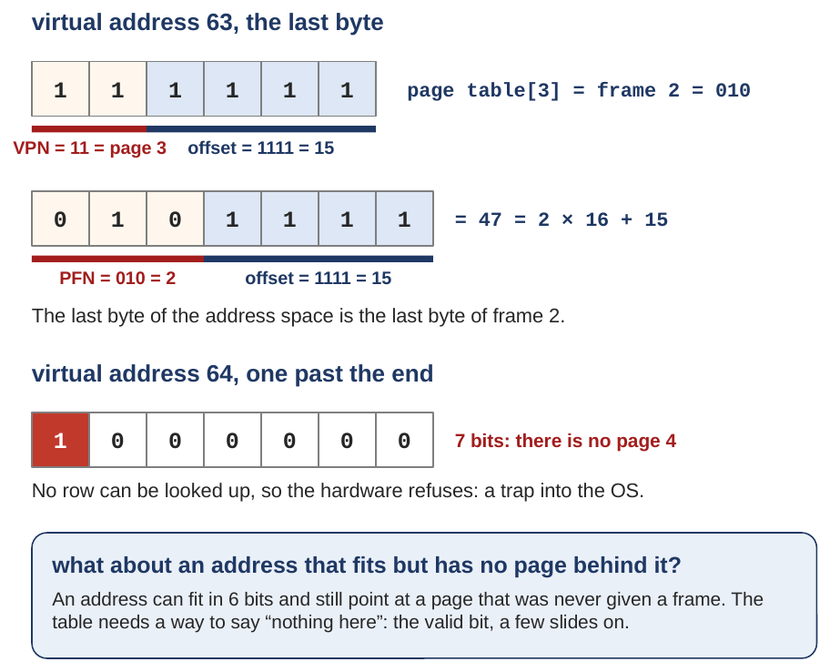
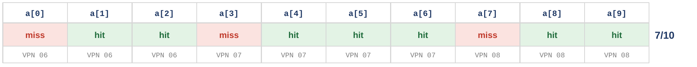
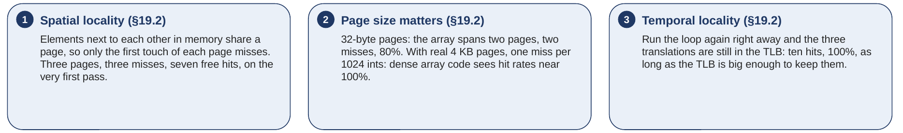

# Exercises and answers

## The week in twelve sentences {#the}

One base and bound per process gives the empty middle of the address space real memory, so the first fix keeps a base and size pair per segment, and the hole between heap and stack gets none. Translation takes the segment from the top bits of the address and the offset from the low bits, checks the offset against the size, and adds the base; a failed check is the segmentation fault. Segments come in different sizes, and pieces of different sizes leave holes between them: external fragmentation, with enough memory free in total and no single hole big enough. The same holes appear inside one heap, and an allocator lives with them by splitting, coalescing, keeping a header before every chunk and the free list inside the free chunks, and choosing holes by a fit policy; xv6's `umalloc.c` does all of that in 90 lines, and none of it removes the holes. `kalloc.c` needs none of it, because every unit is one page: the only real fix for external fragmentation is to stop handing out variable sizes, at the price of some waste inside each piece. Paging does that for all of memory: virtual pages and physical frames of one size, and any page fits in any frame. A virtual address splits into a page number and an offset; the page number is looked up in the page table and replaced by a frame number; the offset is copied through, so 21 becomes 117, and Linux's own table does the same. The table lives in memory, a register (PTBR; satp on RISC-V, CR3 on x86) holds its address, and each entry is a frame number plus flags: valid, read, write, execute, user, accessed, dirty. The OS writes entries (`mappages` in xv6, fed by `kalloc`), the hardware reads them on every access, and an access to an invalid entry or against the flags traps, so the table is also the fence between processes. A flat table is far too big on a real machine, 256 GiB per process on x86-64, which is next week's problem. Reading the table before every access doubles the memory references, and the TLB, a small cache of recent translations inside the MMU, fixes that because locality makes hits the common case. A miss costs one table walk, a change of table must flush the TLB or tag its entries with an ASID (xv6 flushes), and a program that keeps revisiting more pages than the TLB can hold runs several times slower, which you can measure.

## Exercises {#exercises}

Do these on paper, with the figures of the sections they name beside you. Write out the bits; the bits are the point. The answers follow, worked in full. Try each one before you look.

**Exercise 1.** The deck's first exercise, from [Section 1.3](class-1.md#sec-1-3). With the register table of the textbook's Figure 16.3 (code: base 32K, size 2K; heap: base 34K, size 3K; stack: base 28K, size 2K), translate virtual address 100 (in the code) and virtual address 4200 (in the heap) to physical addresses. Which of the two printed candidates for 4200, 39016 or 34920, is right, and where does the 104 come from?

**Exercise 2.** Same registers and the same 16 KB address space (code from 0 to 2K, heap from 4K to 7K). (a) Translate virtual address 1000. (b) Translate virtual address 6000. (c) What happens for virtual address 7300? (d) Now do (b) again the way the hardware of [Section 1.5](class-1.md#sec-1-5) does it: write 6000 as a 14-bit binary number, take the segment from the top two bits with `(6000 & 0x3000) >> 12`, and the offset with `6000 & 0xFFF`. Check that you get the same offset as in (b).

**Exercise 3.** A free list holds four holes, in this order: 25, 12, 40 and 18 bytes. A request for 16 bytes arrives. Which hole does each policy choose, and how big is the leftover sliver: (a) best fit, (b) worst fit, (c) first fit, (d) next fit, if the previous search ended at the 12-byte hole?

**Exercise 4.** The 30-byte heap of [Section 2.2](class-1.md#sec-2-2): bytes 0 to 9 free, 10 to 19 in use, 20 to 29 free, so the free list is (addr 0, len 10) then (addr 20, len 10). Ignore headers, as [Section 2.3](class-1.md#sec-2-3) did, and use first fit. (a) `malloc(4)` arrives. Which address does it return, and what is the free list after? (b) Then the chunk at 10 to 19 is freed, with coalescing. What is the free list now? (c) Could a 15-byte request succeed now? Could it have succeeded without coalescing? (d) Finally the 4-byte chunk from (a) is freed. What is the free list?

**Exercise 5.** `umalloc.c` of [Section 3.2](class-1.md#sec-3-2), with its 16-byte header. (a) How many units does `malloc` reserve for requests of 100, 16 and 17 bytes? (b) Suppose the free list, starting at the node after `freep`, holds chunks of 4 units (at unit 200), 10 units (at unit 400) and 6 units (at unit 600), and then wraps around to `base`. A request for 100 bytes arrives. Which chunk is used, what size is left on the list, and at which unit does the returned pointer point? Where does `freep` point afterwards? (c) Right after that, a second request for 100 bytes arrives. What happens?

**Exercise 6.** The deck's exercise from [Section 4.4](class-2.md#sec-4-4). In the 64-byte address space of [Section 4.2](class-2.md#sec-4-2), with the page table 0 → 3, 1 → 7, 2 → 5, 3 → 2, translate virtual address 50. Show the split, the lookup and the glue, in bits.

**Exercise 7.** Same address space and table: translate virtual address 63.

**Exercise 8.** Same address space and table: what happens for virtual address 64? Explain in one or two sentences.

**Exercise 9.** Use the pagemap capture of [Section 4.5](class-2.md#sec-4-5) (four pages at 0x55f823c38000; frames 1148497, 1102928, 1080841 and 1343822). Give the physical address of virtual address 0x55f823c39fff, and of 0x55f823c3b000. (With 4 KB pages the last three hex digits are the offset. You will need to convert one frame number from decimal to hex; show the check.)

**Exercise 10.** The deck's exercise from [Section 6.4](class-2.md#sec-6-4). The array of the textbook's Figure 19.2: ten 4-byte integers starting at virtual address 100, 16-byte pages, TLB empty at the start. For each access `a[0]` to `a[9]`, write hit or miss, and give the hit rate. Then: (a) what is the hit rate with 32-byte pages? (b) what is the hit rate if the loop runs a second time right after the first? (c) In one sentence, what kind of program does a TLB help most?

**Exercise 11.** A different small machine: 8-bit virtual addresses (a 256-byte address space) and 32-byte pages. (a) How many pages are there, and how many bits are the VPN and the offset? (b) With the page table 0 → 6, 1 → 2, 2 → 7, 3 → 0, 4 → 5, 5 → 1, 6 → 3, 7 → 4, translate virtual address 77.

**Exercise 12.** A machine has 32-bit virtual addresses and 16 KB pages, with 4-byte page-table entries. How big is one process's flat page table? Compare with the 4 MB for 4 KB pages in [Section 5.1](class-2.md#sec-5-1), and say in one sentence what the comparison shows.

**Exercise 13.** This is the hard one, and Answer 13 walks every step, so do not worry if it takes a few tries. xv6 wrote the 64-bit page-table entry 0x21fcd85b (written without its leading zeros; the top 32 bits are all 0). Using the RISC-V entry layout of [Section 5.2](class-2.md#sec-5-2): (a) What are the flag bits, as letters in the order r w x u g a d, and is the entry valid? (b) What is the physical address of the frame? (c) Which row of the `info mem` capture in [Section 5.3](class-2.md#sec-5-3) is this entry? (Hint: dropping 10 bits is two and a half hex digits, so write the entry in binary first, drop the low ten bits, and regroup the rest in fours from the right; Answer 13 does it step by step.)

**Exercise 14.** In the `info mem` capture of [Section 5.3](class-2.md#sec-5-3), the page at 0x2000 is mapped `rw-----`, with no u bit. Explain in your own words why a page with no u bit protects a program from its own stack overflow. Then say what would go wrong if xv6 had mapped it `rw-u---` instead.

**Exercise 15.** In your own words, in four or five sentences: on a machine whose TLB has no ASID field, what must happen to the TLB when the OS switches from one process to another, why, and what does it cost? Use the two entries "VPN 10 → PFN 100" and "VPN 10 → PFN 170" of [Extra 22](class-2.md#extra-22) in your explanation.

## Answers {#answers}

**Answer 1.** Address A, 100, is in the code, which starts at virtual 0. The offset is 100 − 0 = 100, which is less than the code's size, 2K = 2048, so it is legal. Physical = base + offset = 32K + 100 = 32,768 + 100 = 32,868. Address B, 4200, is in the heap, which starts at virtual 4K = 4096. The offset is 4200 − 4096 = 104: that is where the 104 comes from. 104 is less than 3K = 3072, so it is legal. Physical = 34K + 104 = 34,816 + 104 = 34,920. The other candidate, 39016, adds the heap's base to the whole virtual address (4200 + 34,816), as if the heap started at virtual 0. It is wrong, and it is not even inside the heap: the heap occupies physical 34,816 to 34,816 + 3,072 = 37,888, and 39,016 is past its end. [Section 1.4](class-1.md#sec-1-4)'s figure draws both.

**Answer 2.** (a) 1000 is in the code (0 to 2047). Offset 1000 − 0 = 1000 < 2048. Physical 32,768 + 1000 = 33,768. (b) 6000 is between 4096 and 7168, so it is in the heap. Offset 6000 − 4096 = 1904 < 3072. Physical 34,816 + 1904 = 36,720. (c) 7300 is past the heap's end at 7K = 7168. As a heap address its offset would be 7300 − 4096 = 3204, and 3204 ≥ 3072, the heap's size. The check fails: the hardware traps, and the process gets a segmentation fault. (d) 6000 = 4096 + 1904, and 1904 = 1024 + 512 + 256 + 64 + 32 + 16, so in 14 bits 6000 is 01 0111 0111 0000 (in hex, 0x1770). `6000 & 0x3000` keeps bits 13 and 12: 01 0000 0000 0000 = 0x1000; shifted right 12, that is 1, the heap. `6000 & 0xFFF` keeps the low 12 bits: 0111 0111 0000 = 0x770 = 7 × 256 + 7 × 16 = 1792 + 112 = 1904. Same offset as in (b), with no subtraction: the top bits name the segment, so the bottom bits already count from the segment's start.

**Answer 3.** (a) Best fit takes the smallest hole that is big enough. The holes of at least 16 are 25, 40 and 18; the smallest is 18. Leftover 18 − 16 = 2 bytes. (b) Worst fit takes the largest, 40. Leftover 40 − 16 = 24. (c) First fit takes the first hole that is big enough, scanning from the front: 25 fits. Leftover 25 − 16 = 9. (d) Next fit starts where the last search ended, just after the 12-byte hole, so it looks at 40 first: it fits. Leftover 24. Best fit leaves the smallest sliver, 2 bytes, which nobody is likely to want; worst and next fit here leave a 24-byte hole that is still useful. No policy wins on every request; [Extra 9](class-1.md#extra-9) gives a verdict on each.

**Answer 4.** (a) First fit scans from the front: the hole at 0 has 10 bytes, enough for 4. Split: bytes 0 to 3 go out, so `malloc` returns 0, and the hole now starts at 4 with 10 − 4 = 6 bytes. Free list: (4, 6) then (20, 10). (b) The chunk 10 to 19 comes back. It ends at 20, where the free chunk (20, 10) starts, so they merge into (10, 20). And the free chunk (4, 6) ends at 4 + 6 = 10, where the returned chunk starts, so that merges too: (4, 26), bytes 4 to 29. Free list: one entry, (4, 26). (c) Yes: 26 ≥ 15. Without coalescing the list would have been (4, 6), (10, 10), (20, 10), with no single entry of 15, and the request would fail although 26 bytes were free. (d) The chunk 0 to 3 comes back and ends at 4, where (4, 26) starts. Merge: (0, 30). The whole heap is one free chunk again.

**Answer 5.** (a) The rule is `nunits = (nbytes + 16 − 1) / 16 + 1`, with integer division. For 100: (100 + 15) / 16 = 115 / 16 = 7, plus 1 = 8 units (128 bytes: 7 units of data, 112 bytes, hold the 100, and one unit is the header). For 16: 31 / 16 = 1, plus 1 = 2 units. For 17: 32 / 16 = 2, plus 1 = 3 units; one byte more than 16 costs a whole extra unit. (b) 100 bytes need 8 units. The search starts at the node after `freep`: the chunk of 4 units is too small; the chunk of 10 fits. It is not an exact fit, so it is split from the end: its size drops to 10 − 8 = 2 units, which stay on the list at unit 400. The tail, units 402 to 409, gets a header saying 8, and `malloc` returns `p + 1`, the address of unit 403, one header past the chunk's start. `freep = prevp`, so `freep` now points at the 4-unit chunk at unit 200, the node just before the chunk that was used. (c) The search starts after `freep`, at unit 400, now 2 units: too small. Then unit 600, 6 units: too small. Then `base`, size 0. Then the 4-unit chunk at unit 200, which is `freep` itself: too small, and the walk has come all the way around. So `malloc` calls `morecore(8)`, which asks `sbrk` for at least 4096 units (64 KB, [Extra 11](class-1.md#extra-11)), frees that block into the list, and the search continues and finds it.

**Answer 6.** 50 in six bits is 110010 (32 + 16 + 2). Split: the top two bits, 11, are page 3; the bottom four, 0010, are offset 2. Look up: the table says page 3 is in frame 2, which is 010 in three bits. Glue: 010 followed by 0010 is 0100010 = 32 + 2 = 34. Check: frame 2 starts at 2 × 16 = 32, and byte 2 of it is 34. Figure 153 draws it.

<figure markdown="1">
{width=72%}
<figcaption markdown="1">Figure 153. Virtual address 50: page 3, offset 2, frame 2, physical address 34. From slide 49.</figcaption>
</figure>

**Answer 7.** 63 is 111111. Split: 11 = page 3, 1111 = offset 15. Look up: page 3 is in frame 2 = 010. Glue: 0101111 = 32 + 8 + 4 + 2 + 1 = 47. Check: 2 × 16 + 15 = 47. The last byte of the address space is the last byte of frame 2. Figure 154 draws it, together with Exercise 8.

<figure markdown="1">
{width=73%}
<figcaption markdown="1">Figure 154. Virtual address 63 translates to 47; virtual address 64 needs a seventh bit, and there is no page 4. From slide 49.</figcaption>
</figure>

**Answer 8.** 64 in binary is 1000000, which needs seven bits, and the toy machine's addresses have only six. So 64 is not a virtual address on the toy machine at all: no instruction can even name it. If you force it anyway, the top bits would say "page 4", and the table has rows 0 to 3 only, so there is no entry to look up and the hardware must refuse. That is the trick in the question: an address space has a hard edge, set by the number of address bits. Real machines have the same edge, much farther out (2^38 for an xv6 process, [Section 5.3](class-2.md#sec-5-3)). What `badaddr` hit in [Extra 18](class-2.md#extra-18) is the other way an address can fail, and the more common one: an address that fits in the bits and lands on a real row, but the row's valid bit is 0, because the page was never given a frame.

**Answer 9.** 0x55f823c39fff: the last three hex digits, 0xfff, are the offset (4095, the very last byte of the page). The rest, 0x55f823c39, is page 1 of the four (the row at ...39000), and page 1's frame is 1102928. In hex, by dividing by 16 ([Appendix A](appendix.md#appendix-a)): 1,102,928 ÷ 16 = 68,933 remainder 0; 68,933 ÷ 16 = 4,308 remainder 5; 4,308 ÷ 16 = 269 remainder 4; 269 ÷ 16 = 16 remainder 13 (d); 16 ÷ 16 = 1 remainder 0; 1 ÷ 16 = 0 remainder 1. Remainders from last to first: 1, 0, d, 4, 5, 0, so 0x10d450. The capture's physical-address column agrees: 0x10d450000 for page 1. Glue in the offset: 0x10d450fff. Second, 0x55f823c3b000: offset 0x000, page 3 (the row at ...3b000), frame 1343822 = 0x14814e. Check it the other way: 1 × 1,048,576 + 4 × 65,536 + 8 × 4,096 + 1 × 256 + 4 × 16 + 14 = 1,048,576 + 262,144 + 32,768 + 256 + 64 + 14 = 1,343,822. Physical address 0x14814e000, the first byte of that frame.

**Answer 10.** Figure 155 shows the ten accesses. `a[0]` is on page 6, which is not in the TLB: miss, and page 6's translation goes in. `a[1]` and `a[2]` are also on page 6: hit, hit. `a[3]` is on page 7: miss. `a[4]`, `a[5]`, `a[6]`: hit, hit, hit. `a[7]` is on page 8: miss. `a[8]`, `a[9]`: hit, hit. Three misses, seven hits: a hit rate of 70%.

<figure markdown="1">
{width=100%}
<figcaption markdown="1">Figure 155. The ten accesses: miss, hit, hit, miss, hit, hit, hit, miss, hit, hit. Seven hits out of ten. From slide 60.</figcaption>
</figure>

(a) With 32-byte pages each page holds eight integers, and pages start at multiples of 32: 0, 32, 64, 96, 128. Address 100 is in the page that starts at 96 (96 = 3 × 32), at offset 100 − 96 = 4, so `a[0]` to `a[6]` fit in that page (offsets 4 to 28; `a[6]` ends at offset 31, the page's last byte), and `a[7]` (at address 128) to `a[9]` are on the next page. Two misses, eight hits: 80%. Bigger pages mean fewer misses, because more neighbors share one translation: spatial locality. (b) On a second run, pages 6, 7 and 8 are all still in the TLB. Ten hits: 100%. That is temporal locality: what was used a moment ago is used again. (c) A TLB helps most a program that keeps touching the same pages, or nearby addresses, for a while: loops over arrays, code that runs in a small region. A program that jumps to a new page on every access gets no help, as the column-order matrix of [Extra 24](class-2.md#extra-24) showed. Figure 156 is the deck's three cards on the same points.

<figure markdown="1">
{width=100%}
<figcaption markdown="1">Figure 156. Spatial locality, page size, and temporal locality, the three lessons of the reveal. From slide 60, following textbook section 19.2.</figcaption>
</figure>

**Answer 11.** (a) 256 ÷ 32 = 8 pages. The offset must count 32 bytes, so it is 5 bits (2^5 = 32). The VPN must count 8 pages, so it is 3 bits (2^3 = 8). 3 + 5 = 8, the whole address. (b) 77 in eight bits is 01001101 (64 + 8 + 4 + 1). Top three bits: 010 = page 2. Bottom five: 01101 = 8 + 4 + 1 = 13. The table says page 2 is in frame 7 = 111. Glue: 111 01101 = 128 + 64 + 32 + 8 + 4 + 1 = 237. Check: 7 × 32 + 13 = 224 + 13 = 237.

**Answer 12.** 16 KB = 2^14 bytes, so the offset is 14 bits and the VPN is 32 − 14 = 18 bits. That is 2^18 = 262,144 entries. At 4 bytes each: 2^18 × 2^2 = 2^20 bytes = 1,048,576 bytes = 1 MB. With 4 KB pages the same machine needs 4 MB. Bigger pages make a smaller table, four times smaller for pages four times bigger, because there are fewer pages to keep track of. (Bigger pages also waste more memory inside each page when a program needs only part of one: internal fragmentation, which comes back in a later chapter.)

**Answer 13.** (a) The low ten bits are the flags. 0x21fcd85b ends in the hex digits 85b = 1000 0101 1011. Keep the low ten bits: 00 0101 1011. Reading from bit 0 upward: bit 0 (V) = 1, bit 1 (R) = 1, bit 2 (W) = 0, bit 3 (X) = 1, bit 4 (U) = 1, bit 5 (G) = 0, bit 6 (A) = 1, bit 7 (D) = 0 (bits 8 and 9 are the two software bits, both 0). As letters: r-xu-a-, and valid. (b) Shift the whole entry right by 10 bits to drop the flags. Ten bits is two and a half hex digits, so do it in binary: 0x21fcd85b = 0010 0001 1111 1100 1101 1000 0101 1011. Remove the low ten bits, and 22 bits are left: 0010000111111100110110. Regroup them in fours from the right; the top two bits are 00 and can be dropped, and the other twenty are 1000 0111 1111 0011 0110 = 8, 7, f, 3, 6 = 0x87f36. That is the frame number. The physical address is the frame number followed by 12 zero bits, three hex zeros: 0x87f36000. This is `PTE2PA` from [Section 5.2](class-2.md#sec-5-2), done by hand. (c) The frame at 0x87f36000 with flags `r-xu-a-` is the first row of the capture: the code page at virtual address 0x0000.

**Answer 14.** On the stack page, items are pushed toward lower addresses, and xv6 never gives the stack a second page. When a program calls functions deeper and deeper, its **stack pointer** (the register that holds the address of the newest item on the stack) moves from near 0x3fff, the top of the stack page, toward 0x3000, its lowest address. A program that pushes past the bottom of its one stack page does not get more stack. If it goes below 0x3000, the next byte it writes is inside the page at 0x2000. That page has a valid entry but no u bit, so a user program may not touch it. The hardware traps on the first such write, and the OS can see exactly what happened and stop the program. If the page were mapped `rw-u---` instead, the write would succeed silently. The overflowing stack would scribble over whatever was in that page, and the damage would show up later as a mysterious wrong answer or a crash far from the real cause. (Worse, the page below the guard, at 0x1000, holds the program's data.) The guard page turns a silent corruption into an immediate, precise trap. (In xv6 the guard page does have a frame behind it, 0x87f44000, because the kernel allocates the stack and the guard together and then clears the u bit on the guard.)

**Answer 15.** A model answer. Without an ASID, a TLB entry says only "VPN 10 is in frame 100"; it does not say whose VPN 10 that is. After a switch from P1 to P2, P2's own VPN 10 is in frame 170, but the TLB could still answer "frame 100" and let P2 read P1's memory. The hardware cannot tell such entries apart, so they must never be in the TLB together. Therefore the TLB is flushed on every context switch: the OS runs a privileged instruction, or the hardware does it when the base register changes, and every TLB valid bit becomes 0. The cost is that each process starts with an empty TLB every time it runs, and misses again on every page it uses; the more often the OS switches, the more of those misses it pays. xv6 pays exactly this cost, and more often than a context switch requires, because it flushes on every trap and every return.

## Your questions from Assignment 1, answered {#student-questions}

These are the questions you sent in Assignment 1, in the order the guide covers them. Each one names the section to reread, then gives the answer.

### Q1. "The guide says 110000 >> 4 is 11. I expected 000011, which is 3. Why does it say 11?" {#sq-1}

Where in the guide: [Appendix A, the four bit operators](appendix.md#appendix-a-operators), and [Extra 13](class-2.md#extra-13).

Your answer is the right one. The 11 was binary 11, which is 3; written with its full width it is 000011. A register has a fixed width, and a shift moves the bits inside that width: the bits that fall off one end are gone, and zeros come in at the other end. In six bits, 110000 >> 4 = 000011 = 3, and 000010 << 4 = 100000. The operator tables now write the examples this way.

### Q2. "In the address-21 example the page number is 2 bits but the frame number is 3 bits, so the physical address is 7 bits long when the virtual one was 6. Why are the widths different? Is the first part in a different base?" {#sq-2}

Where in the guide: [Section 4.3](class-2.md#sec-4-3), step 3.

Every digit there is binary. The widths differ because the two address spaces are different sizes. The process's address space is 64 bytes, 2^6, so a virtual address is 6 bits: 2 for the page (four pages) and 4 for the offset (sixteen bytes per page). Physical memory in the example is 128 bytes, 2^7, eight frames, so a frame number takes 3 bits and a physical address is 3 + 4 = 7 bits. The offset keeps the same width on both sides, because a page and a frame are the same size; only the "which piece" part changes, from "which of 4 pages" to "which of 8 frames". Real machines do the same. On the RISC-V that xv6 runs on, a virtual address is 39 bits (27 of page number plus 12 of offset) and a physical address is up to 56 bits (44 of frame number plus the same 12), which is why the PPN field of a page-table entry in [Section 5.2](class-2.md#sec-5-2) is 44 bits wide.

### Q3. "Reading the page-table entry is itself a memory access. Why does that access not need translating too? Would it not go on forever?" {#sq-3}

Where in the guide: [Section 5.1](class-2.md#sec-5-1), and the satp value in [Section 5.3](class-2.md#sec-5-3).

satp (the PTBR) holds a physical address, not a virtual one. In [Section 5.3](class-2.md#sec-5-3), satp = 0x8000000000087f33, so the table starts at physical address 0x87f33000. The MMU computes the row's position from that physical base and reads memory at a physical address directly, with no translation, so nothing loops. The frame number stored inside each entry is physical too. The rule: the OS writes only physical addresses into satp and into the table, and the hardware translates only the addresses the program itself uses. Next week, when the flat table becomes a tree, each level is reached the same way, by a physical address stored in the level above.

### Q4. "Why is the code page's entry read three times per trip around the loop? And what decides which memory references are 'wanted' and which are 'overhead'?" {#sq-4}

Where in the guide: [Section 6.1](class-2.md#sec-6-1), and [Extra 20](class-2.md#extra-20).

A reference is wanted if the program's own instruction caused it: fetching the instruction from memory, or the load or store that instruction performs. A reference is overhead if it exists only so the hardware can read a page-table entry. The code page's entry is read three times because the loop body is three instructions, each instruction fetch is its own memory access, and without a TLB the hardware translates every access from scratch. It keeps no memory of the translation it did a moment ago, so it goes back to the table for the second instruction and again for the third, even though the answer is the same each time. Once the TLB holds the code page's translation, those three table reads become three hits and disappear.

### Q5. "What exactly is a TLB and where does it sit? Why is it 'fully associative', and how can the hardware check every slot at once?" {#sq-5}

Where in the guide: [Section 6.2](class-2.md#sec-6-2).

A TLB is a small cache inside the MMU that stores recent translations, each one a VPN, the PFN it maps to, and the permission bits, so a hit skips the page-table read entirely. Fully associative means a translation may sit in any slot; there is no rule that VPN 7 must go in slot 7. Because of that, a lookup has to ask every slot. The hardware gives every slot its own small comparing circuit. The VPN being looked up is sent to all slots at the same time, each comparator checks its stored VPN against it in parallel, and the one that matches outputs its PFN. Memory searched by content this way is called content-addressable memory. It is fast, and it is also why a TLB stays small: a thousand slots means a thousand comparators, all drawing power and chip area at once.

### Q6. "What is the difference between a TLB miss and a page fault? Both seem to be failures to access memory." {#sq-6}

Where in the guide: end of [Section 6.3](class-2.md#sec-6-3); page faults in [Section 5.3](class-2.md#sec-5-3) and [Extra 18](class-2.md#extra-18).

A TLB miss means the cache does not hold the translation. The hardware reads the entry from the page table in memory, puts it into the TLB, and retries the instruction. The program never finds out; the cost is one extra memory reference. A miss is not an error; it happens the first time any page is touched. A page fault means the page table itself says no: the entry's valid bit is 0, or the access is a kind the entry forbids, such as a write to a read-only page or a user access to a kernel-only page. The hardware stops the instruction and traps into the OS, which decides what to do: kill the process, as in [Section 5.3](class-2.md#sec-5-3), or, next week, fetch the page from disk and retry. A page fault is always preceded by a TLB miss, because the entry has to be read before it can be seen to be bad; but almost every miss ends in a hit on the retry, not in a fault.

### Q7. "How does the TLB decide which translation to remove when it is full?" {#sq-7}

Where in the guide: [Extra 23](class-2.md#extra-23), card 1.

That is the replacement policy, built into the hardware. The two common choices are LRU, least recently used, which throws out the entry unused for the longest time and bets on temporal locality; and random, which is simpler to build and avoids a bad case of LRU: a loop that touches one more page than the TLB has slots makes LRU miss on every access, while random still hits some of the time.

### Q8. "The context-switch part has too much happening at once: caching, address spaces, kernel and user tables, fences. It is hard to hold it all." {#sq-8}

Where in the guide: [Extra 22](class-2.md#extra-22) first, then [Section 6.5](class-2.md#sec-6-5), then [Extra 21](class-2.md#extra-21).

Take it in four layers, one at a time.

Layer 1, the problem. There is one TLB. Process P1 has virtual page 10 in frame 100; process P2 has virtual page 10 in frame 170. When the OS switches from P1 to P2, the TLB still holds P1's entry. If P2 touches its page 10, the TLB may answer "frame 100", and P2 reads P1's memory.

Layer 2, the two fixes. Fix 1: empty the TLB on every switch. Safe, but every process starts cold. Fix 2: stamp every TLB entry with a process number, the ASID, and only accept entries whose stamp matches the running process. Nothing is thrown away.

Layer 3, what xv6 does. Fix 1. The instruction `sfence.vma zero, zero` next to every write of satp is the flush.

Layer 4, an xv6 detail you can leave for a second reading. xv6 also has a page table for the kernel itself, and it switches to that table on every trap and back on every return. So xv6 flushes on every trip into and out of the kernel, not only when the process changes. Simple, and slow, and the reason real kernels use Fix 2.

[Extra 22](class-2.md#extra-22) is layers 1 to 3. [Extra 21](class-2.md#extra-21) is layer 4.

### Q9. "How does the TLB use the ASID during a lookup? Why does xv6 leave it at 0? What happens when the OS runs out of ASIDs?" {#sq-9}

Where in the guide: [Extra 22](class-2.md#extra-22), [Section 6.5](class-2.md#sec-6-5), and the global bit in [Extra 23](class-2.md#extra-23).

The lookup. With ASIDs, each TLB entry stores a pair, ASID and VPN, with its PFN. The comparators of Q5 compare both fields: the entry's VPN must equal the VPN being looked up, and the entry's ASID must equal the ASID of the running process, which the OS has written into satp. An entry with another process's ASID simply does not match. It is not deleted; it stays in the TLB for when that process runs again. One exception is the global bit G: an entry marked global matches regardless of ASID, which is how kernel pages shared by every process can use one entry.

Why xv6 leaves it at 0. `MAKE_SATP` never sets bits 44 to 59, and that is a design choice. Using ASIDs means the kernel must hand out numbers, remember which process holds which, write the right one into satp on every switch, and flush selectively when a process exits. xv6 is a teaching kernel and does the simplest correct thing: every process has ASID 0, and the TLB is flushed on every switch.

Running out. RISC-V reserves 16 bits in satp, so up to 65,536 ASIDs, though a particular chip may implement fewer. Linux keeps a generation counter. When the numbers are used up, it flushes the whole TLB once, starts a new generation, and hands the numbers out again from the beginning. So the fallback is Fix 1, applied once in a long while instead of on every switch.

### Q10. "Why does accessing the same data in a different order cost so much more time? Is it really the TLB?" {#sq-10}

Where in the guide: [Extra 24](class-2.md#extra-24).

Two caches miss at once in the column walk. The TLB misses because each step moves 16 KB, to a new page, and one column visits 4096 pages, more than the roughly 2000 translations the TLB holds, so by the time the next column comes back the entries are gone. The data cache misses too. The processor's data cache holds recent 64-byte lines of memory. The row walk reads 16 integers out of each line it fetches; the column walk reads one integer per line and then jumps 16 KB, so every access fetches a fresh line, and a 16 KB stride keeps landing on the same few cache sets, which pushes lines out faster still. The `tlb2.c` experiment is built to isolate the TLB (its stride inside each page is chosen so the data cache does not interfere), and there a miss costs a factor of about five. The 15× of `matrix.c` is both effects together. The lesson is the same for both: walk memory in the order it is laid out.

### Q11. "What do the attr letters in the info mem output mean? Why are a and d set by the hardware? Why do the heap pages have no a bit if the kernel zeroed them? Why does the guard page work just by missing the u bit?" {#sq-11}

Where in the guide: [Section 5.3](class-2.md#sec-5-3), [Section 5.2](class-2.md#sec-5-2), and [Answer 14](#answers).

The letters are the flag bits in the order r w x u g a d, one letter per bit that is 1 and a dash for each bit that is 0. There is no letter for the valid bit, because `info mem` prints only valid entries.

a and d are set by the hardware because only the hardware sees every access. Telling the OS about each read and write would cost a trap per access. So the MMU sets a on the first read and d on the first write, and the OS reads the bits later, when it needs to choose a page to push out to disk (next week).

The heap pages have no a bit because the a bit belongs to the entry, not the frame. The kernel's `memset` did write zeros into those frames, but through the kernel's own page table, which maps all of RAM. The process's three entries were never used for that write, so their a bits stayed 0. The first time the process itself touches a heap page, its entry gets the a bit.

The guard page works because the hardware checks the u bit on every access a user program makes, in the same step where it checks the valid bit. A page without u is as untouchable for the program as a page with no entry at all, and the trap is the same trap: scause 13 for a load, 15 for a store. The only difference is that the guard page has a frame behind it, which an OS could save by leaving the entry invalid instead.

### Q12. "The ten flag bits of a page-table entry do not line up with the hex digits." {#sq-12}

Where in the guide: [Answer 13](#answers), and the macros in [Section 5.2](class-2.md#sec-5-2).

They do not, because 10 is not a multiple of 4. In code, let the shifts do it: `PTE_FLAGS(pte)` is `pte & 0x3FF`, and `PTE2PA(pte)` is `(pte >> 10) << 12`. On paper, convert only the last three hex digits to binary (12 bits), take the low 10 as the flags, and carry the top 2 of those 12 into the frame number. Answer 13 walks it step by step. Writing 0x3FF out once as 11 1111 1111 helps; after that the pattern is familiar.

### Q13. "A practical example of how the TLB handles consecutive memory accesses would help." {#sq-13}

Where in the guide: [Section 6.4](class-2.md#sec-6-4), [Exercise 10](#exercises) and [Answer 10](#answers).

[Section 6.4](class-2.md#sec-6-4) sets up ten array elements on 16-byte pages, Exercise 10 asks you to mark each access hit or miss, and Answer 10 walks all ten with a drawing. It is optional, but it is the shortest route to seeing why locality matters. Do it with a pencil; it takes ten minutes.
