# First class: why the page table is too big, and the tree that shrinks it (OSTEP 20) {#class-1}

## <span class="lbl lbl-roadmap">Roadmap</span> Recap and roadmap of the first class {#opening-1 data-toc-label="[Roadmap] Recap and roadmap of the first class"}

(Part 0 rebuilt the paging week in detail. This part is the one-picture version the slides use just before the new material.)

The **operating system** (the **OS**) is the program that runs the computer and shares it between all the other programs. Its core is called the **kernel**; this guide uses the two words interchangeably. A **process** is a running program. Earlier in the course, the OS gave every process its own **address space**: a private memory of its own, numbered from 0 up, so that no process can see or damage another's. The addresses a process uses are **virtual** addresses: numbers the program uses, not real positions in the RAM chips. The real positions are **physical** addresses. The processor turns every virtual address into a physical address before touching memory. That act is called **address translation**.

Every class this week starts by looking at the last one, because each class exists to fix what the one before it left open. Figure 1.1 is that look back, drawn: the picture the course had built by the end of the paging week.

<figure markdown="1">
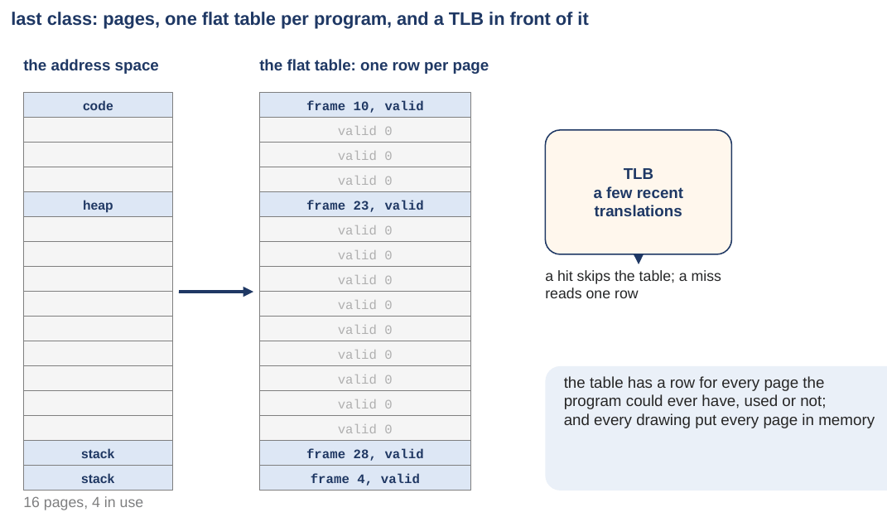{width=86%}
<figcaption markdown="1">Figure 1.1. Where the paging week left the memory story: an address space cut into pages, one flat table per program, and, in front of the table, a TLB (a small, fast memory that remembers recent translations; the text below defines it). From slide 6.</figcaption>
</figure>

Here is what the picture says, with the words it uses. Earlier in the course, each process first got a private memory of its own. Then the processor learned to place it with **base and bounds**: two numbers, one added to every address and one compared against it. Then it placed it in **segments**, the address space in three pieces, each placed separately, which left **holes**, free gaps in RAM too small to be useful. And finally it placed it in **pages**. Memory is cut into equal-sized pieces called pages, 4 KB each on most machines (4096 bytes, so 12 bits name a byte inside a page). The physical side is cut into pieces of the same size, called **frames**. Any page can sit in any frame, so holes cannot happen. In the drawing the address space has 16 pages and the program uses 4 of them. One is **code**, its instructions. One is **heap**, the memory it asks for while running. Two are **stack**, the memory of its function calls (a function is a named piece of a program that other parts of the program can run; [Section 3.3](#sec-3-3) says more).

Each process has a **page table**, the flat list in the middle of the drawing: one row per virtual page, in order, and the row says which frame holds that page. A row is called a **page table entry**, a **PTE** for short, and besides the frame number it holds a **valid bit** that says whether this virtual page exists at all. Four rows are valid and name frames 10, 23, 28 and 4. Twelve rows say nothing but "valid 0". In front of the table sits the **TLB**: a small, very fast memory inside the processor that remembers the translations used most recently. A memory that keeps recent copies of something so that the next lookup is faster is called a **cache**, and the TLB is a cache for the page table. When the TLB has the page (a **hit**), the table is never touched; when it does not (a **miss**), the hardware reads one row of the table.

Figure 1.2 is the two cards beside the drawing: what that picture settled, and what it left open.

<figure markdown="1">
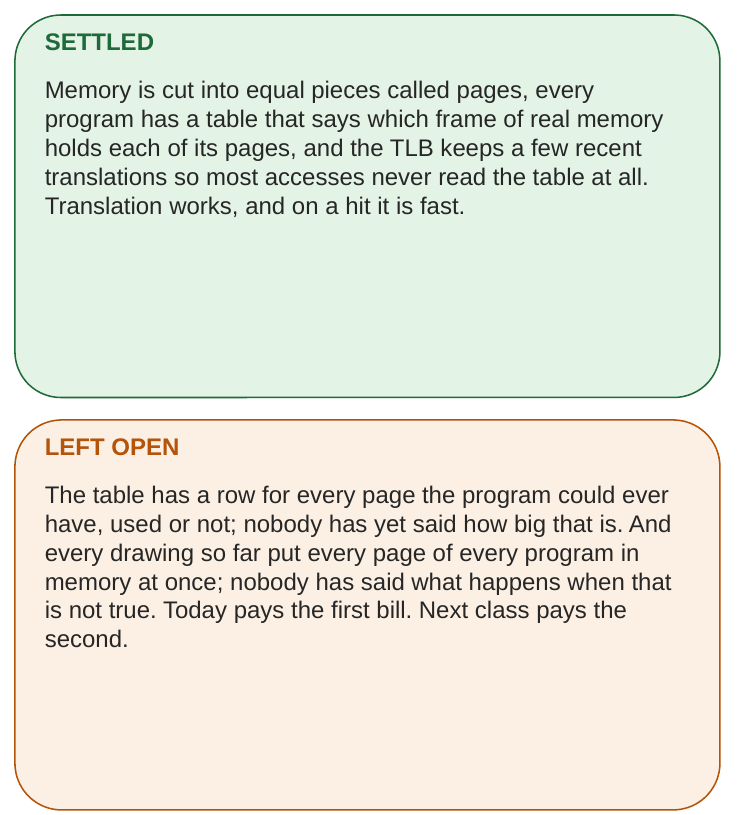{width=60%}
<figcaption markdown="1">Figure 1.2. What the paging week settled, and the two bills it left unpaid. From slide 6.</figcaption>
</figure>

Settled: translation works, and on a hit it is fast. Left open, two things. First, size. Count the rows again: 16 rows for 4 pages. A real address space has far more than 16 pages, and a real program uses a far smaller share of them, so the table is mostly rows that say nothing. Nobody has yet said how big that is. [Section 1.1](#sec-1-1) does the multiplication, and the answer is the reason the first class exists. Second, and quieter: every drawing so far, this one included, gave every page of every program a frame of real memory. Nobody has said what happens when the frames run out. That is the second class, which starts at the second class's opening section.

So the first class asks three questions, in this order, and each one is opened by the answer to the one before it. Why is the page table too big, and what shape fixes it (Sections [1.1](#sec-1-1) to [1.4](#sec-1-4))? How is an address looked up in the new shape (Sections [2.1](#sec-2-1) to [2.5](#sec-2-5))? How does a real kernel do it, and what does it cost (Sections [3.1](#sec-3-1) to [3.8](#sec-3-8))? the first class summary collects the three answers. Extras [1](#extra-1) to [5](#extra-5) go deeper on the same questions and can be read later or skipped. Figure 1.3 is the deck's own list of the three.

<figure markdown="1">
{width=100%}
<figcaption markdown="1">Figure 1.3. The three questions of the first class. From slide 7.</figcaption>
</figure>

## Chapter 1. The size of the page table, and the multi-level page table {#chapter-1}

*The question this chapter answers: Why is the page table too big, and what shape fixes it?*

### 1.1 <span class="lbl lbl-problem">Problem</span> The linear page table is too big {#sec-1-1 data-toc-label="1.1 [Problem] The linear page table is too big"}

Before any fix, the problem, stated the way the textbook states it and the way every problem in this guide will be stated from now on: what we have, where it breaks, and so what we need. Figure 1.4 is the deck's problem slide for the first question, with those three columns.

<figure markdown="1">
{width=99%}
<figcaption markdown="1">Figure 1.4. The problem of the first class in three columns: what we have (the flat table of OSTEP Figures 20.1 and 20.2), where it breaks (the arithmetic at 32 and 64 bits), and so what we need (the crux, the textbook's word for a chapter's central question, of chapter 20). Left and middle columns, what we have and where it breaks. From slide 8.</figcaption>
</figure>

<figure markdown="1">
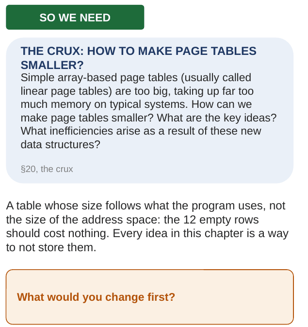{width=51%}
<figcaption markdown="1">Figure 1.5. The right column of the same slide: so what we need. From slide 8.</figcaption>
</figure>

What we have is the left column: one flat table per process, one row per virtual page, the TLB in front of it. The drawing is OSTEP Figures 20.1 and 20.2 side by side: a 16 KB address space with 1 KB pages, so 16 ÷ 1 = 16 virtual pages numbered 0 to 15, and the table that describes it. In the table, the label **VPN** means virtual page number, and **PFN** means physical frame number, the number of the frame that holds the page. The program uses one page of code (page 0), one page of heap (page 4) and two pages of stack (pages 14 and 15). Only 4 rows are valid: VPN 0 in frame 10, VPN 4 in frame 23, VPN 14 in frame 28, VPN 15 in frame 4. The other 12 rows hold nothing but a 0 in the valid bit. Three quarters of this table is dead weight, and it exists only to say "nothing here". And this is the friendly case: a tiny address space with a quarter of it in use. (OSTEP Figure 20.2 gives each row three more columns, which later figures in this guide show. **prot** is the protection: which of read, write and execute (run as code) the page allows, written like `r-x` for read and execute but not write. The bits exist so that a bug, or an attack, cannot overwrite a program's code or run its data as code: the kernel marks code read-only and data non-executable. **present** is a bit the second class explains ([Section 4.2](class-2.md#sec-4-2)), and **dirty** comes later still ([Section 5.6](class-2.md#sec-5-6)), so ignore both for now.)

Where it breaks is the middle column, which does the multiplication at real sizes.

A **linear page table** is the simple kind you met in the paging week: one long array of entries, with entry number 0 for virtual page 0, entry 1 for page 1, and so on. An **array** is a row of equal-sized slots that you reach by position number, like the houses on one side of a street. Each slot is a **page table entry**, a **PTE** for short: a few bytes holding a frame number and some bits of status, including a **valid bit** that says whether this virtual page exists at all.

Start with the 32-bit machine. A 32-bit address names 2^32 bytes. A page is 4 KB, which is 2^12 bytes. So the number of virtual pages is 2^32 ÷ 2^12 = 2^20, about a million (2^20 = 1024 × 1024 = 1,048,576). The table has one entry per virtual page, so 2^20 entries. Each entry is 4 bytes, the size the textbook chooses for a 32-bit machine (a 20-bit frame number plus a few flag bits, single bits that each record one fact about the page, fit in 32 bits; the frame number is 20 bits because a 32-bit physical address minus 12 offset bits leaves 32 − 12 = 20). So one table is 2^20 × 4 = 2^22 bytes, which is 4 MB (4 × 2^20). Check this a second way: 1,048,576 × 4 = 4,194,304 bytes, and 4,194,304 ÷ 1,048,576 = 4. With 100 processes running, that is 400 MB of page tables before any program stores a single byte of its own.

Now the 64-bit machine. The Ubuntu machine in this guide is x86-64, and its processor uses 48-bit virtual addresses (a design fact of that processor family, and [Extra 3](#extra-3) shows the machine reporting it). Linux splits that 48-bit space into two halves, the lower half for the program and the upper half for the kernel; that is Linux's design choice. (The kernel takes a share of every program's address space so that its own code and data have the same addresses in every process. Then the kernel can work during a system call without first switching to a different page table. [Section 3.7](#sec-3-7) shows xv6 doing something similar with just two pages.) So a program gets 2^48 ÷ 2 = 2^47 bytes: 2^47 = 2^7 × 2^40 = 128 × 2^40, which is 128 TiB (an earlier week of the course measured exactly this address-space size on the Ubuntu machine). Pages are still 4 KiB, so the number of virtual pages is 2^47 ÷ 2^12 = 2^35. Entries are 8 bytes now, because on a 64-bit machine each entry holds a 64-bit value ([Section 3.2](#sec-3-2) draws one). So the table is 2^35 × 8 = 2^35 × 2^3 = 2^38 bytes, which is 256 GiB (2^38 = 2^8 × 2^30 = 256 × 2^30). For one process. Nobody can build that.

So what we need is the right column. The textbook states it as a **crux**, its word for the question a chapter is built around: how can we make page tables smaller, what are the key ideas, and what inefficiencies arise as a result? The second half of that question matters as much as the first. Every smaller design in this chapter brings some new cost, and the guide names the cost each time.

Why the table is big comes down to one word, "array". An array is indexed by position, so it needs a slot for every possible position, including the millions of virtual pages the process never touches. Its size depends on the address space, not on the program. The waste is in the invalid entries, and every idea in this chapter is a way to not store them.

The shape of the answer, before any answer: a table whose size follows what the program uses, not the size of the address space. The 12 empty rows should cost nothing. Every idea in this chapter is a way to not store them. The deck put one question to the room at this point, and it is worth a minute of your own before you read on: if you could change one thing about this table, what would it be? The usual answers are bigger pages (so fewer rows), not storing the empty rows, and storing only the regions in use. All three are right. Bigger pages is [Section 1.2](#sec-1-2), and it fails in an instructive way. Not storing the empty rows is the chapter's idea, Sections [1.3](#sec-1-3) and [1.4](#sec-1-4). Storing only the used regions is the hybrid the chapter tried between those two (one small page table per segment), which this guide keeps for the optional [Extra 1](#extra-1).

### 1.2 <span class="lbl lbl-concept">Concept</span> Bigger pages, and internal fragmentation {#sec-1-2 data-toc-label="1.2 [Concept] Bigger pages, and internal fragmentation"}

The fix everybody names first is bigger pages: fewer pages means fewer rows. This part tries it, and it fails in a way that points at the real answer. Figure 1.6 shows the arithmetic and the cost.

<figure markdown="1">
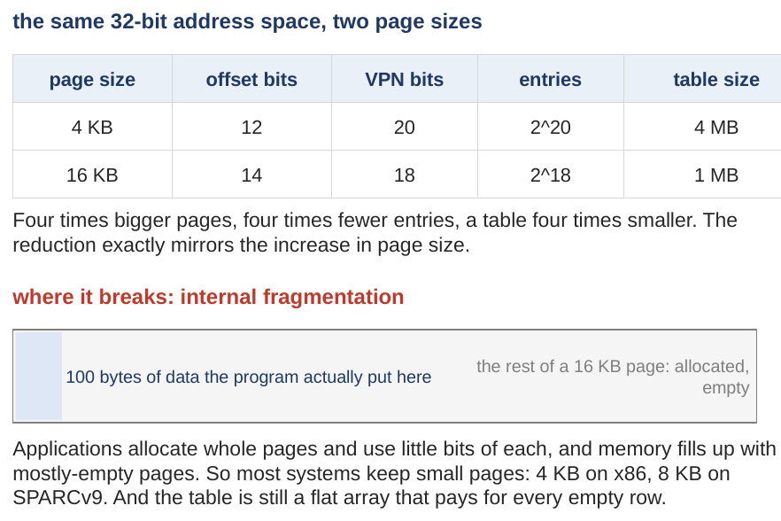{width=71%}
<figcaption markdown="1">Figure 1.6. The same 32-bit address space with 4 KB and 16 KB pages, and the cost of the bigger page: internal fragmentation. From slide 9, following textbook section 20.1.</figcaption>
</figure>

Remember that an address has two parts. The **offset** is how many bytes into its page the address is. The rest of the address, the high bits, is the page number. With 4 KB pages the offset needs 12 bits (2^12 = 4096) and a 32-bit address has 32 − 12 = 20 bits left for the VPN, so 2^20 entries, 4 MB. With 16 KB pages the offset needs 14 bits (16 KB = 2^14 bytes), so 2 bits move from the VPN into the offset. The VPN has 32 − 14 = 18 bits, the table has 2^18 entries, and 2^18 × 4 bytes = 2^20 bytes = 1 MB. Four times bigger pages, four times fewer entries, a table four times smaller. The reduction exactly mirrors the increase in page size.

The price is waste inside each page. A program that stores 100 bytes still gets a whole 16 KB page, and the rest of it sits reserved and empty. This is **internal fragmentation**: wasted space inside the unit that was handed out. The course met it before, with base and bounds. Because of it, most systems keep pages small: 4 KB on x86 (the processor family that x86-64 grew out of), 8 KB on SPARCv9 (both design facts of those processor families).

The idea did survive as an option, though. Figure 1.7 is a real capture from the Ubuntu 24.04 x86-64 machine.

<figure markdown="1">
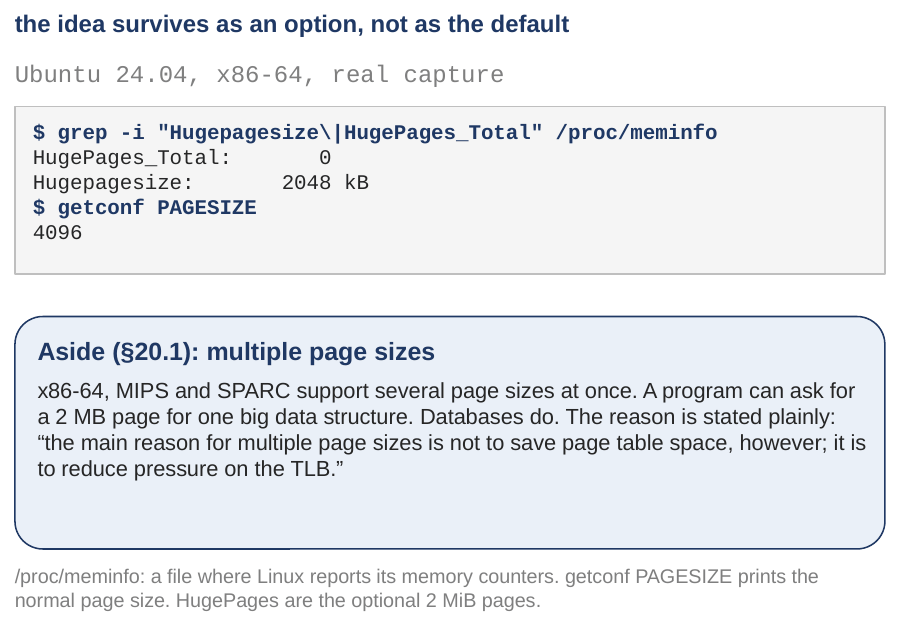{width=72%}
<figcaption markdown="1">Figure 1.7. The Ubuntu 24.04 x86-64 machine reporting its normal page size and its optional huge pages, and the textbook's aside on multiple page sizes. From slide 9, following textbook section 20.1.</figcaption>
</figure>

Some words in the capture. The `$` at the start of a line is the **shell** prompt: the shell is the program that reads typed commands and runs them, and the line after `$` is what was typed. `grep` is a command that prints the lines of a file that contain a given word. `/proc/meminfo` is a file where Linux reports its memory counters (a Linux design choice; the file is not stored on the disk, the machine's long-term storage, and the kernel makes it up when it is read). `getconf PAGESIZE` is a command that prints the normal page size. The capture says the normal page is 4096 bytes, and that the kernel also offers 2 MiB pages, called **huge pages** (Hugepagesize is 2048 kB), of which none are set aside right now (HugePages_Total is 0).

Big pages are not there to save table space. The textbook's aside (its word for a side note) names three processor families that offer several page sizes, x86-64, MIPS and SPARC, and says why they exist: to reduce pressure on the TLB. One TLB entry for a 2 MiB page covers 512 times more memory than one for a 4 KiB page, because 2 MiB ÷ 4 KiB = 2^21 ÷ 2^12 = 2^9 = 512. That is why programs that walk very large tables in memory, such as database servers, ask for them.

So this fix shrinks the table by a fixed factor and wastes memory on every page. The table is still an array that pays for every empty row. The problem was divided by a constant, not changed in shape, and the shape is what the next part changes.

### 1.3 <span class="lbl lbl-concept">Concept</span> The multi-level page table: paging the page table {#sec-1-3 data-toc-label="1.3 [Concept] The multi-level page table: paging the page table"}

The failure to fix is now exact: an array must store its empty rows. So stop storing them. Figure 1.8 is the textbook's statement of that idea, in its own words, plus an analogy.

<figure markdown="1">
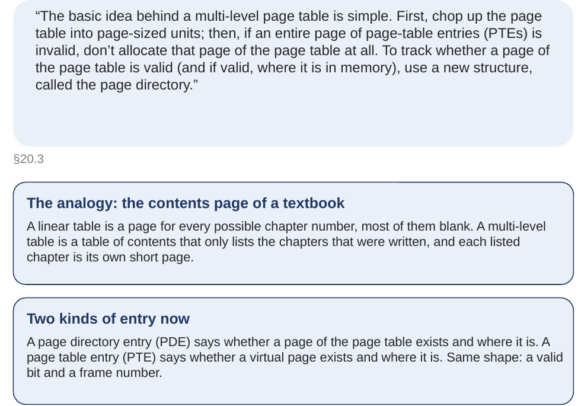{width=78%}
<figcaption markdown="1">Figure 1.8. The multi-level page table in the textbook's words, the table-of-contents analogy, and the two kinds of entry. From slide 10, following textbook section 20.3.</figcaption>
</figure>

Cut the page table into page-sized pieces. When a whole piece contains nothing but invalid entries, do not store it at all. To keep track of which pieces exist and where they are, add one small new table called the **page directory**. The whole design is called a **multi-level page table**, because the directory is one level and the pieces of the table are another.

The analogy is the contents page at the front of a textbook. A linear table is like a book with a page reserved for every possible chapter number, most of them blank. A multi-level table is a contents page that lists only the chapters that were written, and each listed chapter is its own short section. Chapters that were never written simply do not appear.

There are now two kinds of entry. A **page directory entry** (a **PDE**) says whether one page of the page table exists and, if so, which frame it is in. A page table entry (a PTE) says whether one virtual page exists and which frame it is in. They have the same shape: a valid bit and a frame number. Because they look the same, one loop (a piece of code that repeats the same steps) can handle every level, which is exactly what xv6 does in [Section 3.3](#sec-3-3).

Figure 1.9 is the left half of OSTEP Figure 20.3: a 16-entry linear table, drawn as the four pages of memory it occupies.

<figure markdown="1">
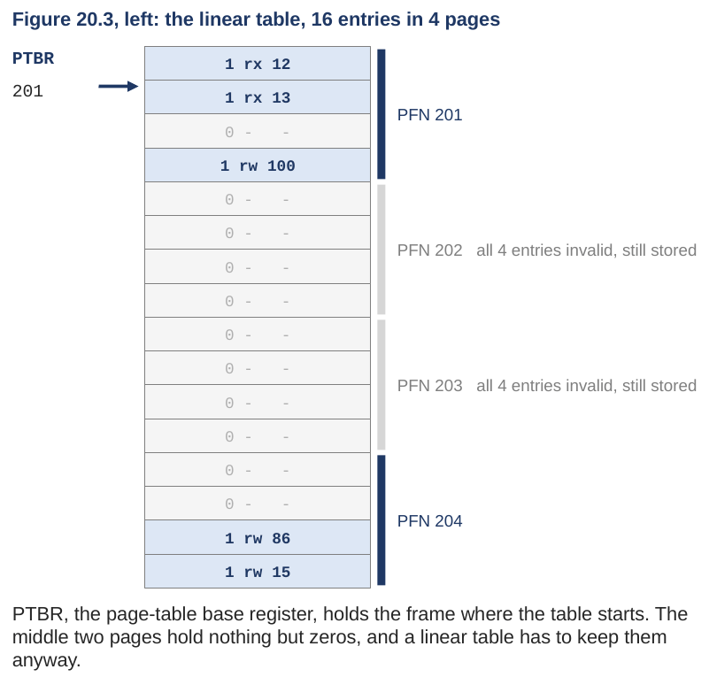{width=64%}
<figcaption markdown="1">Figure 1.9. The linear table of OSTEP Figure 20.3: 16 entries filling four pages of memory, frames 201 to 204, with the middle two pages holding nothing but invalid entries. From slide 10, following textbook section 20.3.</figcaption>
</figure>

In this example a page holds four entries, so the 16-entry table fills 4 pages, in frames 201, 202, 203 and 204. **PTBR** is the page-table base register (a **register** is a tiny storage cell inside the processor), the register that holds the frame where the table starts; here it holds 201. Read the entries: the first page holds `1 rx 12`, `1 rx 13`, an invalid entry, and `1 rw 100` (valid bit, protection, frame number). The last page holds two invalid entries, then `1 rw 86` and `1 rw 15`. The middle two pages, frames 202 and 203, hold eight invalid entries and nothing else. A linear table has to keep them anyway, because an array has no way to leave a position out.

### 1.4 <span class="lbl lbl-concept">Concept</span> The page directory, the page table as a tree, and the time-space trade-off {#sec-1-4 data-toc-label="1.4 [Concept] The page directory, the page table as a tree, and the time-space trade-off"}

Figure 1.10 is the right half of OSTEP Figure 20.3: the same 16 entries with the two empty pages gone.

<figure markdown="1">
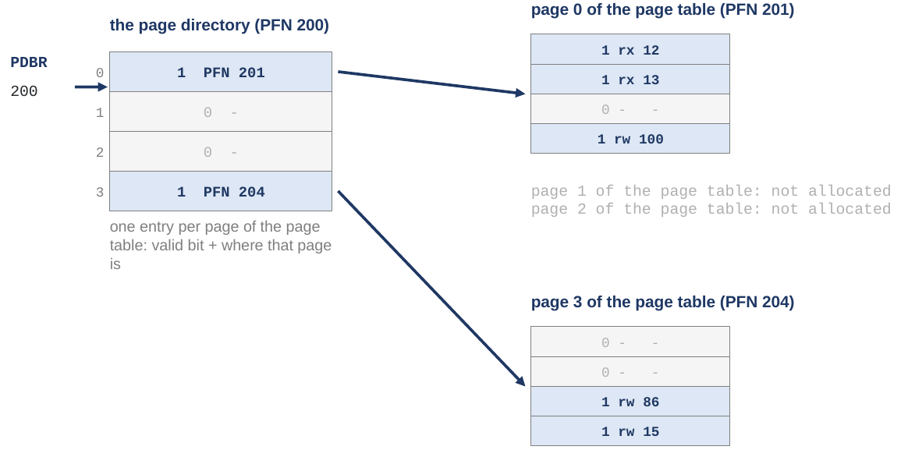{width=92%}
<figcaption markdown="1">Figure 1.10. The same 16-entry table as a two-level tree: a page directory in frame 200 with four entries, and only two pages of the page table kept, in frames 201 and 204. From slide 11, following textbook section 20.3.</figcaption>
</figure>

**PDBR** is the page-directory base register, the register that now holds the frame where the directory starts. It holds 200. Frame 200 holds the page directory, which has 4 entries, one per page of the old table. Entry 0 is valid and points at frame 201. Entry 3 is valid and points at frame 204. Entries 1 and 2 are invalid. Frames 201 and 204 hold the two pages of the table that describe the code, the heap and the stack, exactly as before. Frames 202 and 203 no longer exist. Two invalid directory entries are the only trace of them.

A **tree**, in the computer sense, is a structure where one starting point (the root) points at some children, each child points at its own children, and so on downward. Here the directory is the root, the pages of the page table are its children, and the data frames are at the bottom. The entries in the lowest page-table pages, which point at data rather than at another table, are called the **leaves** of the tree (a leaf entry, a leaf page). That is why the textbook says the multi-level table turns the linear table "into something like a tree".

Figure 1.11 has the three cards that go with the drawing: what the valid bit in a directory entry means, what the tree buys, and what it costs.

<figure markdown="1">
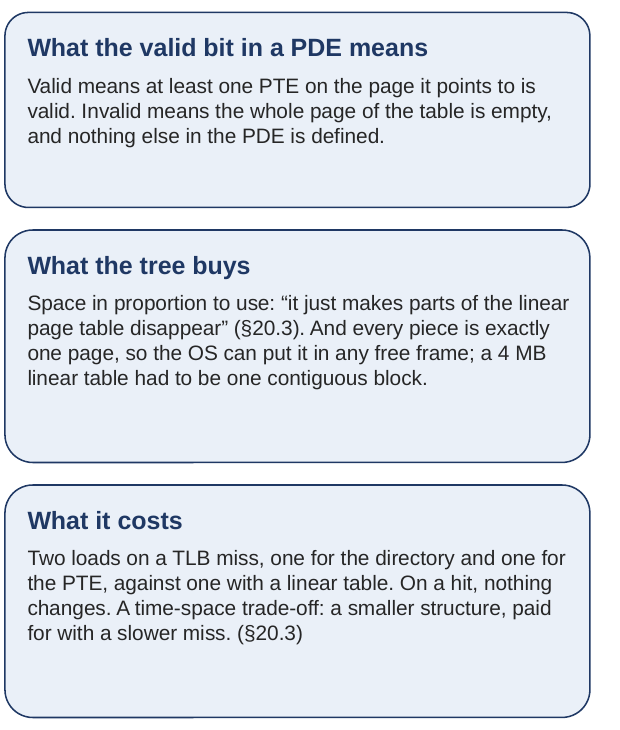{width=50%}
<figcaption markdown="1">Figure 1.11. What a valid bit in a directory entry means, what the tree buys, and what it costs. From slide 11, following textbook section 20.3.</figcaption>
</figure>

The valid bit in a PDE means something slightly different from the valid bit in a PTE. Valid means at least one PTE on the page it points to is valid. Invalid means the whole page of the table is empty, and then nothing else in the PDE is defined; the frame-number field of an invalid PDE is garbage you must not read.

Nothing comes for free, and the second and third cards are the two sides of the trade. They are the next two paragraphs.

It buys space in proportion to use. Table memory now grows only with the part of the address space the program actually uses. A program with a huge, mostly empty address space becomes cheap.

It buys placement. A linear table of 4 MB has to be one unbroken block of physical memory, and finding 4 MB of free memory all in one piece is hard. Each piece of a multi-level table is exactly one page, so the OS can drop it into any free frame, anywhere.

It costs reads. A **load** is an instruction that reads a value from memory into the processor, and a **store** is one that writes a value to memory; each needs one translation. A **TLB hit** means the translation for this page is already in the TLB, and a **TLB miss** means it is not, so the table has to be read. On a miss, the hardware now reads the directory entry first and the page table entry second: two loads from memory to get one translation, where a linear table needed one. Every level added to the tree adds one more read to every miss.

It also costs complexity, which the slide leaves to the textbook: whoever handles the miss, hardware or OS, has more work to do than with a flat array. The rule the textbook gives: accept complexity when it buys performance or saves a scarce resource, and here it saves memory.

The card names the trade with the textbook's phrase. A **time-space trade-off** is the general rule that making a data structure (any arrangement of data in memory, such as a table or a tree) faster usually costs space, and making it smaller usually costs time. The multi-level table is the small-and-slower choice. What makes it affordable is the TLB. In the common case, a hit, the table is never touched, so nothing changes. Only a miss pays for the smaller table.

Figure 1.12 is the count under the drawing.

<figure markdown="1">
{width=92%}
<figcaption markdown="1">Figure 1.12. The page count: 4 pages of linear table, 3 pages of tree. From slide 11.</figcaption>
</figure>

The linear table used 4 pages of memory. The multi-level table uses 1 directory page plus 2 table pages, which is 3. A small win here; an enormous one once the address space is 64 bits and almost entirely empty, because then almost every page of the table is empty and is never built.

That answers the first question, and the deck closes it with a checkpoint, Figure 1.13. Every block of this week ends with one: what is settled, what is still open, and what you should now be able to do. Use it as a test before you go on.

<figure markdown="1">
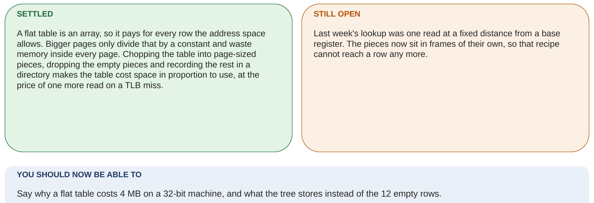{width=100%}
<figcaption markdown="1">Figure 1.13. Checkpoint 1: what the first question settled, what it left open, and what you should now be able to do. From slide 12.</figcaption>
</figure>

Settled: a flat table is an array, so it pays for every row the address space allows. Bigger pages only divide that by a constant and waste memory inside every page. Chopping the table into page-sized pieces, dropping the empty pieces and recording the rest in a directory makes the table cost space in proportion to use, at the price of one more read on a TLB miss. Still open: the paging week's lookup was one read at a fixed distance from a base register ([Section 2.1](#sec-2-1) writes it out), and the pieces now sit in frames of their own, so that recipe cannot reach a row any more. You should now be able to say why a flat table costs 4 MB on a 32-bit machine, and what the tree stores instead of the 12 empty rows. If either is fuzzy, reread Sections [1.1](#sec-1-1) and [1.3](#sec-1-3).

## Chapter 2. Address translation with a multi-level page table {#chapter-2}

*The question this chapter answers: How is an address looked up in the new shape?*

### 2.1 <span class="lbl lbl-problem">Problem</span> One memory read no longer finds the entry {#sec-2-1 data-toc-label="2.1 [Problem] One memory read no longer finds the entry"}

The tree solved the size problem and broke something else, and the second question of the class is that broken thing. Figure 2.1 is the deck's problem slide for it.

<figure markdown="1">
{width=99%}
<figcaption markdown="1">Figure 2.1. The second problem in three columns: the pieces of the table scattered across frames, the one-read lookup of the paging week that no longer works, and the shape of the fix: split the VPN. Left and middle columns, what we have and where it breaks. From slide 13.</figcaption>
</figure>

<figure markdown="1">
{width=48%}
<figcaption markdown="1">Figure 2.2. The right column of the same slide: so what we need. From slide 13.</figcaption>
</figure>

What we have is on the left: a directory in frame 200, and the pieces of the table it points at, each piece in a frame of its own, wherever the OS found one free. In the drawing the two pieces sit in frames 201 and 204, and the frames between them belong to other things. That freedom was one of the things the tree bought ([Section 1.4](#sec-1-4)): a piece is exactly one page, so it fits any free frame.

Where it breaks is in the middle. In the paging week the hardware found a row with one read: `PTEAddr = PTBR + VPN x sizeof(PTE)`, the base register plus the page number times the size of one row (`sizeof(PTE)` is C for "the number of bytes in one page table entry"; 8 on the RISC-V machine, 4 in this chapter's example; the size does not matter here, only that it is one fixed number). That formula assumes every row sits at a fixed distance from one starting point, which is true only when the whole table is one unbroken block. With the pieces scattered, there is no single base to add the VPN to, so one read cannot find the row. The lookup you knew is gone, and nothing has replaced it yet.

So what we need is on the right: cut the VPN in two. The top bits pick a row of the directory, and that row says where the piece is. The low bits pick the row inside that piece. That is two reads before the data, and the second read's address comes out of the first read's answer, which is why it cannot be one read. The two reads are not a detail of the hardware; they follow from the shape. Sections [2.2](#sec-2-2) to [2.5](#sec-2-5) make this concrete on an example small enough to draw every row, and you will do the two reads yourself.

### 2.2 <span class="lbl lbl-example">Worked example</span> The 16 KB example: the page directory index and the page table index {#sec-2-2 data-toc-label="2.2 [Worked example] The 16 KB example: the page directory index and the page table index"}

The textbook's running example has real numbers in it, and the next three parts translate one address through it by hand, so that the two reads of [Section 2.1](#sec-2-1) become something you have done. First the setup. Figure 2.3 is the address space.

<figure markdown="1">
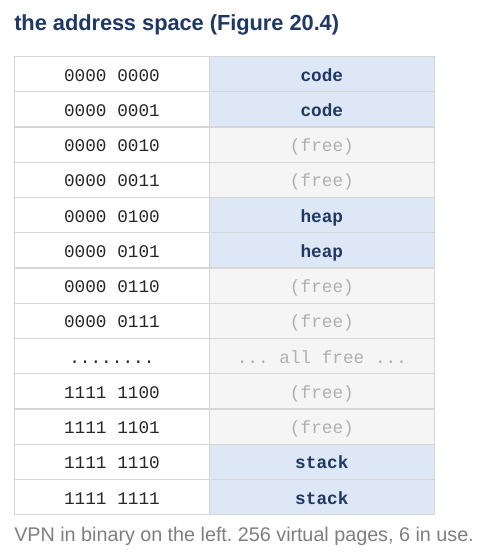{width=45%}
<figcaption markdown="1">Figure 2.3. OSTEP Figure 20.4: a 16 KB address space with 64-byte pages, 256 virtual pages, six of them in use, with the VPN written in binary on the left. From slide 14, following textbook section 20.3.</figcaption>
</figure>

The address space is 16 KB with 64-byte pages. 16 KB is 2^14 bytes and 64 is 2^6, so there are 2^14 ÷ 2^6 = 2^8 = 256 virtual pages. A 14-bit address therefore splits into an 8-bit VPN (2^8 = 256 pages) and a 6-bit offset (2^6 = 64 bytes per page). Only 6 pages are used: VPNs 0 and 1 are code, 4 and 5 are heap, 254 and 255 are stack. In binary, those VPNs are 0000 0000, 0000 0001, 0000 0100, 0000 0101, 1111 1110 and 1111 1111. The page numbers are written in binary on purpose, because the next step cuts them into pieces.

Now build the two-level table. A linear table would have 256 entries. Each entry is 4 bytes, the textbook's choice for this example (it keeps the 4-byte entry of [Section 1.1](#sec-1-1) even though a two-digit frame number would fit in less; a directory entry is the same size), so the table is 256 × 4 = 1024 bytes = 1 KB. With 64-byte pages, that 1 KB of table is 1024 ÷ 64 = 16 pages of page table, and each page holds 64 ÷ 4 = 16 entries. So the directory needs one entry per page of the table: 16 entries. Picking one of 16 entries needs 4 bits (2^4 = 16), so the top 4 bits of the VPN pick the directory entry. Picking one of the 16 entries inside a page also needs 4 bits, so the low 4 bits of the VPN pick the entry inside that page. The 6-bit offset is never touched. Figure 2.4 shows the split.

<figure markdown="1">
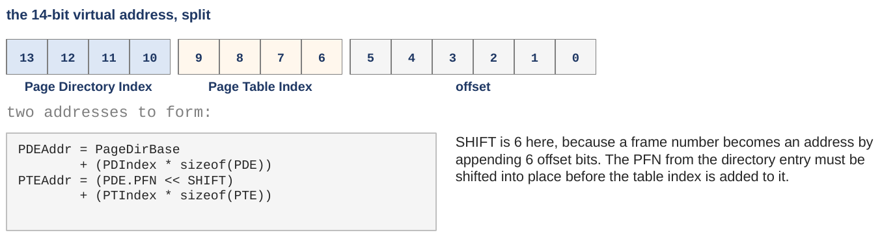{width=100%}
<figcaption markdown="1">Figure 2.4. The 14-bit virtual address split three ways: 4 bits of page directory index, 4 bits of page table index, 6 bits of offset, and the two addresses the hardware forms. From slide 14, following textbook section 20.3.</figcaption>
</figure>

The bit numbers run 13 down to 0, as in [Appendix A](appendix.md#appendix-a). Bits 13 to 10 are the **page directory index** (PDIndex), bits 9 to 6 are the **page table index** (PTIndex), bits 5 to 0 are the offset. Check the widths: 13 − 10 + 1 = 4, 9 − 6 + 1 = 4, 5 − 0 + 1 = 6, and 4 + 4 + 6 = 14.

Two addresses have to be formed. The first is the address of the directory entry: `PDEAddr = PageDirBase + (PDIndex * sizeof(PDE))`. Start where the directory starts, count PDIndex entries down, each `sizeof(PDE)` bytes long (`sizeof` is C's way of writing "the size in bytes of"). The second is the address of the page table entry: `PTEAddr = (PDE.PFN << SHIFT) + (PTIndex * sizeof(PTE))`. `PDE.PFN` means the frame-number field of the directory entry you just read (the dot means "the PFN part of PDE"). A frame number is not an address; it is a count of frames. To turn it into the address where that frame starts, shift it left by the number of offset bits, here 6, which multiplies it by 64. Then count PTIndex entries down. `SHIFT` is 6 in this example because the offset is 6 bits.

Figure 2.5 has the three cards that say the same thing in words.

<figure markdown="1">
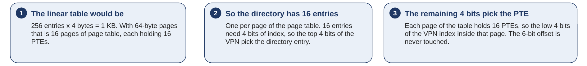{width=100%}
<figcaption markdown="1">Figure 2.5. The three cards of the example: the linear table would be 1 KB in 16 pages, so the directory has 16 entries, and the remaining 4 bits pick the PTE. From slide 14 (the cards run along the bottom of the slide), following textbook section 20.3.</figcaption>
</figure>

### 2.3 <span class="lbl lbl-example">Worked example</span> The page directory and the page table entries of the example {#sec-2-3 data-toc-label="2.3 [Worked example] The page directory and the page table entries of the example"}

Figure 2.6 is OSTEP Figure 20.5, the tables with actual frame numbers in them.

<figure markdown="1">
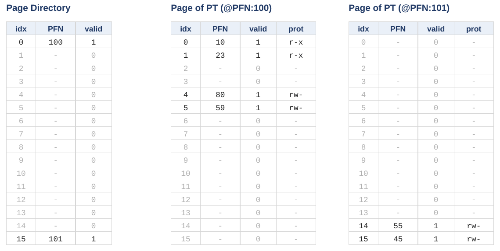{width=91%}
<figcaption markdown="1">Figure 2.6. OSTEP Figure 20.5: the page directory (left) and the only two pages of the page table that exist, in frames 100 and 101. From slide 15, following textbook section 20.3.</figcaption>
</figure>

Read the directory first. Only entries 0 and 15 are valid. Entry 0 points at frame 100, which holds the page of the table for VPNs 0 to 15. Entry 15 points at frame 101, which holds the page for VPNs 240 to 255. Check that: entry 15 covers the sixteenth group of 16 pages, and 15 × 16 = 240, so VPNs 240 through 240 + 15 = 255. Entries 1 to 14 are invalid: fourteen pages of the table that were never allocated.

Then each page of the table. In frame 100, row 0 says VPN 0 is in frame 10 with `r-x`, and row 1 says VPN 1 is in frame 23 with `r-x` (the code). Rows 4 and 5 say VPNs 4 and 5 are in frames 80 and 59 with `rw-` (the heap). Every other row is invalid. In frame 101, the rows are numbered 0 to 15 again, but this page covers VPNs 240 to 255, so its row 14 is VPN 240 + 14 = 254 and its row 15 is VPN 255: the stack, in frames 55 and 45, `rw-`. Every other row is invalid.

Figure 2.7 has the cards that read the tables, and the textbook's count.

<figure markdown="1">
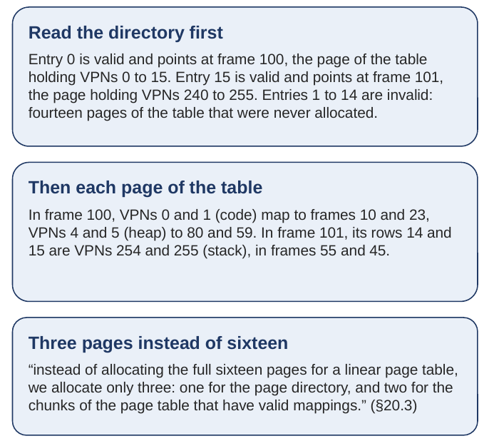{width=56%}
<figcaption markdown="1">Figure 2.7. Reading the directory, then each page of the table, and the count: three pages instead of sixteen. From slide 15, following textbook section 20.3.</figcaption>
</figure>

All told, the table uses 3 pages of memory instead of 16: one for the directory and two for the pieces that hold valid entries. Directory entries 1 to 14 stand for 14 pieces of the table that were never built, and they cost nothing.

### 2.4 <span class="lbl lbl-example">Worked example</span> Translating one address: three memory reads {#sec-2-4 data-toc-label="2.4 [Worked example] Translating one address: three memory reads"}

Now the translation, with the tables of [Section 2.3](#sec-2-3) in front of you. The address is 0x3F80, the first byte of VPN 254. Figure 2.8 shows the first read.

<figure markdown="1">
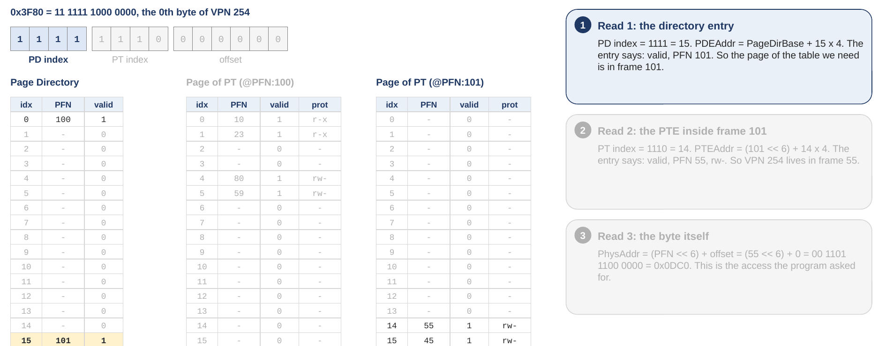{width=100%}
<figcaption markdown="1">Figure 2.8. Read 1 of the translation of 0x3F80: the top four bits pick directory entry 15, which says frame 101. From slide 16, following textbook section 20.3.</figcaption>
</figure>

First the split. 0x3F80 in binary is 0011 1111 1000 0000 (3 = 0011, F = 1111, 8 = 1000, 0 = 0000). The address is 14 bits, so drop the two leading zeros: 11 1111 1000 0000. Now cut it as Figure 2.4 says: the top 4 bits are 1111, the next 4 are 1110, the last 6 are 000000. Check the VPN: the top 8 bits together are 1111 1110, which is 254, so the address is indeed in VPN 254, and the offset 000000 is 0, so it is the first byte of that page.

Read 1, the directory entry. PDIndex = 1111 = 15. The hardware goes to the start of the directory, counts 15 entries down (PDEAddr = PageDirBase + 15 × 4 = PageDirBase + 60) and reads that entry. Entry 15 comes back valid, with PFN 101. That frame does not hold the program's data. It holds the next table to read. Frame 100 stays untouched; this translation never goes there.

Read 2, the page table entry inside frame 101. PTIndex = 1110 = 14. Frame 101 is a frame number, not an address. Shifting it left by 6 turns it into the address where that frame starts: 101 << 6 = 101 × 64 = 6464. Then count 14 entries of 4 bytes down: 14 × 4 = 56. So PTEAddr = 6464 + 56 = 6520, which is 0x1978 (6520 ÷ 16 = 407 remainder 8; 407 ÷ 16 = 25 remainder 7; 25 ÷ 16 = 1 remainder 9; 1 ÷ 16 = 0 remainder 1; remainders backwards 1, 9, 7, 8). The hardware reads the entry at 0x1978. It comes back valid, PFN 55, `rw-`. So VPN 254 lives in frame 55. Read 2 could not start until read 1 said "frame 101": the second read depends on the first, and that chain is exactly what "two loads per miss" means.

Figure 2.9 shows the third read.

<figure markdown="1">
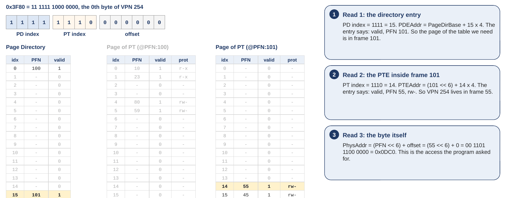{width=100%}
<figcaption markdown="1">Figure 2.9. Read 3 of the translation: the frame number from read 2, shifted into place, plus the offset, gives physical address 0x0DC0, and the data is read from there. From slide 17, following textbook section 20.3.</figcaption>
</figure>

Read 3, the byte itself. PhysAddr = (PFN << 6) + offset = (55 << 6) + 0. In binary, 55 is 11 0111; append six zeros and you get 11 0111 000000, which regrouped in fours from the right is 00 1101 1100 0000, which is 0x0DC0. Check it by multiplication, as [Appendix A](appendix.md#appendix-a) does: 55 × 64 = 3520, and 3520 in hex is DC0. The bits and the multiplication agree. The offset passes through untouched; the tree only ever rewrites the page number. Read 3 goes to 0x0DC0 and brings back the program's data.

So one load cost three memory reads on a TLB miss: two to find the translation, one for the data. On a TLB hit, the first two disappear. Hits are the only reason this design is affordable. Keep two things apart from now on: the frame number from a directory entry leads to the next table, never to the answer; and the two indexes are different bits of the same VPN.

### 2.5 <span class="lbl lbl-check">Your turn</span> Translation practice: two more addresses {#sec-2-5 data-toc-label="2.5 [Your turn] Translation practice: two more addresses"}

Figure 2.10 is the exercise the class did on the spot. Do it now, with Figure 2.6 beside you, before you read the answers at the end of the guide. It is exercises 1 and 2 at the end of this guide, and the worked answers are in the answers section.

<figure markdown="1">
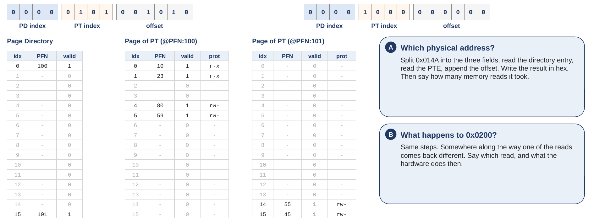{width=100%}
<figcaption markdown="1">Figure 2.10. Two addresses to translate with the tables of Figure 20.5: 0x014A, and 0x0200. From slide 18, following textbook section 20.3.</figcaption>
</figure>

For address A, 0x014A, split it into the three fields, read the directory entry, read the PTE, append the offset, and write the result in hex. Then say how many memory reads it took. For address B, 0x0200, follow the same steps. Somewhere along the way one of the reads comes back different from what you expect; say which read, and what the hardware does then.

The class was then shown four candidate answers for A, Figure 2.11, and voted on them.

<figure markdown="1">
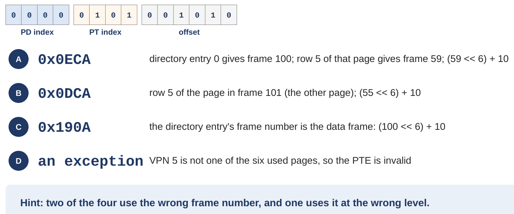{width=100%}
<figcaption markdown="1">Figure 2.11. The four candidate answers for 0x014A, and the hint. From slide 19.</figcaption>
</figure>

The candidates are 0x0ECA, 0x0DCA, 0x190A, and "an exception". An **exception** is what happens when the hardware meets something it cannot finish: it stops the current instruction and hands control to the OS, which decides what to do next ([Extra 2](#extra-2) shows where in the hardware's procedure that happens). Three of the four candidates are the classic mistakes, and the answers section says which mistake each one is. Try to get the right one before you look, and then, just as useful, try to see how each wrong one was produced.

That answers the second question. Figure 2.12 is its checkpoint.

<figure markdown="1">
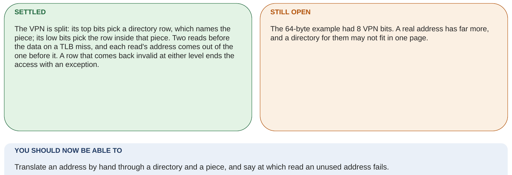{width=100%}
<figcaption markdown="1">Figure 2.12. Checkpoint 2: what the second question settled, what it left open, and what you should now be able to do. From slide 21.</figcaption>
</figure>

Settled: the VPN is split, its top bits pick a directory row, which names the piece, and its low bits pick the row inside that piece. Two reads before the data on a TLB miss, each read's address coming out of the one before. A row that comes back invalid at either level ends the access with an exception. Still open: the 64-byte example had 8 VPN bits, so 4 bits of directory index gave a 16-row directory that fit in one page. A real address has far more VPN bits, and whether its directory still fits in a page is a question nobody has asked yet. You should now be able to translate an address by hand through a directory and a piece, and say at which read an unused address fails. Address B is the model.

## Chapter 3. Multi-level page tables in a real kernel: xv6 on RISC-V {#chapter-3}

*The question this chapter answers: How does a real kernel do it, and what does it cost?*

### 3.1 <span class="lbl lbl-problem">Problem</span> Three levels: when a two-level directory does not fit in a page {#sec-3-1 data-toc-label="3.1 [Problem] Three levels: when a two-level directory does not fit in a page"}

Two levels were enough for 8 bits of VPN. The third question of the class starts by doing the same arithmetic for a real address, and the answer is no. Figure 3.1 is the deck's problem slide.

<figure markdown="1">
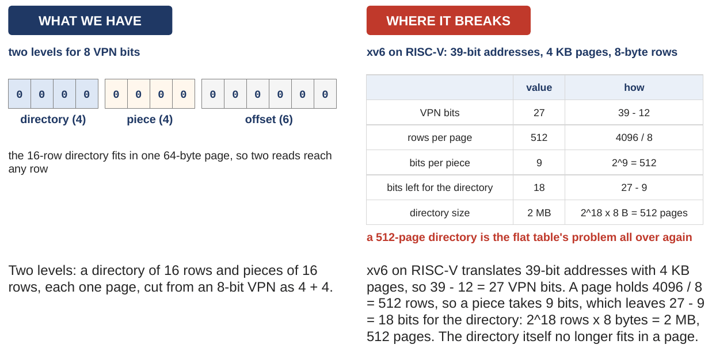{width=99%}
<figcaption markdown="1">Figure 3.1. The third problem in three columns: the two-level design we have, the arithmetic for xv6's 27-bit VPN (a 2 MB directory), and the rule that fixes it. Left and middle columns, what we have and where it breaks. From slide 22.</figcaption>
</figure>

<figure markdown="1">
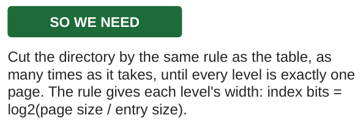{width=47%}
<figcaption markdown="1">Figure 3.2. The right column of the same slide: so what we need. From slide 22.</figcaption>
</figure>

What we have is on the left: two levels, a directory of 16 rows and pieces of 16 rows, each exactly one page, cut from an 8-bit VPN as 4 + 4. Where it breaks is in the middle, and it is one column of arithmetic. xv6 on RISC-V translates 39-bit addresses with 4 KB pages (both design facts; [Section 3.1](#sec-3-1) explains the names in a moment), so 39 − 12 = 27 bits of VPN. A page holds 4096 ÷ 8 = 512 rows of 8 bytes, so a piece takes 9 bits of index (2^9 = 512), which leaves 27 − 9 = 18 bits for the directory. A directory with 2^18 rows of 8 bytes is 2^18 × 2^3 = 2^21 bytes = 2 MB, which is 2 MB ÷ 4 KB = 2^21 ÷ 2^12 = 2^9 = 512 pages. A directory of 512 pages is a flat table of 512 pages: one unbroken block, paying for every row whether used or not. The flat table's problem is back, one level up.

So what we need is on the right: cut the directory by the same rule as the table, as many times as it takes, until every level is exactly one page. And one rule gives each level's width. The rest of this part states the rule, works it on the textbook's smaller example, and then on real machines.

<figure markdown="1">
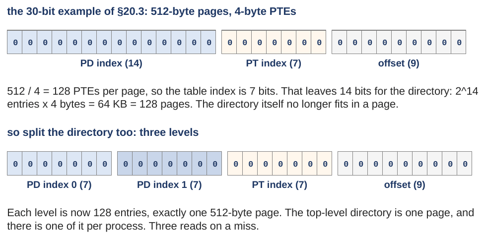{width=78%}
<figcaption markdown="1">Figure 3.3. The textbook's 30-bit example with 512-byte pages: two levels leave a 14-bit directory that does not fit in a page, so the directory is split too, giving three levels of 7 bits. From slide 23, following textbook section 20.3.</figcaption>
</figure>

The rule that sets every level's width, then: every piece of the tree must fit in one page, so each level gets as many index bits as it takes to pick one entry in a page. The number of entries in a page is the page size divided by the entry size, and the index bits are the base-2 logarithm of that: index bits = log2(page size ÷ entry size). Whatever bits are left over go up one level.

Take 512-byte pages and 4-byte entries. One page holds 512 ÷ 4 = 128 entries, and 128 = 2^7, so 7 bits pick an entry: the page table index is 7 bits. The offset is 9 bits (512 = 2^9). A 30-bit address has 30 − 9 = 21 bits of VPN, and 21 − 7 = 14 bits are left for the directory. A directory with 2^14 entries of 4 bytes each is 2^14 × 4 = 2^16 bytes = 64 KB, which is 64 KB ÷ 512 bytes = 128 pages. The directory itself no longer fits in a page, which breaks the rule.

So split the directory too. Now there are three levels: PD index 0 (7 bits), PD index 1 (7 bits), page table index (7 bits), offset (9 bits). Check: 7 + 7 + 7 + 9 = 30. Each level is 128 entries, exactly one 512-byte page. The top-level directory is one page, and there is one of it per process. A miss now costs three reads before the data.

Figure 3.4 applies the same rule to real machines.

<figure markdown="1">
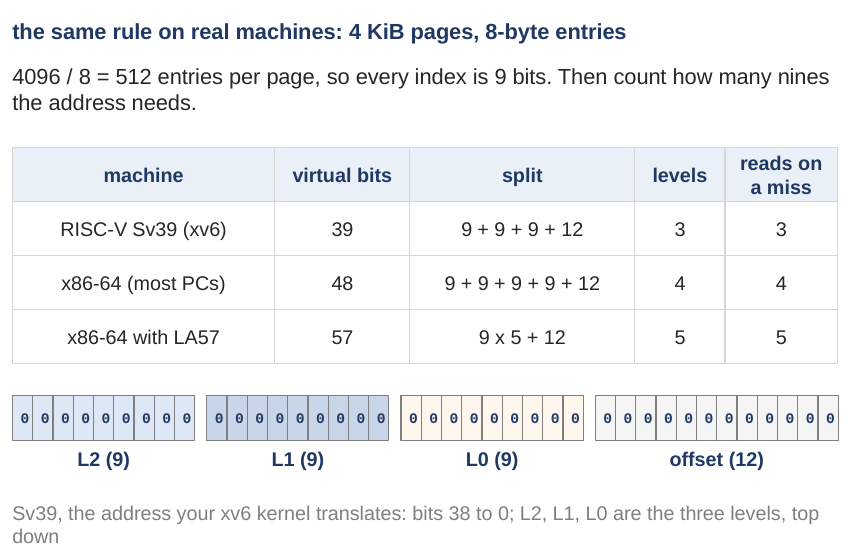{width=69%}
<figcaption markdown="1">Figure 3.4. The same rule on real machines with 4 KiB pages and 8-byte entries: 9 bits per level, and the number of levels follows from the address width. From slide 23.</figcaption>
</figure>

Real machines use 4 KiB pages and 8-byte entries. One page holds 4096 ÷ 8 = 512 entries, and 512 = 2^9, so every index is 9 bits. Then count how many nines the address needs. **RISC-V** is a kind of processor, the same role Intel or ARM chips play in a laptop, and it is the one xv6 runs on. Its **Sv39** mode (a design fact of RISC-V: "Sv" for the paging scheme, 39 for the address width) uses 39-bit virtual addresses: 39 − 12 = 27 bits of VPN, and 27 ÷ 9 = 3, so three levels, three reads on a miss. **x86-64**, the processor family in most PCs and servers, uses 48-bit addresses: 48 − 12 = 36, 36 ÷ 9 = 4, so four levels. A newer x86-64 mode called LA57 uses 57-bit addresses: 57 − 12 = 45, 45 ÷ 9 = 5, so five levels. The bottom drawing is the Sv39 address your xv6 kernel translates: bits 38 to 0, cut as L2 (bits 38 to 30), L1 (29 to 21), L0 (20 to 12) and offset (11 to 0). L2, L1 and L0 stand for level 2, level 1 and level 0, the three levels of the tree counted from the top down. Check the widths: 38 − 30 + 1 = 9, 29 − 21 + 1 = 9, 20 − 12 + 1 = 9, 11 − 0 + 1 = 12.

Every level is one page of 512 entries, and one 9-bit slice of the address picks the entry. Because every level has the same shape, xv6 walks the whole tree with one small loop, which is [Section 3.3](#sec-3-3).

### 3.2 <span class="lbl lbl-kernel">Real kernel</span> The page table entry and the index macros: riscv.h {#sec-3-2 data-toc-label="3.2 [Real kernel] The page table entry and the index macros: riscv.h"}

Before the loop, the handful of one-line definitions it leans on. They are in `kernel/riscv.h` of the xv6 tree you use in the labs (xv6 is the small teaching operating system you run in the labs, under a program called QEMU that pretends to be a RISC-V computer; a tree here means a folder of source files with subfolders, the word's second meaning). Figure 3.5 shows the lines.

<figure markdown="1">
{width=78%}
<figcaption markdown="1">Figure 3.5. The definitions in kernel/riscv.h that the page-table walk uses: the flag bits (lines 372 to 376), the conversions between an entry and a physical address (384 to 389), the picker of one 9-bit slice of an address (391 to 394) and the highest address allowed (400), with a key to the C; each is explained below. From slide 24.</figcaption>
</figure>

Reading the C, one mark at a time. `#define NAME value` gives a name to a constant or to a small formula; every place the name appears later, the value is used instead. Such a name is called a **macro**. `1L` is the number 1 held as a 64-bit value (the L is for "long", C's name for the wider kind of integer), so that shifting it left by up to 63 places does not overflow. (**Overflow** is what happens when a result needs more bits than it is allowed, so the top bits are lost.) `<<`, `>>` and `&` are the shift and mask operators from [Appendix A](appendix.md#appendix-a). `0x1FF` is hex for 511, nine 1 bits, and `0x3FF` is 1023, ten 1 bits. `(uint64)pa` is a **cast**. (`pa` is short for physical address and `va` for virtual address, xv6's usual names for the two.) The cast tells the compiler (the program that turns C source into machine instructions; the next sentence says more) to treat the value `pa` as an unsigned 64-bit integer (unsigned means never negative; `uint64` is xv6's name for that type) so that shifting it is allowed. A **compiler** is the program that turns C source into machine instructions. `PGSHIFT` is defined earlier in the same file as 12, the number of offset bits in a 4 KiB page.

Lines 372 to 376 name the flag bits at the bottom of every entry. `PTE_V` is `1L << 0`, which is 1: bit 0, the valid bit. `PTE_R` is bit 1 (read allowed), `PTE_W` bit 2 (write allowed), `PTE_X` bit 3 (execute allowed, that is, may be run as code), `PTE_U` bit 4 (a **user program**, an ordinary program as opposed to the kernel, may touch it; the bit exists so that the kernel's own pages can sit in the same table without being reachable by the program, and you will see it set in [Section 3.6](#sec-3-6)'s leaf entry and clear on [Section 3.7](#sec-3-7)'s guard page (a page kept out of the program's reach on purpose); "user mode" and "user space" mean the side of the machine where such programs run, and "kernel mode" the other side). As numbers: 1, 2, 4, 8, 16. Which bit means what is a design fact of RISC-V; xv6 just names them.

Figure 3.6 draws one entry and the table of slices.

<figure markdown="1">
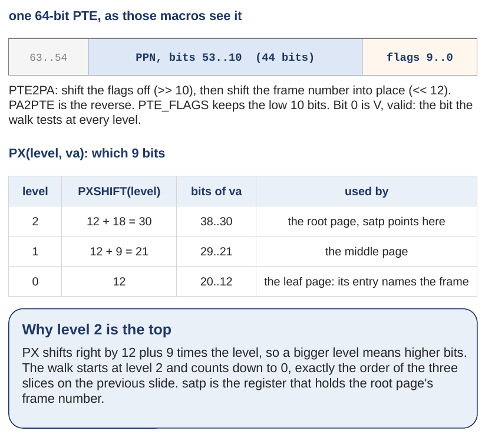{width=67%}
<figcaption markdown="1">Figure 3.6. One 64-bit page table entry as the macros read it, and which 9 bits of the address the slice picker (the macro PX, explained below) picks at each level. From slide 24.</figcaption>
</figure>

One entry is 64 bits. RISC-V calls the frame number a **PPN**, physical page number, the same thing the textbook calls a PFN. The specification puts it in bits 53 down to 10, which is 53 − 10 + 1 = 44 bits, and puts ten flag bits in bits 9 down to 0 (both design facts of Sv39; the five bits named above are the low five of the ten, [Section 5.6](class-2.md#sec-5-6) names two more, and the rest are for other uses). Bits 63 to 54 are unused (63 − 54 + 1 = 10 bits, reserved by the specification). It is the same shape as the entries in the drawings so far, only wider.

Now the two conversions, worked bit by bit on a real entry. `PTE2PA(pte)` is `((pte) >> 10) << 12`: shift the flags off, then shift the frame number into place. Take the entry 0x0000000021fc7801, which [Section 3.6](#sec-3-6) will read out of a running xv6 process. Its low 12 bits are the last three hex digits, 801 = 1000 0000 0001. The lowest 10 of those are 00 0000 0001, the flags, equal to 1: only the valid bit is set. The hex digit 8 is where the cut falls: 8 is 1000, its bottom two bits 00 are the top of the flags, and its top two bits 10 are the bottom of the PPN. Shifting right by 10 drops the 10 flag bits. What is left is the hex digits 21fc7 followed by those two bits, 10 (binary two). So the PPN is 0x21fc7 shifted left by 2 bits plus 2, and shifting left by 2 is multiplying by 4: 0x21fc7 × 4 + 2. In hex, 0x21fc7 × 4 = 0x87f1c (check: 0x21fc7 is 139,207; × 4 = 556,828; 0x87f1c is 8 × 65536 + 7 × 4096 + 15 × 256 + 1 × 16 + 12 = 524,288 + 28,672 + 3,840 + 16 + 12 = 556,828), and 0x87f1c + 2 = 0x87f1e. That is the PPN. Then shift left by 12, which appends three hex zeros: the physical address is 0x87f1e000. That is what `PTE2PA` returns, and it is the start of a page. The same two steps in decimal, as a check: shifting right by 10 is dividing by 1024 and dropping the remainder, and 0x21fc7801 = 570,193,921. (Each hex position is worth 16 times the one to its right, so the eight positions are worth 1, 16, 256, 4096, 65,536, 1,048,576, 16,777,216 and 268,435,456. Then 2 × 268,435,456 + 1 × 16,777,216 + 15 × 1,048,576 + 12 × 65,536 + 7 × 4096 + 8 × 256 + 0 × 16 + 1 = 536,870,912 + 16,777,216 + 15,728,640 + 786,432 + 28,672 + 2,048 + 0 + 1 = 570,193,921.) Next, 570,193,921 ÷ 1024 = 556,830 remainder 1 (the flags), and 556,830 = 0x87f1e; then × 4096 = 2,280,775,680 = 0x87f1e000.

If the cut inside a hex digit is new to you, try the method once on a smaller made-up entry, 0x0000000000004401. The low 12 bits are 401 = 0100 0000 0001; the flags are the low 10 bits, 00 0000 0001 = 1; the two bits above them are 01 = 1; the hex digits above those are 00004; so the PPN is 0x4 × 4 + 1 = 0x11, and the address is 0x11000. Check by division: 0x4401 = 17,409, and 17,409 ÷ 1024 = 17 remainder 1, and 17 = 0x11. `PA2PTE(pa)` is the reverse: `(pa >> 12) << 10`. Drop the 12 offset bits of a physical address (which are zero for a page start anyway), then move the frame number up 10 places to leave room for the flags. Applying it to 0x87f1e000 gives 0x87f1e << 10 = 0x21fc7800, and the flags are then added with `|`: 0x21fc7800 | 1 = 0x21fc7801, the entry we started from. `PTE_FLAGS(pte)` is `pte & 0x3FF`: keep the low 10 bits, the flags. Bit 0 of those, V, is what the walk tests at every level.

`PX(level, va)` cuts one 9-bit slice out of an address. It is `((va) >> PXSHIFT(level)) & PXMASK`, shift then mask, the pattern from [Appendix A](appendix.md#appendix-a); `PXMASK` is `0x1FF` (line 392), the nine-1s mask. `PXSHIFT(level)` is `PGSHIFT + 9 × level`, so 12 + 18 = 30 for level 2, 12 + 9 = 21 for level 1, and 12 for level 0. So `PX(2, va)` is bits 38 to 30 of the address (30 + 9 − 1 = 38), `PX(1, va)` is bits 29 to 21, and `PX(0, va)` is bits 20 to 12, exactly the three slices of Figure 3.4. A bigger level means higher bits, so level 2 is the top. The walk starts at level 2 and counts down to 0. Level 2 picks an entry in the root page, the page that **satp** points at; satp is the RISC-V register that holds the frame number of the root of the current process's tree, and [Section 3.5](#sec-3-5) reads it. Level 0 picks the entry that finally names the data frame.

`MAXVA` is `1L << (9 + 9 + 9 + 12 − 1)`, which is 1 << 38 = 2^38: one beyond the highest address xv6 allows. xv6 uses only half of the 39-bit space, the lower 2^38 bytes. That is its own design choice, and the comment above the line (a note for the reader that the machine ignores; in C it starts with `//`) says why: to avoid having to sign-extend addresses that have the high bit set. (Sign-extending is a RISC-V rule about how a 39-bit address is stored in a 64-bit register. The top bit must be copied into all the bits above it. An address in the lower half has a 0 there, so copying it upward changes nothing. An address in the upper half would need the copied 1s, and the kernel would have to put them there on every address it builds.)

### 3.3 <span class="lbl lbl-kernel">Real kernel</span> The page table walk: walk() {#sec-3-3 data-toc-label="3.3 [Real kernel] The page table walk: walk()"}

Built on those definitions, the whole lookup fits in 19 lines of C, one of them blank. Figure 3.7 is `walk`, complete, from `kernel/vm.c`.

<figure markdown="1">
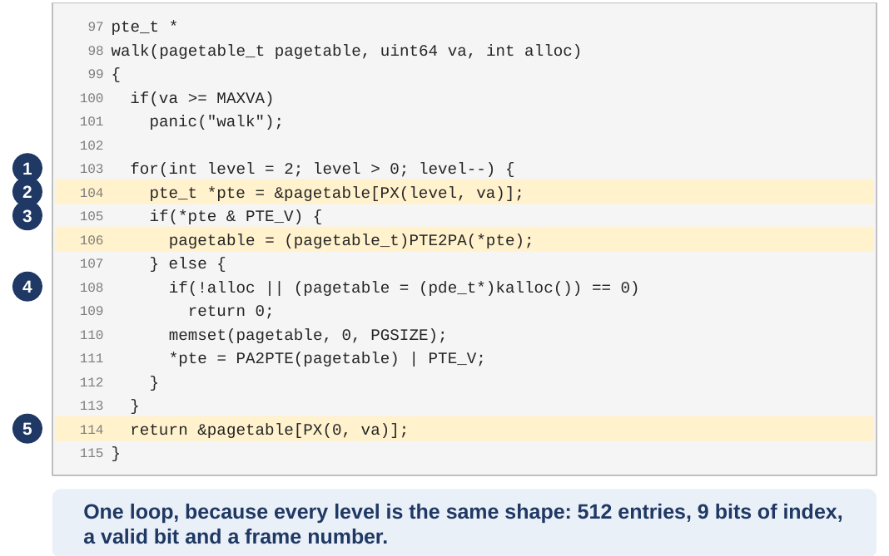{width=85%}
<figcaption markdown="1">Figure 3.7. walk() in kernel/vm.c, lines 97 to 115, complete (the comment above it is lines 85 to 96), with five callouts, the numbered circles in the margin that the text refers to. From slide 25.</figcaption>
</figure>

More C to gloss, all of it ordinary; read this paragraph once, then the story in words that follows it, and come back here only when a symbol in the figure stops you. A **function** is a named piece of code that takes some inputs (its arguments, in parentheses) and hands back a result (its return value). `walk(pagetable_t pagetable, uint64 va, int alloc)` takes the root of a tree, a virtual address, and a flag `alloc` (`int` is C's ordinary whole-number type) that is 1 if the caller wants missing pieces of the tree built and 0 if not. A variable is a named place that holds a value. A **pointer** is a variable that holds an address; `pte_t *pte` declares `pte` as a pointer to an entry (`pte_t` is xv6's name for the 64-bit entry type, and `pagetable_t` its name for a pointer to a page of 512 entries). `&x` means "the address of x", and `*p` means "the value at the address p holds". `pagetable[i]` means "entry number i of the page that `pagetable` points at", and `&pagetable[i]` is that entry's address. `if(va >= MAXVA)` tests "is va greater than or equal to MAXVA"; `panic("walk")` stops the whole kernel with a message, the kernel's way of saying "this can never happen". `for(int level = 2; level > 0; level--)` is a **loop**: start with level = 2, keep going while level is greater than 0, and subtract 1 from level after each pass (`level--`), so the body runs for level 2 and level 1. `!alloc` means "alloc is 0"; `||` is "or"; `== 0` tests for zero, which is what `kalloc` (the kernel's page allocator, explained under callout 4) returns when it has no free page. `(pde_t*)` is a cast, as in [Section 3.2](#sec-3-2); `pde_t` is xv6's name for a directory entry, the same 64-bit type as `pte_t`. `memset(p, 0, PGSIZE)` fills `PGSIZE` (4096) bytes starting at `p` with the byte 0. `return x` hands `x` back to the caller and leaves the function; `return 0` hands back a null pointer, the C way of saying "nothing".

Here is what `walk` does, in words. It starts at the top page of the tree and reads one entry. That entry says where the next page of the tree is. It goes there and reads one more entry. After two steps it reaches the bottom page. It hands back the address of the entry it finds there. Figure 3.8 ties the five callouts to the lines.

<figure markdown="1">
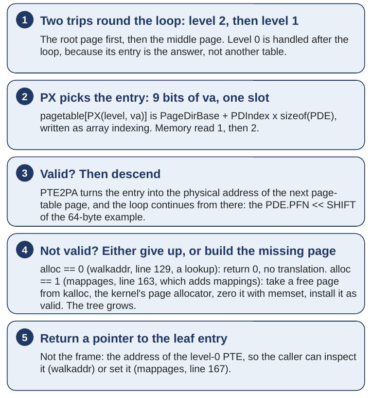{width=61%}
<figcaption markdown="1">Figure 3.8. The five callouts of walk(): two trips round the loop, PX picks the entry, valid means descend, invalid means give up or build, and the return is a pointer to the leaf entry. From slide 25.</figcaption>
</figure>

Callout 1, line 103: two trips round the loop, level 2 then level 1. The root page first, then the middle page. Level 0 is handled after the loop, because its entry is the answer, not another table.

Callout 2, line 104: `pagetable[PX(level, va)]` picks one entry out of 512 using one 9-bit slice of the address. It is [Section 2.2](#sec-2-2)'s `PageDirBase + (PDIndex * sizeof(PDE))`, written as array indexing, because C computes the entry's address for you. This is memory read 1 on the first trip and memory read 2 on the second.

Callout 3, lines 105 and 106: `if(*pte & PTE_V)` tests bit 0 of the entry. Valid, so descend: `PTE2PA(*pte)` turns the entry into the physical address of the next page-table page, and the loop continues from there. That is [Section 2.2](#sec-2-2)'s `PDE.PFN << SHIFT`.

Callout 4, lines 107 to 111: not valid. If `alloc` is 0, return 0: no translation. That is how `walkaddr` calls it (at line 121 of the same file, outside the figure; `walkaddr` is the function that looks up a virtual address and returns its physical address, or 0 if there is none). If `alloc` is 1, as it is when `mappages` calls `walk` (at line 163 of the same file, outside the figure; `mappages` is the function that adds mappings, a mapping being one row that ties a virtual page to a frame, so that the page is mapped), build the missing page. Take a free page from `kalloc`, the kernel's page **allocator**, the piece of kernel code that hands out free 4 KiB pages one at a time. Zero it with `memset`, so that all 512 entries of the new page read as invalid; a frame fresh from the allocator holds whatever was there before. Install it in the entry as `PA2PTE(pagetable) | PTE_V`: the new page's frame number, with only the valid bit set. The tree grows by one page.

Callout 5, line 114: `return &pagetable[PX(0, va)]`. Not the frame: the address of the level-0 entry, so the caller can read it (`walkaddr` does) or write it (`mappages` does, at its line 167, outside the figure).

One loop, because every level is the same shape: 512 entries, 9 bits of index, a valid bit and a frame number.

### 3.4 <span class="lbl lbl-concept">Concept</span> The cost of a walk: memory reads per TLB miss {#sec-3-4 data-toc-label="3.4 [Concept] The cost of a walk: memory reads per TLB miss"}

Figure 3.9 draws the loop as memory: three pages and three reads.

<figure markdown="1">
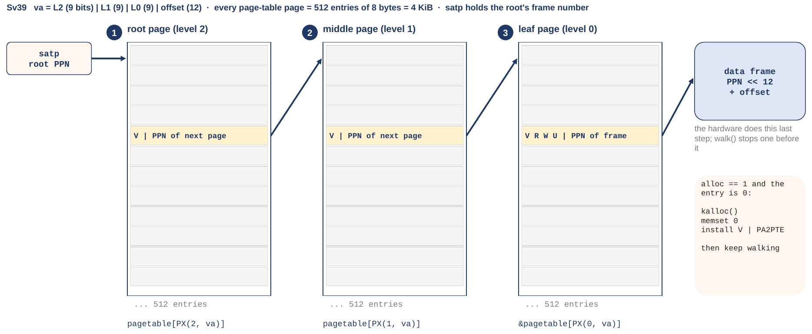{width=100%}
<figcaption markdown="1">Figure 3.9. walk() drawn as memory: satp names the root page, one entry in each of three pages is read, and the last step, frame number plus offset, is the hardware's, not walk's. From slide 26.</figcaption>
</figure>

satp holds the root's frame number. The top 9 bits of the address (`PX(2, va)`) pick one entry in the root page. That entry is valid and holds only V plus the PPN of the next page, the middle page. The next 9 bits (`PX(1, va)`) pick one entry in the middle page, which leads to the leaf page. The last 9 bits (`PX(0, va)`) pick the leaf entry. Its flags include R, W and U, and its PPN is a frame of real data, not another table. Counting the entry reads: the first and second are the two loop trips, and the third happens when the caller reads the leaf entry through the pointer that line 114 returns. Those are the three entry reads that a hardware walk also makes; the data read, which [Section 2.4](#sec-2-4) counted as its read 3, is the hardware's alone.

Turning that leaf entry's frame number into the final address (PPN << 12, plus the offset) is the hardware's job on every access. `walk` stops one step before it and never touches the data frame.

The orange box is the building case. When `alloc` is 1 and an entry is 0, `walk` calls `kalloc`, zeroes the new page with `memset`, installs `V | PA2PTE(new page)` in the entry, and keeps walking. A brand-new process starts with just a root page. The tree grows as pages are added, one page-table page at a time.

### 3.5 <span class="lbl lbl-machine">Real machine</span> Inspecting a real page table: satp and the root page {#sec-3-5 data-toc-label="3.5 [Real machine] Inspecting a real page table: satp and the root page"}

Drawings can lie. So the next three parts read the three entries inside a real running xv6 process, with a tool called the QEMU monitor. Figure 3.10 is the program that was run, and its console output.

<figure markdown="1">
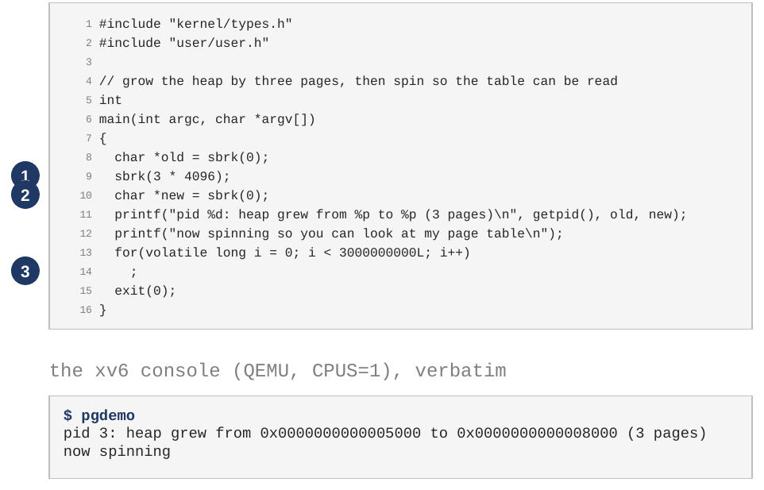{width=77%}
<figcaption markdown="1">Figure 3.10. user/pgdemo.c, complete (a program added for this run; nothing in the kernel changed): it grows its heap by three pages and then spins, and below it is what it printed on the xv6 console. From slide 27.</figcaption>
</figure>

The program is 16 lines and you do not need to read it, but here is what it does, in order. `#include` lines pull in the definitions the program needs. `main` is the function where every C program starts; `argc` and `argv` are the count and the list of words typed on the command line, unused here. `char *old = sbrk(0)` asks the kernel where the heap currently ends and stores that address in `old`. (`char *` is "a pointer to a byte". `sbrk(n)` is a library function (a function supplied with the C language's standard code, the C library) that asks the kernel, through a system call, to grow the heap by n bytes; it returns the old end, so `sbrk(0)` grows nothing and just reports.) A **system call** is a request from a program to the kernel. Callout 1, `sbrk(3 * 4096)`, grows the heap by three pages. Callout 2 reads the new end. `printf` prints text; `%d` is filled in with a number and `%p` with an address in hex; `getpid()` returns the process's **pid**, its process identifier, a number the kernel gives each process. Callout 3 is a loop that counts to three billion doing nothing (`volatile` tells the compiler not to optimize the loop away), which keeps the process alive and its page table in use while we look at it; that is what the captions call spinning. `exit(0)` ends the process.

The console shows what it printed: `pid 3: heap grew from 0x0000000000005000 to 0x0000000000008000 (3 pages)`. Check the three pages: 0x8000 − 0x5000 = 0x3000 = 3 × 4096 = 12,288 bytes, three pages of 4096. The address 0x5000 is the first byte of the first new heap page, and it is the address we will translate.

Figure 3.11 shows the monitor and the two numbers we need from it.

<figure markdown="1">
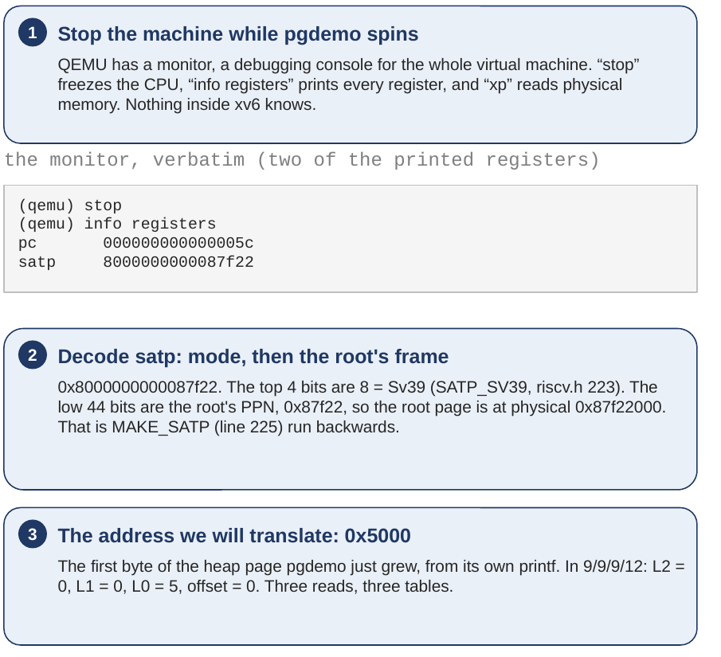{width=72%}
<figcaption markdown="1">Figure 3.11. Stopping the machine in the QEMU monitor while pgdemo spins, the two registers we read, and how satp decodes into the root page's address. From slide 27.</figcaption>
</figure>

QEMU has a **monitor**, a debugging console for the whole virtual machine (the pretend computer; a virtual machine is a computer simulated by software on another computer), outside the pretend computer that xv6 runs on. From there `stop` freezes the CPU (the processor; the two words mean the same thing), `info registers` prints every register, and `xp` reads physical memory. Nothing inside xv6 knows any of this is happening. The two printed registers we need are `pc` and satp. `pc` is the **program counter**, the address of the next instruction to run. Here it is 0x5c, which the deck checked is inside pgdemo's spinning loop (a check against the program's machine code, not shown here), and for the walk it does not matter where it is. satp holds 0x8000000000087f22.

Decode satp. It is a 64-bit value, so sixteen hex digits. The RISC-V specification lays it out in three fields. Bits 63 to 60 are a 4-bit mode. Bits 59 to 44 are a 16-bit field called the ASID (address space identifier, a tag some systems use to keep one process's TLB entries apart from another's), which xv6 leaves at 0. Bits 43 to 0, the low 44 bits (43 − 0 + 1 = 44), are the root page's PPN. Check: 4 + 16 + 44 = 64. The top hex digit is 8, and mode 8 means Sv39 (the specification fixes that number; xv6 names it `SATP_SV39` at riscv.h line 223, `8L << 60`). The low 44 bits are the low 11 hex digits (44 ÷ 4 = 11): 00000087f22, which is 0x87f22. Shift it left by 12 (append three hex zeros) and the root page is at physical address 0x87f22000. That is `MAKE_SATP` (line 225) run backwards: `MAKE_SATP` shifts a root address right by 12 and ors in the mode, and we did the reverse.

Now split 0x5000 into 9, 9, 9 and 12 bits. 0x5000 is 0101 0000 0000 0000 in binary, 15 significant bits. The low 12 bits are all zero: offset 0. Bits 20 to 12 hold the next 9 bits; the only 1 bits in 0x5000 are in positions 14 and 12 (0x5000 = 0x4000 + 0x1000 = 2^14 + 2^12), so that slice is 000000101 = 5. Check it: 0x5000 >> 12 = 0x5 = 5. Bits 29 to 21 and 38 to 30 are all zero. So L2 = 0, L1 = 0, L0 = 5, offset = 0: read entry 0 of the root page, entry 0 of the middle page, entry 5 of the leaf page.

### 3.6 <span class="lbl lbl-machine">Real machine</span> Reading the three levels of a real translation {#sec-3-6 data-toc-label="3.6 [Real machine] Reading the three levels of a real translation"}

Figure 3.12 is the three monitor reads, exactly as printed, with each entry decoded.

<figure markdown="1">
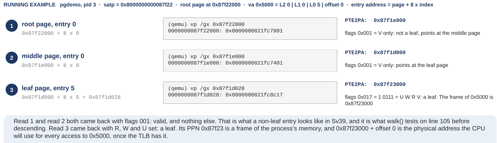{width=100%}
<figcaption markdown="1">Figure 3.12. The three xp reads of the walk for 0x5000: the root entry, the middle entry and the leaf entry, each decoded with PTE2PA into the next address and its flags. From slide 28.</figcaption>
</figure>

`xp /gx addr` reads one 64-bit word ("g" for giant word, "x" for print in hex) at a physical address. The three reads below are the three entry reads of the walk, one per level; unlike [Section 2.4](#sec-2-4), where read 3 fetched the data, here all three fetch entries, because the monitor is reading the table and never the data. Entries are 8 bytes, so entry number i of a page is at the page's address plus 8 × i.

Read 1, the root page, entry 0: address 0x87f22000 + 8 × 0 = 0x87f22000. The monitor prints 0x0000000021fc7801. [Section 3.2](#sec-3-2) decoded exactly this value: flags 0x001 (only V set), PPN 0x87f1e, so `PTE2PA` gives 0x87f1e000. V only means this is not a leaf; it points at the middle page.

Read 2, the middle page, entry 0: address 0x87f1e000 + 8 × 0 = 0x87f1e000. The monitor prints 0x0000000021fc7401. Same decoding. The low three hex digits are 401 = 0100 0000 0001. The low 10 bits are 00 0000 0001 = flags 0x001. The two bits above them are 01 = 1, so the PPN is 0x21fc7 × 4 + 1 = 0x87f1c + 1 = 0x87f1d, and the address is 0x87f1d000. Again V only: it points at the leaf page.

Read 3, the leaf page, entry 5: address 0x87f1d000 + 8 × 5 = 0x87f1d000 + 40, and 40 is 0x28, so 0x87f1d028. The monitor prints 0x0000000021fc8c17. Decode it the same way. The low three hex digits are c17 = 1100 0001 0111. The low 10 bits are 00 0001 0111 = 0x017 = 23. The two bits above are 11 = 3, so the PPN is 0x21fc8 × 4 + 3 = 0x87f20 + 3 = 0x87f23, and the frame is at 0x87f23000. The flags, 0x017, are 1 0111 in binary: bit 0 (V), bit 1 (R), bit 2 (W) and bit 4 (U) set, bit 3 (X) clear. So: valid, readable, writable, user, not executable. That is a leaf, and it is what a heap page should look like.

Reads 1 and 2 both came back with flags 001: valid and nothing else. That is what a non-leaf entry looks like in Sv39. It is a design fact of the specification: an entry with V set and R, W, X all clear points at another page-table page. It is also what `walk` tests on line 105 before descending. Read 3 came back with R, W and U set: a leaf. Its PPN 0x87f23 is a frame of the process's memory, and 0x87f23000 + offset 0 = 0x87f23000 is the physical address the CPU will use for every access to 0x5000, once the TLB has it.

### 3.7 <span class="lbl lbl-machine">Real machine</span> Checking the result, and counting the page table's pages {#sec-3-7 data-toc-label="3.7 [Real machine] Checking the result, and counting the page table's pages"}

The monitor can check the hand walk on its own, and it lets us count every page-table page the process owns. Figure 3.13 is the two captures.

<figure markdown="1">
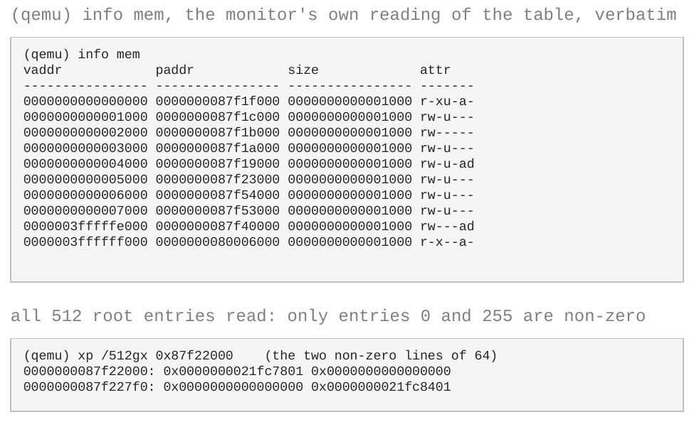{width=78%}
<figcaption markdown="1">Figure 3.13. info mem, the monitor's own reading of pgdemo's page table, and the two non-zero entries among the 512 in the root page. From slide 29.</figcaption>
</figure>

`info mem` walks the current page table itself and prints one line per mapped page: the virtual address, the physical address, the size, and seven attribute letters. The columns vaddr and paddr are the virtual and physical addresses. The letters, in order, stand for the entry's flag bits read, write, execute, user, global, accessed and dirty. (The hardware sets accessed when the page is touched and dirty when it is written.), with a dash where the bit is 0. (Global marks a page meant to be shared by every process; xv6 does not use that bit.) So `r-xu-a-` means read, execute, user and accessed set, and write, global and dirty clear. The row for 0x5000 says paddr 0x87f23000, size 0x1000 (4096, one page), `rw-u---`: the same frame as read 3, and the same flags we decoded, r, w and u set, x not set. The a and d letters, accessed and dirty, are clear because pgdemo has not touched that page since it was mapped ([Section 5.6](class-2.md#sec-5-6) comes back to those two bits).

The other rows are the rest of the process. Page 0 is its code (`r-xu`). Page 1 is its data (`rw-u`). Page 2 is a guard page with no `u`: a page the kernel deliberately keeps out of the program's reach, so that a stack that grows too far hits it. (The stack grows toward lower addresses, a design fact of xv6 and of most machines, so a stack that grows past page 3 lands on page 2.) and the hardware stops the program. ([Section 4.3](class-2.md#sec-4-3) calls that kind of stop a protection fault; it is the hardware's way of handing the problem to the OS.) Pages 3 and 4 are its stack; page 4, the top of the stack, shows `a` and `d` because the program has used it. Pages 5, 6 and 7 are the three heap pages just grown. The last two rows, 0x3fffffe000 and 0x3ffffff000, are two special pages at the very top of the address space that the kernel keeps in every process's table for entering and leaving the kernel. (The processor switches to the kernel without switching tables, so the code that makes the switch must be visible in both; that is why the count includes them.) Ten mapped pages in all: eight at the bottom (pages 0 to 7, the program's own, one of them the guard page) and two at the top.

The second capture reads all 512 entries of the root page with `xp /512gx 0x87f22000`. The monitor prints 8 entries per line, so 512 ÷ 8 = 64 lines, and the capture keeps the only two lines that are not all zeros. One holds entry 0 (0x21fc7801, our read 1) at the start of the page. The other holds entry 255 (0x21fc8401) at address 0x87f227f8, which is 0x87f22000 + 8 × 255 = 0x87f22000 + 2040, and 2040 = 0x7f8. Entry 255 is the top slice of the two special pages: 0x3ffffff000 >> 30 = 255 (0x3ffffff000 is 2^38 − 4096, and dividing by 2^30 gives just under 256, so 255).

Figure 3.14 counts.

<figure markdown="1">
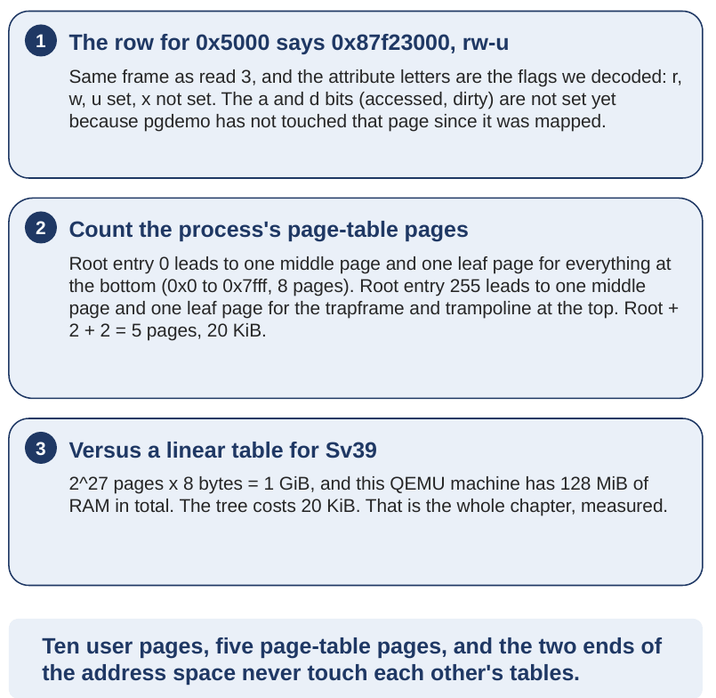{width=64%}
<figcaption markdown="1">Figure 3.14. The row for 0x5000 matches read 3, the count of page-table pages, and the comparison with a linear Sv39 table. From slide 29.</figcaption>
</figure>

Root entry 0 leads to one middle page and one leaf page, and that leaf page covers everything at the bottom of the address space (0x0 to 0x7fff, eight pages, since one leaf page covers 512 × 4 KiB = 2 MiB). Root entry 255 leads to one middle page and one leaf page for the two pages at the top. The demo folder's capture followed that entry the same way as [Section 3.6](#sec-3-6)'s three reads: entry 255 (0x21fc8401) gives 0x87f21000, the middle page; its entry 511 (a read from the same session that the figures do not show; it is `walk_summary.txt` in the demo folder) is 0x0000000021fc8001, whose low three hex digits 001 are flags 0x001 with the two bits above them 00, so the PPN is 0x21fc8 × 4 + 0 = 0x87f20 and the leaf page is at 0x87f20000; and both top pages share those two pages, because 0x3fffffe000 and 0x3ffffff000 differ only in bit 12 (0xe000 against 0xf000), so their L2 slices are both 255 and their L1 slices are both 511; only their L0 slices differ, 510 and 511. (Check it: 0x3ffffff000 is 2^38 − 2^12, which in binary is bits 37 down to 12 all ones and bits 11 to 0 all zeros. Bits 38 to 30 are then 0 followed by eight ones, 0 1111 1111 = 255; bits 29 to 21 are nine ones = 511; bits 20 to 12 are nine ones = 511. In 0x3fffffe000, bit 12 is 0, so its L0 slice is 1 1111 1110 = 510.). So the process's page table is the root plus 2 plus 2 = 5 pages, 5 × 4 KiB = 20 KiB.

Ten mapped pages, five page-table pages. Compare with a linear table for Sv39. A 39-bit address space has 2^39 ÷ 2^12 = 2^27 pages; a linear table would have 2^27 entries of 8 bytes, 2^27 × 2^3 = 2^30 bytes = 1 GiB. This QEMU machine has 128 MiB of RAM in total (a setting of the run, `-m 128M`), so the linear table would not fit even once. The tree costs 20 KiB. That is the whole chapter, measured. The two ends of the address space never touch each other's tables.

### 3.8 <span class="lbl lbl-check">Check yourself</span> The memory cost of one load {#sec-3-8 data-toc-label="3.8 [Check yourself] The memory cost of one load"}

Every design in the first class comes down to one number: how many memory reads a single load costs. Figure 3.15 asks it three ways; it is exercise 3 at the end of this guide, so answer it now on paper before you read on.

<figure markdown="1">
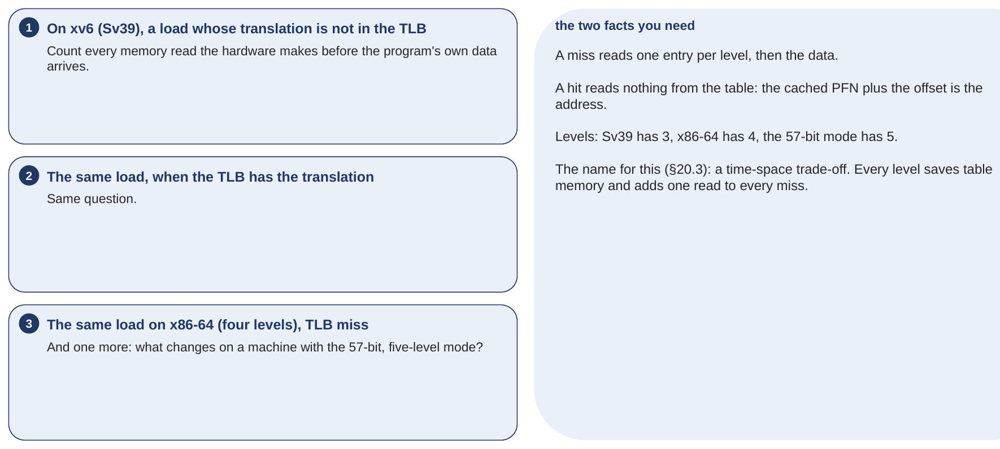{width=100%}
<figcaption markdown="1">Figure 3.15. Three questions about the cost of one load, and the two facts needed to answer them. From slide 30.</figcaption>
</figure>

The two facts you need are on the right. A miss reads one entry per level, then the data. A hit reads nothing from the table: the cached frame number plus the offset is the address, so only the data is read. And the level counts from [Section 3.1](#sec-3-1): Sv39 has 3, x86-64 has 4, the 57-bit mode has 5. The name for this trade is the time-space trade-off of [Section 1.4](#sec-1-4): every level saves table memory and adds one read to every miss.

That answers the third question, and with it the chapter. Figure 3.16 is the checkpoint.

<figure markdown="1">
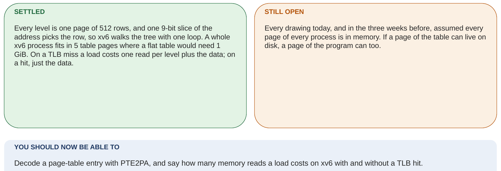{width=100%}
<figcaption markdown="1">Figure 3.16. Checkpoint 3: what the third question settled, what it left open, and what you should now be able to do. From slide 31.</figcaption>
</figure>

Settled: every level is one page of 512 rows, and one 9-bit slice of the address picks the row, so xv6 walks the tree with one loop. A whole xv6 process fits in 5 table pages where a flat table would need 1 GiB. On a TLB miss a load costs one read per level plus the data, on a hit just the data. Still open: every drawing this week, and in the weeks before, assumed every page of every process is in memory, and the chapter's last section ([Extra 5](#extra-5)) says even page tables can be moved to disk when memory is tight. If a page of the table can live on disk, a page of the program can too, and nobody has said how that works. You should now be able to decode a page-table entry with `PTE2PA`, and say how many memory reads a load costs on xv6 with and without a TLB hit.

## <span class="lbl lbl-summary">Summary</span> Summary of the first class: multi-level page tables {#summary-19 data-toc-label="[Summary] Summary of the first class: multi-level page tables"}

The last slide of the class answers its three questions in order, each with the problem it solved. Figure 3.17 is that slide, with the vocabulary list under it. Every word in the list should now have a picture behind it. If one does not, that is the part to reread.

<figure markdown="1">
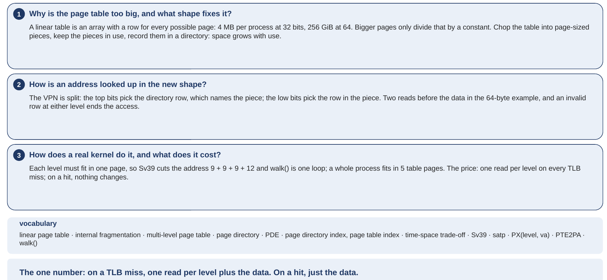{width=100%}
<figcaption markdown="1">Figure 3.17. The first class on one slide: the three questions, each answered with the problem it solved. From slide 32.</figcaption>
</figure>

Question 1, why the table is too big and what shape fixes it. A linear table is an array with a row for every possible page: 4 MB per process at 32 bits and 256 GiB at 64. Bigger pages only divide that by a constant. Chopping the table into page-sized pieces, keeping the pieces in use and recording them in a directory makes space grow with use. Question 2, how an address is looked up in the new shape. Scattering the pieces broke the one-read lookup, so the VPN is split: the top bits pick the directory row, which names the piece, and the low bits pick the row in the piece. That is two reads before the data in the 64-byte example, and an invalid row at either level ends the access. Question 3, how a real kernel does it and what it costs. A real VPN is too wide for one directory, so each level must fit in one page, and Sv39 cuts the address 9 + 9 + 9 + 12. `walk` is one loop over `PX(level, va)`, descending through `PTE2PA` and building missing pages with `kalloc`, and a whole process fits in 5 table pages. The price is one read per level on every TLB miss, and on a hit nothing changes.

The one number: on a TLB miss, one read per level plus the data. On a hit, just the data.

That is what the first class settled. What it left open is the second bill of the first class's opening section, and the second class (the second class's opening section onward) pays it. Between the two classes the deck asked for two things. Read OSTEP chapter 21, which is short and covers the present bit and the page fault: a bit that says whether a page is in memory, and the stop that happens when it is not (Sections [4.2](class-2.md#sec-4-2) to [4.4](class-2.md#sec-4-4) explain both). Then read chapter 22, the replacement policies: the rules for choosing which page to throw out when memory is full (Sections [5.1](class-2.md#sec-5-1) to [5.7](class-2.md#sec-5-7)). Do the traces (a policy run written out one request per line, the way [Section 5.2](class-2.md#sec-5-2) does it) in OSTEP Figures 22.1, 22.2 and 22.5 by hand, because the second class races those policies against each other. And reread section 3.1 of the xv6 book (the short book by xv6's authors that explains its source, which the labs also use), on the paging hardware, now that you have read real entries with your own eyes. Read it together with `walk` (`vm.c` lines 97 to 115) and `mappages` (lines 145 to 174) in your tree. Trace one call of `mappages` for a single page on paper, and write down which lines of `walk` allocate. The question the second class answers: a page can be valid and not in memory. Who notices, and what happens next?

## Going deeper, first class (optional) {#extras-1}

### Extra 1 <span class="lbl lbl-deeper">Deeper, Q1</span> The hybrid approach: one page table per segment {#extra-1 data-toc-label="Extra 1 [Deeper, Q1] The hybrid approach: one page table per segment"}

This part and the four after it are the deck's "deeper, if time allows" block: slides the class may have skipped, placed after the summary so that the core chain reads without them. Each one goes deeper on one of the three questions.

Between bigger pages ([Section 1.2](#sec-1-2)) and the tree ([Section 1.3](#sec-1-3)) the chapter tries a second fix, and it is worth seeing why it lost. It reuses something the course already had. Segments describe only the used parts of a program, so each segment could get its own small page table. Figure E1.1 shows the idea, which Multics (an operating system of the 1960s that many later ideas came from) tried first.

<figure markdown="1">
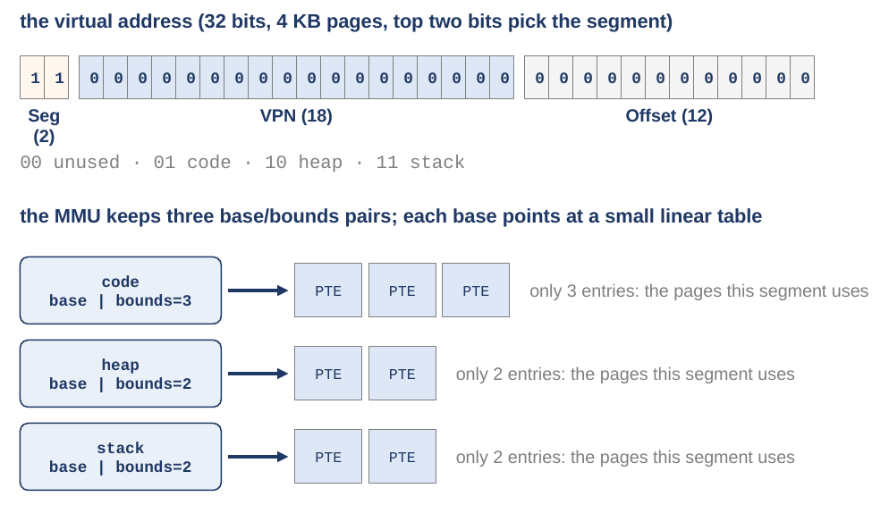{width=78%}
<figcaption markdown="1">Figure E1.1. A 32-bit address with the top two bits naming the segment, and three small page tables, one per segment, each reached through a base and bounds pair. From slide 33, following textbook section 20.2.</figcaption>
</figure>

A **segment** is one region of the program, such as its code, its heap or its stack. In this design the top 2 bits of a 32-bit address say which segment the address belongs to: 00 unused, 01 code, 10 heap, 11 stack. The next 18 bits are the VPN and the last 12 are the offset (2 + 18 + 12 = 32). A register, as in [Section 1.3](#sec-1-3), is a tiny storage cell inside the processor. The **MMU** (memory management unit) is the part of the processor that translates addresses, and it keeps three pairs of registers, a base and a bounds pair per segment. The base no longer points at the segment's memory; it points at that segment's own small page table. The bounds says how many pages that table has. In the figure the code table has 3 entries, the heap table 2 and the stack table 2, and the empty space between heap and stack gets no entries at all.

Figure E1.2 is the formula the MMU runs on a TLB miss (an access whose translation the TLB does not have, so the table must be read; [Section 1.4](#sec-1-4) says more), and the two problems.

<figure markdown="1">
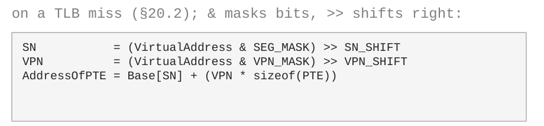{width=74%}
<figcaption markdown="1">Figure E1.2. The lookup formula of the hybrid design, what it buys, and its two problems. From slide 33, following textbook section 20.2.</figcaption>
</figure>

The three lines of the formula use the operators from [Appendix A](appendix.md#appendix-a). `SN` is the segment number: mask off the top two bits of the address with `& SEG_MASK`, then shift them down with `>>`. `VPN` is cut out the same way. Then `AddressOfPTE = Base[SN] + (VPN * sizeof(PTE))`: pick the base register of that segment (`Base[SN]` means "the base for segment number SN"), and count `VPN` entries down from it, each `sizeof(PTE)` bytes long (`sizeof` is C's way of writing "the size in bytes of"). You do not need to hold the formula in your head. It says: look at the segment number, pick that segment's table, count down to the right row.

What it buys is exactly the gap: the unallocated pages between the stack and the heap no longer take up space in a page table just to be marked invalid.

Problem 1: it needs segmentation. A large but sparsely used heap is still one segment, so its table is still mostly invalid entries. Problem 2: **external fragmentation** is back. That is the hole problem from the segments week: page tables now come in every size, in multiples of one entry, so finding room for them in memory is the free-space problem all over again.

Both this and bigger pages kept a flat array for each region. The flat array is the real problem, and the tree of [Section 1.3](#sec-1-3) is the idea that attacks it directly.

### Extra 2 <span class="lbl lbl-deeper">Deeper, Q2</span> The translation control flow in hardware (Figure 20.6) {#extra-2 data-toc-label="Extra 2 [Deeper, Q2] The translation control flow in hardware (Figure 20.6)"}

Figure E2.1 is OSTEP Figure 20.6: the translation written as a procedure, the way the hardware runs it on every memory access.

<figure markdown="1">
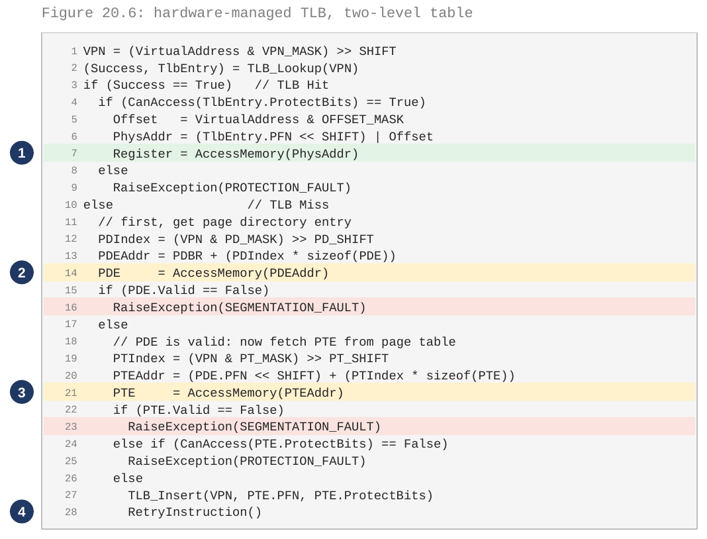{width=85%}
<figcaption markdown="1">Figure E2.1. OSTEP Figure 20.6, the two-level lookup with a hardware-managed TLB, with the four callouts the next figure explains. From slide 34, following textbook section 20.3.</figcaption>
</figure>

This is **pseudocode**: code written to be read by people, not run by a machine, so the names are long and the details are left out. A few marks in it need glossing. `==` is "is equal to" (a test, not a store into a variable). A line starting with `//` is a **comment**, a note for the reader that the machine ignores. `if ... else` means "if this is true, do the first thing, otherwise do the second". `TLB_Lookup(VPN)` asks the TLB whether it has the page; `Success` is true or false and `TlbEntry` is what it found. `CanAccess(...ProtectBits)` checks the protection bits (read, write, execute) against what the instruction wants to do. `AccessMemory(addr)` reads memory at an address. The names ending in `_MASK` (`VPN_MASK`, `PD_MASK`, `PT_MASK`, `OFFSET_MASK`) are masks that keep the bits of one field of the address, and the names ending in `_SHIFT` say how far to shift that field down; `VirtualAddress` is the address being translated. `PDBR` on line 13 is the page-directory base register of [Section 1.4](#sec-1-4), the same thing [Section 2.2](#sec-2-2)'s formula called `PageDirBase`. `RaiseException(...)` is the exception from [Section 2.5](#sec-2-5), with a name for the reason. `SEGMENTATION_FAULT` means the page does not exist; the name is a leftover from the days of segments. `PROTECTION_FAULT` means the page exists but this kind of access to it is not allowed. `TLB_Insert` puts a translation into the TLB, and `RetryInstruction()` runs the same instruction again from the start.

You do not need to follow every line. Here is what it says, in order. First check the TLB (line 2). If the answer is there (lines 3 to 7), check the protection, append the offset to the cached frame number, and read memory: one access, done. If not (line 10 onward), read the directory entry (line 14). If that entry is invalid, stop with an exception (line 16). Otherwise read the page table entry (line 21). If that entry is invalid, stop with an exception (line 23). Otherwise save the translation in the TLB (line 27) and try the instruction again (line 28); this time it takes the hit path.

Figure E2.2 ties the four callouts to the three reads of [Section 2.4](#sec-2-4).

<figure markdown="1">
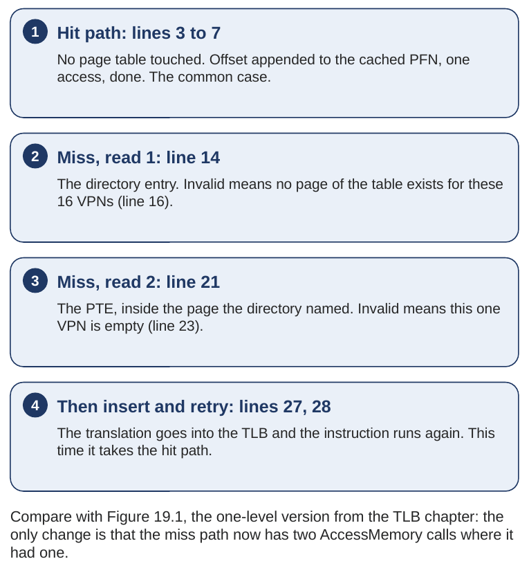{width=61%}
<figcaption markdown="1">Figure E2.2. The four callouts of Figure 20.6: the hit path, memory read 1 at line 14, memory read 2 at line 21, and insert-and-retry at lines 27 and 28. From slide 34, following textbook section 20.3.</figcaption>
</figure>

Callout 1, lines 3 to 7, is the hit path: no page table touched, the common case. Callout 2, line 14, is read 1 of [Section 2.4](#sec-2-4), the directory entry; invalid there means no page of the table exists for these 16 VPNs. Callout 3, line 21, is read 2, the PTE inside the page the directory named; invalid there means this one VPN is empty, which is where address B of [Section 2.5](#sec-2-5) failed, two lines below at line 23. Callout 4, lines 27 and 28, is the insert and the retry.

The last card compares this with OSTEP Figure 19.1, the one-level version from the TLB chapter, which this guide does not reproduce; the first figure of [Section 4.3](class-2.md#sec-4-3) is almost the same thing, and you can make the comparison there. The only change is that the miss path now has two `AccessMemory` calls where it had one. That one extra line is the whole price of the tree.

### Extra 3 <span class="lbl lbl-deeper">Deeper, Q3</span> Four-level page tables on x86-64 {#extra-3 data-toc-label="Extra 3 [Deeper, Q3] Four-level page tables on x86-64"}

xv6 uses three levels. The processor in most PCs and servers, x86-64, uses four, and Linux gives the levels names. Figure E3.1 shows the split and a capture from the Ubuntu 24.04 machine.

<figure markdown="1">
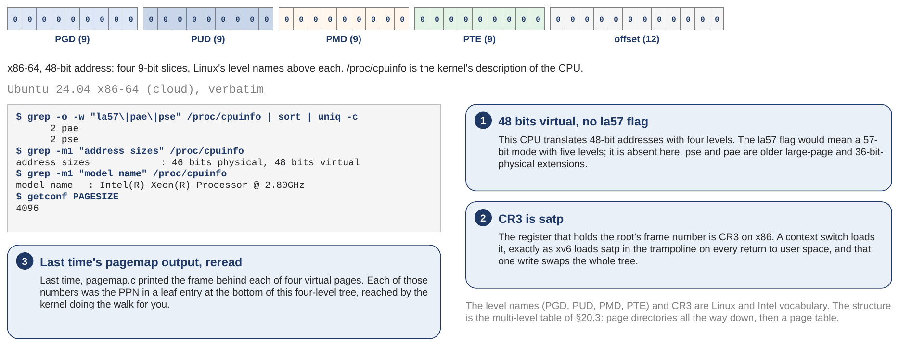{width=100%}
<figcaption markdown="1">Figure E3.1. A 48-bit x86-64 address as four 9-bit slices with Linux's level names, and the Ubuntu 24.04 x86-64 machine reporting 48 bits virtual and no la57 flag. From slide 35.</figcaption>
</figure>

A 48-bit address splits into four 9-bit slices and a 12-bit offset: 9 + 9 + 9 + 9 + 12 = 48. Linux calls the levels PGD (page global directory), PUD (page upper directory), PMD (page middle directory) and PTE (the page table). The names are Linux vocabulary; the shape is the multi-level table of [Section 3.1](#sec-3-1), page directories all the way down, then a page table.

The capture reads `/proc/cpuinfo`, the kernel's description of the CPU (another made-up file, like `/proc/meminfo` in [Section 1.2](#sec-1-2)). `grep -o -w` prints only the matching words, `sort | uniq -c` counts them (the `|` between commands passes one command's output to the next), and `grep -m1` prints the first matching line. The machine reports "address sizes: 46 bits physical, 48 bits virtual", the flags `pae` and `pse` twice (once per CPU), and no `la57` flag. (pae and pse are two older extensions of the x86 design, pae for 36-bit physical addresses and pse for large pages; both are design facts of those chips.) la57 would mean the 57-bit, five-level mode of [Section 3.1](#sec-3-1); it is absent, so this CPU walks four levels. The model name is an Intel Xeon at 2.80 GHz, and `getconf PAGESIZE` is 4096 again.

The register that holds the root's frame number is called CR3 on x86, the same job satp does on RISC-V. A **context switch** is when the kernel stops running one process and starts another. Loading CR3 (or satp) on a context switch swaps the whole tree in one write. xv6 does exactly that in its trampoline code (the small piece of kernel code that switches page tables, whose page [Section 3.7](#sec-3-7) met at the top of the address space) on every return to the running program. In the earlier class, a program called pagemap printed the frame behind each of four virtual pages. Each of those numbers was the PPN in a leaf entry at the bottom of this four-level tree, reached by the kernel doing the walk for you.

### Extra 4 <span class="lbl lbl-deeper">Deeper, Q3</span> Page table memory measured on Linux: VmPTE {#extra-4 data-toc-label="Extra 4 [Deeper, Q3] Page table memory measured on Linux: VmPTE"}

The tree's promise was that table memory follows use. Linux reports table memory per process, so the promise can be measured. Figure E4.1 is the program.

<figure markdown="1">
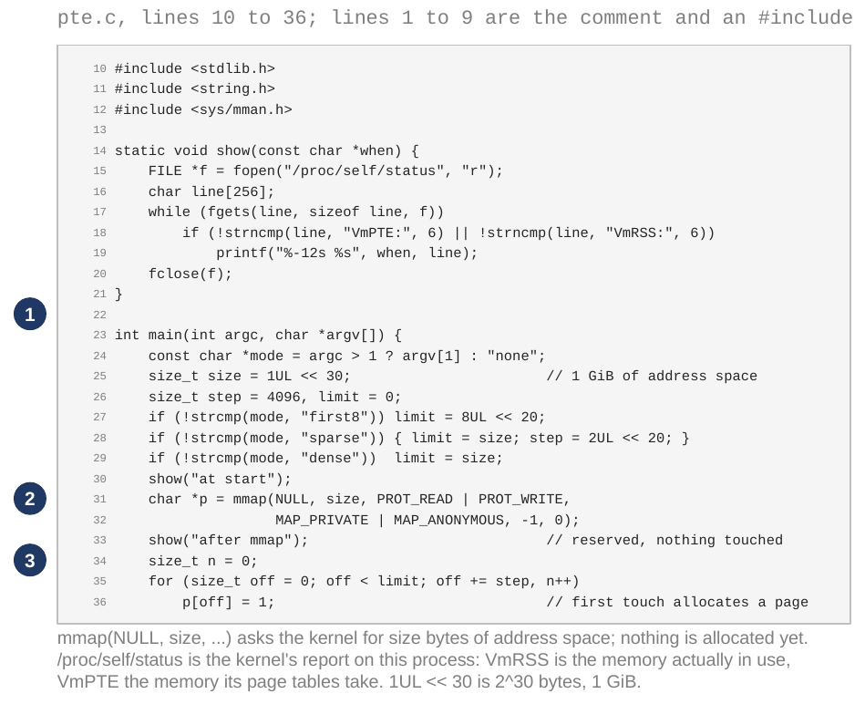{width=76%}
<figcaption markdown="1">Figure E4.1. pte.c, lines 10 to 36: reserve 1 GiB of address space, touch it in one of four patterns, and print the kernel's count of this process's page-table memory before and after. From slide 36.</figcaption>
</figure>

Here is what the program does, in order; its full source is at the end of this part. It reads one word from the command line (`argv[1]`) to choose a mode: `none`, `first8`, `sparse` or `dense`. It reserves 1 GiB of address space with `mmap`. `1UL << 30` is 2^30 bytes, the U meaning an unsigned number, one that is never negative. `mmap(NULL, size, ...)` asks the kernel for `size` bytes of address space; `NULL` is the null pointer, "no address", and here it means "let the kernel choose where". The flags `MAP_PRIVATE | MAP_ANONYMOUS` mean private memory not backed by any file. Nothing is allocated yet, only address space: Linux does what [Section 4.5](class-2.md#sec-4-5) explains for xv6, it promises the pages now and builds each one on its first touch, and that is the whole reason this measurement is interesting. Then, depending on the mode, it writes one byte into the reserved range at some spacing (`step`) up to some limit. Mode `none` touches nothing at all. Mode `first8` touches every page of the first 8 MiB: 2048 pages, since 8 MiB ÷ 4 KiB = 2^23 ÷ 2^12 = 2^11 = 2048. Mode `sparse` touches one byte every 2 MiB across the whole GiB: 512 touches, since 1 GiB ÷ 2 MiB = 2^30 ÷ 2^21 = 2^9 = 512. Mode `dense` touches every page of the whole GiB: 262,144 pages, since 2^30 ÷ 2^12 = 2^18 = 262,144. Each first write to a page makes the kernel allocate that page. Before and after, the function `show` opens `/proc/self/status`, the kernel's report on this process (`self` means "the process reading the file"), and prints two of its lines. **VmRSS** is the memory this process actually has in frames right now (RSS is resident set size). **VmPTE** is the memory its page tables take.

Figure E4.2 is the four runs and the table that explains them.

<figure markdown="1">
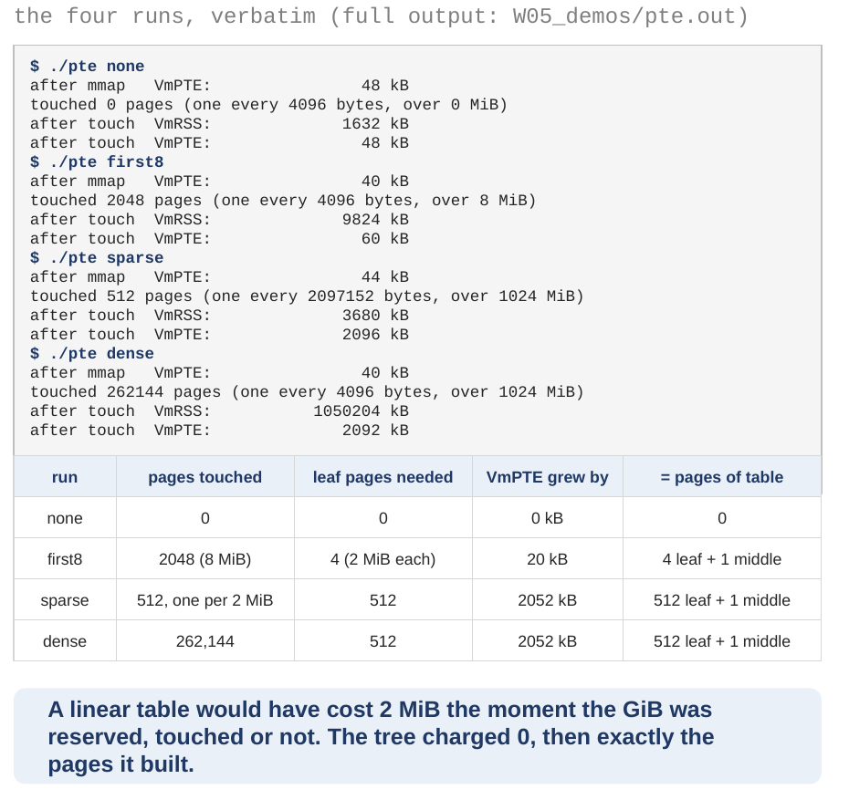{width=74%}
<figcaption markdown="1">Figure E4.2. The four runs of pte, verbatim, and the count of page-table pages each one needed. From slide 36.</figcaption>
</figure>

The note on the slide, "full output: W05_demos/pte.out", refers to the folder of demo programs and captures that goes with the course; the guide lists each program in full, so you do not need the folder. Read the VmPTE lines, "after mmap" against "after touch". Run `none`: 48 kB before, 48 kB after, and VmRSS 1632 kB, the program's own code and data. Reserving a gigabyte cost no table memory at all. Run `first8`: 40 kB to 60 kB, a growth of 20 kB, with 2048 pages touched and VmRSS 9824 kB. Run `sparse`: 44 kB to 2096 kB, a growth of 2052 kB, with only 512 pages touched and VmRSS 3680 kB. Run `dense`: 40 kB to 2092 kB, a growth of 2052 kB, with 262,144 pages touched and VmRSS 1,050,204 kB (a whole GiB of data, plus the program).

Here is why. One leaf page of the table has 512 entries of 4 KiB pages each, so it covers 512 × 4 KiB = 2 MiB of address space. Touching every page of the first 8 MiB needs 8 ÷ 2 = 4 leaf pages, plus 1 middle page above them to point at those leaves: 5 pages, and 5 × 4 kB = 20 kB, exactly what the kernel reported. Any pattern that reaches all 512 of the 2 MiB regions of the GiB needs 512 leaf pages plus 1 middle page; one middle page covers 512 × 2 MiB = 1 GiB, so one is enough when the GiB sits inside a single middle page's span. That is what happened in this run; the count below confirms it, and Answer 7 treats the other case. That is 513 pages, and 513 × 4 kB = 2052 kB, again exactly what the kernel reported, for `sparse` and for `dense` alike. How many data pages you touch inside each region does not matter; one touch builds the leaf page, and the other 511 entries on it are free. Why a new middle page at all, and why only one. `mmap` places the GiB in a part of the address space nothing else uses, so no existing middle page covers it. One middle page covers a whole GiB, so one is enough, and the count of 513 confirms that the GiB landed inside a single middle page's span. The two levels above it (the PUD and PGD of [Extra 3](#extra-3)) cost nothing here. Those pages already exist for the program's other memory, and one entry in the existing PUD page is enough to point at the new middle page. (The starting values differ slightly between runs: 48, 40, 44, 40 kB. The capture does not explain the small differences; only the growth matters.)

A linear table would have cost 2 MiB the moment the GiB was reserved, touched or not: 2^18 pages × 8 bytes = 2^21 bytes = 2 MiB. The tree charged 0, then exactly the pages it built.

??? note "The program behind Figures E4.1 and E4.2 (you can skip this listing)"

    The slide shows lines 10 to 36 of `pte.c`; lines 1 to 9 (eight comment lines and the first `#include`) are included here. `#include <...>` lines pull in the standard library. `static void show(const char *when)` is a helper function. `FILE *f` is an open file; `fopen`, `fgets` and `fclose` open it, read one line at a time (`while` repeats for as long as there is a line), and close it. In the `mmap` call, `PROT_READ | PROT_WRITE` means reading and writing allowed, and the last two arguments, `-1, 0`, mean no file and offset 0. `strncmp(line, "VmPTE:", 6)` compares the first 6 characters of the line with the text, and `!strncmp(...)` is true when they match. `%-12s` and `%s` in `printf` are filled in with text, and `%zu` with a size. `size_t` is C's type for a size in bytes. `argc > 1 ? argv[1] : "none"` means "the first command-line word if there is one, otherwise none". `strcmp` compares two strings (pieces of text). `off += step, n++` advances the offset and counts touches. `limit >> 20` divides by 2^20 to print MiB.
    
    ```c
    // pte.c: how much page-table memory does a 1 GiB address range cost?
    // Reserve 1 GiB with mmap, then touch it in one of four patterns, and print
    // the kernel's own count of this process's page-table memory (VmPTE in
    // /proc/self/status) before and after. VmRSS is the data actually resident.
    //   ./pte none     reserve only, touch nothing
    //   ./pte first8   touch every page of the first 8 MiB (2048 pages)
    //   ./pte sparse   touch one byte every 2 MiB across the whole GiB (512 pages)
    //   ./pte dense    touch every page of the whole GiB (262144 pages)
    #include <stdio.h>
    #include <stdlib.h>
    #include <string.h>
    #include <sys/mman.h>
    
    static void show(const char *when) {
        FILE *f = fopen("/proc/self/status", "r");
        char line[256];
        while (fgets(line, sizeof line, f))
            if (!strncmp(line, "VmPTE:", 6) || !strncmp(line, "VmRSS:", 6))
                printf("%-12s %s", when, line);
        fclose(f);
    }
    
    int main(int argc, char *argv[]) {
        const char *mode = argc > 1 ? argv[1] : "none";
        size_t size = 1UL << 30;                       // 1 GiB of address space
        size_t step = 4096, limit = 0;
        if (!strcmp(mode, "first8")) limit = 8UL << 20;
        if (!strcmp(mode, "sparse")) { limit = size; step = 2UL << 20; }
        if (!strcmp(mode, "dense"))  limit = size;
        show("at start");
        char *p = mmap(NULL, size, PROT_READ | PROT_WRITE,
                       MAP_PRIVATE | MAP_ANONYMOUS, -1, 0);
        show("after mmap");                            // reserved, nothing touched
        size_t n = 0;
        for (size_t off = 0; off < limit; off += step, n++)
            p[off] = 1;                                // first touch allocates a page
        printf("touched %zu pages (one every %zu bytes, over %zu MiB)\n",
               n, step, limit >> 20);
        show("after touch");
        return 0;
    }
    ```
    
    To build and run it on the Ubuntu 24.04 x86-64 machine: `gcc -O2 -o pte pte.c` (`gcc` is the C compiler; this line turns the source into a program named `pte`), then `./pte none`, `./pte first8`, `./pte sparse`, `./pte dense`. No `sudo` is needed (`sudo` runs a command with administrator rights, which some later programs need). The program prints seven lines per run (VmRSS and VmPTE at each of three points, which is 2 × 3 = 6 lines, plus the "touched" line); the slide shows four of them. Your starting values will differ a little; the growth of 0, 20, 2052 and 2052 kB will not, on any x86-64 Linux with 4 KiB pages.
    
### Extra 5 <span class="lbl lbl-deeper">Deeper, Q1</span> Inverted page tables, and swapping the page table to disk {#extra-5 data-toc-label="Extra 5 [Deeper, Q1] Inverted page tables, and swapping the page table to disk"}

The chapter ends with two more ideas. Figure E5.1 has both, and the sentence the first class leaves unfinished, which Checkpoint 3 ([Section 3.8](#sec-3-8)) already named as the open bill.

<figure markdown="1">
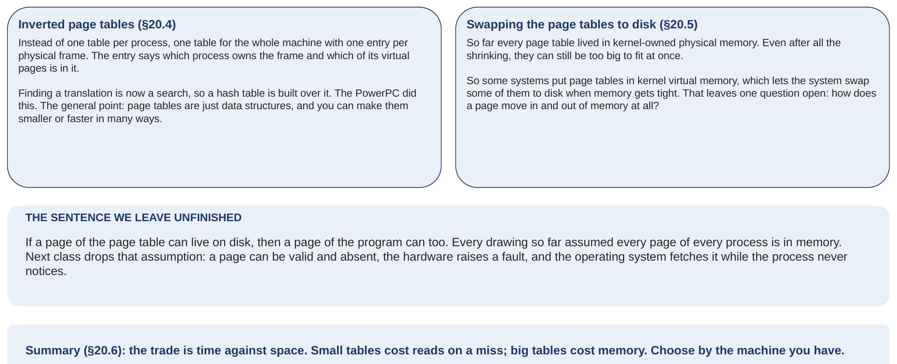{width=100%}
<figcaption markdown="1">Figure E5.1. Inverted page tables, swapping the page tables to disk, and the sentence that the second class finishes. From slide 37, following textbook sections 20.4 to 20.6.</figcaption>
</figure>

The problem it answers: a per-process tree is small, but there is one per process, and a machine with thousands of processes pays for thousands of trees. An **inverted page table** turns the question around. Instead of one table per process, the whole machine shares a single table with one entry per physical frame. Each entry says which process owns that frame and which of its virtual pages is in it. Finding a translation is now a search through that table. So a **hash table** is built on top to make the search fast. A hash table is a structure that jumps straight to the likely entry by computing a number from the key, the value being looked up, instead of scanning. The PowerPC (a processor family used in IBM's servers and in older Macs) did this. The general point: page tables are just data structures, and you can make them smaller or faster in many ways.

Swapping the page tables to disk. So far every page table lived in kernel-owned physical memory. Even after all the shrinking, tables can still be too big to fit at once. So some systems put page tables in kernel virtual memory, which lets the system move some of them to disk when memory gets tight. (Kernel virtual memory is address space that the kernel itself reaches through a page table, the way a program does, instead of through raw physical addresses.) That leaves one question open: how does a page move in and out of memory at all?

That is the sentence left unfinished. If a page of the page table can live on disk, then a page of the program can too. Every drawing so far assumed every page of every process is in memory. The second class drops that assumption: a page can be valid and absent, the hardware raises a fault, and the operating system fetches it while the process never notices.

The chapter's summary: the trade is time against space. Small tables cost reads on a miss; big tables cost memory. Choose by the machine you have.
