# Second class: when memory itself runs out: page faults, swapping, and which page to evict (OSTEP 21, 22) {#class-2}

## <span class="lbl lbl-roadmap">Roadmap</span> Recap and roadmap of the second class {#opening-25 data-toc-label="[Roadmap] Recap and roadmap of the second class"}

The second class starts the way the first did, by looking at the class before it, because it exists to pay the second bill of the first class's opening section. Figure 55 is the drawn recap.

<figure markdown="1">
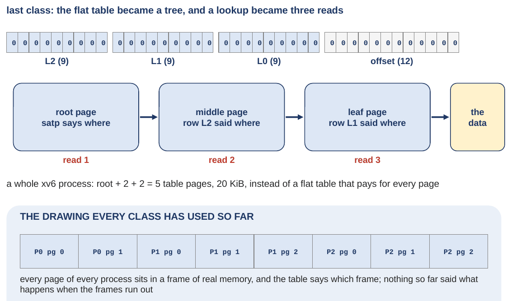{width=90%}
<figcaption markdown="1">Figure 55. Where the first class left the story: the address cut 9 + 9 + 9 + 12, the three pages a lookup reads, five table pages for a whole xv6 process, and the drawing every class has used so far. From slide 39.</figcaption>
</figure>

The top of the drawing is the first class in one picture. The flat table became a tree. An address is cut into three slices of 9 bits plus a 12-bit offset, each slice picks one row in one page of the tree, so a lookup costs three reads before the data: root page, middle page, leaf page. [Section 3.6](class-1.md#sec-3-6) read those three entries in the QEMU monitor, word by word, and a whole xv6 process needed only 5 table pages ([Section 3.7](class-1.md#sec-3-7)). The bottom of the drawing is the one every class has used so far. Every page of every process sits in a frame of real memory (in the drawing, "P0 pg 0" is process 0's page 0, and so on for P1 and P2), and the table says which frame.

Figure 56 is the two cards beside it.

<figure markdown="1">
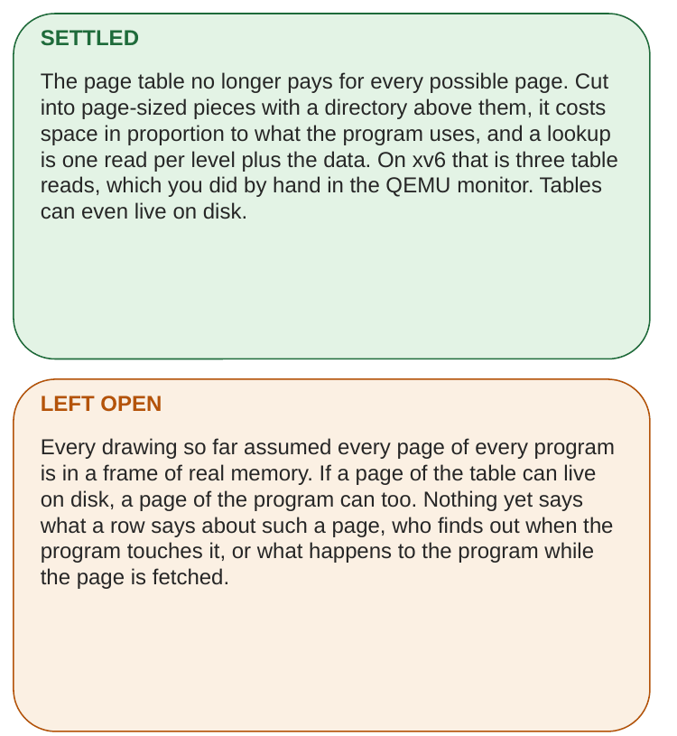{width=60%}
<figcaption markdown="1">Figure 56. What the first class settled, and what it left open. From slide 39.</figcaption>
</figure>

Settled: the page table no longer pays for every possible page. Cut into page-sized pieces with a directory above them, it costs space in proportion to what the program uses, and a lookup is one read per level plus the data. Tables can even live on disk ([Extra 5](class-1.md#extra-5)). Left open: every drawing so far assumed every page of every program is in a frame of real memory. If a page of the table can live on disk, a page of the program can too. Nothing yet says what a row says about such a page, who finds out when the program touches it, or what happens to the program while the page is fetched. That is the whole of the second class.

So the second class asks three questions, and again each one is opened by the answer to the one before it. What happens when a program's pages do not all fit in memory (Sections [4.1](#sec-4-1) to [4.7](#sec-4-7))? When a page must go, which one (Sections [5.1](#sec-5-1) to [5.8](#sec-5-8))? What if the pages in use never fit (Sections [6.1](#sec-6-1) and [6.2](#sec-6-2))? the week summary collects the answers for the whole week, and Extras [6](#extra-6) to [11](#extra-11) go deeper. The answer to the first question, said now so you can judge it as it is built: one more bit in the row, one exception, and one handler in the OS.

## Chapter 4. Swap space, the present bit and the page fault {#chapter-4}

*The question this chapter answers: What happens when a program's pages do not all fit in memory?*

### 4.1 <span class="lbl lbl-problem">Problem</span> Running out of physical memory: swap space {#sec-4-1 data-toc-label="4.1 [Problem] Running out of physical memory: swap space"}

Here is the first problem of the second class, stated the deck's way. Figure 57 is the problem slide.

<figure markdown="1">
{width=99%}
<figcaption markdown="1">Figure 57. The first problem of the second class: pages in frames with the table pointing at them, the Ubuntu machine whose programs want more pages than it has frames, and the crux of chapter 21. Left and middle columns, what we have and where it breaks. From slide 41.</figcaption>
</figure>

<figure markdown="1">
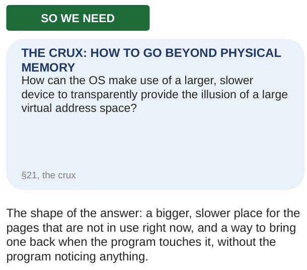{width=49%}
<figcaption markdown="1">Figure 58. The right column of the same slide: so what we need. From slide 41.</figcaption>
</figure>

What we have is the left column: every valid page of every program sits in a frame, and its row in the page table names the frame. Eight frames, eight pages, full, and every program still running. The first class gave the table a shape that stays small; the pages themselves still each take a frame.

Where it breaks is the middle column, and it is a measurement, not a drawing. The Ubuntu 24.04 x86-64 machine behind this guide's captures reports MemTotal 8,224,868 kB, about 7.8 GiB (Linux's spelling kB means 1024 bytes, so 8,224,868 ÷ 1024 ÷ 1024 ≈ 7.84 GiB; read it from the figure's bar). Eight programs that each touch 1 GiB of pages want 8 GiB of frames, more than exist. Memory is a fixed number of frames, and the programs together can want more. The frames fill, and the next page has nowhere to go. The assumption "every page is in memory" was never true of a real machine; it was a simplification the course has been drawing for three weeks.

So what we need is the right column, and the textbook states it as the crux of chapter 21. The crux asks how the OS can use a larger, slower device to transparently provide the illusion of a large virtual address space. The key words are larger, slower and transparently. A **disk** (a hard drive, or an SSD, a solid-state drive, the chip-based kind) holds far more than memory but is far slower to reach. And the program must never find out that any of this is happening; that is what transparently means.

Why want it at all: convenience. With a large address space you write the program naturally and ask for memory as you need it. The alternative was **memory overlays**. Before virtual memory, programmers moved pieces of their own code and data in and out of memory by hand before every use. The textbook's verdict on that is one word, "Yuck!"

The shape of the answer, before the answer: a bigger, slower place for the pages that are not in use right now. And a way to bring one back when the program touches it, without the program noticing anything. The first part of that is a place, and Figure 59 is the deck's slide for it.

<figure markdown="1">
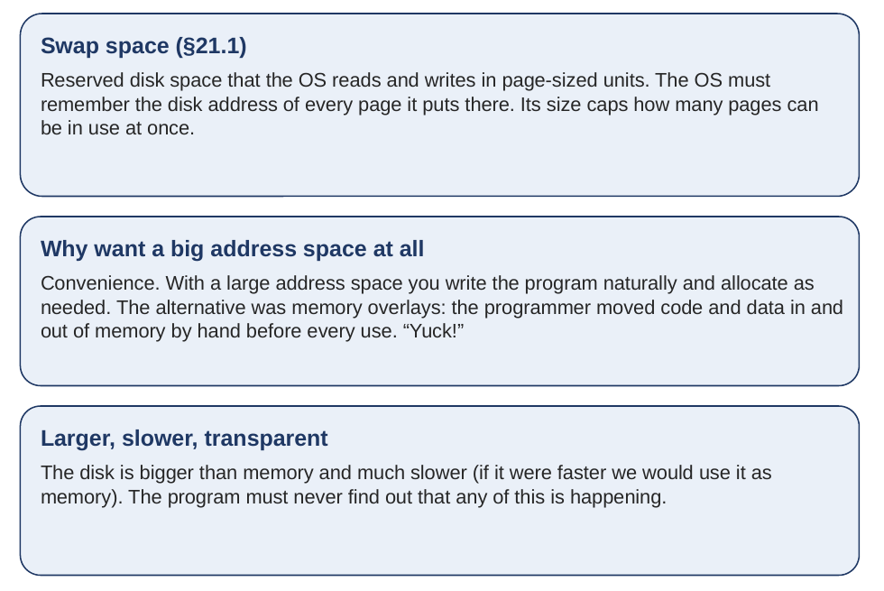{width=78%}
<figcaption markdown="1">Figure 59. Swap space (disk space set aside for pages; the text below defines it), why anyone wants a big address space at all, and the three words of the crux: larger, slower, transparent. From slide 42, following textbook section 21.1.</figcaption>
</figure>

**Swap space** is reserved disk space that the OS reads and writes in page-sized units. The OS must remember the disk address of every page it puts there. Its size, added to the number of frames, caps how many pages can be in use at once (a machine with no swap, like the cloud machine of [Extra 6](#extra-6), can still use as many pages as it has frames). Figure 60 is the textbook's Figure 21.1.

<figure markdown="1">
{width=70%}
<figcaption markdown="1">Figure 60. The textbook's Figure 21.1: four frames of physical memory (PFN 0 to 3, the top row) and eight blocks of swap space, with the pages of four processes spread between them. From slide 42, following textbook section 21.1; the slide's own caption line, which the crop leaves out, reads "Figure 21.1: Physical Memory and Swap Space".</figcaption>
</figure>

Read the figure. In it, "Proc 0" means process 0, and "[VPN 1]" means that process's virtual page 1. Physical memory has four frames, PFN 0 to 3, holding process 0's page 0, process 1's pages 2 and 3, and process 2's page 0. Swap space has eight **blocks** (the disk's word for a page-sized slot), holding the rest of those processes' pages, plus both pages of process 3. Process 3 is entirely on disk, so it cannot be running. Block 2 is free.

Every page of every process is now in exactly one place: a frame, or a swap block. The page table has to say which, and that is the next problem.

### 4.2 <span class="lbl lbl-problem">Problem</span> A page on disk needs a mark: the present bit {#sec-4-2 data-toc-label="4.2 [Problem] A page on disk needs a mark: the present bit"}

A page that moved to disk leaves a row behind, and the row must not lie. That is the problem the present bit solves, and Figure 61 is the deck's statement of it.

<figure markdown="1">
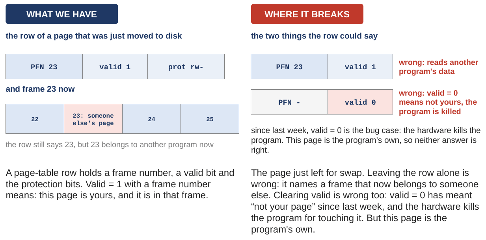{width=99%}
<figcaption markdown="1">Figure 61. The problem the present bit solves: the row of a page that was just moved to disk, the two things the row could say and why both are wrong, and what the row needs instead. Left and middle columns, what we have and where it breaks. From slide 43.</figcaption>
</figure>

<figure markdown="1">
{width=51%}
<figcaption markdown="1">Figure 62. The right column of the same slide: so what we need. From slide 43.</figcaption>
</figure>

What we have is on the left: the row of a page that was just moved to disk. It still says PFN 23, valid 1, rw-, and frame 23 now belongs to someone else's page. Where it breaks is in the middle. Leaving the row alone is wrong: a program that touches the page reads another program's data. Clearing the valid bit is wrong too: valid = 0 has meant "not your page" since the paging week. Touching it makes the hardware trap (stop the program and hand control to the OS; [Section 4.3](#sec-4-3) uses the word) and the OS kill the program. Address B of [Section 2.5](class-1.md#sec-2-5) was exactly that case. But this page is the program's own. So the row needs a way to say "yours, but not here right now", and touching such a page must not kill the access. The hardware alone cannot finish it, because the data is on a disk the hardware knows nothing about. The deck put one question to the room here: what should the hardware do when it meets such a row? The answer is one new bit and one hand-off, and the rest of this part is that answer.

The page table records where a page is with one new bit. Figure 63 shows it beside the bits you know.

<figure markdown="1">
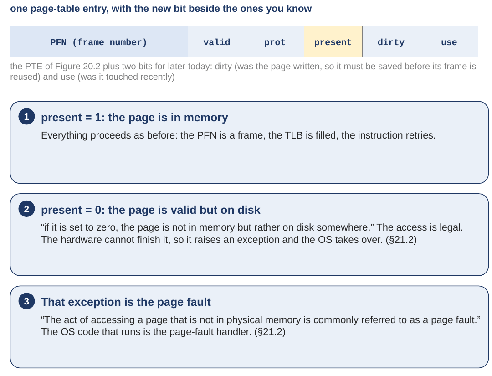{width=86%}
<figcaption markdown="1">Figure 63. One page-table entry with the present bit highlighted, and the three cases: present, valid but on disk, and the exception that the second case raises. From slide 44, following textbook section 21.2.</figcaption>
</figure>

The entry is the one from the textbook's Figure 20.2 ([Section 1.1](class-1.md#sec-1-1)) with one column added: a frame number, the valid bit, the protection bits, the **present bit** (now highlighted), the dirty bit, and a new bit, use. (The hardware sets use when the page is touched; [Section 5.6](#sec-5-6) uses it.) Dirty and use are the two that Sections [5.6](#sec-5-6) and [5.7](#sec-5-7) need. Present = 1 means the page is in memory: everything proceeds as before, the PFN is a frame, the TLB is filled, the instruction retries. Present = 0 means the page is valid but on disk. The access is legal. The hardware cannot finish it, because the data is not in any frame, so it raises an exception and the OS takes over.

That exception is the **page fault**: the act of accessing a page that is not in physical memory. (RISC-V uses the same words more broadly, for any load or store whose translation fails. That is why [Section 4.5](#sec-4-5)'s causes 13 and 15 are called page faults even when the page is merely not allowed; the handler sorts out which case it is.) The OS code that then runs is the **page-fault handler**.

Figure 64 has the textbook's aside on the name, and two cards.

<figure markdown="1">
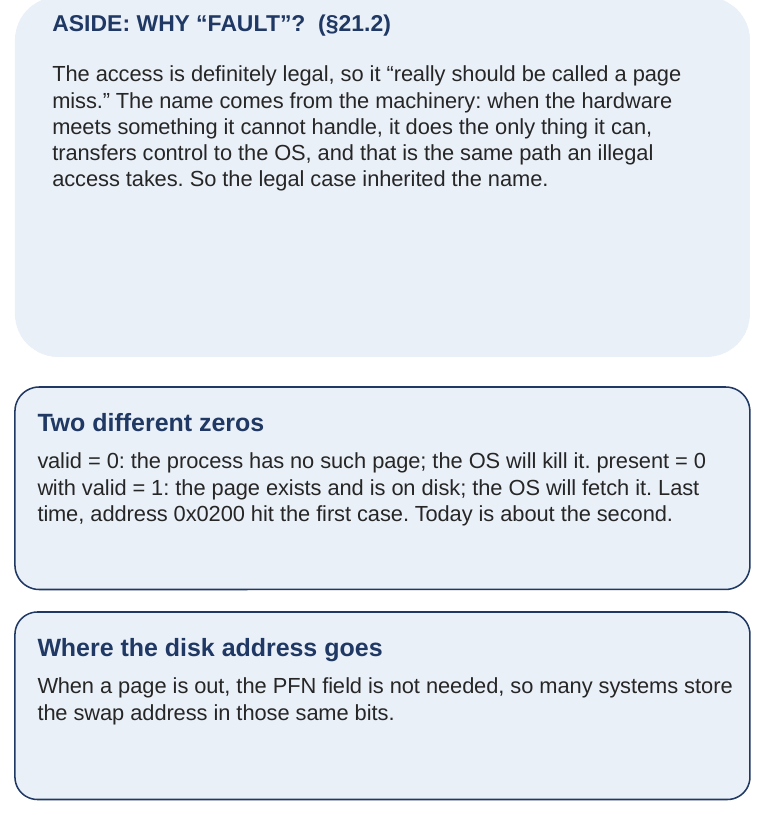{width=61%}
<figcaption markdown="1">Figure 64. Why the legal case is called a fault, the two different zeros, and where the disk address goes. From slide 44, following textbook section 21.2.</figcaption>
</figure>

Why "fault"? The access is definitely legal, so it really should be called a page miss. The name comes from the machinery: when the hardware meets something it cannot handle, it does the only thing it can, which is transfer control to the OS, and that is the same path an illegal access takes. So the legal case inherited the name.

Two different zeros, and keep them apart all week. Valid = 0: the process has no such page, and the OS will kill it; that is what address 0x0200 hit in [Section 2.5](class-1.md#sec-2-5). Present = 0 with valid = 1: the page exists and is on disk, and the OS will fetch it. The second class is about the second case.

Where the disk address goes: while a page is out, its PFN field is not needed, so many systems store the swap address in those same bits.

### 4.3 <span class="lbl lbl-concept">Concept</span> The page fault: what the hardware does {#sec-4-3 data-toc-label="4.3 [Concept] The page fault: what the hardware does"}

On the hardware side, the present bit adds one more branch to the lookup. Figure 65 is the textbook's Figure 21.2.

<figure markdown="1">
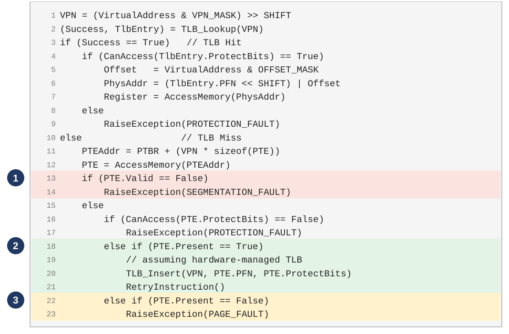{width=85%}
<figcaption markdown="1">Figure 65. The textbook's Figure 21.2, the hardware's control flow (the order in which it takes its steps) with a present bit, drawn for a linear table for brevity, with three callouts. From slide 45, following textbook section 21.5.</figcaption>
</figure>

The pseudocode is the one from [Extra 2](class-1.md#extra-2) with a linear table (one `AccessMemory` on the miss path, line 12) and one more outcome at the end. You do not need to follow every line; check the TLB, and on a miss read the entry, and then there are three possible outcomes. Figure 66 names them.

<figure markdown="1">
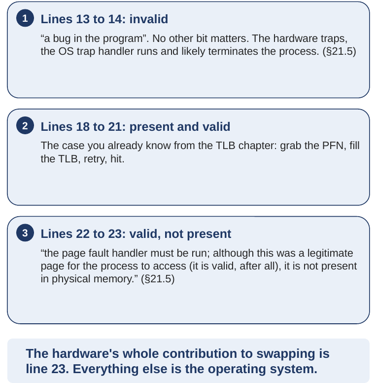{width=61%}
<figcaption markdown="1">Figure 66. The three outcomes of a TLB miss: invalid (lines 13 to 14), present and valid (18 to 21), valid but not present (22 to 23). From slide 45, following textbook section 21.5.</figcaption>
</figure>

Outcome 1, lines 13 and 14: the entry is invalid. The program touched memory it never had, which is a bug in the program. The hardware traps, the OS trap handler runs, and it most likely terminates the process. (A **trap** is the general word for the hardware handing control to the OS, whether for an exception or a system call.) That is what happened to the earlier class's bad-address program.

Outcome 2, lines 18 to 21: valid and present. The case you already know from the TLB chapter: grab the PFN, fill the TLB, retry, hit.

Outcome 3, lines 22 and 23: valid, not present. The page fault handler must be run; this was a legitimate page for the process to access, but it is not in physical memory. `RaiseException(PAGE_FAULT)`.

The hardware's whole contribution to swapping is line 23. Everything else is the operating system.

### 4.4 <span class="lbl lbl-concept">Concept</span> The page-fault handler: what the OS does {#sec-4-4 data-toc-label="4.4 [Concept] The page-fault handler: what the OS does"}

The kernel's side is the textbook's Figure 21.3. Figure 67 is all seven lines.

<figure markdown="1">
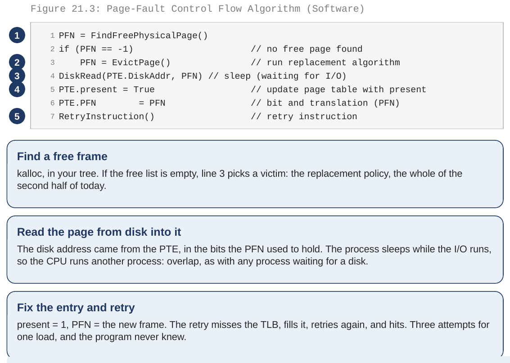{width=91%}
<figcaption markdown="1">Figure 67. The textbook's Figure 21.3, the software side of a page fault, with the three steps named. From slide 46, following textbook section 21.5.</figcaption>
</figure>

In plain words: find a free frame; if there is none, throw a page out to make one; read the missing page from disk into that frame; fix the entry; let the program try again.

Line 1, `FindFreePhysicalPage()`: in xv6 that is `kalloc`. Line 2 and 3: if no free frame (`PFN == -1` is the figure's way of saying "none"), `EvictPage()` picks a victim. To **evict** a page is to write it out to disk, or just drop it if the disk already has a copy, so that its frame can be reused. Which page to evict is the **replacement policy**, and it is the whole of chapter 22, [Section 5.1](#sec-5-1) onward. Line 4, `DiskRead(PTE.DiskAddr, PFN)`: the disk address came from the PTE, in the bits the PFN used to hold, and the page is read into the new frame. The disk is slow, so the process sleeps while the read runs, and the CPU runs another process meanwhile; that overlap is the same trick the course used for any process waiting on a device. Lines 5 and 6: `present = 1`, `PFN = the new frame`. Line 7: retry. The retry misses the TLB, fills it, retries again, and hits. Three attempts for one load, and the program never knew.

Figure 68 has the aside and the number.

<figure markdown="1">
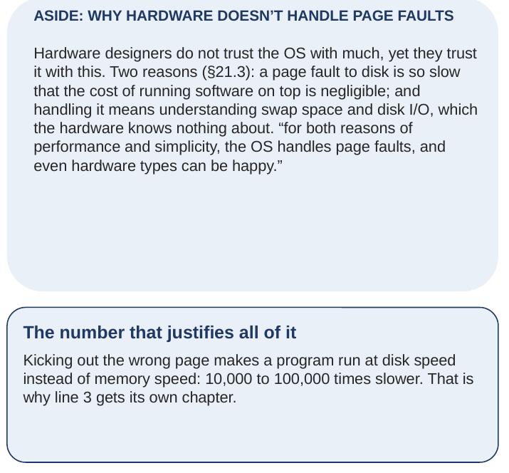{width=57%}
<figcaption markdown="1">Figure 68. Why hardware leaves page faults to software, and the number that justifies a whole chapter on eviction. From slide 46, following textbook sections 21.3 and 21.4.</figcaption>
</figure>

Hardware designers do not trust the OS with much, yet they trust it with this, for two reasons. A page fault to disk is so slow that the cost of running software on top of it is negligible. And handling it means understanding swap space and disk input and output, which the hardware knows nothing about. So for both performance and simplicity, the OS handles page faults.

The number: kicking out the wrong page makes a program run at disk speed instead of memory speed, and in current technology that is 10,000 to 100,000 times slower (the textbook's figure; [Section 5.1](#sec-5-1) does the arithmetic with 100 nanoseconds against 10 milliseconds). That is why line 3 gets its own chapter.

Blocked during the read, retried afterwards, and the process sees only its own private, contiguous memory. That is the transparency the crux asked for.

### 4.5 <span class="lbl lbl-problem">Problem</span> Lazy allocation: xv6's use of the page fault {#sec-4-5 data-toc-label="4.5 [Problem] Lazy allocation: xv6's use of the page fault"}

xv6 has no swap space, so it never reads a page from disk. But it has a problem of its own that the same page fault solves, and Figure 69 is the deck's statement of it.

<figure markdown="1">
{width=99%}
<figcaption markdown="1">Figure 69. The problem lazy allocation solves: xv6's sbrk builds every row at once, so asking for a gigabyte builds 262,144 rows up front, and the fix is to promise now and deliver on first touch. Left and middle columns, what we have and where it breaks. From slide 47.</figcaption>
</figure>

<figure markdown="1">
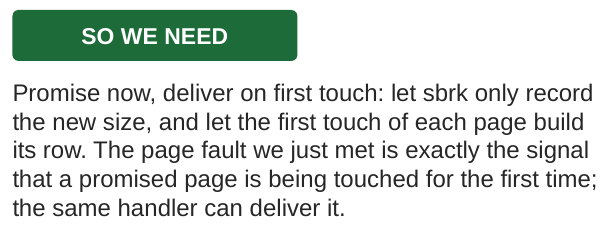{width=49%}
<figcaption markdown="1">Figure 70. The right column of the same slide: so what we need. From slide 47.</figcaption>
</figure>

What we have is on the left. In xv6, `sbrk(n)` is the call that grows a program's memory by n bytes ([Section 3.5](class-1.md#sec-3-5) used it: the library function `sbrk` makes the system call, and `sys_sbrk`, below, is the kernel's side of it). Today it allocates a frame and writes a row for every new page at once, before the program has touched any of them: `kalloc` and `mappages`, n ÷ 4096 times. Where it breaks is in the middle. Ask for 1 GiB and xv6 hands out 2^30 ÷ 2^12 = 2^18 = 262,144 frames and builds 262,144 rows up front, most of which the program may never use. The frames are gone from the free list (the kernel's list of frames not in use) the moment they are promised. Compare [Extra 4](class-1.md#extra-4): Linux charged 0 kB of table for reserving the same gigabyte, because it waits for the first touch. So what we need is on the right: promise now, deliver on first touch. Let `sbrk` only record the new size, and let the first touch of each page build its row. The page fault of [Section 4.2](#sec-4-2) is exactly the signal that a promised page is being touched for the first time, so the same handler can deliver it. That is lazy allocation, and Figure 71 is the two pieces of kernel code that make it happen.

<figure markdown="1">
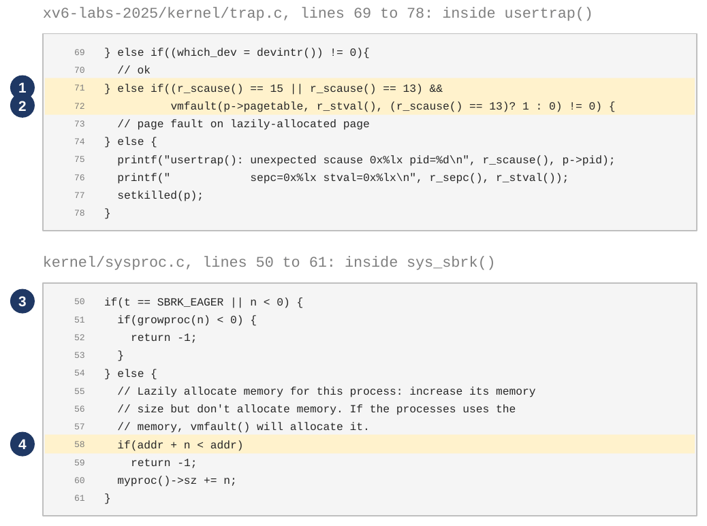{width=83%}
<figcaption markdown="1">Figure 71. The page-fault branch inside usertrap() (kernel/trap.c, lines 69 to 78) and the lazy branch of sys_sbrk() (kernel/sysproc.c, lines 50 to 61). From slide 48.</figcaption>
</figure>

Here is the story before the code. Until now, when a program touched memory it did not have, xv6 killed it. Now xv6 checks first whether that page was promised to the program. If it was, xv6 hands over a page right then, and the program carries on. It is like a restaurant taking your reservation: nothing is cooked until you actually walk in.

The top listing is inside `usertrap`, the kernel function that runs whenever a user program traps: a system call, an interrupt, or an exception. (An **interrupt** is a signal from a device such as a disk or a timer that makes the processor stop and run the kernel.) The `else if` chain asks, in order, what caused the trap. `devintr()` handles device interrupts, and `which_dev` records which kind of device it was. Callout 1, line 71, is the new test: `r_scause() == 15 || r_scause() == 13`. **scause** is the RISC-V register where the hardware records why it trapped, and `r_scause()` is xv6's small function for reading it (all the `r_` functions read a register). The RISC-V specification uses cause 13 for a load whose translation failed and 15 for a store whose translation failed; those are the two page faults. Callout 2, line 72, is the new call: `vmfault(p->pagetable, r_stval(), ...)`. `p` is the kernel's record for the current process, and `p->pagetable` is its page table (`->` reaches into a record through a pointer). **stval** is the register holding the address the program touched, the one that faulted. The third argument, hidden by the `...` in this quotation and visible on line 72 in Figure 71, is `(r_scause() == 13)? 1 : 0`, which reads "1 if the cause is 13, otherwise 0": 1 for a load and 0 for a store. The handler in the students' tree accepts that flag and does not use it; it is there for a later lab, where a store to a shared page needs different handling than a load. If `vmfault` can supply a page for that address, it returns something other than 0, the fault is absorbed, and the process resumes. Only if it cannot does the chain fall through to the `else`: print the cause, the pid, `sepc` (the register that saved the address of the instruction that trapped; `r_sepc()` reads it) and `stval`, and `setkilled(p)`, which marks the process to be killed. That last branch is where the earlier bad-address program went.

The bottom listing is inside `sys_sbrk`, the kernel side of the system call that the `sbrk` function of [Section 3.5](class-1.md#sec-3-5) makes. The system call takes two arguments, the byte count `n` and a mode `t`, and the library function supplies the mode, as the cards below show. Both modes exist in the students' tree. The eager path is the one every xv6 program used until now and still uses by default. The lazy path was added so you can see the alternative; the two differ only in when the frame arrives. `if(t == SBRK_EAGER || n < 0)`: in **eager** mode, or when shrinking, call `growproc(n)`, which allocates frames and maps them right now, the way every program so far worked. Otherwise, the **lazy** branch. `addr` is the old size, read at the top of the function (line 48, above the excerpt). Check that `addr + n` does not wrap around (`addr + n < addr` can only be true on overflow), then `myproc()->sz += n`: `myproc()` fetches the kernel's record for the current process, and `sz` is the field in it that says how big the process's address space is. Only that size number grows. No frame, no entry. The page is promised but not delivered. That is xv6's form of [Section 4.2](#sec-4-2)'s valid-but-absent state: xv6 has no present bit, so the promise lives in the size number `sz` and the entry stays empty until the first touch, and the check "is the address below `sz`" in [Section 4.6](#sec-4-6) plays the part that valid = 1 played in the textbook.

Figure 72 has the cards.

<figure markdown="1">
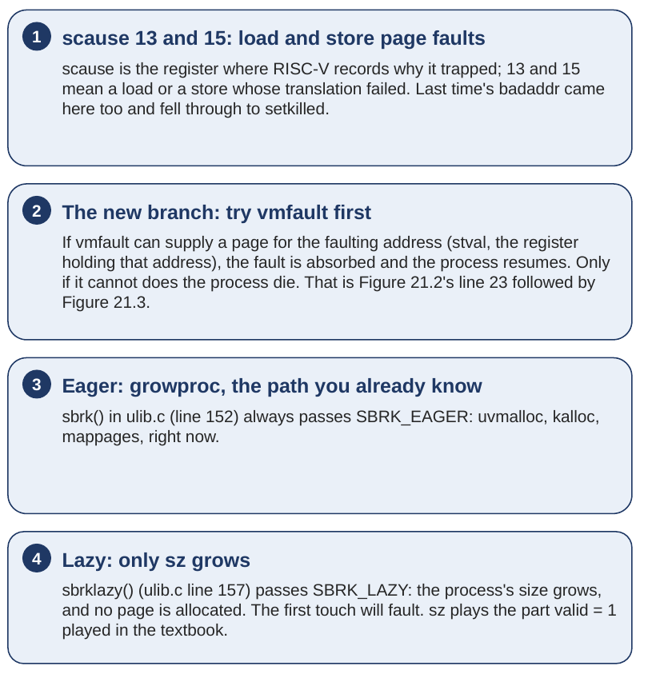{width=66%}
<figcaption markdown="1">Figure 72. scause 13 and 15, the new branch, and the two ways to grow the heap: eager through growproc, lazy through sz alone. From slide 48.</figcaption>
</figure>

The user library offers both. `sbrk()` in `user/ulib.c` (line 152) always passes `SBRK_EAGER`, so `uvmalloc` (the kernel function that grows a process's memory), `kalloc` and `mappages` run right away. `sbrklazy()` (line 157) passes `SBRK_LAZY`: the size grows, no page is allocated, and the first touch will fault.

### 4.6 <span class="lbl lbl-kernel">Real kernel</span> The xv6 page-fault handler: vmfault() {#sec-4-6 data-toc-label="4.6 [Real kernel] The xv6 page-fault handler: vmfault()"}

The xv6 handler is called `vmfault`, and it lines up with Figure 21.3 step by step. Figure 73 is all 26 lines.

<figure markdown="1">
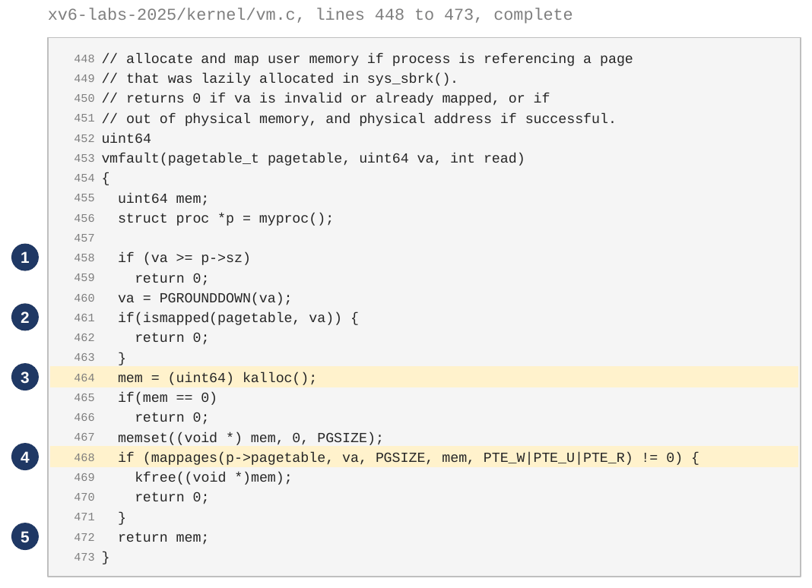{width=85%}
<figcaption markdown="1">Figure 73. vmfault() in kernel/vm.c, lines 448 to 473, complete. From slide 49.</figcaption>
</figure>

Here is what it does, in words. First it checks that the address is one the program was promised. If not, it refuses, and the program dies. Then it grabs a free frame, fills it with zeros, and writes an entry into the page table for it. That is all.

Line by line. Lines 448 to 451 are the comment. It says: allocate and map user memory if the process is referencing a page that was lazily allocated in `sys_sbrk`; return 0 if the address is invalid or already mapped or memory is out, and the physical address if successful. Line 453 declares the function: it takes a page table, a virtual address `va`, and the `read` flag, and returns a `uint64`. Line 456, `struct proc *p = myproc()`: `p` is the kernel's record for the current process (`myproc()` fetches it; `struct proc` is the type of that record). Lines 458 and 459, `if (va >= p->sz) return 0`: any address at or beyond the process's size was never promised, so refuse. Line 460, `va = PGROUNDDOWN(va)`: round the address down to the start of its page, because a row describes a whole page, so the frame must be mapped at the page's first byte, not at the byte the program happened to touch. `PGROUNDDOWN` is a macro in riscv.h, line 370, that clears the low 12 bits with `& ~(PGSIZE-1)`. The `~` flips every bit, so `~(4096 − 1)` is a mask with the low 12 bits clear and every other bit set. Lines 461 to 463, `if(ismapped(pagetable, va)) return 0`: if the page already has a valid entry, this fault was not a lazy page but a real error (a protection fault, say), so refuse. Lines 464 to 466, `mem = (uint64) kalloc()`: take a free frame; if `kalloc` returns 0 there is no memory, refuse. Line 467, `memset((void *) mem, 0, PGSIZE)`: fill the new frame with zeros (`(void *)` is a cast to "a pointer to anything"). Lines 468 to 471, `mappages(p->pagetable, va, PGSIZE, mem, PTE_W|PTE_U|PTE_R)`: write the entry, one page, at `va`, pointing at `mem`, with write, user and read permission; `mappages` calls `walk` with `alloc` = 1, so any missing piece of the tree is built along the way ([Section 3.3](class-1.md#sec-3-3), callout 4). If `mappages` fails, give the frame back with `kfree` and refuse. Line 472, `return mem`: success, the physical address.

Figure 74 sets the two side by side.

<figure markdown="1">
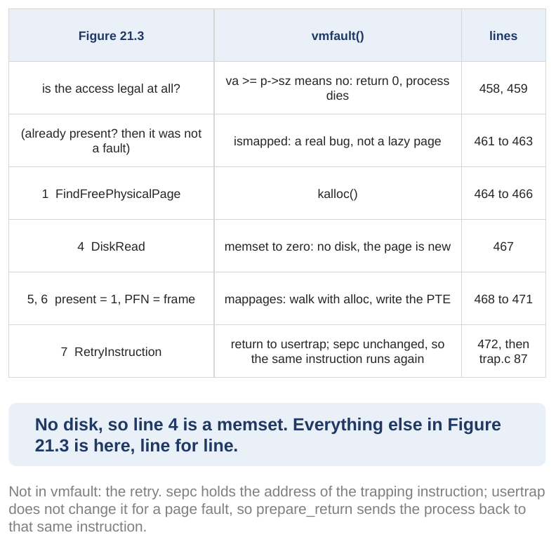{width=63%}
<figcaption markdown="1">Figure 74. Figure 21.3's seven lines matched to vmfault()'s lines, and where the retry actually happens. From slide 49.</figcaption>
</figure>

The table reads: is the access legal at all? `va >= p->sz` means no (lines 458, 459). Already present? Then it was not a fault (461 to 463). Line 1 of Figure 21.3, find a free page: `kalloc()` (464 to 466). Line 4, the disk read: a `memset` to zero, because there is no disk and the page is new. Lines 5 and 6, present = 1 and PFN = frame: `mappages`, which is `walk` with alloc plus the entry write (468 to 471). Line 7, retry: return to `usertrap` (472), and then `trap.c` line 87.

The retry is not in `vmfault`. sepc holds the address of the trapping instruction. `usertrap` does not change it for a page fault; it adds 4 only for a system call, so that the program continues after the `ecall` instruction. (`ecall` is the instruction a program uses to make a system call. Every RISC-V instruction is 4 bytes long, a design fact of the processor, so the next instruction is 4 bytes on.) So `prepare_return` sends the process back to that same instruction, which runs again and now finds the page. (`prepare_return` is at line 87 of the same file, below the excerpt in Figure 71; the `+= 4` for a system call is at line 62, above it.) No disk, so line 4 is a `memset`. Everything else in Figure 21.3 is here, line for line.

### 4.7 <span class="lbl lbl-machine">Real machine</span> Lazy allocation observed: three page faults and one segmentation fault {#sec-4-7 data-toc-label="4.7 [Real machine] Lazy allocation observed: three page faults and one segmentation fault"}

To see it happen, a program asked for three pages lazily and touched them one at a time. Figure 75 is the program and its console.

<figure markdown="1">
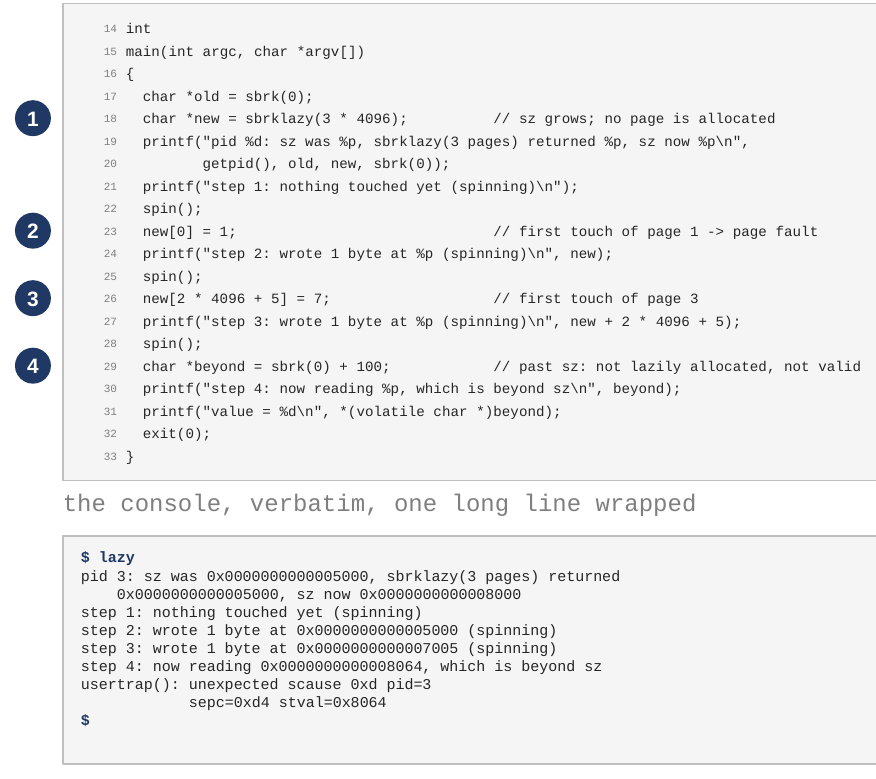{width=70%}
<figcaption markdown="1">Figure 75. user/lazy.c, lines 14 to 33 (spin() is a busy loop defined above them; the program was added for this run), and its console output, ending in the kill message. From slide 50.</figcaption>
</figure>

Here is what the program does; the full source is at the end of this part. It asks for three pages lazily with `sbrklazy(3 * 4096)` and prints the old size, what the call returned, and the new size. Step 1: it touches nothing and spins (the `spin()` function is the same three-billion-count loop as in pgdemo), so the page table can be read. Step 2: it writes one byte into the first new page, `new[0] = 1` (`new[0]` is the byte at the address `new`), prints, and spins. Step 3: it writes one byte into the third new page, `new[2 * 4096 + 5] = 7`, that is, 5 bytes into the page two pages up, and spins. Step 4: it reads a byte 100 bytes past the end of what it was promised, `sbrk(0) + 100`, with `*(volatile char *)beyond`, which means "the byte at that address, and really read it". After each step the machine was frozen and the page table printed with `info mem`.

The console says `pid 3: sz was 0x5000, sbrklazy(3 pages) returned 0x5000, sz now 0x8000`: the size grew by 0x3000, three pages, as in [Section 3.5](class-1.md#sec-3-5), and the call returned the old end, so `new` is 0x5000. Then steps 2 and 3 report the addresses written, 0x5000 and 0x7005 (0x5000 + 2 × 4096 + 5 = 0x5000 + 0x2000 + 5 = 0x7005). Step 4 reports the address it is about to read, 0x8064 (0x8000 + 100, and 100 is 0x64). Then the kernel's message: `usertrap(): unexpected scause 0xd pid=3`, `sepc=0xd4 stval=0x8064`, and the shell prompt is back, because the process was killed. 0xd is 13, the load page fault; stval is the faulting address; sepc is where in the program the load was.

Figure 76 is the page table at each step.

<figure markdown="1">
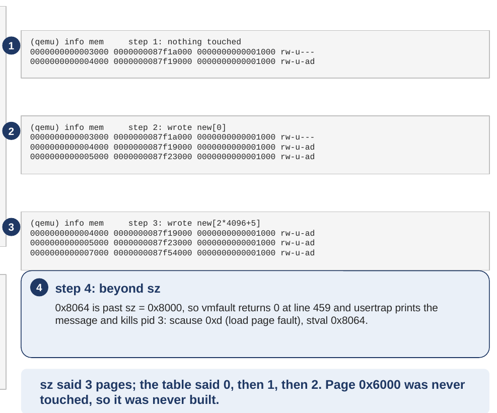{width=79%}
<figcaption markdown="1">Figure 76. info mem after step 1, step 2 and step 3 of the lazy run, and what happened at step 4. From slide 50.</figcaption>
</figure>

Step 1, nothing touched: the rows for the program's own pages stop at 0x4000 (the slide's three excerpts leave out the two kernel pages at the top of the table, which never change). The size says three new pages; the table shows none of them. Promised, not delivered. Step 2, after writing `new[0]`: a row for 0x5000 has appeared, paddr 0x87f23000, `rw-u-ad`. That write faulted, `vmfault` installed a frame, and the hardware set a and d, accessed and dirty, the moment the write happened. Step 3, after writing `new[2*4096+5]`: a row for 0x7000 has appeared, paddr 0x87f54000, `rw-u-ad`. The middle page, 0x6000, still does not exist, because nothing ever used it. Step 4: 0x8064 is past `sz` = 0x8000, so `vmfault` returns 0 at line 459, `usertrap` prints the message and kills pid 3.

The size said three pages; the table said 0, then 1, then 2. Pages appear only when they are used.

??? note "The program behind Figures 75 and 76 (you can skip this listing)"

    `static void spin(void)` defines the busy loop once so the main program can call it three times; `getpid()`, `printf`, `%p` and `%d` are as in [Section 3.5](class-1.md#sec-3-5).
    
    ```c
    #include "kernel/types.h"
    #include "user/user.h"
    
    // Lazy-allocation demo: ask for three pages lazily, then touch them one at a time.
    // Between steps the program spins for a few seconds in user mode, so the
    // process's own page table can be read from the QEMU monitor (info mem).
    static void
    spin(void)
    {
      for(volatile long i = 0; i < 3000000000L; i++)
        ;
    }
    
    int
    main(int argc, char *argv[])
    {
      char *old = sbrk(0);
      char *new = sbrklazy(3 * 4096);          // sz grows; no page is allocated
      printf("pid %d: sz was %p, sbrklazy(3 pages) returned %p, sz now %p\n",
             getpid(), old, new, sbrk(0));
      printf("step 1: nothing touched yet (spinning)\n");
      spin();
      new[0] = 1;                              // first touch of page 1 -> page fault
      printf("step 2: wrote 1 byte at %p (spinning)\n", new);
      spin();
      new[2 * 4096 + 5] = 7;                   // first touch of page 3
      printf("step 3: wrote 1 byte at %p (spinning)\n", new + 2 * 4096 + 5);
      spin();
      char *beyond = sbrk(0) + 100;            // past sz: not lazily allocated, not valid
      printf("step 4: now reading %p, which is beyond sz\n", beyond);
      printf("value = %d\n", *(volatile char *)beyond);
      exit(0);
    }
    ```
    
    To run it under xv6 on QEMU: copy the file into the `user/` folder of your xv6 tree, and add the line `$U/_lazy\` to the `UPROGS` list in the `Makefile`. (The `Makefile` is the file that says how xv6 is built. `UPROGS` is its list of user programs, and `$U/_lazy\` is the form each entry takes.) Then run `make qemu CPUS=1`, which builds xv6 and starts it under QEMU with one CPU, and type `lazy` at the xv6 prompt. To see the page table between steps, press Ctrl-a then c to reach the QEMU monitor, type `info mem`, and press Ctrl-a c again to return. Your frame numbers will match the ones here if your kernel is the same build; the pattern (none, then one, then two rows, then the kill) will match regardless.
    
    That answers the first question of the second class. Figure 77 is its checkpoint.
    
    <figure markdown="1">
    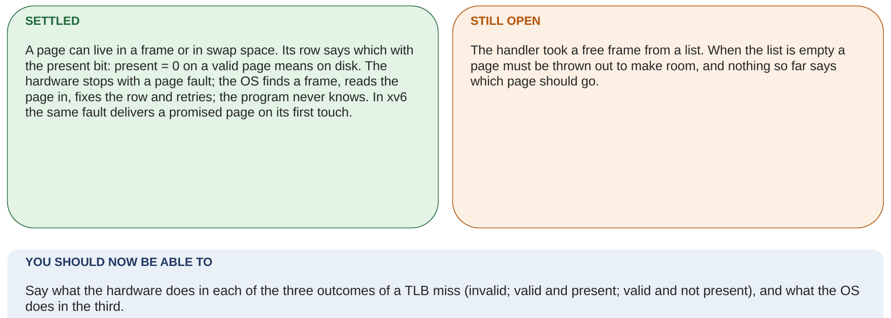{width=100%}
    <figcaption markdown="1">Figure 77. Checkpoint 1 of the second class: settled, still open, and what you should now be able to do. From slide 51.</figcaption>
    </figure>
    
    Settled: a page is in a frame or on disk, and one bit says which. If it is away, the hardware stops, the kernel fetches it, and the program carries on without knowing. Xv6 uses the same stop to deliver promised pages. Still open: the handler helped itself to a free frame, and when no frame is free something has to be thrown out, and nothing has said what. You should now be able to name the three outcomes of a TLB miss (invalid, valid and present, valid and not present) and say what the kernel does in the third.
    
## Chapter 5. Page replacement policies {#chapter-5}

*The question this chapter answers: When a page must go, which one?*

### 5.1 <span class="lbl lbl-problem">Problem</span> Memory as a cache: the replacement policy and the cost of a miss {#sec-5-1 data-toc-label="5.1 [Problem] Memory as a cache: the replacement policy and the cost of a miss"}

The handler of [Section 4.4](#sec-4-4) took a free frame from a list. When the list is empty a page must go, and which page is the second question of the class. Figure 78 is the deck's problem slide for it.

<figure markdown="1">
{width=99%}
<figcaption markdown="1">Figure 78. The second problem of the second class: the free list the handler relies on, the cost of a wrong choice in numbers (the average-access-time table of section 22.1), and the crux of chapter 22. Left and middle columns, what we have and where it breaks. From slide 52.</figcaption>
</figure>

<figure markdown="1">
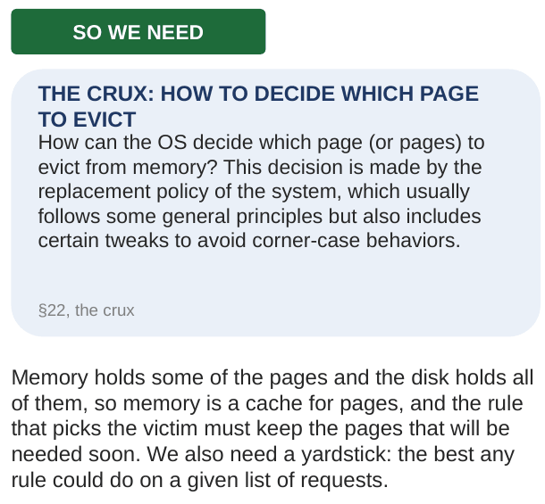{width=49%}
<figcaption markdown="1">Figure 79. The right column of the same slide: so what we need. From slide 52.</figcaption>
</figure>

What we have is on the left: a list of free frames, and a page-fault handler that takes the first one, reads the page in, and retries. As long as the list is not empty, no choice is needed. Where it breaks is in the middle: when the list is empty a page must go, and if the evicted page is the next one needed, the next access waits for the disk: 10 milliseconds instead of 100 nanoseconds. (A millisecond is a thousandth of a second and a nanosecond a billionth; the table writes them ms and ns.) The table in the middle column prices that, and the next paragraphs read it. So what we need is on the right, and the textbook states it as the crux of chapter 22: how can the OS decide which page to evict? Memory holds some of the pages and the disk holds all of them, so memory is a cache for pages, and the rule that picks the victim must keep the pages that will be needed soon. We also need a yardstick: the best any rule could do on a given list of requests.

The rule that makes the choice is the **replacement policy**. The frame: main memory holds some subset of all the pages in the system, and the disk holds all of them, so memory is a cache for pages, in exactly the sense of the first class's opening section's TLB. A **hit** is a reference to a page that is in memory; a **miss** is a reference to one that is not, and costs a fetch from disk. The goal of the policy is to minimize misses, or equally, to maximize hits.

Two kinds of miss come up today. A **compulsory miss** (or cold-start miss) is the first touch of a page; it is unavoidable, because nothing has been loaded yet. A **capacity miss** happens because the cache ran out of room, evicted something, and that something came back. Policies fight the second kind.

Now the middle column, the cost of a miss in numbers. **AMAT** is the average memory access time: AMAT = T_M + (P_Miss × T_D). T_M is the cost of one memory access, T_D the cost of one disk access, and P_Miss the probability of a miss (0.1 for a 10% miss rate). You always pay the memory cost; on a miss you also pay the disk cost. The textbook's numbers are T_M = 100 nanoseconds and T_D = 10 milliseconds (round numbers, chosen by the book; a nanosecond is a billionth of a second, a microsecond a millionth, a millisecond a thousandth, so 10 ms = 10,000 µs = 10,000,000 ns).

Row 1, a 90% hit rate: P_Miss = 0.1, and 0.1 × 10 ms = 1 ms; add 100 ns and you get 1.0001 ms, about 1 ms. Row 2, 99.9%: P_Miss = 0.001, and 0.001 × 10 ms = 0.01 ms = 10 µs; add 100 ns (0.1 µs) and you get 10.1 µs. Row 3, 100%: just 100 ns. Going from a 10% miss rate to a 0.1% miss rate makes the average access about 100 times faster (1 ms ÷ 10.1 µs = 1000 ÷ 10.1 ≈ 99). The cost of disk access is so high that even a tiny miss rate dominates the average. This is also where [Section 4.4](#sec-4-4)'s "10,000 to 100,000 times slower" comes from: one disk access against one memory access is 10 ms ÷ 100 ns = 10,000,000 ns ÷ 100 ns = 100,000, and a faster disk at 1 ms gives 1,000,000 ns ÷ 100 ns = 10,000.

The example in the textbook's section 22.1: ten references, one miss (page 3 is out), a 90% hit rate. That one miss costs 10 ms; the nine hits together cost 9 × 100 ns = 900 ns. 10 ms ÷ 900 ns = 10,000,000 ÷ 900 ≈ 11,111: the one miss costs more than ten thousand times what the other nine cost put together.

### 5.2 <span class="lbl lbl-concept">Concept</span> The optimal replacement policy {#sec-5-2 data-toc-label="5.2 [Concept] The optimal replacement policy"}

The best possible policy is a useful yardstick, even though no real system can use it. Figure 80 is its trace on the stream every policy today runs on.

<figure markdown="1">
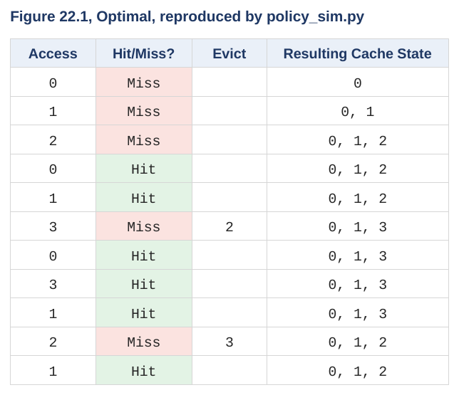{width=52%}
<figcaption markdown="1">Figure 80. The textbook's Figure 22.1: the optimal policy on the reference stream 0, 1, 2, 0, 1, 3, 0, 3, 1, 2, 1 with a cache of three pages. From slide 53, following textbook section 22.2.</figcaption>
</figure>

The slide's note "reproduced by policy_sim.py" names the small simulator program in the course's demo folder that recomputed every table and chart in this chapter; you do not need it. A **reference stream** is the list of pages a program touches, in order. The stream is 0, 1, 2, 0, 1, 3, 0, 3, 1, 2, 1, eleven references to four distinct pages, and the cache holds 3 pages. Every policy today runs on this same stream with this same cache, so the comparisons are fair. The table's columns: the page accessed, hit or miss, which page was evicted (if any), and the cache's contents afterwards.

The rule of the **optimal** policy: on a miss with a full cache, evict the page that will be accessed furthest in the future, because you will refer to every other page before it. Belady published it in 1966 and called it MIN.

Read the trace. References 1 to 3 (pages 0, 1, 2) are three compulsory misses, and they fill the cache: 0; 0, 1; 0, 1, 2. References 4 and 5 (0, 1) hit. Reference 6 (page 3) is the fourth compulsory miss, the first touch of page 3, and this time the cache is full. Look ahead in the stream: 0 is needed next (reference 7), 1 after that (reference 9), and 2 not until reference 10. So 2 is needed furthest out and 2 goes: 0, 1, 3. References 7, 8, 9 (0, 3, 1) all hit. Reference 10 (page 2) misses; look ahead: only reference 11 remains, and it is page 1, so 0 and 3 are both never needed again; the figure evicts 3: 0, 1, 2. Reference 11 (page 1) hits.

Count: hits at references 4, 5, 7, 8, 9 and 11, six hits; misses at 1, 2, 3, 6 and 10, five misses. Check: 6 + 5 = 11. The hit rate is 6 ÷ 11 = 54.5%. The textbook also counts the hit rate "modulo compulsory misses": ignore the first miss to each of the four distinct pages, since no policy can avoid those, and 11 − 4 = 7 references remain, of which 6 hit: 6 ÷ 7 = 85.7%. That is the figure the slide quotes. The two misses left, references 6 and 10, are the price of a 3-page cache on this stream: even optimal pays them, because at reference 6 some page has to go and at reference 10 the page that went is wanted again. Figure 81 has the rule and the verdict.

<figure markdown="1">
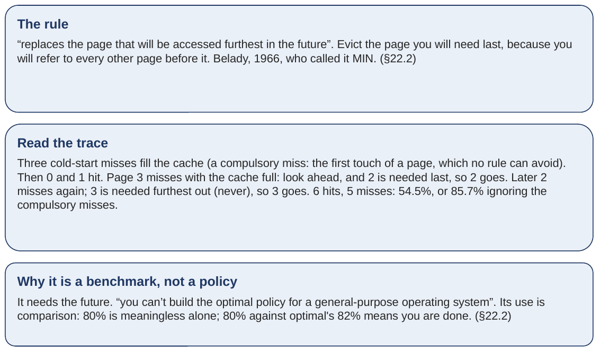{width=92%}
<figcaption markdown="1">Figure 81. The rule of optimal, how to read the trace, and why it is a benchmark rather than a policy. From slide 53, following textbook section 22.2.</figcaption>
</figure>

Why it is a benchmark and not a policy: it needs the future, and no general-purpose operating system knows the future. Its use is comparison. Saying a policy gets 80% is meaningless alone; saying it gets 80% where optimal gets 82% means you are done. Every policy that follows is measured against this line. Nothing can beat 6 hits on this stream.

### 5.3 <span class="lbl lbl-concept">Concept</span> FIFO replacement {#sec-5-3 data-toc-label="5.3 [Concept] FIFO replacement"}

The simplest policy anyone could build is FIFO. Figure 82 is its trace.

<figure markdown="1">
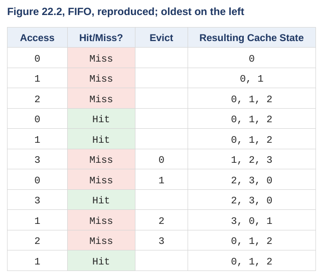{width=52%}
<figcaption markdown="1">Figure 82. The textbook's Figure 22.2: FIFO on the same stream, oldest page on the left. From slide 54, following textbook section 22.3.</figcaption>
</figure>

**FIFO** stands for first in, first out. Pages go into a **queue** (a line, like a checkout line) when they arrive; when a page must go, evict the one that has been in the line longest. In the table, the cache state is written oldest on the left, so the leftmost page is always the next victim. FIFO has one great strength: it is quite simple to implement, because the line only changes on a miss.

Read the trace. The same three misses fill the cache, 0, 1, 2, and the same two hits follow (references 4 and 5). Reference 6 (page 3) misses; the first-in page is 0, so 0 goes: 1, 2, 3. The very next reference (7) is page 0: a miss, and now 1 goes: 2, 3, 0. Reference 8 (page 3) hits. Reference 9 (page 1) misses, 2 goes: 3, 0, 1. Reference 10 (page 2) misses, 3 goes: 0, 1, 2. Reference 11 (page 1) hits.

Count: hits at references 4, 5, 8 and 11, four hits; misses at 1, 2, 3, 6, 7, 9 and 10, seven. Check: 4 + 7 = 11. The hit rate is 4 ÷ 11 = 36.4%, or 4 ÷ 7 = 57.1% modulo the four compulsory misses (11 − 4 = 7). Figure 83 has the rule and the verdict.

<figure markdown="1">
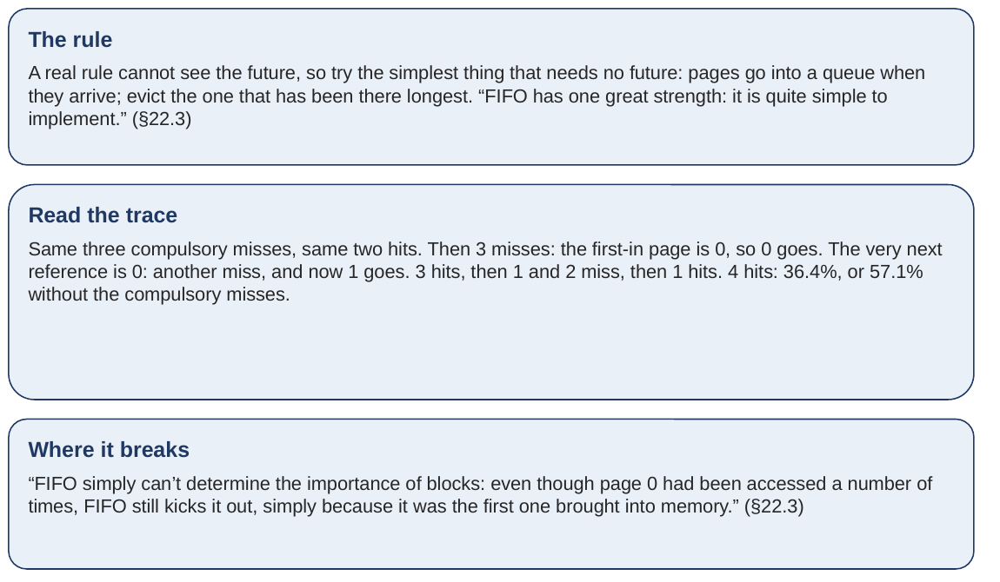{width=92%}
<figcaption markdown="1">Figure 83. FIFO's rule, the trace read, and what it cannot see. From slide 54, following textbook section 22.3.</figcaption>
</figure>

What FIFO cannot see is importance. Page 0 had been accessed a number of times, and FIFO still kicked it out, simply because it was the first one brought in. Optimal: 6 hits. FIFO: 4. The gap is the two evictions of pages that were about to be used.

### 5.4 <span class="lbl lbl-example">Worked example</span> Belady's anomaly {#sec-5-4 data-toc-label="5.4 [Worked example] Belady's anomaly"}

FIFO has one more surprise, strange enough to have a name, and the class found it by hand. Figure 84 is the question. It is exercise 4 at the end of this guide; do it now, before reading on, and write down what you expect before you compute.

<figure markdown="1">
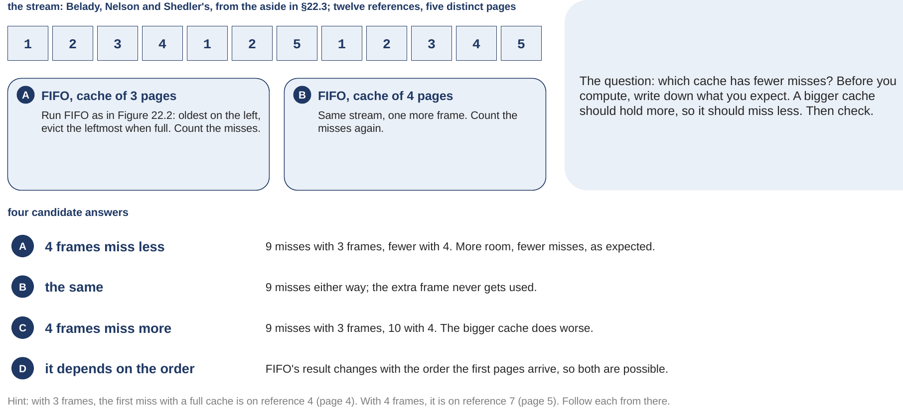{width=100%}
<figcaption markdown="1">Figure 84. The stream 1, 2, 3, 4, 1, 2, 5, 1, 2, 3, 4, 5, the two runs to do (FIFO with 3 frames and with 4), the four candidate outcomes the class voted on, and the hint. From slide 55, following the aside in textbook section 22.3.</figcaption>
</figure>

The stream comes from a 1969 paper by Belady, Nelson and Shedler: twelve references, five distinct pages. Run FIFO as in [Section 5.3](#sec-5-3), oldest on the left, evicting the leftmost when the cache is full, once with 3 frames (a **frame** here is one slot of the cache) and once with 4. Count the misses each time. A bigger cache should hold more, so it should miss less. Then check.

The four candidate outcomes under the question are: 4 frames miss less; the same; 4 frames miss more; it depends on the order. A hint for checking your work: with 3 frames, the first miss with a full cache is on reference 4 (page 4), because the cache is full after three references; with 4 frames, it is on reference 7 (page 5).

Once you have your two counts, here is the result. With 3 frames: 3 hits, 9 misses. With 4 frames: 2 hits, 10 misses. The bigger cache does worse. This is **Belady's anomaly**: with FIFO, giving the cache more room can make it miss more often. Both traces are worked one request at a time in the answers section, with the deck's answer drawing. The reason, in one sentence: after reference 7 with 4 frames, the cache holds 2, 3, 4, 5 in that order, and the stream then asks for 1, 2, 3, 4, 5 in turn. Each request misses and evicts the oldest page, which is exactly the page the next request will ask for. Every page is thrown out one step before it is needed.

Why LRU (least recently used, the policy of [Section 5.5](#sec-5-5)) never does this: it has the **stack property**. For LRU, a cache of size N + 1 always contains everything a cache of size N would, because the N most recently used pages are inside the N + 1 most recently used. So more frames can only add hits. FIFO and Random (the policy that evicts a page chosen at random; [Extra 9](#extra-9) measures it) have no such property.

### 5.5 <span class="lbl lbl-concept">Concept</span> LRU replacement, and locality {#sec-5-5 data-toc-label="5.5 [Concept] LRU replacement, and locality"}

FIFO and Random both ignore history. The next policy uses the one thing a running program leaves behind: its past. Figure 85 is its trace.

<figure markdown="1">
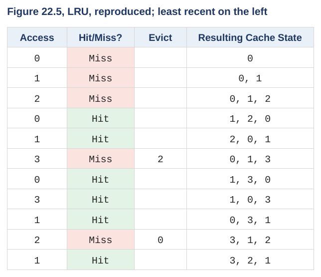{width=52%}
<figcaption markdown="1">Figure 85. The textbook's Figure 22.5: LRU on the same stream, least recently used page on the left. From slide 57, following textbook section 22.5.</figcaption>
</figure>

**LRU** stands for least recently used: evict the page that has gone the longest without being used. In the table the cache state is written least recent on the left, and a hit moves the page to the right end, because it just became the most recent. That is the difference from FIFO's table, where a hit changed nothing.

Read the trace. The three compulsory misses fill the cache: 0, 1, 2. Reference 4 (page 0) hits, and 0 moves to the right: 1, 2, 0. Reference 5 (page 1) hits: 2, 0, 1. Reference 6 (page 3) misses; 0 and 1 were used more recently than 2, so 2 goes: 0, 1, 3. Reference 7 (page 0) hits: 1, 3, 0. Reference 8 (page 3) hits: 1, 0, 3. Reference 9 (page 1) hits: 0, 3, 1. Reference 10 (page 2) misses; 1 and 3 were used more recently than 0, so 0 goes: 3, 1, 2. Reference 11 (page 1) hits: 3, 2, 1.

Count: hits at references 4, 5, 7, 8, 9 and 11, six; misses at 1, 2, 3, 6 and 10, five. Six hits: LRU matches optimal on this stream. Both times the evicted page was not needed next, and the following references hit. To be fair, the stream was chosen to make LRU look good, and the textbook's footnote admits it: "OK, we cooked the results." Figure 86 has the rule, the principle and the family.

<figure markdown="1">
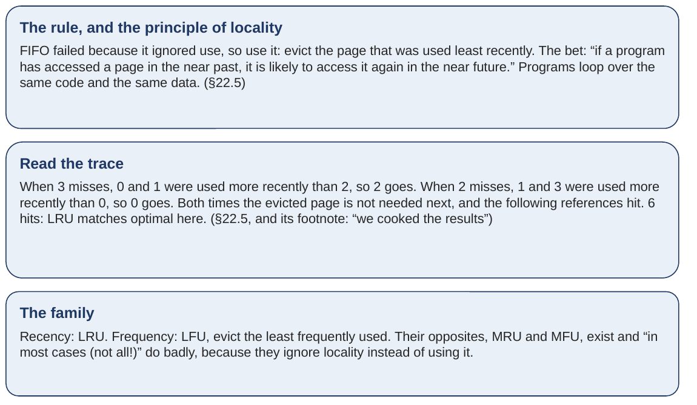{width=92%}
<figcaption markdown="1">Figure 86. LRU's rule and the principle of locality, the trace read, and the family of history-based policies. From slide 57, following textbook section 22.5.</figcaption>
</figure>

The bet behind LRU is the **principle of locality**: if a program has accessed a page in the near past, it is likely to access it again in the near future. The reason is that programs loop over the same code and the same data. Locality comes in two kinds. **Spatial locality**: page P now, so P + 1 or P − 1 soon. **Temporal locality**: page P now, so P again soon. LRU bets on the second.

The family. Recency gives LRU. Frequency gives **LFU**, least frequently used, which evicts the page that has been used the fewest times. Their opposites, MRU and MFU (most recently and most frequently used), exist, and in most cases, not all, they do badly, because they work against locality instead of using it.

### 5.6 <span class="lbl lbl-problem">Problem</span> Approximating LRU: the use bit {#sec-5-6 data-toc-label="5.6 [Problem] Approximating LRU: the use bit"}

LRU is still the policy to aim for. But building it exactly costs too much, and that is the next problem. Figure 87 is the deck's statement of it.

<figure markdown="1">
{width=99%}
<figcaption markdown="1">Figure 87. The problem with perfect LRU: the list it must keep, what updating that list on every access costs (the numbers of section 22.7), and the crux of approximating it. Left and middle columns, what we have and where it breaks. From slide 58, following textbook sections 22.7 and 22.8.</figcaption>
</figure>

<figure markdown="1">
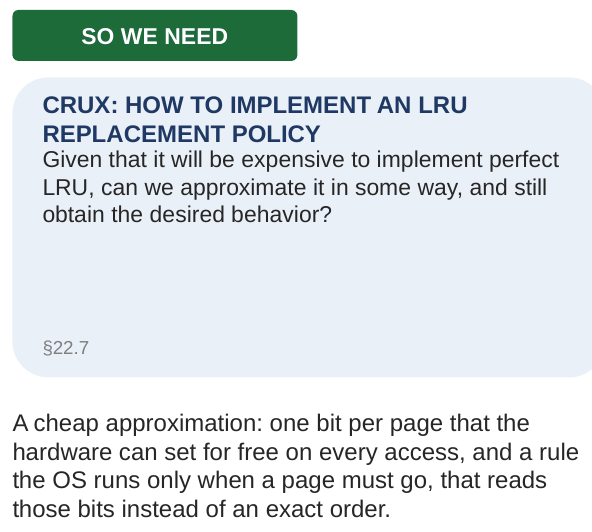{width=47%}
<figcaption markdown="1">Figure 88. The right column of the same slide: so what we need. From slide 58.</figcaption>
</figure>

What we have is on the left: LRU as a list ordered by last use, least recent at one end, most recent at the other, so the victim is always the page at the least-recent end. Where it breaks is in the middle, and it is the price of keeping that list exact. So what we need is on the right: a cheap approximation. One bit per page that the hardware can set for free on every access, and a rule the OS runs only when a page must go, which reads those bits instead of an exact order.

Perfect LRU has to move a page to the most-recent end of a list (the right end in [Section 5.5](#sec-5-5)'s tables) on every memory access: every instruction fetch (the processor reading its next instruction from memory), every load, every store. FIFO touches its list only on a miss; LRU on every reference. Even with hardware writing a timestamp per page, finding the oldest of a million pages means scanning a million entries (a machine with 4 GB of memory in 4 KB pages has 2^32 ÷ 2^12 = 2^20, about a million, pages). So the question becomes whether a cheap approximation can behave almost as well.

The hardware helps with one bit per page, the **use bit** (also called the reference bit). Whenever a page is referenced, read or written, the hardware sets the use bit to 1. The hardware never clears it; clearing is the OS's job. The first machine with paging, the Atlas of 1962, already had it.

You have already seen this bit. Figure 89 is the lazy run's page table from [Section 4.7](#sec-4-7) again, which the deck shows under the clock drawing of the next part.

<figure markdown="1">
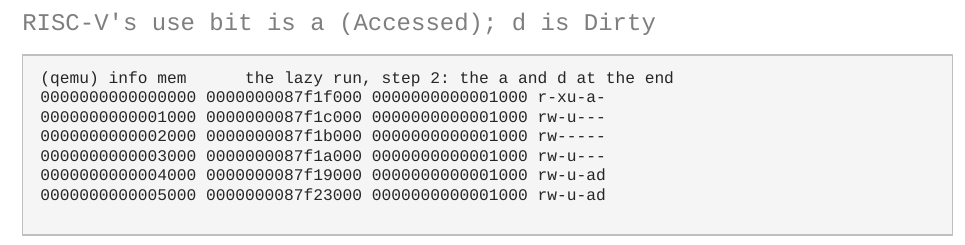{width=77%}
<figcaption markdown="1">Figure 89. The lazy run's info mem after step 2, read for its last two letters: a is the use bit and d the dirty bit, set by the hardware. From slide 59.</figcaption>
</figure>

The `a` at the end of a row is exactly the use bit; RISC-V calls it Accessed, and it is bit 6 of the entry (a design fact of the specification). The `d` next to it is the **dirty bit**, bit 7, which the hardware sets when the page is written. QEMU set `a` and `d` on the stack page (0x4000) and on 0x5000 the moment the program touched them. The code page (0x0) shows `a` only: fetched, never written. xv6 never clears them, because it never needs to; it has no eviction.

What a policy could do with them: read `a`, decide, clear `a`, wait, read again. Any scheme that periodically clears the use bits and then prefers pages whose bit is still 0 is an LRU approximation. [Section 5.7](#sec-5-7) is the classic one.

### 5.7 <span class="lbl lbl-concept">Concept</span> The clock algorithm, and the dirty bit {#sec-5-7 data-toc-label="5.7 [Concept] The clock algorithm, and the dirty bit"}

The best-known approximation puts the pages in a circle and sweeps a hand around it, like a clock. Figure 90 shows three steps of it.

<figure markdown="1">
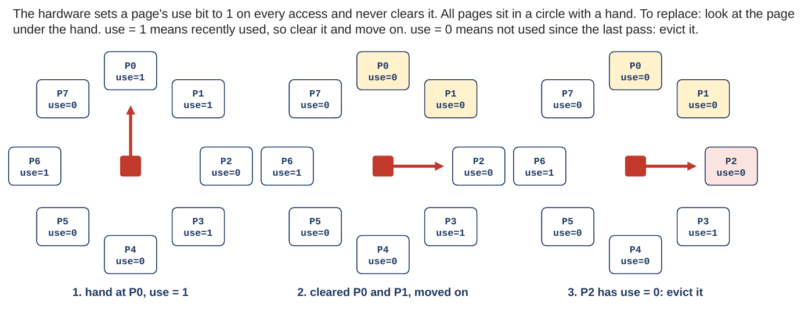{width=100%}
<figcaption markdown="1">Figure 90. Three steps of the clock algorithm on eight pages: the hand at P0 with use = 1, then P0 and P1 cleared and passed, then P2 with use = 0 evicted. From slide 59, following textbook section 22.8.</figcaption>
</figure>

All pages sit in a circular list, and a hand points at one of them; in the drawing the eight pages are named P0 to P7. To replace: look at the page under the hand. If its use bit is 1, it was used recently, so clear the bit and move the hand on; the page gets a second chance. If its use bit is 0, nobody used it since the last time the hand passed, so evict it. In the drawing, the hand starts at P0, whose bit is 1 (step 1). P0 and P1 both have their bits cleared and are passed over (step 2). P2 has use = 0, so P2 is evicted (step 3). The hand stays where it stopped, so the next replacement starts from P2's neighbor, not from the top.

Figure 91 is the textbook's Figure 22.9, reproduced: the 80-20 workload with a clock variant added. (The 80-20 workload is a run of 10,000 page references in which 80% of the references go to 20% of the pages; the chart plots the hit rate, hits divided by references, against the cache size in pages. [Extra 10](#extra-10) explains it in full.)

<figure markdown="1">
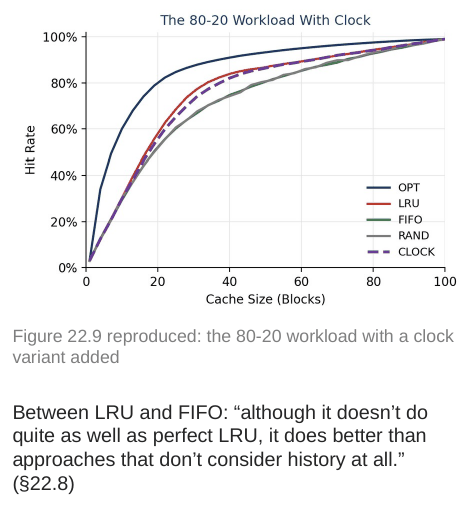{width=45%}
<figcaption markdown="1">Figure 91. The textbook's Figure 22.9 reproduced: the 80-20 workload with a clock variant added, which lands between LRU and FIFO. From slide 59, following textbook section 22.8.</figcaption>
</figure>

Clock lands between LRU and FIFO. In the textbook's words, although it does not do quite as well as perfect LRU, it does better than approaches that do not consider history at all. Figure 92 has the remaining card, which says both.

<figure markdown="1">
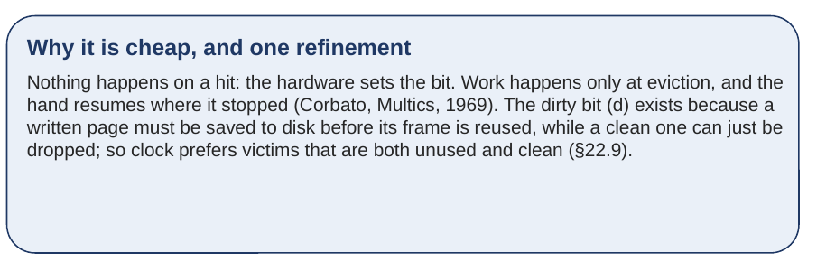{width=73%}
<figcaption markdown="1">Figure 92. Why clock is cheap, and the refinement for dirty pages. From slide 59, following textbook sections 22.8 and 22.9.</figcaption>
</figure>

Why it is cheap: nothing happens on a hit, because the hardware sets the bit for free. Work happens only at eviction, and the hand does not rescan all of memory; it resumes where it stopped. Corbato proposed it for Multics in 1969.

The refinement, for dirty pages. Evicting a page that was written (a **dirty** page) costs a disk write first, because the copy on disk is out of date. Evicting a page that was only read (a **clean** page) costs nothing, because its frame can simply be reused. So the hardware also keeps the dirty bit, the `d` of [Section 5.6](#sec-5-6), and clock can look first for pages that are both unused and clean, and only then take an unused dirty one.

### 5.8 <span class="lbl lbl-kernel">Real kernel</span> Page replacement in Linux: the active and inactive lists {#sec-5-8 data-toc-label="5.8 [Real kernel] Page replacement in Linux: the active and inactive lists"}

Linux does not run a literal clock. Its version is easy to recognize, and it is visible in one file. Figure 93 is the capture and the cards.

<figure markdown="1">
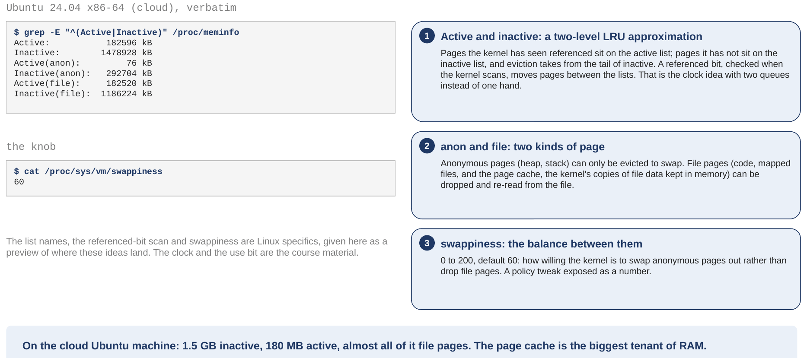{width=100%}
<figcaption markdown="1">Figure 93. The Ubuntu 24.04 machine's active and inactive lists in /proc/meminfo, its swappiness knob, and what the names mean. From slide 60.</figcaption>
</figure>

The capture reads six lines of `/proc/meminfo` (the file from [Section 1.2](class-1.md#sec-1-2)): Active 182,596 kB, Inactive 1,478,928 kB, and each of those split into "anon" and "file". Pages the kernel has seen used more than once sit on the **active list**. Pages it has seen used once, or not since its last scan, sit on the **inactive list**, and eviction takes from the tail of the inactive list. The two lists fix a weakness of the one-hand clock. With one bit the kernel cannot tell a page used once from a page used constantly. So a second list keeps the pages it has seen used again, and only the others are candidates for eviction. The knob below exists because the two kinds of page cost differently to evict, and the right balance depends on the machine's disk and its programs. A referenced bit, checked when the kernel scans, moves pages between the lists. That is the clock idea with two queues instead of one hand.

Anon and file are two kinds of page. **Anonymous pages** are a program's own heap and stack; they belong to no file, so they can only leave memory through swap. **File pages** are code, mapped files and the **page cache** (copies of file contents the kernel keeps in RAM in case they are read again). (A mapped file is one a program has asked the kernel to show as part of its memory; the optional [Extra 7](#extra-7) shows one.) They can be dropped and re-read from the file, which is what happens to a file's pages when a program asks the kernel to evict them (the optional [Extra 7](#extra-7) shows it).

The knob: `/proc/sys/vm/swappiness` is 60 on the Ubuntu 24.04 machine. It ranges from 0 to 200 (the range Linux allows for this setting), and it sets how willing the kernel is to swap anonymous pages out rather than drop file pages. A policy tweak exposed as a number.

On the cloud Ubuntu machine: about 1.5 GB inactive (1,478,928 kB × 1024 is about 1.51 billion bytes) and about 180 MB active (182,596 kB × 1024 is about 187 million bytes). Almost all of it is file pages: Active(file) 182,520 kB and Inactive(file) 1,186,224 kB, against Active(anon) 76 kB and Inactive(anon) 292,704 kB. The page cache is the biggest tenant of RAM. The list names, the referenced-bit scan and swappiness are Linux specifics, given as a preview of where these ideas land; the mechanism of Sections [5.6](#sec-5-6) and [5.7](#sec-5-7) is the course material.

That answers the second question. Figure 94 is its checkpoint.

<figure markdown="1">
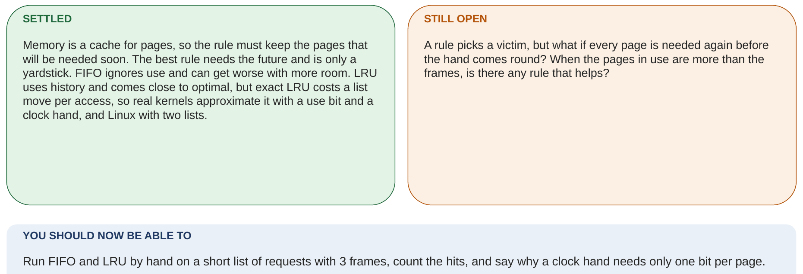{width=100%}
<figcaption markdown="1">Figure 94. Checkpoint 2 of the second class: settled, still open, and what you should now be able to do. From slide 61.</figcaption>
</figure>

Settled: memory is a cache for pages, so keep what is about to be used. Optimal is the yardstick, FIFO ignores use and can get worse with more room, LRU uses history and comes closest to optimal, and because exact LRU is unaffordable the clock approximates it with one bit. Still open: every rule so far assumed the pages in use fit in memory with something to spare, and nothing has said what happens when they do not. You should now be able to run optimal, FIFO and LRU on a short stream by hand, and say what the clock hand does at a page with use = 1 and at a page with use = 0.

## Chapter 6. Thrashing {#chapter-6}

*The question this chapter answers: What if the pages in use never fit?*

### 6.1 <span class="lbl lbl-problem">Problem</span> Thrashing: when the working set exceeds memory {#sec-6-1 data-toc-label="6.1 [Problem] Thrashing: when the working set exceeds memory"}

The chapter ends with the case where no policy can help: the programs simply need more memory than the machine has. It is the third question of the class, and Figure 95 is the deck's problem slide for it.

<figure markdown="1">
{width=99%}
<figcaption markdown="1">Figure 95. The third problem of the second class: a rule that picks a victim, the loop over 50 pages with 49 frames where LRU and FIFO get 0%, and the textbook's word for it. Left and middle columns, what we have and where it breaks. From slide 62, following textbook sections 22.6 and 22.11.</figcaption>
</figure>

<figure markdown="1">
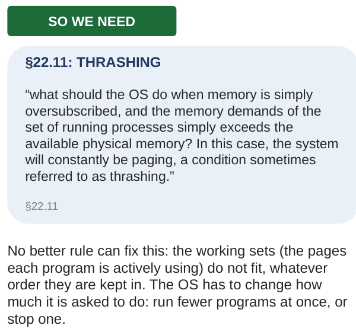{width=48%}
<figcaption markdown="1">Figure 96. The right column of the same slide: so what we need. From slide 62.</figcaption>
</figure>

What we have is on the left: a rule, the clock or LRU, that picks a victim each time a frame is needed, the page that has gone longest without use. Where it breaks is in the middle, and it is the looping workload with a real disk under it. The looping workload is a program that touches pages 0, 1, ..., 49 in order and then starts again from 0. ([Extra 10](#extra-10) has the full chart; the small one in the figure plots hit rate against cache size.) A loop over 50 pages with 49 frames: LRU and FIFO get 0%, because the oldest page is exactly the one the loop comes back to next. Measured on the Ubuntu machine, the same loop over a 256 MiB file takes 3.29 s on the first pass and 1 ms on the next three. Under a 64 MiB memory limit set by the kernel (a cgroup, which [Section 6.2](#sec-6-2) explains) every pass takes 3.3 s and 65,536 disk reads. That is one read per page: 256 MiB ÷ 4 KiB = 2^28 ÷ 2^12 = 2^16 = 65,536 pages. ([Extra 11](#extra-11) has the runs.) The limit stands in for a full machine: it is the only practical way to make the frames run out on an 8 GiB machine without disturbing everything else running on it. So what we need is on the right, and the textbook has a word for the condition first. Figure 97 has the word and the two remedies.

<figure markdown="1">
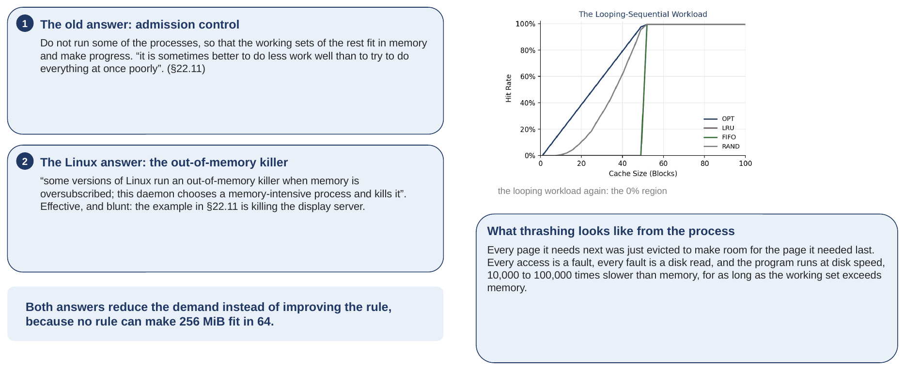{width=100%}
<figcaption markdown="1">Figure 97. The two remedies the text below defines, admission control and the out-of-memory killer, the looping chart's 0% region, and what thrashing looks like from the process. From slide 63, following textbook section 22.11.</figcaption>
</figure>

When memory is oversubscribed, and the memory demands of the running processes exceed the available physical memory, the system will constantly be paging, moving pages in and out and doing no useful work. That condition is called **thrashing**.

The old answer is **admission control**: do not run some of the processes, so that the **working sets** of the rest (the pages each one is actively using) fit in memory and make progress. The textbook's line: it is sometimes better to do less work well than to try to do everything at once poorly.

The Linux answer is the **out-of-memory killer**: when memory is oversubscribed, a kernel routine chooses a memory-intensive process and kills it. Effective, and blunt; the textbook's example is killing the X server, the program that draws the screen, which leaves every window unusable.

Mechanically, thrashing is the 0% region of the looping chart ([Extra 10](#extra-10)) with a real disk under it, and no better rule can fix it: the working sets do not fit, whatever order the pages are kept in. The OS has to change how much it is asked to do, by running fewer programs at once or stopping one. From the process's point of view: every page it needs next was just evicted to make room for the page it needed last. Every access is a fault, and every fault is a disk read. The program runs at disk speed, 10,000 to 100,000 times slower than memory, for as long as its working set exceeds memory.

### 6.2 <span class="lbl lbl-machine">Real machine</span> The out-of-memory killer {#sec-6-2 data-toc-label="6.2 [Real machine] The out-of-memory killer"}

The same cap shows the other remedy as well: the kernel killing a program. Figure 98 is the program.

<figure markdown="1">
{width=75%}
<figcaption markdown="1">Figure 98. oom.c, lines 9 to 22: take 16 MiB at a time and touch every page of it, until 512 MiB or until something stops it. From slide 64; the caption under the four blocks reads "cgroup: a Linux memory limit on a group of processes; 16 MiB per block, the fourth hits the cap".</figcaption>
</figure>

Here is what it does; the source is at the end of this part. It asks for 16 MiB of private memory with `mmap`, then writes into every byte of it with `memset(p, 1, chunk)`, which touches every page so the kernel must really allocate the frames. It adds the chunk to a running total, prints the total in MiB, and repeats. When the total reaches 512 MiB it stops and prints "done, not killed".

Figure 99 is the two runs.

<figure markdown="1">
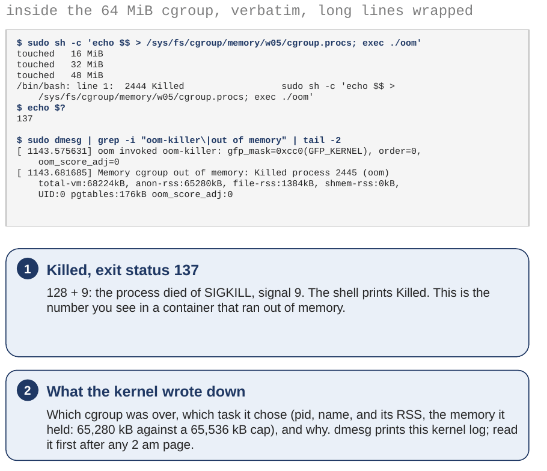{width=73%}
<figcaption markdown="1">Figure 99. oom without a limit (512 MiB, fine) and inside the 64 MiB cgroup (killed after 48 MiB, with exit status 137, the number a program leaves behind when it ends, and the kernel's log line). From slide 64.</figcaption>
</figure>

Without a limit it reaches 512 MiB and finishes. Inside the 64 MiB cgroup it prints 16, 32, 48 MiB, and then the shell prints `Killed`. The fourth chunk would have taken the total to 64 MiB, which is the cap. The process's anonymous memory at death was 65,280 kB (48 MiB is 49,152 kB, so 65,280 − 49,152 = 16,128 kB of the fourth chunk had already been touched). The cap counts all of the process's pages, and the kernel's log line in Figure 99 (printed by `dmesg`, explained below) also shows file-rss 1,384 kB, the pages of its code: 65,280 + 1,384 = 66,664 kB, over the cap of 65,536 kB (64 × 1024). That is why the kill came before the heap alone reached 64 MiB. A process can be a little over the cap at the moment of the kill. The kernel first lets the request through, then looks for pages of the group to evict, and kills only when it finds none (the order Linux's memory-limit code works in; a design fact of Linux, not something the capture shows). That is the order Figure 21.3 gave, with the kill in place of the disk read; the log line records the size at that moment. The memory could not be trimmed enough. The cloud machine has no swap, so the program's 65,280 kB of anonymous pages could not be evicted. Dropping its 1,384 kB of file pages would not have kept the group under the cap, because the next 16 MiB request was already coming. The kernel did what the textbook describes: pick a memory-intensive process and kill it.

`echo $?` prints the **exit status** of the last command, the number a process leaves behind when it ends. It is 137. The shell reports a process killed by a signal as 128 plus the signal's number; that is a convention of Unix shells (Unix is the family of operating systems Linux belongs to). A **signal** is a message the kernel sends a process. **SIGKILL**, signal number 9 (the number Unix gives it), ends a process at once and cannot be refused. 128 + 9 = 137. This is the number you see whenever a container (a way of running a service inside a box with its own memory limit, which is a cgroup) dies of running out of memory.

The last capture is `dmesg`, the command that prints the kernel's own log, filtered to two lines. The kernel wrote down which cgroup was over its limit ("Memory cgroup out of memory"), which task it chose ("Killed process 2445 (oom)"), and its memory at death (anon-rss 65,280 kB, the anonymous resident pages). OOM is short for out of memory, and "oom" is also the name of this program. The rest of the two lines (gfp_mask, order, oom_score_adj, total-vm, file-rss, shmem-rss, UID, pgtables) are details of the kernel's request and of the killed task that you can ignore. When a service dies at 2 a.m., this line is the first thing to read.

??? note "The program behind Figures 98 and 99 (you can skip this listing)"

    `for (;;)` is a loop with no end condition, which runs until a `break`. `fflush(stdout)` forces the printed line out immediately, so it appears even if the process is killed a moment later. `total >> 20` divides by 2^20 to print MiB. `%4zu` prints a size padded to four characters.
    
    ```c
    // oom.c: allocate memory 16 MiB at a time and touch every page, printing a
    // running total, until the kernel stops us. Inside a cgroup limited to 64 MiB
    // with no swap, the out-of-memory killer ends the process.
    #include <stdio.h>
    #include <stdlib.h>
    #include <string.h>
    #include <sys/mman.h>
    
    int main(void) {
        size_t chunk = 16UL << 20, total = 0;
        for (;;) {
            char *p = mmap(NULL, chunk, PROT_READ | PROT_WRITE,
                           MAP_PRIVATE | MAP_ANONYMOUS, -1, 0);
            memset(p, 1, chunk);                     // touch every page
            total += chunk;
            printf("touched %4zu MiB\n", total >> 20); fflush(stdout);
            if (total >= (512UL << 20)) break;       // stop at 512 MiB when not limited
        }
        printf("done, not killed\n");
        return 0;
    }
    ```
    
    On the Ubuntu 24.04 x86-64 machine: `gcc -O2 -o oom oom.c`, then `./oom` for the unlimited run. The capped run needs the same cgroup as [Extra 11](#extra-11) (`sudo systemd-run --scope -p MemoryMax=64M ./oom` on a cgroup version 2 machine; `systemd-run` is a Linux command that starts a program under a limit, and version 1 and version 2 are two generations of the cgroup files). The captures used the older version 1 files, `memory.limit_in_bytes` and `cgroup.procs`, which the cloud machine still had. On such a machine the capture's own two lines are the recipe. Write the byte limit into `memory.limit_in_bytes` of a group directory under `/sys/fs/cgroup/memory/`; then write the shell's process number into that directory's `cgroup.procs` and run the program from that shell. `mount | grep cgroup` (`mount` lists the file systems in use) tells you which version a machine has: a line that says cgroup2 means version 2, and reading the kernel log needs `sudo dmesg`. The process id and the exact kB will differ; "48 MiB, then Killed, then 137" will not, on a machine without swap.
    
    That answers the third question, and with it the week. Figure 100 is its checkpoint.
    
    <figure markdown="1">
    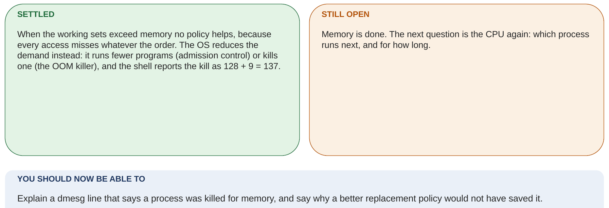{width=100%}
    <figcaption markdown="1">Figure 100. Checkpoint 3 of the second class: settled, still open, and what you should now be able to do. From slide 65.</figcaption>
    </figure>
    
    Settled: when the working sets do not fit, no rule helps, every access becomes a disk read, and the kernel runs fewer programs or kills one. On Linux the killed program leaves exit status 137 and one line in the kernel log. Still open, for later weeks: how the kernel decides which program to kill, and everything about the disk the pages come from and go to. You should now be able to say why a loop over 50 pages with 49 frames gets 0% under LRU, and read the exit status and the dmesg line of a killed process.
    
## <span class="lbl lbl-summary">Summary</span> Summary of the week: multi-level page tables and swapping {#summary-43 data-toc-label="[Summary] Summary of the week: multi-level page tables and swapping"}

The last slide of the week answers its six questions in order, each with the problem it solved. Figure 101 is that slide, with the vocabulary list.

<figure markdown="1">
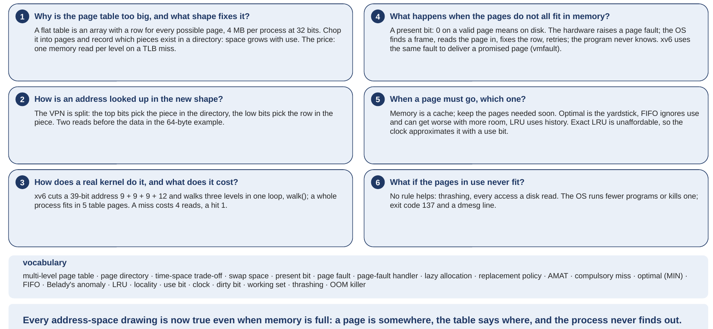{width=100%}
<figcaption markdown="1">Figure 101. The week on one slide: the six questions of the two classes, each answered with the problem it solved. From slide 66.</figcaption>
</figure>

Question 1, why the page table is too big and what shape fixes it. A flat table is an array with a row for every possible page, 4 MB per process at 32 bits. Chop it into pages and record which pieces exist in a directory, and space grows with use, for one memory read per level on a TLB miss. Question 2, how an address is looked up in the new shape. The VPN is split: the top bits pick the piece in the directory, the low bits pick the row in the piece. Two reads before the data in the 64-byte example. Question 3, how a real kernel does it and what it costs. xv6 cuts a 39-bit address 9 + 9 + 9 + 12 and walks three levels in one loop, `walk()`. A whole process fits in 5 table pages. A miss costs 4 reads, a hit 1.

Question 4, what happens when the pages do not all fit in memory. A present bit: 0 on a valid page means on disk. The hardware raises a page fault; the OS finds a frame, reads the page in, fixes the row and retries, and the program never knows. xv6 uses the same fault to deliver a promised page (`vmfault`). Question 5, when a page must go, which one. Memory is a cache, so keep the pages needed soon. Optimal is the yardstick, FIFO ignores use and can get worse with more room, and LRU uses history. Exact LRU is unaffordable, so the clock approximates it with a use bit. Question 6, what if the pages in use never fit. No rule helps: thrashing, every access a disk read. The OS runs fewer programs or kills one, exit code 137 and a dmesg line.

The measurements behind those answers, from the deeper parts and the core ones: three monitor reads, 001, 001, 017 ([Section 3.6](class-1.md#sec-3-6)). VmPTE 0, 20 kB, 2052 kB ([Extra 4](class-1.md#extra-4)). mincore, a program that asks the kernel which of its pages are present: sixteen zeros, then a 1 ([Extra 7](#extra-7)). 1000 minor faults (faults fixed without the disk) for 1000 pages, and a major fault (one that needs the disk) per disk read ([Extra 8](#extra-8)). A loop over 256 MiB under a 64 MiB cap: 65,536 faults per pass, about 3000 times slower ([Extra 11](#extra-11)). Exit 137 and one dmesg line ([Section 6.2](#sec-6-2)).

Every address-space drawing is now true even when memory is full: a page is somewhere, the table says where, and the process never finds out. Any word in the vocabulary line without a picture behind it is the one to reread.

## Going deeper, second class (optional) {#extras-2}

### Extra 6 <span class="lbl lbl-deeper">Deeper, Q1</span> Watermarks and the swap daemon {#extra-6 data-toc-label="Extra 6 [Deeper, Q1] Watermarks and the swap daemon"}

This part and the five after it are the deck's "deeper, if time allows" block for the second class, placed after the summary so the core chain reads without them.

The handler of [Section 4.4](#sec-4-4) assumed a free frame was waiting. Real kernels work ahead of time to keep one available. Figure 102 has the idea.

<figure markdown="1">
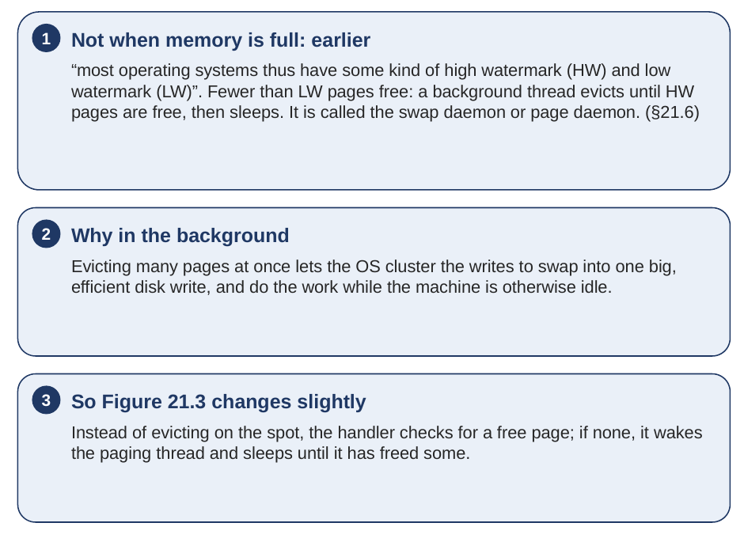{width=75%}
<figcaption markdown="1">Figure 102. High and low watermarks (two thresholds on the number of free pages, defined below), why eviction runs in the background, and how Figure 21.3 changes. From slide 67, following textbook section 21.6.</figcaption>
</figure>

Not when memory is full: earlier. Most operating systems keep two thresholds on the number of free pages, a **high watermark** and a **low watermark**. When fewer than the low watermark are free, a background thread evicts pages until the high watermark are free, then goes back to sleep. (A thread here is a piece of the kernel that runs on its own, like a small process inside the kernel.) That thread is called the **swap daemon** or **page daemon**. A **daemon** is a kernel helper that runs in the background; the word is old, from Multics. Think of a thermostat with two settings: the heater turns on below one temperature and off above another.

Why in the background: evicting many pages at once lets the OS group the writes to swap into one big, efficient disk write, and do the work while the machine is otherwise idle.

So Figure 21.3 changes slightly. Instead of evicting on the spot, the handler checks for a free page; if none, it wakes the paging thread and sleeps until it has freed some.

Figure 103 shows the watermarks on the Ubuntu 24.04 machine.

<figure markdown="1">
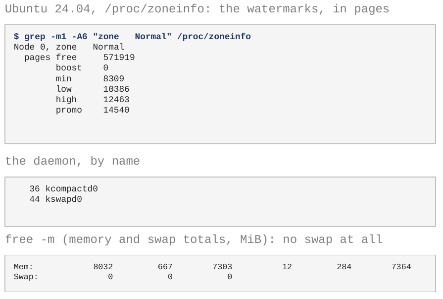{width=72%}
<figcaption markdown="1">Figure 103. The Ubuntu 24.04 machine's watermarks in /proc/zoneinfo, its swap daemon by name, and free -m showing no swap at all. From slide 67.</figcaption>
</figure>

`/proc/zoneinfo` is the kernel's report on each **zone** of physical memory (Linux divides RAM into a few zones by address range. Some old devices can only reach the lowest addresses, so the kernel keeps those apart. "Normal" is the zone ordinary programs get.). `grep -m1 -A6 "zone   Normal"` prints the first line that says zone Normal and the 6 lines after it. The capture shows 571,919 pages free and three marks, in pages: min 8309, low 10386, high 12463. Low and high are the low watermark and high watermark of the textbook (which abbreviates them LW and HW); min sits below them for emergencies, when only the kernel's own most urgent requests may take pages. These values are set by the kernel from the amount of RAM, so they are the cloud machine's numbers, not a rule.

The daemon by name: process 44 is `kswapd0`, the swap daemon, and 36 is `kcompactd0`, a companion that moves pages to make larger free blocks, which some requests need: the 2 MiB huge pages of [Section 1.2](class-1.md#sec-1-2), for one, need 512 free frames side by side. Both are started by the kernel at boot, a Linux design fact, and run for as long as the machine is up. The last capture, `free -m`, prints memory totals in MiB. (The slide calls the machine a VM, a virtual machine: a computer simulated by software on another computer, which is what a cloud machine is.) The six numbers on the Mem line are total, used, free, shared, buffers-and-cache, and available, in MiB. So the machine has 8032 MiB of RAM in total, 667 used, 7303 free. (That is more than the 571,919 free pages of zone Normal, 571,919 × 4 KiB ≈ 2.2 GiB, for two reasons. The capture shows only zone Normal; a second zone, DMA32, the RAM below the 4 GiB address, holds the rest of the machine's pages and its own free count (the capture does not show that zone; that the zones together hold all of RAM is a Linux design fact). And the two captures were taken at different moments, so the numbers need not agree exactly.) (The way `free` splits "used" from the cache means the columns do not add up to the total; only the total matters here.) The Swap line is 0, 0, 0: the cloud machine has no swap at all. So `kswapd0` can only evict pages that came from files, because those can be read back from the file; a program's own heap pages have nowhere to go. [Section 6.2](#sec-6-2) shows what the kernel does when that runs out.

### Extra 7 <span class="lbl lbl-deeper">Deeper, Q1</span> Reading the present bit from a program: mincore {#extra-7 data-toc-label="Extra 7 [Deeper, Q1] Reading the present bit from a program: mincore"}

Linux keeps the same present bit, and an ordinary program can ask to see it. Figure 104 is the program.

<figure markdown="1">
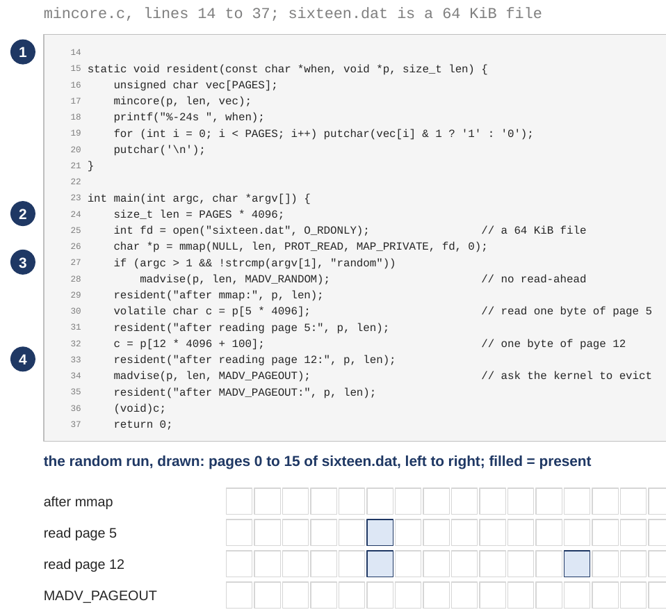{width=77%}
<figcaption markdown="1">Figure 104. mincore.c, lines 14 to 37: map a 16-page file, ask which pages are present, touch two of them, ask again, ask the kernel to evict them, ask once more. From slide 68.</figcaption>
</figure>

Here is what it does; the source is at the end of this part. It opens a small file, `sixteen.dat`, 16 pages long (64 KiB), and maps it into its address space with `mmap`. **Mapping a file** means asking the kernel to make the file's bytes appear at some range of addresses, so that reading those addresses reads the file. Then it asks the kernel which of the 16 pages are present right now, with the **mincore** system call, which fills one byte per page whose lowest bit is 1 if the page is in memory. The helper `resident` prints those 16 bits as a row of 0s and 1s. It reads one byte from page 5 and asks again. It reads one byte from page 12 and asks again. Then it asks the kernel to throw the pages out with `madvise(p, len, MADV_PAGEOUT)` (**madvise** gives the kernel a hint about a range of memory; `MADV_PAGEOUT` means "evict these") and asks one last time. If the program is run with the word `random` on the command line, it first gives another hint, `MADV_RANDOM`, which means "I will access this randomly, do not read ahead". (The reason comes with the two runs below: without the hint the kernel reads neighboring pages ahead, and the second run exists to switch that off.).

Figure 105 is the two runs.

<figure markdown="1">
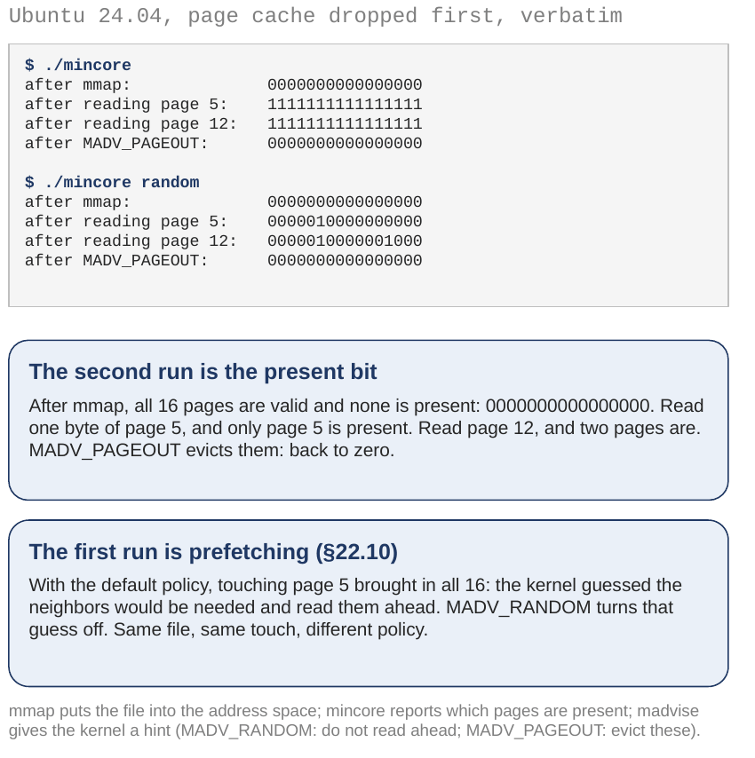{width=68%}
<figcaption markdown="1">Figure 105. Two runs of mincore, verbatim, and the second run drawn as filled boxes; the second run is the present bit, the first is prefetching. From slide 68.</figcaption>
</figure>

The second run, with `random`, is the present bit itself. After `mmap`, all 16 pages are valid and none is present: 0000000000000000. Read one byte of page 5, and only page 5 is present: 0000010000000000 (count from the left, starting at page 0: the 1 is in position 5). Read one byte of page 12, and two pages are: 0000010000001000. `MADV_PAGEOUT` evicts them: back to sixteen zeros. That is the present bit flipping, seen from an ordinary program.

The first run, without `random`, is different. Touch page 5, and all 16 pages come in: 1111111111111111. The kernel guessed that the neighbors would be needed too and read them ahead of time. That is **prefetching**, and it is a policy sitting on top of the mechanism. Same file, same touch, different policy.

??? note "The program behind Figures 104 and 105 (you can skip this listing)"

    `#define PAGES 16` names the page count. `unsigned char vec[PAGES]` is an array of 16 bytes for `mincore` to fill. `open(..., O_RDONLY)` opens the file for reading and returns a file descriptor `fd`, a small number that names the open file. `PROT_READ, MAP_PRIVATE` map it read-only and private. `putchar` prints one character, and `vec[i] & 1 ? '1' : '0'` prints 1 if the low bit is set. `volatile char c = p[5 * 4096]` reads one byte and forces the compiler to really do it. `(void)c` silences a warning that `c` is unused.
    
    ```c
    // mincore.c: watch the present bit from user space.
    // Map a 16-page file, ask the kernel which of those pages are resident
    // (mincore gives one byte per page; bit 0 set = in memory), touch one page,
    // ask again. Run twice: once with the kernel's default read-ahead, once
    // with MADV_RANDOM, which tells the kernel not to prefetch neighbors.
    #include <stdio.h>
    #include <stdlib.h>
    #include <string.h>
    #include <fcntl.h>
    #include <unistd.h>
    #include <sys/mman.h>
    
    #define PAGES 16
    
    static void resident(const char *when, void *p, size_t len) {
        unsigned char vec[PAGES];
        mincore(p, len, vec);
        printf("%-24s ", when);
        for (int i = 0; i < PAGES; i++) putchar(vec[i] & 1 ? '1' : '0');
        putchar('\n');
    }
    
    int main(int argc, char *argv[]) {
        size_t len = PAGES * 4096;
        int fd = open("sixteen.dat", O_RDONLY);                 // a 64 KiB file
        char *p = mmap(NULL, len, PROT_READ, MAP_PRIVATE, fd, 0);
        if (argc > 1 && !strcmp(argv[1], "random"))
            madvise(p, len, MADV_RANDOM);                       // no read-ahead
        resident("after mmap:", p, len);
        volatile char c = p[5 * 4096];                          // read one byte of page 5
        resident("after reading page 5:", p, len);
        c = p[12 * 4096 + 100];                                 // one byte of page 12
        resident("after reading page 12:", p, len);
        madvise(p, len, MADV_PAGEOUT);                          // ask the kernel to evict
        resident("after MADV_PAGEOUT:", p, len);
        (void)c;
        return 0;
    }
    ```
    
    On the Ubuntu 24.04 x86-64 machine: make the file with `dd if=/dev/urandom of=sixteen.dat bs=4096 count=16` (`dd` copies bytes into a file, here 16 blocks of 4096 bytes from `/dev/urandom`, a source of random bytes), build with `gcc -O2 -o mincore mincore.c`, and run `./mincore` and `./mincore random`. To reproduce the first "after mmap" line of zeros, the file must not already be in memory from an earlier run, because the kernel keeps a file's pages in RAM after the program that read them has ended. The command `echo 3 | sudo tee /proc/sys/vm/drop_caches` writes the text 3 into that kernel file (`echo` prints its argument, and `tee` writes its input to a file). Writing 3 there is Linux's command to drop every kind of cache; 3 is Linux's code for "all of them". The file cache is the copies of file contents the kernel keeps in RAM after a program has read them, in case they are read again; [Section 5.8](#sec-5-8) says more. That one command needs `sudo`. The rows of 0s and 1s will match exactly on any Linux with default read-ahead; only the read-ahead width might differ on a machine with different settings.
    
### Extra 8 <span class="lbl lbl-deeper">Deeper, Q1</span> Minor and major page faults {#extra-8 data-toc-label="Extra 8 [Deeper, Q1] Minor and major page faults"}

Linux counts page faults for every process, and it keeps two separate counters. Figure 106 is the program that shows both.

<figure markdown="1">
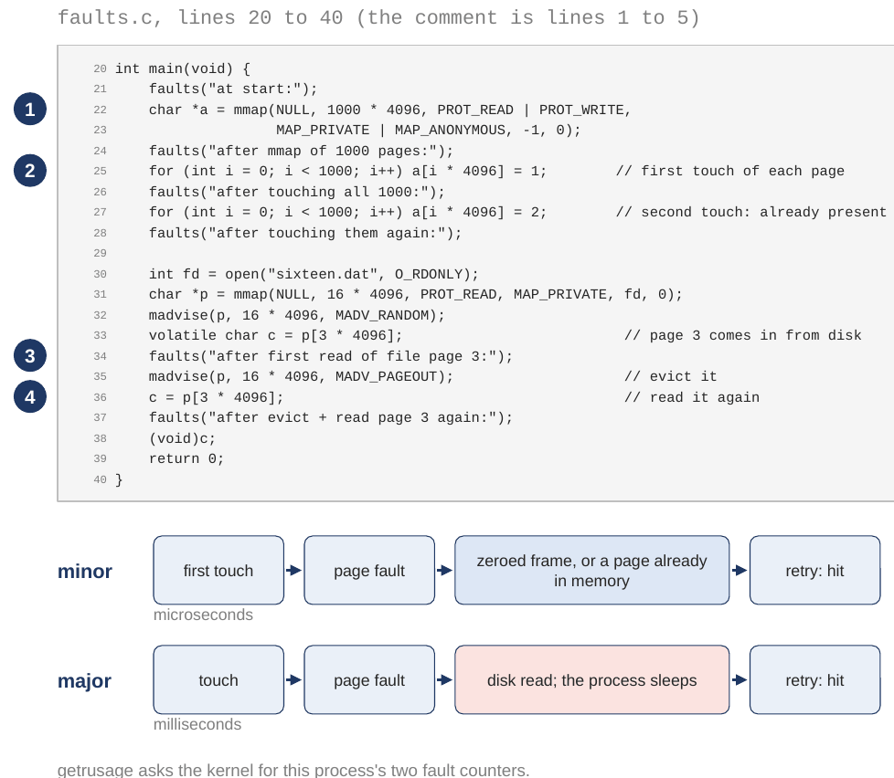{width=78%}
<figcaption markdown="1">Figure 106. faults.c, lines 20 to 40: touch 1000 fresh pages, touch them again, then read a file page, evict it, and read it again, printing both fault counters after each step. From slide 69.</figcaption>
</figure>

Here is what it does; the source is at the end of this part. It maps 1000 fresh pages of private memory (4,096,000 bytes) with `mmap`. It writes one byte into each of the 1000 pages, the first touch of each. It writes one byte into each again. Then it maps the same 16-page file as [Extra 7](#extra-7) with read-ahead turned off, reads one byte of page 3 (which has to come from disk), evicts it with `MADV_PAGEOUT`, and reads it again. After each step, the helper `faults` asks the kernel for this process's two fault counters with `getrusage` and prints them.

A **minor fault** is a page fault the kernel can fix without touching the disk: it hands over a zeroed frame, or points the entry at a page that is already in memory, and the retry hits. It takes microseconds (a rough figure, in the range of the memory costs of [Section 5.1](#sec-5-1); it was not measured here). A **major fault** is a page fault that has to wait for the disk: the page is read in while the process sleeps. It takes milliseconds (the disk cost of [Section 5.1](#sec-5-1)'s table). Figure 107 is the capture.

<figure markdown="1">
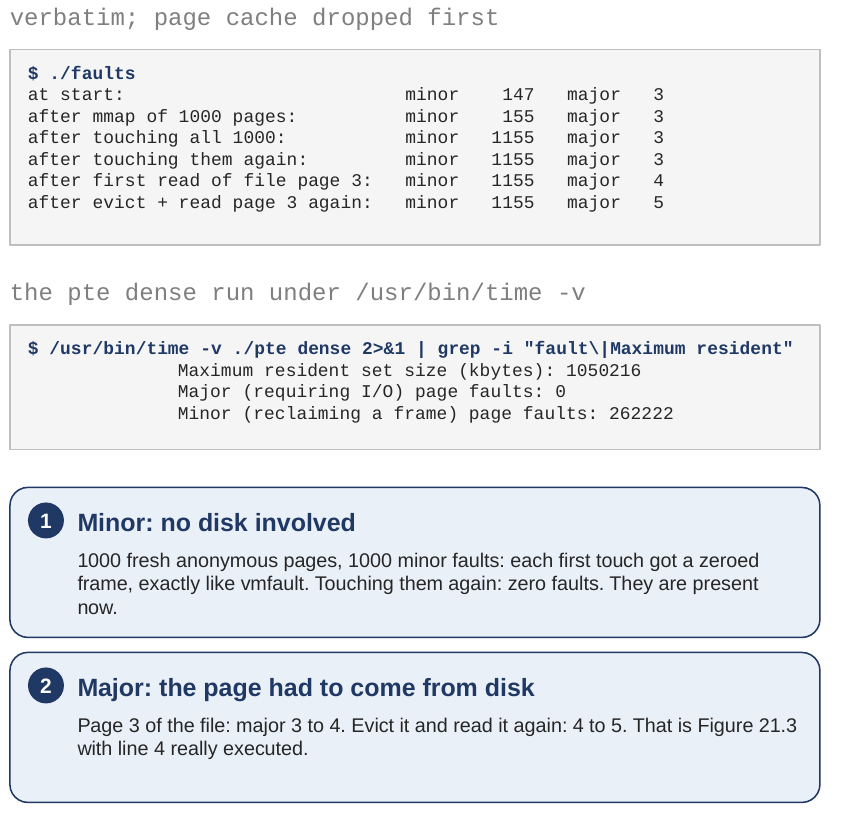{width=68%}
<figcaption markdown="1">Figure 107. The faults run, verbatim, the pte dense run under /usr/bin/time, and the two kinds of fault side by side. From slide 69.</figcaption>
</figure>

Read the counters. At start: minor 147, major 3 (the program's own loading; those are the starting values on that run). After the `mmap` of 1000 pages: minor 155, major 3; the call itself cost 8 minor faults (155 − 147 = 8) for pages that the program's own startup and library code touched around the call. (The C library is the standard code every C program is built with, which provides `printf`, `mmap` and the rest. The exact count is not something the capture lets you check, and it varies by a few from run to run.) After touching all 1000: minor 1155, major 3; that is 1155 − 155 = 1000 minor faults, exactly one per page. On each first touch the kernel handed over a zeroed frame, the same thing `vmfault` did in [Section 4.6](#sec-4-6). After touching them again: minor 1155, major 3; zero new faults, because the pages are present now. After the first read of file page 3 (from disk, because the page cache was emptied before this capture; see the build note at the end of the part): major 3 to 4, one major fault, the disk read. After evicting it and reading it again: major 4 to 5. That is Figure 21.3 with line 4 really executed.

The second capture runs the `pte dense` program from [Extra 4](class-1.md#extra-4) under `/usr/bin/time -v`, a command that runs a program and then prints statistics about it, filtered to three lines: maximum resident set size 1,050,216 kB (about a GiB; 12 kB more than [Extra 4](class-1.md#extra-4)'s 1,050,204 kB, because `time` reports the peak over the whole run while the program's own `show` reported one moment), major faults 0, minor faults 262,222. Touching every one of the 262,144 pages of a GiB took 262,222 minor faults (262,222 − 262,144 = 78 extra, the program's own startup) and no major ones. Every page arrived through a fault; none needed the disk.

A major fault is Figure 21.3 with the disk read actually happening. The gap in cost between the two kinds is the disk-against-memory gap of [Section 4.4](#sec-4-4), thousands of times at the least.

??? note "The program behind Figures 106 and 107 (you can skip this listing)"

    The comment at the top of the file says "anonymous pages": memory that belongs to no file, such as the heap ([Section 5.8](#sec-5-8) says more). `struct rusage r; getrusage(RUSAGE_SELF, &r)` asks the kernel to fill a record of statistics about this process; `r.ru_minflt` and `r.ru_majflt` are its two fault counters (`%6ld` and `%3ld` print them as numbers padded to a width). `a[i * 4096] = 1` writes the first byte of page `i`.
    
    ```c
    // faults.c: count page faults with getrusage while touching memory.
    // Part 1: 1000 fresh anonymous pages. Each first touch is a minor fault
    //         (the kernel hands out a zero page; no disk involved).
    // Part 2: a file page evicted with MADV_PAGEOUT, then read again. The
    //         kernel must fetch it from disk: a major fault.
    #include <stdio.h>
    #include <stdlib.h>
    #include <string.h>
    #include <fcntl.h>
    #include <unistd.h>
    #include <sys/mman.h>
    #include <sys/resource.h>
    
    static void faults(const char *when) {
        struct rusage r;
        getrusage(RUSAGE_SELF, &r);
        printf("%-34s minor %6ld   major %3ld\n", when, r.ru_minflt, r.ru_majflt);
    }
    
    int main(void) {
        faults("at start:");
        char *a = mmap(NULL, 1000 * 4096, PROT_READ | PROT_WRITE,
                       MAP_PRIVATE | MAP_ANONYMOUS, -1, 0);
        faults("after mmap of 1000 pages:");
        for (int i = 0; i < 1000; i++) a[i * 4096] = 1;        // first touch of each page
        faults("after touching all 1000:");
        for (int i = 0; i < 1000; i++) a[i * 4096] = 2;        // second touch: already present
        faults("after touching them again:");
    
        int fd = open("sixteen.dat", O_RDONLY);
        char *p = mmap(NULL, 16 * 4096, PROT_READ, MAP_PRIVATE, fd, 0);
        madvise(p, 16 * 4096, MADV_RANDOM);
        volatile char c = p[3 * 4096];                          // page 3 comes in from disk
        faults("after first read of file page 3:");
        madvise(p, 16 * 4096, MADV_PAGEOUT);                    // evict it
        c = p[3 * 4096];                                        // read it again
        faults("after evict + read page 3 again:");
        (void)c;
        return 0;
    }
    ```
    
    On the Ubuntu 24.04 x86-64 machine: `gcc -O2 -o faults faults.c`, drop the file cache as in [Extra 7](#extra-7) (that step needs `sudo`), then `./faults`. Your starting counts will differ (147 and 3 are the cloud machine's); the growth of exactly 1000 minor faults, then 0, then one major fault twice, will not. For the second capture, `/usr/bin/time -v ./pte dense` prints about twenty lines; the slide keeps three.
    
### Extra 9 <span class="lbl lbl-deeper">Deeper, Q2</span> Random replacement {#extra-9 data-toc-label="Extra 9 [Deeper, Q2] Random replacement"}

If FIFO can behave this badly, maybe choosing at random would do just as well. Figure 108 is one run and ten thousand.

<figure markdown="1">
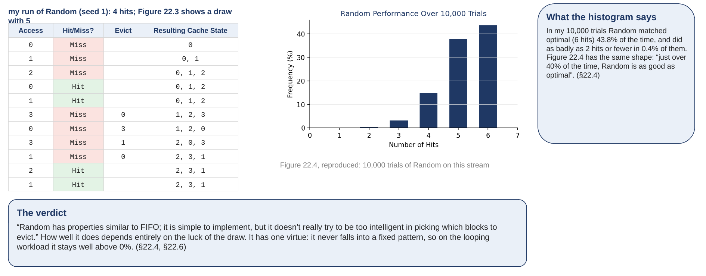{width=100%}
<figcaption markdown="1">Figure 108. One run of the Random policy on the stream (4 hits), the textbook's Figure 22.4 reproduced from 10,000 trials, and the verdict. From slide 70, following textbook section 22.4.</figcaption>
</figure>

The **Random** policy picks a random page to evict. It is as simple as FIFO, and its result depends entirely on luck. The run on the left was made with the demo folder's simulator with its random seed set to 1. (A seed is the starting number a program's random choices are computed from; the same seed gives the same choices every run.) It got 4 hits, the same as FIFO; the textbook's own Figure 22.3 shows a luckier draw with 5. The histogram in the middle reproduces the textbook's Figure 22.4: the simulator ran Random 10,000 times on this stream, each time with a different random seed, and counted how often each number of hits came up. (A **histogram** is a bar chart of how often each value occurred.) In those 10,000 trials Random matched optimal's 6 hits in 4,375 trials, about 44% of the time (4,375 ÷ 10,000 = 0.4375). It got only 2 hits in 38 trials, under half a percent. The tallest bar of the histogram is the one at 6. The textbook reports the same shape from its own trials, "just over 40% of the time".

The verdict: Random has properties similar to FIFO; it is simple to implement, but it does not really try to be intelligent about which page to evict. Keep it in mind, though. In [Extra 10](#extra-10) it wins one contest.

### Extra 10 <span class="lbl lbl-deeper">Deeper, Q2</span> Policies under three workloads: no locality, 80-20, looping {#extra-10 data-toc-label="Extra 10 [Deeper, Q2] Policies under three workloads: no locality, 80-20, looping"}

One short stream proves little. So the textbook runs every policy on 10,000 references from three kinds of program, varying the cache size from 1 to 100 pages. Figure 109 is the first two.

<figure markdown="1">
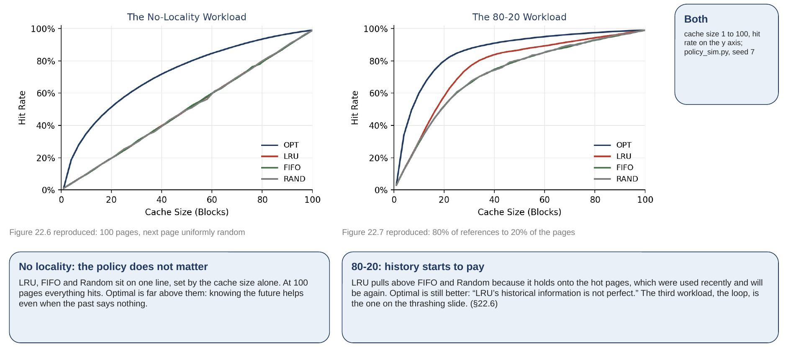{width=100%}
<figcaption markdown="1">Figure 109. The textbook's Figures 22.6 and 22.7 reproduced: the no-locality workload and the 80-20 workload, hit rate against cache size for optimal, LRU, FIFO and Random. From slide 71, following textbook section 22.6.</figcaption>
</figure>

A **workload** is a pattern of references. Both charts have the cache size in pages along the bottom (1 to 100) and the hit rate up the side (0% to 100%), one line per policy. The charts were reproduced with the demo folder's simulator, which follows the textbook's descriptions with a fixed random seed, so they have the book's shape without being pixel copies.

The no-locality workload, left: 100 distinct pages, and each reference picks the next page uniformly at random. LRU, FIFO and Random sit on one line, set by the cache size alone: with a cache of 50 pages out of 100, about half the references hit, whatever the policy. At 100 pages everything hits. Optimal is far above them, because knowing the future helps even when the past says nothing.

The 80-20 workload, right: 80% of the references go to 20% of the pages, the hot ones, and the remaining 20% of the references go to the other 80% of the pages. Now history starts to pay. LRU pulls above FIFO and Random because it holds onto the hot pages, which were used recently and will be again. Optimal is still better: LRU's historical information is not perfect. Whether the gap matters depends on the cost of a miss; a miss to disk is expensive, so it usually does.

Figure 110 is the third workload, the one that breaks LRU completely.

<figure markdown="1">
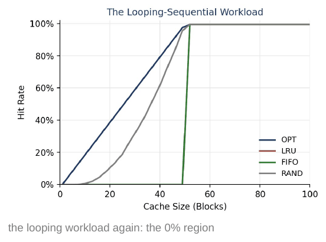{width=45%}
<figcaption markdown="1">Figure 110. The textbook's Figure 22.8 reproduced: the looping-sequential workload, pages 0 to 49 in order, repeated, as the thrashing slide repeats it. From slide 63, following textbook section 22.6.</figcaption>
</figure>

The looping-sequential workload: touch pages 0, 1, ..., 49 in order, then start again from 0, for 10,000 references over 50 pages. It is common in real programs: any pass over a large array or a table, and databases do it all the time. It is the worst case for LRU and FIFO. With 49 frames and 50 pages, both get 0%. Each policy evicts the oldest page, and the oldest page is exactly the one the loop is about to come back to. Even one frame short of holding everything, every single reference misses.

Random wins this one. It is not close to optimal, but it is far from 0, because it never throws pages out in a fixed pattern, so it has no fixed-pattern failure of the kind that sends FIFO to 0% here. (It can still miss more with a bigger cache on an unlucky draw, which is the point of [Section 5.4](#sec-5-4).) Hold this picture: [Section 6.1](#sec-6-1) used it as the problem of thrashing, and [Extra 11](#extra-11) runs a real program with this exact shape under a memory limit, where the 0% appears as seconds.

### Extra 11 <span class="lbl lbl-deeper">Deeper, Q3</span> Thrashing measured on Linux {#extra-11 data-toc-label="Extra 11 [Deeper, Q3] Thrashing measured on Linux"}

Figure 111 is the loop of [Extra 10](#extra-10) as a real program, and Figure 112 runs it with and without room.

<figure markdown="1">
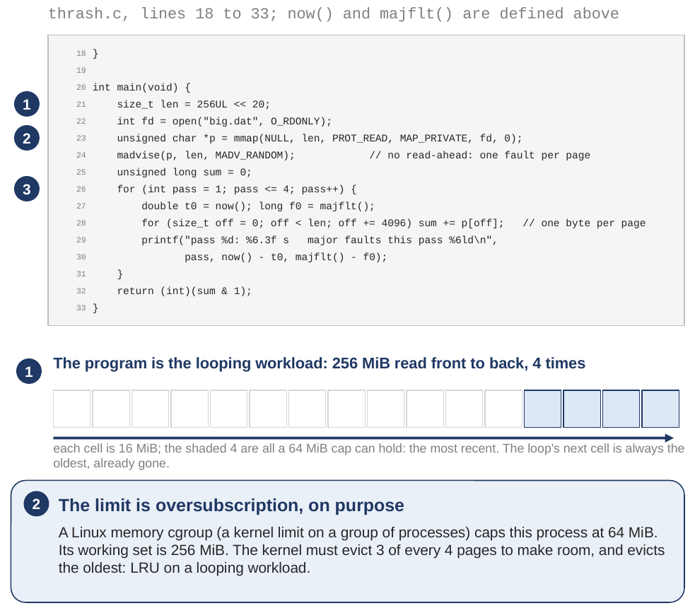{width=79%}
<figcaption markdown="1">Figure 111. thrash.c, lines 18 to 33: map a 256 MiB file, read one byte from every page front to back four times, and time each pass while counting major faults. From slide 72.</figcaption>
</figure>

Here is what the program does; the source is at the end of this part. It maps a 256 MiB file, `big.dat`, into its address space. It tells the kernel not to read ahead, so every page has to fault on its own. Then it makes four passes. In each pass it reads one byte from every page, front to back, adding the bytes into a sum so the compiler cannot skip the reads. Around each pass it records the time and the major-fault count. Then it prints how long the pass took and how many major faults it cost. There are 256 MiB ÷ 4 KiB = 2^28 ÷ 2^12 = 2^16 = 65,536 pages, so a pass that reads every page from disk is 65,536 major faults.

<figure markdown="1">
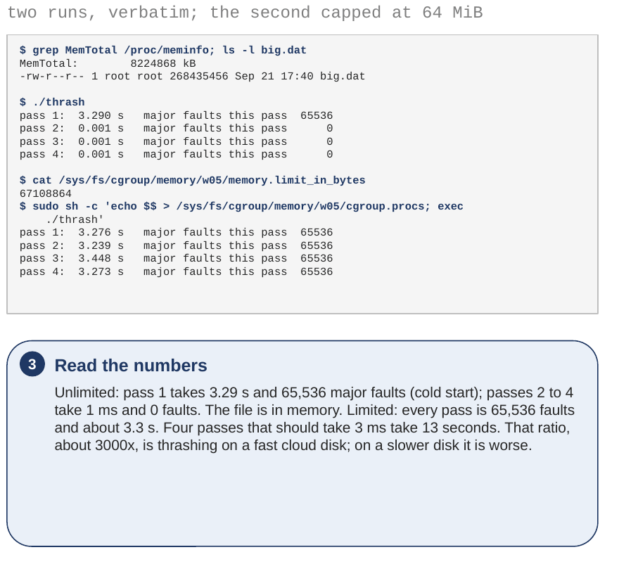{width=70%}
<figcaption markdown="1">Figure 112. Two runs of thrash, verbatim: unlimited, and inside a 64 MiB memory cgroup (a Linux memory limit, explained below); and the drawing of why the capped run misses every time. From slide 72.</figcaption>
</figure>

The capture first shows the machine's total memory (MemTotal 8,224,868 kB, which is 8,224,868 ÷ 1,048,576 = 7.8 GiB, the number quoted in [Section 4.1](#sec-4-1)) and the file (268,435,456 bytes, which is 256 × 2^20, 256 MiB). Then the unlimited run: pass 1 takes 3.290 s and 65,536 major faults, the cold start, because every page had to come from disk; passes 2, 3 and 4 take 0.001 s each and 0 faults. The whole file stayed in memory after the first pass, and 8 GiB has room for 256 MiB many times over.

The second run is the same program inside a **cgroup**, a Linux feature that puts a limit on a group of processes; here `memory.limit_in_bytes` is 67,108,864, which is 64 × 2^20, 64 MiB. (The `sudo sh -c '...'` line moves the shell into the cgroup and then runs `thrash` in it; you do not need to read it.) Now every pass takes about 3.3 s (3.276, 3.239, 3.448, 3.273) and 65,536 major faults. Nothing stays in memory.

The drawing explains why. The file is 16 cells of 16 MiB; the cap holds 4 of them, the most recent. The loop always wants the oldest cell next, and that cell was just thrown out to make room for the newest. The kernel must evict 3 of every 4 pages to stay under the cap, and it evicts the oldest: LRU on a looping workload, the 0% of [Extra 10](#extra-10), with a disk under it.

Read the numbers once more. With room, passes 2 to 4 take 3 ms in all. Without room, they take about 10 s (3.239 + 3.448 + 3.273 = 9.96 s). That ratio, 9.96 s ÷ 0.003 s, is about 3300; call it 3000 times slower, and that is thrashing on a fast cloud disk. On a slower disk it is worse. No policy fixes this, because the program needs four times more memory than it has (256 MiB against 64 MiB).

??? note "The program behind Figures 111 and 112 (you can skip this listing)"

    The slide shows lines 18 to 33 (line 18 is the closing brace of the second helper); the two helpers are here in full. `now()` reads a clock (`clock_gettime` with `CLOCK_MONOTONIC`, a clock that only goes forward) into a record `t` of type `struct timespec`, which holds whole seconds (`tv_sec`) and nanoseconds (`tv_nsec`), and returns seconds as a decimal number (`1e9` is 10^9, so dividing the nanoseconds by it gives seconds). `majflt()` returns the major-fault counter from `getrusage` as in [Extra 8](#extra-8). `unsigned char *p` is a pointer to unsigned bytes. `sum += p[off]` adds the byte at offset `off`. `%6.3f` prints a decimal number with three places. `return (int)(sum & 1)` returns the lowest bit of the sum as the exit status (the number a program leaves behind when it ends; [Section 6.2](#sec-6-2) says more); it is only there so the compiler must keep the reads.
    
    ```c
    // thrash.c: read a 256 MiB file through mmap, pass after pass, and time each
    // pass while counting major faults. Run it normally, then inside a memory
    // cgroup limited to 64 MiB, so the working set (256 MiB) cannot fit.
    #include <stdio.h>
    #include <stdlib.h>
    #include <fcntl.h>
    #include <unistd.h>
    #include <time.h>
    #include <sys/mman.h>
    #include <sys/resource.h>
    
    static double now(void) {
        struct timespec t; clock_gettime(CLOCK_MONOTONIC, &t);
        return t.tv_sec + t.tv_nsec / 1e9;
    }
    static long majflt(void) {
        struct rusage r; getrusage(RUSAGE_SELF, &r); return r.ru_majflt;
    }
    
    int main(void) {
        size_t len = 256UL << 20;
        int fd = open("big.dat", O_RDONLY);
        unsigned char *p = mmap(NULL, len, PROT_READ, MAP_PRIVATE, fd, 0);
        madvise(p, len, MADV_RANDOM);            // no read-ahead: one fault per page
        unsigned long sum = 0;
        for (int pass = 1; pass <= 4; pass++) {
            double t0 = now(); long f0 = majflt();
            for (size_t off = 0; off < len; off += 4096) sum += p[off];   // one byte per page
            printf("pass %d: %6.3f s   major faults this pass %6ld\n",
                   pass, now() - t0, majflt() - f0);
        }
        return (int)(sum & 1);
    }
    ```
    
    On the Ubuntu 24.04 x86-64 machine: make the file with `dd if=/dev/urandom of=big.dat bs=1M count=256`, build with `gcc -O2 -o thrash thrash.c`, drop the file cache (needs `sudo`), and run `./thrash` for the first capture. The capped run needs a memory cgroup, which needs `sudo`; on a machine with cgroup version 2 the one-line form is `sudo systemd-run --scope -p MemoryMax=64M ./thrash`. Your times will differ with your disk; the fault counts (65,536, then 0, then 65,536 every pass) will not.
