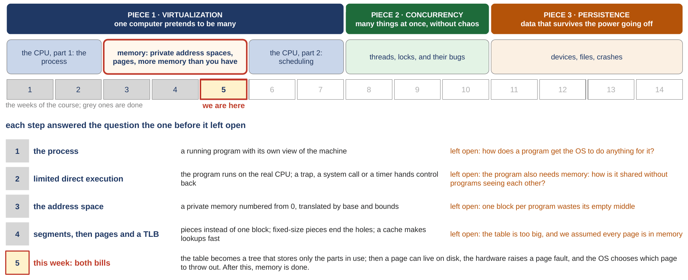
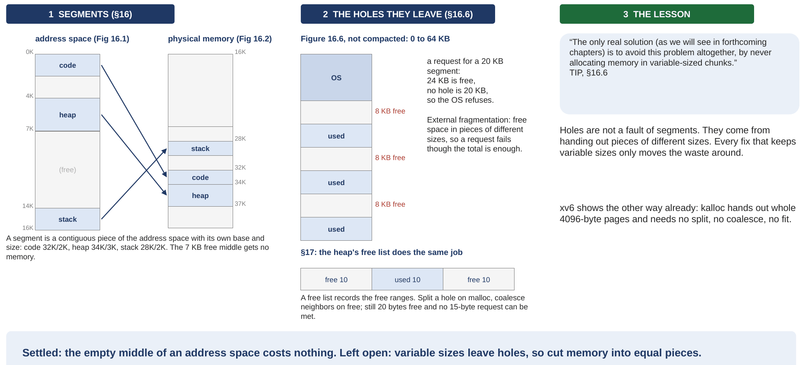
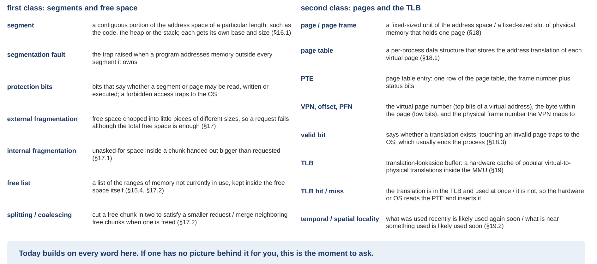

# Memory: smaller tables, and more memory than you have

*Self-study guide · COMP3430 Operating Systems*

## Where this guide comes from {#source}

This guide comes from chapters 20, 21 and 22 of the textbook (OSTEP: *Operating Systems: Three Easy Pieces*) and from the xv6 source code you use in the labs, and it follows the slides of the week in order, with the same pictures (this guide calls the set of slides the deck). It also comes from small programs that were run on two real machines: an Ubuntu 24.04 x86-64 machine in the cloud, and xv6 under QEMU on RISC-V. (x86-64 and RISC-V are two families of processor. xv6 and QEMU are the teaching operating system and the simulator you use in the labs. Sections [3.1](class-1.md#sec-3-1) and [3.2](class-1.md#sec-3-2) explain the names; until then they are just the names of the two machines.) Where a figure, a number or a line of code comes from one of those, the guide says so, so you can look it up later if you want to go deeper.

## How to read this guide {#contents}

The label in brackets says what kind of section it is: a **Problem** section states what we have, where it breaks and what we need, before any fix; a **Concept** section explains the idea that answers it; a **Worked example** runs the idea on small numbers; a **Real kernel** section reads the xv6 code; a **Real machine** section reads an output captured on a real computer; **Check yourself** and **Your turn** are for you to do before reading on; **Extra** sections are optional and go deeper on a question already answered.

The navigation on the left lists every class and chapter of this week; the table of contents on the right lists the sections of the page you are on. Every section number in the text ("Section 3.5", "Extra 4") is a link.

## Part 0. Where we are in the course, and what the paging week taught {#part-0}

This part does two jobs before the new material starts. It shows where this week sits in the whole course, and it rebuilds the previous week, the paging week, with every word of it defined again. Everything later in this guide uses those words without stopping to define them, so if one of them is shaky, this is the place to fix it.

A few words first, so the map can be read. The **operating system** (the **OS**) is the program that runs the computer and shares it between all the other programs; its core is called the **kernel**, and this guide uses the two words interchangeably. A **process** is a running program. **RAM** is the computer's main memory, a long row of bytes, and an **address** is the position number of one byte in that row ([Appendix A](appendix.md#appendix-a) says more about addresses and the numbers used to write them). A **KB** (kilobyte) is 1024 bytes. A program's **code** is its instructions, kept in memory like everything else. An **array** is a row of equal-sized slots reached by position number, like the houses on one side of a street, and a **data structure** is any way of arranging data in memory, such as an array or a list. A **load** is an instruction that reads a value from memory, and a **store** is one that writes a value to memory.

#### The course map

<figure markdown="1">
{width=100%}
<figcaption markdown="1">Figure 1. The whole course on one page: the three pieces, the five blocks, the weeks with this one marked, and the question each week left open. From slide 2.</figcaption>
</figure>

An operating system has three big jobs, and the course takes them in order. The first is **virtualization**: one computer pretends to be many, so every program behaves as if it had its own processor and its own memory. The second is **concurrency**: many things happen at the same time without making a mess of each other. The third is **persistence**: data survives when the power goes off. They are the three colored bands at the top of Figure 1.

The second row of Figure 1 cuts the course into five blocks. Virtualization takes the first three. Block 1 is the processor from the process's point of view (the first two weeks). Block 2 is memory, marked in red: the third, fourth and fifth weeks. Block 3 goes back to the processor to ask which program should run next. Block 4 is concurrency, and block 5 is files and devices. This week is the fifth, the cell marked "we are here", and the last week of memory.

The lower half of Figure 1 is the reason the weeks come in this order: each one answered the question the one before it left open. A process needed a way to ask the OS for things, so the course built system calls and traps. A **system call** is a program's request to the OS. A **trap** is the processor stopping a program and handing control to the OS, which is how a system call reaches it. Then a process needed memory of its own, so the course built the **address space**: a private memory for each process, numbered from 0, so that no process can see or damage another's. The addresses a process uses are **virtual addresses**; the real positions in RAM are **physical addresses**; and turning one into the other on every access is called **address translation**. The first way to translate was **base and bounds**: the processor adds one number (the base) to every address and checks it against another (the bound). That left one complaint, and the paging week answered it. The paging week in turn left two questions open, and this week answers both.

#### The paging week, first class: segments, holes, and fixed sizes

The complaint about base and bounds was simple. A process's address space has its code at the bottom, a stack at the top (the stack is defined in the next paragraph), and a large empty middle. Base and bounds has only one base and one bound per process, so it can only place the address space as one unbroken block, and the empty middle takes real RAM while holding nothing.

<figure markdown="1">
{width=100%}
<figcaption markdown="1">Figure 2. The first class of the paging week, drawn: segments placed separately, the holes they leave, the heap's free list, and the lesson (each is defined in the text below). From slide 3, following textbook chapters 16 and 17.</figcaption>
</figure>

The first fix was **segments**. A **segment** is a contiguous portion of the address space (one unbroken stretch of addresses) of a particular length, such as the code, the heap or the stack; the textbook's example has those three. The **heap** is the memory a program asks for while it runs, and the **stack** holds the data of its function calls (a **function** is a named piece of a program that other parts can run). Each segment gets its own base and its own size, so each one is placed in physical memory on its own, and the empty middle is not placed at all. On the left of Figure 2, a 16 KB address space has code at 0 to 2 KB, heap at 4 to 7 KB and stack at 14 to 16 KB. The three segments land at 32 KB, 34 KB and 28 KB of physical memory, and the unused parts of the address space, 2 to 4 KB and the 7 KB gap between heap and stack (14 − 7 = 7), cost nothing. Two words came with segments. A **segmentation fault** is the trap the hardware raises when a program uses an address outside every segment it owns. **Protection bits** say whether a segment may be read, written or executed (run as code); a forbidden access traps to the OS.

Segments fixed the empty middle and created a new problem, shown in the middle of Figure 2. Segments come in different sizes, so as they come and go, free memory breaks into little holes between them. In the drawing 24 KB is free, in three holes of 8 KB each (3 × 8 = 24), yet a request for a 20 KB segment fails, because no single hole is 20 KB. This is **external fragmentation**: free space chopped into pieces of different sizes, so that a request fails even though the total free space would be enough. "External" means the waste is between the pieces handed out.

The memory allocator inside a program (the code behind `malloc`, which hands out pieces of the heap) has the same problem, and the second half of that class studied it. It keeps a **free list**, a list of the ranges of memory not currently in use, stored inside the free space itself. To hand out a small piece it **splits** a free chunk in two; when a piece comes back it **coalesces** it, merging it with free neighbors into one bigger chunk. In the small heap at the bottom of Figure 2, 20 bytes are free but in two separate pieces of 10, so a request for 15 bytes still fails. The opposite kind of waste got a name too: **internal fragmentation** is unused space inside a piece that was handed out bigger than what was asked for.

The lesson, on the right of Figure 2, is the reason the second class exists. Holes do not come from segments; they come from handing out pieces of different sizes, and every fix that keeps variable sizes only moves the waste around. The textbook's advice is to never allocate memory in variable-sized chunks at all. So: cut memory into equal pieces.

#### The paging week, second class: pages, the page table, and the TLB

<figure markdown="1">
{width=100%}
<figcaption markdown="1">Figure 3. The second class of the paging week, drawn: one address translated through a page table, one entry of that table and the two problems it brings, and the TLB, a cache that speeds translation up (each is defined in the text below). From slide 4, following textbook chapters 18 and 19.</figcaption>
</figure>

Cutting memory into equal pieces is called **paging**. A **page** is a fixed-size unit of the address space. A **page frame** (or just **frame**) is a fixed-size slot of physical memory, exactly as big as a page, that can hold one page. Because every page fits every frame, any page can go into any free frame, and holes cannot form.

Now the processor needs to know which frame holds each page. That is the job of the **page table**: a per-process data structure that stores the translation of each virtual page, that is, which frame holds it. One row of the page table is a **page table entry**, a **PTE**. To translate an address, the hardware cuts it in two. The top bits are the **virtual page number** (**VPN**): which page. The low bits are the **offset**: which byte inside that page. The PTE for that VPN gives the **physical frame number** (**PFN**), and the physical address is the PFN glued in front of the same offset.

The left of Figure 3 is the tiny example from that week: a 64-byte address space with 16-byte pages, so 64 ÷ 16 = 4 pages, 2 bits of VPN (2^2 = 4) and 4 bits of offset (2^4 = 16). Address 21 is 01 0101 in binary (16 + 4 + 1 = 21). Its VPN is 01, page 1, and its offset is 0101, byte 5. The page table says page 1 is in frame 7, which is 111 in binary. Glue 111 in front of 0101 and you get 1110101, which is 117. Check it a second way: frame 7 starts at 7 × 16 = 112, and byte 5 of it is 112 + 5 = 117. The three moves have a short name that this guide keeps using: split, look up, glue.

The middle of Figure 3 is one PTE. Besides the frame number it holds status bits. The **valid bit** says whether this virtual page exists at all; touching an invalid page traps to the OS, which usually ends the process. The **protection bits** (R, W, X) say what may be done to the page, and the U bit says whether an ordinary user program may touch it. Then the two problems paging brought. It is too big: the table has one row for every page the process could possibly have, which on a 64-bit machine is far more memory than any computer has ([Section 1.1](class-1.md#sec-1-1) does that multiplication). And it is too slow: every load or store first has to read a PTE from memory, so every memory access becomes two.

The paging week fixed the slow problem with hardware, on the right of Figure 3. The **TLB** (translation-lookaside buffer) is a small, very fast cache of recent translations, kept inside the processor's **MMU** (memory management unit, the hardware that translates every address). A **cache** is any small, fast memory that keeps copies of things used recently, so the next use is quick. A **TLB hit** means the translation is already in the TLB and is used at once, without touching the page table. A **TLB miss** means it is not, so the page table is read, the translation is put into the TLB, and the access is tried again. In the example, a program reads ten 4-byte numbers that sit next to each other in memory, starting at address 100, with 16-byte pages. The numbers sit at addresses 100, 104, 108, and so on up to 136 (100 + 9 × 4 = 136). Page 6 covers addresses 96 to 111 (6 × 16 = 96), so it holds the first 3 numbers; page 7 covers 112 to 127 and holds the next 4; page 8 covers 128 to 143 and holds the last 3. Only the first touch of each page misses: miss, hit, hit, miss, hit, hit, hit, miss, hit, hit, which is 7 hits out of 10, 70 percent.

The TLB works because programs have **locality**. **Temporal locality** means something used recently is likely to be used again soon, like the instructions of a loop. **Spatial locality** means something near what was just used is likely to be used soon, like the next element of an array. Locality comes back next class, as the reason one replacement rule beats another.

#### Last week's words, in one place

<figure markdown="1">
{width=100%}
<figcaption markdown="1">Figure 4. Last week's words, each in one sentence. From slide 5.</figcaption>
</figure>

Figure 4 is the list from the slides, with the textbook section where each word is defined. These are the words the rest of this guide builds on. Some later parts repeat a definition as a reminder; the meaning never changes.

#### What the paging week settled, and what it left open

Settled: pages end the holes, and the TLB makes most lookups fast. Left open, two things. The page table is far too big, because it has a row for every possible page. And every drawing so far quietly assumed that every page of every process sits in RAM. This week answers both: the first class shrinks the table (the first class's opening section to [Extra 5](class-1.md#extra-5)), and the second class lets pages live on disk (the second class's opening section to [Extra 11](class-2.md#extra-11)).
