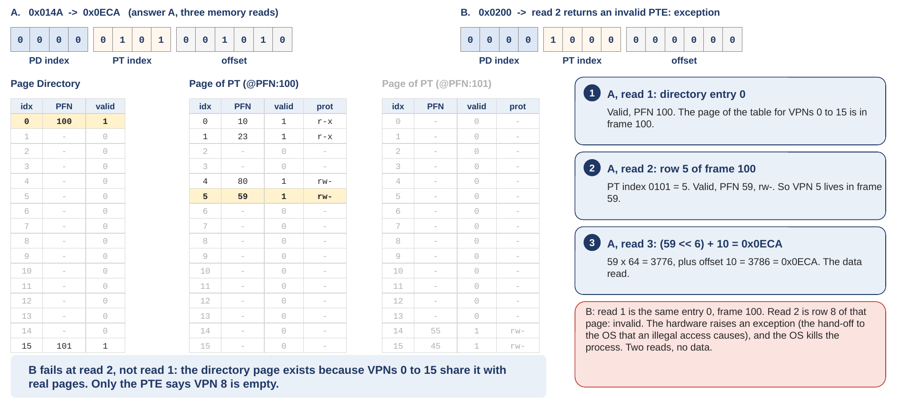
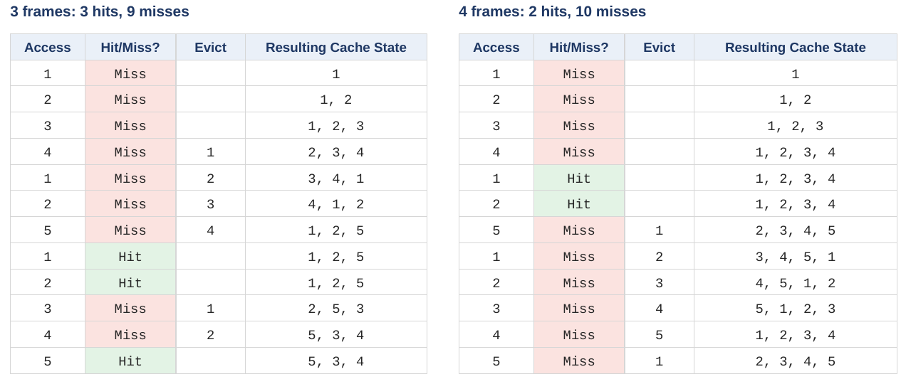
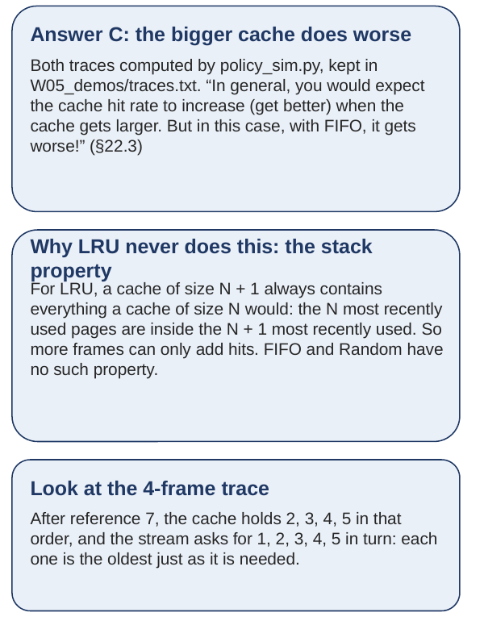

# Exercises and answers

## The week in fifteen sentences {#the}

A linear page table is an array with one entry per virtual page, used or not, so its size follows the address space and not the program: 4 MB per process at 32 bits, 256 GiB at 64. Bigger pages shrink it by a constant and waste memory inside every page; a table per segment brings the holes back. The multi-level page table chops the table into page-sized pieces, keeps only the pieces that hold a valid entry, and records which pieces exist in a page directory. So table memory grows with use, and every piece fits in any free frame. The price is one extra memory read per level on every TLB miss, and nothing on a hit. Every level must fit in one page, which fixes the number of levels: three of 9 bits on RISC-V Sv39, four on x86-64. xv6 walks all three with one loop, `walk`, whose three entries we read by hand in a running process as 001, 001 and 017. A present bit in the entry lets a valid page live on disk. The hardware raises a page fault when it meets present = 0, and the OS handler finds a frame, reads the page in, fixes the entry and retries, while the process never notices. xv6 has no disk to read from but runs the same handler, `vmfault`, to deliver pages it promised lazily, and Linux counts every such delivery as a minor fault and every disk read as a major one. Memory is a cache for pages, so the replacement policy's job is to minimize misses, and a miss costs so much more than a hit that even a small miss rate dominates the average. Optimal evicts the page needed furthest in the future and cannot be built; FIFO and Random ignore history. LRU uses history and matches optimal when locality holds, but a loop one page larger than memory defeats it completely. Exact LRU is too expensive, so real kernels approximate it with a use bit and a clock hand. When the running programs need more memory than exists, no policy helps: the system thrashes, and Linux's answer is to kill a process, which is what exit status 137 means.

## Exercises {#exercises}

Do these with a pencil, and with the figures of the parts they name beside you. The answers follow, worked in full. Try each one before you look.

**Exercise 1.** With the tables of Figure 23 (the textbook's Figure 20.5, 64-byte pages, 4-byte entries), translate the virtual address 0x014A. Split it into the three fields, read the directory entry, read the page table entry, append the offset, and write the physical address in hex. Say how many memory reads it took.

**Exercise 2.** With the same tables, translate 0x0200. Somewhere along the way one of the reads comes back different from what you expect. Say which read, and what the hardware does then.

**Exercise 3.** On xv6 (Sv39), a load whose translation is not in the TLB: count every memory read the hardware makes before the program's own data arrives. Then the same load when the TLB has the translation. Then the same load on x86-64 (four levels) on a TLB miss, and on a machine with the 57-bit, five-level mode.

**Exercise 4.** Run FIFO on the stream 1, 2, 3, 4, 1, 2, 5, 1, 2, 3, 4, 5, as in [Section 5.3](class-2.md#sec-5-3) (oldest on the left, evict the leftmost when full), once with a cache of 3 frames and once with 4. Before you compute, write down which cache you expect to miss less. Then count the misses for each and compare.

**Exercise 5.** With the tables of Figure 23 again, translate 0x3FC5. Give the physical address in hex, checked two ways (by bits and by multiplication), and the number of memory reads.

**Exercise 6.** Two readings from the real captures. First, [Section 3.6](class-1.md#sec-3-6)'s read 2 returned the entry 0x0000000021fc7401 from the middle page. Using the method of [Section 3.2](class-1.md#sec-3-2), and without looking back at [Section 3.6](class-1.md#sec-3-6), decode it: what are its ten flag bits in hex, which named bits are set, is it a leaf, and what physical address does `PTE2PA` give? Second, in Figure 42 (the `info mem` capture), read the row for virtual address 0x7000: which frame holds it, which of the seven attribute letters are set, and has the program touched that page yet?

**Exercise 7.** A program on the Ubuntu 24.04 x86-64 machine reserves 1 GiB with `mmap` as in [Extra 4](class-1.md#extra-4) (an optional part; read it first, it takes about ten minutes). Then it writes one byte at offset 0, one byte at offset 512 MiB, and one byte at offset 1 GiB − 4 KiB (the last page). By how many kB will VmPTE grow? Say how many leaf pages and how many middle pages are built, and why.

**Exercise 8.** Run LRU on the stream of Exercise 4 (1, 2, 3, 4, 1, 2, 5, 1, 2, 3, 4, 5) with a cache of 3 frames, least recently used on the left, moving a page to the right end on a hit. Count the hits. Then explain, in one or two sentences, why LRU with 4 frames cannot do worse than LRU with 3 on any stream, and why FIFO can.

**Exercise 9.** In your own words, in about six sentences, explain three things to a friend who has not taken this course. First, why the textbook says a page fault "really should be called a page miss". Second, what the difference is between an entry with valid = 0 and an entry with valid = 1 and present = 0, and what the OS does in each case. Third, why xv6, which has no swap space, still has a page-fault handler.

## Answers {#answers}

**Answer 1.** 0x014A in binary: 0 = 0000, 1 = 0001, 4 = 0100, A = 1010, so 0000 0001 0100 1010; drop the two leading zeros for the 14-bit address: 00 0001 0100 1010. Split: PDIndex = 0000 = 0, PTIndex = 0101 = 5, offset = 001010 = 8 + 2 = 10. Check the VPN: the top 8 bits are 0000 0101 = 5, so the address is 10 bytes into VPN 5, which is a heap page. Read 1: directory entry 0 is valid, PFN 100, so the page of the table for VPNs 0 to 15 is in frame 100. Read 2: row 5 of frame 100 is valid, PFN 59, `rw-`; so VPN 5 lives in frame 59. Read 3: (59 << 6) + 10. By bits: 59 = 11 1011; append six zeros: 11 1011 000000; add 1010: 11 1011 001010; regroup in fours from the right: 1110 1100 1010 = 0xECA. By multiplication: 59 × 64 = 3776, plus 10 = 3786; 3786 ÷ 16 = 236 remainder 10 (A), 236 ÷ 16 = 14 remainder 12 (C), 14 ÷ 16 = 0 remainder 14 (E): 0xECA, written 0x0ECA as a 14-bit value. Three memory reads: the directory entry, the page table entry, the data. Figure 113 is the deck's answer slide. The three wrong candidates. 0x0DCA goes to frame 101, the page the directory did not point at, and takes the frame of its stack row, 55: (55 << 6) + 10. (Row 5 of frame 101 is in fact invalid; this answer mixes up the two pages of the table.) 0x190A uses the directory's frame number 100 as if it were the data frame, (100 << 6) + 10, one read too few. "An exception" claims VPN 5 is unused, but the heap is VPNs 4 and 5.

<figure markdown="1">
{width=100%}
<figcaption markdown="1">Figure 113. The deck's answers to Exercises 1 and 2: 0x014A translates to 0x0ECA in three reads; 0x0200 fails at read 2 with an invalid entry. From slide 20.</figcaption>
</figure>

**Answer 2.** 0x0200 in binary: 0000 0010 0000 0000, or 00 0010 0000 0000 as 14 bits. Split: PDIndex = 0000 = 0, PTIndex = 1000 = 8, offset = 000000 = 0. VPN = 0000 1000 = 8, the first byte of VPN 8. Read 1 is the same directory entry 0 as in Exercise 1: valid, frame 100. Read 2 is row 8 of frame 100: invalid. The hardware cannot go on. It raises an exception (Figure 20.6, line 23), control passes to the OS, and the OS kills the process, because VPN 8 was never part of its address space. Two reads, no data. The failure is at read 2, not read 1: the directory page for VPNs 0 to 15 exists, because VPNs 0, 1, 4 and 5 share it with real pages, and only the page table entry can say that VPN 8 is empty.

**Answer 3.** On Sv39 on a miss: one read per level, three levels, then the data: 3 + 1 = 4 memory reads. On a hit: the TLB supplies the frame number, the offset is appended, and only the data is read: 1. On x86-64 on a miss: 4 + 1 = 5. With five levels: 5 + 1 = 6. The gap between 1 and 4 is why the TLB exists, and each extra level widens it by one.

**Answer 4.** Most people expect the bigger cache to miss less. With 3 frames: references 1, 2, 3 (pages 1, 2, 3) miss and fill the cache: 1, 2, 3. Reference 4 (page 4) misses, 1 goes: 2, 3, 4. Reference 5 (page 1) misses, 2 goes: 3, 4, 1. Reference 6 (page 2) misses, 3 goes: 4, 1, 2. Reference 7 (page 5) misses, 4 goes: 1, 2, 5. Reference 8 (page 1) hits. Reference 9 (page 2) hits. Reference 10 (page 3) misses, 1 goes: 2, 5, 3. Reference 11 (page 4) misses, 2 goes: 5, 3, 4. Reference 12 (page 5) hits. Total: 3 hits (references 8, 9, 12), 9 misses; check 3 + 9 = 12. With 4 frames: references 1 to 4 miss and fill the cache: 1, 2, 3, 4. References 5 and 6 (pages 1, 2) hit. Reference 7 (page 5) misses, 1 goes: 2, 3, 4, 5. Reference 8 (page 1) misses, 2 goes: 3, 4, 5, 1. Reference 9 (page 2) misses, 3 goes: 4, 5, 1, 2. Reference 10 (page 3) misses, 4 goes: 5, 1, 2, 3. Reference 11 (page 4) misses, 5 goes: 1, 2, 3, 4. Reference 12 (page 5) misses, 1 goes: 2, 3, 4, 5. Total: 2 hits (references 5, 6), 10 misses; check 2 + 10 = 12. The bigger cache misses more: 10 against 9. That is Belady's anomaly. Figures 114 and 115 are the deck's answer slide. Look at the 4-frame trace after reference 7: the cache holds 2, 3, 4, 5 in that order, and the stream then asks for 1, 2, 3, 4, 5 in turn. Each request misses and evicts the oldest page, which is exactly the page the next request will ask for. Every page is thrown out one step before it is needed.

<figure markdown="1">
{width=100%}
<figcaption markdown="1">Figure 114. The deck's answer to Exercise 4: both FIFO traces, 3 hits and 9 misses with 3 frames against 2 hits and 10 misses with 4. From slide 56, following the aside in textbook section 22.3.</figcaption>
</figure>

<figure markdown="1">
{width=48%}
<figcaption markdown="1">Figure 115. The deck's cards for Exercise 4: the anomaly named, why LRU never shows it (the stack property), and what to look at in the 4-frame trace. From slide 56, following the aside in textbook section 22.3.</figcaption>
</figure>

**Answer 5.** 0x3FC5 in binary: 3 = 0011, F = 1111, C = 1100, 5 = 0101, so 0011 1111 1100 0101, or 11 1111 1100 0101 as 14 bits. Split: PDIndex = 1111 = 15, PTIndex = 1111 = 15, offset = 000101 = 5. VPN = 1111 1111 = 255, the last page, a stack page, 5 bytes in. Read 1: directory entry 15 is valid, PFN 101. Read 2: row 15 of frame 101 is VPN 240 + 15 = 255, valid, PFN 45, `rw-`. Read 3: (45 << 6) + 5. By bits: 45 = 10 1101; append six zeros and add 000101: 10 1101 000101; regroup: 1011 0100 0101 = 0xB45. By multiplication: 45 × 64 = 2880, plus 5 = 2885; 2885 ÷ 16 = 180 remainder 5, 180 ÷ 16 = 11 remainder 4, 11 ÷ 16 = 0 remainder 11 (B): 0xB45. Both agree. Three memory reads.

**Answer 6.** First reading. The low three hex digits of 0x21fc7401 are 401 = 0100 0000 0001. The lowest 10 of those 12 bits are 00 0000 0001, so the flags are 0x001: only bit 0, V, is set; R, W, X and U are all clear. An entry with V set and R, W and X clear is not a leaf; it points at another page-table page. The two bits above the flags are 01 = 1, so the PPN is 0x21fc7 × 4 + 1 = 0x87f1c + 1 = 0x87f1d, and `PTE2PA` gives 0x87f1d000, the leaf page. Second reading. The row for 0000000000007000 in Figure 42 says paddr 0000000087f53000, so frame 0x87f53 holds it; the attributes are `rw-u---`: read, write and user set, execute, global, accessed and dirty clear. The accessed letter is clear, so the program has not touched that page since it was mapped; pgdemo grew its heap and never wrote into it.

**Answer 7.** One leaf page of the table covers 512 entries × 4 KiB = 2 MiB, so the GiB is 1 GiB ÷ 2 MiB = 512 regions, numbered 0 to 511. Offset 0 is in region 0. Offset 512 MiB is region 512 MiB ÷ 2 MiB = 256. Offset 1 GiB − 4 KiB is in the last region, 511. Three different regions, so three leaf pages. One middle page covers 512 leaf pages, that is, a whole GiB, and the levels above it already exist ([Extra 4](class-1.md#extra-4)). If the reserved GiB sits inside one middle page's span, as it did in every run of [Extra 4](class-1.md#extra-4), one middle page serves all three leaves: 3 + 1 = 4 pages, and 4 × 4 kB = 16 kB. If the kernel happens to place the GiB across the boundary between two middle pages' spans, two middle pages are needed: 3 + 2 = 5 pages, 20 kB. So VmPTE grows by 16 kB, or by 20 kB in the straddling case; the leaf count, 3, is the same either way. (Touching a fourth byte anywhere inside those same three regions would add nothing.)

**Answer 8.** LRU with 3 frames, least recent on the left. References 1, 2, 3 miss: 1, 2, 3. Reference 4 (page 4) misses, 1 goes: 2, 3, 4. Reference 5 (page 1) misses, 2 goes: 3, 4, 1. Reference 6 (page 2) misses, 3 goes: 4, 1, 2. Reference 7 (page 5) misses, 4 goes: 1, 2, 5. Reference 8 (page 1) hits, 1 moves right: 2, 5, 1. Reference 9 (page 2) hits: 5, 1, 2. Reference 10 (page 3) misses, 5 goes: 1, 2, 3. Reference 11 (page 4) misses, 1 goes: 2, 3, 4. Reference 12 (page 5) misses, 2 goes: 3, 4, 5. Total: 2 hits, 10 misses. Why 4 frames cannot do worse: LRU keeps exactly the N most recently used pages. The 3 most recently used pages are always among the 4 most recently used. So everything the 3-frame cache holds, the 4-frame cache also holds, at every moment. A hit in the small cache is therefore a hit in the big one, and the big one can only add hits. That is the stack property. FIFO keeps the N most recently arrived pages. A page's arrival time depends on when it was last evicted, which differs between the two cache sizes. So the contents of the 3-frame cache need not be inside the 4-frame cache, and Exercise 4 is a stream where they are not.

**Answer 9.** A model answer, a little longer than six sentences. When a program touches a page that it is allowed to use but that the OS has moved out to disk, the hardware cannot finish the access, so it stops and hands the problem to the OS. The program did nothing wrong, so the honest name would be a page miss, like a cache miss. It is called a fault because the hardware uses the same hand-off it uses for real errors, and the legal case inherited the name. An entry with valid = 0 means the program has no such page at all, and the OS kills the program, because touching it is a bug. An entry with valid = 1 and present = 0 means the page exists but is on disk right now. The OS finds a free frame, reads the page into it, marks the entry present, and lets the program retry the instruction, which then succeeds. xv6 never moves pages to disk, but it does promise pages it has not built yet: `sbrklazy` raises the program's size without allocating frames, and the first touch of such a page is a page fault. So xv6 needs the handler, `vmfault`, to check that the page was promised, take a free frame, zero it, put an entry in the page table, and retry. That is the textbook's seven lines with a `memset` where the disk read would be.
