# First class: turnaround time against response time: FIFO, shortest job first, preemption, round robin, overlapping I/O (OSTEP 7) {#class-1}

## Chapter 1. Scheduling metrics, and FIFO {#chapter-1}

*The question this chapter answers: How do we judge a schedule, and what does the simplest one do wrong?*

### 1.1 <span class="lbl lbl-problem">Problem</span> The scheduling problem needs a metric {#sec-1-1 data-toc-label="1.1 [Problem] The scheduling problem needs a metric"}

What we have is the mechanism of Part 0: a timer interrupt stops the running process, a context switch starts another, and the scheduler loop picks a ready process. Any one.

Where it breaks is that the choice matters, and nothing measures it. Picture three ready jobs and one CPU. A **job** is one program's run from the moment it arrives until it finishes, as the scheduler sees it. One job is a backup that needs 100 s of CPU. The other two are shell commands that need 10 s each (the shell is the program that reads what you type and runs it; a shell command is one such request). Run the backup first: the commands finish at 110 s and 120 s. Run the commands first: they finish at 10 s and 20 s, and the backup at 120 s. Same work, same machine.

<figure markdown="1">
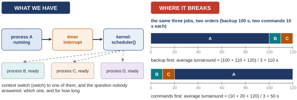{width=100%}
<figcaption markdown="1">Figure 1.1. The two orders of the same three jobs, drawn as timelines. Time runs left to right; each colored bar is one job holding the CPU.</figcaption>
</figure>

Count the average finishing time in each order. Backup first: (100 + 110 + 120) / 3 = 330 / 3 = 110 s. Commands first: (10 + 20 + 120) / 3 = 150 / 3 = 50 s. Check this: 100 + 110 + 120 is 330, and 330 / 3 is 110; 10 + 20 + 120 is 150, and 150 / 3 is 50. The order changed the result by more than a factor of two, and nothing in the mechanism says which order is right.

So we need two things. We need simplifying assumptions about the jobs, so the problem is small enough to think about, and we need one number to compare orders by. A rule for choosing is called a **scheduling policy**; the set of jobs it faces, described by what they need and when they arrive, is the **workload**. The plan for the whole first class is then to drop the assumptions one at a time and fix whatever breaks. The textbook puts the question this way, as the crux of its chapter: how should we develop a basic framework for thinking about scheduling policies, what are the key assumptions, what metrics are important (a metric is a number used to measure something), and what basic approaches have been used in the earliest of computer systems.

- What this part settled: the choice matters by a factor of two.
- What it leaves open: the yardstick itself, which the next part supplies.

### 1.2 <span class="lbl lbl-concept">Concept</span> The workload assumptions, and turnaround time {#sec-1-2 data-toc-label="1.2 [Concept] The workload assumptions, and turnaround time"}

The yardstick comes in two halves: a simplified workload, and a number.

<figure markdown="1">
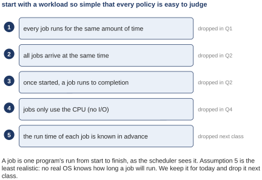{width=73%}
<figcaption markdown="1">Figure 1.2. The five assumptions, with the question that drops each one.</figcaption>
</figure>

Start with a workload so simple that every policy is easy to judge. Assume that:

1. every job runs for the same amount of time,
2. all jobs arrive at the same time,
3. once started, a job runs to completion,
4. jobs only use the CPU and never wait for anything, and
5. the run time of each job is known in advance.

Figure 1.2 says when each assumption goes: 1 in this block of parts, 2 and 3 in the next, 4 in the last block of the first class, and 5 only in the second class. Assumption 5 is the least realistic: no real operating system knows how long a job will run. The first class keeps it because it makes the best rules easy to see.

<figure markdown="1">
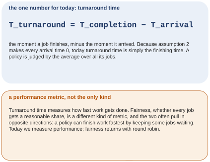{width=72%}
<figcaption markdown="1">Figure 1.3. The one number for the first class, and a note that it is only one kind of number.</figcaption>
</figure>

The number is **turnaround time**: the moment a job finishes minus the moment it arrived, written T_turnaround = T_completion − T_arrival. Because assumption 2 makes every arrival time 0, for now the turnaround time of a job is simply its finishing time; the 110 and the 50 of [Section 1.1](#sec-1-1) were averages of exactly this. A policy is judged by the average turnaround time over its jobs.

Turnaround time is a **performance** metric: it measures how fast work gets done. There is another kind of metric, **fairness**, which asks whether every job gets a reasonable share of the CPU. The two often pull in opposite directions, because the fastest way to finish work is sometimes to keep a few jobs waiting. The first class measures performance; fairness comes back on its own with round robin in [Section 3.2](#sec-3-2).

- What this part settled: a workload and one number.
- What it leaves open: a rule to try the number on. The simplest one is next.

### 1.3 <span class="lbl lbl-concept">Concept</span> FIFO scheduling, and the convoy effect {#sec-1-3 data-toc-label="1.3 [Concept] FIFO scheduling, and the convoy effect"}

The simplest rule is **FIFO**, first in, first out: run jobs in the order they arrived, each one to the end. It is also called first come, first served, like a line at a counter. There is nothing to compute and nothing to predict.

<figure markdown="1">
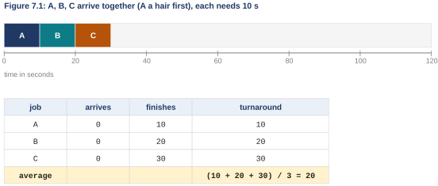{width=92%}
<figcaption markdown="1">Figure 1.4. OSTEP Figure 7.1: three jobs of 10 s under FIFO, and the turnaround times read off the timeline.</figcaption>
</figure>

A, B and C arrive together (A a hair before B, B a hair before C), and each needs 10 s. A runs from 0 to 10, B from 10 to 20, C from 20 to 30. Turnaround: 10, 20, 30; average (10 + 20 + 30) / 3 = 60 / 3 = 20 s. Under the five assumptions this is fine, and no order of three equal jobs can do better, because somebody has to be second and somebody third.

Now drop assumption 1. Jobs no longer all take the same time. Keep the rule and change one job: A now needs 100 s.

<figure markdown="1">
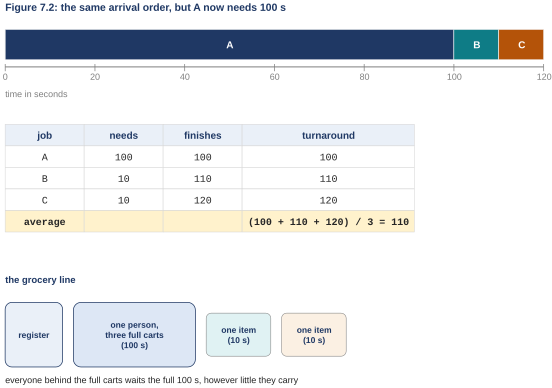{width=92%}
<figcaption markdown="1">Figure 1.5. OSTEP Figure 7.2: the same arrival order with A at 100 s; the table; and the grocery line.</figcaption>
</figure>

A runs first, because it arrived first, and holds the CPU from 0 to 100. B runs from 100 to 110 and C from 110 to 120. B needed 10 s of work and waited 100 s for it; so did C. Average turnaround: (100 + 110 + 120) / 3 = 330 / 3 = 110 s. This failure has a name: the **convoy effect**, short jobs stuck waiting behind one long job, like vehicles in a convoy that all move at the speed of the slowest. FIFO cannot avoid it, because FIFO never looks at how long a job is; it only looks at who came first. The grocery line is the everyday version: one person with three full carts at the register, and everyone behind them waits the full time however little they carry.

The fix is already in the picture: put B and C before A and the same three jobs average 50 s ([Section 1.1](#sec-1-1)). Before making that a rule, the next part shows the convoy on a real machine.

### 1.4 <span class="lbl lbl-machine">Real machine</span> The convoy effect measured: a batch queue on Linux {#sec-1-4 data-toc-label="1.4 [Real machine] The convoy effect measured: a batch queue on Linux"}

A shell script that runs one program after another is a FIFO **batch queue**: jobs submitted to a queue and run in order, each to the end, the way early computers ran everything and the way today's scripts still run things. So the convoy can be measured on a real machine.

*The program `spin.c`, whole (`W06_demos/spin.c`).*

```c linenums="1" hl_lines="8 12 21 23 24 25"
// spin.c: use the CPU for a given number of milliseconds of CPU time, and
// print when the program first ran and when it finished (seconds since a
// shared start time t0).  Usage: ./spin LETTER MS T0
#include <stdio.h>
#include <stdlib.h>
#include <time.h>

static double wall(void) {              /* the clock on the wall */
  struct timespec t; clock_gettime(CLOCK_MONOTONIC, &t);
  return t.tv_sec + t.tv_nsec / 1e9;
}
static double cpu(void) {               /* CPU time this process has used */
  struct timespec t; clock_gettime(CLOCK_PROCESS_CPUTIME_ID, &t);
  return t.tv_sec + t.tv_nsec / 1e9;
}

int main(int argc, char **argv) {
  const char *name = argv[1];           /* a letter for this job */
  double ms = atof(argv[2]);            /* how much CPU time it needs */
  double t0 = atof(argv[3]);            /* the shared start time */
  printf("%s first ran at %.3f s\n", name, wall() - t0); fflush(stdout);
  volatile unsigned long x = 0;
  while (cpu() < ms / 1000.0)           /* compute until ms of CPU are used */
    for (int i = 0; i < 100000; i++) x += i;
  printf("%s finished at %.3f s\n", name, wall() - t0);
  return 0;
}
```

You do not need to follow every line of the program. Here is what it does: you give it a letter, a number of milliseconds, and a shared start time; it prints the moment it first runs, computes until it has used that many milliseconds of CPU, and prints the moment it finished. 

- Lines 8 to 15 are two helpers: `wall()` (line 8) gives the time on the wall clock, and `cpu()` (line 12) gives how much CPU time this process has used so far, which is less than wall time whenever the process is waiting for its turn.
- Line 21 prints the first-run line.
- Lines 23 and 24 are the loop that keeps adding numbers until the CPU time reaches the target; the word `volatile` on line 22 tells the compiler (the program that turns C into machine instructions) that `x`, the variable the loop keeps adding to, matters, so it cannot delete the loop as useless work.
- Line 25 prints the finish line.

In the capture, the command `taskset -c 0` in front of each job pins it to core 0 (a core is one CPU; the Ubuntu machine has several, numbered from 0), so all the jobs compete for one CPU, which is the one-CPU world of this week.

*The capture `batch_fifo.out`, Ubuntu 24.04 x86-64, Linux 6.18.*

```text
$ # FIFO, run to completion: A (1000 ms of CPU), then B (100 ms), then C (100 ms), one after another
$ T0=$(now); for j in "A 1000" "B 100" "C 100"; do taskset -c 0 ./spin $j $T0; done
A first ran at 0.006 s
A finished at 1.005 s
B first ran at 1.007 s
B finished at 1.105 s
C first ran at 1.107 s
C finished at 1.205 s
```

<figure markdown="1">
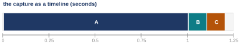{width=100%}
<figcaption markdown="1">Figure 1.6. The capture drawn as a timeline, in seconds.</figcaption>
</figure>

The shell runs A with 1000 ms, then B with 100, then C with 100, one after another. Read the capture: A finished at 1.005 s. B first ran at 1.007 s and finished at 1.105 s. C finished at 1.205 s. B and C each did 0.1 s of work and waited a full second for it. Average turnaround: (1.005 + 1.105 + 1.205) / 3 = 3.315 / 3 = 1.105 s, about 1.1. Check this: 1.005 + 1.105 is 2.110, plus 1.205 is 3.315, and 3.315 / 3 is 1.105. The convoy is real. The next part runs the same three jobs B, C, A and the average falls to 0.5.

**Checkpoint 1.**

- Settled: we judge a schedule by one number, the average turnaround time (finish minus arrival); the simplest rule, FIFO, is fine when jobs are alike and convoys when one long job gets in front, 110 s against 50 in the drawing and 1.1 s against 0.5 on the Ubuntu machine.
- Still open: the order matters by a factor of two, so which order is best, and does it stay best when jobs arrive at different times?
- You should now be able to compute the average turnaround time of a three-job schedule from its timeline, and say what the convoy effect is.

## Chapter 2. Shortest job first, and preemption {#chapter-2}

*The question this chapter answers: If we know how long each job needs, which order is best?*

### 2.1 <span class="lbl lbl-concept">Concept</span> Shortest Job First (SJF) {#sec-2-1 data-toc-label="2.1 [Concept] Shortest Job First (SJF)"}

The fix from the pictures has a name: **SJF**, shortest job first. Of the jobs that are waiting, run the one that needs the least time, to the end; then the next shortest; and so on.

<figure markdown="1">
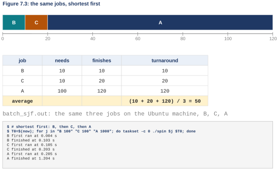{width=92%}
<figcaption markdown="1">Figure 2.1. OSTEP Figure 7.3, the table, and the same three jobs measured in the order B, C, A.</figcaption>
</figure>

B runs from 0 to 10, C from 10 to 20, and A, the 100 s job, from 20 to 120. Turnaround: 10, 20, 120; average (10 + 20 + 120) / 3 = 150 / 3 = 50 s, less than half of 110. When all jobs arrive together, no order beats shortest first: whenever a longer job is put in front of a shorter one, the shorter one waits longer than the longer one would have, and the average goes up.

The capture at the bottom of Figure 2.1 is the same three processes on the Ubuntu machine, now run B, C, A: B finished at 0.103 s, C at 0.203, A at 1.204. Average (0.103 + 0.203 + 1.204) / 3 = 1.510 / 3 = 0.503 s, about 0.5, against 1.105 in arrival order. The same factor of two as the drawing. Stores apply the principle too: an express line for people with few items keeps the average wait down.

- What this part settled: with everyone present at time 0, shortest first is the best order.
- What it leaves open: assumption 2, that everyone is present at time 0, which the next part drops.

### 2.2 <span class="lbl lbl-concept">Concept</span> Preemption, and Shortest Time-to-Completion First (STCF) {#sec-2-2 data-toc-label="2.2 [Concept] Preemption, and Shortest Time-to-Completion First (STCF)"}

What we have is SJF, which makes its decision at one moment: when the CPU becomes free, it picks the shortest waiting job and does not look again until that job is done.

Where it breaks: drop assumption 2, so jobs arrive at any time. A arrives at 0 and needs 100 s; B and C arrive at 10 and need 10 s each. At time 0 the only job is A, so SJF starts A. At 10, B and C arrive, much shorter than what A has left, but assumption 3 says a started job runs to the end, so B and C wait until 100.

<figure markdown="1">
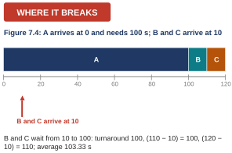{width=50%}
<figcaption markdown="1">Figure 2.2. OSTEP Figure 7.4: late arrivals under SJF, with the arrival of B and C marked.</figcaption>
</figure>

Now the arrival time matters in the formula. A's turnaround is 100. B finishes at 110 and arrived at 10, so its turnaround is 110 − 10 = 100. C finishes at 120, minus 10 is 110. Average (100 + 100 + 110) / 3 = 310 / 3 = 103.33 s. Check this: 310 / 3 is 103 with 1 left over, and 1/3 is 0.33. The convoy is back, and SJF cannot help, because it only decides when a job ends.

So we need to drop assumption 3 as well: permission to stop a running job and come back to it later. That is **preemption**. A scheduler that never stops a running job is **non-preemptive**. And the processes week already built preemption: the timer interrupt takes the CPU away from a running program, and the context switch gives it to someone else. The policy only has to use them when a new job arrives.

Add preemption to SJF and you get **STCF**, shortest time-to-completion first (some people say preemptive shortest job first, PSJF). The rule: whenever a new job arrives, look at every job in the system, including the one running, and run the one with the least time left; if that is not the running job, stop the running job.

<figure markdown="1">
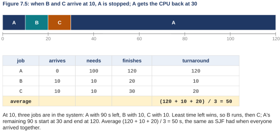{width=92%}
<figcaption markdown="1">Figure 2.3. OSTEP Figure 7.5: STCF on the same jobs, and the table with arrival times subtracted.</figcaption>
</figure>

A starts at 0. At 10, B and C arrive, and now three jobs are in the system: A with 90 s left, B with 10, C with 10. Least time left wins, so A is stopped, B runs from 10 to 20, C from 20 to 30, and A's remaining 90 s run from 30 to 120. Turnaround: A 120 − 0 = 120, B 20 − 10 = 10, C 30 − 10 = 20. Average (120 + 10 + 20) / 3 = 150 / 3 = 50 s, the same 50 that SJF had when everyone arrived together. With preemption and known lengths, this is the best average turnaround there is, by the same exchange argument as [Section 2.1](#sec-2-1) applied at every arrival: whenever a longer remainder runs ahead of a shorter one, swapping them lowers the average. One convention: when two remainders tie, the job already running keeps the CPU.

A word of history. The old batch systems were non-preemptive: a job ran to the end before anything else was considered. Virtually every modern scheduler is preemptive and will stop one process to run another, using exactly the context switch of the processes week.

**Checkpoint 2.**

- Settled: when job lengths are known, shortest first is best for turnaround, as SJF when everyone arrives together and as STCF (shortest remaining time, with preemption) when jobs arrive whenever they like; both give the three-job example an average of 50 s against FIFO's 110.
- Still open: every job so far is judged by when it ends, and a person typing at a terminal (the screen and keyboard through which a person talks to the computer) does not care when the 100 s job ends.
- You should now be able to draw the STCF timeline for three jobs with different arrival times and compute its average turnaround, including the subtraction of the arrival time.

## Chapter 3. Response time, and round robin {#chapter-3}

*The question this chapter answers: What does a person at a keyboard need, and what does it cost?*

### 3.1 <span class="lbl lbl-problem">Problem</span> Response time: a second metric {#sec-3-1 data-toc-label="3.1 [Problem] Response time: a second metric"}

What we have is STCF, the best rule for turnaround, on a time-shared machine: many people at terminals, each expecting the computer to answer when they type.

Where it breaks: three jobs of 5 s arrive together. Shortest first runs them whole, one after another: A from 0 to 5, B from 5 to 10, C from 10 to 15. C's first instruction runs at 10 s. If C is the shell echoing a keystroke, the letter you typed appears on the screen 10 s after you pressed the key.

<figure markdown="1">
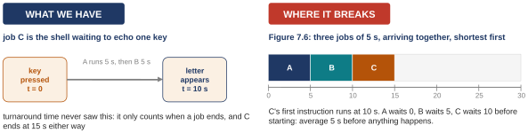{width=100%}
<figcaption markdown="1">Figure 3.1. The typing user, and OSTEP Figure 7.6 (three 5 s jobs under shortest first).</figcaption>
</figure>

A waited 0 before starting, B waited 5, C waited 10: average (0 + 5 + 10) / 3 = 5 s before anything happens. Turnaround time never saw any of this: it only counts when a job ends, and C ends at 15 whatever order we use.

So we need a second number. **Response time** is the moment a job first runs minus the moment it arrived: T_response = T_firstrun − T_arrival. For the three jobs here that is 0, 5 and 10, average 5. The definition is the best case, as if the job answered the instant it first ran. And we need a rule that gets every job started quickly, even if nothing finishes early.

- What this part settled: a second number, and why turnaround could not see the typing user.
- What it leaves open: the rule, which is next.

### 3.2 <span class="lbl lbl-concept">Concept</span> Round robin (RR) {#sec-3-2 data-toc-label="3.2 [Concept] Round robin (RR)"}

The rule that gets everyone started is **round robin** (RR): run a job for a **time slice**, then switch to the next job in the queue, and keep going around until the jobs are done. The slice is also called a **quantum**, and the whole idea is also called time-slicing. One detail: the slice has to be a multiple of the timer-interrupt period, because the timer is what takes the CPU away; if the timer fires every 10 ms, a slice can be 10, 20 or 30 ms, but not 15.

<figure markdown="1">
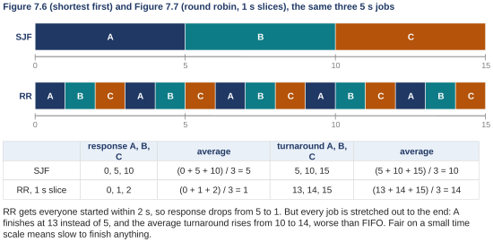{width=92%}
<figcaption markdown="1">Figure 3.2. OSTEP Figures 7.6 and 7.7 on the same three 5 s jobs, and the table of both metrics.</figcaption>
</figure>

The top timeline is shortest first: A, then B, then C, whole. The bottom one is round robin with a 1 s slice: A for 1 s, then B, then C, then A again, and so on around, five rounds in all. Read the table.

- Under round robin, A first runs at 0, B at 1, C at 2: average response (0 + 1 + 2) / 3 = 1 s, instead of 5. That is the win.
- Now the other column: A finishes at 13, B at 14, C at 15, so average turnaround (13 + 14 + 15) / 3 = 42 / 3 = 14.
- Under shortest first the same jobs finished at 5, 10 and 15, average (5 + 10 + 15) / 3 = 30 / 3 = 10; and because the three jobs are equal, FIFO gives the same 10.

So round robin is worse than FIFO here. Round robin stretches every job out to the end, because it only ever runs a short bit of each one. Check this: five rounds of three 1 s slices is 15 s; A's fifth slice is the thirteenth slice overall, so A ends at 13.

So there are two families. Shortest first (SJF, STCF) wins turnaround and loses response. Round robin wins response and loses turnaround. And this is not a flaw to engineer away: any policy that is **fair**, giving every job an even share over a short window, pays in turnaround, because nothing finishes early; any policy that favors short jobs pays in response, because somebody is made to wait. You cannot have both.

- What this part settled: the second family, and the trade-off between the two.
- What it leaves open: the one knob round robin has, the slice length, which is next.

### 3.3 <span class="lbl lbl-concept">Concept</span> The time slice, and the cost of a context switch {#sec-3-3 data-toc-label="3.3 [Concept] The time slice, and the cost of a context switch"}

Round robin has one knob, the slice length. Shorter is better for response. But a switch is not free, so a slice that is too short wastes the CPU on switching.

The word for the cure is **amortization**: a fixed cost that is paid less often becomes a smaller share of the total. If a switch costs 1 ms and the slice is 10 ms, then 1 of every 11 ms goes to switching, roughly 10%; make the slice 100 ms and it is 1 of 101, roughly 1%.

| time slice | switch cost | share of time lost | how |
|---|---|---|---|
| 1 ms | 1.50 µs | 0.150% | 1.50 / 1000 |
| 10 ms | 1.50 µs | 0.015% | 1.50 / 10000 |
| 100 ms | 1.50 µs | 0.002% | 1.50 / 100000 |
| 10 ms | 1 ms | 10% | the example in the tip |
| 100 ms | 1 ms | 1% | the example in the tip |

*The capture `cswitch.out`: one byte back and forth through pipes, on one core. Ubuntu 24.04 x86-64, Linux 6.18.*

```text
$ taskset -c 0 ./cswitch
100000 round trips in 0.299 s: 2.99 microseconds per round trip, about 1.50 per switch
```

*The slices two real kernels use: Linux's round-robin class, then xv6's timer.*

```text
$ cat /proc/sys/kernel/sched_rr_timeslice_ms
100
$ grep -n 1000000 kernel/trap.c      # in the xv6-labs-2025 tree
177:  w_stimecmp(r_time() + 1000000);
```

The table does the arithmetic with a measured number. On the Ubuntu machine a context switch costs about 1.5 µs. In a 1 ms slice that is 1.5 / 1000 = 0.0015, which is 0.15%; in a 10 ms slice, 0.015%; in a 100 ms slice, 0.0015%. Check this: 1 ms is 1000 µs, so 1.5 µs out of 1000 is 0.0015 of the slice, and 0.0015 is 0.15 of a percent. The last two rows of the table are the example in the textbook's tip, with a 1 ms switch.

Here is where 1.5 comes from. Two processes pass one byte back and forth through pipes (a pipe is a one-way channel between two processes; a byte written at one end is read at the other), pinned to one core, 100,000 times. Every hand-off forces a switch, because the writer blocks until the reader answers. The capture says 100,000 round trips took 0.299 s, so one round trip is 0.299 / 100,000 s = 2.99 µs, and a round trip is two switches, so about 1.5 µs each. Check this: 0.299 s is 299,000 µs; 299,000 / 100,000 is 2.99.

There is a cost the capture does not see. While a job runs, it fills the CPU's **caches** (small fast memories inside the processor that keep copies of recently used data) with its data, the TLB (the memory unit's cache of address translations, each one turning an address the program uses into a real position in memory) with its translations, and the branch predictors (the part of the processor that guesses which way each if will go) with its branches. After a switch, the next job finds all of that useless and has to rebuild it. The memory unit measured that kind of cost: a loop that missed the TLB on every access ran several times slower. That is the hidden price of a switch, and it is why real kernels choose slices much longer than 1.5 µs would suggest.

Real kernels choose much longer slices. Linux gives its round-robin scheduling class a slice of 100 ms (Linux has several sets of scheduling rules, called classes; the ordinary one is not round robin, and [Section 7.2](class-2.md#sec-7-2) lists them) (the first line of the last capture, read from the file `/proc/sys/kernel/sched_rr_timeslice_ms`). xv6 switches on every timer tick (a tick is one timer interrupt), and the tick is set in `kernel/trap.c` line 177 to 1,000,000 cycles of the machine's clock. QEMU's clock counts 10,000,000 cycles per second (a design fact of the simulator), so 1,000,000 cycles is 1,000,000 / 10,000,000 = 0.1 s, a tenth of a second.

- What this part settled: the slice is a trade-off with a measured number on one side and a human on the other.
- What it leaves open: nothing new; the next part shows round robin running in a real kernel.

### 3.4 <span class="lbl lbl-kernel">Real kernel</span> Round robin in xv6: scheduler() {#sec-3-4 data-toc-label="3.4 [Real kernel] Round robin in xv6: scheduler()"}

The kernel you use in the lab runs exactly the round-robin rule, and its entire policy fits in one short loop.

*`kernel/proc.c`, the loop inside `scheduler()`, lines 437 to 459 (xv6-labs-2025; lines 422 to 436 are the function's setup).*

```c linenums="437" hl_lines="2 4 8 9 10 21"
    int found = 0;
    for(p = proc; p < &proc[NPROC]; p++) {
      acquire(&p->lock);
      if(p->state == RUNNABLE) {
        // Switch to chosen process.  It is the process's job
        // to release its lock and then reacquire it
        // before jumping back to us.
        p->state = RUNNING;
        c->proc = p;
        swtch(&c->context, &p->context);

        // Process is done running for now.
        // It should have changed its p->state before coming back.
        c->proc = 0;
        found = 1;
      }
      release(&p->lock);
    }
    if(found == 0) {
      // nothing to run; stop running on this core until an interrupt.
      asm volatile("wfi");
    }
  }
```

*`kernel/proc.c`, `yield()`, lines 490 to 498.*

```c linenums="490" hl_lines="6 7"
void
yield(void)
{
  struct proc *p = myproc();
  acquire(&p->lock);
  p->state = RUNNABLE;
  sched();
  release(&p->lock);
}
```

*`kernel/trap.c`, the timer branch of `usertrap()`, lines 84 to 85.*

```c linenums="84" hl_lines="1 2"
  if(which_dev == 2)
    yield();
```

Here is what the function does: it is the loop each CPU runs forever; it walks the list of process records from top to bottom, and every time it finds one that is ready, it runs it. That is all.

<figure markdown="1">
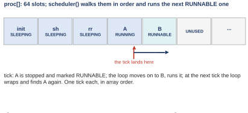{width=70%}
<figcaption markdown="1">Figure 3.3. The proc array: 64 slots, the states of the processes in them, and what one tick does.</figcaption>
</figure>

Look at Figure 3.3 first. `proc` is an **array** (a row of equal-sized slots reached by position number) of 64 process records, one per process. Each has a state: `init` (the first process, which starts everything else) and the shell are SLEEPING (blocked, waiting for something), A is RUNNING, B is RUNNABLE (ready), and the rest are UNUSED. Now the listing of `scheduler()`, line by line.

- Line 438, `for(p = proc; p < &proc[NPROC]; p++)`, is the walk over the array, slot by slot: `p` points at one slot, `p++` moves it to the next, and `&proc[NPROC]` is the address just past the last slot (`&` means "the address of"; `NPROC` is 64, the size of the array).
- Line 440, `if(p->state == RUNNABLE)`, is the only test: a slot is a candidate only if it is ready; sleeping and unused slots are skipped (`p->state` means "the state field of the record p points at"; `==` tests equality).
- Lines 444 and 445 mark the chosen process RUNNING and record it as this CPU's current process.
- Line 446, `swtch(&c->context, &p->context)`, is the context switch of the processes week (`c` is this CPU's own record, `p` the chosen process, and `context` the saved registers of each): it saves the scheduler's own registers and loads the process's, and from this line on the process is running while the scheduler is frozen on this line until the process gives the CPU back.
- Line 457, `asm volatile("wfi")`, is what happens when the whole array had nothing ready: the CPU waits for an interrupt and then scans again.

A process gives the CPU back through `yield()`, the second listing:

- Line 495 marks the process RUNNABLE again, so it will get another turn.
- Line 496 switches back to the scheduler loop, which continues from the next slot, not from the top.

The third listing is who calls `yield()`: in the trap handler (the kernel code that runs whenever the CPU jumps into the kernel because of an interrupt; the jump is called a trap, and xv6 names the handler `usertrap`), `which_dev == 2` means the timer interrupt, so every tick the running process is forced to yield. Put it together: no priorities, no job lengths, no memory of the past; a slice of one tick, in array order. That is round robin.

Code is only convincing when you watch it, so here is a program that makes the array order visible.

*The program `rr.c`, whole (`W06_demos/rr.c`; it goes in `user/` of the xv6 tree).*

```c linenums="1" hl_lines="11 12 17 18 19 22"
// rr.c: watch xv6's round-robin scheduler. The parent starts N children (N = 2 by default).
// Each child computes without stopping and, every time the clock tick changes, prints its
// letter and the tick number. Then it exits after 10 ticks. Run with CPUS=1.
#include "kernel/types.h"
#include "user/user.h"

int
main(int argc, char *argv[])
{
  int n = argc > 1 ? atoi(argv[1]) : 2;
  for (int k = 0; k < n; k++) {
    if (fork() == 0) {                 // child k
      char letter = 'A' + k;
      int start = uptime(), last = -1;
      volatile int x = 0;
      while (uptime() - start < 10) {  // run for 10 ticks
        int t = uptime();
        if (t != last) {               // the tick changed while we were running
          printf("%c%d ", letter, t);
          last = t;
        }
        for (int i = 0; i < 1000; i++) x += i;   // keep the CPU busy
      }
      exit(0);
    }
  }
  for (int k = 0; k < n; k++) wait(0);
  printf("\n");
  exit(0);
}
```

What it does: the parent `fork`s n children (fork makes a copy of the running process; the copy is the child). Each child computes without stopping for 10 ticks, and every time it notices that the tick number changed, it prints its letter and the tick. 

- Line 12 is the fork, inside a loop (line 11) whose counter `k` is 0, 1, 2, so the letters are A, B, C.
- Line 17, `uptime()`, asks the kernel for the current tick count.
- Lines 18 and 19 print only when the tick changed since the last print, so each letter marks the start of one turn.
- Line 22 is busy work, so the child never sleeps and never gives up the CPU on its own.

*The console capture `xv6_rr.out`, xv6 under QEMU with one CPU (the boot messages are cut).*

```text
$ rr
A2 B3 A4 B5 A6 B7 A8 B9 A10 B11 B12 B13 
$ rr 3
A15 B16 C17 A18 B19 C20 A21 B22 C23 A24 B25 C26 A27 B27 
$
$
```

<figure markdown="1">
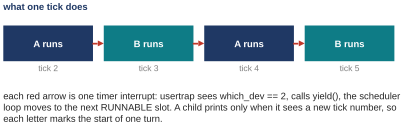{width=75%}
<figcaption markdown="1">Figure 3.4. What one tick does: each red arrow is one timer interrupt.</figcaption>
</figure>

With two children the console (the text screen of the xv6 machine) reads A2 B3 A4 B5 A6 B7 and so on: A had tick 2, B had tick 3, A had tick 4; strictly alternating, one tick each. With three children: A15 B16 C17 A18 B19 C20, a turn each, in array order, around and around. Each red arrow in Figure 3.4 is one timer interrupt: `usertrap` sees `which_dev == 2`, calls `yield()`, and the scheduler loop moves to the next RUNNABLE slot. A tick is about a tenth of a second, so each turn is a slice of 0.1 s. One detail at the end of the first line, B12 B13: each child counts its 10 ticks from the moment it started; A was forked first and began counting a tick or two earlier than B, so A's window closed first, and B's last prints, B12 and B13, came after A had exited, with the CPU to itself; the loop simply finds that only one slot is ready.

- What this part settled: round robin is not a drawing; it is about 30 lines of your own kernel (23 in the loop, 9 in yield, 2 in the trap handler), and the console shows the turns.
- What it leaves open: the same rule on a full Linux machine, which is next.

### 3.5 <span class="lbl lbl-machine">Real machine</span> Round robin on Linux: three jobs at once {#sec-3-5 data-toc-label="3.5 [Real machine] Round robin on Linux: three jobs at once"}

OSTEP Figure 7.7 can be measured on the Ubuntu machine with the same spin program as [Section 1.4](#sec-1-4): three 1 s jobs, run two ways.

*The capture `batch_three.out`: three 1000 ms jobs, one after another. Ubuntu 24.04 x86-64, Linux 6.18.*

```text
$ # three 1000 ms jobs, one after another
$ T0=$(now); for j in A B C; do taskset -c 0 ./spin $j 1000 $T0; done
A first ran at 0.004 s
A finished at 1.003 s
B first ran at 1.005 s
B finished at 2.003 s
C first ran at 2.006 s
C finished at 3.004 s
```

*The capture `together.out`: the same three jobs started together, all pinned to core 0.*

```text
$ # the same three 1000 ms jobs started together, all pinned to core 0
$ T0=$(now); for j in A B C; do taskset -c 0 ./spin $j 1000 $T0 & done; wait
A first ran at 0.004 s
B first ran at 0.006 s
C first ran at 0.009 s
A finished at 2.999 s
B finished at 3.001 s
C finished at 3.002 s
```

<figure markdown="1">
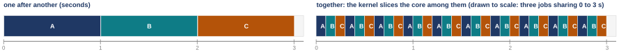{width=100%}
<figcaption markdown="1">Figure 3.5. The two captures drawn as timelines, in seconds: one after another (left), and together, the kernel slicing the core among them (right).</figcaption>
</figure>

First, one after another: A finished at 1.003 s, B at 2.003, C at 3.004; B first ran at 1.005 and C at 2.006. That is the batch, FIFO. Second, all three started together, pinned to core 0: A first ran at 0.004 s, B at 0.006, C at 0.009, so all three were running within 10 ms; and they finished at 2.999, 3.001 and 3.002, all together near 3 s.

Read the table. One after another: response 0.004, 1.005, 2.006, average about 1.0 s; turnaround 1.003, 2.003, 3.004, average about 2.0 s. Together: response 0.004, 0.006, 0.009, average 0.006 s; turnaround about 3.0 s for every job. Response went from a second to six thousandths of a second; turnaround went from 2 s to 3. The same trade-off as the drawing, with real numbers. Check this: (1.003 + 2.003 + 3.004) / 3 = 6.010 / 3 = 2.003.

One honest note. Linux's default scheduler time-slices the core, but its exact rule is not plain round robin: it keeps a running account of how much CPU each job has had and favors the one that is furthest behind. The right-hand strip in Figure 3.5 is drawn as even slices to show the idea, not as a trace of what the kernel did millisecond by millisecond.

**Checkpoint 3.**

- Settled: two families; shortest first (SJF, STCF) wins turnaround and makes the third job wait 10 s for its first instruction; round robin runs a slice of each job in turn, response 1 instead of 5, turnaround 14 instead of 10; no rule wins both, and the slice length is the knob, short for response, long enough to amortize the switch (1.5 µs here; 100 ms slices in Linux's round-robin class, one tick on xv6).
- Still open: every job so far only computes, and a real job stops to wait for the disk, the network, a key.
- You should now be able to compute response and turnaround time for three equal jobs under round robin with a given slice, and name the trade-off.

## Chapter 4. I/O and scheduling {#chapter-4}

*The question this chapter answers: What about jobs that stop to wait for a disk?*

### 4.1 <span class="lbl lbl-concept">Concept</span> Overlapping I/O: each CPU burst as a job {#sec-4-1 data-toc-label="4.1 [Concept] Overlapping I/O: each CPU burst as a job"}

What we have is STCF or round robin, with jobs that only compute from start to finish (assumption 4). Now drop it. **I/O** means input and output: any step where a program waits on a device, a disk, the network, a keyboard. While a job waits for the disk it is **blocked**: it cannot run until the device answers, and the scheduler skips it.

<figure markdown="1">
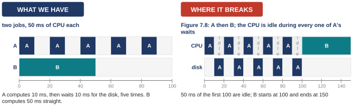{width=100%}
<figcaption markdown="1">Figure 4.1. Two jobs with 50 ms of CPU each (A waits five times, B never), and OSTEP Figure 7.8: A then B, with the CPU idle during every one of A's waits.</figcaption>
</figure>

A computes for 10 ms, then waits 10 ms for the disk, and does that five times. B computes 50 ms straight through and never waits. Where it breaks: run A to the end, then B. Look at the CPU row of Figure 4.1: A computes 10, then the CPU is idle while the disk works, then A computes 10 more, then idle again. Five bursts, five waits. 50 ms of the first 100 are idle, and B starts at 100 and ends at 150. The scheduler had a free CPU and a ready job, B, and did not put them together. Nothing is wrong with either job; the rule simply did not know what to do with a wait.

So we need to treat each 10 ms burst of A as a job of its own (a **CPU burst** is one stretch of computing between two waits). When A starts waiting, run B. When A's disk answers, A's next burst is the shorter job, so shortest-remaining-first gives A the CPU back. The CPU and the disk then work at the same time, which is called **overlap**. And a side effect: a job that keeps waiting gets run often, which is exactly what a job answering a person looks like, because it waits for a key, does a little work, waits again.

<figure markdown="1">
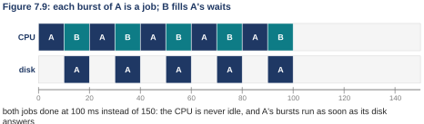{width=79%}
<figcaption markdown="1">Figure 4.2. OSTEP Figure 7.9: each burst of A is a job, and B fills A's waits.</figcaption>
</figure>

In Figure 4.2 the CPU row is never idle, and both jobs are done at 100 instead of 150.

*The program `overlap.c`, lines 17 to 36 (`W06_demos/overlap.c`; lines 1 to 16 are comments and the two clocks of spin.c).*

```c linenums="17" hl_lines="1 9 11 13 16"
static void compute_ms(double ms) {     /* use ms more milliseconds of CPU */
  volatile unsigned long x = 0; double until = cpu() + ms / 1000.0;
  while (cpu() < until) for (int i = 0; i < 10000; i++) x += i;
}

int main(int argc, char **argv) {
  char job = argv[1][0]; double t0 = atof(argv[2]);
  printf("%c first ran at %.3f s\n", job, wall() - t0); fflush(stdout);
  if (job == 'A') {
    for (int k = 0; k < 5; k++) {
      compute_ms(10);                   /* 10 ms of CPU ... */
      struct timespec w = {0, 10000000};
      nanosleep(&w, NULL);              /* ... then wait 10 ms, like a disk */
    }
  } else {
    compute_ms(50);                     /* 50 ms of CPU, straight through */
  }
  printf("%c finished at %.3f s\n", job, wall() - t0);
  return 0;
}
```

You do not need every line.

- Lines 17 to 20 are a helper that uses a given number of milliseconds of CPU.
- Lines 25 to 30 are job A: five times, compute 10 ms (line 27) and then `nanosleep` for 10 ms (line 29), which waits the way a disk read would make it wait (`nanosleep` is a request to the kernel to put this process to sleep for a given time; the process is blocked until the time is up).
- Line 32 is job B: 50 ms of CPU straight through.

*The capture `overlap.out`: A then B, then A and B together on core 0. Ubuntu 24.04 x86-64, Linux 6.18.*

```text
$ # A then B, one after another
$ T0=$(now); taskset -c 0 ./overlap A $T0; taskset -c 0 ./overlap B $T0
A first ran at 0.004 s
A finished at 0.105 s
B first ran at 0.107 s
B finished at 0.157 s
$ # A and B started together on core 0
$ T0=$(now); taskset -c 0 ./overlap A $T0 & taskset -c 0 ./overlap B $T0 & wait
A first ran at 0.004 s
B first ran at 0.005 s
B finished at 0.085 s
A finished at 0.136 s
```

One after another: A finished at 0.105 s, then B started and finished at 0.157 s. Together on one core: B finished at 0.085 s and A at 0.136 s. B's 50 ms of computing happened inside A's waits, so the pair finished at 136 ms instead of 157, which is 21 ms sooner. Check this: 157 − 136 = 21. The drawing promises 50 ms of saving; the kernel gave back 21. The reason is that the real scheduler does not hand the CPU back to A the instant A's wait ends; it lets B's turn run a little longer first, so each of A's bursts was delayed a few milliseconds. Overlap is real, and so is the scheduler's own say in when a woken job runs; the second class is exactly about that say.

**Checkpoint 4.**

- Settled: a job that waits is split into bursts, and the CPU runs someone else during each wait; 150 ms became 100 in the drawing, 157 became 136 on the Ubuntu machine; jobs that keep stopping to wait, which is what jobs that answer people do, get run often.
- Still open: four assumptions are gone, and the fifth is the worst: shortest first needs each job's length, and a real kernel does not know it.
- You should now be able to draw the overlapped timeline for one waiting job and one computing job, and say why each burst counts as a job of its own.

## <span class="lbl lbl-summary">Summary</span> Summary of the first class: scheduling policies and metrics {#summary-13 data-toc-label="[Summary] Summary of the first class: scheduling policies and metrics"}

Four questions, four answers, and for each the problem it solved and the price it carries.

How do we judge a schedule, and what does the simplest one do wrong? By average turnaround time, finish minus arrival. FIFO runs jobs in arrival order; with one long job in front the short ones convoy behind it, 110 s instead of 50. It costs nothing to compute and is blind to length.

If we know how long each job needs, which order is best? Shortest first: SJF when everyone arrives together, STCF (shortest remaining time, with preemption) when jobs arrive at any time. The best possible turnaround; the price is that it needs the lengths, and long jobs wait.

What does a person at a keyboard need, and what does it cost? Response time, the wait for the first run. Round robin gives every job a slice in turn: response 1 instead of 5 for three 5 s jobs. The price is turnaround 14 instead of 10, and a switch per slice (1.5 µs here). Two families, and no rule wins both.

What about jobs that stop to wait for a disk? Treat each CPU burst as a job and run someone else during the wait: overlap. 150 ms became 100 in the drawing, 157 became 136 measured. The price is that the scheduler must notice every block and wake-up; the gain is that jobs that wait often get run often.

Left open: every shortest-first rule needs job lengths, and the kernel does not have them. The second class builds a scheduler that learns them from behavior.

## Going deeper, first class (optional) {#extras-1}

### Extra 1 <span class="lbl lbl-deeper">Deeper, Q1</span> Fairness as a metric {#extra-1 data-toc-label="Extra 1 [Deeper, Q1] Fairness as a metric"}

Fairness can be measured too. **Jain's fairness index** is a number between 1/n and 1 for n jobs: square the sum of the shares, and divide by n times the sum of the squared shares. It is 1 when every job got exactly the same share (check this: shares 2, 2, 2 give 36 / (3 × 12) = 1) and smaller the more unequal the shares (shares 6, 0, 0 give 36 / (3 × 36) = 1/3). It sits next to turnaround time the way a second judge sits next to the first, and the two judges disagree on purpose: shortest first finishes work fastest by making long jobs wait, which is unequal treatment by design; round robin treats every job equally over any short window, and that is exactly why nothing finishes early.

If you want to check the first class's arithmetic without a pencil, chapter 7 comes with a small program, `scheduler.py`, which runs FIFO, SJF and RR on any list of jobs and prints the response and turnaround of each. For lengths 100, 200 and 300 arriving together, FIFO and SJF give the same averages, response 133.33 and turnaround 333.33, because the arrival order already is shortest first (check this: FIFO finishes at 100, 300, 600, average 1000 / 3 = 333.33; first runs at 0, 100, 300, average 400 / 3 = 133.33). Round robin with a slice of 1 gives response 1.00 and turnaround 465.67: the best response and the worst turnaround. Check the turnaround: with slices of 1 the three jobs share the CPU evenly, so the 100 job finishes when each has had 100, near 300 (the program says 298, because it runs the jobs in order and the first finishes two slices early), the 200 job when the remaining two have had 200 each, near 500 (499), and the 300 job at 600; (298 + 499 + 600) / 3 = 1397 / 3 = 465.67. The command is `python3 scheduler.py -p RR -q 1 -l 100,200,300 -c`, where `-p` picks the policy, `-q` the slice, `-l` the job lengths and `-c` prints the answer.

Two questions from the chapter's homework are worth an evening. When does SJF equal FIFO? When the jobs are equal, or when the arrival order is already shortest first. And how bad can RR's worst response get as the slice grows? With N jobs and a slice of q, the last job waits (N − 1) × q before its first run.

### Extra 2 <span class="lbl lbl-deeper">Deeper, Q3</span> The hidden cost of a context switch: caches and the TLB {#extra-2 data-toc-label="Extra 2 [Deeper, Q3] The hidden cost of a context switch: caches and the TLB"}

What the capture of [Section 3.3](#sec-3-3) measured: `cswitch.c` counts a round trip. Process 1 writes a byte into a pipe and then blocks reading the other pipe; the kernel switches to process 2, which reads the byte, writes one back, and blocks; the kernel switches back. 100,000 round trips in 0.299 s is 2.99 µs per round trip, about 1.5 per switch, and that includes two system calls per switch (a system call is a program's request to the kernel; `write` and `read` are two of them).

What it did not measure: while a job runs it fills the CPU caches with its data, the TLB with its translations, and the branch predictors with its branches. After a switch the next job finds that state useless and rebuilds it, one memory access at a time; that cost shows up inside the job's own run time, not inside the switch, so a stopwatch around the switch never sees it. The memory unit saw this cost from the other side: a loop that touched a new page on every access ran several times slower than one that stayed inside a page.

So by the 1.5 µs figure a 1 ms slice would be fine, and real kernels still pick slices from a few milliseconds (Solaris's top queue uses 20 ms, [Section 7.1](class-2.md#sec-7-1)) to 100 ms (Linux's round-robin class, [Section 3.3](#sec-3-3)): partly because of the hidden refill cost, and partly because a slice shorter than that gains nothing a person can feel.
