# Second class: a scheduler that cannot see the future and learns from the past: the multi-level feedback queue (OSTEP 8) {#class-2}

## <span class="lbl lbl-roadmap">Roadmap</span> Recap and roadmap of the second class {#opening-16 data-toc-label="[Roadmap] Recap and roadmap of the second class"}

<figure markdown="1">
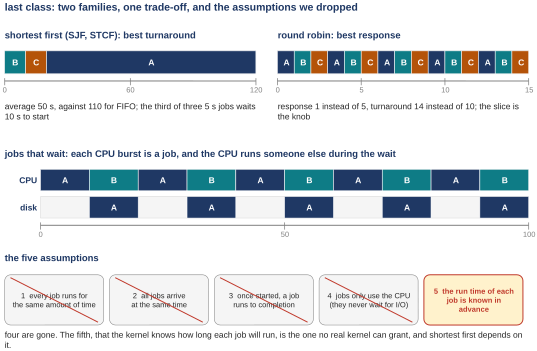{width=90%}
<figcaption markdown="1">Figure 18. The first class drawn: shortest first (left), round robin (right), I/O overlap (middle), and the five assumptions with four crossed out.</figcaption>
</figure>

The first class spent itself on one question: which process runs next, and for how long. We judged a schedule by turnaround time, finish minus arrival, and the best rule for that is shortest first, SJF or STCF; with the three-job example it averaged 50 s against 110 for first-come-first-served, but it made the third of three equal jobs wait 10 s before starting. A person at a keyboard needs response time, the wait before a job first runs; round robin runs a slice of each job in turn, and response dropped from 5 to 1 while turnaround rose from 10 to 14. Two families, and no rule wins both; the slice is the knob. A job that stops for the disk is split into bursts, and the CPU runs someone else during the wait.

The bottom of Figure 18 is the five assumptions. Four are crossed out: same length, same arrival, run to the end, no I/O. One is left, in red: that the kernel knows how long each job will run. No real kernel knows that. Shortest first depends on it. The moment a program starts, the kernel cannot tell a keystroke handler from a compile. The second class builds a scheduler that gets most of both families' benefits without ever being told a length.

## Chapter 5. The multi-level feedback queue (MLFQ) {#chapter-5}

*The question this chapter answers: How can a scheduler run short jobs first when it cannot see job lengths?*

### 5.1 <span class="lbl lbl-problem">Problem</span> Scheduling without knowing job lengths {#sec-5-1 data-toc-label="5.1 [Problem] Scheduling without knowing job lengths"}

What we have is STCF, which needs each job's remaining time, and round robin, which needs nothing and treats every job alike. On xv6 the policy is round robin with a slice of one tick, about 0.1 s.

<figure markdown="1">
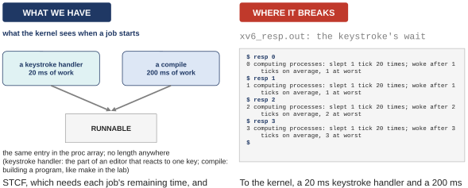{width=100%}
<figcaption markdown="1">Figure 19. What the kernel sees when a job starts (left), and the xv6 capture xv6_resp.out (right).</figcaption>
</figure>

Where it breaks: to the kernel, a 20 ms keystroke handler and a 200 ms compile look identical at the moment they start. Both become a RUNNABLE entry in the process array, the same entry, with no length written anywhere. The right side of Figure 19 shows what that costs on xv6. The program `resp` starts some number of children that compute without stopping, then sleeps for one tick, wakes up, and counts how many ticks passed before it actually ran again. With 0 computing processes it woke after 1 tick, which is the sleep itself. With 1, also 1. With 2, after 2 ticks. With 3, after 3. Each competitor beyond the first costs the sleeper one extra tick of waiting, a tenth of a second each (the next paragraph says why the first costs nothing), because round robin gives everyone a full slice in turn and has no way to know that the sleeper is the one somebody is waiting for.

The reason it is exactly one tick per competitor is this. A spinner is a job that never stops computing. When the sleeper goes to sleep, the scheduler loop continues from the sleeper's slot to the next one, which is the first spinner (the parent's slot comes before all its children's, because it was created first), and that spinner runs until the next tick. At that tick two things happen at once: the sleeper is woken, and the running spinner is stopped. The loop continues from the first spinner's slot, so every spinner after it runs a full tick before the loop wraps around to the sleeper. With one spinner there is nobody after it, so the sleeper runs at once; with two, one full tick passes; with three, two.

So we need a scheduler that watches how a job behaves and uses the recent past to predict the future. Two kinds of job are worth telling apart. An **interactive job** works in short bursts and keeps stopping to wait, for a person or a device; response time matters to it. A **CPU-bound job** computes for a long time without waiting; turnaround matters to it, response does not. The scheduler cannot be told which is which, but it can notice: a job that keeps giving up the CPU early is probably interactive, a job that uses every slice it gets is probably CPU-bound; and it can change its mind when the evidence changes. The textbook's crux puts it this way: how can we design a scheduler that both minimizes response time for interactive jobs while also minimizing turnaround time without a priori knowledge of job length (a priori means in advance).

What this part settled: the kernel cannot read lengths, but it can watch behavior. What it leaves open: a structure that lets it act on what it notices, which is next.

### 5.2 <span class="lbl lbl-concept">Concept</span> Priority queues: MLFQ Rules 1 and 2 {#sec-5-2 data-toc-label="5.2 [Concept] Priority queues: MLFQ Rules 1 and 2"}

The scheduler built here is the **multi-level feedback queue**, MLFQ: multi-level because it has several queues, feedback because a job's position changes based on how it behaved.

<figure markdown="1">
{width=48%}
<figcaption markdown="1">Figure 20. The textbook's Figure 8.1: eight queues and four jobs.</figcaption>
</figure>

Eight queues, Q8 at the top with the highest priority, Q1 at the bottom with the lowest. **Priority** is a job's rank, and here the rank is simply which queue the job sits on. A job that is ready to run sits on exactly one queue. In Figure 20, A and B are on Q8, C is on Q4, D is on Q1.

The first two rules. Rule 1: if Priority(A) > Priority(B), A runs and B does not. Rule 2: if Priority(A) = Priority(B), A and B run in round robin. So the scheduler always runs from the highest queue that has a job on it, and shares that queue by taking turns.

With only these two rules the scheduler is terrible. In Figure 20, A and B share Q8 forever, and C and D never run at all. The two rules only say who runs now. Everything interesting is in how a job's priority changes over time, because that is where the kernel's guess from behavior lives: keep a job high if it keeps giving up the CPU, lower it if it hogs the CPU.

What this part settled: the structure. What it leaves open: the rules that move a job between queues.

### 5.3 <span class="lbl lbl-concept">Concept</span> Changing priority with the allotment: Rules 3 and 4 {#sec-5-3 data-toc-label="5.3 [Concept] Changing priority with the allotment: Rules 3 and 4"}

Three more rules, and these are the ones that learn. Rule 3: a job that enters the system goes on the topmost queue. Rule 4a: a job that uses up its **allotment** while running moves down one queue. Rule 4b: a job that gives up the CPU before its allotment is up stays where it is, and its allotment is reset; this is for jobs that stop to wait for a person, which must not be punished for waiting.

The allotment is the amount of CPU time a job may spend at one priority level before it is moved down. For now it equals one time slice, and the slice is 10 ms in every trace until [Section 7.1](#sec-7-1).

Put the three rules together and you get the guess. Every new job is assumed to be short, so it starts at the top. If it really is short, it finishes near the top. If it is not, it proves that by using its allotment, slice after slice, and sinks to where the long jobs live.

<figure markdown="1">
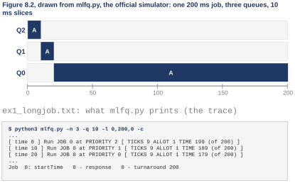{width=70%}
<figcaption markdown="1">Figure 21. The textbook's Figure 8.2 drawn from a real run of the official simulator: one 200 ms job, three queues, 10 ms slices; below it, the lines of the trace where the job changes queue.</figcaption>
</figure>

Every queue picture in this class comes from a small program, `mlfq.py`, that the textbook authors publish with chapter 8 (the guide calls it the simulator). You give it jobs and rules, and it prints, millisecond by millisecond, which job ran on which queue. Figure 21 is its output for one 200 ms job. The simulator numbers its queues from 0, so with three queues the top one is Q2 and the bottom one is Q0 (the textbook's Figure 8.1 counted from 1). The job enters on Q2 by Rule 3. After one slice of 10 ms it has used its allotment, so Rule 4a drops it to Q1. After one more slice it drops to Q0, and it stays there for the remaining 180 ms. The three lines under the strip are the lines of the trace where the job changes queue: at time 0 it runs at priority 2, at time 10 at priority 1, at time 20 at priority 0. Check this: 200 − 10 − 10 = 180 ms on Q0.

What this part settled: priority comes from behavior, and a long job sinks. What it leaves open: whether a short job and a waiting job really win, which the next two traces show.

### 5.4 <span class="lbl lbl-example">Worked example</span> A short job and an I/O-bound job under MLFQ {#sec-5-4 data-toc-label="5.4 [Worked example] A short job and an I/O-bound job under MLFQ"}

<figure markdown="1">
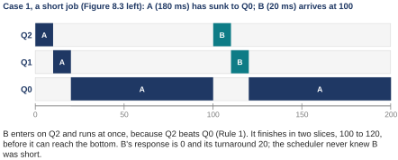{width=74%}
<figcaption markdown="1">Figure 22. The textbook's Figure 8.3 left, as the simulator's trace: A (180 ms) has sunk to Q0; B (20 ms) arrives at 100.</figcaption>
</figure>

A is a 180 ms job, and by time 100 it has sunk to Q0, as the long job did in [Section 5.3](#sec-5-3). At time 100, B arrives: a 20 ms job. Rule 3 puts it on Q2, and Rule 1 says Q2 beats Q0, so B runs at once. It uses one slice, drops to Q1, uses one more, and is done at 120, before it can reach the bottom. A waits those 20 ms and then resumes on Q0. B's response time is 0 and its turnaround is 20, exactly what shortest-job-first would have done for B. And the scheduler never knew B was short; it assumed so, and B proved it right by finishing.

<figure markdown="1">
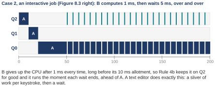{width=75%}
<figcaption markdown="1">Figure 23. The textbook's Figure 8.3 right, as the trace: B now computes 1 ms, then waits 5 ms, over and over.</figcaption>
</figure>

Now a different pair: A has 175 ms of work, and B arrives at 50 with 25 ms of work that it does 1 ms at a time, waiting 5 ms for some device after each, over and over, like a program waiting for keys. Every time, B gives up the CPU after 1 ms, long before its 10 ms allotment, so Rule 4b keeps it on Q2 for good. And every time its wait ends it runs immediately, ahead of A on Q0. The strip shows B as a comb of thin marks along the top row and A filling the gaps on the bottom row. B's response is 0 again. That is what an interactive job needs: whenever it has something to do, it goes first.

So MLFQ approximates SJF without an oracle (something that could tell the future): assume every job is short, give it the top, and let the long ones prove otherwise by sinking; meanwhile the jobs that keep waiting stay at the top because they never use their allotment.

### 5.5 <span class="lbl lbl-machine">Real machine</span> Interactive wake-up latency on Linux {#sec-5-5 data-toc-label="5.5 [Real machine] Interactive wake-up latency on Linux"}

The same experiment as the xv6 one of [Section 5.1](#sec-5-1), on Linux, with milliseconds instead of ticks.

*The program `latency.c`, lines 13 to 28 (`W06_demos/latency.c`; lines 1 to 12 are comments and the wall clock of spin.c).*

```c linenums="13" hl_lines="6 7 10 11"
int main(int argc, char **argv) {
  double worst = 0, total = 0; int n = 200;
  for (int i = 0; i < n; i++) {
    struct timespec w = {0, 10000000};  /* ask to sleep 10 ms */
    double before = wall();
    nanosleep(&w, NULL);
    double late = (wall() - before) - 0.010;   /* how late did we wake up */
    if (late > worst) worst = late;
    total += late;
    volatile unsigned long x = 0;       /* a little work, like redrawing */
    for (int k = 0; k < 200000; k++) x += k;
  }
  printf("%s: woke %d times; late by %.2f ms on average, %.2f ms at worst\n",
         argv[1], n, total / n * 1000, worst * 1000);
  return 0;
}
```

What it does: 200 times, it asks to sleep for 10 ms, and when it wakes up it measures how late it got the CPU back; then it does a little work, like a program redrawing a window, and sleeps again. Line 18 is the sleep, `nanosleep`, the same request as in [Section 4.1](class-1.md#sec-4-1). Line 19 is the measurement: the time that actually passed minus the 10 ms asked for; that difference is how long the kernel made the process wait for the CPU after it was ready (lines 20 and 21 keep the worst and the total). Lines 22 and 23 are the little work.

*The capture `latency.out`: alone, beside one spinner, beside three. Ubuntu 24.04 x86-64, Linux 6.18.*

```text
$ taskset -c 0 ./latency alone
alone      : woke 200 times; late by 0.14 ms on average, 0.21 ms at worst
$ taskset -c 0 ./spin H 5000 0 > /dev/null &   # one spinner on the same core
$ taskset -c 0 ./latency "with 1 hog"
with 1 hog : woke 200 times; late by 0.11 ms on average, 0.32 ms at worst
$ # three spinners on the same core
with 3 hogs: woke 200 times; late by 0.41 ms on average, 3.38 ms at worst
```

| competing spinners on core 0 | late on average | late at worst |
|---|---|---|
| alone | 0.14 ms | 0.21 ms |
| with 1 hog | 0.11 ms | 0.32 ms |
| with 3 hogs | 0.41 ms | 3.38 ms |

Alone on core 0: late by 0.14 ms on average, 0.21 at worst. Beside one spinner (a job that never stops computing): 0.11 on average, 0.32 at worst. Beside three spinners: 0.41 on average, 3.38 at worst. Even behind three jobs that want the CPU all the time, the sleeper got it back within half a millisecond on average. Compare xv6, where the same sleeper woke after 3 ticks behind three spinners: 1 tick was the sleep itself, so it was 2 ticks late, 2 × 0.1 s = 0.2 s = 200 ms, against 0.41 ms here, about 500 times less (check this: 200 / 0.41 = 488).

Nobody told Linux which job was interactive. Its default scheduler keeps an account of how much CPU each job has had; a job that slept is owed time, so when it wakes it goes first. That is not a multi-level feedback queue, but it is the same idea: judge a job by what it did, not by what it says.

**Checkpoint 1 (second class).** Settled: several queues by priority; a new job starts at the top; using its allotment moves it down one queue; giving up the CPU early keeps it where it is; a short job finishes near the top and a waiting job stays there, so interactive jobs get the response of round robin and short jobs get the turnaround of SJF with no length ever known; Linux reaches the same goal with its own accounting (0.41 ms late beside three spinners). Still open: priority only ever goes down, so if many jobs sit at the top the ones below never run, and a job that gives up the CPU on purpose just before its allotment ends never sinks. You should now be able to take a 20 ms job, three queues and a 10 ms slice, and say which queue it is on at every moment and where it finishes.

## Chapter 6. The problems with MLFQ, and the fixes {#chapter-6}

*The question this chapter answers: What goes wrong when a priority can only go down?*

### 6.1 <span class="lbl lbl-problem">Problem</span> Starvation, and the priority boost: Rule 5 {#sec-6-1 data-toc-label="6.1 [Problem] Starvation, and the priority boost: Rule 5"}

What we have is Rules 1 to 4b: a job that keeps giving up the CPU before its allotment ends keeps its high priority, and a high queue always beats a low one.

<figure markdown="1">
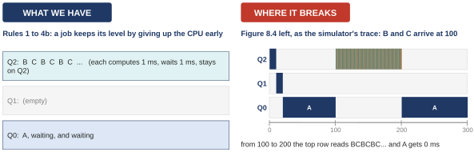{width=100%}
<figcaption markdown="1">Figure 24. Rules 1 to 4b with two interactive jobs on Q2 (left), and the textbook's Figure 8.4 left as the simulator's trace: B and C arrive at 100.</figcaption>
</figure>

Where it breaks: A is a 200 ms job and by time 100 it has sunk to Q0. At 100, B and C arrive, with 50 ms of work each; each computes 1 ms and waits 1 ms, over and over. They give up the CPU early every time, so they stay on Q2. From 100 to 200 the top row of the trace reads B C B C B C, and A gets 0 ms in that whole stretch. In this run B and C finish at 200 and A resumes; if they never ended, A would never run again. That is **starvation**: a ready job that never gets the CPU because higher-priority jobs always exist to run ahead of it. A second failure has the same cause: a compile that becomes interactive (it finishes compiling and starts waiting for the user) is stuck on Q0 with the long jobs, because nothing ever moves a job up.

So we need a way back up: every so often, forgive everyone and move every job in the system to the top queue. That is Rule 5, the **priority boost**: after some time period S, move all the jobs in the system to the topmost queue.

<figure markdown="1">
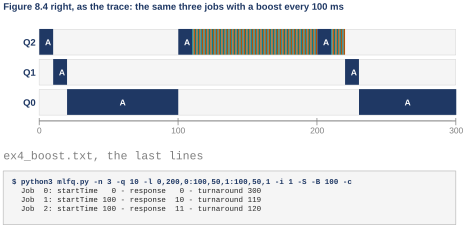{width=78%}
<figcaption markdown="1">Figure 25. The textbook's Figure 8.4 right, as the trace: the same three jobs with a boost every 100 ms, and the trace's last lines.</figcaption>
</figure>

At 100 and again at 200, every job is lifted to Q2. A runs a full 10 ms slice at the top each time, then sinks again, but it makes progress: no more starvation. The last lines show the price: B and C now wait 10 ms before their first run (response 10 and 11), because A had the top for one slice. The boost solves both failures: no job starves, because at the top queue it shares the CPU by round robin and gets served; and a CPU-bound job that has turned interactive is treated properly as soon as the next boost lifts it, since from then on it keeps its level by giving up the CPU early.

The obvious question is what S should be. Set it too high and long jobs still starve for a long stretch; too low and the interactive jobs keep losing the top to the long ones. There is no formula. John Ousterhout, a well-known systems researcher, called values like this **voo-doo constants**, because setting them right seems to need black magic; the tip named after him, Ousterhout's law, says to avoid them where you can and to expect a configuration file full of them where you cannot. In the trace S is 100 ms, far too small for a real system; it was chosen so the picture fits.

What this part settled: a periodic boost stops starvation and rescues jobs that changed. What it leaves open: Rule 4b still has a hole that a program can exploit on purpose.

### 6.2 <span class="lbl lbl-problem">Problem</span> Gaming the scheduler, and better accounting: the new Rule 4 {#sec-6-2 data-toc-label="6.2 [Problem] Gaming the scheduler, and better accounting: the new Rule 4"}

What we have is Rule 4b: a job that gives up the CPU before its allotment is used keeps its level, and its allotment is reset to the full amount. The rule exists for jobs that wait for people.

<figure markdown="1">
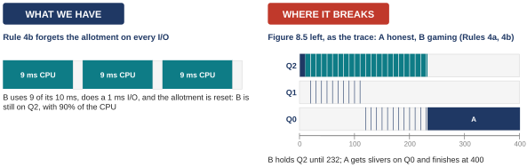{width=100%}
<figcaption markdown="1">Figure 26. Rule 4b forgetting the allotment on every I/O (left), and the textbook's Figure 8.5 left as the trace: A honest, B gaming.</figcaption>
</figure>

Where it breaks: a program can trigger the rule on purpose. In the trace, B computes 9 ms of every 10 and then issues a 1 ms I/O. Each I/O resets its allotment, so B never uses up a slice and holds Q2 for its whole 200 ms of work. A arrived a hair earlier and took the first 10 ms slice on Q2, so B starts at 10; 200 ms of work in 9 ms bursts needs 22 waits of 1 ms between the bursts; 10 + 200 + 22 = 232, which is when B finishes. Honest A sinks to Q0 and gets the 1 ms gaps, the thin marks on the bottom row, and finishes at 400. While it holds the top queue B gets 9 of every 10 ms, 90% of the CPU; over its whole run it got 200 of the 232 ms, 200 / 232 = 0.86, 86%. It took that by asking for the CPU in the right shape. That is **gaming the scheduler**: doing something sneaky to trick it into giving a job more than its fair share. In a shared datacenter this is a security problem, not only an unfair one: users from around the world share the same CPUs, and without care in the policy a single user can take the CPU from the others.

So we need accounting that remembers. Count the allotment across all of a job's bursts at a level, however many times it gave up the CPU in between; when the total is used up, the job drops, whatever shape its work had. Rules 4a and 4b become one Rule 4: once a job uses up its time allotment at a given level, regardless of how many times it has given up the CPU, its priority is reduced and it moves down one queue.

<figure markdown="1">
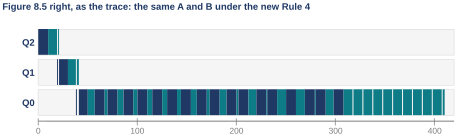{width=78%}
<figcaption markdown="1">Figure 27. The textbook's Figure 8.5 right, as the trace: the same A and B under the new Rule 4, and the last lines.</figcaption>
</figure>

The scheduler keeps a running total of CPU time per job per level. B's 9 ms bursts add up, so after 10 ms at Q2, B drops to Q1 just as A did, then to Q0. From then on A and B share the bottom queue by round robin, with B's 1 ms gaps as the only difference. A finishes at 308 instead of 400; B at 410 instead of 232. The honest job got its share back. And the interactive job is still fine: a job that computes 1 ms and then waits uses its 10 ms allotment only after 10 bursts, and the next boost lifts it again; short bursts still live near the top, and only a job that is a long job in disguise sinks.

Linux's default scheduler has no queues at all and the same worry in its own terms: its documentation says the scheduler prevents tasks from exploiting the system by sleeping briefly to reset their lag, which is the kernel's word for the account. Same cheat, same fix, different scheduler.

**Checkpoint 2 (second class).** Settled: priority that only goes down starves the jobs at the bottom, and a periodic boost (Rule 5) lifts everyone back up; priority that resets on every I/O can be gamed, and counting the allotment across bursts (Rule 4) closes the hole; the five rules are complete. Still open: the rules carry numbers that the rules do not set (how many queues, how long a slice on each, how often to boost), and the same 10 ms slice on the bottom queue makes two long jobs switch 100 times a second for nothing. You should now be able to look at a trace, say which rule it breaks (starvation or gaming) and which rule repairs it.

## Chapter 7. Tuning MLFQ, and the Linux scheduler {#chapter-7}

*The question this chapter answers: How are the knobs set, and what does a real kernel do with them?*

### 7.1 <span class="lbl lbl-concept">Concept</span> The MLFQ parameters: queues, time slices, boost period {#sec-7-1 data-toc-label="7.1 [Concept] The MLFQ parameters: queues, time slices, boost period"}

What we have is five rules with three numbers inside them: the number of queues, the slice and allotment per queue, and the boost period S. Every trace so far used 3 queues and 10 ms slices, and the boosted ones used S = 100 ms, because the simulator had to be given something.

<figure markdown="1">
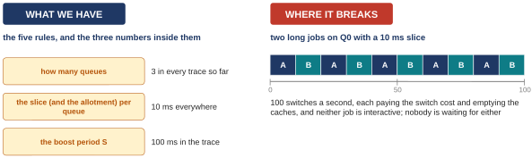{width=100%}
<figcaption markdown="1">Figure 28. The three numbers inside the rules (left), and two long jobs on Q0 with a 10 ms slice (right).</figcaption>
</figure>

Where it breaks: a 10 ms slice on the bottom queue makes two CPU-bound jobs trade places 100 times a second (check this: 1000 ms / 10 ms = 100). Each switch pays the cost of [Section 3.3](class-1.md#sec-3-3) and empties the caches, and nothing is gained, because no person is waiting for either job. S has the opposite trap: too long starves, too short takes the top from the interactive jobs. No rule tells you the values.

So we need three things: longer slices on the lower queues, where the long jobs live; a table an administrator can tune, instead of constants in the code; and a way for a user to give the kernel advice about a job, since the kernel's guess from behavior is only a guess.

<figure markdown="1">
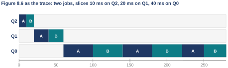{width=78%}
<figcaption markdown="1">Figure 29. The textbook's Figure 8.6 as the trace: two jobs, slices 10 ms on Q2, 20 ms on Q1, 40 ms on Q0; and the trace's last lines.</figcaption>
</figure>

At the top the two jobs alternate every 10 ms, which is what interactive jobs would need. On Q0 they alternate every 40 ms: fewer switches, and nobody is waiting for them anyway. High queues get short slices, low queues long ones; in real systems the bottom slices are hundreds of milliseconds.

The table: the Solaris time-sharing class, called TS, is an MLFQ whose whole behavior comes from a table. For each priority level the table says how long the slice is, where a job goes when it uses it up, where it goes when it sleeps, and how often to boost. The default table has 60 queues, slices from 20 ms at the top to a few hundred at the bottom, and a boost about every second. An administrator edits the table; no kernel code changes. Not everyone uses a table: FreeBSD 4.3 computed a job's priority from a formula over its recent CPU use, letting old use decay away over time, which lifts a job back up without a Rule 5; and many systems reserve the top levels for the operating system itself.

Advice: the OS rarely knows what is best for a job, so it accepts hints. The command **nice** lets a user lower a job's standing (or raise it, if they are the administrator), and the kernel may take the hint into account. **Advice** is the general word for such a hint: nice for the scheduler, madvise for memory (a way for a program to tell the kernel how it will use its memory). The next part measures what nice actually does.

### 7.2 <span class="lbl lbl-machine">Real machine</span> Priority as advice: nice values on Linux {#sec-7-2 data-toc-label="7.2 [Real machine] Priority as advice: nice values on Linux"}

*The program `share.c`, lines 16 to 24 (`W06_demos/share.c`; lines 1 to 15 are comments and the two clocks of spin.c).*

```c linenums="16" hl_lines="4 5 6 7"
int main(int argc, char **argv) {
  const char *name = argv[1]; double t0 = wall();
  volatile unsigned long x = 0;
  while (wall() - t0 < 3.0)             /* keep computing for 3 s of wall time */
    for (int i = 0; i < 100000; i++) x += i;
  printf("%s: got %.2f s of CPU in 3.00 s of wall-clock time (%.0f%%)\n",
         name, cpu(), cpu() / 3.0 * 100);
  return 0;
}
```

*The capture `share.out`: two copies on core 0, nice 0 and nice 10. Ubuntu 24.04 x86-64, Linux 6.18.*

```text
$ taskset -c 0 nice -n 0 ./share "nice 0 " & taskset -c 0 nice -n 10 ./share "nice 10" & wait
nice 10: got 0.29 s of CPU in 3.00 s of wall-clock time (10%)
nice 0 : got 2.71 s of CPU in 3.00 s of wall-clock time (90%)
```

*The capture `chrt -m`: the scheduling classes; the default is SCHED_OTHER.*

```text
$ chrt -m
SCHED_OTHER min/max priority	: 0/0
SCHED_FIFO min/max priority	: 1/99
SCHED_RR min/max priority	: 1/99
SCHED_BATCH min/max priority	: 0/0
SCHED_IDLE min/max priority	: 0/0
SCHED_DEADLINE min/max priority	: 0/0
```

The program is simple. Lines 19 and 20 compute for 3 s of wall-clock time, whatever the scheduler gives us. Lines 21 and 22 report how much CPU time we actually got in those 3 s. Two copies run on core 0 at the same time, one started with `nice -n 0` and one with `nice -n 10`. The nice 0 copy got 2.71 s of CPU in 3 s, which is 2.71 / 3.00 = 0.903, 90%. The nice 10 copy got 0.29 s, which is 0.29 / 3.00 = 0.097, 10%.

*Linux v6.18, `kernel/sched/core.c`: nice becomes a weight (five rows of the 40-entry table; the whole table is in `W06_demos/linux_sched_prio_to_weight.txt`).*

| nice | weight | share beside nice 0 |
|---|---|---|
| -5 | 3121 | 75.3% |
| 0 | 1024 | 50.0% |
| 5 | 335 | 24.7% |
| 10 | 110 | 9.7% |
| 19 | 15 | 1.4% |

Here is where 90 comes from. The kernel turns each nice level into a **weight**, a number from a fixed table in the kernel's source code (`kernel/sched/core.c`; the table is a design choice, there is nothing to derive). nice 0 has weight 1024, nice 10 has weight 110. A job's share of the core is its weight divided by the sum of the weights of the jobs competing for it: 1024 / (1024 + 110) = 1024 / 1134 = 0.903. Check this: 1134 × 0.9 = 1020.6, so 1024 / 1134 is a little over 0.9. So 90% and 10%, which is what the measurement said. Each nice step changes the weight by a factor of about 1.25 (nice 1 has weight 820 in the kernel's table, and 1024 / 820 = 1.25), so a job one step nicer than its neighbor gets 820 / (820 + 1024) = 820 / 1844 = 44% against 56%; the share is not a fixed number of points per step. Nice 5 (weight 335) would get 335 / (335 + 1024) = 335 / 1359 = 0.247, about 25%, beside nice 0; nice 19 (weight 15) gets 15 / 1039 = 0.014, about 1.4%.

The last capture answers one question about the measurement: whether it used Linux's ordinary rules or a special set. `chrt -m` lists the scheduling classes Linux offers. The default class, SCHED_OTHER, is what an ordinary Linux machine runs and what the captures measured. SCHED_FIFO and SCHED_RR are strict-priority classes for special uses such as audio, where a job must never wait behind an ordinary one. To be clear about what this is and is not: this is advice turned into weights, not a multi-level feedback queue. Linux's default class shares a core by weight and by who has had less. Sharing by weight, exactly, is the next topic of the course.

**Checkpoint 3 (second class).** Settled: the numbers come from tables and tuning, not from the rules; slices grow as priority falls (10, 20, 40 ms in the trace, 20 ms to hundreds in Solaris); the boost period is a voo-doo constant; users can advise the kernel, and Linux turns nice into a weight and shares the core in proportion, nice 10 beside nice 0 getting 10%. Still open: sharing a core by weights is a different idea from priorities, and it is exact rather than a guess; the next class makes it precise and then asks what changes with many CPUs. You should now be able to explain, from the weights, why nice 10 next to nice 0 gets about a tenth of the CPU.

## <span class="lbl lbl-summary">Summary</span> Summary of the week: scheduling {#summary-26 data-toc-label="[Summary] Summary of the week: scheduling"}

How can a scheduler run short jobs first when it cannot see job lengths? With the multi-level feedback queue: queues by priority; a new job starts at the top (Rule 3); it sinks when it uses its allotment (Rule 4); the higher queue runs (Rule 1), and equal queues share by round robin (Rule 2). Short jobs and waiting jobs win without an oracle, because the guess "every job is short" is corrected by the job's own behavior. The price is that a long job spends a slice per level finding its way down.

What goes wrong when a priority can only go down? Starvation, fixed by a boost of everyone to the top every S (Rule 5). Gaming by issuing an I/O just before the allotment ends, fixed by counting the allotment across bursts (Rule 4). S is a voo-doo constant.

How are the knobs set, and what does a real kernel do with them? Tables and tuning: longer slices lower down (10, 20, 40 ms in the trace; Solaris: 60 queues, 20 ms to hundreds, a boost about every second), and advice from users through nice. Linux turns nice into a weight, 1024 against 110, and the measurement said 90% and 10%.

The five rules in one line: higher priority runs; equal priority shares by round robin; enter at the top; sink when the allotment is used; boost everyone every S.

#### The week in ten sentences

The scheduler is a policy, not machinery: the timer and the context switch let the kernel run anyone, and the policy says whom. Turnaround time (finish minus arrival) measures work; response time (first run minus arrival) measures what a person feels. FIFO convoys short jobs behind a long one. Shortest first (SJF, and STCF with preemption) is best for turnaround but needs the job lengths and makes long jobs wait. Round robin runs a slice of each job in turn and is best for response but worst for turnaround; the slice is a trade-off against the cost of a switch, about 1.5 µs measured plus the hidden cache cost. A job that waits is split into bursts, and the CPU runs someone else in the gap. No real kernel knows job lengths, so MLFQ guesses from behavior: start every job at the top and let the long ones sink. Priority that only goes down starves, so boost everyone every S; priority that resets on every wait can be gamed, so count the allotment across bursts. The numbers come from tables and advice; Linux turns nice into weights. xv6 is plain round robin with a one-tick slice; Linux's default scheduler is neither round robin nor MLFQ but reaches the same goals by keeping an account of who is owed time.

## Going deeper (optional) {#extras-2}

### Extra 3 <span class="lbl lbl-deeper">Deeper, Q3</span> MLFQ in real systems, and the Linux scheduler {#extra-3 data-toc-label="Extra 3 [Deeper, Q3] MLFQ in real systems, and the Linux scheduler"}

BSD Unix and its derivatives, Solaris with its table, and Windows NT and every Windows after it use a form of MLFQ as their base scheduler: priority queues, demotion for using the CPU, boosts for waiting on I/O or on the user. FreeBSD 4.3 used a formula instead of a table: recent CPU use raises a job's priority number (lowers its standing), and old use decays away over time, which lifts it back up without a Rule 5.

Linux went another way. Until 2007 its scheduler kept priority arrays and interactivity bonuses, a cousin of MLFQ. Then the Completely Fair Scheduler replaced priorities by a fairness account: run whoever has had the least virtual time (its account of CPU time had, scaled by weight). Since kernel 6.6 the default is EEVDF (Earliest Eligible Virtual Deadline First, the scheduler's name), which keeps the fairness account and adds a deadline per job so that latency-sensitive jobs go first; that is the scheduler the captures this week came from. And the same worries show up in the kernel's own documentation, which says the scheduler prevents tasks from exploiting the system by sleeping briefly to reset their lag (how far behind its fair share a job is): the gaming problem of Rule 4, in a scheduler with no queues at all. This is context, not course material: the ideas of this week are inside every one of these systems; the product names are not the point.

### Extra 4 <span class="lbl lbl-deeper">Deeper, Q3</span> Scheduling as a security boundary {#extra-4 data-toc-label="Extra 4 [Deeper, Q3] Scheduling as a security boundary"}

The tip from the chapter, in full: a scheduling policy, inside the OS or in a distributed storage system (a storage service spread across many machines), is a security concern; in a datacenter, users from around the world share CPUs, memory, networks and storage, and without care in the policy a single user can harm the others and gain advantage for itself. On one machine, the trick of 9 ms of work and then an I/O costs the other user some turnaround; in a cloud, the other user is a paying tenant, and the trick is a way to take CPU you did not pay for. So Rule 4's accounting is a security control as much as a fairness one. The paper the tip cites looked at distributed storage systems (HDFS, Cassandra, MongoDB, Riak) and found request schedulers that let one client monopolize the system: scheduling policy in general, not only CPU scheduling, has to be designed with an adversary in mind.

### Extra 5 <span class="lbl lbl-deeper">Deeper, Q1</span> The MLFQ simulator {#extra-5 data-toc-label="Extra 5 [Deeper, Q1] The MLFQ simulator"}

Every queue picture in the second class came from `mlfq.py`, and the commands are in the file `mlfq_run.sh` next to the demo programs: Figure 8.2 is `-n 3 -q 10 -l 0,200,0`; Figure 8.3 left is `-l 0,180,0:100,20,0`; Figure 8.3 right is `-l 0,175,0:50,25,1 -i 5 -S`; Figure 8.4 left is `-l 0,200,0:100,50,1:100,50,1 -i 1 -S`, and the right the same with `-B 100`; Figure 8.5 left is `-l 0,200,0:0,200,9 -i 1 -S`, and the right the same without `-S`; Figure 8.6 is `-Q 10,20,40 -l 0,140,0:0,140,0`. Always add `-c` to see the answer. The flags: `-l` gives each job as start time, run time and how often it does I/O; `-i` is how long an I/O lasts; `-S` keeps the old Rule 4b (reset on I/O); `-B` sets the boost period; `-n` and `-q` set the number of queues and the slice; `-Q` gives a slice per queue. The output lists, millisecond by millisecond, which job ran on which priority, and ends with each job's response and turnaround.

One exercise from the chapter's homework: choose the parameters so that MLFQ behaves exactly like round robin. One queue is enough: `-n 1 -q 10`. Check that two equal jobs then alternate every 10 ms from start to finish.
