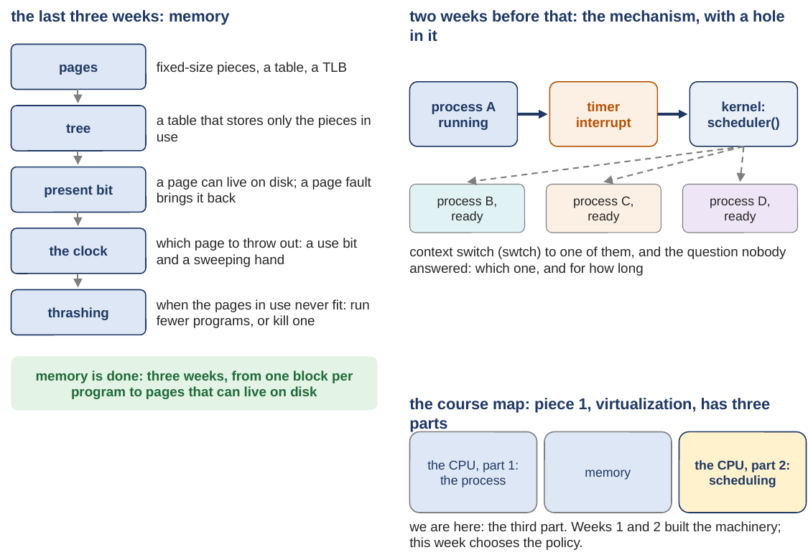

# Scheduling: which process runs next, and for how long

*Self-study guide · COMP3430 Operating Systems*

## What to read {#source}

This guide covers chapters 7 and 8 of the textbook (OSTEP: *Operating Systems: Three Easy Pieces*). Read chapter 7, Scheduling: Introduction (sections 7.1 to 7.10), with the first class, and chapter 8, Scheduling: The Multi-Level Feedback Queue (sections 8.1 to 8.6), with the second class.

## How to read this guide {#contents}

The label in brackets says what kind of section it is: a **Problem** section states what we have, where it breaks and what we need, before any fix; a **Concept** section explains the idea that answers it; a **Worked example** runs the idea on small numbers; a **Real kernel** section reads the xv6 code; a **Real machine** section reads an output captured on a real computer; **Check yourself** and **Your turn** are for you to do before reading on; **Extra** sections are optional and go deeper on a question already answered.

The navigation on the left lists every class and chapter of this week; the table of contents on the right lists the sections of the page you are on. Every section number in the text ("Section 3.5", "Extra 4") is a link.

## Part 0. Where we are, and what this week stands on {#part-0}

This part does two jobs before the new material starts. It shows where this week sits in the course, and it rebuilds the few ideas from earlier weeks that this week uses on every page. Everything later uses these words without stopping to define them, so if one is shaky, fix it here.

A few words first. The **operating system** (the **OS**) is the program that runs the computer and shares it between all the other programs; its core is called the **kernel**, and this guide uses the two words interchangeably. A **program** is a file of instructions; a **process** is a program while it is running. The **CPU** (the processor) is the part of the computer that runs instructions, one after another. **Memory** (RAM) is where a running program's data and instructions live. A **disk** is the slower, larger storage where files live when the power is off.

#### The course map

<figure markdown="1">
{width=90%}
<figcaption markdown="1">Figure 1. The memory unit closed (left), the mechanism the processes week built and the hole it left (right top), and the course map with this week marked (right bottom).</figcaption>
</figure>

An operating system has three big jobs, and the course takes them in order: **virtualization** (one computer pretends to be many, so every program behaves as if it had its own CPU and its own memory), **concurrency** (many things at once without chaos) and **persistence** (data that survives the power going off). Virtualization has three parts: the CPU seen from a process (the first two weeks), memory (the three weeks before this one), and the CPU again, which is this week. The bottom right of Figure 1 marks it.

The left column of Figure 1 is the memory unit in five steps, and you only need its last line: memory is done. A program's memory is cut into **pages** (fixed-size pieces), a table says where each page is, a page can live on disk, and when memory is full the OS chooses a page to throw out. Only one piece of it comes back this week, the TLB (a small cache inside the processor; [Section 3.3](class-1.md#sec-3-3) says what it holds), in [Section 3.3](class-1.md#sec-3-3).

#### What the processes week built, and the hole it left

The top right of Figure 1 is the picture this whole week stands on, so read it slowly. Process A is running on the CPU. A **timer interrupt** fires: a hardware clock forces the CPU to stop whatever program is running and jump into the kernel, many times a second, whether the program likes it or not. The kernel lands in a loop called the **scheduler**. The loop looks at the processes that are ready to run (B, C and D in the picture), picks one, and performs a **context switch**: it saves A's registers (the small set of values inside the CPU that describe exactly where A was) and loads the chosen process's registers, so that process continues from exactly where it had stopped. All of that is machinery, and it works.

Here is the hole. The loop picks a ready process. Any one. The processes week never said which one, and never said how long it should run before the loop picks again. That decision is not machinery; it is a rule, and the word for a rule like that is a **policy**. This week is about that policy.

Three states of a process matter below. A process is **running** when it has the CPU. It is **ready** (xv6 calls it RUNNABLE) when it could run but something else has the CPU. It is **blocked** (xv6 calls it SLEEPING) when it is waiting for something, a disk, a keystroke, a timer, and could not use the CPU even if it were offered. The scheduler only chooses among the ready processes.

#### Two small tools: time units and averages

This week measures things in seconds and in fractions of a second. A **millisecond** (ms) is a thousandth of a second: 1 s = 1000 ms. A **microsecond** (µs, often written us) is a millionth of a second: 1 ms = 1000 µs. So 1.5 µs is 1.5 / 1000 = 0.0015 ms. Check this: 100 ms is a tenth of a second, and 10 ms is a hundredth.

An **average** of several numbers is their sum divided by how many there are. The average of 100, 110 and 120 is (100 + 110 + 120) / 3 = 330 / 3 = 110. Every comparison this week is an average over the jobs.

A **percentage** is a fraction of 100. If a job got 2.71 s of CPU out of 3.00 s, its share is 2.71 / 3.00 = 0.903, which is 90.3 percent, written 90%.
