# The class: a share for every job, then many CPUs (OSTEP 9 and 10) {#class-1}

## <span class="lbl lbl-roadmap">Roadmap</span> Where we left off, and three questions {#opening-1 data-toc-label="[Roadmap] Where we left off, and three questions"}

The last class left two things open. A priority ranks jobs, so it can say who runs first but not how much each one gets; it cannot promise anyone a quarter of the CPU. And every picture so far had one CPU, one cache and one queue, while real machines have several CPUs, each with its own small fast memory beside it.

Those two open points become this class's three questions, and each one opens the next:

1. How can a scheduler promise each job a share of the CPU, instead of ranking jobs? The answer is a number per job and two rules that use it ([Chapter 1](#chapter-1)).
2. How does Linux keep that promise for thousands of jobs, when nobody hands out numbers there and the knob a user has for a share is nice? This answer is also where the 90% and 10% of Part 0 came from ([Chapter 2](#chapter-2)).
3. What changes when there are many CPUs instead of one? Each CPU brings a cache, and the one queue suddenly has many readers ([Chapter 3](#chapter-3)).

The summary at the end answers the three in this order.

## Chapter 1. Proportional share: tickets, the lottery and stride {#chapter-1}

*The question this chapter answers: How can a scheduler promise each job a share of the CPU, instead of ranking jobs?*

### 1.1 <span class="lbl lbl-problem">Problem</span> A priority cannot promise a share {#sec-1-1 data-toc-label="1.1 [Problem] A priority cannot promise a share"}

What we have is the multi-level feedback queue of Part 0. Its queues are ranked by priority. The higher queue runs first (Rule 1), jobs on the same queue take turns (Rule 2), and a boost every S milliseconds puts everyone back on top (Rule 5). It decides who goes first.

Where it breaks is a request that is about amounts. Picture a shared server. Customer A paid for 75% of one core and customer B paid for 25%, and both always have work to do. Suppose A happens to sit on the higher queue. What does MLFQ give them?

<figure markdown="1">
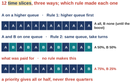{width=70%}
<figcaption markdown="1">Figure 1.1. Twelve time slices, three ways. Top: A on a higher queue. Middle: A and B on the same queue. Bottom: what was paid for, a pattern no rule makes.</figcaption>
</figure>

Figure 1.1 counts 12 time slices.

- Top strip: A is on the higher queue, so Rule 1 gives A every slice and B none. That lasts until the boost lifts B back up, or until A uses up its allotment and sinks by Rule 4. A gets 12 of 12, which is 100%.
- Middle strip: after either of those events, A and B sit on the same queue (here B sits one level below A, so a sinking A lands on B's queue), and Rule 2 makes them take turns, A B A B. A gets 6 of 12, which is 50%.
- Bottom strip: what was paid for. Three slices of A, then one of B, over and over. A gets 9 of 12, and 9 / 12 = 0.75, which is 75%.

No rule makes the bottom strip. In these strips the rules give A everything or half; other timings give other splits, such as nothing for A once it has sunk below B. Over a long run with boosts and allotments the average can land somewhere in between, but only as a side effect of when the boost and the allotment happen to fall; nothing in the rules can be told "three quarters" and made to keep it.

Here is the argument step by step. A priority only puts the jobs in order. The job on top runs until the boost (or until its allotment runs out), and after that the two take turns, so the shares it produces are all, half, or whatever the timing gives. Rule 4 does count a job's CPU time at one queue, but only to decide when to drop it a queue; nothing in the rules counts how much each job has had against what it was promised, and a share needs exactly that count.

So we need a different kind of scheduler. Instead of ranking jobs, it should guarantee each job a certain percentage of the CPU and keep that promise. This goal is called **proportional share**, also called **fair share**. It is a new goal, next to the two yardsticks of Part 0: not finishing work soonest, not answering a person fastest, but keeping a promised split. OSTEP puts the question this way: how can we design a scheduler to share the CPU in a proportional manner, what are the key mechanisms for doing so, and how effective are they.

One question to carry into the next part: which single number would you attach to each job, so that "A gets 75 and B gets 25" can be said at all?

- What this part settled: a rank cannot express an amount, so a share needs its own number per job.
- What it leaves open: what that number is, and a rule that turns it into turns on the CPU. The next part supplies both.

*The argument in one line:* why can a priority never promise three quarters? nothing in the rules counts a job's CPU against a promise; a priority only orders the jobs → the top job runs until the boost or its allotment, then they take turns → so the split is all, half, or whatever the timing happens to give.

### 1.2 <span class="lbl lbl-concept">Concept</span> Tickets, and lottery scheduling {#sec-1-2 data-toc-label="1.2 [Concept] Tickets, and lottery scheduling"}

The last part asked for one number per job that can express a share. Suppose A should get three quarters of the CPU and B one quarter. The simplest thing that could make that happen is to hand out tickets.

A **ticket** is a job's share of a resource written as a count. Give each job some tickets; a job's percentage of all the tickets is its percentage of the CPU. Here there are 100 tickets in all. A holds 75 of them, numbered 0 to 74, and B holds 25, numbered 75 to 99. So A should get 75 / 100 = 75% of the CPU and B 25 / 100 = 25%.

The idea is bigger than the CPU. The same count can share memory between **virtual machines** (several guest operating systems running on one physical computer). Whenever you need to say "this one gets a quarter", a ticket count says it.

Now a rule that turns tickets into turns. Every time slice, the scheduler holds a lottery: it draws one ticket number at random, from 0 to 99, and whoever holds that number runs for that slice. This is **lottery scheduling**: a proportional-share scheduler that draws a random winning ticket every time slice and runs the job that holds it.

<figure markdown="1">
{width=90%}
<figcaption markdown="1">Figure 1.2. The 100 tickets: A holds 0 to 74, B holds 75 to 99. The red marks above the strip are 20 random draws.</figcaption>
</figure>

<figure markdown="1">
{width=90%}
<figcaption markdown="1">Figure 1.3. The 20 time slices those 20 draws produce.</figcaption>
</figure>

Figure 1.2 shows 20 real draws from OSTEP's example: 63, 85, 70, 39, 76, 17, 29, 41, 36, 39, 10, 99, 68, 83, 63, 62, 43, 0, 49, 12. Read them against the strip. The first draw, 63, is between 0 and 74, so it is A's. The second, 85, is between 75 and 99, so it is B's. Going through all 20, the B draws are 85, 76, 99 and 83, four of them. Every other draw is A's: 20 − 4 = 16. Figure 1.3 is the resulting row of slices: A ran 16 and B ran 4.

So B got 4 / 20 = 20% instead of the promised 25 / 100 = 25%. That is the character of a lottery. Here is the argument. A holds 75 of the 100 tickets, so each draw has a 3 in 4 chance of falling in A's part. Keep drawing and A ends up with close to 3 slices in 4, which is the promised share. One short run can miss it, and this one did: B got 4 slices where 5 were owed (25% of 20 is 5). The longer the two jobs compete, the closer their shares of the slices get to 75% and 25%.

OSTEP gives three reasons for drawing at random at all.

- Strange corner cases rarely trip it up. A rule that follows a fixed pattern can be fooled by a workload that happens to match the pattern; a random draw is much harder to fool. (Its weak spot is a different one, short jobs, in [Section 1.5](#sec-1-5).)
- It needs almost no bookkeeping: one ticket count per job, and the total.
- The draw itself is fast: one random number per decision. (Finding who holds the number is a walk down the list of jobs, [Section 1.3](#sec-1-3); its cost is the subject of [Exercise 10](review.md#exercises).)

- What this part settled: a ticket count is a share, and a random draw per slice delivers it on average.
- What it leaves open: how the scheduler finds out who holds the drawn number when there are many jobs. The next part does it by hand.

*The argument in one line:* why does a lottery give the right share over time? A holds 75 of the 100 tickets → each draw: a 3-in-4 chance for A → many draws: about 3 slices in 4 for A | one short run can miss: B got 4 of 20.

### 1.3 <span class="lbl lbl-example">Worked example</span> Finding the winning ticket: the ticket walk {#sec-1-3 data-toc-label="1.3 [Worked example] Finding the winning ticket: the ticket walk"}

The draw gives a number, and several jobs hold the tickets. The scheduler has to find out whose number it is, without keeping a list of every single ticket. Let us do it slowly by hand, because the next part is the same thing in code.

Three jobs this time: A holds 100 tickets, B holds 50 and C holds 250. That is 100 + 50 + 250 = 400 tickets in all, so a draw is a number from 0 to 399. Suppose the draw is 300.

<figure markdown="1">
{width=90%}
<figcaption markdown="1">Figure 1.4. The 400 tickets handed out in order: A gets the first 100, B the next 50, C the last 250. The red arrow is the draw, ticket 300.</figcaption>
</figure>

Think of a raffle where the tickets were sold in order down a street. A bought numbers 0 to 99, B bought 100 to 149 and C bought 150 to 399. Number 300 is drawn. To find who holds it you do not need every name. You only need to know where each person's block of numbers ends: after A, 100 tickets have gone by; after B, 150; after C, 400. The first block that ends past 300 is the one that contains 300.

The scheduler does exactly this. It walks past the jobs in order, adding each job's tickets to a running total, and stops the first time the total passes the draw:

| after | tickets added | total so far | past 300 yet? | so |
|---|---|---|---|---|
| A | 100 | 100 | no, 300 is further along | keep walking |
| B | 50 | 150 | no, 300 is further along | keep walking |
| C | 250 | 400 | yes, 300 is inside C's block | stop: C holds ticket 300 |

This is the **ticket walk**: add each job's tickets to a running total, in list order; the first job that pushes the total past the drawn number holds that number. Here is why it works. Because the tickets go out in order, each job owns one block of numbers. The running total tells you where a block ends. The first block whose end is beyond the drawn number contains that number, so its owner wins.

One thing to keep straight. The walk only finds the winner. Nobody runs during it. Once the winner is known, that job runs for the whole time slice, and the next slice starts with a fresh draw: one draw, one walk, one winner per slice.

<figure markdown="1">
{width=90%}
<figcaption markdown="1">Figure 1.5. Six real slices with these three jobs, from a lottery simulator run (seed 4; [Section 1.4](#sec-1-4) explains seeds).</figcaption>
</figure>

Figure 1.5 is six real slices. They come from `lottery.py`, a **simulator**: a small program that plays a scheduler on paper, with made-up jobs, so a run can be watched and repeated. The six draws were 48, 366, 58, 172, 115 and 391. Walk each one:

- 48: below 100, so A.
- 366: past 150 and below 400, so C.
- 58: A.
- 172: past 150, so C.
- 115: past 100 and below 150, so B.
- 391: C.

C wins most often because C holds most of the tickets: 250 of 400, which is 62.5%. That is over a long run; in the six slices of Figure 1.5, C won 3, half, which is how a short run looks ([Section 1.5](#sec-1-5)). This is all the scheduler has to remember: one ticket count per job, and the total.

- What this part settled: a running total turns a drawn number into its owner.
- What it leaves open: nothing new; the next part shows the same walk as 16 lines of code.

*The argument in one line:* why does adding up the tickets find the owner? tickets go out in order: A, then B, then C → running total = where each block ends → first block ending past the draw holds it.

### 1.4 <span class="lbl lbl-concept">Concept</span> The lottery decision in code: OSTEP Figure 9.1 {#sec-1-4 data-toc-label="1.4 [Concept] The lottery decision in code: OSTEP Figure 9.1"}

The last part did the walk by hand. A scheduler has to do it in code, every time slice, so here are the 16 lines that OSTEP gives as its Figure 9.1. You do not need to read C to follow them, because you just did the same thing by hand. The few C words that appear are explained right after the listing.

<figure markdown="1">
{width=60%}
<figcaption markdown="1">Figure 1.6. The list of jobs the code walks: each box is one job's record, with its name and its ticket count; head points at the first record, and NULL marks the end.</figcaption>
</figure>

Figure 1.6 is the list as the program stores it. Each job has a **record**: a small bundle of named values kept together, here the job's name and its ticket count. Each record also holds the place in memory where the next record is, so the records form a chain. Such a chain is called a **linked list**. **head** is a **variable** (a named place in memory that holds a value) that holds where the first record is, and **NULL** is the special value that means "no record here": the last record's "next" is NULL, which marks the end of the list.

*OSTEP Figure 9.1, the lottery scheduling decision code, whole.*

```c linenums="1" hl_lines="6 9 11 12 13 14"
// counter: used to track if we’ve found the winner yet
int counter = 0;

// winner: use some call to a random number generator to
//         get a value >= 0 and <= (totaltickets - 1)
int winner = getrandom(0, totaltickets);

// current: use this to walk through the list of jobs
node_t *current = head;
while (current) {
    counter = counter + current->tickets;
    if (counter > winner)
        break; // found the winner
    current = current->next;
}
// ’current’ is the winner: schedule it...
```

Lines that start with `//` are comments: notes for the reader that the computer ignores. The highlighted lines are the walk; the notes also cover the lines around them:

- Line 6 is the draw: `getrandom` is a **function**, a named piece of code; **calling** it runs it, and it **returns** (hands back) a random number, and `totaltickets` holds the total, 400; so the draw is one random number between 0 and the total minus 1, here 0 to 399 (the call's second number, 400, is itself excluded, so the draw is never 400, as the comment on line 5 says). `int winner` makes a whole-number variable called `winner`, and `=` stores the random number in it.
- Line 9 starts at the head of the list. `node_t` is the **type** of one job's record in the list (a type tells C what kind of value a variable holds: a whole number, a decimal number, a record of a certain shape), and the star in `node_t *current` makes `current` a **pointer**: a variable that holds the place in memory where one record is, instead of the record itself. (If you know Java: this is what Java calls a reference.) So `current` points at the first job.
- Line 10, `while (current)`, repeats the lines between the braces `{ }` as long as `current` is not NULL, that is, until the walk falls off the end of the list.
- Line 11 is the adding up: `current->tickets` reads the ticket field of the record that `current` points at (in Java, `current.tickets`), and the line adds it to the running total `counter`.
- Lines 12 and 13 are the stop: if the total is now greater than the winner, `break` leaves the loop, and `current` still points at the job whose tickets pushed the total past the draw.
- Line 14 steps to the next job in the list.

<figure markdown="1">
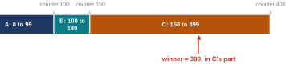{width=70%}
<figcaption markdown="1">Figure 1.7. The 400 tickets in a row with the running total marked: the counter passes 300 only after C's tickets are added, so C holds ticket 300.</figcaption>
</figure>

Figure 1.7 is the same 400 tickets with the running total marked under the strip. After A the counter is 100, after B 150, after C 400. It passes 300 only when C's tickets are added. That is why one random number is enough. The draw picks a ticket number, not a job. The walk down the list turns that number into its owner by adding up the ticket counts. So no job has to remember which numbers it holds, and adding a job is just adding its count.

The six real slices of Figure 1.5 came from this same algorithm, run by the simulator with **seed** 4. A seed is the starting number for the random draws: the same seed gives the same draws again, so anyone can repeat the run exactly.

- What this part settled: the whole lottery scheduler is one random number and one walk down a list.
- What it leaves open: how well it keeps the promise. Being cheap is not the same as being right, and the next part measures how wrong a short run can be.

*The argument in one line:* why is one random number enough, with no job remembering which numbers it holds? the draw picks a ticket, not a job → the walk adds ticket counts until the total passes the draw, which lands on the ticket's owner → so the owner is found from the counts alone.

### 1.5 <span class="lbl lbl-problem">Problem</span> Unfairness over a short run: the fairness metric F {#sec-1-5 data-toc-label="1.5 [Problem] Unfairness over a short run: the fairness metric F"}

What we have is lottery scheduling: a ticket count per job, one random draw per slice, and nothing else. A new job just adds its tickets to the total and joins the next draw; a finished job leaves. That is why lottery is so simple.

Where it breaks is time. The lottery is right on average, and an average needs many draws. A job that needs only a few slices may be finished before the average ever arrives.

<figure markdown="1">
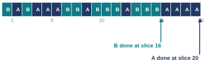{width=70%}
<figcaption markdown="1">Figure 1.8. One real run: two jobs with equal tickets and 10 slices of work each. B finished at slice 16, A at slice 20.</figcaption>
</figure>

Figure 1.8 is one real run of the simulator. Two jobs hold the same number of tickets and each needs 10 slices of work, so they should finish together. The row shows the slices in order (seed 1): the draws went B's way early, so B won its 10th draw at slice 16 and was done. There are 10 + 10 = 20 slices of work in all, so A, which still needed the rest, finished at slice 20.

OSTEP measures this with a number. The **fairness metric F** is the time the first of two equal jobs finishes divided by the time the second finishes. A perfectly fair scheduler gives F = 1, because the two finish together. Here F = 16 / 20 = 0.80. Check this: 0.80 × 20 = 16.

One run could be bad luck, so the run was repeated with 30 different seeds for each job length, and F was averaged:

| job length | 10 slices | 100 slices | 1000 slices |
|---|---|---|---|
| average F over 30 seeds | 0.85 | 0.94 | 0.98 |

So the lottery is unfair over a short run and fair over a long one. Here is the argument. A lottery is only right on average, and an average needs many draws. A job that needs 10 slices is finished once it has won 10 draws (B won its 10th at the 16th draw). If those few draws went the other way, that run of bad luck was its whole life, and nothing evens it out afterwards. A customer billed by the second cannot wait for the average, and neither can a video that shows 60 frames a second, where each frame must be ready every 1000 / 60 = 16.7 milliseconds.

So we need the same shares, but exactly, with no luck involved. The fix is to stop drawing and start counting: each job keeps a counter that grows each time it runs, and whoever is furthest behind runs next. The time slice stays as it is; only the choice of the next job changes.

A question to carry into the next part: if B is owed one slice in four, what could each job count, so that the scheduler always knows who is furthest behind?

- What this part settled: the lottery's error is real and large for short jobs, and F measures it.
- What it leaves open: a rule that gives the share exactly. Stride, next.

*The argument in one line:* why does a short job suffer? a lottery is only right on average → the average needs many draws → a 10-slice job is over after 10 wins → one run of bad luck is its whole life.

### 1.6 <span class="lbl lbl-example">Worked example</span> Stride scheduling, one turn at a time {#sec-1-6 data-toc-label="1.6 [Worked example] Stride scheduling, one turn at a time"}

The last part asked for a count that always says who is furthest behind. Stride scheduling is that count, and this part runs it in slow motion, one turn at a time, with the same three jobs as the walk: A with 100 tickets, B with 50, C with 250.

Each job carries two numbers.

- The **counter**, which OSTEP calls the **pass value** (not the `counter` of the lottery code in [Section 1.4](#sec-1-4), which was a running ticket total), is a score that grows every time the job runs. It does not count milliseconds: each turn adds the job's step (below), a big step for a job with few tickets and a small one for a job with many. So the score measures how much CPU a job has had compared with what its tickets entitle it to; level scores mean every job has had its fair part. All counters start at 0.
- The **step**, which OSTEP calls the **stride**, is 10000 divided by the job's tickets. A: 10000 / 100 = 100. B: 10000 / 50 = 200. C: 10000 / 250 = 40. The 10000 is nothing special; any big number works, and this one keeps the steps whole. Notice the direction: more tickets, smaller step. A small step means the counter climbs slowly, so the job is soon the lowest again and runs often.

A stride is a number, not a length of time. How long a turn lasts is still the time slice. Stride only decides whose turn is next.

The rule, in words: every turn the scheduler does the same four things.

1. Find the job with the lowest counter.
2. Run it for one time slice.
3. Add its step to its counter.
4. Put it back and decide again.

The counters keep score of how much CPU each job has had, measured against its tickets, and the smallest score always goes next.

<figure markdown="1">
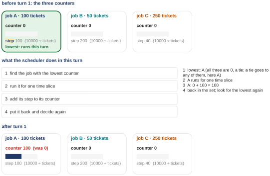{width=85%}
<figcaption markdown="1">Figure 1.9. Turn 1 of stride: the three counters before the turn, the four things the scheduler does, and the three counters after the turn.</figcaption>
</figure>

**Turn 1.** All three counters are 0, a tie. A tie can go to any of them; say A. A runs one slice, and A's counter becomes 0 + 100 = 100. After the turn: A 100, B 0, C 0 (Figure 1.9).

**Turn 2.** The lowest counter is 0, and two jobs share it, B and C: another tie, and this time B goes. B runs one slice, and B's counter jumps by its step, 0 + 200 = 200. That is a big jump, because B holds few tickets. After the turn: A 100, B 200, C 0.

**Turn 3.** C is the only job still at 0, so C is the lowest, no tie. C runs one slice, and its counter grows by only 40, the smallest step, because C holds the most tickets: 0 + 40 = 40. After the turn: A 100, B 200, C 40.

**Turn 4.** C is at 40, which is below A at 100 and below B at 200, so C goes again: 40 + 40 = 80. After the turn: A 100, B 200, C 80.

Each turn adds one row to a table, which is OSTEP's Figure 9.3. Each row shows the counters before the turn and who runs:

| turn | counter A | counter B | counter C | who runs |
|---|---|---|---|---|
| 1 | 0 | 0 | 0 | A |
| 2 | 100 | 0 | 0 | B |
| 3 | 100 | 200 | 0 | C |
| 4 | 100 | 200 | 40 | C |

Now you can see why the job with fewer tickets gets the bigger step. The rule is that the lowest counter runs. A job with a big step jumps up a lot every time it runs, so it stays the lowest less often and gets fewer turns. A job with a small step creeps up and keeps coming back to the front. So a big step for few tickets and a small step for many tickets is what makes the turns match the tickets.

- What this part settled: the rule of stride, and four turns of it by hand.
- What it leaves open: whether the turns come out exactly in the ticket ratio, and when the pattern repeats. The next part runs the whole lap (the turns until all the counters are level again).

*The argument in one line:* why does the job with fewer tickets get a bigger step? the lowest counter runs → a big step pushes a job up fast, so it is lowest less often → few tickets, big step, few turns → many tickets, small step, many turns.

### 1.7 <span class="lbl lbl-concept">Concept</span> One stride cycle: why counting gives the exact share {#sec-1-7 data-toc-label="1.7 [Concept] One stride cycle: why counting gives the exact share"}

Four turns have run in slow motion. What we still do not know is whether the turns come out exactly in the ticket ratio, and when the pattern starts over. Here is the whole lap, all eight turns at once.

<figure markdown="1">
{width=55%}
<figcaption markdown="1">Figure 1.10. The three steps: 10000 divided by the tickets. More tickets, shorter bar.</figcaption>
</figure>

<figure markdown="1">
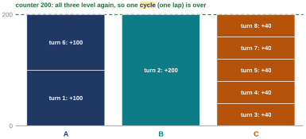{width=60%}
<figcaption markdown="1">Figure 1.11. The eight turns as a staircase: one column per job, one block per turn the job ran. At 200 all three columns are level again, so one cycle is over.</figcaption>
</figure>

Continue from where turn 4 left off (A 100, B 200, C 80):

- Turn 5: C at 80 is still the lowest, so C runs and climbs to 120.
- Turn 6: now A at 100 is the lowest, so A runs and climbs to 200.
- Turn 7: C at 120 is the lowest, so C runs and climbs to 160.
- Turn 8: C at 160 is still below 200, so C runs and climbs to 200.

Now all three counters sit at 200. Figure 1.11 draws this as a staircase: each block is one turn, labeled with the step it added.

| turn | counter A | counter B | counter C | who runs |
|---|---|---|---|---|
| 1 | 0 | 0 | 0 | A |
| 2 | 100 | 0 | 0 | B |
| 3 | 100 | 200 | 0 | C |
| 4 | 100 | 200 | 40 | C |
| 5 | 100 | 200 | 80 | C |
| 6 | 100 | 200 | 120 | A |
| 7 | 200 | 200 | 120 | C |
| 8 | 200 | 200 | 160 | C |
| (next) | 200 | 200 | 200 | the pattern repeats |

This table is OSTEP's Figure 9.3 in full: the lowest number in each row is the job that runs.

<figure markdown="1">
{width=80%}
<figcaption markdown="1">Figure 1.12. The same lap as a row of time slices: A B C C C A C C.</figcaption>
</figure>

Figure 1.12 is the lap as a row of slices: A, B, C, C, C, A, C, C. A **cycle** (one lap) is the run of turns until every counter is level again. Here they meet at 200, because 200 is the first number that whole steps of 100, of 200 and of 40 all land on: 2 steps of 100, 1 step of 200, 5 steps of 40. Check this: 2 × 100 = 200, 1 × 200 = 200, 5 × 40 = 200.

Count the blocks in each column of Figure 1.11: A ran 2 turns, B ran 1, C ran 5. The tickets were 100, 50 and 250. Divide the tickets by 50 and they read 2, 1 and 5. So the turns are in exactly the ticket ratio. Here is the argument. A lap is over when the three counters meet again, at 200. To climb from 0 to 200 a job needs 200 divided by its step turns: 2 for A, 1 for B, 5 for C. That is the ticket ratio, the same in every lap, and no luck is involved. The next lap looks exactly the same.

Stride is exact, so you might expect nobody to choose the lottery any more. The lottery survives because stride keeps a counter for every job, and a job that arrives in the middle has none. Give the newcomer a counter of 0, and it sits at the bottom for a long time, taking turn after turn while the others wait, until it catches up. There is a fix (start it at the lowest counter in the queue, [Exercise 9](review.md#exercises)), but it is one more rule, applied right at every arrival and every time a job wakes up. (A job **sleeps** while it waits for something, such as a key press or data from the disk, which is **I/O**, input or output; it **wakes up** when that arrives.) The lottery has no such state. A new job brings its tickets and is in the very next draw.

- What this part settled: stride gives each job exactly its ticket share in every cycle.
- What it leaves open: a newcomer's counter. And two questions nobody has asked yet: who hands out the tickets, and how a scheduler finds the lowest counter among thousands of jobs.

*The argument in one line:* why does counting give the share exactly? every lap ends when all three counters are level, first at 200, the smallest number all three steps (100, 200 and 40) land on → a job's turns in a lap = 200 ÷ its step → 200 ÷ 100 = 2, 200 ÷ 200 = 1, 200 ÷ 40 = 5 → 2 : 1 : 5 is the ticket ratio, every lap, no luck involved.

### 1.8 <span class="lbl lbl-check">Check yourself</span> What tickets settled, and what they left open {#sec-1-8 data-toc-label="1.8 [Check yourself] What tickets settled, and what they left open"}

Before the next question, the first one in four sentences.

- A ticket count says a share: a job's percentage of all tickets is its percentage of the CPU.
- Lottery delivers it on average, with almost no state: one random number per slice and a walk down the list. A short job can be treated unfairly (F was 0.85 on average for 10-slice jobs).
- Stride delivers it exactly in every cycle, with one counter (pass value) per job: run the lowest, add its stride.
- Stride needs every counter to stay in step, so a newcomer needs a rule for its starting counter.

Three things are still open. Stride's newcomer. Nobody has said where the tickets come from. And a walk down a list on every decision gets slow with thousands of jobs ([Section 2.1](#sec-2-1)).

Check yourself: you should now be able to trace the pass values of three jobs through one stride cycle by hand, and say why lottery and stride give the same shares in the long run. (Exercises 1 to 4 practice this.)

## Chapter 2. The Linux Completely Fair Scheduler {#chapter-2}

*The question this chapter answers: How does Linux keep the promise of a share for thousands of jobs, when the knob a user has for a share is nice?*

### 2.1 <span class="lbl lbl-problem">Problem</span> Who hands out tickets, and how to find the lowest among thousands {#sec-2-1 data-toc-label="2.1 [Problem] Who hands out tickets, and how to find the lowest among thousands"}

What we have is stride as a kernel would keep it: for each job, a ticket count and a pass value, the counter, in a list. Every decision picks the job with the lowest pass.

<figure markdown="1">
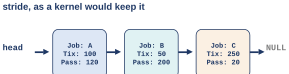{width=60%}
<figcaption markdown="1">Figure 2.1. Stride as a kernel would keep it: each job's record holds its tickets and its pass value, in a list.</figcaption>
</figure>

Before a real kernel can use this, two questions need an answer, and Figure 2.1 shows where both come from: each record holds a ticket count that somebody has to set (the first question), and the whole list has to be searched for the lowest pass at every decision (the second).

The first question: who decides how many tickets each job gets? Your web browser, your text editor and a backup running in the background would all need a count, and nothing tells you what the counts should be. There is no good answer, and OSTEP says in so many words that the question of how to hand out tickets remains open. What a Linux user actually has is nice. A new process gets the nice value of its parent (the process that started it), which is 0 unless someone changed it; the commands in this guide set it with `nice -n`. Any user can turn a job down, to a higher nice value. Only an administrator can turn one up, to a lower nice value and a bigger share, or every user would raise their own and take the CPU from everyone else. The user never writes down a number of tickets.

The second question is about scale. A busy server has thousands of tasks, and at busy moments many of them are runnable at once. (A **task** is Linux's word for a process or a thread, where a **thread** is a second line of execution inside one program; the next piece of the course is about threads. **Runnable** means ready and waiting for a CPU.) The scheduler decides every few milliseconds. In a list kept in no particular order, the lowest pass can be anywhere, so picking it means reading the whole list every time. (Keeping the list sorted does not help much: the lowest is then first, but after a job runs, putting it back in its sorted place is again a walk through the list.) The scheduler's cost matters: a 2015 study of Google's datacenters found that even after careful tuning, about 5% of all their CPU time went to the scheduler itself. Every decision has to be cheap.

So we need two things. For the first question, the scheduler gives each process only a knob: every job starts at its parent's nice value, normally 0, and the user can only nudge one job relative to the others. For the second question, Linux has a real answer: keep the jobs in a structure where the lowest is found without reading all of them.

<figure markdown="1">
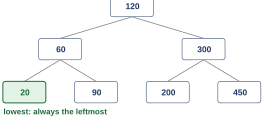{width=55%}
<figcaption markdown="1">Figure 2.2. Seven pass values as a sorted tree (120 at the top; 60 and 300 below it; 20, 90, 200 and 450 at the bottom): smaller to the left, bigger to the right. The lowest is always the leftmost node.</figcaption>
</figure>

That structure is a sorted tree, Figure 2.2. Its seven values are made up for the picture (the list of Figure 2.1 uses made-up passes too): 120 at the top, 60 and 300 on the next level, and 20, 90, 200 and 450 at the bottom. Each value sits in a box called a node. Every node has a value; everything in its left branch is smaller and everything in its right branch is bigger. The tree is kept **balanced**: no path from the top down is much longer than any other. This matters because a sorted tree that is not balanced can grow into one long chain (insert the values in increasing order and each one goes to the right of the last), and a chain is just a list again. Each level of a balanced tree doubles the room: one node at the top, 2 on the next level, 4 on the next, and so on. Ten levels hold 1 + 2 + 4 + ... + 512 = 1023 nodes, about 2^10 = 1024 (2^10 means 2 multiplied by itself 10 times; [Appendix A](appendix.md#appendix-a)), so 1000 jobs need about 10 levels, and a million jobs need about 20 (2^20 = 1,048,576). This kind of growth is called **logarithmic**: the work grows with the number of levels, not with the number of jobs. Finding, removing or inserting a job takes about as many steps as there are levels.

Here is the argument step by step. In a list the lowest counter can be anywhere, so every decision has to read all 1000 jobs. In a sorted tree the lowest is always at the left edge, and putting a job back after its counter grows is a walk down about 10 levels for 1000 jobs, not a scan of 1000. In Figure 2.2 the lowest pass, 20, is found by going left from the top twice: 120, then 60, then 20. Linux uses a balanced tree of this kind called a red-black tree.

One question to carry on: after a job runs and its pass has grown, what has to happen to it in the tree? It no longer belongs where it was. Take it out, and walk down from the top, left or right at each level, to its new place: about 10 steps for 1000 jobs.

- What this part settled: a sorted, balanced tree finds the lowest pass in about 10 steps for 1000 jobs, and Linux has only nice, not tickets.
- What it leaves open: what Linux keeps in place of a pass value, and how it turns a nice value into a share. The next two parts.

*The argument in one line:* there is no good rule for handing out tickets → so Linux gives a user only nice | why can a list not scale? in an unsorted list the lowest can be anywhere, so a pick reads all 1000 jobs; a sorted list finds it at once but needs a scan to put a job back → either way, a decision can cost a walk over 1000 jobs | the fix: a balanced sorted tree keeps the lowest at its left edge and is about 10 levels deep → about 10 steps for 1000 jobs.

### 2.2 <span class="lbl lbl-concept">Concept</span> Virtual runtime and the scheduling window {#sec-2-2 data-toc-label="2.2 [Concept] Virtual runtime and the scheduling window"}

The last part left open what Linux keeps in place of a pass value. Linux wants what stride wants, for thousands of jobs, and it keeps a counter per job too, under a new name. Three questions shape it.

**First, the counter.** As a job runs, a number called its **virtual runtime**, **vruntime** for short, grows. When the scheduler has to decide, it runs the job with the lowest vruntime. That is stride's pass value under a new name: a counter that grows while the job runs, and the lowest runs next. ("Virtual" because, as [Section 2.3](#sec-2-3) shows, it does not grow at the same speed as real time for every job.)

**Second, when do we stop the running job and give someone else a turn?** There is a tension here.

- Switch often, and the shares are fair even over tiny stretches of time. But every switch costs: about 1.5 microseconds for each switch, including the small work of handing the CPU over, on the Linux computer the captures come from. (The first scheduling class measured it: 100,000 round trips, in each of which one process hands the CPU to the other and gets it back, took 0.299 s. That is 2.99 microseconds per round trip, and each round trip is two switches, so about 1.5 each.) On top of that comes, often, a colder cache: while other jobs ran, their data pushed some of this job's data out of the CPU's small fast memory, and it has to be fetched again ([Chapter 3](#chapter-3) measures what moving a job between caches costs).
- Switch rarely, and switching is cheap. But a job can wait a long time for its turn.

Linux, in the version OSTEP describes, settles this with a window instead of a fixed slice. Every runnable job gets one turn inside a window of 48 milliseconds, called **sched_latency**. 48 ms, and the 6 ms below, are the values OSTEP uses in its examples; a real kernel sets its own, and what matters here is the rule, not the exact numbers. So with equal jobs a turn is 48 ms divided by the number of jobs ([Section 2.3](#sec-2-3) adds weights): with 4 jobs, 48 / 4 = 12 ms each; with 2 jobs, 48 / 2 = 24 ms each.

<figure markdown="1">
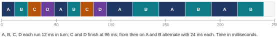{width=90%}
<figcaption markdown="1">Figure 2.3. OSTEP Figure 9.4: A, B, C and D each run 12 ms in turn; C finishes at 84 ms and D at 96 ms; from then on A and B alternate with 24 ms each. Time in milliseconds.</figcaption>
</figure>

Figure 2.3 is the textbook's example. Four jobs, so 12 ms each, in turn. In the example C and D each need 24 ms of CPU, two turns. In the first 96 ms each job runs twice: 4 jobs × 2 turns × 12 ms = 96 ms; C finishes its second turn at 84 ms and D at 96 ms. From then on only A and B are left, so each turn is 24 ms. The window stays 48; the turn changes with the count.

**Third, what if there are too many jobs?** Ten jobs would make a turn 48 / 10 = 4.8 ms, and 100 jobs would make it 48 / 100 = 0.48 ms, under half a millisecond. The switch itself is still small next to that, but every switch also costs the next job some cache refilling, and with turns this short a job would spend much of each turn just refilling its cache before losing the CPU again. So a turn never goes below a floor, called **min_granularity**, 6 ms in OSTEP's example. With 10 jobs, each gets 6 ms instead of 4.8, and the window stretches to 10 × 6 = 60 ms, so every job waits a little longer for its turn.

One more detail. The scheduler takes the CPU away from a running job only at the timer interrupt (a job that waits or finishes gives it up sooner), which in OSTEP's description goes off about every millisecond, so a turn need not end at exactly the computed time. That does not hurt the long run, because vruntime is tracked precisely: whatever extra a job got this turn is already counted on its clock.

Here is the argument for the window step by step. A fixed slice has no idea how many jobs are waiting: with few jobs it switches more often than it needs to. A window does know: inside 48 milliseconds each runnable job has had a turn, so a turn is the window divided by the count. With few jobs the turns are long, and with up to 8 jobs (8 × 6 ms = 48 ms) no job waits more than the 48 ms window for its next turn; past that, the 6 ms floor described above takes over.

Now the names. This scheduler is the **Completely Fair Scheduler**, **CFS**, Linux's default from 2007. Linux version 6.6 replaced its way of picking the next job with a successor, **EEVDF** (Earliest Eligible Virtual Deadline First), and EEVDF is the scheduler of the Linux 6.18 computer the captures come from. EEVDF keeps the virtual runtime and the weights of the next part, and it still never lets a job's clock get far ahead of the others. What it changes is the choice among the jobs that are not ahead: it lets a job that needs to answer quickly go sooner ([Extra 5](#extra-5) shows how, with numbers). It also drops the 48 ms window: each job gets a slice of its own. The window and the floor above are CFS as OSTEP describes it. The captures in this guide come from Linux 6.18, and the two things they show, the shares and the clocks staying level (Sections [2.3](#sec-2-3) and [2.4](#sec-2-4)), are what CFS was built to give; they come out on EEVDF too.

- What this part settled: CFS runs the lowest vruntime; in CFS, as OSTEP describes it, a turn is a share of the 48 ms window (48 ms divided by the number of jobs when they are equal), never below 6 ms.
- What it leaves open: so far every job's clock runs at the same speed, so every job gets the same share. Nobody hands out tickets on Linux, so a bigger or smaller share must come from somewhere else. The next part.

*The argument in one line:* in CFS, vruntime plays the pass: the lowest runs | why a window instead of a fixed slice? a fixed slice ignores the job count, so with few jobs it switches more often than needed → a window gives every job one turn inside 48 ms, so few jobs get long turns and fewer switches → turn = window ÷ jobs | too many jobs: turns would shrink until a job spends much of each one refilling its cache, so a 6 ms floor stops them, and above 8 jobs (8 × 6 ms = 48 ms) the window stretches instead.

### 2.3 <span class="lbl lbl-concept">Concept</span> The weight table: from nice to a share {#sec-2-3 data-toc-label="2.3 [Concept] The weight table: from nice to a share"}

So far every job's clock runs at the same speed, so the scheduler keeps them level and every job gets the same share. Nobody hands out tickets on Linux. A bigger or smaller share comes from a table instead, and the job's nice value picks a row.

The kernel keeps a table with 40 entries, one per nice value from −20 to 19. Each entry holds a **weight**. Here is the table, copied from the Linux 6.18 source code. `const int sched_prio_to_weight[40]` declares a fixed list (an **array**) of 40 whole numbers that never change (`const`); the numbers inside the braces fill it in order. (`/* ... */` is a comment, like `//`.) The listing prints five entries to a line. The label at the start of each line is the nice value of its first entry, and the next entries are the next nice values: the line labeled 0 holds nice 0, 1, 2, 3 and 4.

```c
const int sched_prio_to_weight[40] = {
 /* -20 */     88761,     71755,     56483,     46273,     36291,
 /* -15 */     29154,     23254,     18705,     14949,     11916,
 /* -10 */      9548,      7620,      6100,      4904,      3906,
 /*  -5 */      3121,      2501,      1991,      1586,      1277,
 /*   0 */      1024,       820,       655,       526,       423,
 /*   5 */       335,       272,       215,       172,       137,
 /*  10 */       110,        87,        70,        56,        45,
 /*  15 */        36,        29,        23,        18,        15,
};
```

So nice 0 has weight 1024, nice 5 has 335, nice 10 has 110 and nice −5 has 3121. (1024 is the weight chosen for nice 0, a round number for a computer, 2^10, because computers count in base 2, [Appendix A](appendix.md#appendix-a); the others are set relative to it, and with it a nice 0 job's clock runs at real speed, as the second rule below shows.) Each step toward a higher nice value (one place to the right in the listing) divides the weight by about 1.25: nice 1 is 1024 / 1.25 = 819.2, and the table says 820. The factor was chosen, says the comment above the table in the kernel source, so that one nice step makes about a 10-point difference between two jobs' shares: nice 0 against nice 1 is 1024 / (1024 + 820) = 55.5% against 44.5%, eleven points apart, close to the 10 the comment aims for.

The weight does two things.

**First, it sets the turn.** A job's share of the window is its weight over everyone's weights added together, and its turn is that share of the 48 ms window. So a heavy job gets its bigger share in one long turn per window, not in many short turns that would each cost a switch. OSTEP writes this as equation 9.1:

    time slice of job k = (weight of k / sum of all the weights) × sched_latency

Take A at nice −5 and B at nice 0. The weights are 3121 and 1024, and they add up to 3121 + 1024 = 4145.

- A: 3121 / 4145 = 0.753, and 0.753 × 48 ms = 36 ms.
- B: 1024 / 4145 = 0.247, and 0.247 × 48 ms = 12 ms.

Three quarters and a quarter. Check this: 36 + 12 = 48. The 90% and 10% of Part 0 are the same fraction, a job's weight over the sum of the weights: nice 0 against nice 10 is 1024 / (1024 + 110) = 1024 / 1134 = 0.903, which is 90.3%. That is the share the weights call for. The turn length alone does not deliver it, as the next paragraph shows, and the 6.18 kernel of that run has no 48 ms window anyway; what delivers it is the second rule.

**Second, it sets how fast the virtual clock runs.** This is the real trick, and the first rule alone would not be enough. If every clock ran at real speed, A's 36 ms turn would push A's clock up by 36 while B's 12 ms turn pushed B's up by 12. The scheduler runs the lowest clock, so it would then hold A back until B caught up, and the real time would even out to half and half again. For example, after A's first 36 ms turn A's clock reads 36 and B's 0, so B runs three 12 ms turns to reach 36; by then each has had 36 ms. The clocks have to run at different speeds. OSTEP's equation 9.2:

    vruntime += (1024 / weight) × real run time

(`+=` means "add the right side to": each time the job runs, its vruntime grows by that amount.)

A job at nice 0 has weight 1024, so its vruntime grows exactly as fast as real time: 1024 / 1024 = 1. A's weight is 3121, so A's clock runs at 1024 / 3121 = 0.33 of real time, a third of B's speed.

<figure markdown="1">
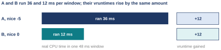{width=85%}
<figcaption markdown="1">Figure 2.4. One 48 ms window with A at nice −5 and B at nice 0: A runs 36 ms and B runs 12 ms, yet both virtual clocks rise by the same 12.</figcaption>
</figure>

Figure 2.4 puts the two together. In one window A runs 36 ms, and its clock rises by 36 × 1024 / 3121 = 11.8, about 12. B runs 12 ms, and its clock rises by 12 × 1024 / 1024 = 12. (Unrounded, the turns are 36.1 and 11.9 ms, and both clocks rise by exactly 11.9.) Same rise, very different real time.

Here is the argument step by step. A heavy job (one with a big weight) has a virtual clock that runs slowly. The scheduler always picks the lowest clock, and a slow clock is lowest more of the time, so the heavy job collects more real time. A light job's clock runs fast and falls to the back of the line sooner. The scheduler keeps the clocks level, and a clock rises by real time × 1024 / weight, so equal rises need real time in proportion to the weight. Divide its weight by everyone's weights added together and that is its share.

Notice what Linux leaves alone. Nobody decides who deserves more. Every job starts at its parent's nice value, normally 0, a user can only say "this one matters less" (and an administrator "this one matters more"), and the table turns that knob into a share. It does not choose the share for you.

One property of the table: only the distance between two nice values matters, to within a few percent ([Extra 5](#extra-5)). Nice 5 beside nice 10 (335 against 110) splits a core the same way as nice −5 beside nice 0 (3121 against 1024): 335 / 445 = 75.3% and 3121 / 4145 = 75.3%, about 3 to 1 both times. [Extra 5](#extra-5) measures it.

- What this part settled: a nice value picks a weight; the weight sets both the turn and the speed of the job's virtual clock, and keeping the clocks level gives each job weight over sum.
- What it leaves open: whether a real kernel actually behaves like this. The next part measures it.

*The argument in one line:* why does a bigger weight mean a bigger share? a heavy job's clock runs slower (1024 ÷ weight per millisecond) → the lowest clock runs, so the clocks stay level → equal clock rises need real time in proportion to the weight → share = weight ÷ sum of the weights.

### 2.4 <span class="lbl lbl-machine">Real machine</span> Three nice levels on one core, measured {#sec-2-4 data-toc-label="2.4 [Real machine] Three nice levels on one core, measured"}

The table predicts a split. Here is the same program three times at three nice levels on one core, and what the kernel actually gave them. If the shares match and the clocks come out level, the weights and the level clocks of the last part are what the real kernel uses.

The program is `share.c`. It computes for 3 seconds of **wall-clock time** (time by the clock on the wall) and then reports how much **CPU time** it was given (the time it was actually running).

*The program `share.c`, whole (`W07_demos/share.c`).*

```c linenums="1" hl_lines="7 8 11 12 17 19 20 21"
// share.c: compute for 3 seconds of wall-clock time and report how much
// CPU time this process was given.  Usage: ./share NAME
#include <stdio.h>
#include <stdlib.h>
#include <time.h>

static double wall(void) {
  struct timespec t; clock_gettime(CLOCK_MONOTONIC, &t);
  return t.tv_sec + t.tv_nsec / 1e9;
}
static double cpu(void) {
  struct timespec t; clock_gettime(CLOCK_PROCESS_CPUTIME_ID, &t);
  return t.tv_sec + t.tv_nsec / 1e9;
}

int main(int argc, char **argv) {
  const char *name = argv[1]; double t0 = wall();
  volatile unsigned long x = 0;
  while (wall() - t0 < 3.0)             /* keep computing for 3 s of wall time */
    for (int i = 0; i < 100000; i++) x += i;
  printf("%s: got %.2f s of CPU in 3.00 s of wall-clock time (%.0f%%)\n",
         name, cpu(), cpu() / 3.0 * 100);
  return 0;
}
```

The notes, which cover the highlighted lines and a few around them:

- Lines 7 and 8: `wall()` reads the clock on the wall. `clock_gettime` is the library call that reads a clock (a **library** is a collection of ready-made functions that programs can use; the C standard library is the one that comes with C itself), and `CLOCK_MONOTONIC` names the clock that keeps counting real time whatever the program does. `&t` hands the function the address of `t`, the place in memory where `t` lives, so the function can fill it in. `struct timespec t` is a record with two fields that the call fills in, `tv_sec` (whole seconds) and `tv_nsec` (nanoseconds); line 9 turns them into one number of seconds (`1e9` is 1,000,000,000).
- Lines 11 and 12: `cpu()` reads a different clock, `CLOCK_PROCESS_CPUTIME_ID`, which only runs while this process is running on a CPU.
- Lines 3 to 5 (`#include`) bring in the standard library's declarations of `printf` and `clock_gettime`. Line 16 is where the program starts: `main` receives the words typed on the command line in `argv`, and `return 0` (line 23) ends it. `static double wall(void)` declares a small helper function (`static` keeps it private to this file) that takes nothing and returns a decimal number (`double`).
- Line 17: `argv[1]` is the first word typed after the program's name, here the label such as "nice 5"; `t0` remembers the start time.
- Lines 19 and 20: the loop burns CPU until 3 seconds of wall time have passed. `x += i` adds `i` to `x`, a whole number that is never negative (`unsigned long`); `volatile` (line 18) tells the **compiler** (the program that turns C into instructions the CPU can run) to really do that work and not skip it as useless.
- Line 21: print the CPU time the process got and what percentage of 3 seconds that is (`%s` prints a piece of text, `%.2f` a decimal number with two digits after the point, `%.0f` one with no digits after the point, and `%%` a percent sign).

Three copies ran together, all pinned to core 0, at nice 0, 5 and 10. `./share` runs the program `share` from the current folder (the `./` says "from here"). **taskset** `-c 0` runs a program on core 0 only, so the three must share one core; `nice -n 5` starts a program at nice 5. The `&` at the end of each command starts it in the background, so all three run at once, and `wait` waits for all of them.

*Capture `W07_demos/share3.out`.*

```text
$ taskset -c 0 nice -n 0 ./share "nice 0 " & taskset -c 0 nice -n 5 ./share "nice 5 " & taskset -c 0 nice -n 10 ./share "nice 10" & wait
nice 0 : got 2.08 s of CPU in 3.00 s of wall-clock time (69%)
nice 10: got 0.23 s of CPU in 3.00 s of wall-clock time (8%)
nice 5 : got 0.69 s of CPU in 3.00 s of wall-clock time (23%)
```

Before the run, the table predicted the split. The weights are 1024, 335 and 110, and they add up to 1024 + 335 + 110 = 1469.

| nice | weight | predicted share | measured |
|---|---|---|---|
| 0 | 1024 | 1024 / 1469 = 69.7% | 69% (2.08 s) |
| 5 | 335 | 335 / 1469 = 22.8% | 23% (0.69 s) |
| 10 | 110 | 110 / 1469 = 7.5% | 8% (0.23 s) |

Check this: the predictions add to 69.7 + 22.8 + 7.5 = 100.0%, and the CPU times add to 2.08 + 0.69 + 0.23 = 3.00 s, the whole run. Each promise was kept to within a percent, and nobody assigned a ticket by hand.

Now the part you cannot see from outside. Linux keeps a file for every task, `/proc/PID/sched`, with the scheduler's own counters. (**PID** is the process id, the number the kernel gives each process.) The three jobs were started again, and their files were read 2.5 seconds into the run, before the jobs end at 3 seconds and their files disappear with them:

*Capture `W07_demos/vruntime.out` (the `policy` line of each block left out).*

```text
$ taskset -c 0 nice -n 0 ./share "nice 0 " & P0=$!; taskset -c 0 nice -n 5 ./share "nice 5 " & P5=$!; taskset -c 0 nice -n 10 ./share "nice 10" & P10=$!
$ sleep 2.5; for p in $P0 $P5 $P10; do echo "pid $p"; grep -E "^(se.sum_exec_runtime|se.vruntime|policy|prio)" /proc/$p/sched; echo; done
pid 2591
se.vruntime                                  :         10807.240702
se.sum_exec_runtime                          :          1724.582276
prio                                         :                  120

pid 2592
se.vruntime                                  :         10811.090812
se.sum_exec_runtime                          :           566.673494
prio                                         :                  125

pid 2593
se.vruntime                                  :         10803.422531
se.sum_exec_runtime                          :           187.714832
prio                                         :                  130
```

The first line starts the three jobs; after each one, `P0=$!` saves the process id of the job just started (`$!`) under a name, and `$P0` reads it back. The second line waits 2.5 s and then, for each saved id in turn (`for p in ...; do ...; done` repeats the commands between `do` and `done` once per id), prints a label (`echo`) and the lines of that job's `/proc` file that begin with one of the four names (`grep -E "^(a|b)"` keeps lines starting with a or b). How to read the three numbers of each block:

- `se.sum_exec_runtime` is real CPU time in milliseconds: 1725, 567 and 188 for nice 0, 5 and 10. That is the weight ratio again: 1725 / 188 = 9.2, and 1024 / 110 = 9.3.
- `se.vruntime` is the virtual clock, also in milliseconds: 10807, 10811 and 10803. The biggest minus the smallest is 10811 − 10803 = 8 ms. Each clock has climbed by about 1725 ms since the jobs started (the nice 0 job's clock climbs at real speed, and it ran 1725 ms; the others are level with it), and 8 ms is under 0.5% of that. The three clocks are level.
- `prio` is the kernel's own priority number for a normal task: 100 + 20 + nice, so 120, 125 and 130. For a normal job it is only nice on another scale: the kernel uses it to look up the weight, and the share comes from the weight, not from a ranking. Linux keeps the numbers 0 to 99 for a separate class of real-time tasks (tasks that must meet deadlines and are scheduled by a different set of rules), so normal tasks start at 100, and the 20 moves nice −20 to 100 and nice 0 to 120.

The clocks are near 10,800 although the jobs have only run for 2.5 seconds, because a new job's clock does not start at 0. It starts close to the clocks already in the queue, which on the Linux computer had grown large long before. Only the differences between clocks mean anything.

So this is the mechanism, visible. Each clock ticks at 1024 over the job's weight, so the nice 10 job's clock ran about 1024 / 110 = 9.3 times faster than the nice 0 job's, and it got only 188 milliseconds. Keeping the three clocks level forced the real time to split the way the weights say. That is stride's idea, kept by a real kernel: EEVDF chooses differently among the jobs that are behind ([Extra 5](#extra-5)), but it never runs a job whose clock is ahead of the weighted average of all the clocks (a heavier job counts more in it), so the clocks still stay level.

- What this part settled: on a real Linux kernel the shares are weight over sum, and the virtual clocks are kept level.
- What it leaves open: two loose ends on one core, waking jobs and who sets the weights ([Section 2.5](#sec-2-5)), and then the last assumption, one CPU.

*The argument in one line:* why are the three clocks level while the CPU times differ? the scheduler keeps the clocks together (CFS runs the lowest clock; EEVDF never runs one ahead of the weighted average), so the three clocks stay level → each clock ticks at 1024 ÷ weight → nice 10's clock ticks 9 times faster than nice 0's, so it reaches the same level with 188 ms of real time where nice 0 needs 1725 → so the real time splits as the weights say.

??? note "The program behind Figure 0.3 and Section 2.4 (you can skip this listing)"

    The two-copy run of Part 0 (Figure 0.3) used the same `share.c` listed above. To repeat the runs you need Linux, because `taskset` exists only there; on Windows, use WSL, the Linux inside Windows that the labs use. Then:
    
    1. Open the Terminal program (on Windows, open Ubuntu from the Start menu). It shows the `$` prompt of the shell. A Mac's own Terminal will not do: it has no `apt` (the installer of step 2) and no `taskset`; on a Mac, install a Linux virtual machine (a free app such as UTM can run Ubuntu) and follow these steps inside it.
    2. Install the C compiler once: `sudo apt update`, then `sudo apt install gcc` (`sudo` runs a command as administrator and asks for your own password; `apt` is Ubuntu's installer, and `update` refreshes its list of packages).
    3. Save the listing: `nano share.c` opens a simple editor; paste the listing (in a terminal, Ctrl-Shift-V or a right-click pastes; Ctrl-V does not), then press Ctrl-O, Enter and Ctrl-X.
    4. Type each line below without the `$`, which the shell prints itself.
    
    ```text
    $ gcc -O2 -o share share.c
    $ taskset -c 0 nice -n 0 ./share "nice 0 " & taskset -c 0 nice -n 10 ./share "nice 10" & wait
    $ taskset -c 0 nice -n 0 ./share "nice 0 " & taskset -c 0 nice -n 5 ./share "nice 5 " & taskset -c 0 nice -n 10 ./share "nice 10" & wait
    ```
    
    In the commands, the quotes make `nice 0 ` one label, and its trailing space lines the printed columns up. `gcc` is the C compiler: it turns `share.c` into a program called `share` (`-o share`), and `-O2` asks it to make the program fast. The shares should come out close to the ones above on an otherwise idle Linux computer; a busy or shared one may differ more.
    
### 2.5 <span class="lbl lbl-check">Check yourself</span> What the weight table settled, and what it left open {#sec-2-5 data-toc-label="2.5 [Check yourself] What the weight table settled, and what it left open"}

The second question in four sentences.

- Linux keeps stride's idea under new names: a virtual clock per job, and (in CFS) the job furthest behind runs.
- In CFS, as OSTEP describes it, a turn is the job's weight share of the 48 ms window (48 ms over the number of jobs when the weights are equal), never below 6 ms.
- Every job starts at its parent's nice value, normally 0; a table turns a nice value into a weight, and the weight sets both the turn and how fast the clock runs.
- Measured: predicted 69.7 / 22.8 / 7.5, got 69 / 23 / 8 for nice 0, 5 and 10, with the three clocks level. The shares and the level clocks are what both CFS and today's EEVDF keep.

Still open. Who deserves more is still nobody's job: the ticket question is left open, and nice is only a knob. A job that wakes from a long sleep needs a rule, because its clock stopped while it slept and it would own the CPU while it caught up; and the usual rule (CFS lifts a waking job's clock up to the lowest clock, [Extra 4](#extra-4)) makes a job that keeps waiting for input or output lose part of its share, because the time it was owed is forgotten at each wake-up. And every picture so far still had one CPU.

Check yourself: you should now be able to predict the split of two always-running jobs from their nice values with the table, and say what the kernel keeps level while it does that. (Exercises 5 and 6.)

## Chapter 3. Multiprocessor scheduling {#chapter-3}

*The question this chapter answers: What changes when there are many CPUs instead of one?*

### 3.1 <span class="lbl lbl-problem">Problem</span> Each CPU brings its own cache {#sec-3-1 data-toc-label="3.1 [Problem] Each CPU brings its own cache"}

So far every picture had one CPU. When a second one shows up, one new thing arrives, and it changes everything after it: each CPU comes with its own cache.

<figure markdown="1">
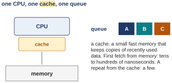{width=55%}
<figcaption markdown="1">Figure 3.1. What we have: one CPU with a small fast cache in front of a slow memory, and one queue of runnable jobs.</figcaption>
</figure>

What we have is Figure 3.1: one CPU, one cache, one memory, one queue. A **cache** is a small fast memory beside the CPU that keeps copies of recently used data. The first time a program reads a value from memory, the read takes tens to hundreds of nanoseconds (the textbook's figure). The CPU keeps a copy in its cache, and a repeat read of the same value from the cache is several times faster ([Section 3.2](#sec-3-2) measures about 10 nanoseconds a step on the computer of this guide). The cache works because of **locality**: data used once is likely to be used again soon, so keeping a copy close to the CPU pays off.

Where it breaks: with two CPUs, two things go wrong.

<figure markdown="1">
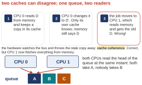{width=60%}
<figcaption markdown="1">Figure 3.2. Two caches can disagree, and one queue has two readers. Top: OSTEP's story in three steps. Bottom: both CPUs read the head of the queue at the same instant.</figcaption>
</figure>

**The first thing: each CPU keeps its own copies.** Figure 3.2's top row is the textbook's story in three steps:

1. A program on CPU 0 reads a value D from memory, and CPU 0 keeps a copy in its cache.
2. The program changes the value to D′ (read "D prime"). Only CPU 0's cache knows; memory still says D, because writing every change all the way back to memory is slow, so the hardware does it later.
3. The OS moves the program to CPU 1. CPU 1 has no copy, reads memory, and gets the old D. Wrong answer.

The hardware repairs this by itself. Every cache watches the **bus**, the wires between the CPUs and memory. When one CPU writes a value that another cache holds, the other cache throws its stale copy away (or updates it). And when CPU 1 asks for a value that CPU 0 has changed but not yet written back, CPU 0's cache sees the request on the bus and supplies D′ itself. Keeping every CPU's copy of a value in step this way is called **cache coherence**. So in step 3, CPU 1 gets D′, and a moved job is still correct. But coherence makes a moved job correct, not fast: the job arrives at CPU 1, whose cache may hold little of its data, and fetches what is missing again, from a bigger cache that all the CPUs share ([Section 3.2](#sec-3-2) says more) or from memory. In the measurement of the next part (which also weighs how much of this is the cache), moving a job every millisecond or so turned 4.16 seconds into 7.06.

**The second thing: one queue, two readers.** Figure 3.2's bottom row: both CPUs read the head of the queue at the same instant, both take job A, and nobody takes B. Coherence keeps the copies of each value right, but it says nothing about this. Each CPU's read was correct; the trouble is that two reads and two updates of the queue overlapped. For that you need a **lock**: a rule that only one CPU may touch the queue at a time.

Here is the argument step by step. Once there are 2 caches, one value can live in both. The hardware throws the stale copy out the moment it sees the write, so the moved job computes the right answer, but every value missing from the new cache has to be fetched again from farther away. None of that stops 2 CPUs grabbing the same queue entry in the same instant; only a lock does.

So we need a scheduler that knows there are several CPUs. It should prefer to keep a job where its cache is warm, and it must decide who owns the queue: one queue everyone shares, protected by a lock, or one queue per CPU. OSTEP puts the question this way: how should the OS schedule jobs on multiple CPUs, what new problems arise, and do the same old techniques work, or are new ideas required.

One question to carry on: if two CPUs both want the next job, who hands it out? The answer is the lock, and xv6 has one, in [Section 3.4](#sec-3-4).

- What this part settled: many CPUs add two problems, a cold cache after a move and two readers on one queue.
- What it leaves open: how much the cold cache really costs. The next part measures it.

*The argument in one line:* why is a moved job correct but slow? two caches can hold two copies of one value → coherence drops or updates stale copies, so the values stay right → but the new CPU's cache may not hold the job's data, and then it is fetched again from farther away | coherence does not stop two CPUs taking the same queue entry: that needs a lock.

### 3.2 <span class="lbl lbl-machine">Real machine</span> Cache affinity: what a move costs {#sec-3-2 data-toc-label="3.2 [Real machine] Cache affinity: what a move costs"}

The last part said a moved job may find its data missing from the new cache. To see how much that costs, here is the same work done three ways: kept on one core, bounced between two cores every millisecond or so, and a control run described after the notes.

The program is `affinity.c`. It builds a list of 16,384 records of 64 bytes each (a **byte** is the unit memory is counted in, enough to hold one letter of text), linked in a random order, and follows the links 400,000,000 times, enough to make each run last a few seconds. 16,384 × 64 bytes = 1,048,576 bytes, which is 1 MB (a **megabyte**, about a million bytes). 64 bytes is not an accident: a cache does not copy single values but blocks of 64 bytes, called **cache lines**, so each record fills exactly one line. 1 MB fits in each core's 2 MB second-level cache, the **L2**, on that Linux computer (the bigger, slightly slower cache behind each core's smallest one). The order is random on purpose. A CPU normally fetches data early when it can guess the next address, as in a list stored in order, and that would hide the cost of a fetch; in random order it cannot guess. Because each step depends on the one before it, the CPU cannot fetch ahead: every step is one read, from the cache if the line is there, from farther away if it is not.

*The program `affinity.c`, the lines that matter (the whole file is at the end of this part).*

```c linenums="20" hl_lines="1 2 3"
static void pin(int core) {               /* ask the kernel to run us only on one core */
  cpu_set_t set; CPU_ZERO(&set); CPU_SET(core, &set);
  sched_setaffinity(0, sizeof set, &set);
}
```

```c linenums="35" hl_lines="3 4 5 6"
  double t0 = wall(), tnext = t0 + 0.001; int core = 0; long p = 0;
  for (long s = 0; s < STEPS; s++) {
    p = a[p].next;                         /* one dependent load per step */
    if ((bounce || same) && (s & 0xffff) == 0 && wall() >= tnext) {   /* every millisecond */
      if (bounce) core ^= 1;                 /* bounce: the other core; same: this core again */
      pin(core); tnext += 0.001;
    }
  }
```

- Lines 20 to 22 are `pin()`: it asks the kernel to run this process only on one core. `cpu_set_t` is a set of cores; `CPU_ZERO` empties it and `CPU_SET` adds one core to it. **sched_setaffinity** is the system call that hands that set to the kernel; `&set` is the address of `set` (on line 38 below, `&` between two numbers is a different operation). Its first **argument** (a value handed to a call), 0, means "this process", and `sizeof set` is the size of `set` in bytes, which the kernel needs in order to read it. (The command-line tool **taskset**, used in [Section 2.4](#sec-2-4), does the same from the shell.)
- Line 37 is one step of the walk: `a` is the list, an array of the 16,384 records, and `p` becomes the number of the next record, read from the `next` field of record `p`.
- Line 35 notes the start time `t0`, sets the first deadline `tnext` a millisecond later, and starts on core 0 at record 0. Line 36 repeats the walk `STEPS` times, and `STEPS` is 400,000,000 (line 14).
- Line 38 decides when to act. In words: in the bounce and same runs (two of the three runs described just after these notes), once every 65,536 steps, if the clock has passed `tnext`, act. The pieces:
    - `||` means "or" and `&&` means "and"; `==` asks "is equal to" and `>=` "is at least".
    - `s & 0xffff` is a cheap way to count to 65,536. Computers store numbers in **binary** (base 2, using only the digits 0 and 1, each one called a **bit**). `0xffff` is 65,535 written in base 16 ([Appendix A](appendix.md#appendix-a)), which in binary is sixteen 1 bits, and `s & 0xffff` keeps only the last 16 binary digits of `s`. Those are all 0 once every 2^16 = 65,536 values of `s`, just as the last three decimal digits of a count are 000 once every 1000.
    - Why not look at the clock at every step: reading the clock takes time too, and reading it at every step would slow down the very walk being measured.
    - When the clock has passed `tnext`, the process acts, and `tnext` moves 0.001 s ahead.
- Lines 39 and 40: in the `bounce` run, `core ^= 1` flips 0 to 1 and 1 to 0, and `pin` moves the process to that core. In the `same` run, `pin` is called with the core the process is already on, so the call happens but nothing moves.

So each round has three runs. **pinned**: the process stays on core 0 the whole time. **bounce**: it asks the kernel to move it to the other core whenever a clock check finds that a millisecond has passed (the note on line 38 above explains the checks). **same**: a control. It makes the same pin call on the same schedule, but to the core it is already on, so nothing moves; any extra time in bounce beyond `same` is not just the cost of the call. Because `same` runs faster, its clock checks come less than a millisecond apart, so it calls about once a millisecond: about 3,500 calls in its 3.57 s, against 6,101 in bounce.

*Capture `W07_demos/affinity.out`.*

```text
$ ./affinity pinned; ./affinity same; ./affinity bounce
pinned  4.16 s   se.nr_migrations 1   (ended at line 14456)
same    3.57 s   se.nr_migrations 0   (ended at line 14456)
bounce  7.06 s   se.nr_migrations 6101   (ended at line 14456)
```

How to read it:

- The time is the wall-clock time of the walk. Pinned took 4.16 s, so a step took 4.16 s / 400,000,000 = about 10 ns. Bounce took 7.06 s: 7.06 / 4.16 = 1.7 times slower.
- `se.nr_migrations` is the kernel's own count of how many times it moved the process to another core: 1 (or 0) when pinned or same (the one move is the program pinning itself to core 0 at the start, line 34 of the full listing, if it happened to start on core 1), 6101 when bounced. Check this: the clock is looked at once every 65,536 steps, and 400,000,000 / 65,536 = 6,103.5, so the whole run has 6,104 looks, counting the one at step 0. In the bounce run the looks are 7.06 s / 6,104 = 1.16 ms apart, more than a millisecond, so nearly every look moves the process: about 6,100 moves. In the repeat rounds they were further apart, for example 10.74 s / 6,104 = 1.76 ms.
- "ended at line 14456" is the record where the walk stopped. It is the same in all three runs, so every run did exactly the same work.

Pinned took 4.16 s and bounce 7.06 s, 1.7 times slower in this run. The same run came out faster than pinned here, 3.57 against 4.16 s. That is noise, not a speed-up. Three more rounds on another day:

*Capture `W07_demos/affinity_x3.out` (the same three commands, three times).*

```text
pinned  3.24 s   se.nr_migrations 1   (ended at line 14456)
same    3.25 s   se.nr_migrations 1   (ended at line 14456)
bounce  10.74 s   se.nr_migrations 6101   (ended at line 14456)
pinned  4.08 s   se.nr_migrations 1   (ended at line 14456)
same    3.83 s   se.nr_migrations 0   (ended at line 14456)
bounce  10.38 s   se.nr_migrations 6102   (ended at line 14456)
pinned  3.45 s   se.nr_migrations 0   (ended at line 14456)
same    4.50 s   se.nr_migrations 0   (ended at line 14456)
bounce  10.90 s   se.nr_migrations 6102   (ended at line 14456)
```

Pinned took 3.2 to 4.1 s and same 3.3 to 4.5 s, so the two ranges overlap: a shared cloud machine is noisy by about a second. Bounce took 10.4 to 10.9 s that day, much slower than the 7.06 s of the first round, while pinned (3.2 to 4.1 s, against 4.16 s) changed by less than the machine's noise of about a second. So each move cost more that day than in the first round (worked out below), and these runs do not show why; other work on the shared machine is one possibility. Round by round, 10.74 / 3.24 = 3.3, 10.38 / 4.08 = 2.5 and 10.90 / 3.45 = 3.2: between 2.5 and 3.3 times slower than pinned. The difference that holds up, every round, is between bounce and the other two.

<figure markdown="1">
{width=70%}
<figcaption markdown="1">Figure 3.3. A likely reason the bounce is slow: on the warm core each step takes about 10 nanoseconds (4.16 s / 400,000,000 steps), reading from the cache; on a cold core each step can be a trip to the shared cache or to memory until the list is pulled in again.</figcaption>
</figure>

Here is the argument in three steps.

**What the runs show.** Within one round, the bounce run differs from the pinned run by its moves, plus the clock reads and calls that come with them, and the `same` run puts a limit on what the calls cost (below). Bounce moved 6101 times in the first round, and 6101 and 6102 times in the repeat rounds. So each move cost (7.06 − 4.16) / 6101 = 0.48 ms in the first round and (10.74 − 3.24) / 6101 = 1.23 ms in the first repeat round.

**What would explain a cost that size.** Fetching the whole list again. Spread over its 16,384 lines, 0.48 ms is 480,000 ns / 16,384 = 29 ns per line, and 1.23 ms is 1,230,000 ns / 16,384 = 75 ns per line. Both are in the low end of the tens to hundreds of nanoseconds that the textbook gives for a fetch from far away. So a full refill after each move would cost about what was measured. The textbook's range is wide, though, so this shows that the sizes are compatible, not that a refill happened.

**What the runs cannot show.** Whether the list really was gone each time. The walk only reads, so coherence throws nothing away, and the other core held the list a millisecond earlier. But a cache keeps only what was used recently, and in that millisecond the other core was idle: on a shared cloud computer an idle core can be lent to other programs, or put into a low-power sleep that can empty its cache. The kernel's own work to move the process is also folded into the same figures. The textbook's case does not depend on these runs: a job moved to a core that never held its data must fetch all of it again, and a refill like that costs about this much. The `same` runs came out sometimes faster and sometimes slower than pinned, so the cost of the call itself is lost in the noise. That noise is about a second, and a `same` run of 3.3 to 4.5 s makes about 3,300 to 4,500 calls (one a millisecond), so the runs can only say that a call costs under about 1 s / 3,500 = 0.3 ms. That is not small next to the first round's 0.48 ms per move, so part of that round's cost could be the call; it is small next to the repeat rounds' 1.2 ms. And a call to the core you are already on does none of the kernel's work for a real move. (A refill comes from the **L3**, a bigger cache that all the cores share, or from memory.)

The principle has a name. A job that ran on a CPU has built up state in that CPU's cache. Run it there again and it is fast; run it elsewhere and it is correct, thanks to coherence, but it may have to fetch that state again, and in these runs it was slow: 1.7 times slower in the first round, 2.5 to 3.3 times in the repeat rounds. So a scheduler should prefer to keep a job on the CPU it last ran on. This is **cache affinity**, and it is the first new rule that many CPUs add.

- What this part settled: here a move cost 0.48 to 1.2 ms, the size of a full refill of the job's cache (the runs fit a refill but cannot prove one); a move to a core that never held the job's data must pay that refill, so keep a job where it last ran.
- What it leaves open: how the scheduler's queue is organized across CPUs. The obvious first design is next.

*The argument in one line:* why is the bounce run 1.7 to 3.3 times slower? within a round, bounce differs from pinned by its 6101 moves and the calls that make them → so each move cost (bounce − pinned) / 6101 = 0.48 to 1.2 ms → refetching the 16,384-line list at tens of nanoseconds a line costs about that much → so a refill fits | the runs cannot separate it from the call (under about 0.3 ms, from `same`) or from the kernel's own move work.

??? note "The program behind Section 3.2 (you can skip this listing)"

    `affinity.c` builds a 1 MB list of records in a random order, then follows it 400,000,000 steps, optionally asking the kernel every millisecond to move it to the other core, and finally prints how long the walk took and how many times the kernel moved it (read from its own `/proc/self/sched` file). A few library words: `malloc` asks for memory at run time; `rand()` gives a pseudo-random number and `srand(1)` fixes its starting point (its seed), so every run builds the same list; `strcmp` compares two strings (it returns 0 when they are equal); `fopen`, `fgets` and `sscanf` open a file, read one line of it, and pick a number out of that line.
    
    *`W07_demos/affinity.c`, whole. (The comment on lines 4 and 5 claims more than the runs show; [Section 3.2](#sec-3-2) says why.)*
    
    ```c linenums="1"
    // affinity.c: the same work twice, pinned to one core and then bounced between
    // two cores every millisecond.  The work walks a 1 MB linked list in random
    // order (it fits in one core's 2 MB L2 cache).  Usage: ./affinity pinned | bounce
    // (./affinity same makes the same pin() call every millisecond without changing core:
    // the cost of the call alone, so the difference is the cache.)
    #define _GNU_SOURCE
    #include <sched.h>
    #include <stdio.h>
    #include <stdlib.h>
    #include <string.h>
    #include <time.h>
    
    #define LINES (1 << 14)                   /* 16384 cache lines of 64 bytes = 1 MB */
    #define STEPS 400000000L
    
    static double wall(void) {
      struct timespec t; clock_gettime(CLOCK_MONOTONIC, &t);
      return t.tv_sec + t.tv_nsec / 1e9;
    }
    static void pin(int core) {               /* ask the kernel to run us only on one core */
      cpu_set_t set; CPU_ZERO(&set); CPU_SET(core, &set);
      sched_setaffinity(0, sizeof set, &set);
    }
    
    int main(int argc, char **argv) {
      int bounce = argc > 1 && strcmp(argv[1], "bounce") == 0;
      int same = argc > 1 && strcmp(argv[1], "same") == 0;
      struct { long next; char pad[56]; } *a = malloc(LINES * 64);
      long perm[LINES];                        /* a random cycle through all the lines */
      for (long i = 0; i < LINES; i++) perm[i] = i;
      srand(1);
      for (long i = LINES - 1; i > 0; i--) { long j = rand() % (i + 1); long t = perm[i]; perm[i] = perm[j]; perm[j] = t; }
      for (long i = 0; i < LINES; i++) a[perm[i]].next = perm[(i + 1) % LINES];
      pin(0);
      double t0 = wall(), tnext = t0 + 0.001; int core = 0; long p = 0;
      for (long s = 0; s < STEPS; s++) {
        p = a[p].next;                         /* one dependent load per step */
        if ((bounce || same) && (s & 0xffff) == 0 && wall() >= tnext) {   /* every millisecond */
          if (bounce) core ^= 1;                 /* bounce: the other core; same: this core again */
          pin(core); tnext += 0.001;
        }
      }
      double t = wall() - t0;
      char line[256]; long mig = -1;            /* the kernel's own count of our core changes */
      FILE *f = fopen("/proc/self/sched", "r");
      while (f && fgets(line, sizeof line, f))
        if (strncmp(line, "se.nr_migrations", 16) == 0) sscanf(line + 16, " : %ld", &mig);
      printf("%-7s %.2f s   se.nr_migrations %ld   (ended at line %ld)\n", argc > 1 ? argv[1] : "pinned", t, mig, p);
      return 0;
    }
    ```
    
    Line 6 asks the C library to offer Linux's own extra functions, such as `sched_setaffinity`. Line 13: `1 << 14` means 1 shifted left 14 places in **binary** (base 2, the way the computer stores numbers), which is 2^14 = 16,384. Line 28: each record is a `next` number (8 bytes) plus 56 bytes of padding, 64 bytes in all, one cache line. Lines 29 to 33 shuffle the numbers 0 to 16,383 and link them into one big random cycle. To build and run it on Linux with at least two cores (save the listing with nano, as in the steps of [Section 2.4](#sec-2-4)):
    
    ```text
    $ gcc -O2 -o affinity affinity.c
    $ ./affinity pinned; ./affinity same; ./affinity bounce
    ```
    
### 3.3 <span class="lbl lbl-concept">Concept</span> Single-queue multiprocessor scheduling (SQMS) {#sec-3-3 data-toc-label="3.3 [Concept] Single-queue multiprocessor scheduling (SQMS)"}

We now know two facts about many CPUs: moving a job costs its cache, and a shared queue needs a lock. Now the queue itself. We already have a scheduler with one queue, so the obvious first design lets every CPU pick from it.

<figure markdown="1">
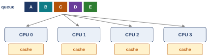{width=70%}
<figcaption markdown="1">Figure 3.4. One shared queue (A to E) and four CPUs, each with its own cache: every CPU takes the next job from the one queue.</figcaption>
</figure>

This is **single-queue multiprocessor scheduling**, **SQMS** for short: one shared queue of runnable jobs that every CPU picks from. It reuses the single-CPU scheduler as it is. Each CPU picks the best job left; four CPUs pick the best four. There is no new **policy** (rule for choosing the next job) to write.

Watch five jobs on four CPUs, a time slice each. In each slice the CPUs pick in turn, CPU 0 first, then 1, 2, 3, and a job that has had its slice goes to the back of the queue:

| slice | 1 | 2 | 3 | 4 | 5 |
|---|---|---|---|---|---|
| CPU 0 | A | E | D | C | B |
| CPU 1 | B | A | E | D | C |
| CPU 2 | C | B | A | E | D |
| CPU 3 | D | C | B | A | E |

Follow A across the table, one column at a time: slice 1 on CPU 0, slice 2 on CPU 1, slice 3 on CPU 2, slice 4 on CPU 3. A job that runs in two slices in a row is on a different CPU each time. That is exactly the opposite of cache affinity. (With exactly as many jobs as CPUs, each CPU would keep picking the same job; it is the fifth job, waiting its turn, that shifts everyone along.)

So SQMS fails in two ways.

- **Failure 1: a lock on every decision.** Every CPU reads and changes the same queue, so every decision must take the lock first. The more CPUs there are, the more of them stand waiting for it, and waiting is not work. As the machine grows, more time goes to the lock and less to the jobs.
- **Failure 2: affinity lost by design.** With more jobs than CPUs, each CPU simply takes the next job, so jobs bounce from CPU to CPU every slice and no cache stays warm from one slice to the next. With five jobs on four CPUs, if no job ever moved, two of them would share one CPU forever and get half as much as the other three; to keep the shares equal, some job has to change CPU now and then. You can patch this with an extra rule that keeps most jobs each on the same CPU every time and moves only one, so that only that one job pays the cold-cache cost, but that is extra machinery added to a design that works against it.

Here is the argument. Every CPU changes the same queue, so each decision waits for the lock. And because a CPU simply takes the next job in line, a job keeps landing on a new CPU, and its cache is never warm.

- What this part settled: one shared queue is simple, and it costs a lock and every cache.
- What it leaves open: whether a real kernel is built this way. xv6 is, and its code shows the queue and the lock.

*The argument in one line:* why does one queue fail twice? all CPUs change one queue → each decision takes the lock, the others wait | each CPU takes whatever is next → a job lands on a different CPU every slice, so no cache stays warm.

### 3.4 <span class="lbl lbl-kernel">Real kernel</span> xv6: one process array, a lock per entry {#sec-3-4 data-toc-label="3.4 [Real kernel] xv6: one process array, a lock per entry"}

The shared queue is not just a textbook idea: the kernel you build in the labs uses one shared queue too, and its code shows both the shared queue and the lock that the two-readers picture of [Section 3.1](#sec-3-1) needed.

<figure markdown="1">
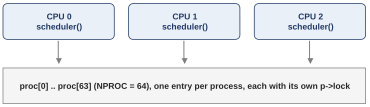{width=70%}
<figcaption markdown="1">Figure 3.5. Three CPUs, each running its own copy of the scheduler loop, all walking one shared array of 64 process entries, each entry with its own lock.</figcaption>
</figure>

xv6 keeps every process in one array called `proc`, with 64 entries (`NPROC` is 64). Every CPU runs the same scheduler loop forever, walking the whole array and switching into any process it finds ready to run. xv6 runs on a pretend machine, the emulator QEMU described below (an **emulator** is a program that imitates a whole computer), which has 3 CPUs unless told otherwise. So Figure 3.5 is SQMS: one shared queue, read by every CPU. xv6 puts a lock on each entry rather than one lock on the whole array, so two CPUs looking at different entries do not wait for each other; that softens Failure 1 of [Section 3.3](#sec-3-3), but every CPU still walks the same array, and jobs still land on whichever CPU finds them.

*`kernel/proc.c`, `scheduler()`, lines 422 to 460, from the course's xv6 folder.*

```c linenums="422" hl_lines="4 17 18 19 23 25 32"
scheduler(void)
{
  struct proc *p;
  struct cpu *c = mycpu();

  c->proc = 0;
  for(;;){
    // The most recent process to run may have had interrupts
    // turned off; enable them to avoid a deadlock if all
    // processes are waiting. Then turn them back off
    // to avoid a possible race between an interrupt
    // and wfi.
    intr_on();
    intr_off();

    int found = 0;
    for(p = proc; p < &proc[NPROC]; p++) {
      acquire(&p->lock);
      if(p->state == RUNNABLE) {
        // Switch to chosen process.  It is the process's job
        // to release its lock and then reacquire it
        // before jumping back to us.
        p->state = RUNNING;
        c->proc = p;
        swtch(&c->context, &p->context);

        // Process is done running for now.
        // It should have changed its p->state before coming back.
        c->proc = 0;
        found = 1;
      }
      release(&p->lock);
    }
    if(found == 0) {
      // nothing to run; stop running on this core until an interrupt.
      asm volatile("wfi");
    }
  }
}
```

Lines 429 to 435 turn interrupts on and off, and 455 to 458 make an idle CPU wait for the next interrupt; neither matters here. The highlighted lines and their notes:

- Line 425: `mycpu()` returns this CPU's own record, a `struct cpu` (a record with the CPU's saved scheduler state and the process it is running). Every CPU runs this loop, but each has its own `c`.
- Line 428: `for(;;)` is a loop with no condition, so it repeats forever: a CPU never leaves its scheduler loop.
- Line 438: the shared queue. `for(p = proc; p < &proc[NPROC]; p++)` walks `p` over all 64 entries of the one `proc` array, the same array for every CPU.
- Line 439: `acquire(&p->lock)` takes the lock of this entry before looking at it. `p->lock` is the lock field inside the entry `p` points at, and `&` gives its address (the place in memory where it lives), so `acquire` knows which lock to take.
- Line 440: `RUNNABLE` is the state of a process that is ready and waiting for a CPU. Only such a process is chosen.
- Line 444: `RUNNING` is the state of a process that is on a CPU right now; the chosen process is marked so before the switch.
- Line 445: `c->proc = p` records, in this CPU's own record, which process it is about to run (`->` reads a field through an address, as in `p->lock`).
- Line 446: `swtch` is the context switch: it saves this CPU's scheduler state and resumes the chosen process. When the process gives up the CPU, `swtch` returns here.
- Line 453: `release` gives the entry's lock back.

Here is why each entry needs a lock. Three CPUs walk the same 64 entries, so 2 of them can reach the same RUNNABLE process together. The lock on that entry admits one; by the time the other gets in, line 444 has marked the process RUNNING, and the second CPU walks on. Without the lock, both could see RUNNABLE at line 440 and both switch into the same process.

One more detail, in the comment at lines 441 to 443. The lock stays held while this CPU switches into the process, because the switch is itself a change to the entry: line 444 has marked it RUNNING, but until `swtch` finishes, this CPU has not yet loaded the process's registers. The danger is clearest on the way back: when a process gives up the CPU, it marks itself RUNNABLE before `swtch` has finished saving its registers. Without the lock, another CPU could pick it up in that moment and start running it on the same kernel stack (the memory the kernel uses for that process's function calls) that the first CPU is still using. Holding the lock keeps every other CPU out until the switch is done. Think of the lock as a token. The scheduler hands it to the process along with the switch; the process gives it up once it is running (in code the guide does not show), and takes it again just before it switches back. So the lock is held across every switch, by whichever side is switching, and while the process simply runs, nobody holds it; and line 453 is the scheduler's own release after the process has come back.

A small xv6 program, `twocpu`, checks that two CPUs really do run two processes at the same time out of this array. It starts two **child** processes (copies of itself that it starts, as in the second class of the course), A and B (`twocpu 2` asks for two); each counts how many loops it gets through in 10 clock ticks. xv6 was started once with one CPU and once with two. (`make CPUS=1 qemu` builds xv6 and starts it under **QEMU**, a program that pretends to be a whole computer, with one CPU.)

*Captures `W07_demos/xv6_twocpu_cpus1.out` and `xv6_twocpu_cpus2.out`, the last lines.*

```text
make CPUS=1 qemu, then:
$ twocpu 2
A: 16746 loops in 10 ticks
B: 24405 loops in 10 ticks

make CPUS=2 qemu, then:
$ twocpu 2
A: 29744 loops in 10 ticks
B: 34818 loops in 10 ticks
```

With one CPU the two children share it: 16,746 + 24,405 = 41,151 loops in all. With two CPUs each child has a CPU of its own: 29,744 + 34,818 = 64,562 loops. The two-CPU sum is 64,562 / 41,151 = 1.57 times the one-CPU sum, not 2 times. That probably comes from the emulator: QEMU's pretend CPUs run on a real computer that has other work too, so a pretend CPU is not guaranteed a full real core all the time. The split between A and B is also uneven in both runs, with B ahead; these captures do not show why. The program's own comment (in the listing below) expects each child to get about half the loops on one CPU and a whole CPU each on two, which would double the sum; the captures show the real run. Still, 1.57 times the work in the same 10 ticks means the second CPU really ran a second process at the same time, out of the same array.

- What this part settled: xv6 is SQMS, with a lock on every entry of its one shared array.
- What it leaves open: the other design, which shares nothing.

*The argument in one line:* why does each entry need a lock? 3 CPUs walk the same 64 entries → two could find the same RUNNABLE process at once → the entry's lock lets only one of them in → the other finds it RUNNING and walks on.

??? note "The program behind the xv6 capture (you can skip this listing)"

    `twocpu.c` starts a number of child processes (two by default). Each child keeps the CPU busy for 10 clock ticks and counts how many rounds of work it got through, then waits a moment so the lines do not print at once, and prints the count. `fork()` starts a copy of the running program as a child process (it returns 0 in the child); `uptime()` returns the number of clock ticks since xv6 started; `pause(n)` waits n ticks; `wait(0)` makes the parent wait until a child finishes.
    
    *`W07_demos/twocpu.c`, whole.*
    
    ```c linenums="1"
    // twocpu.c: does a second CPU really run a second process at the same time?
    // The parent starts N children (N = 2 by default). Each child computes for 10 clock
    // ticks of wall time and counts how many loops it got through, then prints the count.
    // With one CPU the two children share it and each gets about half the loops;
    // with two CPUs each gets a whole CPU. Run with CPUS=1 and then CPUS=2.
    #include "kernel/types.h"
    #include "user/user.h"
    
    int
    main(int argc, char *argv[])
    {
      int n = argc > 1 ? atoi(argv[1]) : 2;
      for (int k = 0; k < n; k++) {
        if (fork() == 0) {                 // child k
          char letter = 'A' + k;
          int start = uptime(), loops = 0;
          volatile int x = 0;
          while (uptime() - start < 10) {  // run for 10 ticks of wall time
            for (int i = 0; i < 1000; i++) x += i;   // keep the CPU busy
            loops++;
          }
          pause(k + 1);                    // wait k+1 ticks so the lines do not print at once
          printf("%c: %d loops in 10 ticks\n", letter, loops);
          exit(0);
        }
      }
      for (int k = 0; k < n; k++) wait(0);
      exit(0);
    }
    ```
    
    To run it:
    
    1. Move into the course's xv6 folder, `xv6-labs-2025`, the same one the labs use: `cd` followed by its path, for example `cd ~/xv6-labs-2025` if it sits in your home folder.
    2. Create the program: `nano user/twocpu.c`, paste the listing with Ctrl-Shift-V or a right-click, then Ctrl-O, Enter, Ctrl-X.
    3. Open the `Makefile` (the file that tells the build tool `make` how to build xv6) with `nano Makefile`. Find its `UPROGS` list (in nano, Ctrl-W searches), a column of lines like `$U/_cat\`, and add the line `$U/_twocpu\` among them (the trailing `\` continues the list on the next line). Save as before.
    4. Run `make CPUS=1 qemu`, type `twocpu 2`, and quit QEMU with Ctrl-a, then x.
    5. Repeat with `make CPUS=2 qemu`.
    
### 3.5 <span class="lbl lbl-concept">Concept</span> Multi-queue multiprocessor scheduling (MQMS) {#sec-3-5 data-toc-label="3.5 [Concept] Multi-queue multiprocessor scheduling (MQMS)"}

One shared queue caused both failures of [Section 3.3](#sec-3-3): the lock and the lost affinity. So the other design gives every CPU a queue of its own.

<figure markdown="1">
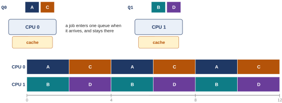{width=85%}
<figcaption markdown="1">Figure 3.6. Two CPUs, four jobs, a queue per CPU: A and C live on CPU 0's queue Q0, B and D on CPU 1's queue Q1, and each CPU runs its own queue by round robin.</figcaption>
</figure>

This is **multi-queue multiprocessor scheduling**, **MQMS** for short: one queue of runnable jobs per CPU, each scheduled on its own. When a job arrives, it is put on one queue, and that queue is its home. Which queue is a **heuristic**, a rule of thumb: a random one, or the one with the fewest jobs. After that, each CPU runs its own queue alone, with any single-CPU policy, here round robin. In Figure 3.6, A and C never leave CPU 0, and B and D never leave CPU 1. Nobody moves.

Both failures of the single queue are gone. Here is why. With a queue for each CPU, no queue is shared by every CPU on every decision, so there is no lock that all the CPUs line up for: adding CPUs adds queues, and the lock problem does not grow. (Each queue still has a lock of its own for the rare moment another CPU reaches into it to move a job, which [Section 3.6](#sec-3-6) describes, but its own CPU almost never has to wait for it.) And because a job stays on the queue it was given, it always comes back to the same CPU, whose cache still holds whatever of its data the other jobs on that CPU have not pushed out: affinity comes almost free.

Linux works this way. It keeps one **run queue**, its name for the per-CPU queue, for every CPU, and the virtual-clock scheduler of [Chapter 2](#chapter-2) runs inside each one.

But if you have been paying attention, you may already see a new problem. Queues that never talk to each other cannot help each other either. That is the next part.

- What this part settled: a queue per CPU scales and keeps affinity almost for free.
- What it leaves open: what happens when the queues hold uneven amounts of work.

*The argument in one line:* why do both failures vanish? one queue per CPU → no queue shared on every decision, so no lock every CPU waits for → a job never leaves its queue, so it always returns to the same CPU's cache, which may still hold its data.

### 3.6 <span class="lbl lbl-problem">Problem</span> Load imbalance, migration and work stealing {#sec-3-6 data-toc-label="3.6 [Problem] Load imbalance, migration and work stealing"}

What we have is a queue per CPU, each minding its own business. Where it breaks is the moment one of them empties out.

<figure markdown="1">
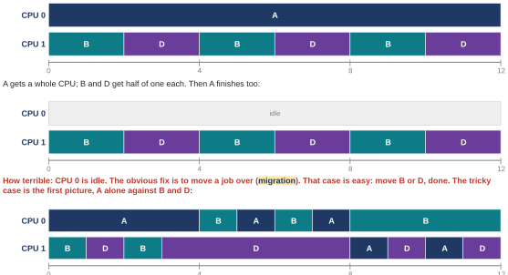{width=85%}
<figcaption markdown="1">Figure 3.7. Top: C finishes, so A has CPU 0 to itself while B and D share CPU 1. Middle: A finishes too, and CPU 0 sits idle. Bottom: jobs keep moving so that the load stays balanced.</figcaption>
</figure>

Start from Figure 3.6 and let C finish first (Figure 3.7, top). Now A has a whole CPU to itself, while B and D get half of one each. Then A finishes too (middle): CPU 0 sits idle while CPU 1 is still shared. The textbook's comment is "How terrible": half the machine does nothing. The name for this is **load imbalance**: one CPU's queue has much more work than another's, so one CPU is busy while another idles. The policy inside each queue, however fair, cannot see it, because each queue sees only itself.

The obvious fix is to move a job from one CPU's queue to another's. This is called **migration**. The idle case is easy: move B or D to CPU 0, done.

The tricky case is the top picture: A alone on one CPU, B and D on the other. No single move balances that, because three jobs on two CPUs always leave two of them sharing. So jobs keep moving (Figure 3.7, bottom): for the first 4 slices, A is alone on CPU 0 while B and D take turns on CPU 1; then B moves over to share CPU 0 with A (the next 4 slices); then A moves to share CPU 1 with D (the last 4 slices), leaving B alone. Over time each job gets about the same share. Count it over the 12 slices: A runs in 4 + 2 + 2 = 8, B in 2 + 2 + 4 = 8 and D in 2 + 4 + 2 = 8. The load is balanced, and each move costs a cold cache, the price measured in [Section 3.2](#sec-3-2).

That leaves the question of when a job should move. One basic approach is **work stealing**: a queue that is low on jobs peeks at another queue now and then, and if that one is much fuller, takes a job from it. There is a tension. Peek too often, and the queues are talking to each other again, which is the overhead the multi-queue design was built to avoid. Peek too rarely, and the imbalance stays. Finding the right setting is, in OSTEP's words, a black art.

Here is the argument step by step. Each queue sees only itself. When jobs finish at different times one queue runs dry while the other still holds 2, and that CPU idles. Shifting a job across repairs it, and the job that moved pays with a cold cache.

- What this part settled: per-CPU queues need migration, and work stealing decides when, at the cost of tuning.
- What it leaves open: how often to look, which has no theory, only tuning. [Extra 1](#extra-1) shows Linux's balancer leaving an already balanced machine alone.

*The argument in one line:* why does a queue per CPU go idle? jobs finish at different times, and the queues never look at each other → so one queue can empty while the other still holds two → moving a job fixes it, at the price of a cold cache.

### 3.7 <span class="lbl lbl-check">Check yourself</span> What many CPUs settled, and what they left open {#sec-3-7 data-toc-label="3.7 [Check yourself] What many CPUs settled, and what they left open"}

The third question in four sentences.

- Moving a job was expensive in the measurement (4.16 s pinned against 7.06 s bounced in the first round, and 2.5 to 3.3 times slower in the repeat rounds), a cost the size of a cache refill (though the runs cannot show it was one), so a scheduler keeps a job where it last ran: cache affinity.
- One shared queue (SQMS) is simple but needs a lock on every decision and bounces jobs; xv6 does it that way, with a lock per process entry.
- A queue per CPU (MQMS) scales and keeps affinity, but drifts out of balance.
- So Linux keeps a queue per CPU and adds a balancer that migrates jobs ([Extra 1](#extra-1) shows it leaving a balanced machine alone).

Still open. The balancer's interval is tuning, not theory. And the lock on the shared queue is a bigger thing than one line of code: what "two CPUs took the same job" really is, and how a lock is built, is the next piece of the course.

Check yourself: you should now be able to say which of the two designs loses cache affinity and which one risks an idle CPU, and why each one does. (Exercises 7 and 8.)

## <span class="lbl lbl-summary">Summary</span> What this class settled, and the scheduling block in review {#summary-1 data-toc-label="[Summary] What this class settled, and the scheduling block in review"}

Here are the three questions with their answers, and what each answer cost.

**How can a scheduler promise a share, not a rank?** A ticket count per job is its share. Lottery draws one random ticket per slice: the share arrives on average, with no state but the counts. Stride keeps a pass per job, runs the lowest and adds its stride: the share is exact every cycle. The costs: a newcomer's pass, and nobody saying where the tickets come from.

**How does Linux keep the promise, with only nice?** vruntime is the pass: in CFS the lowest runs, and a turn is the job's weight share of the 48 ms window (48 ms over the number of jobs when the weights are equal), never below 6 ms. Everyone normally starts at nice 0; a table turns nice into a weight that sets both the turn and the speed of the virtual clock. Measured: 69 / 23 / 8 for nice 0, 5 and 10 against a predicted 69.7 / 22.8 / 7.5, with the vruntimes level. The costs: a sorted tree; a rule for a job that wakes up; in CFS, a share lost by a job that keeps waiting for input or output (EEVDF's lag, a record per job of the CPU it is owed, reduces this; [Extra 4](#extra-4)); and the question of who deserves more, still open.

**What changes with many CPUs?** Each CPU has a cache, so a move can cost a job a refill of its cache (in the measurements, a move every millisecond or two made the run 1.7 to 3.3 times slower: 0.5 to 1.2 ms per move, about what refetching the whole list would cost): keep a job where it last ran, which is cache affinity. One shared queue needs a lock and bounces jobs (xv6). A queue per CPU scales and keeps affinity but drifts out of balance, so Linux migrates jobs with a balancer. The costs: a lock, or tuning the balancer.

The words to know from this class: proportional share, fair share, ticket, lottery scheduling, stride, pass, nice, weight, vruntime, sched_latency, min_granularity, CFS, EEVDF, cache, cache coherence, cache affinity, SQMS, MQMS, load imbalance, migration, work stealing, run queue.

The class in one line: a share is a number per job; Linux keeps it with a weight and a virtual clock; many CPUs add caches, and then a lock or a balancer. With this, the first piece of the course, virtualization, is done.

#### The scheduling block, three classes on one map

<figure markdown="1">
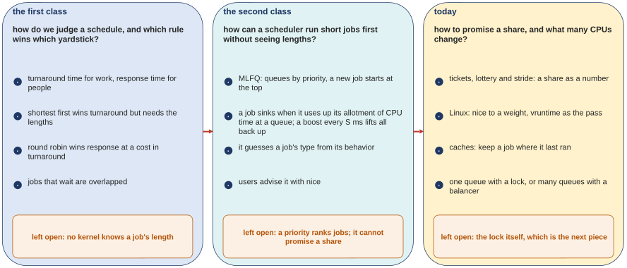{width=100%}
<figcaption markdown="1">Figure 3.8. The scheduling block as three classes side by side, each with the question it answered and, in its yellow box, what it left open.</figcaption>
</figure>

Scheduling took three classes, and each one began where the one before it stopped (Figure 3.8):

1. The first class asked how to judge a schedule. It gave two yardsticks, turnaround and response time, and a rule that wins each one: shortest job first (run the job with the least work left first) wins turnaround but needs the job lengths, and round robin wins response time at a cost in turnaround. Left open: no kernel knows a job's length.
2. The second class answered that with the multi-level feedback queue: start at the top, sink when you use up your allotment, and a boost every S milliseconds. The queue a job ends up on is a guess at its type. Left open: a priority ranks jobs; it cannot promise a share.
3. This class answered that with tickets, stride, and Linux's weights and virtual clock, and then dropped the last assumption, one CPU. Left open: the lock itself, which is the next piece of the course.

Every rule of the three scheduling classes serves one goal and pays for it somewhere else (the first four rows come from the two earlier classes):

| goal | rule | what it costs |
|---|---|---|
| finish work soonest | shortest job first (SJF: run the job with the least work left first); STCF (shortest time to completion first: the same, re-decided whenever a new job arrives) | the lengths, which no kernel knows; long jobs wait |
| answer a person fast | round robin: a slice each, in turn | worse turnaround; a context switch per slice |
| use the CPU while a job waits | treat each CPU burst (the computing between two waits) as a job; run someone else during the wait | only the context switches; the waiting time itself is put to use |
| both, without knowing lengths | MLFQ: priority queues, start high, sink when the allotment is used up, boost everyone every S ms | a guess that can be wrong; tuning (S, allotments, slices) |
| keep a promise of a share | tickets: lottery (random, almost no state) or stride (exact, a pass per job) | who assigns tickets; a newcomer's pass |
| the same, for thousands of jobs | Linux: nice to a weight, vruntime as the pass, a turn = its weight share of 48 ms (CFS) | a tree of runnable jobs; a wake-up rule; in CFS, a job that keeps waiting for input or output can lose share (less so under EEVDF, [Extra 4](#extra-4)); who deserves more is still open |
| use every CPU while keeping jobs put | a queue per CPU (affinity almost for free) with a balancer that migrates only when the queues drift apart | a lock taken on every decision if the queue is shared; if it is not, tuning, and a lock taken only for the rare move |

Each row is a different goal, and no single scheduler wins them all at once.

## Going deeper (optional) {#extras-1}

The seven Extras below go deeper on questions the class already answered. None of them is needed for what comes next, except that [Exercise 9](review.md#exercises) uses the sleeper rule of [Extra 4](#extra-4); read the ones that interest you.

### Extra 1 <span class="lbl lbl-deeper">Deeper, Q3</span> Linux: a queue per CPU plus a balancer {#extra-1 data-toc-label="Extra 1 [Deeper, Q3] Linux: a queue per CPU plus a balancer"}

[Section 3.6](#sec-3-6) said Linux keeps a queue per CPU and a balancer that moves jobs when the queues drift apart. Here is what it does with four busy jobs on the two-core Linux computer.

The program is `spin.c`, which computes until it has used a given number of milliseconds of CPU time. Four copies were started, each asking for 4000 ms, and none was pinned to a core. Four jobs on two cores get about half a core each, so after 2 s each has had about 1000 ms of the 4000 it needs: all four are still busy when we look.

*`W07_demos/spin.c`, lines 17 to 27 (`wall()` and `cpu()` read the two clocks, exactly as in `share.c` of [Section 2.4](#sec-2-4); the whole file is printed in the guide of the previous scheduling class).*

```c linenums="17" hl_lines="3 7 8"
int main(int argc, char **argv) {
  const char *name = argv[1];           /* a letter for this job */
  double ms = atof(argv[2]);            /* how much CPU time it needs */
  double t0 = atof(argv[3]);            /* the shared start time */
  printf("%s first ran at %.3f s\n", name, wall() - t0); fflush(stdout);
  volatile unsigned long x = 0;
  while (cpu() < ms / 1000.0)           /* compute until ms of CPU are used */
    for (int i = 0; i < 100000; i++) x += i;
  printf("%s finished at %.3f s\n", name, wall() - t0);
  return 0;
}
```

Line 19 reads how many milliseconds of CPU the job needs (`atof` turns the typed text "4000" into the number 4000), and lines 23 and 24 compute until the CPU clock has reached that much time (`ms / 1000.0` turns the milliseconds into seconds, so 4000 ms is 4 s). Line 20 reads a shared start time, used only to label the printed lines; it is 0 here because the printed lines are thrown away. `fflush(stdout)` on line 21 makes the line appear at once instead of waiting in a buffer (memory where output collects before it is written out).

*Capture `W07_demos/balance.out`.*

```text
$ for i in 1 2 3 4; do ./spin job$i 4000 0 > /dev/null & done; sleep 2
$ ps -o pid,ni,psr,pcpu,comm -C spin; for p in $(pgrep spin); do echo "pid $p $(grep se.nr_migrations /proc/$p/sched)"; done
  PID  NI PSR %CPU COMMAND
 2601   0   1 51.4 spin
 2602   0   1 48.0 spin
 2603   0   0 48.0 spin
 2604   0   0 48.0 spin
pid 2601 se.nr_migrations                             :                    0
pid 2602 se.nr_migrations                             :                    1
pid 2603 se.nr_migrations                             :                    0
pid 2604 se.nr_migrations                             :                    0
```

How to read it. `> /dev/null` throws the programs' printed lines away. **ps** lists processes (`-o` names the columns to show, `-C spin` keeps only processes of the program `spin`): its `PSR` column is the core a task last ran on, `NI` the nice value, `%CPU` the percentage of a CPU it has been using, `COMMAND` the program name. `pgrep spin` lists the process ids of the running `spin` programs, and the last loop prints each one's `se.nr_migrations` from its `/proc` file.

<figure markdown="1">
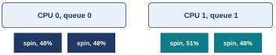{width=70%}
<figcaption markdown="1">Figure E1.1. Where the kernel put the four jobs: two on CPU 0's queue and two on CPU 1's, each with about half a core.</figcaption>
</figure>

Two jobs ended up on each core (PSR 1, 1, 0, 0), each with about half of it (48% to 51%). The kernel's count of moves reads 0, 1, 0 and 0: one job was moved a single time, the others never. Here is why. The balancer only moves a job when one queue is clearly fuller than the other. Two and two is balanced, so after one early move (probably at start-up, before the four jobs were spread over the two cores) there was nothing to fix, and affinity kept every job where it was. Compare the bounce run of [Section 3.2](#sec-3-2): 6101 moves in 7 seconds there, 0 or 1 in 2 seconds here.

*The argument in one line:* why 0 and 1 moves? the balancer moves a job only when one queue is clearly fuller → probably one early move made it 2 and 2 → balanced, so affinity keeps every job where it is.

### Extra 2 <span class="lbl lbl-deeper">Deeper, Q1</span> Moving tickets around: currency, transfer, inflation {#extra-2 data-toc-label="Extra 2 [Deeper, Q1] Moving tickets around: currency, transfer, inflation"}

Tickets can be moved around in three ways, and OSTEP names all three.

- **Ticket currency.** A user hands out tickets to their own jobs in a currency of their own, and the system converts. User A has 100 global tickets and gives each of two jobs, A1 and A2, 500 tickets out of 1000 in A's currency: 500 / 1000 = half of A's 100, so 50 global tickets each. User B has 100 global tickets and gives its one job 10 out of 10 in B's currency: all of B's 100. The lottery is held over the 50 + 50 + 100 = 200 global tickets.
- **Ticket transfer.** A client process that asks a server process (one that does work for others) to do work can lend the server its tickets while the server works for it, so the server runs with the client's share, and hands the tickets back when it is done.
- **Ticket inflation.** A process raises or lowers its own ticket count. That is safe only among processes that trust each other; among processes that compete, one greedy process would give itself everything.

Proportional shares are used today, as shares rather than lotteries, in a CPU share for each virtual machine and each container (a group of processes the OS keeps apart and limits as a unit). Linux has such a mechanism beside nice: control groups give a group of processes a CPU share, and that is how containers get theirs. There are also shares of memory in a **hypervisor**, the software that runs virtual machines. Wherever a proportion has to be written down, a count that means a proportion is the mechanism.

### Extra 3 <span class="lbl lbl-deeper">Deeper, Q1</span> The fairness curve, measured point by point {#extra-3 data-toc-label="Extra 3 [Deeper, Q1] The fairness curve, measured point by point"}

[Section 1.5](#sec-1-5) gave three averages of F. Here is the whole curve: two jobs with 100 tickets each and the same length R, 30 seeds per length, and the average of F = (first finish) / (second finish).

*Capture `W07_demos/fairness.out`, made by `python3 fairness.py` (the script is listed below).*

```text
R       average F over 30 seeds   (lottery.py -l R:100,R:100 -s SEED -c)
1       0.50
2       0.63
5       0.77
10      0.85
20      0.88
50      0.94
100     0.94
200     0.96
500     0.98
1000    0.98
```

<figure markdown="1">
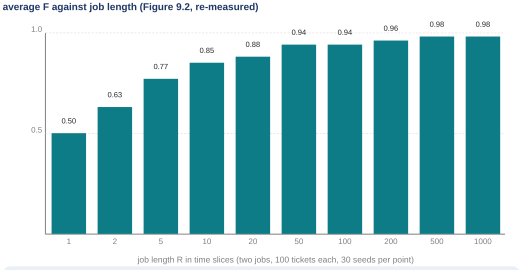{width=75%}
<figcaption markdown="1">Figure E3.1. Average F against job length R, OSTEP Figure 9.2 re-measured.</figcaption>
</figure>

At R = 1 it is exactly 0.50, every time: one job finishes at slice 1 and the other at slice 2, and 1 / 2 = 0.50. It climbs to 0.85 at 10, 0.94 at 100 and 0.98 at 1000. Fair only once the jobs are long enough for the average to arrive.

Every run is one command on the simulator ([Extra 7](#extra-7) says where to get it), and each point averages 30 runs: `python3 lottery.py -l R:100,R:100 -s SEED -c`. The option `-l` lists the jobs as length:tickets, `-s` picks the seed, and `-c` prints the result; the two "DONE" lines of the output give the two finish times. The script `fairness.py` reruns all 300 runs (10 lengths × 30 seeds). It runs the simulator once for each length and seed, reads the two DONE times from the output, and prints the average F for each length:

*`W07_demos/fairness.py`, whole.*

```python linenums="1"
# fairness.py: Figure 9.2 re-measured. Two jobs, 100 tickets each, the same length R; 30 seeds per R;
# F = time the first job finishes / time the second job finishes; print the average F for each R.
import subprocess, re
print("R       average F over 30 seeds   (lottery.py -l R:100,R:100 -s SEED -c)")
for R in (1, 2, 5, 10, 20, 50, 100, 200, 500, 1000):
    fs = []
    for seed in range(1, 31):
        out = subprocess.run(["python3", "-I", "lottery.py", "-l", f"{R}:100,{R}:100", "-s", str(seed), "-c"], capture_output=True, text=True).stdout
        done = [int(m) for m in re.findall(r"DONE at time (\d+)", out)]
        fs.append(done[0] / done[1])
    print(f"{R:<7} {sum(fs)/len(fs):.2f}")
```

### Extra 4 <span class="lbl lbl-deeper">Deeper, Q2</span> The tree of runnable jobs, and a sleeper's vruntime {#extra-4 data-toc-label="Extra 4 [Deeper, Q2] The tree of runnable jobs, and a sleeper's vruntime"}

Two details of Linux's scheduler that the class left out: how the lowest clock is found fast, and what a job that slept gets.

<figure markdown="1">
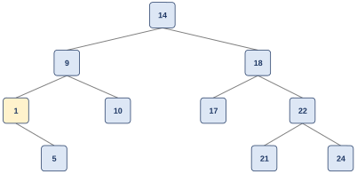{width=60%}
<figcaption markdown="1">Figure E4.1. OSTEP Figure 9.5: ten runnable jobs kept in a red-black tree by their vruntime. The leftmost node, 1, runs next.</figcaption>
</figure>

Figure E4.1 is the textbook's tree of ten jobs with vruntimes 1, 5, 9, 10, 14, 17, 18, 21, 22 and 24. The leftmost node, 1, is the lowest and runs next. A list would be worse. If the list is kept sorted, finding the lowest is easy (it is first), but putting a job back in its place after its clock grows means scanning the list for the right spot: the work grows with the number of jobs, called **linear**. In the tree both steps are logarithmic ([Section 2.1](#sec-2-1)): about as many steps as levels. With thousands of jobs that is the difference the scheduler needs. Only runnable jobs are in the tree; a sleeping job is kept elsewhere.

Now the sleeper. Two jobs at nice 0, so their clocks run at real speed: A runs all the time; B sleeps for 10 seconds and wakes up. B's vruntime is now 10 seconds behind A's. Run the lowest, and B owns the CPU for the next 10 seconds while it catches up: A is starved by a job that did nothing. So CFS raised a waking job's vruntime to the lowest value in the tree (a job whose clock was not behind kept its own). No catching up.

The cost: a job that sleeps briefly and often never gets its full share, because each wake-up forgets the time it was owed. That is why fair-share schedulers do not mix well with jobs that keep waiting for input or output, one of the two open problems of proportional share (the other is who assigns the tickets). EEVDF keeps a **lag** for every job, how much CPU the job is owed ([Extra 5](#extra-5) uses it in every pick), and the lag also handles this case: a waking job keeps what it was owed, up to a limit, so a short sleep costs it little and a long one cannot be turned into a bonus.

### Extra 5 <span class="lbl lbl-deeper">Deeper, Q2</span> From CFS to EEVDF, and the ratio property of the table {#extra-5 data-toc-label="Extra 5 [Deeper, Q2] From CFS to EEVDF, and the ratio property of the table"}

Two things here: what changed in Linux's scheduler in version 6.6, and a measurement of the table's ratio property.

The kernel's own documentation of its default scheduler (Linux 6.18) says this about the change:

```text
.. Linux v6.18 Documentation/scheduler/sched-eevdf.rst
The "Earliest Eligible Virtual Deadline First" (EEVDF) was first introduced
in a scientific publication in 1995 [1]. The Linux kernel began
transitioning to EEVDF in version 6.6 (as a new option in 2024), moving
away from the earlier Completely Fair Scheduler (CFS) in favor of a version
of EEVDF proposed by Peter Zijlstra in 2023 [2-4].
```

(The bracketed numbers point to the document's own list of papers, not shown. Its "new option in 2024" is loose wording: version 6.6 came out late in 2023, it replaced the CFS way of picking outright, with no setting to go back, and the 6.18 kernel of the captures has only EEVDF.) In words: instead of running the lowest vruntime, EEVDF computes for each job a **virtual deadline**, roughly "when this job's next slice should be done": its clock plus its slice, the slice scaled by 1024 over the weight just as the clock is. Only an **eligible** job may run: one whose **lag**, how much CPU it is owed, is at least 0, so it is not ahead of its share. Put another way, its clock is not ahead of the average of all the clocks, an average in which a job with a bigger weight counts more. Among the eligible jobs, the earliest deadline runs. Take three jobs at nice 0, with made-up clocks of 12, 10 and 11 ms. A and B use a slice of 3 ms; C has asked for 1 ms. The average clock is (12 + 10 + 11) / 3 = 11, so A, at 12, is ahead and must wait; B and C are eligible. Their deadlines are 10 + 3 = 13 and 11 + 1 = 12, so C runs. CFS would have run B, the lowest clock; EEVDF lets C, the job that asked for short slices, go first. The eligibility rule stops a job that is already ahead of its share from jumping the line just because its deadline is early. A job that asks for short slices gets an earlier deadline, so it is picked sooner: that favors jobs that need to answer fast. What stayed: vruntime, the weight table, the per-CPU run queues and the balancer. What went: the 48 ms window, replaced by a slice per job (short by default; a job can ask for a shorter one). The two things measured in this guide, the shares and the level clocks, hold on 6.18.

Now the check. [Section 2.3](#sec-2-3) said only the distance between two nice values matters. Put nice 5 against nice 10 on one core:

*Capture `W07_demos/share_shift.out`.*

```text
$ taskset -c 0 nice -n 5 ./share "nice 5 " & taskset -c 0 nice -n 10 ./share "nice 10" & wait
nice 5 : got 2.24 s of CPU in 3.00 s of wall-clock time (75%)
nice 10: got 0.74 s of CPU in 3.00 s of wall-clock time (25%)
```

(2.24 + 0.74 = 2.98 s: the missing 0.02 s is time neither job got, such as the kernel's own work; the other runs in this guide happened to add up to the full 3.00 s, and small gaps like this come and go.)

Predicted: 335 / (335 + 110) = 335 / 445 = 75.3%. And nice −5 beside nice 0: 3121 / (3121 + 1024) = 3121 / 4145 = 75.3%. Same distance, same split. Each nice step changes the weight by a factor of about 1.25, so the share between two jobs depends, to within a few percent, only on how far apart their nice values are, not on where they sit in the range. At the very end of the table the factor drifts a little: nice 18 against nice 19 is 18 / (18 + 15) = 54.5%, against 55.5% for nice 0 against nice 1.

### Extra 6 <span class="lbl lbl-deeper">Deeper, Q3</span> Linux's multiprocessor schedulers over time {#extra-6 data-toc-label="Extra 6 [Deeper, Q3] Linux's multiprocessor schedulers over time"}

Linux's default multiprocessor scheduler has been O(1) (named for taking the same, constant time per decision however many jobs there are), then CFS, and since version 6.6 EEVDF ([Section 2.2](#sec-2-2)); a fourth, BFS, was used by many people from outside the official source. Between them they used both designs of [Chapter 3](#chapter-3).

- **O(1)**: named for its constant-time pick, the same cost however many jobs there are. Multi-queue (a run queue per CPU). Priority-based, a cousin of MLFQ: it changed a task's priority over time and ran the highest, with interactivity as the focus.
- **CFS**: multi-queue. Proportional share and **deterministic** (no random draws: the same jobs always get the same schedule), like stride: vruntime, the weight table, a red-black tree per CPU, a balancer between CPUs.
- **BFS**: Con Kolivas's scheduler from 2009, kept outside the official Linux source. Single-queue by choice: one queue for the whole machine, proportional share through EEVDF. It showed that a single queue can work for a desktop with a few cores.

No common solution emerged; both designs have been made to work. The scheduler today (EEVDF, from version 6.6 on) runs on per-CPU run queues: a deadline pick rule of the same family as BFS's, running on CFS's one queue per CPU. This is context, not course material: know that the two designs of this class are both in use, not the product names.

### Extra 7 [Deeper, Q1 and Q3] Run the simulators yourself {#extra-7}

The textbook's authors publish two small simulators with the homework of chapters 9 and 10: `lottery.py` for the lottery and `multi.py` for many CPUs. They are written in Python, which Ubuntu and WSL come with. To get them:

1. Open github.com/remzi-arpacidusseau/ostep-homework; its green Code button, then Download ZIP, downloads everything as one zip file.
2. In the Terminal, go to the folder the zip is in with `cd` (change directory) followed by its path. On plain Linux it is usually `~/Downloads`; in WSL the Windows Downloads folder is `/mnt/c/Users/` followed by your Windows user name and `/Downloads`.
3. Type `unzip` followed by the zip file's name (`sudo apt install unzip` first if it is missing). It unpacks into a folder named after the repository (the project's set of files) and its branch (its version), such as `ostep-homework-master`, with `cpu-sched-lottery` and `cpu-sched-multi` inside.
4. `cd` into that folder and then into `cpu-sched-lottery` or `cpu-sched-multi`, and run the commands below from there. To rerun [Extra 3](#extra-3), `cd` into `cpu-sched-lottery`, save the `fairness.py` listing there with `nano fairness.py` (paste, then Ctrl-O, Enter, Ctrl-X, as in [Section 2.4](#sec-2-4)), and type `python3 fairness.py`. Here is how to repeat the runs of this guide and a few more.

| what it shows | command | result |
|---|---|---|
| two equal jobs of 10 slices | `python3 lottery.py -l 10:100,10:100 -s 1 -c` | look at the two DONE lines |
| the same at 1000 slices | `python3 lottery.py -l 1000:100,1000:100 -s 1 -c` | the two finish close together |
| 1 ticket against 100 | `python3 lottery.py -l 10:1,10:100 -s 1 -c` | does job 0 (the first one listed; the simulator numbers jobs from 0) ever run before job 1 is done? |
| one job, its data bigger than the cache | `python3 multi.py -n 1 -L a:30:200 -c` | finished at 30 |
| the same job, the cache big enough | `python3 multi.py -n 1 -L a:30:200 -M 300 -c` | finished at 20 |
| three jobs, one shared queue | `python3 multi.py -n 2 -L a:100:100,b:100:50,c:100:50 -c` | finished at 150, caches never warm |
| the same, affinity by hand | `python3 multi.py -n 2 -L a:100:100,b:100:50,c:100:50 -A a:0,b:1,c:1 -c` | finished at 110 |
| the same, a queue per CPU | `python3 multi.py -n 2 -L a:100:100,b:100:50,c:100:50 -p -c` | finished at 100 |

How to read the `multi.py` options. `-n` is the number of CPUs. `-L` gives each job as name:run time:working set, where the **working set** is the amount of data a job touches over and over. `-M` is the size of each CPU's cache (100 if not given). A job runs at full speed only once its working set is warm in the cache of the CPU it is on. `-A` pins jobs to CPUs by hand, and `-p` gives each CPU its own queue (with work stealing between them). The last three finish times, 150, 110 and 100, are the single queue, affinity, and the multi-queue design of [Chapter 3](#chapter-3), in the simulator. Add `-t` to watch the run tick by tick.

Most of these finish times can be worked out by hand. By default a cache warms up after a job has run 10 ticks on it, and a warm job runs twice as fast (2 units of work per tick). The job needs 30 units. With a cache of 100 its working set of 200 never fits, so it never warms: 30 units at 1 a tick is 30 ticks. With a cache of 300 it fits: 10 ticks cold do 10 units, and the remaining 20 units at 2 a tick take 10 more ticks, so it finishes at 10 + 10 = 20.

The three-job rows use the same rules. The jobs a, b and c need 100 units each, 300 in all, with working sets of 100, 50 and 50 units of data against caches that hold 100 units of data. With one shared queue they bounce between the CPUs. A slice is 10 ticks (`-q`, 10 if not given), the same as the warm-up, so a job's cache is warm only as its slice ends, and its next slice is on the other CPU. When it does come back to a CPU, the other two jobs have run there in between, and together their data takes at least 100 units (a's is 100, b's and c's 50 each), the whole cache, so its data has been pushed out. So they run at 1 unit per tick on 2 CPUs: 300 / 2 = 150 ticks. With a pinned to CPU 0 and b and c to CPU 1, every working set fits its CPU's cache. CPU 1 has the most work, 200 units: b and c each run 10 ticks cold (20 ticks, 20 units), and the remaining 180 units at 2 a tick take 90 ticks, so it finishes at 20 + 90 = 110. With a queue per CPU, the simulator deals the jobs out in the order listed: a to CPU 0, b to CPU 1, c to CPU 0. Alone, b warms after 10 ticks and finishes at 10 + 90 / 2 = 55. CPU 1 then has nothing to do, so at its next look at the other queue (every 30 ticks, set by `-P`, so at tick 60) it takes a, the job waiting in CPU 0's queue at that moment (c was running). After that the caches on both CPUs warm and cool as jobs come and go, which is hard to follow by hand (the one finish time in this table not worked out here); the run ends at 100, and `-t -C` shows it tick by tick (`-t` prints the trace, `-C` adds whether each cache is warm or cold).
