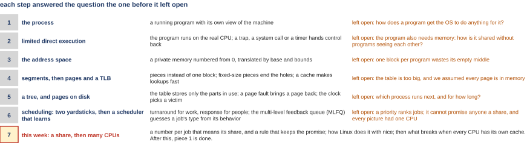
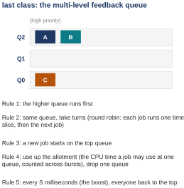

# Sharing the CPU: by share, and across many CPUs

*Self-study guide · COMP3430 Operating Systems*

## Where this guide comes from {#source}

This guide follows *Operating Systems: Three Easy Pieces* (OSTEP) by Remzi H. Arpaci-Dusseau and Andrea C. Arpaci-Dusseau, which the authors publish free at [https://pages.cs.wisc.edu/~remzi/OSTEP](https://pages.cs.wisc.edu/~remzi/OSTEP/). The figures and examples credited to the textbook are theirs. The code the guide reads is from [xv6](https://github.com/mit-pdos/xv6-riscv), the teaching operating system from MIT, and its [xv6 book](https://mit-pdos.github.io/xv6-riscv-book/).

Read with this class:

- [OSTEP chapter 9. Scheduling: Proportional Share](https://pages.cs.wisc.edu/~remzi/OSTEP/cpu-sched-lottery.pdf)
- [OSTEP chapter 10. Multiprocessor Scheduling (Advanced)](https://pages.cs.wisc.edu/~remzi/OSTEP/cpu-sched-multi.pdf)
- The xv6 source.

## Part 0. Where we are, and what this class stands on {#part-0}

This part does two jobs before the new material starts. It shows where this class sits in the course, and it rebuilds the few ideas from earlier classes that this one uses on every page. Everything later uses these words without stopping to define them again, so if one is shaky, fix it here.

A few words first. The **operating system** (the **OS**) is the program that runs the computer and shares it between all the other programs; its core is called the **kernel**, and this guide uses the two words interchangeably. A **program** is a file of instructions; a **process** is a program while it is running. The **CPU** (the processor) is the part of the computer that runs instructions, one after another. A modern chip holds several CPUs side by side, and each one is also called a **core**. **Memory** (RAM) is where a running program's data and instructions live. **Linux** is the operating system on most servers; the Linux measurements in this guide were taken on a virtual machine (one of several operating systems sharing one physical computer, [Section 1.2](class-1.md#sec-1-2)) rented in a cloud data center, which shares its real hardware with other customers' programs. **xv6** is a small teaching operating system from MIT whose whole source code you can read; this course builds on it in the labs.

#### The course map

<figure markdown="1">
{width=100%}
<figcaption markdown="1">Figure 0.1. The course map as a chain of questions: each row is one step of the course, and the text on the right of each row is the question that step could not answer.</figcaption>
</figure>

An operating system has three big jobs, and the course takes them in order. The first is **virtualization**: one computer pretends to be many, so every program behaves as if it had its own CPU and its own memory. The second is **concurrency**: many things happening at once without chaos. The third is **persistence**: data that survives the power going off. This class is the last step of the first job.

Figure 0.1 lists the steps so far. Each row answered the question the row before it left open:

1. The process: a running program with its own view of the machine. Left open: how a program gets the OS to do anything for it.
2. Limited direct execution: the program runs on the real CPU, and a trap (a forced jump into the kernel), a system call (a request a program makes to the kernel) or a timer hands control back to the OS. Left open: how memory is shared without programs seeing each other.
3. The address space: a private memory numbered from 0. Left open: one block per program wastes its empty middle.
4. Segments, then pages and a fast cache of page lookups (a cache is a small fast memory that keeps recent answers close at hand). Left open: the table of pages is too big, and every page was assumed to be in memory.
5. A tree of tables, and pages on disk. Left open: which process runs next, and for how long.
6. Scheduling: two yardsticks, then a scheduler that learns. Left open: a priority (a rank that says which job goes first) ranks jobs but cannot promise anyone a share; and every picture had one CPU.
7. This class: a share for every job, then many CPUs.

You do not need rows 1 to 5 for this class, except two terms: a system call (row 2) and a cache (row 4). Row 6 is the two scheduling classes before this one, and the next two parts rebuild it. After this class, the first job of the OS, virtualization, is done.

#### What the two scheduling classes built: two yardsticks and the multi-level feedback queue

The **scheduler** is the part of the OS that picks which process runs next. When a process has had its turn, a **timer interrupt** stops it: a hardware clock forces the CPU to leave whatever program is running and jump into the kernel, many times a second. The kernel then picks the next process and performs a **context switch**: it saves the registers of the process that was running and loads the registers of the chosen one. (The **registers** are the few dozen storage cells inside the CPU that hold exactly where a program is and what it was working on.) The chosen process continues from exactly where it had stopped.

Three words come back on every page of this class.

- A **job** is one program's run, as the scheduler sees it. "Job" and "process" mean the same thing in this guide.
- A **time slice** is the stretch of CPU time a job gets before the scheduler decides again. On xv6 it is one tick of the timer, which xv6 sets to go off about ten times a second, so about 0.1 s; on Linux it is a few to a few dozen milliseconds (thousandths of a second; more on units below), and [Chapter 2](class-1.md#chapter-2) shows how Linux's scheduler worked it out from the jobs present, and what the newest Linux does instead.
- A schedule is judged by two yardsticks. **Turnaround time** is the time a job finishes minus the time it arrived: it measures work getting done. **Response time** is the time a job first runs minus the time it arrived: it measures how fast a person at the keyboard sees an answer.

The second of those classes built a scheduler that runs short and interactive jobs first without being told how long any job is. It is the **multi-level feedback queue**, **MLFQ** for short.

<figure markdown="1">
{width=60%}
<figcaption markdown="1">Figure 0.2. The multi-level feedback queue: several queues, the highest at the top, each ready job on one of them; and its five rules.</figcaption>
</figure>

Figure 0.2 shows it. There are several queues, ranked by **priority** (how urgent a job is: a higher queue means a higher priority). Every ready job sits on one of them. Five rules decide everything:

- Rule 1: the higher queue runs first.
- Rule 2: jobs on the same queue take turns, one time slice each. Taking turns like this is called **round robin**.
- Rule 3: a new job starts on the top queue.
- Rule 4: a job that uses up its **allotment**, the CPU time it may use at one queue (counted across all its turns there), drops one queue.
- Rule 5: every S milliseconds (thousandths of a second; S is a setting the system's designer picks), the **boost** puts every job back on the top queue, so no job waits forever.

The point of the rules is that the queue a job ends up on is a guess at what kind of job it is. A job that keeps using the CPU sinks; a job that keeps stopping to wait for a person stays high.

Check this: in Figure 0.2 the queues are named Q2 (the top), Q1 and Q0 (the bottom); A and B are on Q2 and C is on Q0. By Rule 1, C cannot run while A or B is ready. By Rule 2, A and B alternate. By Rule 5, C gets back to the top at the next boost.

#### The number that MLFQ could not explain

The last class ended with one measurement that no MLFQ rule explains.

<figure markdown="1">
{width=60%}
<figcaption markdown="1">Figure 0.3. Two copies of the same program on one core for 3 s: the copy at nice 0 (nice is explained just below) got 2.71 s of CPU time, the copy at nice 10 got 0.29 s.</figcaption>
</figure>

**nice** is the knob a Linux user has on a process's share of the CPU. It is a number from −20 to 19, and the default is 0. A higher number means "this process matters less" and asks for a smaller share of the CPU; a lower number asks for a bigger one. (The name comes from the idea that a process with a high nice value is being nice to the others.) The experiment ran two copies of the same program on one core for 3 seconds, one started with nice 0 and one with nice 10. Each copy reported how much **CPU time** it was given, meaning the time it actually spent running on the CPU, as opposed to time spent waiting for its turn.

Figure 0.3 shows the result. The nice 0 copy got 2.71 s and the nice 10 copy got 0.29 s. Together that is 2.71 + 0.29 = 3.00 s, the whole 3 seconds. As shares: 2.71 / 3.00 = 0.903, which is 90%, and 0.29 / 3.00 = 0.097, which is 10%. Check this: 90% + 10% = 100%.

The grey numbers in Figure 0.3, 1024 and 110, are the **weights** Linux gives nice 0 and nice 10. [Section 2.3](class-1.md#sec-2-3) explains where they come from. For now notice only this: a split of 90% and 10% is an amount, and none of the five MLFQ rules talks about amounts. Rule 1 says who goes first; it never says how much each one gets.

#### Two small tools: fractions and time units

A **share** is a fraction of a whole. If A should get three quarters of the CPU, A's share is 3/4 = 0.75, written 75%. If a job got 4 slices out of 20, its share was 4 / 20 = 0.20, which is 20%. Check this: 75% of 100 is 75, and 20% of 20 is 4.

Time comes in small units in this class. A **millisecond** (ms) is a thousandth of a second: 1 s = 1000 ms. A **microsecond** (µs) is a millionth of a second: 1 ms = 1000 µs. A **nanosecond** (ns) is a billionth of a second: 1 µs = 1000 ns. Check this: 48 ms is 48 / 1000 = 0.048 s, about a twentieth of a second.

#### Reading the code, the captures and the one-line arguments

This class shows short programs in C and the output they printed. You do not need to know C. [Appendix A](appendix.md#appendix-a) explains, one at a time, the few pieces of C notation that appear, and in every main-text listing, the lines that matter are explained where the listing appears (lines that only set a starting value are left to you, and the optional listings get a short summary). A **capture** is a saved copy of what a program printed on the screen of a real computer; each capture starts with the command that produced it (or, where it has no such line, the line above it says how it was made), written after a `$` sign, which is the prompt of the **shell** (the program that reads the commands you type and runs them).

Most parts end with a line that starts *The argument in one line*. It is the part's reasoning squeezed into one line: a question, then steps joined by arrows (→ means "so"). When a part makes more than one separate point, a bar (|) separates them.
