# First class: threads, the race on a shared counter, and the thread API, the calls that make and control threads (OSTEP 26 and 27) {#class-1}

## <span class="lbl lbl-roadmap">Roadmap</span> Where we left off: two CPUs, one queue, and a lock nobody opened {#opening-1 data-toc-label="[Roadmap] Where we left off: two CPUs, one queue, and a lock nobody opened"}

The last class ended with more than one CPU. With several CPUs, a scheduler can keep one shared queue of jobs that every CPU takes from, or one queue per CPU. The shared queue had a flaw we named but did not open.

<figure markdown="1">
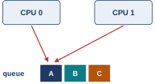{width=45%}
<figcaption markdown="1">Figure 1.1. Two CPUs read the front of the same queue at the same instant. Both take job A, and nobody takes job B.</figcaption>
</figure>

Figure 1.1 is that flaw. CPU 0 and CPU 1 both run the scheduler at the same moment. Each reads the front of the queue, sees job A, and takes it. Job A is handed out twice and job B is left behind. The fix we gave was one sentence: a CPU must hold a **lock** before it touches an entry of the queue. In xv6, the small teaching kernel this course reads, that sentence is one line in the scheduler, `acquire(&p->lock);`, which every CPU runs before it looks at a process's entry. xv6 has no separate run queue: each CPU's scheduler scans the **process table** (the kernel's array of process records), and the table's entries play the part of the queue. There is one such lock per process entry, not one for the whole queue, so two CPUs looking at different entries need not wait for each other. (Here `p` is a pointer to one process's record, and `p->lock` is the lock field inside that record; the arrow `->` reads one field of the record a pointer points at.)

Two sentences hid the whole of the next part of the course. "Two CPUs can take the same job" hides a question: what exactly goes wrong when two CPUs read the same data at the same moment? And "a lock prevents it" hides another: what is inside `acquire()`? This week answers both. The first class asks three questions:

1. Why would one program want more than one point of execution, and what do the two share? ([Chapter 1](#chapter-1))
2. Why does a shared counter come out wrong, and which lines are the dangerous ones? ([Chapter 2](#chapter-2))
3. What does a program say to make a thread, wait for it, and keep it out of the dangerous lines? ([Chapter 3](#chapter-3))

The second class then opens the lock itself.

## Chapter 1. Threads: a second point of execution inside one program {#chapter-1}

*The question this chapter answers: why would one program want more than one point of execution, and what do the two share?*

### 1.1 <span class="lbl lbl-concept">Concept</span> The thread: a new abstraction inside one program {#sec-1-1 data-toc-label="1.1 [Concept] The thread: a new abstraction inside one program"}

Everything the course has built so far made one machine look like many machines. Last week ended with two CPUs taking jobs from one queue: two flows of execution touching one piece of data, inside the kernel. The same problem shows up in an ordinary program as soon as it has two flows of execution, and there we can run it and measure it. So the week starts with that second flow inside one program; the kernel's own case comes back in Sections [2.7](#sec-2-7) and [5.3](class-2.md#sec-5-3). First we need the thing itself: a way for one program to be in two places at once, which the operating system has to offer. This part says what that new thing is. It is a new **abstraction**: a simple picture the OS offers a program in place of the messy machine underneath. The process was one abstraction, and the address space was another.

<figure markdown="1">
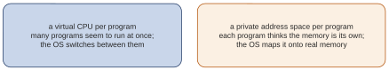{width=80%}
<figcaption markdown="1">Figure 1.2. The two illusions the course has built so far. Each one is about many programs sharing one machine.</figcaption>
</figure>

The first piece of the course built two illusions, shown in Figure 1.2. A **virtual CPU** per program: many programs seem to run at once, because the OS switches between them. A **private address space** per program: each program thinks the memory is its own, because the OS maps it onto real memory. Both illusions are about many programs. Look inside any one of those programs, and the old picture still holds: one program counter, so one place in the code, so one instruction at a time. Such a program cannot use a second core, and it cannot compute while it waits for something; [Section 1.2](#sec-1-2) shows both.

The new idea is to give one program a second place in its own code. Same program, same memory, same code, but two program counters. This is the definition to keep:

A **thread** is a point of execution inside a program: its own program counter, its own registers and its own stack, sharing the program's code, heap and global variables with the other threads of that program. A thread is very much like a separate process, except for one difference: the threads of one program share the same address space, so they can reach the same data. A program with more than one thread is a **multi-threaded program**.

<figure markdown="1">
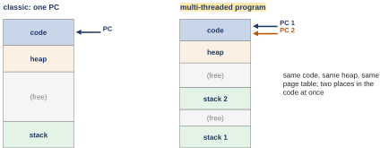{width=80%}
<figcaption markdown="1">Figure 1.3. OSTEP Figure 26.1 redrawn. Left: a classic program, with one program counter and one stack. Right: a multi-threaded program, with two program counters (PC 1, PC 2) and two stacks in the same address space.</figcaption>
</figure>

Figure 1.3 shows the difference as two address spaces. On the left, a classic program: code at the top, then the heap, free space, and one stack at the bottom, with one PC pointing into the code. On the right, the same program with two threads: the same code and the same heap, but two stacks, and two PCs pointing at two different places in the same code. Each thread needs its own stack because each one is running its own chain of function calls; [Section 1.3](#sec-1-3) says this more carefully.

An idea like this raises three questions, and this class takes them in order:

- a. Why would one program want two points of execution? ([Section 1.2](#sec-1-2): one core sits idle, and a wait for the disk is wasted.)
- b. What does each thread keep for itself, and what is shared? ([Section 1.3](#sec-1-3): thread against process, item by item.)
- c. What can go wrong when two threads reach the same data? ([Chapter 2](#chapter-2): a counter that loses adds.)

Questions a and b are about what a thread is. Question c is the cost of sharing, and the rest of the week is about paying it.

- What this part settled: a thread is a second point of execution in the same program, sharing its address space.
- What it leaves open: why anyone would want one. That is the next part.

*The argument in one line:* why a new abstraction at all? the two illusions let many programs share one machine, but inside one program there is still one point of execution → so the program can be in only one place in its code at a time: it cannot use a second core, or compute while it waits → a thread: a second point of execution in the same program, with the same data.

### 1.2 <span class="lbl lbl-problem">Problem</span> One point of execution leaves a core idle: parallelism and overlap {#sec-1-2 data-toc-label="1.2 [Problem] One point of execution leaves a core idle: parallelism and overlap"}

A thread is a second place in the code. Before we say what it is made of, here is why a program would want one. What we have is a process as we have known it, and there are two cases where it does badly.

<figure markdown="1">
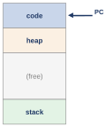{width=30%}
<figcaption markdown="1">Figure 1.4. A process as we have known it: one address space, one program counter.</figcaption>
</figure>

What we have, in Figure 1.4: a process is one address space (code, heap, one stack), one program counter and one set of registers. There is exactly one PC, so exactly one instruction of this program runs at any moment. The OS switches between whole processes, never inside one.

<figure markdown="1">
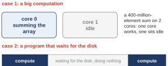{width=60%}
<figcaption markdown="1">Figure 1.5. Two cases one process does badly. Case 1: a big computation keeps core 0 busy while core 1 sits idle. Case 2: a program that waits for the disk does nothing while it waits.</figcaption>
</figure>

Where it breaks, in Figure 1.5. The measurements in this guide come from a computer running Linux (Part 0), in the version called Ubuntu 24.04; Ubuntu is one of the packaged versions of Linux. It has an x86-64 processor (the 64-bit Intel and AMD family) and 2 cores; this guide calls it the Ubuntu machine.

- **Case 1, a big computation.** A program adds up an **array** (a row of numbered elements of one type, stored one after another) of 400,000,000 numbers. It keeps core 0 busy for about a second (1.10 s in [Section 1.4](#sec-1-4)'s capture) while core 1 has nothing to run. The work takes about twice as long as the machine could do it.
- **Case 2, a program that waits.** A program asks the disk for a block of data, and it has nothing to do until the block arrives, which can take milliseconds. Its own work stops for the whole wait.

A second process could take the extra work in both cases. The trouble is where it lives. A second process gets an address space of its own, so it cannot see this program's array. Two processes can share memory only by asking the OS for it specially (this is called shared memory); by default, they would have to copy data back and forth. Processes stay the right choice for separate programs that share little. Here the program wants to share everything.

So we need one program that can be in two places in its code at once. Each place needs its own local variables. Both places should see the same heap and the same global variables. That shape is exactly a thread, and each case has a name (Figure 1.6).

<figure markdown="1">
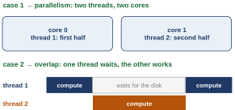{width=48%}
<figcaption markdown="1">Figure 1.6. The two cases, fixed with two threads. Case 1, parallelism: each core runs one thread on half of the work. Case 2, overlap: while thread 1 waits for the disk, thread 2 computes.</figcaption>
</figure>

- **Parallelism** (case 1): doing two parts of one job on two CPUs at the same time, so the job finishes sooner. Each core runs one thread on its own half of the array.
- **Overlap** (case 2): doing useful work while another part of the program waits for a slow device, instead of waiting too. While thread 1 waits for the disk, thread 2 uses the CPU.

Either way the threads share the program's data, so nobody copies anything. A web server is a good example of the second reason. It spends most of its time waiting, for clients and for disks, so its reason is overlap: while one thread waits on a slow client, another serves the next one. A big computation on many cores is the first reason, parallelism.

- What this part settled: a second point of execution lets one program use a second core (parallelism) or keep working during a wait (overlap).
- What it leaves open: what exactly a thread keeps for itself. That is the next part.

*The argument in one line:* why does a core sit idle, and why is a wait wasted? one program counter → one instruction of this program at a time, on one core → the second core has nothing of it to run, and a wait for the disk stops all of it → a second point of execution, on the same data, gives the second core (or the wait) something to do.

### 1.3 <span class="lbl lbl-concept">Concept</span> Thread against process: the thread control block and the shared page table {#sec-1-3 data-toc-label="1.3 [Concept] Thread against process: the thread control block and the shared page table"}

Two threads of one program run the same code and see the same data, yet each must be able to stop and continue on its own. So each must keep something private. The clearest place to see what is private and what is shared is a switch between them.

<figure markdown="1">
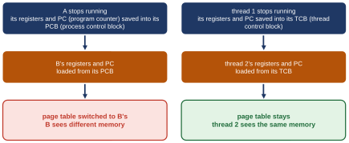{width=75%}
<figcaption markdown="1">Figure 1.7. A switch drawn twice. Left: the OS switches from process A to process B. Right: from thread 1 to thread 2 of the same program. Only the last step differs.</figcaption>
</figure>

Follow the boxes of Figure 1.7 from the top.

- **Step 1, the same in both.** The one that stops has its registers and PC saved. A process keeps them in its **process control block** (PCB). A thread keeps them in a **thread control block** (TCB): where the OS saves a thread's registers and PC while it is not running, the thread's version of the PCB.
- **Step 2, the same in both.** The one that starts has its registers and PC loaded from its PCB or TCB.
- **Step 3, the only difference.** Process B gets its own page table, so it sees different memory. Thread 2 keeps the same page table, so it sees exactly the memory thread 1 saw.

Two threads of one program live in one address space, so nothing about memory changes at a switch between them. That is why a thread switch is less work, and why thread 2 can read what thread 1 wrote.

Here is the full list.

| same as a process: each thread owns | different from a process: all threads share |
|---|---|
| a program counter: where it is in the code | the code |
| its registers, saved in its TCB at a switch | the heap: memory handed out while the program runs (by `malloc`, defined just below) |
| a stack: its local variables, the arguments of its calls, and where each call returns to | the global variables |
| | the page table, so the same address means the same byte to both |

(`malloc` is the C function a program calls to ask for heap memory while it runs; it hands back the address of the new memory.)

The reason for the split is short. A stack holds the local variables of one chain of function calls, so two chains need two stacks. The heap and the globals belong to the program, not to any one call, so there is one copy and both threads see it.

There is one small price. Each thread's stack gets its own fixed stretch of the address space. The stacks are placed when the threads start, and a stack cannot be moved later, because pointers into it may exist. A thread that calls functions many levels deep can run out of its stretch, where a single stack could have grown. Most threads use little stack, so this rarely matters.

In one sentence: like a process, a thread keeps its own PC, its own registers and its own stack; what it does not have is its own address space. That one difference lets threads see each other's data without copying, and it is also how they can break it.

- What this part settled: what a thread owns (PC, registers, stack) and what it shares (code, heap, globals, page table). So at a switch between two threads of one process, only the page-table step is skipped: the switch is cheaper, and the data stays shared.
- What it leaves open: whether two threads on two cores really run at the same time. The next part measures it.

*The argument in one line:* why its own stack, but a shared heap? a stack holds one chain of calls → two chains need two stacks | heap and globals are the program's data, not any call's → so one copy, under one page table that a switch between the threads leaves unchanged.

### 1.4 <span class="lbl lbl-machine">Real machine</span> Two threads sum an array in about half the time {#sec-1-4 data-toc-label="1.4 [Real machine] Two threads sum an array in about half the time"}

If threads are real, two of them on two cores should finish the big sum of case 1 in about half the time. This part checks that on the Ubuntu machine, and introduces the two library calls that start a thread and wait for it.

*The program `psum.c`, whole (`W08_demos/psum.c`).*

```c linenums="1" hl_lines="7 10 11 29 30 31 32"
// psum.c: add up a 400-million-element array with 1 thread, or with 2.
#include <stdio.h>
#include <stdlib.h>
#include <pthread.h>
#include <time.h>
#define N 400000000L                 // 400 million elements
static int *a;                       // the array: on the heap, shared
static long sum[2];                  // one result slot per thread

void *half(void *arg) {              // the function each thread runs
    long k = (long) arg;             // k = 0: first half, k = 1: second half
    long s = 0;
    for (long i = k * N / 2; i < (k + 1) * N / 2; i++)
        s += a[i];
    sum[k] = s;
    return NULL;
}

int main(int argc, char *argv[]) {
    int threads = atoi(argv[1]);     // 1 or 2
    a = malloc(N * sizeof(int));
    for (long i = 0; i < N; i++) a[i] = 1;
    struct timespec t0, t1;
    clock_gettime(CLOCK_MONOTONIC, &t0);
    if (threads == 1) {
        half((void *) 0); half((void *) 1);          // both halves, one after the other
    } else {
        pthread_t p1, p2;
        pthread_create(&p1, NULL, half, (void *) 0); // start thread 1 on the first half
        pthread_create(&p2, NULL, half, (void *) 1); // start thread 2 on the second half
        pthread_join(p1, NULL);                      // wait for thread 1
        pthread_join(p2, NULL);                      // wait for thread 2
    }
    clock_gettime(CLOCK_MONOTONIC, &t1);
    double secs = (t1.tv_sec - t0.tv_sec) + (t1.tv_nsec - t0.tv_nsec) / 1e9;
    printf("%d thread(s): sum = %ld, time = %.2f s\n", threads, sum[0] + sum[1], secs);
    return 0;
}
```

You do not need to follow every line, but a few pieces of C are new here:

- A **library** is a collection of ready-made functions, and its **declarations** tell the **compiler** (the program that turns C into machine instructions) each function's name and the types of its inputs and result. `#include <...>` (lines 2 to 5) pulls in a library's declarations, so the program can call its functions; `#define N 400000000L` (line 6) makes `N` a name for 400,000,000 (the `L` marks it as a `long`, a whole-number type bigger than `int`).
- `a[i]` is element number `i` of the array `a`, counting from 0; `sum[2]` declares an array of 2 elements, `sum[0]` and `sum[1]`. `s += a[i]` means `s = s + a[i]`.
- `int main(int argc, char *argv[])` (line 19): every C program starts in `main`. `argc` is the number of words on the command line, and `argv` is the list of those words, as text (`char` is the type of one character, so `char *` points at a piece of text); `argv[0]` is the program's own name. So `argv[1]` (line 20) is the first word typed after the name, and `atoi` turns that text into a number.
- `sizeof(int)` (line 21) is the size of one `int` in bytes, 4, so `malloc(N * sizeof(int))` asks for room for N integers.
- A **struct** is a bundle of named fields kept together as one variable. `struct timespec t0, t1;` (line 23) makes two such bundles, each holding a time as whole seconds (`tv_sec`) and nanoseconds (`tv_nsec`). The dot picks one field out of a bundle: `t1.tv_sec` (line 35) is the field `tv_sec` of `t1`.
- `if (threads == 1) { ... } else { ... }` (lines 25 to 33) runs the first block when the test is true and the second block otherwise.
- `double` (line 35) is a number type that can hold a fraction. In the `printf` of line 36, `%ld` is replaced by a `long` number and `%.2f` by a number with a fraction, shown with 2 digits after the point. `\n` at the end of the text means "start a new line".

The story: the program fills an array of 400,000,000 ones. With 1 thread it adds up the first half and then the second half. With 2 threads it starts a thread on each half and waits for both. Now the highlighted lines.

- Line 7: `a` is a pointer to the array, and line 21 points it at memory from `malloc`, on the heap, so both threads can reach the array. `static` here only means the variable belongs to this file.
- Line 10: `half` is the function a thread runs. Its one input `arg` says which half; line 11 turns it into the number `k`, 0 for the first half and 1 for the second. The type `void *` comes back in [Section 3.3](#sec-3-3). Here the number 0 or 1 is passed dressed up as a pointer, and `(long) arg` on line 11 turns it back into a number. So read line 11 as "k is the number that was passed in".
- Lines 29 and 30: `pthread_create` starts a new thread running `half`. Its first argument, `&p1`, is the address of a **handle**: a variable of type `pthread_t` that names the new thread, so the program can refer to it later. `NULL` (an empty pointer) asks for the default settings, `half` is the function to run, and `(void *) 0` is the one value handed to it.
- Lines 31 and 32: `pthread_join` waits until that thread has finished.

These two calls come from the **POSIX threads library**, usually called **pthreads**: a standard set of thread functions that Linux and macOS both provide. (**POSIX**, the Portable Operating System Interface, is the standard both follow, and the prefix `pthread_` on every name comes from the library's name.) [Section 3.3](#sec-3-3) reads their arguments one by one. Lines 24 and 34 read a clock before and after (`clock_gettime` fills in `t0` and `t1`, each a bundle of seconds and nanoseconds), and line 35 turns the difference into seconds (`1e9` is 1,000,000,000).

The kept runs, from `W08_demos/psum.out` (`./psum 1` runs the program with one thread, `./psum 2` with two):

```text
$ ./psum 1
1 thread(s): sum = 400000000, time = 1.11 s
$ ./psum 1
1 thread(s): sum = 400000000, time = 1.10 s
$ ./psum 2
2 thread(s): sum = 400000000, time = 0.57 s
$ ./psum 2
2 thread(s): sum = 400000000, time = 0.57 s
```

With 1 thread, just over a second, both times. With 2 threads, a little over half a second, both times. The sum is the same in every run, 400,000,000, which is right: 400,000,000 ones. The speed-up is 1.10 / 0.57 = 1.93, about 1.9 times, on 2 cores. Check it the other way: twice 0.57 is 1.14, a little more than 1.10, so 2 threads did a little worse than a perfect halving.

Why 1.9 and not 2? The two halves do run at the same time on two cores, which gives close to 2. Perfect halving of 1.10 s would be 0.55 s, and the 2-thread run took 0.57 s, so there is 0.57 − 0.55 = 0.02 s, 20 milliseconds, to explain. These runs do not show for certain where it goes. Starting and joining two threads costs tens of microseconds. A small program, `cj_cost.c`, starts two threads that do nothing and joins them, 1000 times, and prints the average per round. From `W08_demos/cj_cost.out`:

```text
$ ./cj_cost
1000 rounds of create 2 + join 2: 55.0 microseconds per round
$ ./cj_cost
1000 rounds of create 2 + join 2: 47.7 microseconds per round
$ ./cj_cost
1000 rounds of create 2 + join 2: 36.4 microseconds per round
```

A microsecond is a millionth of a second, so 20 milliseconds is 20,000 microseconds. One round, 36 to 55 microseconds, is well under 1 percent of the 20 milliseconds to explain (55 / 20,000 ≈ 0.3 percent), far too little to matter. The more likely cause is the memory system. Adding up ones is so quick that each core most likely spends much of its time waiting for the array to arrive from memory, and both cores fetch it through the one memory of the machine. So the speed-up is a little under 2. These threads never wrote the same variable: thread 1 wrote only `sum[0]` and thread 2 only `sum[1]`. Keep that in mind; [Chapter 2](#chapter-2) is what happens when they do.

- What this part settled: two threads on two cores really run at once; the sum took about half the time.
- What it leaves open: who decides when each thread runs. The next part shows that the program does not.

*The argument in one line:* why 1.9 times and not 2? the two halves run at once → close to 2 times | the shortfall is 0.57 − 0.55 = 0.02 s; create and join cost tens of microseconds against that → too little to matter → so something else costs the rest; most likely the two cores waiting on one shared memory system (not measured).

### 1.5 <span class="lbl lbl-machine">Real machine</span> The scheduler decides which thread runs first {#sec-1-5 data-toc-label="1.5 [Real machine] The scheduler decides which thread runs first"}

`pthread_create` starts a thread, and the program goes on. But at that moment two threads are ready to run, the old one and the new one, and only one can be on a given core at a time. Something has to choose. This part shows that the program does not choose, by running a tiny program a hundred times.

*The program `t0.c`, whole (`W08_demos/t0.c`). It is OSTEP Figure 26.2 with the plain library calls. The book's figures call `Pthread_create` and `Pthread_join`, with a capital P: the book's own wrappers, which call the library functions of the same name and check that nothing went wrong. This guide calls the library functions directly.*

```c linenums="1" hl_lines="5 12 13 15 16"
#include <stdio.h>
#include <pthread.h>

void *mythread(void *arg) {
    printf("%s\n", (char *) arg);
    return NULL;
}

int main(int argc, char *argv[]) {
    pthread_t p1, p2;
    printf("main: begin\n");
    pthread_create(&p1, NULL, mythread, "A");
    pthread_create(&p2, NULL, mythread, "B");
    // join waits for the threads to finish
    pthread_join(p1, NULL);
    pthread_join(p2, NULL);
    printf("main: end\n");
    return 0;
}
```

- Lines 12 and 13 start two threads on the same function, `mythread`, one handed the text `"A"` and one the text `"B"`.
- Line 5 is all a thread does: it prints the text it was given (`%s` in `printf` means "a piece of text goes here"). In C a piece of text is handled through a pointer to its first character, whose type is `char *`; `(char *) arg` says "treat `arg` as text".
- Lines 15 and 16 make the first thread of the program, called **main** after the function it runs, wait for both.

Which letter comes out first? A **thread trace** answers that kind of question: a table with one column per thread and time running down, showing which thread ran at each step. The same program can have several legal traces. Here are three, OSTEP Figures 26.3, 26.4 and 26.5 written as tables.

Order 1: main creates both threads first, and only then do they run, A before B.

| main | Thread 1 | Thread 2 |
|---|---|---|
| prints "main: begin" | | |
| creates Thread 1 | | |
| creates Thread 2 | | |
| waits for T1 | | |
| | prints "A", returns | |
| waits for T2 | | |
| | | prints "B", returns |
| prints "main: end" | | |

Orders 2 and 3 leave out main's rows "prints main: begin" and "prints main: end", which come first and last in every order.

Order 2: each thread runs the moment it is created.

| main | Thread 1 | Thread 2 |
|---|---|---|
| creates Thread 1 | | |
| | prints "A", returns | |
| creates Thread 2 | | |
| | | prints "B", returns |
| waits for T1: returns at once, T1 is done | | |
| waits for T2: returns at once, T2 is done | | |

Order 3: thread 2 runs first, so B comes out before A.

| main | Thread 1 | Thread 2 |
|---|---|---|
| creates Thread 1 | | |
| creates Thread 2 | | |
| | | prints "B", returns |
| waits for T1 | | |
| | prints "A", returns | |
| waits for T2: returns at once, T2 is done | | |

All three are correct runs of the same program. The run on the Ubuntu machine, 100 times, from `W08_demos/t0_orders.out`:

```text
$ for i in $(seq 100); do ./t0 | sed -n 2p; done | sort | uniq -c
     94 A
      6 B
```

How to read the command: it runs `t0` 100 times and keeps only the second line of each run's output. That line is the first letter printed, since line 1 is "main: begin". (`sed` edits text, and `sed -n 2p` means "print line 2 only".) Then it counts how many of the 100 were A and how many B: `sort` puts the lines in order, and `uniq -c` counts each block of equal lines in a row. Mostly A came first, 94 times, but B came first 6 times; 94 + 6 = 100. Both outcomes are correct. The captures do not show why A usually wins.

Why the order can vary at all is simpler. Creating a thread is a bit like calling a function, except that the caller does not wait for the function. Once `pthread_create` has done its job there are two threads ready to run, main and the new one, and either may get the CPU first. On two cores they may even run at the same moment. Which one goes first is the scheduler's decision, not the order of creation, and nothing in the program says which. Both orders are correct here because A and B touch nothing in common.

- What this part settled: the program does not control which thread runs when; the scheduler does.
- What it leaves open: what happens when two threads do touch something in common. That is the next chapter.

*The argument in one line:* why does the order change from run to run? create makes the new thread ready to run → main and the new thread both want the CPU → the scheduler picks who goes first, not the order of creation | both correct: A and B share nothing.

### 1.6 <span class="lbl lbl-check">Check yourself</span> What the first question settled {#sec-1-6 data-toc-label="1.6 [Check yourself] What the first question settled"}

Before the race, a stop to make sure the first answer is solid.

Settled:

- A thread is a second program counter and a second stack inside the same address space.
- Code, heap and global variables are one copy, shared by all threads of a program; the page table stays the same at a switch between them.
- Two threads on 2 cores finished the big sum in about half the time (1.10 s against 0.57 s).

Still open:

- The other reason, overlap (a thread that waits lets another one work), has not been measured.
- Nobody can say which thread runs first or when a switch happens; the scheduler decides.
- Both threads can read and write the same heap and the same globals. Nothing has said what happens when they write the same number at the same time. That is the next question.

You should now be able to name the four things two threads share (code, heap, globals, page table) and the three things each one owns (PC, registers, stack), and say why a thread switch does not change the page table.

## Chapter 2. The race condition: why a shared counter comes out wrong {#chapter-2}

*The question this chapter answers: why does a shared counter come out wrong, and which lines are the dangerous ones?*

### 2.1 <span class="lbl lbl-machine">Real machine</span> A shared counter: two threads, ten million adds each {#sec-2-1 data-toc-label="2.1 [Real machine] A shared counter: two threads, ten million adds each"}

[Chapter 1](#chapter-1) ended with a promise: two threads can write the same number. Everything this week stands on one small experiment that does exactly that. A variable that more than one thread can read and write is called a **shared variable**: a global variable, or anything on the heap that both threads hold a pointer to.

*The program `counter.c`, whole (`W08_demos/counter.c`; it is OSTEP Figure 26.6 with the plain library calls in place of the book's capital-P wrappers, as in [Section 1.5](#sec-1-5)).*

```c linenums="1" hl_lines="4 8 9 18 19 20 21 22"
#include <stdio.h>
#include <pthread.h>

static volatile int counter = 0;   // shared by both threads

void *mythread(void *arg) {
    printf("%s: begin\n", (char *) arg);
    for (int i = 0; i < 10000000; i++) {
        counter = counter + 1;     // the dangerous line
    }
    printf("%s: done\n", (char *) arg);
    return NULL;
}

int main(int argc, char *argv[]) {
    pthread_t p1, p2;
    printf("main: begin (counter = %d)\n", counter);
    pthread_create(&p1, NULL, mythread, "A");
    pthread_create(&p2, NULL, mythread, "B");
    pthread_join(p1, NULL);
    pthread_join(p2, NULL);
    printf("main: done with both (counter = %d)\n", counter);
    return 0;
}
```

- Line 4: `counter` is a global variable, so there is one copy and both threads see it. The word `volatile` only tells the **compiler** (the program that turns C into machine instructions) to really read and write memory every time the program mentions `counter`, instead of keeping a copy somewhere faster. This program needs it: without it, the compiler could keep `counter` in a register for the whole loop and write memory only at the end, and the experiment would no longer do one load and one store per add. (A **load** copies a value from memory into the CPU; a **store** copies it back. [Section 2.3](#sec-2-3) shows both.)
- Lines 8 and 9: each thread adds 1 to `counter`, 10,000,000 times.
- Lines 18 and 19: two threads are started on the same function, named A and B by the text they are handed.
- Lines 20 to 22: main waits for both, then prints the total.

<figure markdown="1">
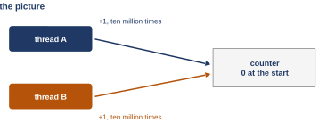{width=55%}
<figcaption markdown="1">Figure 2.1. The picture: two threads, A and B, each add 1 to one counter, ten million times.</figcaption>
</figure>

Figure 2.1 is the whole idea: two arrows into one box. Each thread adds 1 at a time, 10,000,000 times. So the last line should say 2 × 10,000,000 = 20,000,000. Decide now what you expect it to print.

Why ten million adds, and not ten? With only a few adds, thread A would be finished before thread B had even started, so nothing would overlap and the total would be right. Millions of adds keep both threads inside the loop at the same time for a while, and that is when trouble, if there is any, shows up, over and over.

- What this part settled: the experiment, and the expected answer, 20,000,000.
- What it leaves open: what the machine actually prints. That is the next part.

*The argument in one line:* why 10,000,000 adds and not 10? 10 adds would likely finish before the second thread even starts → 10,000,000 keep both threads in the loop at the same time → any trouble from sharing has millions of chances to show.

### 2.2 <span class="lbl lbl-problem">Problem</span> The total is wrong, and different every run {#sec-2-2 data-toc-label="2.2 [Problem] The total is wrong, and different every run"}

We expected 20,000,000. Here is what the Ubuntu machine printed, three times. Only the last line of each run matters; the full runs are in `W08_demos/counter.out`.

```text
$ ./counter
main: begin (counter = 0)
B: begin
A: begin
A: done
B: done
main: done with both (counter = 10798495)
$ ./counter
main: begin (counter = 0)
B: begin
A: begin
A: done
B: done
main: done with both (counter = 11268287)
$ ./counter
main: begin (counter = 0)
B: begin
A: begin
A: done
B: done
main: done with both (counter = 10445986)
```

What we have: two threads, one shared counter, 10,000,000 adds each, and a program that did not change between runs.

Where it breaks: every run is short, and short by a different amount.

| run | counter at the end | short by |
|---|---|---|
| 1 | 10,798,495 | 9,201,505 |
| 2 | 11,268,287 | 8,731,713 |
| 3 | 10,445,986 | 9,554,014 |

Take run 1: 20,000,000 − 10,798,495 = 9,201,505 adds lost. Check it: 10,798,495 + 9,201,505 = 20,000,000. Almost half of the adds vanished, a different number of them each run, with nothing in the program changing between runs. Why so many is not something these runs explain exactly. On 2 cores both threads are in the loop for most of the run, so their loads and stores interleave constantly ([Section 2.5](#sec-2-5) shows how), and a large share of adds can overwrite each other.

Compare this with [Section 1.5](#sec-1-5). There, the order of the letters changed from run to run, but every run was correct. Here the value changes from run to run, and every run is wrong. A program whose output varies from run to run with the same input is called **indeterminate**: its result depends on timing, not only on its input. `t0.c`'s order of letters was indeterminate too, and that was fine, because every order is correct. The problem here is not that the total varies; it is that every total is wrong. (In these three runs B began first each time. This is a different program from `t0.c`, so that says nothing about the 94 A-first runs of [Section 1.5](#sec-1-5).)

So we need an explanation, and the clue is in the numbers. No add failed with an error, yet adds disappeared. Every add did run: each thread's loop is written to make 10,000,000 passes, and both threads printed "done". If each add were one indivisible step, a finished add could not vanish. So some adds ran and then had their results overwritten, which means the one line `counter = counter + 1` must be several steps on the processor, with a gap between them. The next part stops looking at the C and looks at what the processor actually runs.

- What this part settled: the counter is wrong, and indeterminate.
- What it leaves open: how many steps one line of C really is. The next part counts them.

*The argument in one line:* why look at the processor? every add ran (each loop makes all its passes), yet adds vanished → so finished adds had their results overwritten, and an add cannot be one indivisible step → so the C line must be several steps, with a gap between them.

### 2.3 <span class="lbl lbl-machine">Real machine</span> One line of C is three instructions: load, add, store {#sec-2-3 data-toc-label="2.3 [Real machine] One line of C is three instructions: load, add, store"}

The hypothesis is that one line of C is several steps. The way to check is to ask the compiled program itself. A **disassembler** is a tool that prints the machine instructions inside a compiled program, with their addresses; on Linux it is called **objdump**. Its option `-d` asks for the instructions, and `-S` also prints each line of C above the instructions made from it.

The part of its output for our line is below, from `W08_demos/counter_objdump.out`. `grep` is a tool that keeps only the lines that match a pattern. Here it keeps the C line, with `-B2` two lines before it and `-A6` six lines after it. `-n` puts each kept line's number in the whole listing in front of it, followed by a colon on the line that matched (`164:`) and a dash on the lines kept around it (`162-`).

```text
$ objdump -d -S counter | grep -n -B2 -A6 'counter = counter + 1'
162-    11d4:	c7 45 fc 00 00 00 00 	movl   $0x0,-0x4(%rbp)
163-    11db:	eb 13                	jmp    11f0 <mythread+0x47>
164:        counter = counter + 1;     // the dangerous line
165-    11dd:	8b 05 31 2e 00 00    	mov    0x2e31(%rip),%eax        # 4014 <counter>
166-    11e3:	83 c0 01             	add    $0x1,%eax
167-    11e6:	89 05 28 2e 00 00    	mov    %eax,0x2e28(%rip)        # 4014 <counter>
168-    for (int i = 0; i < 10000000; i++) {
169-    11ec:	83 45 fc 01          	addl   $0x1,-0x4(%rbp)
170-    11f0:	81 7d fc 7f 96 98 00 	cmpl   $0x98967f,-0x4(%rbp)
```

How to read one instruction line, left to right: the address of the instruction inside the program (in hex), the instruction's bytes, then the instruction in words. Under the C line `counter = counter + 1` there are three instructions:

1. Address `11dd`: `mov 0x2e31(%rip),%eax`. This is a **load**: copy the value of `counter` from memory into a register called `eax`. (`mov` means "copy". In this notation the source comes first and the destination second, and `%` marks a register name.)
2. Address `11e3`: `add $0x1,%eax`. Add 1 to the register. Memory is untouched. (`$0x1` is the constant 1.)
3. Address `11e6`: `mov %eax,0x2e28(%rip)`. This is a **store**: copy the register back to `counter` in memory.

Why three instructions for one line of C? For the hardware, adding 1 to a number in memory is always three steps: load the number, add 1, store it back. On this build, gcc, the C compiler, chose to write the three steps as three separate instructions, which makes them visible in the listing; that is gcc's choice here, not a law. x86 also has an add that names a memory cell directly: line 169 in the capture above uses one for the loop counter `i` (read with the rest of the loop below). Inside the CPU that one is still a load, an add and a store, and without a special marker in front of the instruction, called a prefix ([Section 2.6](#sec-2-6)), another CPU can slip between those steps just the same. So the race does not depend on how the compiler writes the add.

`volatile` ([Section 2.1](#sec-2-1)) has a different job. Without it, the compiler could keep `counter` in a register for the whole loop and store it only once at the end, and the program would no longer do one load and one store per add. With it, every pass really loads and stores `counter`. This program was built with no **optimization**, the compiler rewriting code to run faster (for example by keeping a variable in a register across many lines). The build line, the command that compiled the program, is `gcc -g -Wall -pthread` (`-g` adds debugging information, `-Wall` turns on warnings, and `-pthread` connects the program to the threads library; [Section 3.1](#sec-3-1) has more). It has no `-O` option, which means gcc's default, `-O0`. Built with optimization (`-O2`), the same `volatile` add still came out as a separate load, add and store (`W08_demos/counter_O2_objdump.out`).

objdump's note `# 4014 <counter>` on lines 165 and 167 says that the memory address in both instructions is the variable `counter`. You can take objdump's word for it and skip to the next paragraph. Here is the check, in four steps.

1. `rip` is the x86-64 name of the program counter. During an instruction it holds the address of the next instruction.
2. `0x2e31(%rip)` means "the address `rip` + `0x2e31`"; the number added, `0x2e31`, is called the **offset**. During the load, the next instruction is at `11e3`, so the address is `0x11e3` + `0x2e31`.
3. In ordinary numbers (Part 0), `0x11e3` = 1 × 4,096 + 1 × 256 + 14 × 16 + 3 = 4,579, and `0x2e31` = 2 × 4,096 + 14 × 256 + 3 × 16 + 1 = 11,825. The sum is 4,579 + 11,825 = 16,404, which is `0x4014`.
4. During the store, the next instruction is at `11ec` = 1 × 4,096 + 1 × 256 + 14 × 16 + 12 = 4,588, 9 bytes further on. The offset `0x2e28` = 2 × 4,096 + 14 × 256 + 2 × 16 + 8 = 11,816 is exactly 9 smaller. So 4,588 + 11,816 = 16,404 again: same address, same variable.

The other lines belong to the loop around it. They show that the loop really runs 10,000,000 times and where `i` lives; you can skip to Figure 2.2 without losing the argument. `-0x4(%rbp)` is the variable `i` (`rbp` is the register that points at this function's part of the stack, where its local variables live). The `l` at the end of `movl`, `addl` and `cmpl` means the value is 32 bits wide, the size of an `int`. Read the loop lines in listing order:

1. Line 162 sets `i` to 0 (`$0x0` is the constant 0).
2. Line 163, `jmp 11f0`, jumps straight to the compare at `11f0`, so the loop checks its condition before the first pass.
3. Lines 165 to 167 are the three instructions of the add, and line 169 adds 1 to `i`.
4. Line 170 compares `i` with `0x98967f`. With the place values of Part 0 that is 9 × 1,048,576 + 8 × 65,536 + 9 × 4,096 + 6 × 256 + 7 × 16 + 15 = 9,999,999.
5. The jump that closes the loop comes right after; the capture above stops before it.

The next line of the full listing, `W08_demos/counter_objdump_full.out`, is this one:

```text
    11f7:	7e e4                	jle    11dd <mythread+0x34>
```

`jle 11dd` means "jump back to the load at `11dd` if `i` was less than or equal" to 9,999,999. Why 9,999,999 and not 10,000,000? The compiler rewrote `i < 10000000` as the same test, `i <= 9999999`.

<figure markdown="1">
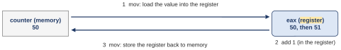{width=75%}
<figcaption markdown="1">Figure 2.2. The three instructions as a picture: 1, load the value from memory into the register; 2, add 1 inside the register; 3, store the register back to memory.</figcaption>
</figure>

Figure 2.2 draws the three steps: memory on the left, the register on the right, arrow 1 loading, step 2 adding inside the register, arrow 3 storing. Now the key fact. A register is private to the thread that is running: at a switch the OS saves a thread's registers into its TCB and restores the other thread's ([Section 1.3](#sec-1-3)). The memory cell `counter` is shared. So the add happens in a private place, and only the store makes it visible to anyone else. Between the load and the store, the new value exists only in `eax`.

And a **timer interrupt** can arrive between any two instructions. When it does, the OS may switch to the other thread. That gap, between the load and the store, is where the next parts drop a second thread.

- What this part settled: one line of C is three instructions, with the new value in a private register between the first and the third.
- What it leaves open: what exactly happens when a second thread runs in that gap. The next part plays it out.

*The argument in one line:* why does one line become three steps? adding to a value in memory takes reading it into the CPU, adding, and writing it back: a load, an add and a store → here gcc writes them as three instructions, with the new value only in eax between the load and the store → another thread can run in that gap (a one-instruction add has the same gap inside the CPU).

### 2.4 <span class="lbl lbl-example">Worked example</span> The race on one CPU, step by step: OSTEP Figure 26.7 {#sec-2-4 data-toc-label="2.4 [Worked example] The race on one CPU, step by step: OSTEP Figure 26.7"}

We know where the gap is: between the load and the store. Now we drop a second thread into it on purpose. The trick is to play a mean scheduler: pretend you are allowed to interrupt a thread at the worst possible moment, and watch what the counter does. This part does it on one CPU, where the two threads take turns and a switch happens only when the timer fires. It takes three steps.

The trace keeps the rounder numbers of the textbook's figure. The three instructions sit at addresses 100, 105 and 108. (x86 instructions have different lengths. In the textbook's 32-bit example each `mov` between `eax` and the fixed address `0x8049a1c` takes 5 bytes: one byte saying which kind of `mov`, then the 4-byte address. The `add` takes 3, the same `83 c0 01` as on the Ubuntu machine (line 166 of [Section 2.3](#sec-2-3)). So 100 + 5 = 105, 105 + 3 = 108, and after the store the PC is 108 + 5 = 113. On the Ubuntu machine the load took 6 bytes, from `11dd` to `11e3`. The sizes differ; the idea does not.) The counter lives at address `0x8049a1c`, which the table writes without the `0x`, and it starts at 50. The PC column is the address of the next instruction, the eax column is the register of the thread that is running, and the counter column is memory.

**Step 1: thread 1 loads and adds; the timer fires first.**

| OS | Thread 1 | Thread 2 | PC | eax | counter |
|---|---|---|---|---|---|
| | (before the line) | | 100 | 0 | 50 |
| | `mov 8049a1c,%eax` | | 105 | 50 | 50 |
| | `add $0x1,%eax` | | 108 | 51 | 50 |
| interrupt: save T1 | | | | | |

<figure markdown="1">
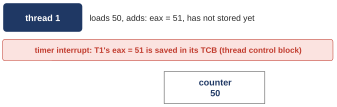{width=75%}
<figcaption markdown="1">Figure 2.3. After step 1: thread 1 has loaded 50 and added, so its eax is 51, but it has not stored. The timer interrupt saves that 51 into thread 1's TCB. Memory still says 50.</figcaption>
</figure>

Thread 1 loads the counter into its register and adds 1 (Figure 2.3). Look at the last two columns: the register has the new value, 51, and memory still has the old one, 50. Then the timer fires. The OS saves everything thread 1 has, the register with the 51 included, into thread 1's TCB, and gives the CPU to thread 2. Nobody has done anything wrong. The scheduler is allowed to take the CPU away between any two instructions. The only damage so far is that a half-finished add is hiding in a saved register.

*Step 1 in one line:* why is a saved register dangerous? thread 1 has 51 only in its register → the interrupt saves that register in the TCB → memory still says 50: nobody else can see the 51.

**Step 2: thread 2 runs all three instructions and stores 51.**

| OS | Thread 1 | Thread 2 | PC | eax | counter |
|---|---|---|---|---|---|
| restore T2 | | | 100 | 0 | 50 |
| | | `mov 8049a1c,%eax` | 105 | 50 | 50 |
| | | `add $0x1,%eax` | 108 | 51 | 50 |
| | | `mov %eax,8049a1c` | 113 | 51 | 51 |

<figure markdown="1">
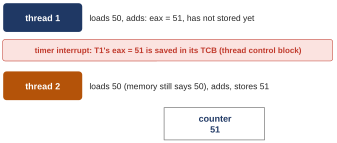{width=75%}
<figcaption markdown="1">Figure 2.4. After step 2: thread 2 loaded 50 (memory still said 50), added, and stored 51. Thread 1 still holds its own 51 in a saved register.</figcaption>
</figure>

Thread 2 loads the counter (Figure 2.4). It reads memory, because memory is all it can read, and memory says 50. It adds and gets 51. It stores, and now memory says 51. Follow the counter column down: memory changes only once, at thread 2's store. From thread 2's point of view, everything is correct. Now two threads each believe they have added 1 to 50.

*Step 2 in one line:* why does thread 2 not see the add? thread 2 reads memory, not thread 1's register → memory says 50 → thread 2 computes 51 and stores it.

**Step 3: thread 1 returns and stores its old 51.**

| OS | Thread 1 | Thread 2 | PC | eax | counter |
|---|---|---|---|---|---|
| interrupt: save T2 | | | | | |
| restore T1 | | | 108 | 51 | 51 |
| | `mov %eax,8049a1c` | | 113 | 51 | 51 |

<figure markdown="1">
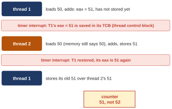{width=75%}
<figcaption markdown="1">Figure 2.5. After step 3: the OS restored thread 1's eax, 51, and thread 1 stored it over thread 2's 51. Two adds, and the counter moved by one: 51, not 52.</figcaption>
</figure>

Another interrupt (Figure 2.5). The OS puts thread 1's saved registers back, so its register holds the 51 it computed before it was stopped, and its PC is 108, the store. It has one instruction left, and it writes that 51 into memory. Memory already held 51, so nothing moves. The arithmetic: 50 + 1 + 1 should be 52; the counter was stored as 51, and then as 51 again. One add is lost. Nothing crashed and nothing printed an error. An add simply vanished.

This is a **race condition**: a bug whose outcome depends on the timing of the threads, so that with bad timing the result is wrong. The book adds a more specific term, **data race**: two threads touch the same memory with nothing ordering the two accesses (no lock between them), and at least one of them writes. On one CPU the threads never run at the same instant, but the trace above still qualifies: both threads load and store `counter`, both write, and no lock stands between them. A data race is the most common way to get a race condition, and the counter has both. The second name matters because tools use it: helgrind, in [Extra 2](#extra-2), reports exactly this as a "Possible data race". Here the timing decides everything. A switch outside the gap costs nothing. A switch inside the gap costs adds: one here, and possibly many more. Suppose thread 2 had kept going for many passes while thread 1 waited. Thread 1's late store of its stale 51 would then wipe out all of thread 2's work at once.

- What this part settled: on one CPU, an add is lost when a switch lands between a thread's load and its store.
- What it leaves open: the runs in [Section 2.2](#sec-2-2) came from a 2-core machine, where the two threads run at the same time. The next part shows that there, no switch is even needed.

*The argument in one line:* why 51 and not 52? T1 loads 50 and adds: its 51 waits in its register → an interrupt switches to T2 before T1's store → T2 loads 50 from memory → both store 51 → one add is lost.

### 2.5 <span class="lbl lbl-example">Worked example</span> The race on two cores, with no interrupt {#sec-2-5 data-toc-label="2.5 [Worked example] The race on two cores, with no interrupt"}

On one CPU the loss needed a switch at the worst moment. But the three short runs of [Section 2.2](#sec-2-2) came from the Ubuntu machine, which has 2 cores. There the two threads run at the same time, one on each core, and nobody is switched out. This part shows that an add can be lost anyway.

The table is one possible order, one moment at a time. It is not a capture; it is one of many orders that lose an add the same way.

| moment | core 0: thread 1 | core 1: thread 2 | counter in memory |
|---|---|---|---|
| 1 | `mov`: load 50 into its eax | (still in the loop's compare) | 50 |
| 2 | `add`: its eax is 51 | `mov`: load 50 into its own eax | 50 |
| 3 | `mov`: store 51 | `add`: its eax is 51 | 51 |
| 4 | (next pass of the loop) | `mov`: store 51 | 51 |

<figure markdown="1">
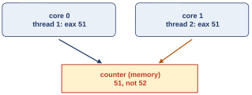{width=55%}
<figcaption markdown="1">Figure 2.6. The two cores side by side: each register holds 51, and the one counter in memory ends at 51, not 52.</figcaption>
</figure>

Moment 2 is where it goes wrong (Figure 2.6). Thread 2 reads memory at the very moment thread 1's new value is sitting in thread 1's register, over on core 0. Registers are private: each core has its own. Each core also has its own cache, but the hardware keeps the caches **coherent**: once a store reaches a core's cache, every core's next load of that cell sees it. (There is one exception, which does not matter here: a store can first wait a moment in a small buffer before it reaches the cache. [Extra 5](class-2.md#extra-5) shows where that matters.) So the shared place is memory, seen through the coherent caches, and thread 1's 51 is not there yet; it is still in core 0's register. So thread 2 loads 50, both threads store 51, and one add is lost, with no interrupt anywhere. Two adds should give 50 + 1 + 1 = 52; both stored 51.

So there are two ways in:

- **On one CPU**, the gap opens only when a switch lands between a load and its store; the late store can then wipe out every add the other thread made in the meantime.
- **On two cores**, no switch is needed: while both threads are in the loop, either core can load while the other's new value is still in a register.

Either way the total comes out short, and different every run. This matters for the fix. Whatever we build must make the three instructions act as one on two cores, not only stop interrupts on one. A cure that only stopped interrupts would fix the one-CPU case and leave this one broken. Keep that in mind for the second class.

- What this part settled: on two cores, adds are lost with no interrupt at all.
- What it leaves open: a name for what we want, and how to get it. The next part names it.

*The argument in one line:* why are adds lost on two cores with no interrupt? both threads are in the loop at the same moment → registers are private, memory is shared → core 1 loads from memory while core 0's 51 is still in its register → both store 51.

### 2.6 <span class="lbl lbl-concept">Concept</span> Critical section, mutual exclusion and atomicity {#sec-2-6 data-toc-label="2.6 [Concept] Critical section, mutual exclusion and atomicity"}

We know where the race lives: in those three instructions. Before building any fix, we need words for what we want to be true about them. There are three, and they come in a chain.

1. **The dangerous lines.** A **critical section** is a piece of code that touches a shared variable (or any shared resource) and must not be run by more than one thread at a time. If two threads are inside it at once, the race can happen. In `counter.c` the critical section is the one line `counter = counter + 1`.
2. **What we want.** **Mutual exclusion** is the guarantee that while one thread is inside a critical section, no other thread can enter it. One thread at a time: the others wait outside until it leaves, so one thread's load, add and store are never split by another's.
3. **How it must look.** **Atomic** means all or nothing: a group of actions that looks like one step to everyone else. Either none of it has happened or all of it has, and no other thread ever sees a state in between.

The wish, then, is that the three instructions behave atomically. One way would be a single instruction that adds 1 straight into memory, something like `memory-add 0x8049a1c, $0x1`. An interrupt lands between instructions, never inside one, so on one CPU that would be safe. x86 actually has such an instruction; objdump showed one for `i` in [Section 2.3](#sec-2-3). Inside the CPU it is still a load, an add and a store, so on two cores another CPU can slip between them. A **lock prefix** is a one-byte marker in front of an instruction that makes those three steps one step for every CPU: no other CPU can touch that memory cell in between. With one, that instruction would fix `counter.c` on two cores as well. (This "lock" is a hardware marker on one instruction, not the software lock of Chapters 3 and 4: the same word, a different thing.)

But a critical section can be anything. The next program might add an item to a linked list (a chain of records, each holding the address of the next; [Section 2.7](#sec-2-7)). The one after that might rebalance a tree (a branching structure of records used to keep data sorted). A processor's **instruction set** is the list of instructions it understands, and no sane instruction set has an "atomic update of a tree" instruction. So the plan is different. The hardware gives a few small atomic instructions, the OS adds some help, and from those pieces we build **synchronization primitives**: tools, such as a lock, that make any critical section behave atomically. The textbook puts the question for the rest of the week as its crux:

**The crux: how to support synchronization.** What support do we need from the hardware in order to build useful synchronization primitives? What support do we need from the OS? How can we build these primitives correctly and efficiently? How can programs use them to get the desired results?

- What this part settled: the words critical section, mutual exclusion and atomic, and the plan: build a lock from small hardware pieces and OS help.
- What it leaves open: how a program asks for a lock, and what is inside one. [Chapter 3](#chapter-3) and the second class.

*The argument in one line:* why not one atomic instruction for everything? a critical section needs mutual exclusion so that it looks atomic, and it can touch anything: a counter, a list, a tree → no instruction set can offer one atomic instruction per data structure → so hardware gives a few small atomics, and the OS and software build locks from them.

### 2.7 <span class="lbl lbl-kernel">Real kernel</span> xv6's free-page list is a critical section on every CPU {#sec-2-7 data-toc-label="2.7 [Real kernel] xv6's free-page list is a critical section on every CPU"}

The race is not a toy. The kernel had this exact problem before any user program did, because every CPU runs kernel code on the same kernel lists. Our example is a file from the xv6 kernel, `kernel/kalloc.c`, which hands out and takes back pages of **physical memory**. Physical memory is the machine's real memory, as opposed to the addresses a process uses (which its page table translates); xv6 cuts it into pages of 4096 bytes each.

What we have is one linked list of every free page, called `kmem.freelist`, shared by all CPUs. (`kmem` is a bundle of fields, and the dot reads one of them: `kmem.freelist` is the field `freelist` of `kmem`. The arrow `->` does the same through a pointer.) A **linked list** is a chain of records where each record holds the address of the next one; the **head** is the address of the first record. In xv6 each free page doubles as a list record of type `struct run` (a `struct` is a bundle of named fields; this one has a single field, `next`, the address of the next free page). `kalloc` hands out one free page by taking it off the front of the list, which is called a **pop**. Before two CPUs collide on the list, watch one CPU take a page.

*`kalloc()`, from `W08_demos/xv6_excerpts/kalloc.c_46-78.c` (`kernel/kalloc.c` lines 68 to 78).*

```c linenums="68" hl_lines="7 8 9"
void *
kalloc(void)
{
  struct run *r;

  acquire(&kmem.lock);
  r = kmem.freelist;
  if(r)
    kmem.freelist = r->next;
  release(&kmem.lock);

```

- Line 74 reads the head: now the local variable `r` points at the first free page.
- Line 75 checks that the list was not empty (`if(r)` means "if r is not the empty pointer").
- Line 76 writes the head: `r->next` is the `next` field of the record `r` points at, so the list now starts at the second page.
- A few lines further down, `kalloc` returns the page `r` to the caller.

The `acquire` and `release` on lines 73 and 77 are xv6's lock and unlock around these lines. Ignore them for a moment.

<figure markdown="1">
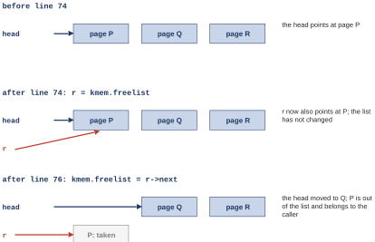{width=70%}
<figcaption markdown="1">Figure 2.7. One CPU, one pop, three moments. Before line 74 the head points at page P. After line 74, r also points at P and the list has not changed. After line 76 the head has moved to Q, and P belongs to the caller.</figcaption>
</figure>

Look at the middle moment of Figure 2.7. For an instant the list still says P is free, while this CPU has already decided to take P. That is a gap between a read and a write, exactly the counter's gap.

Now let two CPUs run those lines at the same moment, with the lock gone. This is not far-fetched: xv6 normally runs on 3 CPUs at once, so two CPUs can call `kalloc` together. The 3 comes from how xv6 is run. xv6 runs inside **QEMU**, a program that imitates a whole **RISC-V** computer (RISC-V is a processor family different from the x86 of the Ubuntu machine, with its own instructions). xv6 is built and started with **make**, a tool that follows the recipe in a file called `Makefile`, and that recipe tells QEMU to give xv6 3 CPUs unless the command says otherwise (`make CPUS=1 qemu`, for example).

<figure markdown="1">
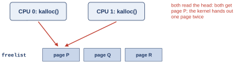{width=70%}
<figcaption markdown="1">Figure 2.8. Two CPUs call kalloc at the same instant. Both read the head, both get page P, and the kernel hands out one page twice.</figcaption>
</figure>

In Figure 2.8, each CPU reads the head and walks away with page P. One page, given out twice. Two processes would then share one physical page without knowing it, and each would overwrite the other's data. With the lock, the second CPU waits inside `acquire` until the first has moved the head, and then it takes page Q.

Freeing a page has the same shape. `kfree` pushes a page onto the front of the list:

*`kfree()`, lines 57 to 62 of the same file.*

```c linenums="57" hl_lines="4 5"
  r = (struct run*)pa;

  acquire(&kmem.lock);
  r->next = kmem.freelist;
  kmem.freelist = r;
  release(&kmem.lock);
```

Line 60 reads the head into the new page's `next` field, and line 61 writes the head. Two steps, with a gap, and a lock around them. (`pa` is the address of the page being freed; `(struct run*)` tells the compiler to treat that address as a list record.)

Kernels met this problem early; the textbook calls the OS the first concurrent program. An interrupt can arrive at any instruction, and a kernel may run on several CPUs at once. So every kernel list, table and bitmap (a table of bits, one per page or disk block) is a shared variable: the process table (Roadmap 1), the free list, the file system's records. In xv6 each shared one is protected by a lock. (Data that each CPU keeps for itself needs none. Larger kernels also use lock-free structures, which threads share without any lock. They rely on instructions such as compare-and-swap, which writes a new value only if the cell still holds the expected one; [Extra 4](class-2.md#extra-4) has more.) That is why this is taught in an operating systems class.

- What this part settled: a kernel list is a shared variable too, and its pop and push are critical sections.
- What it leaves open: how a program, not the kernel, asks for threads and locks. That is [Chapter 3](#chapter-3).

*The argument in one line:* why does the kernel need this? 3 CPUs share one free list → pop is read head, write head → two pops in the gap hand out one page twice → so `kalloc` and `kfree` hold `kmem.lock` around those lines.

### 2.8 <span class="lbl lbl-check">Check yourself</span> What the second question settled {#sec-2-8 data-toc-label="2.8 [Check yourself] What the second question settled"}

Settled:

- One line of C is three instructions, with the value in a private register between the load and the store.
- A switch in that gap, or the other core's load in that gap, loses an add. It happened a different number of times in each run of 20,000,000 adds (10,000,000 per thread), so the totals came out short, and short by a different amount each time.
- The lines that touch shared data are a critical section. They need mutual exclusion, which means making them behave atomically. xv6's free list is one such section on every CPU.

Still open:

- How the hardware's few small atomic instructions, with help from the OS, become a lock for any critical section ([Section 2.6](#sec-2-6) showed why one instruction per data structure is not on offer).
- We have named what we want, and not yet how a program asks for it. The next question is what a program says to make a thread, wait for it, and keep it out of the dangerous lines.

You should now be able to point at the critical section in `counter.c` and explain, with the 50 → 51 trace, why the total came out short.

## Chapter 3. The thread API: create, join, and a lock {#chapter-3}

*The question this chapter answers: what does a program say to make a thread, wait for it, and keep it out of the dangerous lines?*

### 3.1 <span class="lbl lbl-problem">Problem</span> Starting a thread, and why main must wait for it {#sec-3-1 data-toc-label="3.1 [Problem] Starting a thread, and why main must wait for it"}

Three programs so far, `psum.c`, `t0.c` and `counter.c`, used the same two thread calls; [Section 1.4](#sec-1-4) named their arguments but not why each call is needed. C had no way of its own to start a second point of execution or to wait for one until C11, the 2011 version of the C standard, added a small thread library (`<threads.h>`, with `thrd_create` and `thrd_join`). Linux programs use the pthreads library, and so does this guide. This part asks what each call is for, starting with what goes wrong without the second one.

What we have, in `t0.c` ([Section 1.5](#sec-1-5)), lines 12 to 16:

```c linenums="12"
    pthread_create(&p1, NULL, mythread, "A");
    pthread_create(&p2, NULL, mythread, "B");
    // join waits for the threads to finish
    pthread_join(p1, NULL);
    pthread_join(p2, NULL);
```

- `pthread_create` starts a function as a new thread. Main does not wait; it goes on to its next line.
- `pthread_join` makes main stop on that line until the named thread has finished. It is the thread version of `wait()`, the call by which a process waits until a child process (a process it created) has finished.

Where it breaks: here is `t0.c` with its two joins deleted, `W08_demos/t0_nojoin.c`, run 100 times. For each run the command counts how many of the letters A and B came out, and then it counts how many runs gave 0, 1 or 2 letters. (`grep -c` counts the lines that match. The pattern `^[AB]$` matches a line that is exactly A or exactly B: `^` is the start of the line, `[AB]` one letter, A or B, and `$` the end.)

```text
$ for i in $(seq 100); do ./t0_nojoin | grep -c "^[AB]$"; done | sort | uniq -c
     18 0
      5 1
     77 2
```

In 18 runs out of 100, no letter came out at all; in 5, only one; in 77, both (18 + 5 + 77 = 100). The reason is short. Without the joins, main reaches its last line and returns. When main returns, the whole process exits, and every thread in it stops with it, finished or not. So main must wait, and `pthread_join` is how it waits.

There is a second rule about the end of a thread. A thread's stack is freed when the thread ends, so a pointer into it points at nothing afterward. That matters for join: main reads the thread's result after the thread has ended, so whatever a thread hands back must live somewhere the thread's end cannot reach. [Section 3.3](#sec-3-3) shows where.

So we need three things from the library, and the textbook states the question as the crux of its chapter on the thread API (an **API**, application programming interface, is the set of calls a library offers to programs):

- one call that starts a function as a new thread and hands it an argument;
- one call that waits for a thread to finish and collects what it returns;
- one pair of calls that keeps every other thread out of a critical section.

**The crux: how to create and control threads.** What interfaces should the OS present for thread creation and control? How should these interfaces be designed to enable ease of use as well as utility?

Note what join does and does not fix. It only waits at the end. The adds of `counter.c` were lost in the middle, while both threads were running. That is the job of the third call, the lock, in [Section 3.4](#sec-3-4).

- What this part settled: create starts, join waits, and main must join before it returns.
- What it leaves open: how an argument gets into a thread and a result gets out. The next two parts.

*The argument in one line:* why join, and why never a stack address? main returns → the process exits → the threads die with it: so join | a thread ends → its stack is freed: never return its address.

??? note "The program behind the run without join (you can skip this listing)"

    *`W08_demos/t0_nojoin.c`, whole.* It is `t0.c` with lines 15 and 16 deleted; line 14 now says so.
    
    ```c linenums="1" hl_lines="14"
    #include <stdio.h>
    #include <pthread.h>
    
    void *mythread(void *arg) {
        printf("%s\n", (char *) arg);
        return NULL;
    }
    
    int main(int argc, char *argv[]) {
        pthread_t p1, p2;
        printf("main: begin\n");
        pthread_create(&p1, NULL, mythread, "A");
        pthread_create(&p2, NULL, mythread, "B");
        // no join: main returns right away
        printf("main: end\n");
        return 0;
    }
    ```
    
    To build and run it on any Linux computer: `gcc -g -Wall -pthread -o t0_nojoin t0_nojoin.c`, then `./t0_nojoin`. (`gcc` is the C compiler. `-o t0_nojoin` names the program file it writes. `-pthread` connects the program to the threads library (on today's Linux the pthread functions are part of the C library, glibc, which the program uses while it runs). `-g` and `-Wall` only add debugging information and warnings.) The output varies from run to run, which is the point.
    
### 3.2 <span class="lbl lbl-concept">Concept</span> pthread_create and pthread_join as a picture {#sec-3-2 data-toc-label="3.2 [Concept] pthread_create and pthread_join as a picture"}

Before any C, here is what it looks like to start a function as a thread, hand it something, and get something back. The program on the next pages does exactly this: main hands a new thread two numbers, 10 and 20, and gets two numbers back, 1 and 2.

<figure markdown="1">
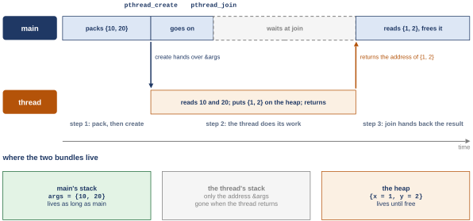{width=95%}
<figcaption markdown="1">Figure 3.1. One run of the program, with time going to the right. Main packs {10, 20} and calls create; the thread reads 10 and 20, puts {1, 2} on the heap and returns; join hands main the address of {1, 2}. Below: where each bundle lives.</figcaption>
</figure>

Follow Figure 3.1 from the left.

1. Main packs two numbers into a bundle and calls create. A second thread starts right there. All it receives is one address: where main keeps those two numbers.
2. Main does not wait. It goes straight on to its next line. Meanwhile the thread reads the two numbers and builds its answer, `{1, 2}`, on the heap.
3. Main reaches join and stops. When the thread returns, join lets main go, and hands it the address of the answer. Main reads it and frees it: it gives the memory back with `free`, so it can be used again.

Now look at where things live, in the three boxes at the bottom. The numbers `{10, 20}` stay in main's stack, which lasts as long as main runs. The answer sits on the heap, which lasts until someone frees it. The thread's own stack disappears when the thread returns. It holds the thread's own local variables, such as its copy of the address it was handed and its own pointer to the answer, but nothing the caller needs lives there.

It is like handing off a job at work. You give a coworker a folder with two numbers and go back to your own work. Later you wait at their desk until they hand you a report. The folder stays yours. The report is on fresh paper, because their desk is cleared when they leave.

Those two moments have names: `pthread_create` starts a function as a new thread and passes it one address; `pthread_join` makes the caller wait until that thread has finished, then hands it the address the thread returned.

- What this part settled: the shape of create and join, and where the argument and the result live.
- What it leaves open: the C that does it. The next part reads it in three steps.

*The argument in one line:* why read the result only after join? the thread builds the result while it runs → join returns only after the thread has finished → after join, the result is complete.

### 3.3 <span class="lbl lbl-example">Worked example</span> Passing arguments in and a result out, in three steps {#sec-3-3 data-toc-label="3.3 [Worked example] Passing arguments in and a result out, in three steps"}

The picture of [Section 3.2](#sec-3-2) is one complete program. It joins OSTEP Figures 27.1 and 27.2 into one file, `W08_demos/create_join.c`. We read it in three steps, one per moment of the picture, and after each step we draw where the two bundles live.

*The program `create_join.c`, whole (`W08_demos/create_join.c`).*

```c linenums="1" hl_lines="4 5 7 8 10 13 17 18 19 20 21 22 23"
#include <stdio.h>
#include <stdlib.h>
#include <pthread.h>
typedef struct { int a; int b; } myarg_t;
typedef struct { int x; int y; } myret_t;

void *mythread(void *arg) {
    myarg_t *args = (myarg_t *) arg;        // unpack the arguments
    printf("%d %d\n", args->a, args->b);
    myret_t *rvals = malloc(sizeof(myret_t)); // results go on the heap
    rvals->x = 1;
    rvals->y = 2;
    return (void *) rvals;
}

int main(int argc, char *argv[]) {
    pthread_t p;
    myret_t *rvals;
    myarg_t args = { 10, 20 };
    pthread_create(&p, NULL, mythread, &args);
    pthread_join(p, (void **) &rvals);
    printf("returned %d %d\n", rvals->x, rvals->y);
    free(rvals);
    return 0;
}
```

It prints two lines (from `W08_demos/create_join.out`):

```text
$ ./create_join
10 20
returned 1 2
```

Lines 4 and 5 define the two bundles. A **struct** is a bundle of named fields; `typedef` gives the bundle a name. So `myarg_t` is "a bundle with two integers called `a` and `b`", and `myret_t` is "a bundle with two integers called `x` and `y`".

**Step 1: main packs two numbers and starts a thread on them (lines 17 to 20).**

Main declares a handle `p` (line 17) and a result pointer `rvals` (line 18). `rvals` is not set yet: until join fills it, it holds whatever happened to be in that memory. Line 19 makes the argument bundle `args`, with `a = 10` and `b = 20`. Then line 20 calls create with four arguments:

- `&p`: the address of the handle, which the call fills in. (`&` means "the address of": where `p` lives, so another function can reach it.)
- `NULL`: default settings.
- `mythread`: the function to run, passed by its name. A function's name used as a value, so another function can be told which function to call later, is a **function pointer**; `pthread_create` takes one.
- `&args`: the address of main's bundle, the one value the new thread receives.

<figure markdown="1">
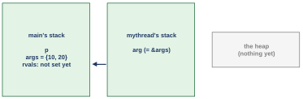{width=70%}
<figcaption markdown="1">Figure 3.2. After step 1: main's stack holds the handle p, the bundle args = {10, 20} and rvals, not yet filled. The thread's stack holds only arg, the address of main's bundle. The heap is empty.</figcaption>
</figure>

What create really did (Figure 3.2): a second stack, a second program counter sitting at the first line of `mythread`, and one address handed across. Main's bundle stays in main's stack.

Why is the argument passed as an address of type `void *`? One create call serves every program in the world, so it cannot know the type of anybody's argument. A `void *` is a pointer that may point at anything; the receiving side converts it back to the type it expects. Writing a type in parentheses in front of a value to convert it like this is called a **cast**; Step 2 shows one. The same trick lets a thread return any kind of result. (`psum.c` used it in reverse: it passed the number 0 or 1 dressed as a pointer, `(void *) 0`, and turned it back into a number with the cast `(long) arg`.)

*Step 1 in one line:* why void *? one create call for every program → it cannot know the argument's type → a pointer to anything → the thread casts it back.

**Step 2: the thread reads its bundle and builds its result (lines 7 to 13).**

The new thread is running now. Follow what it does with the address it was given.

- Line 8 converts the anything-pointer back: `(myarg_t *) arg` says "treat this as a pointer to a `myarg_t`". That is the cast promised in Step 1.
- Line 9 reads `a` and `b` through that pointer: `args->a` is the field `a` of the bundle that `args` points at. This works because the two threads share the address space: the address means the same bytes to the thread as it did to main. The thread prints `10 20`.
- Line 10 builds the result not on its own stack but with `malloc`, on the heap. `sizeof(myret_t)` is the size of one result bundle in bytes, so `malloc` hands back the address of fresh heap memory exactly that big. That memory stays until someone frees it.
- Lines 11 to 13 fill in `x = 1` and `y = 2` and return the heap address, cast back to an anything-pointer.

<figure markdown="1">
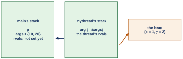{width=70%}
<figcaption markdown="1">Figure 3.3. After step 2: the result bundle {x = 1, y = 2} sits on the heap, and the thread's rvals points at it. The thread is about to return, and its stack with it.</figcaption>
</figure>

Figure 3.3 shows the result bundle on the heap, with the thread's stack about to go. One rule to remember, with its reason: never return the address of a thread's local variable. The thread's stack is reclaimed the moment it returns, so any address inside it is an address of nothing. The heap lives until someone frees it.

*Step 2 in one line:* why does the result go on the heap? the thread's stack is reclaimed when it returns → a pointer into it would point at nothing → malloc gives memory that lives until free.

**Step 3: join hands main the result; main frees it (lines 21 to 23).**

The thread has returned. Main has been waiting at join the whole time.

- Line 21: `pthread_join(p, (void **) &rvals)` does two things at once, and needs one cast.
    - It **blocks**: it stops main on this line until thread `p` has returned. (A thread stopped waiting for something is called blocked; [Section 6.2](class-2.md#sec-6-2) comes back to this.)
    - It writes whatever the thread returned, the heap address, into main's `rvals`. That is why join is handed `&rvals`, the address of `rvals`: it needs to know where to write.
    - The cast. (If this is too much on a first reading, the point is only that join copies the thread's result address into `rvals`; skip to line 22.) First, a pointer to a pointer. Picture two boxes. The box `rvals` holds an address, the address of a result bundle. `&rvals` is the address of the box `rvals` itself. So `&rvals` is the address of a variable that itself holds an address: a pointer to a pointer. Its type is `myret_t **`, one `*` for each step from `&rvals` to the bundle. Join is written for every program and cannot know that type, so it asks for a `void **`, "the address of an anything-pointer". The cast `(void **)` hands it `&rvals` in that form, and join writes the thread's `void *` result there.
- Line 22 follows that pointer to read `x` and `y` and prints `returned 1 2`.
- Line 23, `free(rvals)`, gives the heap memory back. After it, `rvals` must not be used again.

<figure markdown="1">
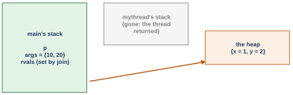{width=70%}
<figcaption markdown="1">Figure 3.4. After step 3: the thread's stack is gone, and main's rvals, set by join, points at the bundle on the heap. Neither bundle was ever stored on the thread's own stack.</figcaption>
</figure>

Join is both the wait and the hand-back (Figure 3.4). Main never touched the result before it existed, and what it got is exactly what the thread returned. Neither bundle was ever stored on the thread's own stack; the thread kept only addresses there, which is why its stack could disappear safely.

*Step 3 in one line:* why is join both the wait and the hand-back? main must not read the result before it exists → join blocks until the thread returns → the return value is the pointer join writes into rvals.

- What this part settled: an argument goes in as one value the size of an address, either a plain number cast to fit (as `psum.c` does) or the address of data that outlives the thread (main's stack, the heap or a global). A result comes back through memory that outlives the thread: here the heap, or a global variable as in `psum.c`.
- What it leaves open: the third call, the lock, which works in the middle of the run rather than at the end.

### 3.4 <span class="lbl lbl-concept">Concept</span> A lock lets only one thread at a time do the add {#sec-3-4 data-toc-label="3.4 [Concept] A lock lets only one thread at a time do the add"}

`counter.c` called create and join from the start, and it still lost almost half of its adds. Join only makes main wait until the threads are done. The adds were lost earlier, while both threads were running. So we need something that works in the middle, at the dangerous line itself. That is the third call, the lock.

A **lock** is a shared variable that only one thread can hold at a time. `lock()` waits until the lock is free and then takes it; `unlock()` gives it back. Put `lock()` at the start of the critical section and `unlock()` at the end.

<figure markdown="1">
{width=95%}
<figcaption markdown="1">Figure 3.5. counter.c with a lock around the add, one possible order, time going to the right. A takes the free lock, does load 50, add, store 51, and unlocks. B finds the lock held and waits at the door; only after A's unlock does B take the lock, load 51 and store 52.</figcaption>
</figure>

Follow Figure 3.5.

- Thread A calls `lock()`. Nobody holds it, so A takes it and goes in.
- Inside, A does its three steps: load, add, store. The counter goes from 50 to 51.
- Meanwhile B also calls `lock()`. A holds it, so B stops right there and waits.
- A unlocks on the way out. Only now does B get the lock and go in.
- So B loads 51, not 50, and stores 52. Both adds count.

Earlier, without the lock, B loaded 50 while A's 51 was still in A's register, and both stored 51. With the lock, B's load always comes after A's store, so the counter goes 50, 51, 52, and no add is lost. Think of a small room with one key. Only the person holding the key may be inside. Anyone else who arrives waits at the door. When the key comes back out, one waiting person takes it and goes in.

In the real program, the lock is a **mutex** (short for mutual exclusion): the standard name for a lock in the pthreads library. It is not free. Every pass now locks and unlocks, and a thread that waits gets no work done. The next part measures the price.

- What this part settled: a lock around the critical section forces one thread's load to come after the other's store.
- What it leaves open: whether it works on a real machine, and what it costs.

*The argument in one line:* why does the lock save the add? only the holder runs load, add, store → the other thread waits at lock() → its load comes after the holder's store: 50, 51, 52.

### 3.5 <span class="lbl lbl-machine">Real machine</span> One mutex makes the counter right, and slow {#sec-3-5 data-toc-label="3.5 [Real machine] One mutex makes the counter right, and slow"}

The picture says a lock saves every add. This part puts one around the dangerous line on the Ubuntu machine, counts the total, and then looks at the clock.

*The program `counter_mutex.c`, whole (`W08_demos/counter_mutex.c`). It is `counter.c` plus three lines.*

```c linenums="1" hl_lines="5 10 11 12"
#include <stdio.h>
#include <pthread.h>

static volatile int counter = 0;   // shared by both threads
static pthread_mutex_t lock = PTHREAD_MUTEX_INITIALIZER;

void *mythread(void *arg) {
    printf("%s: begin\n", (char *) arg);
    for (int i = 0; i < 10000000; i++) {
        pthread_mutex_lock(&lock);
        counter = counter + 1;     // the critical section
        pthread_mutex_unlock(&lock);
    }
    printf("%s: done\n", (char *) arg);
    return NULL;
}

int main(int argc, char *argv[]) {
    pthread_t p1, p2;
    printf("main: begin (counter = %d)\n", counter);
    pthread_create(&p1, NULL, mythread, "A");
    pthread_create(&p2, NULL, mythread, "B");
    pthread_join(p1, NULL);
    pthread_join(p2, NULL);
    printf("main: done with both (counter = %d)\n", counter);
    return 0;
}
```

- Line 5 declares the lock, a variable of type `pthread_mutex_t`, and sets it to "free" with `PTHREAD_MUTEX_INITIALIZER`. **POSIX** (Portable Operating System Interface) is the standard that Linux and macOS follow for these calls; it calls a lock a mutex.
- Line 10: before the dangerous line, `pthread_mutex_lock(&lock)` waits here if another thread holds the lock, then takes it.
- Line 12: after it, `pthread_mutex_unlock(&lock)` gives the lock back, so one waiter can go in. Both calls take `&lock`, the lock's address, because they must change the lock itself.

The last line of three runs, from `W08_demos/counter_mutex.out`:

```text
$ ./counter_mutex
main: done with both (counter = 20000000)
$ ./counter_mutex
main: done with both (counter = 20000000)
$ ./counter_mutex
main: done with both (counter = 20000000)
```

The exact expected total, every time. Now the clock. `time` runs a program and reports how long it took; `real` is the time on a clock on the wall, written as minutes and seconds, so `0m0.057s` is 0 minutes and 0.057 seconds. From `W08_demos/counter_time.out`, the first pair of runs (the capture keeps only main's first and last lines and the `real` time of each run):

```text
$ time ./counter
main: begin (counter = 0)
main: done with both (counter = 12235707)
real	0m0.057s
$ time ./counter_mutex
main: begin (counter = 0)
main: done with both (counter = 20000000)
real	0m1.298s
```

Without the lock: 0.057 s, and wrong. With the lock: 1.298 s, about 1.30 s, and right. The ratio is 1.30 / 0.057 = 23, so in this pair of runs the right answer cost 23 times the time, for 20,000,000 lock calls. (A second pair of runs in the same file gives 31 times; [Exercise 6](review.md#exercises) reads it.) Check it the other way: 0.057 × 23 = 1.31, close to 1.30.

Why so much? There are three plain reasons.

- Each pass now pays a lock and an unlock, and each of them uses an atomic instruction (the kind the second class builds locks from), which costs more than a plain add.
- The lock lets only one thread in at a time, so the two threads no longer add side by side on the two cores.
- When the two threads collide, the loser has to wait for the holder. Threads competing for the same lock like this is called **contention**.

[Section 6.5](class-2.md#sec-6-5) takes the 23 apart with one more measurement.

- What this part settled: a mutex around the critical section gives 20,000,000 every run.
- What it leaves open: the price, 23 times slower, and what is inside `lock()` at all.

*The argument in one line:* why 23 times slower? each pass now pays a lock and an unlock, dearer than a plain add | the lock lets one thread in at a time → so the two threads no longer add side by side | when they collide, the loser waits: contention → together, 1.30 s against 0.057 s; [Section 6.5](class-2.md#sec-6-5) takes the 23 apart.

### 3.6 <span class="lbl lbl-check">Check yourself</span> What the third question settled {#sec-3-6 data-toc-label="3.6 [Check yourself] What the third question settled"}

Settled:

- `pthread_create` starts a function as a thread and hands it one argument; `pthread_join` waits for it and collects what it returned.
- Arguments and results live where they outlast the thread: an argument in main's stack, on the heap or in a global; a result on the heap or in a global. Never on the thread's own stack.
- `pthread_mutex_lock` and `pthread_mutex_unlock` around the critical section made the total 20,000,000 in every run.
- Join fixes the end; the lock fixes the middle.

Still open:

- The locked program took 1.30 s instead of 0.057 s, 23 times as long in that pair of runs.
- `lock()` is a function call like any other, so somewhere inside it there is C code, and C code is made of loads and stores like the ones that just failed. How a lock can be built at all, and why this one cost so much, is the second class.

You should now be able to name the calls that create a thread, wait for it, and protect one shared variable, put them in the right places, and say where the argument to the thread must live.

## <span class="lbl lbl-summary">Summary</span> What the first class settled {#summary-1 data-toc-label="[Summary] What the first class settled"}

The three questions of the first class, with their answers and what each answer cost:

1. **Why would one program want two points of execution, and what do they share?** A thread is a second program counter and a second stack inside the same address space; code, heap and globals are shared, and the page table stays the same at a switch. Two threads on 2 cores summed the array in about half the time. The cost: nobody controls which thread runs first.
2. **Why does a shared counter come out wrong, and which lines are dangerous?** One line of C is load, add, store, with the value in a private register in between. A second thread's load landing in that gap (after a switch, or on the other core) loses an add. Each thread made 10,000,000 adds; the total came out short, by a different amount every run. The lines that touch shared data are a critical section; they need mutual exclusion, so they must behave atomically. The cost: the hardware cannot do that for every sequence by itself.
3. **What does a program say to make, wait for and protect threads?** `pthread_create` starts a function as a thread with one argument; `pthread_join` waits and collects the result; a mutex around the critical section made 20,000,000 every run. The cost: 23 times slower in the first pair of runs (31 in the second), and the inside of `lock()` is still a mystery.

The words of the class: thread, thread control block (TCB), parallelism, overlap, shared variable, indeterminate, objdump, register, race condition, data race, critical section, mutual exclusion, atomic, synchronization primitive, `pthread_create`, `pthread_join`, function pointer, `void *`, mutex. Five of them, thread, critical section, mutual exclusion, atomic and race condition, will be used every week from now on.

In three short sentences: a thread shares everything but its PC, registers and stack; shared data plus a second thread in the gap is a race; a critical section needs mutual exclusion, and a lock gives it, at a price.

## Going deeper, first class (optional) {#extras-1}

### Extra 1 <span class="lbl lbl-deeper">Deeper, Q1</span> The other interaction: one thread waits for another {#extra-1 data-toc-label="Extra 1 [Deeper, Q1] The other interaction: one thread waits for another"}

This class was about one way threads interact: two threads touching the same variable, which needs atomicity. There is a second way, and it is just as common. One thread must wait until another has finished something, the way a process waits for a disk read to complete and must be woken when it does. Servers and databases are built from both kinds.

The tempting way to wait is a flag. The waiter loops on `while (ready == 0) ;` and the other thread sets `ready = 1` when it is done. Do not do it. It spins, burning the CPU the whole time, and it is easy to get wrong. OSTEP's chapter 27 cites a study of real programs (Xiong and colleagues, 2010) in which roughly half of such home-made signals were buggy.

The right tool is a **condition variable**. `pthread_cond_wait` puts the calling thread to sleep until another thread calls `pthread_cond_signal`. The waiter always checks its condition in a `while` loop and checks again after it wakes. It can wake without its condition being true, or another thread can change the condition before the waiter runs. Both sides hold a lock while they look at the shared flag. A later class builds it from the ground up.

The thread calls come with guidelines. In short: keep it simple, and keep the ways threads interact few. Initialize locks and condition variables, and check the return codes of the calls (the number each call hands back to say whether it worked). Never pass or return a pointer to a thread's stack: each thread has its own stack, so share through the heap or globals. Signal with condition variables, not flags. And read the manual pages, the reference page that comes with each call: `man pthread_create` in the shell shows the one for `pthread_create`.

### Extra 2 <span class="lbl lbl-deeper">Deeper, Q2</span> A tool that finds the race for you: helgrind {#extra-2 data-toc-label="Extra 2 [Deeper, Q2] A tool that finds the race for you: helgrind"}

The race in `counter.c` was found by reasoning. A tool can find it by watching. **valgrind** is a tool that runs a program under supervision; **helgrind** is its race checker. It runs the program slowly, watches every memory access from every thread, and reports two accesses to one address from two threads with no lock held in between. The first report on `counter.c`, from `W08_demos/helgrind.out`:

```text
$ valgrind --tool=helgrind ./counter 2>&1 | grep -A12 "Possible data race" | head -16
==1323== Possible data race during read of size 4 at 0x10C014 by thread #3
==1323== Locks held: none
==1323==    at 0x1091DD: mythread (counter.c:9)
==1323==    by 0x4854B7A: ??? (in /usr/libexec/valgrind/vgpreload_helgrind-amd64-linux.so)
==1323==    by 0x490DB83: start_thread (pthread_create.c:447)
==1323==    by 0x499ACC3: clone (clone.S:100)
==1323== 
==1323== This conflicts with a previous write of size 4 by thread #2
==1323== Locks held: none
==1323==    at 0x1091E6: mythread (counter.c:9)
```

The capture is trimmed: it shows the first 10 of the 16 lines the command kept. The 6 left out finish the second access's list of calling functions and begin a second report, about a write to the same address. In the command, `2>&1` sends valgrind's messages into the pipe too. A program has two outputs: its normal output, and a second one meant for messages and errors, called **standard error** (number 2). valgrind writes its reports to standard error, and `2>&1` joins it to the normal output, number 1. `grep -A12` keeps each match with the 12 lines after it, and `head -16` keeps the first 16 lines; `tail -3` below keeps the last 3.

The report names the line, `counter.c:9`, the dangerous line. It is a read of 4 bytes (one `int`) by thread 3 that conflicts with an earlier write by thread 2, with "Locks held: none" for both. (helgrind numbers main as thread 1, so A and B are threads 2 and 3.)

Its addresses differ from objdump's by a fixed amount, because valgrind loads the program at a different place in memory. In ordinary numbers (Part 0), `0x10C014` is 1 × 1,048,576 + 12 × 4,096 + 1 × 16 + 4 = 1,097,748, and objdump's `0x4014` is 16,404, a difference of 1,081,344. The read at `0x1091DD` = 1 × 1,048,576 + 9 × 4,096 + 1 × 256 + 13 × 16 + 13 = 1,085,917 is the load at `11dd` = 4,573 of [Section 2.3](#sec-2-3), plus the same 1,081,344. The write at `0x1091E6` = 1,085,926 is the store at `11e6` = 4,582, plus the same amount.

On the fixed program, the same tool ends with no errors, because every access to `counter` now happens with the lock held:

```text
$ valgrind --tool=helgrind ./counter_mutex 2>&1 | tail -3
==1328== the cost of reduced accuracy of conflicting-access information
==1328== For lists of detected and suppressed errors, rerun with: -s
==1328== ERROR SUMMARY: 0 errors from 0 contexts (suppressed: 33529936 from 13)
```

(Suppressed errors are reports that valgrind hides by default, because they match its list of known, harmless reports inside the system's own libraries. "33529936 from 13" means 33,529,936 hidden reports coming from 13 different places in the code, which valgrind calls contexts. A separate run with `-s`, which also lists the hiding rules it used, ended with "suppressed: 55065061 from 17": a different count, because each run interleaves differently. Its list of rules has one line: all 55,065,061 reports matched a single rule, a race reported inside the C library itself, `libc.so.6` (`W08_demos/helgrind_s.out`). So none was reported at a line of `counter_mutex.c`.)

Why does it say "possible" when the race is certain? helgrind watches one run and sees two accesses from different threads with no lock it knows of between them. A program can also order its accesses in ways helgrind may not recognize, its own flags for example, so helgrind cannot be sure that nothing ordered these two; it says possible. Here nothing did. The pattern is the bug, even on a run that happens to come out right.

*The argument in one line:* why 'possible', when the race is certain? helgrind sees two accesses with no lock it knows of between them → it cannot rule out some other ordering it does not recognize → so: possible; here nothing ordered them, and the pattern is the bug even on a run that came out right.

### Extra 3 <span class="lbl lbl-deeper">Deeper, Q2</span> Who named the problem, and why the OS met it first {#extra-3 data-toc-label="Extra 3 [Deeper, Q2] Who named the problem, and why the OS met it first"}

The words of this class are older than any of us. Critical section and mutual exclusion are Edsger Dijkstra's. In the 1960s he posed the mutual exclusion problem to his colleagues. His 1965 paper stated it in print, credited his colleague Theodorus Dekker with the first solution for two threads, and gave a solution for many threads. His 1968 paper "Cooperating Sequential Processes" lays out the whole way of thinking. He later won the Turing Award, the highest prize in computer science, and his name comes back twice more in this part of the course.

Kernels met the problem early, because an interrupt can arrive at any instruction. Two processes that both append to one file must each allocate a disk block, record it in the file's **inode** (the on-disk record that lists a file's blocks) and grow the file's size. An interrupt between those steps is the counter's race, with three updates to keep together instead of one.

The same problem sits one layer down everywhere: page tables, the process list, the free-page list, the file system's bitmaps and inodes. Every kernel structure is reachable from several CPUs and from interrupt handlers (the kernel code that runs when an interrupt arrives). So in xv6 each shared one is protected by a lock. Data that each CPU keeps for itself needs none, and larger kernels also use lock-free structures (structures shared without any lock, [Extra 4](class-2.md#extra-4)). Application programmers inherited the problem when processes got threads. The tools of the coming weeks (locks, then condition variables and semaphores, two ways for a thread to wait for another) are ones kernels built for themselves early.
