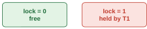
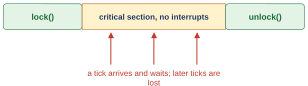
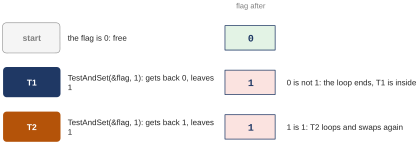
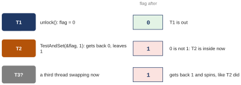
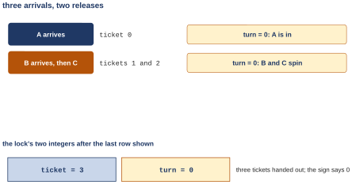
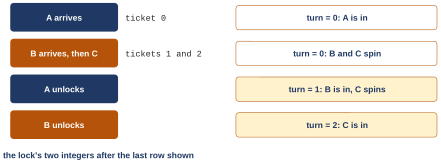
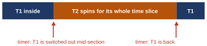

# Second class: how a lock is built: a hardware instruction and help from the OS (OSTEP 28) {#class-2}

## <span class="lbl lbl-roadmap">Roadmap</span> Where we left off: a lock that worked, and nobody knows how {#opening-2 data-toc-label="[Roadmap] Where we left off: a lock that worked, and nobody knows how"}

The first class ended with a lock that fixed the counter. Here is that class in one picture, and the one thing it did not open.

<figure markdown="1">
{width=80%}
<figcaption markdown="1">Figure 4.1. The first class in one picture. Top: one line of C is three instructions, and a timer interrupt between the add and the store lets the other thread run. Bottom: the fix, a lock around the critical section; thread 2 waits outside the locked lines until unlock.</figcaption>
</figure>

The words from the first class, so nobody has to dig for them:

| word | what it means |
|---|---|
| thread | a second program counter and stack inside the same address space |
| critical section | the few lines that touch a shared variable |
| mutual exclusion | one thread inside the critical section at a time |
| atomic | all or nothing: no in-between state that another thread can see |
| mutex | the POSIX name for a lock: `pthread_mutex_lock` and `pthread_mutex_unlock` |

In Figure 4.1, one line of C turned out to be three instructions: load the counter into a register, add 1 there, store it back. The register is private; memory is shared. A switch between the load and the store, or the other core's load in that gap, drops an add. The fix was a lock around the dangerous lines, and it gave 20,000,000 every run, in 1.30 s instead of 0.057 s.

Settled: put a lock around the dangerous lines and the race cannot happen. Left open: a lock is a variable, and `lock()` is a function, so inside it there is C code made of loads and stores, the same kind that just raced. How can such a thing be built at all? And where did the time go? The second class asks three questions:

1. What must a lock guarantee, and why does a simple flag fail? ([Chapter 4](#chapter-4))
2. What one instruction makes a working lock, and what does that lock still get wrong? ([Chapter 5](#chapter-5))
3. How does the OS stop a waiting thread from burning its whole time slice? ([Chapter 6](#chapter-6))

(A **time slice** is the stretch of CPU time a thread gets before the scheduler may switch to another. In the Linux scheduler the textbook describes, it is a few to a few dozen milliseconds. In the newest Linux it is about a millisecond or a few, depending on the number of CPUs. The scheduling part of the course showed how each sets it. Sections [6.1](#sec-6-1) and [6.6](#sec-6-6) need only that a slice is long next to a lock held for nanoseconds; the 1 ms critical sections measured later, in [Section 6.6](#sec-6-6), are about as long as a slice.)

## Chapter 4. What a lock must guarantee, and why a simple flag fails {#chapter-4}

*The question this chapter answers: what must a lock guarantee, and why does a simple flag fail?*

### 4.1 <span class="lbl lbl-problem">Problem</span> A lock is a variable, and setting it is the race again {#sec-4-1 data-toc-label="4.1 [Problem] A lock is a variable, and setting it is the race again"}

What we have is a lock as the first class used it: a variable, and two calls around the critical section. Before building one, we need to say exactly what it is and what it must do.

<figure markdown="1">
{width=40%}
<figcaption markdown="1">Figure 4.2. A lock variable has two states: free (0), or held by exactly one thread, here T1 (1).</figcaption>
</figure>

A **lock** is a variable with two states: **free**, when no thread holds it, or **held** by exactly one thread, its **owner** (Figure 4.2). `lock()` waits until the lock is free and takes it, so it returns only when the caller owns the lock. `unlock()`, called by the owner, makes the lock free again, and one waiter may take it. Only the owner may unlock; otherwise any thread could free the lock and let a second thread into a section someone else is still in.

Where it breaks: write the obvious lock in C. If the flag is 0, set it to 1 and go in.

```c
if (flag == 0)    // load flag, compare
    flag = 1;     // store 1: it is mine
// (no waiting yet; attempt 2 adds a loop that waits)
```

It does not even wait yet, and it is already wrong. Look at its shape: a load of the flag, a compare, and a store of 1. That is the counter's three instructions with a compare in the middle. Here is a trace on one CPU, the flag starting at 0:

| step | Thread 1 | Thread 2 |
|---|---|---|
| 1 | loads flag: 0 | |
| 2 | interrupt | |
| 3 | | loads flag: 0 |
| 4 | | stores 1, goes in |
| 5 | | interrupt |
| 6 | stores 1, goes in | |

Both saw 0, both stored 1, and both are inside the critical section. The lock has the very race it was built to prevent. The test (the load and the compare) and the set (the store) are two steps with a gap between them, and the other thread's test can land in that gap.

So we need, first, something a load and a store cannot give: a test and a set that nothing can separate. And we need yardsticks to judge whatever we build. There are three:

1. **Correctness.** Does it exclude: does it really keep a second thread out of the critical section?
2. **Fairness.** Does every thread that wants the lock eventually get it? The opposite is **starvation**: a thread that keeps losing and never gets in.
3. **Performance.** What does it cost? In three situations: with **no contention** (nobody else wants the lock), with **contention** (several threads want it) on one CPU, and with contention on many CPUs. These are where the costs differ. With nobody waiting, a lock costs only its own instructions; on one CPU a spinner wastes the time the holder needs; on many CPUs spinning can pay off, because the holder keeps running. [Section 6.1](#sec-6-1) reasons about them, and [Section 6.6](#sec-6-6) measures them (its no-contention case uses the mutex run of [Section 6.5](#sec-6-5)).

The textbook states the question as the crux of its chapter on locks:

**The crux: how to build a lock.** How can we build an efficient lock? Efficient locks provide mutual exclusion at low cost, and also might attain a few other properties. What hardware support is needed? What OS support?

- What this part settled: what a lock is, the three yardsticks, and why a test followed by a set is broken.
- What it leaves open: how to make the test and the set inseparable. The oldest answer comes first.

*The argument in one line:* why does the obvious lock fail? a test (load, compare), then a set (store) → a gap between them → the other thread's test lands in the gap → both see 0, both set 1.

### 4.2 <span class="lbl lbl-concept">Concept</span> Attempt 1: turn interrupts off {#sec-4-2 data-toc-label="4.2 [Concept] Attempt 1: turn interrupts off"}

On one CPU, the race needed an interrupt in the gap. The oldest answer is blunt: forbid interrupts while inside the critical section.

```c
void lock() {
    DisableInterrupts();
}
void unlock() {
    EnableInterrupts();
}
```

<figure markdown="1">
{width=55%}
<figcaption markdown="1">Figure 4.3. One CPU, the timer silenced between the two calls. Ticks that arrive during the critical section wait; later ones can be lost.</figcaption>
</figure>

This is **interrupt masking**: a privileged instruction that tells this CPU to hold interrupts back until they are turned back on. (**Privileged** means only the kernel may run it.) On one CPU (Figure 4.3), the timer keeps ticking, and the CPU holds the tick back until interrupts are on again. No interrupt, so no switch, so the three instructions run as one piece. It works, and it is simple. The kernel still turns interrupts off for its own short critical sections, because it can trust itself. But on a kernel with several CPUs that is never the whole lock. xv6's `acquire()` begins by turning interrupts off on its CPU, which keeps out only this CPU's own **interrupt handlers**, the kernel code that runs when an interrupt arrives. (They must be kept out because a handler on this CPU that wanted the same lock would keep retrying forever. That is why xv6 turns interrupts off and also checks for that case; [Section 5.3](#sec-5-3) shows how.) Then it also waits on the lock itself, which keeps out the other CPUs ([Section 5.3](#sec-5-3)).

As the general lock, it fails three ways:

1. **It requires trusting every program.** The instruction is privileged, so to make it everyone's lock, the OS would have to let every user program run it. Then a program that calls `lock()` and never unlocks, by mistake or on purpose, owns the machine: no timer, no switch, until someone restarts the computer. A general-purpose lock cannot hand every program the power to switch the OS off.
2. **It does nothing on a second CPU.** Turning interrupts off on CPU 0 says nothing to CPU 1. A thread on the other CPU walks straight into the critical section. Every machine today has several CPUs, and [Section 2.5](class-1.md#sec-2-5) showed the race needs no interrupt there.
3. **Interrupts can be lost.** If a disk finishes a read while interrupts are off, the kernel hears about it late. If a second disk interrupt arrives in the meantime, it can be lost: the hardware keeps only one pending flag per source, so a second interrupt from the same source while the first is still pending is merged into it, and the kernel sees one event where there were two. The process waiting for the lost read may then wait forever. Interrupts carry information, and silencing them for long loses it.

The verdict: used inside the kernel for short sections, never as the general lock.

- What this part settled: interrupts off works only on one CPU and only for code you trust.
- What it leaves open: a lock built from a variable that works for everyone. Back to the flag, more carefully.

*The argument in one line:* why does it work on one CPU, and only there? one CPU: no interrupt, no switch, no gap | more CPUs: turning interrupts off on mine does nothing to the others | and even on one CPU it is no lock for everyone: a user program could keep them off for good, and interrupts held back too long can be lost.

### 4.3 <span class="lbl lbl-example">Worked example</span> Attempt 2: a flag with a spin loop, and the trace that breaks it {#sec-4-3 data-toc-label="4.3 [Worked example] Attempt 2: a flag with a spin loop, and the trace that breaks it"}

Back to a variable, but written carefully this time: wait in a loop until the flag is 0, then set it to 1. This is OSTEP Figure 28.1, placed around `counter.c`. If it worked, the counter would be right. The proof that it does not takes two steps.

*The lock of `flaglock.c`, lines 1 to 15 (`W08_demos/flaglock.c`; lines 16 to 37 are `counter.c` with `lock()` and `unlock()` around the add). `void lock(void)` is a function that takes no input and returns nothing.*

```c linenums="1" hl_lines="8 10 14"
#include <stdio.h>
#include <pthread.h>

static volatile int counter = 0;   // shared by both threads
static volatile int flag = 0;      // 0: lock is free, 1: lock is held

void lock(void) {
    while (flag == 1)              // TEST the flag
        ;                          // spin-wait (do nothing)
    flag = 1;                      // now SET it
}

void unlock(void) {
    flag = 0;
}
```

- Line 8 is the **test**: loop as long as someone else holds the lock. Line 9 is the loop's empty body, so the thread just checks the flag again and again, using the CPU the whole time. Waiting like this is called **spin-waiting**, or spinning.
- Line 10 is the **set**: then take it.
- Line 14 is unlock: give it back.

The test on line 8 and the set on line 10 are two separate steps, with a gap between them, exactly like the load and the store of the counter.

**Step 1: thread 1 passes the test, then is interrupted.** The flag starts at 0.

| Thread 1 | Thread 2 |
|---|---|
| calls `lock()` | |
| `while (flag == 1)`: it is 0, falls out of the loop | |
| interrupt: switch to Thread 2 | |

Thread 1 saw a 0 and left the loop. It has not written the 1 yet. At this instant the flag still says 0, and the scheduler takes the CPU away. Nothing is wrong yet: thread 1 is one store short of owning the lock, just as thread 1 of the counter was one store short of its add.

*Step 1 in one line:* why is passing the test not the same as holding the lock? the test reads the flag → the set writes it, one instruction later → between them the flag still says free.

**Step 2: thread 2 passes too, and both set the flag.**

| Thread 1 | Thread 2 |
|---|---|
| calls `lock()` | |
| `while (flag == 1)`: it is 0, falls out of the loop | |
| interrupt: switch to Thread 2 | |
| | calls `lock()` |
| | `while (flag == 1)`: still 0, falls out of the loop |
| | `flag = 1;` goes in |
| | interrupt: switch to Thread 1 |
| `flag = 1;` goes in, too | |

Thread 2 tests the flag and sees 0, because thread 1 never wrote its 1. It leaves the loop, writes 1, and goes in. Then thread 1 resumes right after its test, writes its own 1, and goes in as well. Two threads inside the critical section. On two cores no interrupt is even needed: both can read 0 at the same moment.

The kept runs on the Ubuntu machine agree. The last line of three runs, from `W08_demos/flaglock.out`:

```text
$ ./flaglock
main: done with both (counter = 11935314)
$ ./flaglock
main: done with both (counter = 12601011)
$ ./flaglock
main: done with both (counter = 13109611)
```

All three short of 20,000,000. The lock fails twice:

1. **No mutual exclusion.** The while loop and the store are two separate steps; a switch, or the other core's load, lands between them, both threads see 0, and both go in.
2. **The waiter spins.** A thread that finds the flag at 1 checks it again, and again. On one CPU it burns its whole time slice on a value that cannot change while it runs. That is the cost of spin-waiting, and it comes back in [Chapter 6](#chapter-6).

- What this part settled: a lock made of an ordinary load and store races against itself.
- What it leaves open: an instruction that tests and sets in one step.

*The argument in one line:* why does spinning not help? spinning waits for 0 and then sets 1, as two steps → so the gap is between the test and the set → both can pass the test before either sets.

### 4.4 <span class="lbl lbl-check">Check yourself</span> What the first question of the second class settled {#sec-4-4 data-toc-label="4.4 [Check yourself] What the first question of the second class settled"}

Settled:

- A lock must exclude, should be fair, and should be cheap in three situations: no contention, contention on one CPU, contention on many.
- Interrupts off works only on one CPU and only for code you trust, so the kernel keeps it for itself.
- A flag made of a load and a store has the race itself: both threads saw 0, and the counter was still short.

Still open: the test and the set must happen as one step that no interrupt can land between and that no other core can split, and nothing written as an ordinary load followed by an ordinary store does that. The next question is which hardware instruction can.

You should now be able to show, with a two-thread trace, where the flag lock lets both threads in.

## Chapter 5. Test-and-set, spin locks and the ticket lock {#chapter-5}

*The question this chapter answers: what one instruction makes a working lock, and what does that lock still get wrong?*

### 5.1 <span class="lbl lbl-concept">Concept</span> Test-and-set: read the old value and write a 1 in one step {#sec-5-1 data-toc-label="5.1 [Concept] Test-and-set: read the old value and write a 1 in one step"}

The flag lock failed because its test and its set were two instructions with a gap. The hardware's answer is one instruction that does both. An everyday picture first: a key hangs on a hook. In one motion you take whatever hangs there and leave a note that says "taken". If you got the key, the door is yours. If you got the note, someone else has the key, so you look again.

Here is what the instruction does, written as C:

```c linenums="1"
int TestAndSet(int *old_ptr, int new) {
    int old = *old_ptr; // fetch old value at old_ptr
    *old_ptr = new;     // store 'new' into old_ptr
    return old;         // return the old value
}
```

The C reads like three steps: fetch the old value from the memory cell `old_ptr` points at, store the new value there, return the old one. But it describes one hardware instruction, **test-and-set** (also called **atomic exchange**): it writes a new value to a memory cell and returns the old value, as a single step that nothing can land in between. The C only says what it does. The instruction has a name on each processor: `xchg` (exchange) on x86, and `amoswap` (atomic memory operation: swap) on RISC-V, the processor xv6 runs on.

Here is the lock built on it, OSTEP Figure 28.3:

```c linenums="1" hl_lines="11 16"
typedef struct __lock_t {
    int flag;
} lock_t;

void init(lock_t *lock) {
    // 0: lock is available, 1: lock is held
    lock->flag = 0;
}

void lock(lock_t *lock) {
    while (TestAndSet(&lock->flag, 1) == 1)
        ; // spin-wait (do nothing)
}

void unlock(lock_t *lock) {
    lock->flag = 0;
}
```

- Lines 1 to 3 make a record type: `__lock_t` is the record's tag name, and `typedef ... lock_t` gives it the shorter name `lock_t`. In lines 10 to 13 the function is called `lock` and its parameter, a pointer to such a record, is also called `lock`; inside the function, `lock` means the parameter.
- Line 11, lock: swap a 1 into the flag (`&lock->flag` is the flag's address). If the old value was 1, someone else has the lock, so swap again.
- Line 16, unlock: store 0.

<figure markdown="1">
{width=80%}
<figcaption markdown="1">Figure 5.1. The two cases. Lock free: TestAndSet(&flag, 1) returns 0 and leaves 1 behind; 0 is not 1, so the loop ends, the thread is in, and the flag says held. Lock held: it returns 1 and writes 1 again (no change), so the thread swaps again until the owner stores 0.</figcaption>
</figure>

Figure 5.1 shows the two cases. If the lock is free, the swap hands back 0 and leaves a 1; 0 is not 1, so the loop stops, the thread goes in, and the flag now says held. If the lock is held, the swap hands back 1 and writes 1 again, which changes nothing, and the thread keeps swapping until the owner stores 0.

Why this works where the flag did not: the flag lock had its test (the `while`) and its set (`flag = 1`) in two separate steps with a gap. Here both happen inside one instruction. An interrupt lands before it or after it, never inside. And on two CPUs the hardware makes sure that of two swaps arriving at the same moment, only one goes first.

A lock whose waiters loop like this is called a **spin lock**: waiters loop on test-and-set until the flag turns 0. It is the simplest lock to build, and it burns the CPU while it waits. Keep the habit the textbook recommends: play the mean scheduler. Pretend you can interrupt anywhere, and check that no **interleaving** (no order of the two threads' steps) lets both in.

- What this part settled: one atomic instruction removes the gap between test and set.
- What it leaves open: a careful check, swap by swap, that every order lets exactly one thread in. The next part.

*The argument in one line:* why does one instruction fix it? test and set cannot be split: no gap → the first swap sees 0 and goes in → the second sees 1 and spins.

### 5.2 <span class="lbl lbl-example">Worked example</span> Two threads on a test-and-set lock, swap by swap {#sec-5-2 data-toc-label="5.2 [Worked example] Two threads on a test-and-set lock, swap by swap"}

The claim is that every order of swaps lets exactly one thread in. Here is the check, following the one memory cell both threads swap with. It takes two steps: the arrivals, then the release.

**Step 1: two swaps, and only the first gets 0.** Two threads call `lock()` on a free lock at about the same time. Each pass of their loop is a single swap.

<figure markdown="1">
{width=80%}
<figcaption markdown="1">Figure 5.2. The flag, one swap at a time. Start: the flag is 0. T1 swaps first: gets back 0, leaves 1, and is inside. T2 swaps: gets back 1, leaves 1, and loops. T2 swaps again: 1 again, for as long as T1 is inside.</figcaption>
</figure>

In Figure 5.2, the flag starts at 0, free. Thread 1 swaps first. It gets back the 0 and leaves a 1 behind. A 0 means the lock was free, so thread 1's loop ends and it goes in. Thread 2 swaps next. It gets back the 1 that thread 1 left, which means taken, so it loops. It keeps swapping and keeps getting a 1, for as long as thread 1 is inside.

On two cores the two swaps can arrive at the very same moment. Even then the memory system performs them on that cell one after the other. Whichever goes first sees the 0; nobody else can. There is no moment between reading the 0 and writing the 1, so nobody can slip in between. Chance only decides who goes first, and whoever it is, it is alone inside.

*Step 1 in one line:* why can only one thread get the 0? each swap reads and writes the flag in one step → the hardware puts two swaps to one cell in order → the first leaves a 1; every later swap reads that 1.

**Step 2: unlock stores 0, and the waiter gets in.**

<figure markdown="1">
{width=80%}
<figcaption markdown="1">Figure 5.3. T1 unlocks: the flag is 0. T2's next swap gets back 0 and leaves 1: T2 is inside now. A third thread swapping now would get back 1 and spin, as T2 did.</figcaption>
</figure>

In Figure 5.3, thread 1 leaves its critical section and unlocks, which is a plain store of 0. Thread 2 was still swapping. Its very next swap picks up that 0, puts a 1 back, and thread 2 is inside; the flag says held again. A third thread arriving now would get back a 1 and spin, the way thread 2 did a moment ago.

Notice what unlock does not do. It does not choose the next owner, and it tells nobody. It only stores 0. A waiter finds that 0 on its own next swap, which is why a waiter has to keep swapping. Suppose threads 2 and 3 had both been spinning when thread 1 unlocked: the winner would simply be whichever swap happened to land first after the store. The flag is one number; it holds no list of waiters. So the lock is correct in every order, but it is not fair, and those are different things.

*Step 2 in one line:* why does the waiter get in after unlock? unlock stores 0 → the waiter's next swap reads that 0 → and leaves a 1: the waiter now owns the lock.

- What this part settled: in every order, exactly one thread gets the 0.
- What it leaves open: nobody is served in order. That is the fairness problem of [Section 5.5](#sec-5-5). First, the real thing in xv6 and on Linux.

### 5.3 <span class="lbl lbl-kernel">Real kernel</span> xv6's acquire() and release() {#sec-5-3 data-toc-label="5.3 [Real kernel] xv6's acquire() and release()"}

The test-and-set loop is not a textbook toy. It is the lock every CPU in xv6 takes before it touches the free list of [Section 2.7](class-1.md#sec-2-7) or a process entry in the scheduler. But a real kernel needs more than the loop: its lock is taken by interrupt handlers ([Section 4.2](#sec-4-2)) and by every CPU QEMU gives it at once (3 unless you say otherwise; [Section 2.7](class-1.md#sec-2-7)). Each extra line in xv6's lock is there for a reason, and the order of the lines matters. This part reads `acquire()` in the order it runs, then `release()`.

*`acquire()`, from `W08_demos/xv6_excerpts/spinlock.c_19-72.c` (`kernel/spinlock.c` lines 21 to 43).*

```c linenums="21" hl_lines="4 5 6 12 13 19 22"
void
acquire(struct spinlock *lk)
{
  push_off(); // disable interrupts to avoid deadlock.
  if(holding(lk))
    panic("acquire");

  // On RISC-V, sync_lock_test_and_set turns into an atomic swap:
  //   a5 = 1
  //   s1 = &lk->locked
  //   amoswap.w.aq a5, a5, (s1)
  while(__sync_lock_test_and_set(&lk->locked, 1) != 0)
    ;

  // Tell the C compiler and the processor to not move loads or stores
  // past this point, to ensure that the critical section's memory
  // references happen strictly after the lock is acquired.
  // On RISC-V, this emits a fence instruction.
  __sync_synchronize();

  // Record info about lock acquisition for holding() and debugging.
  lk->cpu = mycpu();
}
```

The story first: `acquire` turns interrupts off, checks that this CPU does not already hold the lock, spins on an atomic swap until it wins, puts up a fence, and writes down which CPU owns the lock. Line by line:

- Line 24, `push_off()`: first, interrupts off on this CPU. The reason: suppose this CPU holds the lock and an interrupt arrives, and the interrupt's handler (the kernel code that runs for that interrupt) wants the same lock. The handler would spin forever on a lock that its own CPU holds and can never release, because the holder cannot run until the handler finishes. That is a **deadlock**: nobody can move because everyone is waiting for someone who is also waiting. (xv6's check on lines 25 and 26 would catch this case and stop with a panic rather than spin forever. Turning interrupts off first means the handler cannot run on this CPU at all until the lock is released.)
- Lines 25 and 26: a check. Taking a lock this CPU already holds is a bug, and `panic` (stop the kernel with a message) is easier to find than a hang.
- Lines 32 and 33: the spin lock of Figure 28.3. `__sync_lock_test_and_set` is the C compiler's name for test-and-set: it writes 1 into `lk->locked` and returns the old value, in one step; the loop repeats while the old value is not 0 (`!=` means "is not equal to").
- Line 39, `__sync_synchronize()`: a **fence**, an instruction that stops the compiler and the CPU from moving memory loads and stores across it. Compilers and processors are allowed to reorder memory operations to go faster, as long as one thread alone cannot tell. Another CPU can tell. For example, if a load of the free list's head were moved ahead of the swap that takes the lock, this CPU could read the head while another CPU still held the lock and was changing it. The fence keeps everything the critical section does after the moment the lock was taken.
- Line 42: last, the owner's name. `mycpu()` is this CPU's own record; it is used by the check on line 25 and for debugging.

Two captures follow, one for each function, with their readings. In short, `acquire()` compiled to an `amoswap.w.aq` loop followed by a fence, and `release()` to two fences and one plain store, `sw`. If that is enough for you, skip each capture and the paragraphs that read it.

Here is what the compiler made of lines 32 and 33 for RISC-V, from `W08_demos/xv6_acquire_objdump.out`. The tool is objdump again, in the version for RISC-V programs, `riscv64-linux-gnu-objdump`, since the Ubuntu machine's own objdump reads only x86 code. It is run on `kernel/kernel`, the compiled xv6 kernel that `make` builds ([Section 2.7](class-1.md#sec-2-7)), and `grep -A18` keeps the line that names `acquire` and the 18 lines after it.

```text
$ riscv64-linux-gnu-objdump -d kernel/kernel | grep -A18 "<acquire>:"
000000008000586a <acquire>:
    80005876:	fb5ff0ef          	jal	8000582a <push_off>
    8000587c:	f85ff0ef          	jal	80005800 <holding>
    80005880:	4705                	li	a4,1
    80005884:	87ba                	mv	a5,a4
    80005886:	0cf4a7af          	amoswap.w.aq	a5,a5,(s1)
    8000588a:	2781                	sext.w	a5,a5
    8000588c:	ffe5                	bnez	a5,80005884 <acquire+0x1a>
    8000588e:	0330000f          	fence	rw,rw
    80005892:	cccfb0ef          	jal	80000d5e <mycpu>
```

(Trimmed to the lines that matter.) `jal` calls a function: first `push_off`, then `holding`. `li a4,1` puts a 1 in register `a4`, once, before the loop. Then comes the loop of four instructions.

- `mv a5,a4` copies that 1 into register `a5`.
- `amoswap.w.aq a5,a5,(s1)` swaps it with the **lock word** (the integer `lk->locked`: 0 when free, 1 when held) at the address in register `s1`, so `a5` now holds the old value. The `.w` means a 32-bit word. The `.aq` asks for acquire ordering: no later load or store may move ahead of the swap.
- `sext.w` copies that 32-bit value into the whole 64-bit register.
- `bnez a5,80005884` jumps back to the `mv` if the old value was not 0.

One atomic swap in a short loop. Then `fence rw,rw`, the fence of line 39, and the call to `mycpu`.

The `.aq` and the fence overlap: both keep the critical section's loads and stores after the swap. The `.aq` comes with `__sync_lock_test_and_set`. The fence comes from the `__sync_synchronize()` call that xv6 writes out, a portable call that the compiler turns into a fence on any processor. So on RISC-V the same guarantee is given twice; the second costs a little and makes the code correct whatever the first one does.

The order is not an accident. Interrupts go off before the lock is taken, so no handler can ever arrive on this CPU while it holds the lock. The fence comes after the swap, so nothing in the critical section leaks out ahead of it.

*Acquire in one line:* why does each line come where it does? interrupts off first, so a handler on this CPU cannot want the lock we hold → the swap loop, so only one CPU gets the 0 → the fence, so the section's loads and stores stay after the lock.

Unlocking has to undo all of this without letting the critical section's work slip past it: the same care, in reverse order.

*`release()`, `kernel/spinlock.c` lines 46 to 72, from the same excerpt file.*

```c linenums="46" hl_lines="4 5 7 15 24 26"
void
release(struct spinlock *lk)
{
  if(!holding(lk))
    panic("release");

  lk->cpu = 0;

  // Tell the C compiler and the CPU to not move loads or stores
  // past this point, to ensure that all the stores in the critical
  // section are visible to other CPUs before the lock is released,
  // and that loads in the critical section occur strictly before
  // the lock is released.
  // On RISC-V, this emits a fence instruction.
  __sync_synchronize();

  // Release the lock, equivalent to lk->locked = 0.
  // This code doesn't use a C assignment, since the C standard
  // implies that an assignment might be implemented with
  // multiple store instructions.
  // On RISC-V, sync_lock_release turns into an atomic swap:
  //   s1 = &lk->locked
  //   amoswap.w zero, zero, (s1)
  __sync_lock_release(&lk->locked);

  pop_off();
}
```

- Lines 49 and 50: a check. Releasing a lock this CPU does not hold is a bug, so panic (`!` means "not").
- Line 52: forget the owner.
- Line 60: a fence. This time it comes before the unlock: every store the critical section made must be finished before another CPU can see the lock as free. Another CPU may take the lock the moment it sees a 0, and by then it must also see everything the section wrote.
- Line 69: the unlock itself, a store of 0 into the lock word.
- Line 71, `pop_off()`: the undo of `push_off`. `push_off` and `pop_off` keep a count of how many locks this CPU holds. It is a count because one CPU can hold several locks at once, and interrupts must stay off until it holds none. At the first lock, `push_off` also remembers whether interrupts were on before. When the count is back to zero, once this CPU holds no lock at all, `pop_off` puts interrupts back the way they were: on if they were on, still off if they were already off.

And what the compiler made of it, from `W08_demos/xv6_release_objdump.out`:

```text
$ riscv64-linux-gnu-objdump -d kernel/kernel | grep -A16 "<release>:"
0000000080005902 <release>:
    8000590e:	ef3ff0ef          	jal	80005800 <holding>
    80005914:	0004b823          	sd	zero,16(s1)
    80005918:	0330000f          	fence	rw,rw
    8000591c:	0310000f          	fence	rw,w
    80005920:	0004a023          	sw	zero,0(s1)
    80005924:	f8bff0ef          	jal	800058ae <pop_off>
```

(Trimmed.) `sd zero,16(s1)` is line 52, storing 0 into `lk->cpu`. (`zero` is a RISC-V register that always holds 0, so storing it stores 0.) `16(s1)` means the address in `s1` plus 16, and `cpu` is the field 16 bytes into the lock's record. The record is `struct spinlock` in `kernel/spinlock.h`, with three fields in this order:

| field | type | size | starts at byte |
|---|---|---|---|
| `locked` | `uint`, a whole number | 4 bytes | 0 |
| (padding) | unused | 4 bytes | 4 |
| `name` | `char *`, a pointer | 8 bytes | 8 |
| `cpu` | `struct cpu *`, a pointer | 8 bytes | 16 |

A pointer takes 8 bytes because xv6 runs on 64-bit RISC-V, where an address is 64 bits, which is 8 bytes. The padding is there because the compiler starts each 8-byte pointer at a byte number that is a multiple of 8. `fence rw,rw` is line 60. Then line 69 became two instructions. `fence rw,w` makes every earlier load and store (r, w) finish before any later store (w). `sw zero,0(s1)` is one plain store of 0 into the lock word, at offset 0. Then comes the call to `pop_off`. Look at the comment on lines 66 to 68: it says the release turns into an atomic swap. The compiled code says a fence and a store. When a comment and the machine code disagree, believe the machine code: it is what runs. (A plain store is enough here for two reasons. First, it is one **aligned** store instruction, `sw`: the 4-byte word starts at an address that is a multiple of 4, so it is written in one piece. A waiting CPU swapping its 1 into the lock word at that very moment sees either the old 1 or the new 0, never half of each. Second, the fence before it keeps the critical section's writes ahead of it.)

*Release in one line:* why the fence before the unlock this time? another CPU may take the lock the moment it sees it free → so it must already see every store the section made → so: fence first, then the store of 0.

The loop on line 32 is the whole spin lock of Figure 28.3. Everything else is three kinds of care that a real kernel needs because interrupt handlers and several CPUs all use the same lock. The three are interrupts off, fences around the critical section, and a record of the owner. In the compiled code, `acquire()` has the swap with `.aq` followed by xv6's own `fence rw,rw` (line 39). `release()` has xv6's own `fence rw,rw` (line 60), then the `fence rw,w` that gcc puts inside `__sync_lock_release`, then the plain `sw` of 0.

- What this part settled: xv6's lock is the test-and-set loop plus interrupts off, fences and an owner field, in a deliberate order.
- What it leaves open: the same kind of lock in an ordinary program on the Ubuntu machine, measured.

### 5.4 <span class="lbl lbl-machine">Real machine</span> A spin lock from one xchg makes 20,000,000 every run {#sec-5-4 data-toc-label="5.4 [Real machine] A spin lock from one xchg makes 20,000,000 every run"}

The same test as the flag lock of [Section 4.3](#sec-4-3): same counter, same two threads, but now the test and the set are one instruction. Here are three runs, and the instruction the compiler emitted.

*The lock of `taslock.c`, lines 1 to 15 (`W08_demos/taslock.c`; lines 16 to 37 are `counter.c` with `lock()` and `unlock()` around the add).*

```c linenums="1" hl_lines="9 14"
#include <stdio.h>
#include <pthread.h>

static volatile int counter = 0;   // shared by both threads
static volatile int flag = 0;             // 0: lock is free, 1: lock is held

void lock(void) {
    // test-and-set: write 1, get the old value back, in ONE instruction
    while (__sync_lock_test_and_set(&flag, 1) == 1)
        ;                          // spin-wait (do nothing)
}

void unlock(void) {
    __sync_lock_release(&flag);    // store 0
}
```

- Line 9: `__sync_lock_test_and_set(&flag, 1)` is the compiler's built-in test-and-set, the same one xv6 uses; the loop repeats while the old value was 1.
- Line 14: `__sync_lock_release` stores 0.

The last line of three runs, from `W08_demos/taslock.out` (the capture keeps the program's output only):

```text
$ ./taslock
main: done with both (counter = 20000000)
$ ./taslock
main: done with both (counter = 20000000)
$ ./taslock
main: done with both (counter = 20000000)
```

The exact total, every time. And here is `lock()`, disassembled, from `W08_demos/taslock_objdump.out`:

```text
$ objdump -d -S taslock | grep -A8 '__sync_lock_test_and_set'
    while (__sync_lock_test_and_set(&flag, 1) == 1)
    11b1:	90                   	nop
    11b2:	b8 01 00 00 00       	mov    $0x1,%eax
    11b7:	87 05 5b 2e 00 00    	xchg   %eax,0x2e5b(%rip)        # 4018 <flag>
    11bd:	83 f8 01             	cmp    $0x1,%eax
    11c0:	74 f0                	je     11b2 <lock+0x9>
        ;                          // spin-wait (do nothing)
}
    11c2:	90                   	nop
```

`mov $0x1,%eax` puts the new value 1 in the register `eax`. `xchg %eax,0x2e5b(%rip)` swaps `eax` with the flag in memory, in one instruction, so `eax` now holds whatever the flag was. (The address checks out the same way as in [Section 2.3](class-1.md#sec-2-3). The next instruction is at `0x11bd` = 1 × 4,096 + 1 × 256 + 11 × 16 + 13 = 4,541, and the offset is `0x2e5b` = 2 × 4,096 + 14 × 256 + 5 × 16 + 11 = 11,867. The sum is 4,541 + 11,867 = 16,408 = 4 × 4,096 + 1 × 16 + 8 = `0x4018`, the address objdump names `flag`.) `cmp $0x1,%eax` compares the old value with 1, and `je 11b2` jumps back to the `mov` if they were equal. (`nop` does nothing.) On x86 an `xchg` with a memory cell is atomic by itself: a rule of x86 is that the CPU treats an `xchg` with memory as if it carried the lock prefix of [Section 2.6](class-1.md#sec-2-6).

Why believe three runs? Three right totals could be luck. Luck can hide a bug but not create one: the flag lock's wrong totals proved it broken, while three right totals prove nothing by themselves. The compiled loop shows that there is nothing to split: the test and the set are one `xchg`. The runs agree with it.

Between the flag lock and this one, two things changed. The lock's test and set became one `xchg` in place of a load and a store. And the unlock became `__sync_lock_release`. The compiler's manual calls it a release: a store of 0 that no earlier load or store of the critical section may pass. On x86 an ordinary store already keeps that order, so the compiler makes it a plain store. The disassembly of `unlock()` shows `mov $0x0,%eax` and then `mov %eax,0x2e3f(%rip)`, a store of 0 into `flag` (`W08_demos/taslock_unlock_objdump.out`). The flag lock's `flag = 0` compiled to one plain store as well (`W08_demos/flaglock_unlock_objdump.out`). So the source changed, but the machine code is still a plain store of 0. xv6's compiled lock has a fence after the swap in `acquire()` and two before the store in `release()`. Why does this lock need none? Two orders matter, one at each end of the critical section.

- **Taking the lock.** On x86 an `xchg` with memory is also a full fence: no load or store moves across it, so nothing in the section can run ahead of the moment the lock was taken.
- **Releasing it.** The unlock is a plain store; the steps below show why that is enough.

Why a plain store is enough to unlock on x86:

1. The unlock is a store. What must not happen is that a load or store from inside the section moves past it, to after the unlock, because it would then run while another thread may already hold the lock.
2. x86 never lets a store move ahead of earlier loads or stores. So nothing from inside the section can slip past the unlock, and when another core sees the 0, it also sees everything the section wrote.
3. The one reordering x86 allows is a later load moving ahead of an earlier store to a different address. For the unlock, that would be a load from after the unlock moving up into the section. That is harmless: the load just reads a little early, while the lock is still held.

So on x86 a plain store is a correct unlock. Two lines on two cores show what step 2 buys:

| | core 0 (the holder) | core 1 (a waiter) |
|---|---|---|
| 1 | stores `counter` = 51 (the section), then stores `flag` = 0 (the unlock) | |
| 2 | | its `xchg` sees `flag` = 0 and takes the lock; its load of `counter` sees 51, never the old 50 |

[Extra 5](#extra-5) shows a lock that the reordering of step 3 does break. RISC-V, the processor xv6 runs on, keeps fewer orders on its own, so xv6 asks for them. The `.aq` on its swap and the fence after it both give the acquire order ([Section 5.3](#sec-5-3)), and the fences in `release()` give the release order. A correct lock needs both things. The atomic instruction makes sure only one thread gets the lock, and the ordering makes sure the section's work stays inside it ([Section 5.3](#sec-5-3) shows how a lock fails without it). On x86 the `xchg` and x86's store order give both; on RISC-V, xv6 adds fences. What we still do not have is fairness, and the waiter still spins.

- What this part settled: the first yardstick, correctness, is passed by a lock built on one atomic instruction.
- What it leaves open: the second yardstick, fairness.

*The argument in one line:* why believe three runs? three right runs could be luck | the lock is one xchg: no gap between test and set | the unlock is one store, and x86 keeps it after the section's work → the reasoning shows the lock correct; the runs agree with it.

### 5.5 <span class="lbl lbl-problem">Problem</span> The spin lock is correct but unfair {#sec-5-5 data-toc-label="5.5 [Problem] The spin lock is correct but unfair"}

What we have: a spin lock built on test-and-set. It passes the first yardstick, mutual exclusion; two threads fighting for the counter on 2 cores got 20,000,000 every run. Now the second yardstick. When three threads want the lock, who gets it next?

<figure markdown="1">
{width=45%}
<figcaption markdown="1">Figure 5.4. A spin lock with three threads: A holds the lock, B and C spin.</figcaption>
</figure>

Where it breaks: three threads on three CPUs, round after round. A holds the lock, and B and C spin (Figure 5.4). A releases. B's swap and C's swap both go for the 0, and whichever lands first wins.

| round | A | B | C |
|---|---|---|---|
| 1 | holds | spins | spins |
| 2 | spins | holds | spins |
| 3 | holds | spins | spins |
| 4 | spins | holds | spins |
| ... | | | C still spinning |

In round 2, B wins. B releases, and A, back for more, swaps first and wins round 3. Round after round, C loses. Nothing in the lock remembers who has waited longest, so C can lose every single round while A and B pass the lock back and forth. In principle forever: the lock makes no promise about order. That is **starvation**, the failure of the second yardstick.

So we need a lock that hands out turns in the order threads arrived, so that once a thread has asked, the number of threads ahead of it can only go down. The shape is two numbers: a number you take when you arrive, and a number that says whose turn it is now. A bakery counter has solved this for a century: you pull a numbered ticket and watch the "now serving" sign.

- What this part settled: a test-and-set lock is correct and unfair.
- What it leaves open: the bakery in two integers. The next part.

*The argument in one line:* why unfair? the lock remembers nothing → whoever swaps first after a release wins → a slow or unlucky thread can lose every round.

### 5.6 <span class="lbl lbl-concept">Concept</span> Fetch-and-add and the ticket lock {#sec-5-6 data-toc-label="5.6 [Concept] Fetch-and-add and the ticket lock"}

The bakery needs a ticket dispenser that never gives two people the same number. In memory, that is one more atomic instruction. **Fetch-and-add** adds 1 to a memory cell and returns the old value, as a single step:

```c linenums="1"
int FetchAndAdd(int *ptr) {
    int old = *ptr;
    *ptr = old + 1;
    return old;
}
```

Every pull gives a fresh number, and no two pulls can give the same one, because the read and the write happen as one step with no gap for a second thread to read the same value. The lock built on it keeps two numbers: `ticket`, the next number to hand out, and `turn`, the number being served. This is the **ticket lock**, OSTEP Figure 28.7:

```c linenums="1" hl_lines="12 13 18"
typedef struct __lock_t {
    int ticket;
    int turn;
} lock_t;

void lock_init(lock_t *lock) {
    lock->ticket = 0;
    lock->turn   = 0;
}

void lock(lock_t *lock) {
    int myturn = FetchAndAdd(&lock->ticket);
    while (lock->turn != myturn)
        ; // spin
 }

void unlock(lock_t *lock) {
    lock->turn = lock->turn + 1;
}
```

- Line 12: take a ticket with fetch-and-add: you get the old value, and the dispenser moves on, in one step.
- Line 13: wait until the sign, `turn`, shows your number.
- Line 18: unlock calls the next number by moving the sign on by 1. This is a plain load, add and store, but it is safe: only the owner of the lock ever writes `turn`.

**Step 1: three threads arrive and take numbers.**

<figure markdown="1">
{width=75%}
<figcaption markdown="1">Figure 5.5. Three arrivals. A arrives and takes ticket 0; the sign says 0, so A is in. B and C arrive and take tickets 1 and 2; the sign still says 0, so they spin. The lock's two integers: ticket = 3, turn = 0.</figcaption>
</figure>

In Figure 5.5, A arrives first and pulls ticket 0. The sign says 0, so A walks in. B and C arrive about the same time and pull 1 and 2. The sign still says 0, so both wait, each watching for its own number. After three arrivals the dispenser stands at 3 and the sign at 0. Three threads got three different numbers, in arrival order, and C already knows the most it can wait: C holds ticket 2, so at most 2 threads can be served before C, whatever the timing.

*Step 1 in one line:* why can two threads never get the same ticket? fetch-and-add reads and bumps the counter in one step → no gap for a second thread to read the same value → each arrival gets its own number.

**Step 2: each unlock calls the next number.**

<figure markdown="1">
{width=75%}
<figcaption markdown="1">Figure 5.6. Two releases. A unlocks: turn = 1, B is in, C spins. B unlocks: turn = 2, C is in. The lock's two integers: ticket = 3, turn = 2.</figcaption>
</figure>

Unlock does not set anything free (Figure 5.6). It moves the sign on by 1, and only the thread whose number comes up can go in. A unlocks: the sign says 1, so B goes in and C keeps waiting. B unlocks: the sign says 2, and now it is C's turn. The dispenser has not moved; the sign has moved on twice.

Every ticket holder gets in after a bounded number of turns, because the sign only ever counts up by 1. That is the fairness the plain spin lock lacked, bought for one more integer. What it does not settle: it is still a spin lock. A waiter watches the sign in a loop. The third yardstick, cost, is still open.

*Step 2 in one line:* why fair now? fetch-and-add hands out tickets in arrival order → the sign calls numbers in order → with ticket 2, at most 2 are served before you.

- What this part settled: the ticket lock is correct and fair.
- What it leaves open: every waiter still spins.

### 5.7 <span class="lbl lbl-check">Check yourself</span> What the second question of the second class settled {#sec-5-7 data-toc-label="5.7 [Check yourself] What the second question of the second class settled"}

Settled:

- One atomic instruction is enough to build a lock that excludes: test-and-set swaps a 1 in and hands back the old value in one uninterruptible step.
- xv6's `acquire()` is exactly that loop (an `amoswap.w.aq`), with interrupts off first, xv6's `fence rw,rw` after the swap, and a record of the owner; `release()` has two fences before its plain store of 0, xv6's own `fence rw,rw` and the `fence rw,w` that gcc adds.
- `taslock.c` on the Ubuntu machine compiled it to one `xchg` and gave 20,000,000 every run.
- Fetch-and-add makes a ticket lock, which is fair.

Still open: every waiter is still spinning. On one CPU, a thread spinning for a lock is waiting for a thread that cannot run while it spins. The third yardstick, cost, is the last question.

You should now be able to say in two sentences why test-and-set succeeds where a plain load and store failed. One sentence is for one CPU: where interrupts land (between instructions, never inside one). The other is for two CPUs: what the hardware does with two swaps to one address (it performs them one after the other).

## Chapter 6. Sleeping instead of spinning: help from the OS {#chapter-6}

*The question this chapter answers: how does the OS stop a waiting thread from burning its whole time slice?*

### 6.1 <span class="lbl lbl-problem">Problem</span> On one CPU, a spinner waits for a thread that cannot run {#sec-6-1 data-toc-label="6.1 [Problem] On one CPU, a spinner waits for a thread that cannot run"}

What we have: a correct spin lock, test-and-set or ticket. A waiter checks the lock in a loop until it is its turn. On two CPUs that is fine. The holder is running on the other CPU, the critical section is short, and the flag turns 0 soon; the waiter loses only as long as the section lasts. For a section of a few dozen instructions that is well under a microsecond, since a core runs on the order of a billion simple instructions a second.

<figure markdown="1">
{width=60%}
<figcaption markdown="1">Figure 6.1. One CPU, two threads. T1 is switched out by the timer in the middle of its critical section; T2 runs and spins for its whole time slice; only the next timer interrupt brings T1 back.</figcaption>
</figure>

Where it breaks: one CPU, two threads (Figure 6.1). Thread 1 holds the lock and is interrupted in the middle of its critical section. Thread 2 runs, finds the lock taken, and spins. For its entire time slice. The flag cannot change, because the only thread that could change it is not running. Only the next timer interrupt lets thread 1 back in to finish and release. A whole time slice is wasted on checking a value that will not move. With N threads it gets worse: N − 1 time slices can be burned this way for one release, one per waiting thread.

The hardware cannot fix this. It has no idea that the spinner should stop. Only the OS can take the CPU away from a thread and give it back later. So we need the OS: a way for a waiter to go to sleep instead of spinning, and a way for the thread that unlocks to wake one waiter up. The textbook's crux:

**The crux: how to avoid spinning.** How can we develop a lock that doesn't needlessly waste time spinning on the CPU?

- What this part settled: on one CPU, spinning wastes whole slices, and only the OS can fix it.
- What it leaves open: what the OS should offer. The simplest offer first.

*The argument in one line:* why N − 1 wasted slices? the holder is off the CPU → the flag cannot move until it runs → every other thread spins out a whole slice first.

### 6.2 <span class="lbl lbl-concept">Concept</span> Attempt 3: yield the CPU instead of spinning {#sec-6-2 data-toc-label="6.2 [Concept] Attempt 3: yield the CPU instead of spinning"}

The simplest thing a waiter can do is step aside: give up the CPU right away, instead of spinning until the timer takes it away. This is OSTEP Figure 28.8, the test-and-set lock with one change:

```c linenums="1" hl_lines="7"
void init() {
    flag = 0;
}

void lock() {
    while (TestAndSet(&flag, 1) == 1)
        yield(); // give up the CPU
}

void unlock() {
    flag = 0;
}
```

Line 7: if the lock is taken, call `yield()` instead of looping empty.

<figure markdown="1">
{width=65%}
<figcaption markdown="1">Figure 6.2. The three states of a thread, and what yield does: it moves the caller from running back to ready, and the scheduler runs someone else; later it is scheduled again.</figcaption>
</figure>

A thread is always in one of three states (Figure 6.2). **Running**: on a CPU right now. **Ready**: could run, waiting for a CPU. **Blocked**: waiting for some event, such as a disk read, and not runnable at all. **yield** is a system call (a request a program makes to the kernel) that moves the caller from running back to ready, so the scheduler can pick somebody else.

Where it works: two threads on one CPU. The waiter yields, the holder runs at once, finishes its section and releases. No slice is wasted.

Where it fails, twice:

1. **Run-and-yield, 99 times.** Take 100 threads, with the holder interrupted inside its section. Each of the other 99 gets scheduled, finds the lock held, and yields. That is 99 context switches before the holder runs again. Better than 99 wasted slices, but a context switch is not free, and the waiter still has no idea when to try again.
2. **Still unfair.** A thread can yield, get scheduled, find the lock held again, and yield again, forever, while others keep entering and leaving. Starvation is back.

The waiter should not have to guess when to try again. Someone should tell it.

- What this part settled: yielding saves the slice on one CPU with two threads, and nothing more.
- What it leaves open: a waiter that sleeps until it is told, and a lock that remembers who is waiting.

*The argument in one line:* why is yield still not enough? 99 waiters → each runs, looks, yields: 99 context switches per release, none free | yield remembers nobody: a thread can yield forever.

### 6.3 <span class="lbl lbl-concept">Concept</span> A queue of sleeping waiters: park, unpark and the guard {#sec-6-3 data-toc-label="6.3 [Concept] A queue of sleeping waiters: park, unpark and the guard"}

The waiter should sleep, write its name on a list, and let the thread that unlocks wake the first name on the list. That needs two OS calls and a queue. The calls come from Solaris, an operating system of the Unix family. (Unix is the operating system from the 1970s whose design Linux and macOS follow.) **park()** puts the calling thread to sleep: it becomes blocked and uses no CPU. **unpark(id)** wakes the one thread with that id. This is OSTEP Figure 28.9. Besides a flag and a queue, its lock has a **guard**, a small spin lock that keeps two threads from changing the flag and the queue at the same moment. The part that matters is `lock()` and `unlock()`:

```c linenums="1" hl_lines="14 16 17 20 21 22 27 29 30 32"
typedef struct __lock_t {
    int flag;
    int guard;
    queue_t *q;
} lock_t;

void lock_init(lock_t *m) {
    m->flag = 0;
    m->guard = 0;
    queue_init(m->q);
}

void lock(lock_t *m) {
    while (TestAndSet(&m->guard, 1) == 1)
        ; //acquire guard lock by spinning
    if (m->flag == 0) {
        m->flag = 1; // lock is acquired
        m->guard = 0;
    } else {
        queue_add(m->q, gettid());
        m->guard = 0;
        park();
    }
}

void unlock(lock_t *m) {
    while (TestAndSet(&m->guard, 1) == 1)
          ; //acquire guard lock by spinning
    if (queue_empty(m->q))
          m->flag = 0; // let go of lock; no one wants it
    else
          unpark(queue_remove(m->q)); // hold lock
                                            // (for next thread!)
    m->guard = 0;
}
```

The story first. The lock has a flag (held or free), a queue of sleeping threads, and the guard. The guard is held only during the few instructions of `lock()` and `unlock()` that read and change the flag and the queue. The paragraph after Figure 6.3, in Step 1, shows what goes wrong without it. To lock: take the guard, look at the flag. Free: take the lock. Taken: write your name on the queue and go to sleep. To unlock: take the guard; if the queue is empty, clear the flag; otherwise wake the first sleeper and pass the lock to it.

**Step 1: the waiter queues itself and parks.** T1 holds the lock, and T2 arrives.

- Line 14: T2 first takes the guard, a mini spin lock that covers nothing but the flag and the queue, for a handful of instructions.
- Line 16: it looks at the flag. The flag is 1: taken.
- Line 20: so T2 writes its own thread id on the queue. A **thread id** is the number the OS gives each thread to name it, as each process has a **process id**, the number that names it; `gettid()` is the call that returns the calling thread's id.
- Line 21: it lets go of the guard.
- Line 22: it calls `park()`. The OS marks T2 blocked and runs someone else; T2 uses no CPU until someone unparks it.

<figure markdown="1">
{width=55%}
<figcaption markdown="1">Figure 6.3. After step 1: the lock is held by T1, the guard is free, and T2 sleeps on the queue of waiting threads.</figcaption>
</figure>

Figure 6.3 shows the result. Here is what the guard is for. The flag and the queue must be read and changed as one unit. Picture a thread arriving while the owner holds the lock. It looks at the flag, sees 1, and decides to join the queue. Before it has joined, the owner unlocks: it looks at the queue, finds it empty, and sets the flag to 0. Now the arriving thread, still acting on the 1 it saw, adds itself to the queue and goes to sleep. Nobody is coming to wake it: the owner already decided there was no one to wake. (A later thread that takes and releases the lock might wake it, by luck.) A wake-up that a sleeping thread needs and never gets is called a **lost wake-up**. [Section 6.4](#sec-6-4) meets a second way to lose one. The guard makes the flag and the queue change together: while the arriving thread holds it, from looking at the flag to joining the queue, the owner cannot get in to look at the queue. That is also why the lock does not simply use test-and-set on the flag and skip the guard. Looking at the flag and joining the queue would then be two separate steps, with exactly this gap between them. The guard is held only for those few instructions inside `lock()` and `unlock()`, never while the user's critical section runs. Spinning still exists, but only on the guard, and only for a few instructions.

*Step 1 in one line:* why a guard? a thread can see flag = 1 and decide to queue, the owner then finds the queue empty and frees the lock, and the thread queues and sleeps: nobody is coming to wake it (a lost wake-up) → so the flag and the queue must change as one → so a guard, held for a few instructions, never for the section.

**Step 2: unlock hands the lock over.** First, one more arrival. T3 comes while T1 still holds the lock and does what T2 did in step 1: it takes the guard, sees the flag at 1, adds itself to the queue, lets go of the guard and parks. So when T1 finishes its section, T2 and T3 are both asleep on the queue, T2 first.

- Lines 27 and 29: T1 takes the guard (line 27) and looks at the queue (line 29). It is not empty.
- Line 32: so T1 removes the first name, T2, and unparks it. Notice what `unlock()` skips: it does not clear the flag.
- Line 34: T1 lets go of the guard (`m->guard = 0`).

<figure markdown="1">
{width=55%}
<figcaption markdown="1">Figure 6.4. After T1 unlocks: the flag is still 1, now held by T2; T3 still sleeps on the queue.</figcaption>
</figure>

The flag stays 1, and T2 is woken (Figure 6.4). When T2 wakes up, it continues from its call to `park()`, already owning the lock. The lock goes straight from T1 to T2. There is no moment when a third thread could grab it, and the queue fixes the order, so the lock is fair. T3 stays asleep until T2 unlocks. If the queue is empty (line 29), unlock simply stores 0 (line 30), and the next arrival takes the lock with no sleeping at all. The queue is only used when somebody actually had to wait.

*Step 2 in one line:* why does flag stay 1 at unlock? a waiter is asleep with its name on the queue → wake it and leave the flag at 1 → the lock passes straight to it: nobody can slip in, and the order is the queue's.

- What this part settled: waiters sleep instead of spinning, and the lock passes to them in queue order.
- What it leaves open: one trap, in the few instructions between writing the name down and falling asleep.

### 6.4 <span class="lbl lbl-example">Worked example</span> The lost wake-up, and setpark() {#sec-6-4 data-toc-label="6.4 [Worked example] The lost wake-up, and setpark()"}

One trap remains. Look again at lines 20 to 22 of `lock()`: T2 writes its name on the queue, lets go of the guard, and then calls `park()`. Between letting go of the guard and calling `park()`, T2 is still awake. Now change the timing: suppose T1 unlocks exactly in that gap (Figure 6.5).

<figure markdown="1">
{width=55%}
<figcaption markdown="1">Figure 6.5. T2 is on the queue and has released the guard, but has not reached park() yet: it is still awake. T1 unlocks right now.</figcaption>
</figure>

T1 takes the guard, finds T2 on the queue, removes it and unparks it. But T2 is not asleep, so the unpark does nothing. Then T2 reaches `park()` and sleeps, and no wake-up is ever coming. The lock is T2's, and T2 is asleep forever. This is called the **wakeup/waiting race**: a wake-up that arrives before the sleep it was meant for is lost.

Can the guard close this gap? No. `park()` has to be called with the guard released: a sleeper that kept the guard would leave every other thread, the owner included, spinning on it forever.

The fix, from Solaris, is one more call. **setpark()** says "I am about to park". If an unpark arrives after `setpark()` and before `park()`, the `park()` that follows returns at once instead of sleeping. The change to `lock()` is small:

```c
queue_add(m->q, gettid());
setpark();        // new code: "I am about to park"
m->guard = 0;
park();           // returns at once if unpark came first
```

Now the unpark that lands in the gap is remembered, and T2 wakes immediately, owning the lock.

- What this part settled: the gap before `park()` can lose a wake-up, and `setpark()` closes it.
- What it leaves open: how a real system, Linux, builds the same lock.

*The argument in one line:* why can a wake-up be lost? the waiter must release the guard before it parks → between the release and park() it is still awake → an unpark in that gap does nothing; setpark() makes the later park() return at once.

### 6.5 <span class="lbl lbl-machine">Real machine</span> Linux: one lock word, and the futex {#sec-6-5 data-toc-label="6.5 [Real machine] Linux: one lock word, and the futex"}

**glibc**, the C library on Linux (the library that provides `printf` and also the pthread functions), builds its mutex on the same idea: a waiter sleeps on a kernel queue instead of spinning. That mutex is the lock the first class used in `counter_mutex.c`. It is built on a kernel service called the **futex**, short for "fast userspace mutex", which is Linux's version of park and unpark. **User space** is everything outside the kernel, where ordinary programs run; the futex is fast because the common case never leaves it. One difference from Figure 28.9 comes below: glibc does not hand the lock to the woken thread; the woken thread takes it itself. The futex has two calls:

- `futex_wait(address, value)`: put the calling thread to sleep on the kernel's queue that belongs to this address, but only if the integer at the address still holds `value`; if it does not, return at once.
- `futex_wake(address, n)`: wake up to `n` threads sleeping on that address's queue.

The state of the lock itself fits in one integer, the **lock word**, which the program reads and changes with atomic instructions in user space (outside the kernel). The queue lives in the kernel. In glibc's mutex, the lock word takes three values. **0** means free. **1** means held, with nobody waiting. **2** means held, and somebody may be asleep, so the unlocker must call the kernel.

<figure markdown="1">
{width=100%}
<figcaption markdown="1">Figure 6.6. One lock word, two threads, five moments. 1: T1 locks a free word, 0 → 1, one atomic instruction, no kernel. 2: T2 finds 1, writes 2 and calls futex_wait. 3: T1 unlocks, finds 2, stores 0 and calls futex_wake. 4: T2 wakes and takes the lock by writing 2. 5: T2 unlocks, finds 2, stores 0, and the wake call finds nobody asleep.</figcaption>
</figure>

Follow the integer through one contended lock and unlock (Figure 6.6).

1. **T1 locks.** Its first try is one **compare-and-swap**: an atomic instruction that writes a new value into a word only if the word still holds an expected value, and otherwise leaves it alone, all in one step ([Extra 4](#extra-4) has more). Here it means "if the word is 0, make it 1". The word is 0, free, so it becomes 1, and T1 holds the lock. No kernel. Why not a plain swap of 1? If a sleeper had already left a 2 in the word, swapping in 1 would wipe out the 2, and the next unlock would not know to wake anyone.
2. **T2 locks.** Its compare-and-swap finds a 1, not 0, and leaves the word alone. T2 then swaps a 2 into the word; the swap also hands back the old value, still 1, so the lock is held, and T2 calls `futex_wait` with that 2. The kernel checks that the word still says 2 and, if so, puts T2 to sleep on the queue for this address. The 2 is a note to whoever unlocks: somebody may be asleep. The check matters: if an unlock got in before T2 fell asleep, the word no longer says 2, so the kernel returns at once. That is the same gap `setpark()` closed, closed by the kernel. No wake-up is lost. A thread that arrives and finds a 2 also fails its compare-and-swap, which leaves the 2 in place; since the word already says 2, it calls `futex_wait` straight away.
3. **T1 unlocks**, with one atomic swap: it puts 0 into the word and gets back the old value in the same step. The old value is 2, so it calls `futex_wake`: wake one sleeper from that queue. Because the store of 0 and the look at the old value are one swap, nobody can change the word in between; this is not the test-then-set of [Section 4.1](#sec-4-1). If several threads sleep there, the kernel does not promise which one it wakes.
4. **T2 wakes and takes the lock**, by swapping in 2 again; the swap hands back 0, so the lock is T2's. Not 1: another waiter could still be sleeping, and the next unlock has to know that.
5. **T2 unlocks.** Its swap puts 0 in and hands back 2, so it asks the kernel to wake someone. Nobody is there: T2 wrote that 2 itself in moment 4, in case another waiter was asleep. So now and then a wake call finds nobody.

**The never-sleeping branch of moment 2.** In moment 2, if T2's swap hands back 0 instead of 1, the lock was freed between T2's first try and its swap. T2 now holds the lock, with the word at 2, and goes straight into its critical section without sleeping.

**The lock word's rules, in one place.** [Exercise 13](review.md#exercises) uses them.

- **Lock:** one compare-and-swap 0 → 1; if it succeeds, the lock is yours. If not and the word already says 2, call `futex_wait`. Otherwise swap in 2: if the swap returns 0, the lock is yours and you do not sleep; if not, call `futex_wait`. After any wake-up, go back to the swap-in-2 step. If `futex_wait` returns at once because the word is no longer 2, go back to the swap-in-2 step too.
- **Unlock:** one swap that puts 0 in and returns the old value; if the old value was 2, call `futex_wake` to wake one sleeper.
- **`futex_wait`** sleeps only if the word still holds 2; otherwise it returns at once.

Why three values and not two? A flag with two values cannot tell the unlocker whether anyone is asleep. With three it can: if unlock's swap hands back 1, the lock was held with nobody sleeping, and unlock is done; if it hands back 2, somebody may be asleep, and unlock asks the kernel to wake one. Moment 1 is the common case, called the fast path: locking a free word, or unlocking a word that says 1, stays out of the kernel, one instruction each. Moment 5 is the small price of not knowing for sure: one wasted call.

Why does Linux not hand the lock to the woken thread, as Figure 28.9 did? A woken thread is not running yet. It must wait until the scheduler gives it a CPU, and if the lock were already its, nobody could use the lock in the meantime. Leaving the lock free lets a thread that is already running take it at once. The price is order. The glibc mutex is not first-come, first-served: a running thread can take a just-freed lock ahead of the sleeper that was woken for it, and the sleeper then finds the lock held again and goes back to sleep. The queue of Figure 28.9 serves waiters strictly in order.

*The lock word in one line:* why three values and not two? 1: held, nobody asleep: unlock just stores 0 | 2: held, somebody may be asleep: unlock must wake one | a two-value flag could not tell these apart.

Now watch the real thing ask the kernel for help, and count how often. **strace** is a tool that lists the system calls a program makes; with `-c` it counts them, `-f` follows every thread of the program, and `-e trace=futex` keeps only the futex calls. The first run is `counter_mutex` with two threads fighting for the lock; the second is the same program with one thread doing all 20,000,000 adds (`counter_mutex1.c`, listed at the end of this part). From `W08_demos/futex_strace.out` (the lines "Process ... attached" are strace announcing each new thread it starts to follow):

```text
$ strace -f -c -e trace=futex ./counter_mutex
strace: Process 1299 attached
strace: Process 1300 attached
% time     seconds  usecs/call     calls    errors syscall
------ ----------- ----------- --------- --------- ----------------
100.00    0.329279          12     25642      7944 futex
------ ----------- ----------- --------- --------- ----------------
100.00    0.329279          12     25642      7944 total

$ strace -f -c -e trace=futex ./counter_mutex1
strace: Process 1306 attached
% time     seconds  usecs/call     calls    errors syscall
------ ----------- ----------- --------- --------- ----------------
  0.00    0.000000           0         1           futex
------ ----------- ----------- --------- --------- ----------------
100.00    0.000000           0         1           total
```

How to read it with the walk in mind:

- **% time 100.00, seconds 0.329279**: all the traced time is futex time, because only futex calls were traced. **usecs/call 12**: the average kernel CPU time per call (not wall time), 0.329279 s / 25,642 ≈ 0.0000128 s, about 12.8 microseconds (strace prints whole microseconds).
- **calls 25642** (two threads): apart from main's single call while it waits in `pthread_join` (on a different address), every call is on the mutex. Each is either a wait (moment 2: a thread found the lock held, wrote 2 and asked to sleep) or a wake (moments 3 and 5: an unlocker found a 2).
- **errors 7944**: not failures. Each is a moment 2 that did not sleep: by the time the kernel looked, the word was no longer 2, so the call returned at once.
- **1 call** (one thread): with nobody to collide with, every lock is moment 1 (0 to 1) and every unlock finds a 1 and just stores 0. The kernel never hears about the lock; the single call is main's `pthread_join`, a futex wait on a different address (the word that holds the thread's id), not on the mutex. When a thread exits, the kernel writes 0 into that word and wakes whoever sleeps on it; that is how `pthread_join` learns the thread has finished.

So there were 20,000,000 lock calls, as many unlocks, and only 25,642 futex calls. Counted per lock-and-unlock pair, that is 25,642 / 20,000,000, about 0.13 percent: roughly one futex call per 780 pairs. The count comes from the run under strace, which slows the calls and may change how often the threads collide, so it is a guide, not an exact figure for the run without strace. Almost every lock and unlock stayed in user space. To see the calls one by one, the program was run again under strace without `-c`. This is a separate run, so its thread ids differ from the counted run above. The first few calls in order, from `W08_demos/futex_lines.out` (the `pid` column is the id of the thread that made the call):

```text
$ strace -f -e trace=futex ./counter_mutex 2>&1 | head -12
strace: Process 1314 attached
strace: Process 1315 attached
[pid  1313] futex(0x7f13bd7ff990, FUTEX_WAIT_BITSET|FUTEX_CLOCK_REALTIME, 1314, NULL, FUTEX_BITSET_MATCH_ANY <unfinished ...>
[pid  1315] futex(0x55ceddd0b060, FUTEX_WAKE_PRIVATE, 1 <unfinished ...>
[pid  1314] futex(0x55ceddd0b060, FUTEX_WAKE_PRIVATE, 1 <unfinished ...>
[pid  1315] <... futex resumed>)        = 0
[pid  1314] <... futex resumed>)        = 0
[pid  1315] futex(0x55ceddd0b060, FUTEX_WAKE_PRIVATE, 1 <unfinished ...>
[pid  1314] futex(0x55ceddd0b060, FUTEX_WAIT_PRIVATE, 2, NULL <unfinished ...>
[pid  1315] <... futex resumed>)        = 0
[pid  1314] <... futex resumed>)        = -1 EAGAIN (Resource temporarily unavailable)
[pid  1315] futex(0x55ceddd0b060, FUTEX_WAKE_PRIVATE, 1 <unfinished ...>
```

How to read these lines. Lines are counted from the first line under the command. Each line is one call by one thread. When a call is still running as another thread's call begins, strace cuts its line short with `<unfinished ...>` and prints the rest later as `<... futex resumed>`, followed by what the call returned. So line 6 finishes line 4 (both thread 1315), line 7 finishes line 5 (1314), line 10 finishes line 8 (1315), and line 11 finishes line 9 (1314). Line 3, main's wait in its join, has not finished within these 12 lines. A `futex_wake` returns the number of threads it woke, so the `= 0` on lines 6, 7 and 10 means those wakes found nobody asleep. `PRIVATE` in `FUTEX_WAKE_PRIVATE` says the futex is used only inside this one process. In line 3, the `|` in `FUTEX_WAIT_BITSET|FUTEX_CLOCK_REALTIME` combines two options into one number; it is not the shell's pipe.

Here the "Process ... attached" lines name 1314 and 1315. The thread strace does not announce, 1313, is the one it was following from the start, main, here waiting in its join (on a different address). Threads 1314 and 1315 are A and B (A is created first, and Linux hands out thread ids in increasing order, so A got 1314), on the mutex at `0x55ceddd0b060`. `FUTEX_WAKE_PRIVATE, 1` is a wake of one sleeper, and `FUTEX_WAIT_PRIVATE, 2` is a wait while the word says 2. The `-1 EAGAIN` on the second-to-last line is a wait that returned at once because the word had already changed: the same kind of call as the 7,944 "errors" counted in the other run. Why do the first wakes, lines 4 and 5 below the command, come before any wait on the mutex? (Line 3 is main's join, on a different word.) strace shows the calls, not the writes to the lock word, so what follows is the reading that fits the order. The reading uses two of the rules above: a waiter whose swap returns 0 owns the lock and does not sleep, and an unlock that gets back a 2 calls `futex_wake`. Lines 4 and 5 are the never-sleeping branch of moment 2. A thread whose first quick try failed swapped in a 2, and the swap handed back 0 because the lock had just been freed. So the thread took the lock with the word at 2. When it unlocks, it finds its own 2 and calls `futex_wake` with nobody asleep, as in moment 5. Line 4 is B (1315) doing that, and line 5 is A (1314) doing the same a moment later; each found the 2 it had written itself.

Lines 8 to 11 show the other case. A (1314) found the lock held, wrote 2 in user space, and only then entered the kernel with `futex_wait` (line 9). In that gap B (1315) unlocked, found A's 2, and called `futex_wake` (line 8) while nobody was asleep yet. When the kernel looked, the word was no longer 2, so A's wait returned at once with `EAGAIN` (line 11).

The textbook calls a lock like this a **two-phase lock**. In the first phase it tries to take the lock in user space, in case the lock is about to be released; in the second it sleeps. The default glibc mutex is the simplest kind, with no spinning in its first phase. It makes one compare-and-swap, then one swap that may still win, and then it sleeps. So under contention its extra time should go into sleeping and waking, not into spinning; the rough split below is consistent with that.

Where did the first class's slowdown (23 times in that pair of runs) go? One more measurement takes it apart: the locked program run with a single thread doing all 20,000,000 passes, so that nobody is ever in the way. Its source and its time capture are at the end of this part (`W08_demos/counter_mutex1_time.out`). That gives three whole runs:

- **No lock, two threads:** 0.057 s for 20,000,000 adds, with both cores working at once.
- **The lock, one thread:** 0.42 s, which is 0.42 / 20,000,000 = 0.000000021 s, or 21 nanoseconds a pass (a nanosecond is a billionth of a second). Since the lock lets one thread in at a time, two threads cannot be expected to get through those 20,000,000 locked passes much faster than this.
- **The lock, two threads:** 1.30 s.

The 23 can be divided into two factors. They multiply back to 23 because of how they are defined, so they divide the 23 up; they do not test it.

- **The lock work, plus losing the side-by-side running:** 0.42 / 0.057 ≈ 7.4 times. Each pass pays a lock and an unlock: 21 ns a pass, against 0.057 s / 10,000,000 = 5.7 ns for an unlocked add, about 3.7 times. (That 5.7 ns is per thread, with both threads racing on two cores, so the 3.7 is rough.) The rest of the 7.4 is a factor of 2, because one thread makes all 20,000,000 passes where each of two made 10,000,000 side by side.
- **The contention:** 1.30 / 0.42 ≈ 3.1 times. In seconds, getting in each other's way cost about 1.30 − 0.42 = 0.88 s. The split is rough, since the 0.42 s comes from a different run.

What is the 0.88 s made of? strace counted 0.33 s inside futex calls (0.329279 s). With `-c` and no `-w` (the strace option that would report wall-clock time instead), strace reports the CPU time the kernel spent working on the calls, added up over both threads, not the time a thread lay asleep inside them. CPU time summed over two threads is not wall time, so the 0.33 s does not subtract cleanly from the 0.88 s. It says only that the kernel did a real amount of work for the contention; and it was measured while strace was watching, which slows the calls down.

The rest of the 0.88 s was not measured. The likely causes are the time a thread spends asleep while the other holds the lock (which strace's count leaves out), and the context switches around each sleep and wake-up. Another is the lock word's cache line (the 64-byte unit a cache moves) passing back and forth between the two cores. The default glibc mutex does not spin, so none of that time was spent spinning in user space.

- What this part settled: a Linux mutex is one lock word plus futex calls, and the kernel is called only when threads collide.
- What it leaves open: a direct comparison of spinning and sleeping, on one core and on two.

*The argument in one line:* why 25,642 kernel calls and not 20,000,000? no collision: lock and unlock stay in user space | a collision writes 2 → a 2 makes the futex calls.

??? note "The program behind the one-thread run (you can skip this listing)"

    *`W08_demos/counter_mutex1.c`, whole.* It is `counter_mutex.c` with one thread doing all 20,000,000 adds, so the lock is never contended.
    
    ```c linenums="1" hl_lines="10 11 13"
    // counter_mutex.c with ONE thread doing all 20,000,000 adds (no contention)
    #include <stdio.h>
    #include <pthread.h>
    
    static volatile int counter = 0;
    static pthread_mutex_t lock = PTHREAD_MUTEX_INITIALIZER;
    
    void *mythread(void *arg) {
        printf("%s: begin\n", (char *) arg);
        for (int i = 0; i < 20000000; i++) {
            pthread_mutex_lock(&lock);
            counter = counter + 1;
            pthread_mutex_unlock(&lock);
        }
        printf("%s: done\n", (char *) arg);
        return NULL;
    }
    
    int main(int argc, char *argv[]) {
        pthread_t p1;
        printf("main: begin (counter = %d)\n", counter);
        pthread_create(&p1, NULL, mythread, "A");
        pthread_join(p1, NULL);
        printf("main: done (counter = %d)\n", counter);
        return 0;
    }
    ```
    
    Its run, from `W08_demos/counter_mutex1_time.out`:
    
    ```text
    $ time ./counter_mutex1
    main: begin (counter = 0)
    A: begin
    A: done
    main: done (counter = 20000000)
    
    real	0m0.419s
    user	0m0.407s
    sys	0m0.000s
    ```
    
    `real` is the wall-clock time; `user` is the time the CPU spent in the program itself, and `sys` the time spent in the kernel on its behalf: 0.000 s, too small to show. The program did enter the kernel, to create and join the thread and to print, but the lock never did. To build and run: `gcc -g -Wall -pthread -o counter_mutex1 counter_mutex1.c`, then `time ./counter_mutex1`.
    
### 6.6 <span class="lbl lbl-machine">Real machine</span> Spin against sleep, measured on one core and on two {#sec-6-6 data-toc-label="6.6 [Real machine] Spin against sleep, measured on one core and on two"}

One measurement closes the comparison: the same work, locked two ways, spin or sleep. [Section 6.1](#sec-6-1) said that on two CPUs a spinner waits only as long as the section lasts, and that on one CPU it wastes whole slices. This test uses long sections, about 1 ms each, which is harder on the spin lock: on two cores a waiter may spin for a whole section. If the holder keeps running, even that should cost no wall-clock time on two cores, and the spin lock should still lose on one.

*The program `longcs.c`, lines 8 to 29 (`W08_demos/longcs.c`; the includes, the clock and `main` are listed at the end of this part).*

```c linenums="8" hl_lines="7 8 16 18"
static int flag = 0;                               // spin lock variable
static pthread_mutex_t mutex = PTHREAD_MUTEX_INITIALIZER;
static int use_spin;
static volatile long work;                         // something to do inside

void lock(void) {
    if (use_spin) { while (__sync_lock_test_and_set(&flag, 1) == 1) ; }
    else pthread_mutex_lock(&mutex);
}
void unlock(void) {
    if (use_spin) __sync_lock_release(&flag);
    else pthread_mutex_unlock(&mutex);
}

void *mythread(void *arg) {
    for (int i = 0; i < 200; i++) {
        lock();
        for (long k = 0; k < 400000; k++) work++;   // about 1 ms of work
        unlock();
    }
    return NULL;
}
```

- Lines 14 and 15: the two locks. The spin lock is the one from `taslock.c`; the other is the pthreads mutex, the sleeping lock of [Section 6.5](#sec-6-5). The first word on the command line chooses.
- Lines 23 and 25: each thread enters the critical section 200 times, and each time runs an inner loop of 400,000 passes inside it, which the program's comment puts at about 1 ms on the Ubuntu machine. Each thread spends nearly all its time inside the lock, so wherever a timer interrupt lands, the lock is most likely held.

The runs, from `W08_demos/longcs.out` (first round). **taskset** is a Linux command that runs a program only on the cores it lists: `-c 0,1` means cores 0 and 1, and `-c 0` means core 0 only. The capture file keeps each run on one line, the command and then `->` and the program's one line of output; here each run is set out as a terminal shows it, command first and output below.

```text
$ taskset -c 0,1 ./longcs spin
spin lock: 0.44 s
$ taskset -c 0,1 ./longcs mutex
mutex lock: 0.45 s
$ taskset -c 0 ./longcs spin
spin lock: 0.67 s
$ taskset -c 0 ./longcs mutex
mutex lock: 0.45 s
```

First a check of the comment's 1 ms. If each section takes about 1 ms, then 2 threads × 200 sections × 1 ms = 0.4 s. All of it is inside the lock, so it runs one section after another even on 2 cores. The 2-core runs, 0.44 and 0.45 s, sit just above that: 0.44 s / 400 sections = 1.1 ms per section, lock included. So the comment is right, and the program measures what it claims. On 2 cores the two locks tie. On 1 core the spin lock takes 0.67 s and the mutex still 0.45 s: 0.67 − 0.45 = 0.22 s of the spin run was spent spinning on a flag that could not move. (A second round in the same file gave 0.45, 0.45, 0.68 and 0.45 s: the same picture.)

<figure markdown="1">
{width=70%}
<figcaption markdown="1">Figure 6.7. What the extra 0.22 s is. Top, the spin lock on one core: T1 is switched out inside its section, and T2 spins for its whole slice. Bottom, the mutex: T2 tries once, sleeps in futex_wait (zz), T1 gets the CPU back at once, finishes and unlocks, and T2 goes in.</figcaption>
</figure>

Figure 6.7 shows why. On 2 cores the holder keeps running, so a spin ends when the section does, even with 1 ms sections. The second core is busy spinning meanwhile. That costs no wall-clock time here, but the core is lost to any other program that needs it. On 1 core the spinner sits on the only CPU, the one the holder needs. The sleeping lock gives that CPU back and finishes in the same 0.45 s as on two cores.

That completes the third yardstick, cost. Two of its three situations were measured here; the first comes from the mutex run of [Section 6.5](#sec-6-5), since no spin-lock run without contention was made:

- **No contention**: the one-thread run of [Section 6.5](#sec-6-5), 0.42 s for 20,000,000 passes, about 21 nanoseconds per pass, most of it the lock and unlock, with no futex call for the lock (the one call is main's join).
- **Contention on one CPU**: spinning wastes slices; sleeping does not (0.67 s against 0.45 s).
- **Contention on many CPUs**: the holder keeps running elsewhere, so spinning cost no wall-clock time even with 1 ms sections (0.44 s against 0.45 s); the waiting core is busy, though, and for short sections the wait itself is short.

- What this part settled: a spin lock is a fine choice on a **multiprocessor** (a machine with several CPUs) when the holder keeps running and the section is short, and a poor one when the holder can be off the CPU.
- What it leaves open: nothing in this chapter; the next class puts locks around whole data structures.

*The argument in one line:* why is the spin lock slower only on one core? two cores: the holder keeps running on the other core, so a spin ends when the section does | one core: the spinner holds the only CPU, the one the holder needs to finish → sleeping gives that CPU back.

#### The rest of the program behind the spin-against-sleep runs (you can skip this listing)

*`W08_demos/longcs.c`, lines 1 to 7 and 30 to 46.* Line 37 sets `use_spin` when the first word on the command line is `spin`. (`strcmp` compares two pieces of text and returns 0 when they are equal.) Lines 40 to 43 start the two threads and wait for them, and line 44 prints the elapsed time.

```c linenums="1"
// longcs.c: two threads, a critical section that takes about 1 ms of work,
// 200 times each; the lock is a spin lock (argv[1] = spin) or a mutex (argv[1] = mutex).
#include <stdio.h>
#include <string.h>
#include <pthread.h>
#include <time.h>

```

```c linenums="30"

static double now(void) {
    struct timespec t; clock_gettime(CLOCK_MONOTONIC, &t);
    return t.tv_sec + t.tv_nsec / 1e9;
}

int main(int argc, char *argv[]) {
    use_spin = strcmp(argv[1], "spin") == 0;
    pthread_t p1, p2;
    double t0 = now();
    pthread_create(&p1, NULL, mythread, NULL);
    pthread_create(&p2, NULL, mythread, NULL);
    pthread_join(p1, NULL);
    pthread_join(p2, NULL);
    printf("%s lock: %.2f s\n", argv[1], now() - t0);
    return 0;
}
```

To build and run: `gcc -g -Wall -pthread -o longcs longcs.c`, then `taskset -c 0 ./longcs spin` and `taskset -c 0 ./longcs mutex`.

### 6.7 <span class="lbl lbl-check">Check yourself</span> What the third question of the second class settled {#sec-6-7 data-toc-label="6.7 [Check yourself] What the third question of the second class settled"}

Settled:

- Spinning wastes a whole slice when the holder cannot run; yielding helps and is still blind and unfair.
- A queue plus park and unpark puts waiters to sleep and wakes one at a time; Figure 28.9 hands the lock straight over.
- Linux stores 0 and wakes one waiter, which then takes the lock itself, so a running thread can get there first: the lock is not first-come, first-served. One lock word and a futex, and the kernel only when threads collide: 25,642 futex calls with two threads, 1 with one thread (and that one is main's join, not the mutex).
- On one core the sleeping lock saved the 0.22 s the spin lock burned.

Still open:

- Even with nobody waiting, a lock costs atomic instructions: a pass with a lock and an unlock took 21 ns, against 5.7 ns for an unlocked add, roughly 3.7 times. The two figures come from separate runs, and [Section 6.5](#sec-6-5) keeps a separate factor of 2 for the passes no longer running side by side. With two threads the run took 1.30 s, and the extra 0.88 s, roughly, is contention. Going to sleep is a system call followed by a context switch; waking is a system call for the unlocker, which makes the sleeper runnable again. Only the kernel's CPU time in those calls was measured (0.33 s, summed over both threads); the rest was not.
- So far each lock protected one small thing (a counter, a list head). A list, a **hash table** (a table that finds an item fast by computing from its key which slot it belongs in) or a counter used by many threads needs a plan for which locks to take, and a thread that must wait for a condition, not for a lock, needs another tool. Both are the next class.

You should now be able to say in which of the three situations (no contention, one CPU, many CPUs) a spin lock is a fine choice, and why.

## <span class="lbl lbl-summary">Summary</span> What the second class settled {#summary-2 data-toc-label="[Summary] What the second class settled"}

The week asked six questions, three per class. Here they are with their answers and costs.

1. **Why two points of execution, and what do they share?** A thread: a second PC and stack in one address space; everything else shared. Two threads on 2 cores, half the time. Cost: no control over order.
2. **Why does a shared counter come out wrong?** A line of C is three instructions; a second thread in the gap loses an add; the lines that touch shared data are a critical section and need mutual exclusion, so they must behave atomically. Cost: hardware cannot do that for every sequence.
3. **What does a program say to make, wait for and protect threads?** `pthread_create`, `pthread_join`, and a mutex around the critical section: 20,000,000 every run, 23 times slower in one pair of runs and 31 in another.
4. **What must a lock guarantee, and why does a simple flag fail?** Exclude; be fair; be cheap in three situations. Interrupts off only works on one CPU and only for the kernel; a flag you test and then set has the race itself.
5. **What one instruction makes a lock, and what is still wrong?** Test-and-set, one uninterruptible read-and-write; xv6's `acquire()` is that loop (`amoswap.w.aq`) plus interrupts off and a fence after the swap; `release()` has two fences (xv6's and gcc's) before its plain store of 0. It spins, and it is unfair; a ticket lock from fetch-and-add is fair.
6. **How does the OS stop a waiter burning its slice?** Sleep on a queue with park and unpark; the unlocker wakes one (Figure 28.9 hands the lock over; Linux lets the woken thread take it). Linux: one lock word and a futex; the kernel is called only when threads collide, to sleep and to wake. Cost: a system call to sleep and another to wake.

The words of the second class: lock (free, held, owner), fairness, starvation, spin-waiting, test-and-set, `xchg`, `amoswap`, spin lock, fence, fetch-and-add, ticket lock, yield, running, ready, blocked, park, unpark, guard, futex, two-phase lock.

The week in one line: a real lock is a hardware instruction that cannot be split, plus OS calls to sleep and wake, plus care: interrupts off in the kernel, fences, and a queue.

## Going deeper, second class (optional) {#extras-2}

### Extra 4 <span class="lbl lbl-deeper">Deeper, Q2</span> Two more atomic instructions: compare-and-swap, and load-linked/store-conditional {#extra-4 data-toc-label="Extra 4 [Deeper, Q2] Two more atomic instructions: compare-and-swap, and load-linked/store-conditional"}

Test-and-set can only swap a value in. Two other atomic instructions are common in real kernels and in code that shares data without locks.

**Compare-and-swap** (CAS) writes the new value only if the cell still holds what you expected, and tells you the old value either way (OSTEP Figure 28.4):

```c linenums="1"
int CompareAndSwap(int *ptr, int expected, int new) {
    int original = *ptr;
    if (original == expected)
        *ptr = new;
    return original;
}
```

Used as a lock, `while (CompareAndSwap(&lock->flag, 0, 1) == 1) ;` behaves exactly like test-and-set: put a 1 in if the flag is 0. Its extra power is a conditional update: change this value, but only if nobody changed it since I looked. **Lock-free data structures** (structures that threads share without any lock) are built on that. The pattern is: read the value, compute the new one, and CAS it in, expecting the value you read. If the CAS fails, someone changed the value in between, so read again and retry. Adding 1 to a shared counter this way needs no lock. On x86 the instruction is `cmpxchg` (compare and exchange).

**Load-linked** and **store-conditional** (LL/SC) are a pair. The load fetches a value and remembers the address. The store succeeds only if nothing wrote to that address since the load-linked; it returns 1 on success and 0 on failure, and on failure it writes nothing. If two threads both load-link a 0, only one store-conditional succeeds; the other gets 0 and tries again. The processor families MIPS (an older design, still used in teaching and some small devices), ARM (the one in most phones) and RISC-V (where they are called `lr` and `sc`) provide them. The chapter keeps a short lock built on them, a student's rewrite. Its loop condition, split over two lines here, does both steps:

```c
void lock(lock_t *lock) {
    while (LoadLinked(&lock->flag) ||
          !StoreConditional(&lock->flag, 1))
        ; // spin
}
```

Here `||` means "or" and `!` means "not": keep looping while the load says 1, or the store fails.

The course needs test-and-set, fetch-and-add and, for the Linux mutex of [Section 6.5](#sec-6-5), compare-and-swap; these are what you will meet in real kernels and in any lock-free code.

*The argument in one line:* why another atomic instruction? test-and-set can only swap | CAS writes only if the cell is unchanged since you looked → read, compute, CAS, and retry if someone changed it → a value can be updated with no lock: lock-free structures.

### Extra 5 <span class="lbl lbl-deeper">Deeper, Q1</span> Peterson's algorithm: a lock from loads and stores, once {#extra-5 data-toc-label="Extra 5 [Deeper, Q1] Peterson's algorithm: a lock from loads and stores, once"}

[Chapter 4](#chapter-4) showed that a lock made of one flag and an ordinary load and store fails. Can any lock be built from ordinary loads and stores alone? In the 1960s that was a famous puzzle, and it was solved. Dijkstra posed the problem to his colleagues. Dekker found the first solution for two threads, using loads and stores only, and Dijkstra's 1965 paper gave one for many threads ([Extra 3](class-1.md#extra-3)). Peterson refined Dekker's approach in 1981. Here is Peterson's version for two threads, from an aside in OSTEP chapter 28:

```c
int flag[2];
int turn;
void init() {
    // indicate you intend to hold the lock w/ 'flag'
    flag[0] = flag[1] = 0;
    // whose turn is it? (thread 0 or 1)
    turn = 0;
}
void lock() {
    // 'self' is the thread ID of caller
    flag[self] = 1;
    // make it other thread's turn
    turn = 1 - self;
    while ((flag[1-self] == 1) && (turn == 1 - self))
        ; // spin-wait while it's not your turn
}
void unlock() {
    // simply undo your intent
    flag[self] = 0;
}
```

(In `init`, `flag[0] = flag[1] = 0` sets both flags to 0 in one statement: C does `flag[1] = 0` first and then gives `flag[0]` the same value. `self` is the calling thread's number, 0 or 1, so `1 - self` is the other thread's.) Each thread raises its flag to say it wants in, then politely sets `turn` to the other thread. A thread waits only while the other one wants in and (`&&`) the turn belongs to the other. Each thread's `lock()` is three steps: raise its flag, set `turn`, check. List the interleavings of the two threads' steps and you will find none with both inside. The reason: `turn` holds one value, so if both threads raised their flags, the one that wrote `turn` last gave the turn away and waits.

Why is it history? It assumes the loads and stores of the two threads happen in the order the program wrote them. Today's processors and compilers reorder memory operations unless a fence stops them; that is what the fences in xv6's `acquire()` of [Section 5.3](#sec-5-3) are for. Even x86, which keeps stores in order ([Section 5.4](#sec-5-4)), allows one reordering: a later load may go ahead of an earlier store. The store waits in a **store buffer**, a small queue of stores on their way to memory, and a later load to a different address does not wait for it. That one reordering is exactly what breaks this lock. Thread 0's store `flag[0] = 1` can still be waiting in its store buffer when its load of `flag[1]` runs, and thread 1 can do the same at the same moment. Each then sees the other's flag at 0, and both walk in. With a fence between the stores and the loop, the lock works again. So Peterson's lock shows what goes wrong without fences. Real locks use atomic instructions instead. On x86 every atomic instruction on memory (`xchg`, or an instruction with a lock prefix) is also a full fence. On RISC-V an atomic swap keeps order only when its suffix asks for it (`.aq` for acquire, `.rl` for release). In xv6 the swap in `acquire()` already has `.aq`, and xv6 adds a fence anyway, a second guarantee; `release()` uses no swap at all, only fences followed by a plain store ([Section 5.3](#sec-5-3)).

### Extra 6 <span class="lbl lbl-deeper">Deeper, Q3</span> Priority inversion: the trap that kept resetting a Mars lander {#extra-6 data-toc-label="Extra 6 [Deeper, Q3] Priority inversion: the trap that kept resetting a Mars lander"}

Spinning has a worse cost than wasted time: with thread priorities it can hang a system. A thread's **priority** is a rank the scheduler uses: when two threads are ready, the higher one runs.

1. **Two threads, two priorities.** T2 has high priority, T1 low; the scheduler always runs T2 when it can. T2 is blocked (say, waiting for a disk), so T1 runs, takes a spin lock, and enters its section. T2 wakes, pushes T1 off the CPU, tries the lock, and spins. On one CPU, T1 never runs again, because T2 is always runnable and always preferred. T2 spins forever: the system is hung, with no bug in either thread's logic.
2. **Three threads, and even a sleeping lock does not save you.** T1 (low) takes a lock. T3 (high) preempts it (takes the CPU away from it) and blocks on that lock. T2 (medium) starts, and since T2 outranks T1, T2 runs and T1 does not. T3, the most important thread, waits on T1, which cannot run because of T2. The lock is not even spinning; the priorities alone are inverted.

It has happened. The textbook cites an account of priority inversion on the Mars Pathfinder lander in 1997. It was the three-thread kind, around a sleeping lock. The stuck high-priority task made a **watchdog** (a timer that restarts a system that stops responding) reset the lander again and again. It also cites a 2015 warning that macOS's spin lock, `OSSpinLock`, is unsafe with threads of different priorities, because a thread might spin forever.

The fixes depend on the case. For the spin hang of case 1, on one CPU, do not use spin locks where priorities differ. For the inversion of case 2, the Pathfinder kind, a sleeping lock does not help; the fix is **priority inheritance**. A thread holding a lock that a higher-priority thread wants is lent that higher priority until it releases the lock, so a medium-priority thread can no longer keep it off the CPU. For both cases, the simplest fix is to give every thread the same priority.

*The argument in one line:* why can priorities hang a system? a spin lock on one CPU: low holds the lock, high always wins that CPU and spins on a lock low never gets to run to release | a sleeping lock: high waits for low, and a medium thread keeps low off the CPU → so high waits on medium, priorities inverted; priority inheritance lends low the high priority until it releases.

### Extra 7 <span class="lbl lbl-deeper">Deeper, Q2</span> Replay this week's locks in the x86.py simulator {#extra-7 data-toc-label="Extra 7 [Deeper, Q2] Replay this week's locks in the x86.py simulator"}

The textbook's homework comes with a simulator, **x86.py**. It runs tiny **assembly** programs (programs written directly as machine instructions, one per line) with as many threads as you ask. It interrupts every N instructions, and it prints a memory variable after each instruction. It lets you play the mean scheduler on real lock code. The simulator and the small programs it runs (`flag.s`, `test-and-set.s`, `ticket.s`, `yield.s` and more) are in the folder `threads-locks` of `ostep-homework`, the homework collection the authors publish online next to the book (on GitHub, at `github.com/remzi-arpacidusseau/ostep-homework`).

To run them yourself:

1. On Windows, first install **WSL** (the Windows Subsystem for Linux, which runs Ubuntu inside Windows), once. Open a command prompt as administrator: type cmd in the Start menu's search box, right-click Command Prompt and choose Run as administrator. Then type `wsl --install` and restart the computer; when Ubuntu first starts, it asks you to choose a new user name and password. Now open a **terminal**, the window where you type commands: the Terminal on Ubuntu, or WSL on Windows; both come with Python. On a Mac the built-in Terminal works too, since x86.py is a Python script: `python3` and `git` come with Apple's command-line tools, which macOS offers to install the first time you type either.
2. Download the homework collection from **GitHub**, the website where the authors publish it: `git clone https://github.com/remzi-arpacidusseau/ostep-homework`. (`git clone` copies a project from such a website into a new folder. On Ubuntu or WSL, type `sudo apt install git` first if `git` is missing: `apt` is Ubuntu's installer, and `sudo` runs it with the administrator's rights. On a Mac, git comes with Apple's command-line tools.)
3. Go into the folder: `cd ostep-homework/threads-locks` (`cd` changes directory).
4. Run a command from the block below, typing `python3 x86.py` where the block shows `./x86.py`. Both forms run the same program; `./x86.py` works only where the command `python` starts Python.

Four runs, from `W08_demos/x86py.out`. A run prints one line per instruction; the capture keeps only each run's last line, which shows `count` after both threads have halted.

```text
$ ./x86.py -p flag.s -t 2 -a bx=100,bx=100 -M count -i 7 -c
  166                            1011 halt
$ ./x86.py -p test-and-set.s -t 2 -a bx=100,bx=100 -M count -i 7 -c
  200                            1011 halt
$ ./x86.py -p ticket.s -t 2 -a bx=100,bx=100 -M count -i 7 -c
  200                            1013 halt
$ ./x86.py -p yield.s -t 2 -a bx=100,bx=100 -M count -i 7 -c
  200                            1013 halt
```

The flags:

- `-p` names the program, and `-t 2` runs two threads.
- `-a bx=100,bx=100` sets each thread's register `bx` to 100. Each program uses `bx` as its loop counter: the end of its loop is `sub $1, %bx`, and it jumps back to the top while `bx` is still above 0. So each thread goes through its critical section 100 times.
- `-M count` prints the variable `count`, and `-i 7` interrupts every 7 instructions.
- `-c` prints the answers it computes (the value of `count` after each instruction), instead of leaving them blank as questions for you. Two threads × 100 = 200 is the right count. In each result line, the first number is `count`; the second number and the word after it are the address and the name of the last instruction run, the `halt` that stops a thread.

- `flag.s` is the flag lock of [Section 4.3](#sec-4-3): 166, short of 200, because both threads got in. The exact 166 depends on where the interrupts every 7 instructions fall; it is not worked out here.
- `test-and-set.s` uses `xchg`: 200.
- `ticket.s` is the ticket lock of [Section 5.6](#sec-5-6): 200.
- `yield.s` has a `yield` instruction standing in for the system call of [Section 6.2](#sec-6-2): 200.

Change `-i` to move the interrupts and watch the flag lock pass or fail; `-P` lets you write the exact interleaving yourself. The homework also has `test-and-test-and-set.s`, which reads the flag with a plain load first and swaps only when the lock looks free, so a spinning CPU does not hammer the memory bus (the shared wires between the CPUs and memory).
