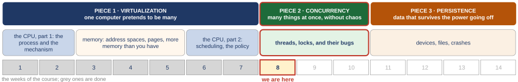

# Threads and locks: when one program has two points of execution

*Self-study guide · COMP3430 Operating Systems*

## Where this guide comes from {#source}

This guide follows *Operating Systems: Three Easy Pieces* (OSTEP) by Remzi H. Arpaci-Dusseau and Andrea C. Arpaci-Dusseau, which the authors publish free at [https://pages.cs.wisc.edu/~remzi/OSTEP](https://pages.cs.wisc.edu/~remzi/OSTEP/). The figures and examples credited to the textbook are theirs. The code the guide reads is from [xv6](https://github.com/mit-pdos/xv6-riscv), the teaching operating system from MIT, and its [xv6 book](https://mit-pdos.github.io/xv6-riscv-book/).

Read with this week:

- [OSTEP chapter 26. Concurrency: An Introduction](https://pages.cs.wisc.edu/~remzi/OSTEP/threads-intro.pdf)
- [OSTEP chapter 27. Interlude: Thread API](https://pages.cs.wisc.edu/~remzi/OSTEP/threads-api.pdf)
- [OSTEP chapter 28. Locks](https://pages.cs.wisc.edu/~remzi/OSTEP/threads-locks.pdf)
- The xv6 source.

## Part 0. Where we are, and what this week stands on {#part-0}

This part does three jobs before the new material starts. It shows where this week sits in the course. It rebuilds the few ideas from earlier weeks that this week uses on every page. And it gives you just enough of the C language to read the short programs the week is built on. Everything later uses these words without stopping, so if one is shaky, fix it here.

A few words first. The **operating system** (the **OS**) is the program that runs the computer and shares it between all the other programs; its core is called the **kernel**, and this guide uses the two words interchangeably. A **program** is a file of instructions; a **process** is a program while it is running. The **CPU** (the processor) is the part of the computer that runs instructions, one after another. A modern chip holds several CPUs side by side; each one is called a **core**, and this guide uses "CPU" and "core" for the same thing. **Memory** (RAM) is where a running program's data and instructions live. A **disk** is the slower, larger storage where files live when the power is off.

#### The course map

<figure markdown="1">
{width=100%}
<figcaption markdown="1">Figure 0.1. The three pieces of the course, the weeks behind us in grey, and this week, the first of the second piece.</figcaption>
</figure>

An operating system has three big jobs, and the course takes them in order. The first is **virtualization**: one computer pretends to be many, so every program behaves as if it had its own CPU and its own memory. The second is **concurrency**: many things happening at once without chaos. The third is **persistence**: data that survives the power going off. Figure 0.1 shows the first piece finished and the second piece starting. This week is the first week of concurrency.

The first piece was built one question at a time, and each step answered what the step before it left open. (The words this week uses again, address space, heap, stack and page table, are explained properly in the next subsection; here they are only names.)

1. **The process**: a running program with its own view of the machine. Left open: how does a program get the OS to do anything for it?
2. **Limited direct execution**: the program runs on the real CPU, and a trap (a forced jump into the kernel), a system call (a request a program makes to the kernel) or a timer hands control back to the kernel. Left open: how is memory shared without programs seeing each other?
3. **The address space**: a private memory numbered from 0. Left open: one block per program puts the heap at one end and the stack at the other, and wastes the unused space between them.
4. **Segments, then pages and a TLB**: memory cut into a few pieces called segments (one for the code, one for the heap, one for the stack), then into many fixed-size pieces called pages. A **translation** turns an address the program uses into a real memory address. The TLB (translation lookaside buffer) is a small fast memory beside the CPU that remembers recently used translations from the current page table, so most memory accesses need no table lookup. Left open: the table of pages is too big, and we assumed every page is in memory.
5. **A tree, and pages on disk**: the page table is split into small tables arranged as a **tree**, a top table whose entries point at further tables, so only the parts in use need to exist. And a page can live on disk until it is needed. Left open: which process runs next, and for how long?
6. **Scheduling**: two yardsticks for judging a scheduler (turnaround time, from a job's arrival to its finish, and response time, from its arrival to its first run), then a scheduler that learns from how a job behaves. Left open: a **priority** (a rank that says which job runs first) cannot promise anyone a share.
7. **A share, then many CPUs**: tickets and weights give each job a share. With tickets, each job holds some, and a random draw picks who runs. With weights, **Linux** (the operating system on most servers and on Android phones) gives each job a weight, and its share of the CPU follows its weight. Then, with several CPUs, either one shared queue with a lock or one queue per CPU. Left open: two CPUs can take the same job from one queue. What is that, exactly, and what is the lock?

That last question is where this week begins.

#### What the first piece built, and what this week uses

A process has an **address space**: the memory it believes it owns, numbered from 0. Three regions of it matter this week. The **code** is the program's instructions. The **heap** is memory the program asks for while it runs. The **stack** is where a function keeps its **local variables** (the variables declared inside the function, which exist only while it runs) and where the computer remembers which function called which. A **page table** is the kernel's table that maps the addresses a process uses onto real memory; each process has its own, which is why two processes cannot see each other's data.

Inside the CPU there are a few dozen tiny storage cells called **registers**. The CPU does its arithmetic mostly in registers: to add 1 to a number in memory, it usually copies the number into a register, adds there, and copies the result back. ([Section 2.3](class-1.md#sec-2-3) meets an add that names memory directly, and shows that inside the CPU it still works this way.) One register is special. The **program counter** (the **PC**) holds the address of the instruction the CPU will run next; it is the CPU's "you are here" marker in the code.

A **timer interrupt** is a signal from a hardware clock that forces the CPU to stop what it is doing and jump into the kernel, many times a second. The kernel then runs the **scheduler**, the part that picks which process runs next. It may then perform a **context switch**. It saves the running process's registers (including the PC) into that process's **process control block** (the **PCB**, the kernel's record of one process), and it loads another process's registers from its PCB. The other process then continues exactly where it had stopped. The switch also changes the page table, since every process has its own, so the new process sees its own memory.

From the last class, three words. A **cache** is a small fast memory beside each CPU that keeps copies of recently used data. A **queue** is a waiting line: things join at the back and leave from the front. A **lock**, for now, is just a name: a rule that only one CPU may touch a shared piece of data, such as one entry of the queue, at a time. This week opens it.

- Check this: name the three regions of an address space and say which one holds a function's local variables. (Code, heap, stack; the stack.)
- Check this: say in one sentence what a context switch saves. (The registers of the process that stops, including its program counter, into its PCB.)

#### Reading the C in this guide

The week's programs are written in **C**, the language the kernel and most system programs are written in. You do not need to write C to follow the guide, but you need to read about forty symbols. Each is explained again where it first appears, and [Appendix A](appendix.md#appendix-a) collects them all in its tables. Here are the ones that appear on almost every page.

- Memory is a long row of numbered cells. A **bit** is one binary digit, 0 or 1; a **byte** is 8 bits, and each memory cell holds one byte, so an address counts bytes. An `int` takes 32 bits, which is 4 bytes.
- A **variable** is a named storage place. `int counter = 0;` makes a variable called `counter` that holds an **integer** (a whole number, `int`) and starts at 0. The semicolon ends a statement.
- A **global variable** is declared outside every function, so every function of the program can use it, and there is exactly one copy of it. A local variable is declared inside a function and lives on the stack.
- A **function** is a named piece of code. `int twice(int x) { return 2 * x; }` defines a function called `twice` that takes one input, an integer `x`, and gives back an integer; the curly braces hold its body. `return` ends the function and hands back its result. `void` as a result type means the function gives nothing back, and `(void)` as its input list means it takes no input. The thread functions of this week have the form `void *mythread(void *arg)`; that `void *` is not "nothing" but a pointer, explained two bullets down.
- `for (int i = 0; i < 10; i++) { ... }` repeats the body 10 times: `i` starts at 0, the body runs while `i < 10`, and `i++` adds 1 to `i` after each pass. `while (x == 1) ;` repeats as long as `x` equals 1 (`==` means "is equal to", `!=` means "is not equal to"); the lone semicolon is an empty body, so the loop does nothing but check again.
- A **pointer** is a variable that holds the address of something else in memory. `&x` means "the address of `x`". If `p` holds an address, `*p` means "the thing at that address". Between two values `*` multiplies instead, and `/` divides: `k * N / 2` is k times N divided by 2. Between two whole numbers `/` drops the fraction, so `7 / 2` is 3. In a declaration, `int *p` means "`p` is a pointer to an integer". `void *p` means "`p` is a pointer to something of a type not stated"; the code that uses it must say what it really points at ([Section 3.3](class-1.md#sec-3-3)).
- `printf("...")` prints text; `%d` in the text is replaced by the next number given.
- `//` starts a comment: the rest of the line is a note for people, ignored by the computer.

**Machine code** is the program as the CPU runs it, numbered instructions rather than the C a person writes. Numbers in machine code are often written in **hexadecimal** (base 16), marked with the prefix `0x`. Base 16 uses the digits 0 to 9 and then a to f for ten to fifteen. In base 10 each place is worth 10 times the place to its right (1, 10, 100, ...). In base 16 each place is worth 16 times: 1, 16, 16² = 256, 16³ = 4,096, 16⁴ = 65,536, 16⁵ = 1,048,576. So `0x10` is 1 × 16 + 0 = 16, `0xff` is 15 × 16 + 15 = 255, and `0x4014` is 4 × 4,096 + 0 × 256 + 1 × 16 + 4 = 16,404. Check this: `0x9` is 9 and `0xa` is 10. To add two hex numbers, this guide converts both to ordinary numbers, adds, and compares: no hex arithmetic is needed.

#### Reading the shell lines in this guide

The captures show the commands that produced them, typed into the **shell**, the program that reads a command line and runs it. A few signs appear over and over:

- `$` at the start of a line is the shell's prompt: what follows is the command that was typed. Lines without `$` are the output.
- `./psum 1` runs the program `psum` from the current folder (`./` means "this folder") with one input, `1`.
- `a | b` is a **pipe**: the output of command `a` becomes the input of command `b`.
- `for i in $(seq 100); do ...; done` repeats the command between `do` and `done` 100 times; `$(seq 100)` is replaced by the output of `seq 100`, the numbers 1 to 100.
- A word starting with `-` after a command, like `-c` or `-n`, is an option that changes what the command does; each one is explained where it appears.

[Appendix A](appendix.md#appendix-a) has a table of every shell command the guide uses.

Times this week are small. A **millisecond** (ms) is a thousandth of a second, a **microsecond** (µs) a millionth, and a **nanosecond** (ns) a billionth: 1 s = 1,000 ms = 1,000,000 µs = 1,000,000,000 ns. A **speed-up** is the old time divided by the new time: a job that took 1.10 s and now takes 0.57 s ran 1.10 / 0.57 = 1.9 times faster. Check this: a job that went from 2 s to 0.5 s ran 4 times faster.
