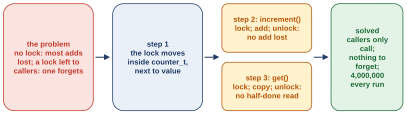
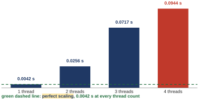
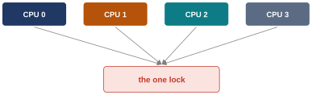
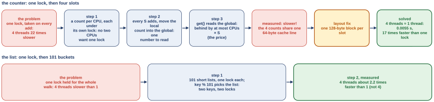
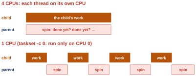
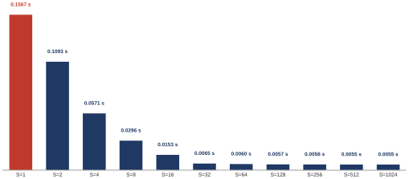
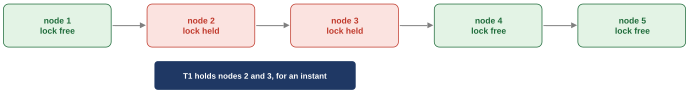
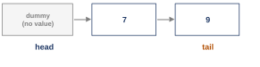

# First class: locks inside data structures, and a queue to sleep on (OSTEP 29 and 30.1) {#class-1}

## <span class="lbl lbl-roadmap">Roadmap</span> Where we left off: a lock around one line, and now a whole structure {#opening-1 data-toc-label="[Roadmap] Where we left off: a lock around one line, and now a whole structure"}

Last week ended with a lock that worked and that we had opened up. Three things are settled. A lock needs one read-and-write the hardware will not split, such as test-and-set. A waiting thread should sleep on a queue, not spin. Linux keeps a lock in one word and calls the kernel only when somebody has to sleep or be woken. The words that come back today are the critical section (the lines that touch shared data), mutual exclusion (one thread inside at a time), the mutex (a mutual exclusion lock; `lock()` takes it, `unlock()` gives it back), test-and-set and the futex.

Look once more at where last week's lock sat. In `counter_mutex.c` (Part 0), the lock was one global, guarding one line, `counter = counter + 1`, inside the one function that touched the counter, `mythread()`. We wrote that function ourselves, so we remembered to take the lock and give it back.

This week the shared thing is bigger than one line. It is a whole **data structure**: a counter, a list, a table, a bundle of data with the functions that work on it, that any thread in the program may call at any time. Here is the idea before its name. If such a structure still gives the right answer whoever calls it, and however many threads call at once, we say it is **thread safe**. Our test this week is simple: 4 threads each call `increment()` 1,000,000 times, and a thread-safe counter prints 4 × 1,000,000 = 4,000,000 every run.

Why not keep doing what we did last week, with the lock outside, in the caller? Because a structure is called from all over a program, and each of those callers would have to remember the lock. One of them will forget. So the locks must live inside the structure, taken by its own functions. And exactly how such locks are added decides two things at once: whether the structure is correct, and how fast it is. That is the question of the first half of this class.

Three things are left open. Where exactly do the locks go inside a structure, and which of its functions must take them? What does one lock cost when four threads call at once? And a thread sometimes waits for something to happen, such as another thread finishing, not for a lock; nothing we have does that. So the first class asks three questions:

1. Where does the lock go when a whole data structure is shared? ([Chapter 1](#chapter-1))
2. Why can one lock make four threads slower than one, and how do we spread the work? ([Chapter 2](#chapter-2))
3. How does a thread wait for something to happen, rather than for a lock? ([Chapter 3](#chapter-3))

Each question opens the next. The first puts the lock inside a data structure. The second measures what that lock costs, and the number is worse than you might guess, so then we split the lock. The third is a new kind of waiting, and it needs a new tool, the condition variable.

## Chapter 1. Where the lock goes when a whole data structure is shared {#chapter-1}

*The question this chapter answers: where does the lock go when a whole data structure is shared, and which of its functions must take it?*

### 1.1 <span class="lbl lbl-concept">Concept</span> A counter as a tiny data structure: one int and three functions {#sec-1-1 data-toc-label="1.1 [Concept] A counter as a tiny data structure: one int and three functions"}

Last week the shared number sat in a global that the thread function touched directly. Real programs do not do that. They hide the number inside a small data structure that every part of the program calls, so that no caller has to know how the count is kept. The smallest data structure there is, is a counter: a struct and three functions. Here it is, written the way a real program would write it.

*The counter without a lock, `W09_demos/counter_nolock.c` lines 8 to 22. It is OSTEP Figure 29.1 without `decrement()`.*

```c linenums="8" hl_lines="2 6 10 14"
typedef struct __counter_t {
    int value;
} counter_t;

void init(counter_t *c) {
    c->value = 0;
}

void increment(counter_t *c) {
    c->value++;
}

int get(counter_t *c) {
    return c->value;
}
```

The code has four pieces.

- Lines 8 to 10 declare the struct: a bundle of named fields, here one `int` called `value`. The long name `__counter_t` is used only here; `typedef` gives the bundle the short name `counter_t`.
- Line 13, inside `init()`, sets the value to 0. `counter_t *c` says that `c` is the address of a counter, and `c->value` reaches the field `value` through that address.
- Line 17, inside `increment()`, adds one. `c->value++` is last week's dangerous line in a new coat: load, add, store.
- Line 21, inside `get()`, hands the count back.

None of the three functions knows about threads. The life of a counter is: `main` calls `init(&c)` once; then any thread calls `increment(&c)`, which inside does load, add, store on `c->value`; and any thread calls `get(&c)`.

Why hide the counter inside a structure at all? Every part of the program counts the same way, by calling `increment()`. No caller touches `value` directly. So whatever has to protect `value` can live in one place, inside the structure. That is the whole reason the structure exists, and it is what makes the lock's new home possible.

- What this part settled: a data structure is a struct plus the functions that work on it, and callers go through the functions only.
- What it leaves open: what happens when four threads call `increment()` at once. The next part runs it.

*The argument in one line:* why hide the counter inside a structure? every part counts the same way: `increment()` → no caller touches `value` → the protection can live in one place.

### 1.2 <span class="lbl lbl-machine">Real machine</span> Four threads call increment(), and most of the adds vanish {#sec-1-2 data-toc-label="1.2 [Real machine] Four threads call increment(), and most of the adds vanish"}

A main, not shown in the listing above, starts 4 threads on the 4-CPU Linux VM. Each thread calls `increment()` 1,000,000 times. The right total is 4 × 1,000,000 = 4,000,000. Here are three runs, from `W09_demos/counter_nolock.out` (`./counter_nolock 4` runs the program with 4 threads; the file's first line, which names the machine, is left out):

```text
$ ./counter_nolock 4
4 threads  total 1071121  time 0.0035 s
$ ./counter_nolock 4
4 threads  total 1037269  time 0.0035 s
$ ./counter_nolock 4
4 threads  total 1067050  time 0.0034 s
```

Expected: 4,000,000. Printed: 1,037,269 to 1,071,121. The best of the three kept 1,071,121 / 4,000,000 = 0.268, about a quarter of the adds. Check it the other way: a quarter of 4,000,000 is 1,000,000, and all three totals are a little above that.

Why are adds lost inside a function? Line 17, `c->value++`, is one line of C but three machine steps: load `value`, add 1, store `value`. Another thread can run its own load between this thread's load and its store. Both then store the same new value, and one add is lost. Putting the three steps inside a function changes nothing: four threads land in each other's gaps, exactly as last week, and most of the adds are lost.

What changed from last week is who can see the race. The caller only sees a call to `increment()`. The dangerous line now hides inside the structure, so whatever fixes it must also hide inside.

- What this part settled: the race is last week's race, and it is now invisible to the caller.
- What it leaves open: the fix, and where exactly it goes. The next part turns that into one question with two halves.

*The argument in one line:* why are adds lost inside a function? `c->value++` inside a function is still load, add, store → four threads land in each other's gaps.

### 1.3 <span class="lbl lbl-problem">Problem</span> The crux: make the structure correct first, then fast {#sec-1-3 data-toc-label="1.3 [Problem] The crux: make the structure correct first, then fast"}

What we have is a counter whose `increment()` loses adds, and a caller who cannot see it. OSTEP's chapter 29 asks one question about every shared data structure (the book calls each chapter's central question its **crux**), and it has two halves:

> "When given a particular data structure, how should we add locks to it, in order to make it work correctly? Further, how do we add locks such that the data structure yields high performance, enabling many threads to access the structure at once, i.e., concurrently?"

Half 1 is **correct**: no add is lost, whatever the threads do. Half 2 is **fast**: many threads can use the structure at the same time. This class takes correctness now and speed after the first checkpoint (the "Check yourself" part that closes each question).

First, where should the lock live?

<figure markdown="1">
{width=55%}
<figcaption markdown="1">Figure 1.1. Two homes for the lock. Top: outside, with every caller, as last week; thread C forgot it. Bottom: inside the structure, taken by its own functions; every caller just calls `increment(&c)`.</figcaption>
</figure>

Figure 1.1, top: the lock stays outside, with every caller, as last week. Picture three threads in three parts of the program, all calling `increment()`. Each has to remember to lock before the call and unlock after. Threads A and B remember. Thread C forgets, and the race of [Section 1.2](#sec-1-2) is back. Many callers, one counter: a lock per caller means that one forgets.

Bottom: the lock lives inside the structure, taken by its own functions. The struct carries the lock next to the value, and `increment()` and `get()` take it themselves. Then every caller just calls `increment(&c)`, from any thread, and no caller can forget, because there is nothing to remember. A lock that is a field of the struct travels with the data: whoever has the counter has the lock.

So the question becomes: which of the three functions, `init()`, `increment()` and `get()`, need to take the lock? The fix has three steps, one per place the lock must appear:

1. the struct gets its own lock, set up by `init()`;
2. `increment()` takes it on entry and gives it back on return;
3. `get()` takes it too, for a reason step 3 shows.

Do all three, and the run comes out at 4,000,000 every time.

- What this part settled: the lock goes inside the struct, because a lock left to callers is forgotten; and the crux has a second half, speed, that waits.
- What it leaves open: the three steps. The next three parts take one each.

*The argument in one line:* why inside the struct, not in the caller? many callers, one counter → a lock per caller: one forgets | a lock in the struct goes with the data.

### 1.4 <span class="lbl lbl-concept">Concept</span> Step 1: the lock becomes a field of the struct {#sec-1-4 data-toc-label="1.4 [Concept] Step 1: the lock becomes a field of the struct"}

If the lock is to live inside the structure, the struct needs a field for it, and somebody has to set the lock up before any thread shares the counter. That is step 1.

*The counter with one lock, `W09_demos/counter_lock.c` lines 8 to 29. It is OSTEP Figure 29.2 without `decrement()`. The book's figure calls `Pthread_mutex_lock` and friends with a capital P: the book's own wrappers, which call the library functions of the same name and check that nothing went wrong. This guide's programs call the library functions directly. Steps 1 to 3 each read a few lines of this listing.*

```c linenums="8" hl_lines="3 8"
typedef struct __counter_t {
    int value;
    pthread_mutex_t lock;
} counter_t;

void init(counter_t *c) {
    c->value = 0;
    pthread_mutex_init(&c->lock, NULL);
}

void increment(counter_t *c) {
    pthread_mutex_lock(&c->lock);
    c->value++;
    pthread_mutex_unlock(&c->lock);
}

int get(counter_t *c) {
    pthread_mutex_lock(&c->lock);
    int rc = c->value;
    pthread_mutex_unlock(&c->lock);
    return rc;
}
```

Line 10 adds a second field to the struct: a lock of type `pthread_mutex_t`, the POSIX thread library's lock (Part 0). It sits next to the value it guards, so whoever has a counter has its lock.

Line 15 sets that lock up as free. `pthread_mutex_init(&c->lock, NULL)` takes the lock's address, `&c->lock`, and `NULL` asks for the default settings. Last week's lock was set up by writing `PTHREAD_MUTEX_INITIALIZER` next to its declaration. A lock inside a struct is set up by this call instead, because the initializer can be written only in a declaration, and `init()` runs on a counter that already exists, wherever and however it was made. `init()` runs once, in `main`, before any thread shares the counter. So it is the one function here that needs no lock call: nobody else can be inside yet.

The order of events is: `main` calls `init(&c)` once; `c->value` becomes 0 and `c->lock` is set up as free; only then do the threads start sharing `c`.

- What this part settled: the struct now carries a lock, and `init()` sets it up before sharing starts.
- What it leaves open: nobody takes the lock yet. Step 2 is the function where the race happened.

*The argument in one line:* why a field, and why set up in `init()`? the lock must travel with the data → a field of the struct | threads share the counter only after `init()` → `init()` sets the lock up, and needs none itself.

### 1.5 <span class="lbl lbl-concept">Concept</span> Step 2: increment() takes the lock, adds, and gives it back {#sec-1-5 data-toc-label="1.5 [Concept] Step 2: increment() takes the lock, adds, and gives it back"}

The struct now carries a lock. Last week the race was inside the add, so the add is where the lock must be taken. That is step 2: the function that changes the count takes the lock around its one dangerous line.

Lines 18 to 22 of the listing in [Section 1.4](#sec-1-4) are `increment()`. Line 19 takes the lock: `pthread_mutex_lock(&c->lock)` waits until nobody is inside, then enters. Line 20 is unchanged, `c->value++`, still load, add, store; but only the thread holding the lock is running these three steps now, so nobody can slip in between its load and its store. Line 21 gives the lock back: `pthread_mutex_unlock(&c->lock)`, and the next waiter may enter. Both calls reach the lock through the struct, `&c->lock`.

<figure markdown="1">
{width=60%}
<figcaption markdown="1">Figure 1.2. While T1 is inside `increment()`, holding the lock, T2 arrives, finds the lock held, and waits.</figcaption>
</figure>

Figure 1.2 is the picture. Thread T1 is inside with the lock. Thread T2 arrives at line 19, finds the lock held by T1, and waits there until T1 unlocks on line 21. One call, step by step:

1. `increment(&c)` is called;
2. `lock(&c->lock)`: held by another thread? then wait;
3. load, add, store `c->value`;
4. `unlock(&c->lock)`.

Why must the lock cover all three machine steps, and not just the store? The lost add came from the gap between one thread's load and its store. So the lock has to cover the whole add, all three steps. With one thread inside at a time, the adds no longer overlap.

- What this part settled: writes are safe; `increment()` takes the lock on the way in and gives it back on the way out.
- What it leaves open: the function that only reads. Step 3 is the one people skip.

*The argument in one line:* why must the lock cover all three steps? the lost add: the gap between load and store → the lock must cover the whole add | one thread inside at a time: no overlap.

### 1.6 <span class="lbl lbl-concept">Concept</span> Step 3: get() follows the same rule, reads included {#sec-1-6 data-toc-label="1.6 [Concept] Step 3: get() follows the same rule, reads included"}

`get()` reads the same `value` that `increment()` writes. It changes nothing. So it is tempting to let it read without the lock. Step 3 says no: a read that skips the lock can land in the middle of somebody's add, so the reader takes the same lock.

Lines 24 to 29 of the listing in [Section 1.4](#sec-1-4) are `get()`. Line 25 takes the lock. If another thread is in the middle of an add, `get()` waits here until the add is done. Line 26 copies the number into `rc` while nobody else is inside; `int rc = c->value;` makes a local variable `rc` (a variable declared inside a function, which exists only while the function runs) holding the copy. Line 27 gives the lock back; `rc` is already safe. Line 28 returns the copy. The copy is there because `return` ends the function: `return c->value;` on line 26 would leave with the lock still held, and the unlock on line 27 would never run. From the outside, `get()` is just a call; the caller never sees a lock.

Why does a read need the lock, if a read changes nothing? Two reasons.

- Another thread may be in the middle of a change. The lock makes `get()` wait for the add to finish, so it returns a number the counter really held, not one caught halfway.
- C makes no promise for a read that races a write, even of one `int`. The language says the result of such a read is undefined, and the compiler may even keep an old copy of the variable in a register and never look at memory again. "It is only 4 bytes" is not an argument the C language accepts.

So the rule has no exceptions among the functions threads call: every one takes the lock, reads included.

- What this part settled: the reader takes the lock too, and why.
- What it leaves open: whether the three steps really give 4,000,000. The next part runs it.

*The argument in one line:* why does `get()` take the lock too? another thread may be in the middle of a change | C makes no promise for a read that races a write, even of one `int` | one rule for every function threads call, reads included.

### 1.7 <span class="lbl lbl-machine">Real machine</span> Result: 4,000,000 every run, with one thread inside at a time {#sec-1-7 data-toc-label="1.7 [Real machine] Result: 4,000,000 every run, with one thread inside at a time"}

The same main, the same 4 threads, the same 1,000,000 adds each, now with the counter of [Section 1.4](#sec-1-4). The 4-thread rows of `W09_demos/counter_lock.out`, three runs:

```text
$ ./counter_lock 4
4 threads  total 4000000  time 0.0944 s
$ ./counter_lock 4
4 threads  total 4000000  time 0.0957 s
$ ./counter_lock 4
4 threads  total 4000000  time 0.0955 s
```

4 × 1,000,000 = 4,000,000, every run. The counter is thread safe.

<figure markdown="1">
{width=70%}
<figcaption markdown="1">Figure 1.3. The three steps together: the problem, where the lock moved, what each function does with it, and what that solved.</figcaption>
</figure>

Figure 1.3 puts the three steps side by side. The problem: with no lock most adds were lost, and a lock left to callers is forgotten by one of them. Step 1 moved the lock inside `counter_t`, next to `value`. Step 2 made `increment()` do lock, add, unlock, so no add is lost. Step 3 made `get()` do lock, copy, unlock, so no read is half done. Solved: callers only call, there is nothing to forget, and the run prints 4,000,000 every time.

This is the pattern, and it is the right first version of any shared structure. One lock per structure. Every function that threads call takes the lock on entry and releases it just before it returns. Callers simply call `increment()` and `get()`, from any number of threads, and nothing is lost. Nothing is simpler than this. One lock and one rule are easy to get right, and getting it right comes first.

The price is in the sentence "one thread at a time". Only one thread can be inside any of the counter's functions at any moment. The other three wait at the lock. Whether that matters depends on how long they wait, and that has not been measured yet.

- What this part settled: the first half of the crux. A shared structure carries its own lock, every function that threads call takes it, and the counter is exact.
- What it leaves open: the second half of the crux, speed. What one lock costs with four threads is the next chapter.

*The argument in one line:* why is this the right first version? one lock, one rule: easy to get right | the price: one thread inside at a time | its cost: not measured yet.

### 1.8 <span class="lbl lbl-check">Check yourself</span> What the first question settled {#sec-1-8 data-toc-label="1.8 [Check yourself] What the first question settled"}

Before the measurement, a stop to make sure the first answer is solid.

Settled:

- A shared structure carries its own lock, a field next to the data it guards, set up once by `init()` before sharing starts.
- Every function that threads call takes that lock on entry and drops it before returning, readers included.
- The counter now prints 4,000,000 every run: it is thread safe.

Still open:

- The crux asked for two things, correct and fast. With one lock, only one thread at a time can be inside any of the counter's functions.
- What that costs has not been measured yet.

You should now be able to add one lock to a small structure, say a stack (here the data structure, a pile where `push()` adds on top and `pop()` takes from the top, not the thread's memory of Part 0), and say which lines it must cover: the lock goes inside the stack, and both functions take it around the lines that change the top.

## Chapter 2. Why one lock makes four threads slow, and how to spread the work {#chapter-2}

*The question this chapter answers: why can one lock make four threads slower than one, and how do we spread the work?*

### 2.1 <span class="lbl lbl-machine">Real machine</span> One lock: four times the work takes over 20 times as long {#sec-2-1 data-toc-label="2.1 [Real machine] One lock: four times the work takes over 20 times as long"}

The counter of [Chapter 1](#chapter-1) is exact every run. The crux's second half asks whether it is fast, and "fast" here has a precise meaning. Four CPUs are doing four times the work. With 4 threads, each adding 1,000,000 times, the run does 4,000,000 adds instead of 1,000,000. If each CPU could add without waiting for the others, 4 threads on 4 CPUs would finish in about the time 1 thread takes for its 1,000,000. That ideal has a name: **perfect scaling** is when more threads on more CPUs do more work in the same time. So the test is to time the counter with 1, 2, 3 and 4 threads and compare each run with the 1-thread run. The first of the three runs in `W09_demos/counter_lock.out` (`./counter_lock N` runs N threads):

```text
$ ./counter_lock 1
1 threads  total 1000000  time 0.0042 s
$ ./counter_lock 2
2 threads  total 2000000  time 0.0256 s
$ ./counter_lock 3
3 threads  total 3000000  time 0.0717 s
$ ./counter_lock 4
4 threads  total 4000000  time 0.0944 s
```

<figure markdown="1">
{width=70%}
<figcaption markdown="1">Figure 2.1. The same four runs as bars. The green dashed line is perfect scaling: 0.0042 s at every thread count. The red bar is what 4 threads took.</figcaption>
</figure>

Figure 2.1 draws the four runs. One thread: 1,000,000 adds in 0.0042 s. Four threads: 4,000,000 adds in 0.0944 s. The ratio is 0.0944 / 0.0042 = 22.5, so the 4-thread run took 22.5 times as long as the 1-thread run. Check it the other way: 22 × 0.0042 = 0.0924, a little under 0.0944, so "more than 22 times" is right. The green line, perfect scaling, would have been 0.0042 s at every bar; the red bar is 22 times taller.

The question to think about before the next part: four CPUs are doing four times the total work. Most people expect the same time as one thread. That is not what happened, and the gap is what the next parts explain.

- What this part settled: with one lock, 4 threads on 4 CPUs took 22.5 times as long as 1 thread, for 4 times the work.
- What it leaves open: where the time goes. The next part looks inside one add.

*The argument in one line:* why compare with 1 thread? 4 CPUs, 4 times the work → ideal: no slower than 1 thread | measured: 22.5 times slower.

### 2.2 <span class="lbl lbl-problem">Problem</span> Every add takes the one lock: adds go one at a time {#sec-2-2 data-toc-label="2.2 [Problem] Every add takes the one lock: adds go one at a time"}

What we have is four CPUs and one lock. `increment()` is nothing but lock, add, unlock (lines 18 to 22 of the [Section 1.4](#sec-1-4) listing). Every `increment()` on every CPU wants the same lock.

<figure markdown="1">
{width=55%}
<figcaption markdown="1">Figure 2.2. Four CPUs, one lock. At any moment one CPU holds it and three wait.</figcaption>
</figure>

Figure 2.2 is the picture: one CPU holds the lock and the other three stand in line for it. So the adds go one at a time, whatever the number of CPUs. Here is where that puts the time. Suppose the adds just took turns, with no other cost: four times the work would take four times the time, 4 × 0.0042 = 0.0168, about 0.017 s. We measured 0.0944 s. The rest, 0.0944 − 0.0168 = 0.0776, about 0.077 s, is the cost of sharing one lock: the waiting, and the lock changing hands between CPUs. The run only gives the total, so this guide will not invent a breakdown of that 0.077 s into parts.

So what we need is the second half of the crux: "high performance, enabling many threads to access the structure at once". The shape of the answer, before any code: each CPU should add without waiting for the others, so that the shared lock is taken rarely, not on every add; and a reader must still find one number. The fix has three steps:

1. a count per CPU, under its own lock, so that CPUs no longer compete;
2. every so often, fold each CPU's count into one shared total, under one lock;
3. a reader takes the shared total, which may be a little behind.

- What this part settled: the one lock makes every add queue; if the adds only took turns they would cost 0.017 s, and the other 0.077 s is read as the cost of sharing the lock, not measured.
- What it leaves open: the three steps. Step 1 is next.

*The argument in one line:* why more than 4 times as long? one lock: adds take turns → turns alone: 0.017 s | measured 0.0944 s: sharing costs the rest.

### 2.3 <span class="lbl lbl-concept">Concept</span> Step 1: the approximate counter, each CPU counts alone and reports every S adds {#sec-2-3 data-toc-label="2.3 [Concept] Step 1: the approximate counter, each CPU counts alone and reports every S adds"}

The slow run came from every CPU wanting one lock on every add. So the first change is where the counting happens. How can each CPU add without waiting for the others? Give each CPU a count of its own.

Here is the idea in plain words. Four helpers count votes. Each keeps a tally of their own and walks to the board only after every 5 marks, so they almost never meet at the board. In the program: each CPU adds to its own **local count** under its own **local lock**. Why a lock on a count that only one CPU uses? Because the program picks a slot by a number ([Section 2.4](#sec-2-4)), and with more threads than slots two threads can share one; the local lock keeps that case correct. With one thread per slot nobody else wants that lock, so there is no waiting. The board is the **global count**, with its own global lock: every S marks, a helper walks over and adds the tally to it, so the shared lock is taken once per S adds instead of on every add. S is the **threshold**: how many adds a local count collects before they are moved into the global count.

OSTEP Figure 29.3 traces this with S = 5 and four CPUs. L1 to L4 are the four local counts, G is the global count, and time runs down the table:

| time | L1 | L2 | L3 | L4 | G (global) |
|---|---|---|---|---|---|
| 0 | 0 | 0 | 0 | 0 | 0 |
| 1 | 0 | 0 | 1 | 1 | 0 |
| 2 | 1 | 0 | 2 | 1 | 0 |
| 3 | 2 | 0 | 3 | 1 | 0 |
| 4 | 3 | 0 | 3 | 2 | 0 |
| 5 | 4 | 1 | 3 | 3 | 0 |
| 6 | 5 → 0 | 1 | 3 | 4 | 5 (from L1) |
| 7 | 0 | 2 | 4 | 5 → 0 | 10 (from L4) |

Read it row by row. At each time step some local counts go up by one. At time 6, L1 reaches 5, which is S: it takes the global lock once, pours its 5 into G, and starts again at 0. At time 7, L4 does the same, and G reads 10. Between those two moments nobody touched the global lock at all.

A counter built this way is called an **approximate counter**: one count kept as several local counts (one per CPU in OSTEP; in our program one per **slot**, [Section 2.4](#sec-2-4) says why) plus one global count. The global count is updated only every S adds, so reading it gives an approximate total. "Approximate" is the price, and [Section 2.5](#sec-2-5) puts a number on it.

- What this part settled: a count per CPU under a lock nobody else wants removes the waiting; the global lock is visited once per S adds.
- What it leaves open: the code, and the price. Step 2 is the code.

*The argument in one line:* why does this stop the waiting? a local lock per CPU → nobody else wants it | the shared lock: once per S adds.

### 2.4 <span class="lbl lbl-example">Worked example</span> Step 2: a slot lock per add, the global lock per S {#sec-2-4 data-toc-label="2.4 [Worked example] Step 2: a slot lock per add, the global lock per S"}

Step 1 gave each CPU a private count. Four private counts are no use to a reader, so step 2 moves each private count into the shared total every S adds. Here is the code, `update()`, the function every thread calls instead of `increment()`. `c` points at the counter's struct, printed in full in [Section 2.6](#sec-2-6); it holds the four local counts `local[]`, their locks `llock[]`, the global count `global` with its lock `glock`, and the threshold.

*The approximate counter's `update()`, `W09_demos/approx.c` lines 27 to 38 (OSTEP Figure 29.4). `NUMCPUS` is 4, set at the top of the file to match the 4-CPU Linux VM.*

```c linenums="27" hl_lines="2 3 4 5 6 7 8 9 11"
void update(counter_t *c, int threadID, int amt) {
    int cpu = threadID % NUMCPUS;
    pthread_mutex_lock(&c->llock[cpu]);
    c->local[cpu] += amt;
    if (c->local[cpu] >= c->threshold) {
        pthread_mutex_lock(&c->glock);
        c->global += c->local[cpu];
        pthread_mutex_unlock(&c->glock);
        c->local[cpu] = 0;
    }
    pthread_mutex_unlock(&c->llock[cpu]);
}
```

The function has three pieces.

- Lines 28 to 30 pick a slot, take its lock, and add. `local` is an array of 4 counts side by side, and `local[cpu]` is count number `cpu`. Line 28 picks the slot by the thread's number: `threadID % NUMCPUS` is the remainder after dividing the thread's number (0 to 3, handed to each thread by `main`) by 4, so threads 0 to 3 land on slots 0 to 3. `llock[cpu]` is that slot's lock; line 29 takes it. Line 30 adds `amt` (how much to add; 1 here) to the slot's count: `+=` means "add to".
- Line 31 asks whether this slot's count has reached S, which the struct keeps in `c->threshold`. Most of the time the answer is no, and the function skips to line 37, unlocks the slot and returns, without touching anything shared.
- Lines 32 to 35 are the rare case, once per S adds: take `c->glock`, the global lock; add the slot's count to `c->global`; release; set the slot's count back to 0.

One call, step by step: lock the slot; `local += 1`; `local >= S`? no (most adds): straight to the slot unlock; yes (once per S): lock global, `global += local`, unlock global, `local = 0`; unlock the slot.

Why pick the slot by thread number, when the book says "per CPU"? Because asking "which CPU am I on?" gives an answer that can change: a thread can be moved to another CPU between asking and doing the add, so that answer is unreliable: two threads could end up in one slot and queue on its lock, which is the waiting this design exists to remove. The thread number never changes. With 4 threads and 4 slots, no two threads ever share a slot, which is exactly the job OSTEP's slot per CPU does. So the guide says "slot" where the book says "CPU"; a slot follows its thread wherever it runs, and in these runs both ways give one count per thread, which is what matters.

- What this part settled: the code; a slot lock on every add, the global lock once per S adds.
- What it leaves open: what the reader sees. Step 3 is next.

*The argument in one line:* why pick the slot by thread number? which CPU am I on? the answer can change → `threadID % 4` cannot change | 4 threads, 4 slots: each its own slot.

### 2.5 <span class="lbl lbl-example">Worked example</span> Step 3: get() reads only the global count, which lags {#sec-2-5 data-toc-label="2.5 [Worked example] Step 3: get() reads only the global count, which lags"}

Step 2 reports to the global count only every S adds, so the global count is behind most of the time. Step 3 is what `get()` returns, and how far behind it can be.

`get()` in `approx.c` (lines 40 to 45, not shown) takes the global lock, copies `c->global`, releases, and returns the copy; it never looks at the slots, because summing them would mean taking all four slot locks, and the point of the slots was that nobody waits on them. Go back to the last row of the table in [Section 2.3](#sec-2-3), time 7. `get()` returns G, which is 10. The true total is the four local counts plus G: 0 + 2 + 4 + 0 + 10 = 16. The 6 missing adds are still sitting in L2 and L3, waiting to reach S.

How far behind can `get()` be, at worst? A local count is moved into G in the same `update()` call that brings it to S, but not in the same instant: line 30 makes the slot S, and the slot still holds S while the thread waits at line 32 for the global lock. A `get()` that holds the global lock at that moment reads G without those S adds. So each slot can hide up to S adds, and with four slots the global count is behind by at most 4 × S: the number of CPUs multiplied by S, which is the bound OSTEP states. For S = 5 that is at most 4 × 5 = 20 adds behind; for S = 1024, the value OSTEP used for its runs and the one [Section 2.6](#sec-2-6) uses, at most 4 × 1024 = 4,096.

So the counter trades exactness for speed, and S is the knob. A small S keeps the global count close to the truth but takes the shared lock often. A large S almost never takes it, and `get()` may be thousands behind. Which S to pick is a measurement, in [Extra 1](#extra-1).

Where is a count that lags acceptable? A statistics counter in a kernel (packets received, pages mapped) is read rarely and updated constantly; a total that is a little behind is fine there. A bank balance is not that kind of counter.

- What this part settled: `get()` returns G, which can be behind the truth by at most 4 × S.
- What it leaves open: whether the three steps really made the counter fast. The next part measures it, and it does not go the way OSTEP says.

*The argument in one line:* why is the global count behind? adds wait in the slots until S, and `get()` reads only the global → at most 4 × S behind.

### 2.6 <span class="lbl lbl-machine">Real machine</span> Measured: as printed, four slots are slower than one lock {#sec-2-6 data-toc-label="2.6 [Real machine] Measured: as printed, four slots are slower than one lock"}

The three steps are in, and OSTEP's own run of this counter flew. The only honest thing to do is run ours: 4 threads, S = 1024 (the setting of OSTEP Figure 29.5), on the 4-CPU Linux VM. Here is the struct exactly as the book prints it, `W09_demos/approx.c` lines 9 to 15 (OSTEP Figure 29.4):

```c linenums="9" hl_lines="4 5"
typedef struct __counter_t {
    int             global;           // global count
    pthread_mutex_t glock;            // global lock
    int             local[NUMCPUS];   // per-CPU count
    pthread_mutex_t llock[NUMCPUS];   // ... and locks
    int             threshold;        // update frequency
} counter_t;
```

Line 12 is the four local counts: an array of 4 `int`s side by side in memory. An `int` is 4 bytes, so the four counts take 16 bytes in a row. Line 13 is the four local locks: another array, right after the counts; a `pthread_mutex_t` is 48 bytes on the 4-CPU Linux VM (the capture in [Section 2.7](#sec-2-7) prints it), so the locks take 4 × 48 = 192 bytes. In memory, left to right, the struct is: `global` and `glock`; `local[0]` to `local[3]`, 16 bytes; `llock[0]` to `llock[3]`, 192 bytes; `threshold`.

The runs, from `W09_demos/approx.out` (`./approx 4 1024`: 4 threads, S = 1024):

```text
$ ./approx 4 1024
4 threads  S 1024  global 3997696  still local 2304  time 0.1335 s
$ ./approx 4 1024
4 threads  S 1024  global 3997696  still local 2304  time 0.1379 s
```

It should fly. It does not. One lock with 4 threads took 0.0944 s ([Section 2.1](#sec-2-1)); four slots, as printed, took 0.1335 s. The clever version lost to the simple one. The count is right: `main`, after every thread has finished (so nobody is adding any more), adds up what is still in the slots and prints it as `still local`, and 3,997,696 + 2,304 = 4,000,000.

Four slots, a count per slot, the shared lock once per 1,024 adds, and slower than one lock. Nothing the threads touch on an ordinary add is shared in the program's logic (the next part finds the sharing one level down, in the hardware), so the bug is not in the logic of the code. It is in where the bytes sit, and the fix, in [Section 2.8](#sec-2-8), changes the struct that lays them out, and nothing in the logic. The measurement has three steps of its own:

1. measure it: as printed, 4 slots run slower than 1 lock (this part);
2. find why: neighboring counts share a 64-byte block (the next part);
3. fix the layout: one 128-byte block per slot, then measure again.

- What this part settled: the approximate counter as printed is slower than one lock on the 4-CPU Linux VM, and the code is not at fault.
- What it leaves open: the reason, which needs one fact about how a CPU reads memory.

*The argument in one line:* why is a correct idea slower? a count per slot, the shared lock once per S → nothing shared on an ordinary add, so the logic is not at fault | still 0.1335 s against 0.0944 s → the fault is somewhere other than the logic: where the bytes sit, as the next part shows.

### 2.7 <span class="lbl lbl-concept">Concept</span> Why slower: neighboring counts share a 64-byte block {#sec-2-7 data-toc-label="2.7 [Concept] Why slower: neighboring counts share a 64-byte block"}

Start from what we have, and what makes no sense. Four threads, four separate counts, and no two threads ever touch the same count. By everything said about races, there is nothing here to wait for. And still the run took longer than the single-lock version.

Here is the one fact about the hardware that explains it. A CPU does not fetch one number from memory. It fetches a 64-byte block, keeps a copy of the block in its **cache** (a small fast memory beside each CPU), and works on the copy. That block is a **cache line**: the block a CPU's cache copies from memory at a time, 64 bytes on this one (the `getconf` line below); other machines differ, and the fix in [Section 2.8](#sec-2-8) allows for 128. When a CPU writes into a line, it takes the line away from every other CPU's cache, so that only one copy is current.

So where do our four counts sit? The program `sizes.c` prints the byte positions of the fields in both structs, and `getconf` asks Linux for the line size. From `W09_demos/sizes.out`:

```text
$ ./sizes
sizeof(pthread_mutex_t) = 48 bytes
as printed: local[0..3] at bytes 56 to 71, llock[0..3] at bytes 72 to 263
padded: slot size 128 bytes; slots start at bytes 128 256 384 512
$ getconf LEVEL1_DCACHE_LINESIZE
64
```

(`sizeof(x)` is the size of `x` in bytes; `LEVEL1_DCACHE_LINESIZE` is the line size of the level-1 data cache, the cache closest to the CPU; the `padded` line is for the fixed struct of [Section 2.8](#sec-2-8).) The four counts sit at bytes 56 to 71 of the struct: 16 bytes in a row, `local[0]` at 56, `local[1]` at 60, `local[2]` at 64, `local[3]` at 68, with the locks packed right behind them from byte 72 on. Cache lines are 64-byte blocks of memory, cut from address 0, so a line boundary is an address that is a multiple of 64; the cache finds a line by the address with its last 6 bits dropped, which is the same as rounding down to a multiple of 64, because 64 is 2 to the 6th. The capture does not print where the struct starts, so the guide cannot say where the boundaries fall inside it. But 16 bytes in a row can cross at most one boundary, so at least two of the four counts, and perhaps all four, sit in one line, and the locks, written on every add too, begin right behind them. Neighboring counts share a line, and that is all the argument needs. (Two side notes, safe to skip. Why 56 and not 4 + 48 = 52: gcc keeps a mutex on an address that is a multiple of 8, a rule called **alignment**, because the mutex holds 8-byte fields and the CPU reads an 8-byte field in one step only from such an address; so `glock` starts at byte 8, not 4, and 8 + 48 = 56. And the table of [Section 2.3](#sec-2-3) and the figure call the counts L1 to L4; L1 is `local[0]`.)

<figure markdown="1">
{width=70%}
<figcaption markdown="1">Figure 2.3. The struct as printed: 4 counts in 16 bytes, then 4 locks of 48 bytes each; boxes not to scale. Neighbors share a 64-byte line.</figcaption>
</figure>

Figure 2.3 draws that stretch of the struct. Now follow what happens on every add:

1. Thread 0 writes `local[0]`. Its CPU pulls the 64-byte line that holds `local[0]` into its cache.
2. Thread 1 writes `local[1]`, 4 bytes away. Take the case where it sits in that same line (if the boundary falls between them, the same story plays out between `local[2]` and `local[3]`): CPU 1 pulls the line away, and CPU 0 loses it.
3. Thread 0 writes `local[0]` again. CPU 0 pulls the line back; CPU 1 loses it.
4. This happens on add after add, 4,000,000 adds in all. The threads never share a count, yet the line travels between the CPUs, and those trips are the guide's reading of what the run paid for: 0.1335 s against 0.0944 s. The runs count neither the trips nor the price of one.

No count is shared, but the line is, so the CPUs act as if the threads shared one variable. This is **false sharing**: CPUs writing different variables that sit in one cache line keep taking the line from each other. It is called false because the sharing is in the memory layout, not in the program. The variables are separate; the lines are not.

- What this part settled: the four counts, 16 bytes in a row with the locks behind them, share cache lines, and the line bounces between the CPUs on every add.
- What it leaves open: the fix, which changes only the struct.

*The argument in one line:* why did a count per slot not help at first? 4 counts in 16 bytes, locks right after → neighbors share a 64-byte line | the line bounces between CPUs: false sharing.

### 2.8 <span class="lbl lbl-machine">Real machine</span> The fix: one 128-byte block per slot, and the slots scale {#sec-2-8 data-toc-label="2.8 [Real machine] The fix: one 128-byte block per slot, and the slots scale"}

If the counts fight only because they are neighbors, give each slot a block of its own. The struct changes; the logic does not. `W09_demos/approx_pad.c` lines 9 to 17:

```c linenums="9" hl_lines="4 5 6 7"
typedef struct __counter_t {
    int             global;           // global count
    pthread_mutex_t glock;            // global lock
    struct {
        int             count;        // per-CPU count
        pthread_mutex_t lock;         // ... and its lock
    } __attribute__((aligned(128))) local[NUMCPUS];
    int             threshold;        // update frequency
} counter_t;
```

Lines 12 to 15 make one slot a small struct of its own: a `count` and its `lock`, the two things one thread writes, side by side. `__attribute__((aligned(128)))` tells gcc to start each slot on a new 128-byte block. 64 would do on this VM; 128 also covers CPUs with 128-byte lines, such as the Apple chip in the Mac that hosts the VM, which reports 128. `local[NUMCPUS]` is still an array of 4 slots, and `update()` changes only the field names (`c->local[cpu].count`, `c->local[cpu].lock`). In memory, left to right: slot 0 (count, lock, then **padding**, unused bytes that fill the block out to 128), slot 1, slot 2, slot 3, each 128 bytes; the capture in [Section 2.7](#sec-2-7) printed their starts, bytes 128, 256, 384 and 512 (128 is the first multiple of 128 after byte 55, where `glock` ends). And `aligned(128)` on the array makes gcc start the whole struct on a multiple of 128 too (a struct takes the strictest alignment of its fields, because every field must land on its own kind of boundary wherever the struct starts), so these offsets are real line boundaries, which the printed struct could not promise. No two slots share a line any more.

The runs, from `W09_demos/approx_pad.out`, 1 thread and 4 threads with S = 1024:

```text
$ ./approx_pad 1 1024
1 threads  S 1024  global 999424  still local 576  time 0.0050 s
$ ./approx_pad 4 1024
4 threads  S 1024  global 3997696  still local 2304  time 0.0055 s
```

Four threads now take 0.0055 s, against 0.0050 s for one thread: four times the work in about the time of one, which is close to perfect scaling. Against the printed layout, 0.1335 / 0.0055 = 24, so the padding alone made the run 24 times faster. Against the one lock of [Section 2.1](#sec-2-1), 0.0944 / 0.0055 = 17 times faster. The global count ends 2,304 short, and those adds are parked in the slots: 3,997,696 + 2,304 = 4,000,000. (Why 2,304: 1,000,000 is not a multiple of 1024; 976 × 1024 = 999,424, so each thread leaves 1,000,000 − 999,424 = 576 adds in its slot, and 4 × 576 = 2,304.)

OSTEP Figure 29.4 never mentions memory layout. This is why we measured instead of trusting the idea, and OSTEP has a tip for it: more concurrency is not necessarily faster; your idea is either faster, or it isn't, and only the clock knows which.

- What this part settled: with each slot in its own 128-byte block, 4 threads run in about the time of 1; the counter is solved.
- What it leaves open: a list has the same one-lock problem, in a worse form.

*The argument in one line:* why 128 bytes per slot? a slot: what one thread writes → its own block: no neighbor in the line | 128 covers lines of 64 and of 128 | 4 threads: 0.0055 s.

### 2.9 <span class="lbl lbl-problem">Problem</span> One lock on a list, held for the whole walk {#sec-2-9 data-toc-label="2.9 [Problem] One lock on a list, held for the whole walk"}

The counter is fixed. A list has the same single lock, and its work is much longer. A **linked list** is a chain of nodes, each holding a key and the address of the next node; a lookup starts at the **head** (the first node) and steps from node to node until it finds the key or runs out of nodes. Our list holds 10,000 keys, enough that one walk is long and a run of lookups takes a time worth reading. Here is its lookup, `W09_demos/lookup.c` lines 26 to 36 (OSTEP Figure 29.8):

```c linenums="26" hl_lines="3 4 5 6 7 9"
int List_Lookup(list_t *L, int key) {
    int rv = -1;
    pthread_mutex_lock(&L->lock);
    node_t *curr = L->head;
    while (curr) {
        if (curr->key == key) { rv = 0; break; }
        curr = curr->next;
    }
    pthread_mutex_unlock(&L->lock);
    return rv;
}
```

`list_t *L` is the list: a head pointer and one lock. `node_t` is one node: a key and a `next` pointer. Line 28 takes the list's one lock. Lines 29 to 33 walk from the head, node by node: `curr` starts at `L->head`; `while (curr)` repeats until `curr` is `NULL`, the end of the list; line 31 compares the key, and on a match sets `rv` to 0 (found) and `break`s out of the loop; line 32 steps to the next node. Only then does line 34 release the lock, and line 35 returns `rv`: 0 if found, −1 if not (a C convention: 0 for success, −1 for failure; calls that have a count to return, like the pipe's `pipewrite()` in [Section 4.10](class-2.md#sec-4-10), return the count instead). `List_Insert()`, the list's insert function, takes the same lock ([Extra 2](#extra-2) shows it). So every lookup and every insert, from any thread, goes through this one lock.

Compare this with the counter. There the lock covered three machine steps. Here it covers a walk of up to 10,000 nodes, and the lock is held the whole way: nobody else can walk the list meanwhile.

- What this part settled: the list's one lock is held through a walk of up to 10,000 nodes, and inserts queue on the same lock.
- What it leaves open: what that costs with 4 threads. The next part times it.

*The argument in one line:* why is a list worse than the counter? the lock is held for the whole walk, up to 10,000 nodes instead of 3 steps → the other threads wait that long | inserts use the same lock.

### 2.10 <span class="lbl lbl-machine">Real machine</span> Measured: four threads look up slower than one {#sec-2-10 data-toc-label="2.10 [Real machine] Measured: four threads look up slower than one"}

40,000 lookups on the list of 10,000 keys, first all on one thread, then split across four (each doing 10,000). The list rows of `W09_demos/lookup.out`, three runs (`./lookup list N T`: the list, N threads, T lookups in total):

```text
list  1 threads x   40000 lookups  found 40000  time 0.402 s
list  4 threads x   10000 lookups  found 40000  time 0.587 s
list  1 threads x   40000 lookups  found 40000  time 0.438 s
list  4 threads x   10000 lookups  found 40000  time 0.607 s
list  1 threads x   40000 lookups  found 40000  time 0.387 s
list  4 threads x   10000 lookups  found 40000  time 0.592 s
```

One thread: 0.387 to 0.438 s. Four threads: 0.587 to 0.607 s. Slower with 4, not faster. (`found 40000` says every lookup found its key, since every key looked up is one of the 10,000 in the list.)

<figure markdown="1">
{width=60%}
<figcaption markdown="1">Figure 2.4. What the four threads do in time: one walks while the other three wait at the lock, so the walks go one after another.</figcaption>
</figure>

Figure 2.4 shows why. While one thread walks, the other three wait at the lock. The walks go strictly one after another, so 4 threads can do no better than 1. They did worse: sharing the lock has a cost of its own, and these runs do not separate it out, so the guide does not guess at its parts.

So what we need: lookups for different keys should not wait for each other. The shape of the answer is the counter's again. Cut the one shared thing into parts, give each part its own lock, and let the key say which part a thread needs. Then most lookups need different locks. The fix has two steps:

1. split the list into 101 short lists by `key % 101`, one lock each;
2. measure: do four threads now walk at the same time?

- What this part settled: with one lock, 4 threads look up slower than 1, because the walks cannot overlap.
- What it leaves open: the split. Step 1 is next.

*The argument in one line:* why are four threads slower than one? the lock is held through the whole walk → one walk at a time → no faster than 1 thread | slower: sharing costs, not measured apart.

### 2.11 <span class="lbl lbl-concept">Concept</span> Step 1: 101 short lists, one lock each, picked by the key {#sec-2-11 data-toc-label="2.11 [Concept] Step 1: 101 short lists, one lock each, picked by the key"}

Split the list the way we split the counter: many short lists, each with its own lock, and the key decides which list a thread walks. That structure has a name, and the code is short. `W09_demos/lookup.c` lines 38 to 42 (OSTEP Figure 29.10, written compactly):

```c linenums="38" hl_lines="1 2 3 4 5"
#define BUCKETS (101)
typedef struct __hash_t { list_t lists[BUCKETS]; } hash_t;
void Hash_Init(hash_t *H) { for (int i = 0; i < BUCKETS; i++) List_Init(&H->lists[i]); }
int Hash_Insert(hash_t *H, int key) { return List_Insert(&H->lists[key % BUCKETS], key); }
int Hash_Lookup(hash_t *H, int key) { return List_Lookup(&H->lists[key % BUCKETS], key); }
```

- Line 38 names the constant 101, OSTEP Figure 29.10's choice: a prime number, which spreads keys more evenly over the lists when the keys follow a pattern (keys that are all multiples of 10, say, would land on only 10 of 100 lists, but on all 101 of 101, because 101 shares no factor with 10); any count works, and more lists mean shorter walks.
- Line 39 makes the table an array of 101 of our lists, `list_t lists[BUCKETS]`; each one carries its own lock, so there are 101 locks.
- Line 40 sets up every bucket (one of the 101 short lists; the word is defined below) with the list's own `List_Init()`, repeating with `i` = 0, 1, ..., 100.
- Line 41 inserts a key into one list: `key % BUCKETS` is the remainder after dividing the key by 101, a number from 0 to 100, and that picks the list; then the one-lock list's own `List_Insert()` runs on that list, locking only that list.
- Line 42 looks a key up the same way, with `List_Lookup()` from [Section 2.9](#sec-2-9) on the one bucket the key picks.

A **hash table** is many short lists in an array, and a rule (here `key % 101`) that says which list a key belongs to, so each lookup walks only one short list. One slot of the table is a **hash bucket**; here each bucket is a short list with its own lock.

<figure markdown="1">
![Figure 2.5. The table: buckets [0] to [100], each a short list with its own lock. Thread T1 looks up key 57 and lands in bucket [57]; T2 looks up key 103 and lands in bucket [2] (103 % 101 = 2). Two keys, two buckets, two locks: both walks at once.](figs/hash_buckets.svg){width=75%}
<figcaption markdown="1">Figure 2.5. The table: buckets [0] to [100], each a short list with its own lock. Thread T1 looks up key 57 and lands in bucket [57]; T2 looks up key 103 and lands in bucket [2] (103 % 101 = 2). Two keys, two buckets, two locks: both walks at once.</figcaption>
</figure>

Figure 2.5: T1 with key 57 locks bucket [57]; T2 with key 103 locks bucket [2], because 103 divided by 101 leaves remainder 2. Two locks are taken, and the two walks happen at the same time. Each bucket holds about a hundredth of the keys, 10,000 / 101 = 99, so each walk is about 99 keys long instead of up to 10,000. One lookup, step by step: `Hash_Lookup(key)`; bucket = `key % 101`; `List_Lookup()` on that bucket; lock only that bucket's lock; walk about 99 keys; unlock.

- What this part settled: the key picks one of 101 locks, so two keys usually mean two locks, and the walks are short.
- What it leaves open: whether four threads really walk at once. The next part measures it.

*The argument in one line:* why do lookups stop waiting for each other? `key % 101`: one of 101 locks → different keys, usually different locks | short walks, side by side.

### 2.12 <span class="lbl lbl-machine">Real machine</span> Step 2, measured: 4 threads about 2 times faster, not 4 {#sec-2-12 data-toc-label="2.12 [Real machine] Step 2, measured: 4 threads about 2 times faster, not 4"}

Step 1 gave two threads two locks. Step 2 measures whether they really walk at the same time. Each walk is now about a hundred times shorter (a bucket holds about 99 nodes where the one list held 10,000, and a lookup walks until it finds its key), so we need many more lookups to get a time worth reading: 4,000,000 lookups, first on one thread, then split across four. The hash rows of `W09_demos/lookup.out`, three runs:

```text
hash  1 threads x 4000000 lookups  found 4000000  time 1.033 s
hash  4 threads x 1000000 lookups  found 4000000  time 0.460 s
hash  1 threads x 4000000 lookups  found 4000000  time 1.023 s
hash  4 threads x 1000000 lookups  found 4000000  time 0.451 s
hash  1 threads x 4000000 lookups  found 4000000  time 1.048 s
hash  4 threads x 1000000 lookups  found 4000000  time 0.474 s
```

One thread: about a second. Shorter is not the same as cheaper by the same factor: per lookup, 1.033 s / 4,000,000 = 0.26 µs against the list's 0.402 s / 40,000 = 10 µs, so a hash lookup is about 39 times cheaper, not 100. A lookup is more than its walk: the lock, the call and the first node cost the same whether the walk is long or short, so the shorter walk cuts only part of the cost (a reading, not a measurement; the runs do not price the fixed part). Four threads: about 0.46 s. From the first run, 1.033 / 0.460 = 2.2, so 4 threads were about 2.2 times faster than 1, where the list got slower. Two threads rarely want the same bucket, so their walks run at the same time. The 101 buckets did for the list what the 4 slots did for the counter, in kind if not in degree: threads stopped waiting for one lock.

Honest about the number: it is about 2 times, not 4, and the runs do not show what holds it back. Giving each bucket its own 128-byte block, the fix that saved the counter, did not help here: with padded buckets, 4 threads took 0.443 to 0.549 s. The 4-thread rows of `W09_demos/lookup_pad.out`:

```text
hash  4 threads x 1000000 lookups  found 4000000  time 0.458 s
hash  4 threads x 1000000 lookups  found 4000000  time 0.549 s
hash  4 threads x 1000000 lookups  found 4000000  time 0.443 s
```

So this guide reports 2.2 and leaves the cause open.

What the counter and the table share: more locks help only when different threads need different locks. The counter and the table were both fixed by splitting one shared thing into parts. And the order matters: start with one big lock, measure, and split only when the measurement says so.

- What this part settled: a lock per bucket made 4 threads about 2.2 times faster than 1; the cause of "not 4" is not visible in the runs.
- What it leaves open: the principle behind both fixes, on one page.

*The argument in one line:* why faster at all? two keys usually mean two locks → walks run side by side → 2.2 times faster where the list got slower | why not 4: the runs do not say; padding, the counter's cure, did not help here.

### 2.13 <span class="lbl lbl-concept">Concept</span> The design behind both fixes: split what is shared, lock each part {#sec-2-13 data-toc-label="2.13 [Concept] The design behind both fixes: split what is shared, lock each part"}

The counter and the list were made fast by the same idea. Here is the whole second question as one argument, each step next to the problem it removed.

<figure markdown="1">
{width=100%}
<figcaption markdown="1">Figure 2.6. Top row, the counter: one lock, then four slots, the layout surprise, and the fix. Bottom row, the list: one lock, then 101 buckets.</figcaption>
</figure>

The counter, Figure 2.6 top row, left to right:

- the problem: one lock, taken on every add, made 4 threads 22 times slower;
- step 1: a count per CPU, each under its own lock, so no two CPUs want one lock;
- step 2: every S adds, move the local count into the global, so there is one number to read;
- step 3: `get()` reads the global, behind by at most 4 × S, which is the price;
- measured: slower! the 4 counts shared cache lines;
- the layout fix: one 128-byte block per slot;
- solved: 4 threads in about the time of 1, 0.0055 s, 17 times faster than one lock.

The list, bottom row:

- the problem: one lock held for the whole walk made 4 threads slower than 1;
- step 1: 101 short lists, one lock each, `key % 101` picks the list, so two keys mean two locks;
- step 2, measured: 4 threads about 2.2 times faster than 1 (not 4).

The principle, and why the steps come in this order. Threads on different CPUs must almost never need the same lock. So cut the one shared thing into parts, give each part its own lock, and pick the part by something the thread already has: its number, or its key. The order matters too. Start with one big lock, because it is easy to get right. Measure. Split only when the measurement says so. And measure again, because a layout detail or a cost you did not count can undo the gain.

- What this part settled: both fixes rest on one rule, split what is shared and lock each part, in a fixed order: one lock, measure, split, measure again.
- What it leaves open: nothing in this question. The checkpoint is next.

*The argument in one line:* why split, and why in this order? one lock: every CPU queues → parts with a lock each → pick the part by thread number or key | one big lock first → measure → split, then measure again.

### 2.14 <span class="lbl lbl-check">Check yourself</span> What the second question settled {#sec-2-14 data-toc-label="2.14 [Check yourself] What the second question settled"}

Settled:

- One lock makes a structure exact, and with it 4 threads took more than 20 times as long as 1 thread, for 4 times the work.
- Splitting the shared state helps: a count per slot (OSTEP's count per CPU) scaled almost perfectly once no two slots (a count and its lock) shared a cache line, and a lock per hash bucket made 4 threads about 2 times faster than 1.
- The order: start with one big lock, and split it only when a measurement says so.

Still open:

- Both fixes are about threads that use shared data at the same time. Nothing yet lets a thread wait until another thread has done something, such as finish its work.

You should now be able to say what the threshold S trades: a larger S takes the shared lock less often, and allows the global count to fall further behind the true total, by up to 4 × S with four slots.

## Chapter 3. How a thread waits for something to happen, not for a lock {#chapter-3}

*The question this chapter answers: how does a thread wait for something to happen, rather than for a lock?*

### 3.1 <span class="lbl lbl-problem">Problem</span> A join: the parent waits for its child by watching a flag {#sec-3-1 data-toc-label="3.1 [Problem] A join: the parent waits for its child by watching a flag"}

So far the threads shared data, and every wait was a wait for a lock. Sometimes a thread must wait for something else: until another thread has done something. The commonest case is a **join**: a parent thread starts a child thread and must wait until the child has finished before it goes on. Last week `pthread_join()`, the library call that waits for a thread to finish, did this for us. This chapter builds it, because the way it is built is the week's second tool. The obvious way to wait is to keep checking a shared flag. Here it is, `W09_demos/join_spin.c` lines 6 to 25 (OSTEP Figure 30.2, with the child given real work to do):

```c linenums="6" hl_lines="2 5 8 16 17"
#define WORK 2000000000L
volatile int done = 0;

void *child(void *arg) {
    for (volatile long i = 0; i < WORK; i++)
        ;                               // the child's real work
    printf("child\n");
    done = 1;
    return NULL;
}

int main(int argc, char *argv[]) {
    printf("parent: begin\n");
    pthread_t c;
    pthread_create(&c, NULL, child, NULL);
    while (done == 0)
        ;                               // spin
    printf("parent: end\n");
    return 0;
}
```

- Line 7 is the flag, `done`, starting at 0. `volatile` forces a fresh load of `done` on every pass of the parent's loop; without it the compiler might load the flag once and spin forever. But `volatile` is not a lock: the read still races the write.
- Line 10 is the child's work: a loop of 2,000,000,000 (two billion) empty steps. `WORK` is that number; the `L` makes it a `long` constant, a bigger whole-number type, because an `int` tops out near 2,147,483,647 and 2,000,000,000 is too close to that for a loop that compares against it; `volatile` on `i` keeps the compiler from removing the empty loop (gcc deletes a loop whose result nothing uses; a `volatile` counter must be stored on every pass, so the loop stays). It takes about half a second on the 4-CPU Linux VM.
- Line 13: the child sets the flag to 1 as its very last act, after printing `child`.
- Line 20 starts the child (`pthread_create()` starts `child()` as a new thread; `pthread_t` is the type that names a thread), and lines 21 to 22 sit in `while (done == 0) ;`, checking, checking, checking, with no pause. (`int main(int argc, char *argv[])` is where every C program starts; `argc` and `argv` are the count and the text of its command-line inputs, unused here.)

Why is a flag enough to make a join? The child writes 1 last, and the parent loops until it reads 1, so the parent gets through exactly when the child is done. That is a join that works here, on every run; by the letter of C ([Section 1.6](#sec-1-6)) a read that races a write is promised nothing, and `volatile` is what keeps gcc loading the flag. The cost is the loop itself, which never pauses: the parent starts the child, tests `done` again and again, and only after about half a second sees the 1 and goes on. A whole CPU, spinning.

- What this part settled: a spinning flag is a join that works, with no promise from the language.
- What it leaves open: what the spinning costs. The next part times it.

*The argument in one line:* why is `done` enough to make a join? the child writes 1 last → the parent loops until it reads 1 | correct, but checking without pause.

### 3.2 <span class="lbl lbl-machine">Real machine</span> Measured: spinning burns a whole CPU, or steals the child's {#sec-3-2 data-toc-label="3.2 [Real machine] Measured: spinning burns a whole CPU, or steals the child's"}

Two clocks are needed from here on (Part 0 defined them): **real time** is the wall clock from start to finish; **user time** is the CPU time spent running the program's own code, added up over all its threads, so two busy threads give about twice the real time. The same program timed on 4 CPUs, then held to 1 CPU with `taskset -c 0`. From `W09_demos/join.out`, first run:

```text
$ /usr/bin/time -f 'real %e s  user %U s'  ./join_spin
real 0.49 s  user 0.99 s
$ /usr/bin/time -f 'real %e s  user %U s' taskset -c 0 ./join_spin
real 0.97 s  user 0.97 s
```

<figure markdown="1">
{width=60%}
<figcaption markdown="1">Figure 3.1. Top, 4 CPUs: the child works on one CPU while the parent spins on another, from start to finish. Bottom, 1 CPU: the parent and the child take turns, so the spinner steals time from the very thread it is waiting for.</figcaption>
</figure>

On 4 CPUs (Figure 3.1, top): real 0.49 s, user 0.99 s, about 2 × 0.49. Both threads stayed busy the whole run, and the parent's share, about half of the 0.99 s, went only to asking "done yet?". On 1 CPU (bottom): real 0.97 s, user 0.97 s, about 2 × 0.49. The parent takes turns with the child, so the spinner steals time from the very thread it waits for, and the run takes twice as long. (Why does spinning hurt? Because there is no pause between checks: a CPU stays busy for nothing. With four CPUs one is wasted outright; with one CPU the turns are stolen from the child.)

So the real question of this chapter is how a thread should wait. OSTEP's crux: "The simple approach, of just spinning until the condition becomes true, is grossly inefficient and wastes CPU cycles, and in some cases, can be incorrect. Thus, how should a thread wait for a condition?" The shape of the answer: the waiter must sleep; the thread that makes the condition true must wake it; and since both touch the same variable, a lock must keep them apart. The fix has three steps:

1. a queue to sleep in, so the waiter uses no CPU;
2. `wait()`: give up the lock and fall asleep in one step;
3. `signal()`: record the change in `done`, then wake; the waiter checks again.

- What this part settled: the spinning join cost 0.99 s of CPU for 0.49 s of work on 4 CPUs, and doubled the run on 1 CPU.
- What it leaves open: the three steps. Step 1 is the place to sleep.

*The argument in one line:* why does spinning hurt? no pause between checks: a CPU stays busy | 4 CPUs: one wasted | 1 CPU: turns stolen from the child.

### 3.3 <span class="lbl lbl-concept">Concept</span> Step 1: a queue to sleep in until something changes {#sec-3-3 data-toc-label="3.3 [Concept] Step 1: a queue to sleep in until something changes"}

The spinning parent needed somewhere to sleep, and the waiter should be woken by the thread that makes the change. Step 1 is the place to sleep, and the first thing to see is that a lock's own queue (Part 0) is no use here: it holds threads that want the lock, not threads that want an event.

A lock answers one question: may I go in now? It waits until nobody else is inside. The join asks a different question: has it happened yet? A lock has no answer, because nothing in it records that the child finished. The event has to live in a variable of our own, such as `done`. And spinning on that variable burns a CPU, so the waiter also needs a queue to sleep in. That queue is called a **condition variable**: a queue that a thread puts itself on to sleep until some condition is true; another thread that makes the condition true wakes it. The name is old and a little misleading: it is not a variable that holds the condition (the condition lives in the program's own variable, such as `done`); it is the queue tied to a condition. OSTEP's key sentence says the same thing: "A condition variable is an explicit queue that threads can put themselves on when some state of execution (i.e., some condition) is not as desired (by waiting on the condition); some other thread, when it changes said state, can then wake one (or more) of those waiting threads and thus allow them to continue (by signaling on the condition)."

An everyday picture: a restaurant pager. You get a pager and sit down instead of standing at the counter asking every minute. It buzzes when a table frees up. When it buzzes, you still check that the table is really yours, because somebody may have taken it first.

The difference from a lock, side by side:

| | a lock | a condition variable |
|---|---|---|
| remembers | whether someone is inside | nothing: just a queue of sleeping threads |
| a thread waits for | the lock to be free | another thread to say "something changed" |
| the condition lives in | the lock itself | the program's own variable (such as `done`) |

So three pieces work together. The program's own variable (`done`) records the event. The condition variable is the queue the waiter sleeps in. The lock keeps the check and the change from overlapping. The next two parts show the two calls.

- What this part settled: a condition variable is a queue to sleep in; it remembers nothing, so the event lives in a variable of our own.
- What it leaves open: how a thread gets into the queue safely. Step 2 is the waiting side.

*The argument in one line:* why can a lock not do this? a lock knows: inside or not → the event needs a variable | spinning on it burns a CPU: a queue to sleep in.

### 3.4 <span class="lbl lbl-concept">Concept</span> Step 2: wait() drops the lock and sleeps, in one step {#sec-3-4 data-toc-label="3.4 [Concept] Step 2: wait() drops the lock and sleeps, in one step"}

Step 1 gave the waiter a queue. But between checking `done` and lying down in the queue, the change could slip past: the child could set `done` and signal while the parent is on its way to sleep, and the parent would then sleep on news that already came. Step 2 is the call that closes that gap. The POSIX call, `wait()` for short:

```text
pthread_cond_wait(pthread_cond_t *c, pthread_mutex_t *m);
```

| in the code | what it means |
|---|---|
| `pthread_cond_t c` | a condition variable, named `c` |
| `PTHREAD_COND_INITIALIZER` | the value that sets `c` up empty |
| `pthread_mutex_t *m` | the lock the caller holds right now |

Here is what happens, with the waiting thread called T. T holds lock `m` and finds `done == 0`. T calls `wait(&c, &m)`: in one step, as far as any other thread can tell, `m` is released and T joins `c`'s queue, asleep (inside the library it is several instructions, guarded so that no signal can land between them; [Section 4.11](class-2.md#sec-4-11) shows how xv6 does that). When T later wakes, `wait()` takes `m` back before it returns, so that T checks `done` again, in the next part, with the lock held, exactly as it checked it the first time.

<figure markdown="1">
{width=55%}
<figcaption markdown="1">Figure 3.2. After step 2: T is asleep on `c`'s queue, and lock `m` is free.</figcaption>
</figure>

Figure 3.2 is the state after the call: T on the queue, `m` free. The lock being free is the point: the other thread can now take it, change `done`, and signal. T will hold the lock again by the time `wait()` returns.

Why does `wait()` take the lock as an argument, instead of letting the caller unlock first? The check of `done` and the falling asleep must happen with nobody able to change `done` in between. If T released the lock and then went to sleep as two steps, another thread could set `done` and signal in that gap; the signal would find nobody asleep, and T would sleep forever. So `wait()` takes the lock as an argument and does both in one step: unlock, then sleep, with no gap.

- What this part settled: `wait()` releases the lock and sleeps as one step, and takes the lock back before it returns.
- What it leaves open: the other side, the thread that makes the change.

*The argument in one line:* why must `wait()` release the lock itself? the waiter checks `done` holding the lock → someone must be able to change `done` | unlock, then sleep: a gap → one step: no gap.

### 3.5 <span class="lbl lbl-concept">Concept</span> Step 3: signal() wakes the sleeper, who checks done again {#sec-3-5 data-toc-label="3.5 [Concept] Step 3: signal() wakes the sleeper, who checks done again"}

Step 2 put the waiter to sleep with the lock free. Step 3 is the other side: change `done` under the lock, then wake the sleeper, who looks at `done` again. The POSIX call, `signal()` for short:

```text
pthread_cond_signal(pthread_cond_t *c);
```

It takes only the condition variable. U, the other thread, takes lock `m` and sets `done = 1`. U calls `signal(&c)`: a sleeper (T) moves from `c`'s queue to **ready**, allowed to run again. Then U unlocks `m`. T runs again: inside `wait()`, T first takes `m` back; only then does `wait()` return. T checks `done` again, finds 1, and leaves the loop.

<figure markdown="1">
{width=55%}
<figcaption markdown="1">Figure 3.3. After step 3: `c`'s queue is empty, and T is ready.</figcaption>
</figure>

Figure 3.3: the queue is empty now and T is ready. **Signal()** wakes one thread sleeping on `c` (POSIX promises at least one; the signaler cannot choose which, because `signal()` takes only the condition variable, not a thread, so the pick is the library's; the guide says "one" from here on); with nobody asleep it does nothing.

Why does T check `done` again after waking? Because a wake-up is a hint, not a promise. POSIX lets `wait()` return with no signal meant for the waiter, even when nobody signaled at all (a **spurious wake-up**, section 30.2 of the book; its own example is a second case, two threads woken by one signal, and both cases count as spurious; the standard allows it because on some systems a wait that may return early now and then is cheaper to build than one that never does), and another thread may have changed `done` again before T runs. So the waiter always checks `done` again after waking: the check is a `while` loop, never an `if`.

And a signal with no sleeper? `signal()` with nobody asleep on `c` does nothing, and that is not a bug: the event is also recorded in `done`, so a thread that arrives later reads `done` and never sleeps. The next parts show both orders.

- What this part settled: the changer records the change in `done`, then signals; the waiter checks `done` again in a loop.
- What it leaves open: the full join at work, in both orders.

*The argument in one line:* why does the waiter check `done` in a loop? `wait()` may return with no signal (spurious, section 30.2) | waking proves nothing | so: `while`, not `if`.

### 3.6 <span class="lbl lbl-example">Worked example</span> The join, order 1: the parent arrives first and waits, the child wakes it {#sec-3-6 data-toc-label="3.6 [Worked example] The join, order 1: the parent arrives first and waits, the child wakes it"}

The three steps are in. Now watch them at work in the two orders a join can happen. Order 1: the parent reaches the join while the child still works. The program is `W09_demos/join_cv.c` lines 7 to 31 (OSTEP Figure 30.3; `main`, not shown, starts the child and calls `thr_join()`; the child does the half second of work and then calls `thr_exit()`):

```c linenums="7" hl_lines="6 7 8 9 21 22 23 24"
int done = 0;
pthread_mutex_t m = PTHREAD_MUTEX_INITIALIZER;
pthread_cond_t c = PTHREAD_COND_INITIALIZER;

void thr_exit() {
    pthread_mutex_lock(&m);
    done = 1;
    pthread_cond_signal(&c);
    pthread_mutex_unlock(&m);
}

void *child(void *arg) {
    for (volatile long i = 0; i < WORK; i++)
        ;                               // the child's real work
    printf("child\n");
    thr_exit();
    return NULL;
}

void thr_join() {
    pthread_mutex_lock(&m);
    while (done == 0)
        pthread_cond_wait(&c, &m);
    pthread_mutex_unlock(&m);
}
```

Lines 7 to 9 are the three pieces: the variable `done`, the lock `m` (started free by `PTHREAD_MUTEX_INITIALIZER`) and the condition variable `c` (started with nobody asleep by `PTHREAD_COND_INITIALIZER`). `thr_join()` (lines 26 to 31) is the parent's side; `thr_exit()` (lines 11 to 16) is the child's.

The parent's side first. Line 27 takes the lock, and line 28 looks at `done`, so the check happens with the lock held: the child cannot change `done` in the middle of it. `done` is 0, so line 29 calls `wait()`: the lock is released and the parent sleeps on `c`, in one step. Later the parent wakes inside `wait()` holding `m`, goes back to the `while` test on line 28, finds `done == 1`, leaves the loop and unlocks on line 30.

<figure markdown="1">
{width=65%}
<figcaption markdown="1">Figure 3.4. Order 1 in time. Parent: lock, `done` is 0, wait; asleep on `c`; lock back, unlock. Child: the work; `thr_exit()`.</figcaption>
</figure>

Figure 3.4 is the timeline: the parent sleeps for as long as the child works. Why check `done` with the lock held? Because the child changes `done` under the same lock, so the check sees `done` either before or after the change, never during; and `wait()` unlocks only as the parent sleeps, so nothing slips in between.

Now the child's side, `thr_exit()`, the same three pieces in the other role. Line 12 takes `m`, the same lock the parent holds when it checks `done`; if the parent is in the middle of its check, the child waits here until the parent has gone to sleep. Line 13 records the event, `done = 1`. Line 14 rings the bell, `signal(&c)`: the sleeping parent moves to ready. You could swap lines 13 and 14 and it would still work, because `m` is held through both. Line 15 lets go of `m`, and the parent can take `m` back inside `wait()` and return. The child's flow: work; lock; `done = 1`; signal (the parent moves to ready); unlock; the parent wakes and sees `done == 1`.

Why both `done = 1` and `signal()`? The variable serves a parent that has not arrived yet; the signal serves a parent already asleep. The lock makes the two happen together, so the parent never sees one without the other.

The capture only has times, but with half a second of child work and a parent that heads straight for the join, order 1 is almost certain. From `W09_demos/join.out`, first run:

```text
$ /usr/bin/time -f 'real %e s  user %U s'  ./join_cv
real 0.46 s  user 0.46 s
$ /usr/bin/time -f 'real %e s  user %U s' taskset -c 0 ./join_cv
real 0.45 s  user 0.45 s
```

CPU time equals wall time now, 0.46 s, which is the child's work alone; the spinning join burned 0.99 s. Held to one CPU, 0.45 s against the spinner's 0.97: the sleeping parent steals nothing from the child.

- What this part settled: in order 1 the parent sleeps on `c` with the lock free, and the child's `done = 1` plus `signal()` under the lock wakes it; the join now costs 0.46 s of CPU instead of 0.99.
- What it leaves open: the other order, where the child finishes first.

*The argument in one line:* why does order 1 work? parent: lock, `done` is 0, `wait()` unlocks and sleeps in one step → child: lock, `done = 1`, signal, unlock → parent wakes, checks `done` again under the lock, goes on | 0.46 s of CPU against 0.99 s spinning.

### 3.7 <span class="lbl lbl-example">Worked example</span> The join, order 2: the child finishes first, and nothing is lost {#sec-3-7 data-toc-label="3.7 [Worked example] The join, order 2: the child finishes first, and nothing is lost"}

Order 1 worked because the parent slept and the child woke it. Order 2: the child finishes before the parent even arrives at the join, so there is nobody to wake. Is anything lost?

The child's side runs first: lock; `done = 1`; `signal(&c)`, with nobody asleep, so nothing happens; unlock. The signal does nothing, and nothing needs to happen: `done = 1` is already in memory, and the lock was held, so the parent cannot have been in the middle of its check.

The parent arrives later: `lock(&m)`; `done == 0`? no; so no `wait()`; unlock; go on. The `while` test fails at once; the parent never calls `wait()` and unlocks. It never slept, so there was no wake-up to lose.

Either order ends the same way: the parent goes on only after `done` is 1, and it uses no CPU while it waits. Which order happens is only timing. Our child works for half a second, so our runs almost never take this order; it needs a quick child or a slow parent.

- What this part settled: when the child goes first, the signal lands on an empty queue and the variable carries the news; nothing is lost.
- What it leaves open: whether `done` and the lock are both really needed. The next two parts drop one each.

*The argument in one line:* why is nothing lost when the child goes first? signal: nobody there, nothing happens | `done = 1` is in memory → the parent reads it: no wait.

### 3.8 <span class="lbl lbl-example">Worked example</span> Shortcut 1: drop done, and the parent can sleep forever {#sec-3-8 data-toc-label="3.8 [Worked example] Shortcut 1: drop done, and the parent can sleep forever"}

Both orders worked with three pieces. Are all three needed? Shortcut 1 drops the variable `done`: the child just signals, the parent just waits. To force the order that breaks it, `main` sleeps 0.1 s before joining. `W09_demos/join_nostate.c` (OSTEP Figure 30.4), the three functions and `main`, whose one new line is 33:

```c linenums="11" hl_lines="3 15 23"
void thr_exit() {
    pthread_mutex_lock(&m);
    pthread_cond_signal(&c);
    pthread_mutex_unlock(&m);
}

void *child(void *arg) {
    printf("child\n");
    thr_exit();
    return NULL;
}

void thr_join() {
    pthread_mutex_lock(&m);
    pthread_cond_wait(&c, &m);
    pthread_mutex_unlock(&m);
}

int main(int argc, char *argv[]) {
    printf("parent: begin\n");
    pthread_t p;
    pthread_create(&p, NULL, child, NULL);
    usleep(100000);                     // let the child run first
    thr_join();
    printf("parent: end\n");
    return 0;
}
```

- Line 13: the child signals, with nothing recorded. This child has no work loop, so it signals almost at once. Nobody is asleep yet, so the signal does nothing, and nothing remembers that it happened.
- Line 25: the parent waits, with nothing to check. There is no variable to look at, so it goes straight to `wait()` and sleeps. The signal already came and went. Nothing will ever wake it.
- Line 33: `usleep(100000)` makes `main` sleep for 100,000 microseconds, 0.1 s, before joining. This forces the order child first; a real program would hit it only sometimes, which is worse, because a bug that shows up only now and then is the hardest kind to find.

The run, from `W09_demos/join_nostate.out`:

```text
$ timeout 5 stdbuf -oL ./join_nostate; echo "exit status $?"
parent: begin
child
exit status 124
```

(`stdbuf -oL` is there because `timeout` kills the program: a line printed into a buffer and not yet written out would be lost with it.) The signal lands while the parent is still inside `usleep()`. We killed the program after 5 seconds, and the exit status 124 means `timeout` did it (Part 0); `parent: end` never printed. The flow, with `done` dropped: child: lock; signal (nobody asleep); unlock. Parent, 0.1 s later: lock; `wait()`: sleeps. Nobody will ever signal again.

- What this part settled: the variable must stay; a queue remembers nothing, so a signal before the sleep is gone.
- What it leaves open: the lock. Shortcut 2 keeps `done` and drops the lock.

*The argument in one line:* why does the parent never wake? signal before sleep → nobody hears it, nothing records it → the child is done and will never signal again | the parent sleeps on a signal that has already passed.

### 3.9 <span class="lbl lbl-example">Worked example</span> Shortcut 2: drop the lock, and the signal hits a gap {#sec-3-9 data-toc-label="3.9 [Worked example] Shortcut 2: drop the lock, and the signal hits a gap"}

Shortcut 1 showed that `done` must stay. Is the lock needed too, now that `done` records the event? Shortcut 2 drops it. This one is drawn only, because a real `wait()` needs a lock (OSTEP Figure 30.5, not real code):

```c linenums="1" hl_lines="2 3 7 8"
void thr_exit() {
    done = 1;
    Pthread_cond_signal(&c);
}

void thr_join() {
    if (done == 0)
        Pthread_cond_wait(&c);
}
```

(`Pthread_cond_signal` and `Pthread_cond_wait` with a capital P are the book's wrappers, which also check for errors. `Pthread_cond_wait(&c)`, as printed in the figure, drops the lock argument a real `wait()` needs.)

- Line 7: the parent checks `done` with no lock. It sees 0 and decides to sleep. Between this line and the next, the OS can interrupt it (stop it, and run the child instead).
- Lines 2 and 3: the child sets `done = 1` and signals into the gap. `done` becomes 1 and the signal finds nobody asleep. Both happen while the parent is between its check and its sleep.
- Line 8: the parent resumes and sleeps on news that already came. Nobody will ever signal again.

The flow, with the lock dropped: parent: `done == 0`? yes; interrupted: the child runs; child: `done = 1`; signal: nobody asleep; the parent resumes: `wait()`: sleeps; nobody will ever signal again. This failure has a name: a **lost wake-up** is when the signal comes before the waiter is asleep, but the waiter still goes to sleep afterwards, so nobody is left to wake it. Shortcut 1 lost it the same way; shortcut 2 loses it through a gap.

The rule both failures teach, and why the lock closes the gap. Keep the event in a variable (shortcut 1 dropped it). Hold the lock while you check it and call `wait()`, and while you change it and signal (shortcut 2 dropped it). Remove either piece, and the waiter can go to sleep after its signal has already come. With the lock held, the child cannot touch `done` between the parent's check and its sleep, because `wait()` releases the lock only as the parent falls asleep.

- What this part settled: the lock must stay; without it the change and the signal land in the gap between the check and the sleep.
- What it leaves open: nothing of the mechanism. One page puts the three pieces together.

*The argument in one line:* why does the lock close the gap? no lock: check, gap, sleep → the change and the signal land in the gap | with the lock: no change until the parent sleeps.

### 3.10 <span class="lbl lbl-concept">Concept</span> The join's design: three pieces, one per failure you saw {#sec-3-10 data-toc-label="3.10 [Concept] The join's design: three pieces, one per failure you saw"}

Why three pieces and not one? Because each shortcut you just watched lost a different thing. Here is the whole design, each piece next to the failure it removes.

<figure markdown="1">
{width=100%}
<figcaption markdown="1">Figure 3.5. The join, from the spin to OSTEP Figure 30.3: the problem, the three pieces, what `wait()` itself does, and what that solved.</figcaption>
</figure>

Figure 3.5, left to right:

- the problem: spin on a flag, and a whole CPU is burned, or the child's own time is stolen (0.99 s of CPU);
- piece 1, the queue: a condition variable to sleep in, so the waiter uses no CPU (0.46 s instead of 0.99 s);
- piece 2, `done`: a variable that records the event, because a queue remembers nothing (shortcut 1);
- piece 3, the lock: held around check plus `wait()` and around change plus `signal()`, so the signal cannot hit a gap (shortcut 2);
- and `wait()` itself: releases the lock only as the waiter falls asleep, both in one step;
- solved: in either order, the parent goes on only after `done` is 1, and sleeps meanwhile.

The principle: the sleeping, the waking and the locking are all built around the variable. The event lives in a variable, `done`, because that is the thing the threads want to know. The queue only gives the waiter a place to sleep; it cannot remember that the event happened. The lock makes the check and the change take turns, and `wait()` hands that lock back only as the waiter lies down, so there is no moment when the waiter has decided to sleep and is not yet asleep. Take `done` or the lock away and the waiter can sleep after its wake-up has already come; take the queue away and it is back to spinning. In the second class, one **primitive** (a basic building block the library hands you, as the lock and the condition variable are) folds the count, the queue and the lock into one: the semaphore.

- What this part settled: the three pieces of a wait, and the failure each one prevents.
- What it leaves open: nothing in this question. The checkpoint is next.

*The argument in one line:* why three pieces, not one? each stops one failure: spinning, so a queue to sleep in | a queue remembers nothing, so `done` | two threads touch `done`, so the lock, and a gap between unlock and sleep, so `wait()` drops the lock only as it sleeps.

### 3.11 <span class="lbl lbl-check">Check yourself</span> What the third question settled {#sec-3-11 data-toc-label="3.11 [Check yourself] What the third question settled"}

Settled:

- To wait for a condition: keep it in a variable, check it with the lock held, and call `wait()`, which releases the lock and sleeps in one step.
- The thread that changes the variable signals, with the lock held.
- The waiter checks again after waking, in a `while` loop.
- On 4 CPUs the join used 0.46 s of CPU instead of 0.99 s.

Still open:

- One waiter and one signaler. A buffer (a queue of items) shared by several producers (threads that add items) and several consumers (threads that take them out) raises two more questions: one more way an `if` in place of the `while` loop breaks, and which sleeper a signal should wake. That is the second class.

You should now be able to say which two of the three pieces of OSTEP Figure 30.3 the shortcuts dropped, `done` and the lock held around both the check and the change, and why the parent cannot do without either: remove either one, and the parent can go to sleep after the signal has come and gone.

## <span class="lbl lbl-summary">Summary</span> What the first class settled {#summary-1 data-toc-label="[Summary] What the first class settled"}

The three questions of the first class, with their answers and what each answer cost:

1. **Where does the lock go when a whole data structure is shared?** Inside the structure: one lock, taken by every function that threads call, on entry and released before it returns. Without it the counter kept 1,037,269 to 1,071,121 of 4,000,000 adds; with it, 4,000,000 every run. Cost: one thread at a time.
2. **Why can one lock make four threads slower than one, and how do we spread the work?** Every add needed the one lock: 4 threads took more than 20 times as long as 1 thread, for 4 times the work. A count per slot (per CPU in OSTEP), moved to a global count every S adds, scaled almost perfectly (0.0055 s for 4 threads against 0.0050 s for 1) once no two slots (a count and its lock) shared a cache line; a lock per hash bucket made 4 threads about 2 times faster. Cost: an approximate total, and more code.
3. **How does a thread wait for something to happen, rather than for a lock?** A condition variable: keep the event in a variable, hold the lock, and `wait()`, which releases the lock and sleeps in one step; the other thread changes the variable and signals. Cost: three pieces (variable, lock, condition variable) that must all be there.

The words of the class: thread safe, perfect scaling, approximate counter, threshold S, cache line, false sharing, hash table, hash bucket, condition variable, `wait()`, `signal()`, real time, user time, lost wake-up.

In one sentence: put the lock in the structure, split it when a measurement says so, and wait on a condition variable with the event in a variable and the lock held.

## Going deeper, first class (optional) {#extras-1}

### Extra 1 <span class="lbl lbl-deeper">Deeper, Q2</span> The threshold S trades accuracy for speed {#extra-1 data-toc-label="Extra 1 [Deeper, Q2] The threshold S trades accuracy for speed"}

[Section 2.5](#sec-2-5) said that S is a knob and that choosing it is a measurement. OSTEP Figure 29.6 asks how big S should be; here is the same sweep on the 4-CPU Linux VM, with the padded counter of [Section 2.8](#sec-2-8): 4 threads, 1,000,000 adds each, S from 1 to 1024. The eleven result lines of the S sweep in `W09_demos/approx_pad.out` (the file also holds the 1-to-4-thread runs of [Section 2.8](#sec-2-8); each sweep line follows a `$ ./approx_pad 4 S` command line, left out here):

```text
4 threads  S    1  global 4000000  still local 0  time 0.1567 s
4 threads  S    2  global 4000000  still local 0  time 0.1093 s
4 threads  S    4  global 4000000  still local 0  time 0.0571 s
4 threads  S    8  global 4000000  still local 0  time 0.0296 s
4 threads  S   16  global 4000000  still local 0  time 0.0153 s
4 threads  S   32  global 4000000  still local 0  time 0.0065 s
4 threads  S   64  global 4000000  still local 0  time 0.0060 s
4 threads  S  128  global 3999744  still local 256  time 0.0057 s
4 threads  S  256  global 3999744  still local 256  time 0.0056 s
4 threads  S  512  global 3999744  still local 256  time 0.0055 s
4 threads  S 1024  global 3997696  still local 2304  time 0.0055 s
```

<figure markdown="1">
{width=80%}
<figcaption markdown="1">Figure E1.1. The S sweep: 4 threads × 1,000,000 adds, S from 1 to 1024, time per run.</figcaption>
</figure>

Figure E1.1 draws all eleven. With S = 1 every add takes its local lock and then the global lock, so the counter is exact (`still local 0`) and even slower than one lock: 0.157 s against 0.0944 s. The time falls fast at first: S = 2 gives 0.1093 s, S = 4 gives 0.0571 s, S = 16 gives 0.0153 s. From S = 32 on it falls only a little, 0.0065 s down to 0.0055 s at S = 1024, while the most the count can lag, 4 × S, keeps growing: 4 × 32 = 128 at S = 32, 4 × 1024 = 4,096 at S = 1024. At S = 1024 the run ended 4,000,000 − 3,997,696 = 2,304 behind, which [Section 2.8](#sec-2-8) derived (4 × 576). Why does a bigger S run faster? Fewer trips to the shared lock, one per S adds. Why the bars flatten right after 32 is not something these runs show, so the guide does not say.

So choose the smallest S that is fast enough. Here that is about 32: almost all of the speed, with a lag of at most 128.

### Extra 2 <span class="lbl lbl-deeper">Deeper, Q1</span> Lock only the lines that touch shared data {#extra-2 data-toc-label="Extra 2 [Deeper, Q1] Lock only the lines that touch shared data"}

[Chapter 1](#chapter-1) locked whole functions: take the lock on entry, release on return. A finer rule: lock only the lines that touch shared data, and give the lock back on every way out, even the rare ones. OSTEP's first list insert (Figure 29.7) takes the lock at the very top:

```c linenums="1" hl_lines="2 5 6"
int List_Insert(list_t *L, int key) {
    pthread_mutex_lock(&L->lock);
    node_t *new = malloc(sizeof(node_t));
    if (new == NULL) {
        perror("malloc");
        pthread_mutex_unlock(&L->lock);
        return -1; // fail
    }
    new->key = key;
    new->next = L->head;
    L->head   = new;
    pthread_mutex_unlock(&L->lock);
    return 0; // success
}
```

(`malloc()` is the call that hands out heap memory, the memory a program asks for while it runs; `sizeof(node_t)` is the size of one node; `perror()` prints an error message.) Line 2 locks before anything. So if `malloc()` fails (line 4), this rare path must unlock too, on line 6. Forget that one line, and every later caller waits forever on a lock nobody will release.

The rewrite, `W09_demos/lookup.c` lines 15 to 24 (OSTEP Figure 29.8), moves `malloc()` out of the lock:

```c linenums="15" hl_lines="2 3 5 8"
int List_Insert(list_t *L, int key) {
    node_t *new = malloc(sizeof(node_t));
    if (new == NULL) { perror("malloc"); return -1; }
    new->key = key;
    pthread_mutex_lock(&L->lock);
    new->next = L->head;
    L->head = new;
    pthread_mutex_unlock(&L->lock);
    return 0;
}
```

`malloc()` is safe to call from many threads at once (the C library's `malloc()` takes its own lock inside), so lines 16 and 17 run with no lock held, and the failure path on line 17 has nothing to unlock. The lock, lines 19 to 22, covers only the two lines that change the shared list.

Why it matters: OSTEP, in its section on the concurrent linked list, cites a study of Linux kernel patches (its reference [S+11]) that found nearly 40 percent of bugs on rarely taken code paths like this one. OSTEP's tip "be wary of locks and control flow": structure the code so that taking a lock, and anything else that must be undone, has one way out.

### Extra 3 <span class="lbl lbl-deeper">Deeper, Q2</span> Hand-over-hand: a lock per node, and rarely any faster {#extra-3 data-toc-label="Extra 3 [Deeper, Q2] Hand-over-hand: a lock per node, and rarely any faster"}

[Chapter 2](#chapter-2) split the list into buckets. Another way to split the list's lock is to give every node its own lock.

<figure markdown="1">
{width=80%}
<figcaption markdown="1">Figure E3.1. Five nodes, each with a lock. T1 holds nodes 2 and 3 for an instant, on its way from 2 to 3.</figcaption>
</figure>

Walking the list (Figure E3.1), a thread first takes the next node's lock, then lets go of the current node's lock, like climbing a rope hand over hand. Two threads can walk different parts of the list at the same time.

The verdict is OSTEP's, not a run of ours: in practice it is hard to make this faster than the single lock, because taking and releasing a lock at every node costs more than the concurrency gains, even on long lists with many threads (it is OSTEP's judgment in its section on the linked list; the guide has no measurement of it). Perhaps a hybrid, a new lock every so many nodes, would be worth trying. The lesson is the same as the counter's: an idea that adds concurrency has to be measured.

### Extra 4 <span class="lbl lbl-deeper">Deeper, Q2</span> Michael and Scott: one lock for the head, one for the tail {#extra-4 data-toc-label="Extra 4 [Deeper, Q2] Michael and Scott: one lock for the head, one for the tail"}

A **queue** is a waiting line: items join at the back (the tail) and leave from the front (the head). With one lock, a thread adding an item and a thread removing one wait for each other, though they work at opposite ends. Michael and Scott's queue (OSTEP's reference for it is from 1998) uses two locks. OSTEP Figure 29.9, trimmed as in the lecture (the node type, the checks and `Queue_Init()` left out):

```c linenums="1" hl_lines="4 11 15 20 29"
typedef struct __queue_t {
    node_t         *head;
    node_t         *tail;
    pthread_mutex_t head_lock, tail_lock;
} queue_t;

void Queue_Enqueue(queue_t *q, int value) {
    node_t *tmp = malloc(sizeof(node_t));
    tmp->value = value;
    tmp->next = NULL;
    pthread_mutex_lock(&q->tail_lock);
    q->tail->next = tmp;
    q->tail = tmp;
    pthread_mutex_unlock(&q->tail_lock);
}

int Queue_Dequeue(queue_t *q, int *value) {
    pthread_mutex_lock(&q->head_lock);
    node_t *tmp = q->head;
    node_t *new_head = tmp->next;
    if (new_head == NULL) {
        pthread_mutex_unlock(&q->head_lock);
        return -1; // queue was empty
    }
    *value = new_head->value;
    q->head = new_head;
    pthread_mutex_unlock(&q->head_lock);
    free(tmp);
    return 0;
}
```

`Queue_Enqueue()` adds at the tail and takes only `tail_lock` (line 11); `Queue_Dequeue()` removes from the head and takes only `head_lock` (line 18). (`*value = ...` stores into the caller's variable through a pointer; `free()` gives heap memory back; `new_head` is the node that becomes the new head.) So one enqueue and one dequeue can run at the same time.

<figure markdown="1">
{width=55%}
<figcaption markdown="1">Figure E4.1. The queue with its dummy node: head points at the dummy, tail at the last real item.</figcaption>
</figure>

The trick that keeps the two locks apart is the **dummy node** (Figure E4.1), an empty node made by `Queue_Init()`, which keeps `head` and `tail` on different nodes whenever the queue holds at least one item, so the two ends work on different nodes. With an empty queue both point at the dummy, and the two routines do touch that one node (enqueue writes its `next`, dequeue reads it); by the letter of [Section 1.6](#sec-1-6) that read is a race, and the book's code lives with it; a stricter version would take both locks when the queue is empty. The book prints it that way; by [Section 1.6](#sec-1-6)'s rule the read is not promised to work, and the guide has no run of this queue, so it makes no claim that it does. And there is always exactly one dummy: a successful dequeue frees the old one and makes the node it took the value from the new dummy (lines 18 to 28 of the listing: `tmp` on line 19 is the old head, the dummy; line 26 moves `head` to `new_head`, and line 28 frees `tmp`).

What it still cannot do: this queue cannot make a thread wait while it is empty; dequeue just returns −1. A queue that lets a thread wait is the bounded buffer of the second class, and it needs the condition variables of [Chapter 3](#chapter-3).

### Extra 5 <span class="lbl lbl-deeper">Deeper, Q2</span> One big kernel lock, then many: how Linux grew up {#extra-5 data-toc-label="Extra 5 [Deeper, Q2] One big kernel lock, then many: how Linux grew up"}

The advice of this class, start with one big lock and split it only when you must, is how real kernels were built. When Sun OS (the operating system of Sun Microsystems) and Linux first ran on machines with several CPUs, each used a single lock for the whole kernel. In Linux this lock even had a name: the **big kernel lock**. Only one CPU at a time could run kernel code.

For years this simple approach worked. When machines with many CPUs became normal, that one lock became the bottleneck. Linux replaced one lock with many. Sun built a new kernel instead, Solaris, designed for concurrency from the start. (This history is OSTEP's, from its aside on the big kernel lock; the book does not say why each chose as it did.)

Knuth's law: "Premature optimization is the root of all evil" (Donald Knuth, a pioneer of computer science). Start with the most basic approach, a single lock, because it is easy to make correct. Make it faster only when a measurement shows that the lock is the problem, which is what the counter and the hash table did in this class.
