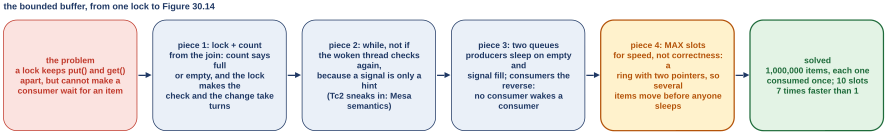
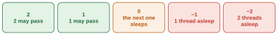
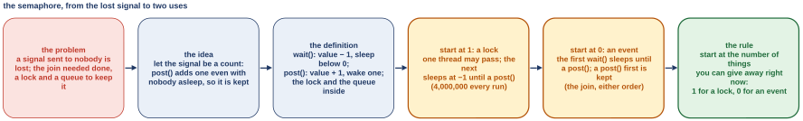
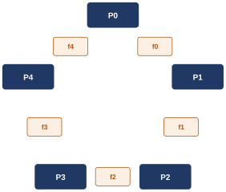
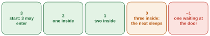

# Second class: producers and consumers, and the semaphore (OSTEP 30.2, 30.3 and 31) {#class-2}

<!-- classmap:start -->
<details class="abstract cmap-details" markdown="0" open>
<summary>Map of this class: the questions, and the steps of each</summary>
<div class="cmap-wrap">
<svg xmlns="http://www.w3.org/2000/svg" viewBox="0 0 796 1926" class="cmap" role="img" aria-label="Map of this class: each question, why we ask it, its steps, how we know, and what it settles; each box a link to its section">
<style>.cmap .cmap-link rect{transition:filter .15s} .cmap .cmap-link:hover rect{stroke-width:2.2;filter:drop-shadow(0 2px 4px rgba(0,0,0,.18))} .cmap .cmap-link:hover text{text-decoration:underline}</style>
<rect x="0" y="0" width="796" height="1926" fill="#ffffff"/>
<text x="10" y="20" font-family="Source Sans 3, Helvetica Neue, Arial, sans-serif" font-size="12" font-weight="700" letter-spacing=".05em" fill="#a0632a">WEEK 9 · MAP OF THIS CLASS</text>
<text x="10" y="36" font-family="Source Sans 3, Helvetica Neue, Arial, sans-serif" font-size="10.5" fill="#5b6675">Each question: why we ask it, the steps that answer it, how we know, and what it settles. Every box opens its section.</text>
<rect x="10" y="48" width="51" height="15" rx="3" fill="#b23a48"/>
<text x="16" y="59" font-family="Source Sans 3, Helvetica Neue, Arial, sans-serif" font-size="9.5" font-weight="600" fill="#fff">Problem</text>
<text x="66" y="59" font-family="Source Sans 3, Helvetica Neue, Arial, sans-serif" font-size="10" fill="#5b6675">why we ask: what breaks</text>
<rect x="192.9" y="48" width="51" height="15" rx="3" fill="#1f6f8b"/>
<text x="198.9" y="59" font-family="Source Sans 3, Helvetica Neue, Arial, sans-serif" font-size="9.5" font-weight="600" fill="#fff">Concept</text>
<text x="249" y="59" font-family="Source Sans 3, Helvetica Neue, Arial, sans-serif" font-size="10" fill="#5b6675">the idea, one step at a time</text>
<rect x="400.3" y="48" width="90" height="15" rx="3" fill="#5b7a2a"/>
<text x="406.3" y="59" font-family="Source Sans 3, Helvetica Neue, Arial, sans-serif" font-size="9.5" font-weight="600" fill="#fff">Worked example</text>
<text x="496" y="59" font-family="Source Sans 3, Helvetica Neue, Arial, sans-serif" font-size="10" fill="#5b6675">traced by hand</text>
<rect x="10" y="68" width="79" height="15" rx="3" fill="#a0632a"/>
<text x="16" y="79" font-family="Source Sans 3, Helvetica Neue, Arial, sans-serif" font-size="9.5" font-weight="600" fill="#fff">Real machine</text>
<text x="94" y="79" font-family="Source Sans 3, Helvetica Neue, Arial, sans-serif" font-size="10" fill="#5b6675">measured on a real computer</text>
<rect x="240.5" y="68" width="74" height="15" rx="3" fill="#6b4fa0"/>
<text x="246.5" y="79" font-family="Source Sans 3, Helvetica Neue, Arial, sans-serif" font-size="9.5" font-weight="600" fill="#fff">Real kernel</text>
<text x="319" y="79" font-family="Source Sans 3, Helvetica Neue, Arial, sans-serif" font-size="10" fill="#5b6675">read in xv6 or Linux</text>
<rect x="431.1" y="68" width="90" height="15" rx="3" fill="#2a7a6b"/>
<text x="437.1" y="79" font-family="Source Sans 3, Helvetica Neue, Arial, sans-serif" font-size="9.5" font-weight="600" fill="#fff">Check yourself</text>
<text x="526" y="79" font-family="Source Sans 3, Helvetica Neue, Arial, sans-serif" font-size="10" fill="#5b6675">what is settled, what is open</text>
<rect x="10" y="88" width="46" height="15" rx="3" fill="#7a7a7a"/>
<text x="16" y="99" font-family="Source Sans 3, Helvetica Neue, Arial, sans-serif" font-size="9.5" font-weight="600" fill="#fff">Deeper</text>
<text x="61" y="99" font-family="Source Sans 3, Helvetica Neue, Arial, sans-serif" font-size="10" fill="#5b6675">optional</text>
<a href="#opening-2" class="cmap-link"><title>Where we left off: locks inside structures, and a queue to sleep on</title><rect x="10" y="122" width="206" height="61" rx="6" fill="#f3f4f6" stroke="#9aa3b2" stroke-width="1.1"/><text x="20" y="138" font-family="Source Sans 3, Helvetica Neue, Arial, sans-serif" font-size="11.5" font-style="italic" fill="#3a4350">Where we left off: locks inside</text><text x="20" y="153" font-family="Source Sans 3, Helvetica Neue, Arial, sans-serif" font-size="11.5" font-style="italic" fill="#3a4350">structures, and a queue to sleep</text><text x="20" y="168" font-family="Source Sans 3, Helvetica Neue, Arial, sans-serif" font-size="11.5" font-style="italic" fill="#3a4350">on</text></a>
<a href="#sec-4-2" class="cmap-link"><title>4.2 Problem: A lock cannot make a consumer wait for an item</title><rect x="384" y="205" width="400" height="27" rx="6" fill="#ffffff" stroke="#b23a48" stroke-width="1.1"/><rect x="390" y="211" width="51" height="15" rx="3" fill="#b23a48"/><text x="396" y="221.5" font-family="Source Sans 3, Helvetica Neue, Arial, sans-serif" font-size="9.5" font-weight="600" fill="#fff">Problem</text><text x="448" y="223" font-family="Source Sans 3, Helvetica Neue, Arial, sans-serif" font-size="11.5" fill="#1b2430">4.2 A lock cannot make a consumer wait for an item</text></a>
<path d="M352,218 C368,218 368,218 384,218" fill="none" stroke="#b23a48" stroke-width="1.4"/>
<rect x="248" y="206" width="104" height="26" rx="13" fill="#ffffff" stroke="#b23a48" stroke-width="1.5"/>
<text x="300.0" y="222" text-anchor="middle" font-family="Source Sans 3, Helvetica Neue, Arial, sans-serif" font-size="11.5" font-weight="700" fill="#b23a48">Why we ask</text>
<a href="#sec-4-1" class="cmap-link"><title>4.1 Concept: A buffer with one slot: put() fills it, get() empties it</title><rect x="384" y="244" width="400" height="42" rx="6" fill="#ffffff" stroke="#1f6f8b" stroke-width="1.1"/><rect x="390" y="250" width="51" height="15" rx="3" fill="#1f6f8b"/><text x="396" y="260.5" font-family="Source Sans 3, Helvetica Neue, Arial, sans-serif" font-size="9.5" font-weight="600" fill="#fff">Concept</text><text x="448" y="262" font-family="Source Sans 3, Helvetica Neue, Arial, sans-serif" font-size="11.5" fill="#1b2430">4.1 A buffer with one slot: put() fills it, get()</text><text x="448" y="277" font-family="Source Sans 3, Helvetica Neue, Arial, sans-serif" font-size="11.5" fill="#1b2430">empties it</text></a>
<a href="#sec-4-3" class="cmap-link"><title>4.3 Worked example: Attempt 1: one condition variable and an if</title><rect x="384" y="290" width="400" height="27" rx="6" fill="#ffffff" stroke="#5b7a2a" stroke-width="1.1"/><rect x="390" y="296" width="90" height="15" rx="3" fill="#5b7a2a"/><text x="396" y="306.5" font-family="Source Sans 3, Helvetica Neue, Arial, sans-serif" font-size="9.5" font-weight="600" fill="#fff">Worked example</text><text x="487" y="308" font-family="Source Sans 3, Helvetica Neue, Arial, sans-serif" font-size="11.5" fill="#1b2430">4.3 Attempt 1: one condition variable and an if</text></a>
<a href="#sec-4-4" class="cmap-link"><title>4.4 Worked example: Attempt 1 traced: Tc2 takes the item, and Tc1&#x27;s get() hits an empty slot</title><rect x="384" y="321" width="400" height="42" rx="6" fill="#ffffff" stroke="#5b7a2a" stroke-width="1.1"/><rect x="390" y="327" width="90" height="15" rx="3" fill="#5b7a2a"/><text x="396" y="337.5" font-family="Source Sans 3, Helvetica Neue, Arial, sans-serif" font-size="9.5" font-weight="600" fill="#fff">Worked example</text><text x="487" y="339" font-family="Source Sans 3, Helvetica Neue, Arial, sans-serif" font-size="11.5" fill="#1b2430">4.4 Attempt 1 traced: Tc2 takes the item, and</text><text x="487" y="354" font-family="Source Sans 3, Helvetica Neue, Arial, sans-serif" font-size="11.5" fill="#1b2430">Tc1&#x27;s get() hits an empty slot</text></a>
<a href="#sec-4-5" class="cmap-link"><title>4.5 Worked example: Attempt 2: while, but one queue, and all three fall asleep</title><rect x="384" y="367" width="400" height="42" rx="6" fill="#ffffff" stroke="#5b7a2a" stroke-width="1.1"/><rect x="390" y="373" width="90" height="15" rx="3" fill="#5b7a2a"/><text x="396" y="383.5" font-family="Source Sans 3, Helvetica Neue, Arial, sans-serif" font-size="9.5" font-weight="600" fill="#fff">Worked example</text><text x="487" y="385" font-family="Source Sans 3, Helvetica Neue, Arial, sans-serif" font-size="11.5" fill="#1b2430">4.5 Attempt 2: while, but one queue, and all</text><text x="487" y="400" font-family="Source Sans 3, Helvetica Neue, Arial, sans-serif" font-size="11.5" fill="#1b2430">three fall asleep</text></a>
<a href="#sec-4-6" class="cmap-link"><title>4.6 Concept: Step 3: two condition variables, one queue per side</title><rect x="384" y="413" width="400" height="27" rx="6" fill="#ffffff" stroke="#1f6f8b" stroke-width="1.1"/><rect x="390" y="419" width="51" height="15" rx="3" fill="#1f6f8b"/><text x="396" y="429.5" font-family="Source Sans 3, Helvetica Neue, Arial, sans-serif" font-size="9.5" font-weight="600" fill="#fff">Concept</text><text x="448" y="431" font-family="Source Sans 3, Helvetica Neue, Arial, sans-serif" font-size="11.5" fill="#1b2430">4.6 Step 3: two condition variables, one queue per side</text></a>
<a href="#sec-4-7" class="cmap-link"><title>4.7 Concept: Step 4: MAX slots, a ring with fill_ptr, use_ptr and count</title><rect x="384" y="444" width="400" height="42" rx="6" fill="#ffffff" stroke="#1f6f8b" stroke-width="1.1"/><rect x="390" y="450" width="51" height="15" rx="3" fill="#1f6f8b"/><text x="396" y="460.5" font-family="Source Sans 3, Helvetica Neue, Arial, sans-serif" font-size="9.5" font-weight="600" fill="#fff">Concept</text><text x="448" y="462" font-family="Source Sans 3, Helvetica Neue, Arial, sans-serif" font-size="11.5" fill="#1b2430">4.7 Step 4: MAX slots, a ring with fill_ptr, use_ptr and</text><text x="448" y="477" font-family="Source Sans 3, Helvetica Neue, Arial, sans-serif" font-size="11.5" fill="#1b2430">count</text></a>
<a href="#sec-4-9" class="cmap-link"><title>4.9 Concept: The buffer&#x27;s design: four pieces, and where each came from</title><rect x="384" y="490" width="400" height="42" rx="6" fill="#ffffff" stroke="#1f6f8b" stroke-width="1.1"/><rect x="390" y="496" width="51" height="15" rx="3" fill="#1f6f8b"/><text x="396" y="506.5" font-family="Source Sans 3, Helvetica Neue, Arial, sans-serif" font-size="9.5" font-weight="600" fill="#fff">Concept</text><text x="448" y="508" font-family="Source Sans 3, Helvetica Neue, Arial, sans-serif" font-size="11.5" fill="#1b2430">4.9 The buffer&#x27;s design: four pieces, and where each</text><text x="448" y="523" font-family="Source Sans 3, Helvetica Neue, Arial, sans-serif" font-size="11.5" fill="#1b2430">came from</text></a>
<path d="M352,388 C368,388 368,265 384,265" fill="none" stroke="#1f6f8b" stroke-width="1.4"/>
<path d="M352,388 C368,388 368,304 384,304" fill="none" stroke="#1f6f8b" stroke-width="1.4"/>
<path d="M352,388 C368,388 368,342 384,342" fill="none" stroke="#1f6f8b" stroke-width="1.4"/>
<path d="M352,388 C368,388 368,388 384,388" fill="none" stroke="#1f6f8b" stroke-width="1.4"/>
<path d="M352,388 C368,388 368,426 384,426" fill="none" stroke="#1f6f8b" stroke-width="1.4"/>
<path d="M352,388 C368,388 368,465 384,465" fill="none" stroke="#1f6f8b" stroke-width="1.4"/>
<path d="M352,388 C368,388 368,511 384,511" fill="none" stroke="#1f6f8b" stroke-width="1.4"/>
<rect x="248" y="375" width="104" height="26" rx="13" fill="#ffffff" stroke="#1f6f8b" stroke-width="1.5"/>
<text x="300.0" y="392" text-anchor="middle" font-family="Source Sans 3, Helvetica Neue, Arial, sans-serif" font-size="11.5" font-weight="700" fill="#1f6f8b">The steps</text>
<a href="#sec-4-8" class="cmap-link"><title>4.8 Real machine: Measured: every item consumed exactly once; 10 slots beat 1</title><rect x="384" y="544" width="400" height="42" rx="6" fill="#ffffff" stroke="#a0632a" stroke-width="1.1"/><rect x="390" y="550" width="79" height="15" rx="3" fill="#a0632a"/><text x="396" y="560.5" font-family="Source Sans 3, Helvetica Neue, Arial, sans-serif" font-size="9.5" font-weight="600" fill="#fff">Real machine</text><text x="476" y="562" font-family="Source Sans 3, Helvetica Neue, Arial, sans-serif" font-size="11.5" fill="#1b2430">4.8 Measured: every item consumed exactly once; 10</text><text x="476" y="577" font-family="Source Sans 3, Helvetica Neue, Arial, sans-serif" font-size="11.5" fill="#1b2430">slots beat 1</text></a>
<a href="#sec-4-10" class="cmap-link"><title>4.10 Real kernel: xv6&#x27;s pipe is this buffer: 512 bytes, two sleep addresses</title><rect x="384" y="590" width="400" height="42" rx="6" fill="#ffffff" stroke="#6b4fa0" stroke-width="1.1"/><rect x="390" y="596" width="74" height="15" rx="3" fill="#6b4fa0"/><text x="396" y="606.5" font-family="Source Sans 3, Helvetica Neue, Arial, sans-serif" font-size="9.5" font-weight="600" fill="#fff">Real kernel</text><text x="471" y="608" font-family="Source Sans 3, Helvetica Neue, Arial, sans-serif" font-size="11.5" fill="#1b2430">4.10 xv6&#x27;s pipe is this buffer: 512 bytes, two sleep</text><text x="471" y="623" font-family="Source Sans 3, Helvetica Neue, Arial, sans-serif" font-size="11.5" fill="#1b2430">addresses</text></a>
<a href="#sec-4-11" class="cmap-link"><title>4.11 Real kernel: xv6&#x27;s sleep() is wait(); wakeup() wakes every sleeper</title><rect x="384" y="636" width="400" height="42" rx="6" fill="#ffffff" stroke="#6b4fa0" stroke-width="1.1"/><rect x="390" y="642" width="74" height="15" rx="3" fill="#6b4fa0"/><text x="396" y="652.5" font-family="Source Sans 3, Helvetica Neue, Arial, sans-serif" font-size="9.5" font-weight="600" fill="#fff">Real kernel</text><text x="471" y="654" font-family="Source Sans 3, Helvetica Neue, Arial, sans-serif" font-size="11.5" fill="#1b2430">4.11 xv6&#x27;s sleep() is wait(); wakeup() wakes every</text><text x="471" y="669" font-family="Source Sans 3, Helvetica Neue, Arial, sans-serif" font-size="11.5" fill="#1b2430">sleeper</text></a>
<path d="M352,611 C368,611 368,565 384,565" fill="none" stroke="#a0632a" stroke-width="1.4"/>
<path d="M352,611 C368,611 368,611 384,611" fill="none" stroke="#a0632a" stroke-width="1.4"/>
<path d="M352,611 C368,611 368,657 384,657" fill="none" stroke="#a0632a" stroke-width="1.4"/>
<rect x="248" y="598" width="104" height="26" rx="13" fill="#ffffff" stroke="#a0632a" stroke-width="1.5"/>
<text x="300.0" y="615" text-anchor="middle" font-family="Source Sans 3, Helvetica Neue, Arial, sans-serif" font-size="11.5" font-weight="700" fill="#a0632a">How we know</text>
<a href="#sec-4-12" class="cmap-link"><title>4.12 Check yourself: What the first question of the second class settled</title><rect x="384" y="690" width="400" height="42" rx="6" fill="#ffffff" stroke="#2a7a6b" stroke-width="1.1"/><rect x="390" y="696" width="90" height="15" rx="3" fill="#2a7a6b"/><text x="396" y="706.5" font-family="Source Sans 3, Helvetica Neue, Arial, sans-serif" font-size="9.5" font-weight="600" fill="#fff">Check yourself</text><text x="487" y="708" font-family="Source Sans 3, Helvetica Neue, Arial, sans-serif" font-size="11.5" fill="#1b2430">4.12 What the first question of the second class</text><text x="487" y="723" font-family="Source Sans 3, Helvetica Neue, Arial, sans-serif" font-size="11.5" fill="#1b2430">settled</text></a>
<a href="#summary-2" class="cmap-link"><title>The answer</title><rect x="384" y="736" width="400" height="76" rx="6" fill="#eef7f4" stroke="#2a7a6b" stroke-width="1.1"/><text x="394" y="752" font-family="Source Sans 3, Helvetica Neue, Arial, sans-serif" font-size="11.5" fill="#1b2430">The answer: Two condition variables, each side waking only the</text><text x="394" y="767" font-family="Source Sans 3, Helvetica Neue, Arial, sans-serif" font-size="11.5" fill="#1b2430">other, and always while: the if broke under Mesa semantics, the</text><text x="394" y="782" font-family="Source Sans 3, Helvetica Neue, Arial, sans-serif" font-size="11.5" fill="#1b2430">single queue woke the wrong thread. xv6&#x27;s pipe is this with two</text><text x="394" y="797" font-family="Source Sans 3, Helvetica Neue, Arial, sans-serif" font-size="11.5" fill="#1b2430">sleep addresses.</text></a>
<path d="M352,751 C368,751 368,711 384,711" fill="none" stroke="#2a7a6b" stroke-width="1.4"/>
<path d="M352,751 C368,751 368,774 384,774" fill="none" stroke="#2a7a6b" stroke-width="1.4"/>
<rect x="248" y="738" width="104" height="26" rx="13" fill="#ffffff" stroke="#2a7a6b" stroke-width="1.5"/>
<text x="300.0" y="755" text-anchor="middle" font-family="Source Sans 3, Helvetica Neue, Arial, sans-serif" font-size="11.5" font-weight="700" fill="#2a7a6b">What it settles</text>
<a href="#extra-6" class="cmap-link"><title>Extra 6 Deeper, Q1: Covering conditions: unsure whom to wake, so wake everyone</title><rect x="384" y="824" width="400" height="42" rx="6" fill="#fafafa" stroke="#7a7a7a" stroke-width="1.1" stroke-dasharray="4 3"/><rect x="390" y="830" width="68" height="15" rx="3" fill="#7a7a7a"/><text x="396" y="840.5" font-family="Source Sans 3, Helvetica Neue, Arial, sans-serif" font-size="9.5" font-weight="600" fill="#fff">Deeper, Q1</text><text x="465" y="842" font-family="Source Sans 3, Helvetica Neue, Arial, sans-serif" font-size="11.5" fill="#5b6675">Extra 6 Covering conditions: unsure whom to wake, so</text><text x="465" y="857" font-family="Source Sans 3, Helvetica Neue, Arial, sans-serif" font-size="11.5" fill="#5b6675">wake everyone</text></a>
<path d="M352,845 C368,845 368,845 384,845" fill="none" stroke="#7a7a7a" stroke-width="1.4" stroke-dasharray="4 3"/>
<rect x="248" y="832" width="104" height="26" rx="13" fill="#ffffff" stroke="#7a7a7a" stroke-width="1.5" stroke-dasharray="4 3"/>
<text x="300.0" y="849" text-anchor="middle" font-family="Source Sans 3, Helvetica Neue, Arial, sans-serif" font-size="11.5" font-weight="700" fill="#7a7a7a">Going deeper</text>
<path d="M216,538 C232,538 232,218 248,218" fill="none" stroke="#a0632a" stroke-width="1.4"/>
<path d="M216,538 C232,538 232,388 248,388" fill="none" stroke="#a0632a" stroke-width="1.4"/>
<path d="M216,538 C232,538 232,611 248,611" fill="none" stroke="#a0632a" stroke-width="1.4"/>
<path d="M216,538 C232,538 232,751 248,751" fill="none" stroke="#a0632a" stroke-width="1.4"/>
<path d="M216,538 C232,538 232,845 248,845" fill="none" stroke="#a0632a" stroke-width="1.4" stroke-dasharray="4 3"/>
<a href="#chapter-4" class="cmap-link"><title>Q1. How do producers and consumers share a buffer, using condition variables?</title><rect x="10" y="496" width="206" height="84" rx="8" fill="#ffffff" stroke="#a0632a" stroke-width="1.9"/><circle cx="28" cy="516" r="11" fill="#a0632a"/><text x="28" y="520" text-anchor="middle" font-family="Source Sans 3, Helvetica Neue, Arial, sans-serif" font-size="11" font-weight="700" fill="#fff">Q1</text><text x="48" y="520" font-family="Source Sans 3, Helvetica Neue, Arial, sans-serif" font-size="12.5" font-weight="600" fill="#1b2430">How do producers and</text><text x="48" y="536" font-family="Source Sans 3, Helvetica Neue, Arial, sans-serif" font-size="12.5" font-weight="600" fill="#1b2430">consumers share a</text><text x="48" y="552" font-family="Source Sans 3, Helvetica Neue, Arial, sans-serif" font-size="12.5" font-weight="600" fill="#1b2430">buffer, using condition</text><text x="48" y="568" font-family="Source Sans 3, Helvetica Neue, Arial, sans-serif" font-size="12.5" font-weight="600" fill="#1b2430">variables?</text></a>
<text x="113.0" y="888" text-anchor="middle" font-family="Source Sans 3, Helvetica Neue, Arial, sans-serif" font-size="10" font-style="italic" fill="#6b7482">↓ what is left open leads to the next question</text>
<a href="#sec-5-1" class="cmap-link"><title>5.1 Problem: A signal sent to nobody is lost; a count would remember it</title><rect x="384" y="900" width="400" height="42" rx="6" fill="#ffffff" stroke="#b23a48" stroke-width="1.1"/><rect x="390" y="906" width="51" height="15" rx="3" fill="#b23a48"/><text x="396" y="916.5" font-family="Source Sans 3, Helvetica Neue, Arial, sans-serif" font-size="9.5" font-weight="600" fill="#fff">Problem</text><text x="448" y="918" font-family="Source Sans 3, Helvetica Neue, Arial, sans-serif" font-size="11.5" fill="#1b2430">5.1 A signal sent to nobody is lost; a count would</text><text x="448" y="933" font-family="Source Sans 3, Helvetica Neue, Arial, sans-serif" font-size="11.5" fill="#1b2430">remember it</text></a>
<path d="M352,921 C368,921 368,921 384,921" fill="none" stroke="#b23a48" stroke-width="1.4"/>
<rect x="248" y="908" width="104" height="26" rx="13" fill="#ffffff" stroke="#b23a48" stroke-width="1.5"/>
<text x="300.0" y="925" text-anchor="middle" font-family="Source Sans 3, Helvetica Neue, Arial, sans-serif" font-size="11.5" font-weight="700" fill="#b23a48">Why we ask</text>
<a href="#sec-5-2" class="cmap-link"><title>5.2 Concept: Step 1: a counter that wait() lowers and post() raises</title><rect x="384" y="954" width="400" height="42" rx="6" fill="#ffffff" stroke="#1f6f8b" stroke-width="1.1"/><rect x="390" y="960" width="51" height="15" rx="3" fill="#1f6f8b"/><text x="396" y="970.5" font-family="Source Sans 3, Helvetica Neue, Arial, sans-serif" font-size="9.5" font-weight="600" fill="#fff">Concept</text><text x="448" y="972" font-family="Source Sans 3, Helvetica Neue, Arial, sans-serif" font-size="11.5" fill="#1b2430">5.2 Step 1: a counter that wait() lowers and post()</text><text x="448" y="987" font-family="Source Sans 3, Helvetica Neue, Arial, sans-serif" font-size="11.5" fill="#1b2430">raises</text></a>
<a href="#sec-5-4" class="cmap-link"><title>5.4 Worked example: Step 3: start at 0, and one thread waits for another</title><rect x="384" y="1000" width="400" height="42" rx="6" fill="#ffffff" stroke="#5b7a2a" stroke-width="1.1"/><rect x="390" y="1006" width="90" height="15" rx="3" fill="#5b7a2a"/><text x="396" y="1016.5" font-family="Source Sans 3, Helvetica Neue, Arial, sans-serif" font-size="9.5" font-weight="600" fill="#fff">Worked example</text><text x="487" y="1018" font-family="Source Sans 3, Helvetica Neue, Arial, sans-serif" font-size="11.5" fill="#1b2430">5.4 Step 3: start at 0, and one thread waits for</text><text x="487" y="1033" font-family="Source Sans 3, Helvetica Neue, Arial, sans-serif" font-size="11.5" fill="#1b2430">another</text></a>
<a href="#sec-5-5" class="cmap-link"><title>5.5 Concept: The semaphore&#x27;s design: the start value picks its job</title><rect x="384" y="1046" width="400" height="42" rx="6" fill="#ffffff" stroke="#1f6f8b" stroke-width="1.1"/><rect x="390" y="1052" width="51" height="15" rx="3" fill="#1f6f8b"/><text x="396" y="1062.5" font-family="Source Sans 3, Helvetica Neue, Arial, sans-serif" font-size="9.5" font-weight="600" fill="#fff">Concept</text><text x="448" y="1064" font-family="Source Sans 3, Helvetica Neue, Arial, sans-serif" font-size="11.5" fill="#1b2430">5.5 The semaphore&#x27;s design: the start value picks its</text><text x="448" y="1079" font-family="Source Sans 3, Helvetica Neue, Arial, sans-serif" font-size="11.5" fill="#1b2430">job</text></a>
<path d="M352,1021 C368,1021 368,975 384,975" fill="none" stroke="#1f6f8b" stroke-width="1.4"/>
<path d="M352,1021 C368,1021 368,1021 384,1021" fill="none" stroke="#1f6f8b" stroke-width="1.4"/>
<path d="M352,1021 C368,1021 368,1067 384,1067" fill="none" stroke="#1f6f8b" stroke-width="1.4"/>
<rect x="248" y="1008" width="104" height="26" rx="13" fill="#ffffff" stroke="#1f6f8b" stroke-width="1.5"/>
<text x="300.0" y="1025" text-anchor="middle" font-family="Source Sans 3, Helvetica Neue, Arial, sans-serif" font-size="11.5" font-weight="700" fill="#1f6f8b">The steps</text>
<a href="#sec-5-3" class="cmap-link"><title>5.3 Real machine: Step 2: start at 1, and a semaphore is a lock</title><rect x="384" y="1100" width="400" height="27" rx="6" fill="#ffffff" stroke="#a0632a" stroke-width="1.1"/><rect x="390" y="1106" width="79" height="15" rx="3" fill="#a0632a"/><text x="396" y="1116.5" font-family="Source Sans 3, Helvetica Neue, Arial, sans-serif" font-size="9.5" font-weight="600" fill="#fff">Real machine</text><text x="476" y="1118" font-family="Source Sans 3, Helvetica Neue, Arial, sans-serif" font-size="11.5" fill="#1b2430">5.3 Step 2: start at 1, and a semaphore is a lock</text></a>
<path d="M352,1114 C368,1114 368,1114 384,1114" fill="none" stroke="#a0632a" stroke-width="1.4"/>
<rect x="248" y="1100" width="104" height="26" rx="13" fill="#ffffff" stroke="#a0632a" stroke-width="1.5"/>
<text x="300.0" y="1118" text-anchor="middle" font-family="Source Sans 3, Helvetica Neue, Arial, sans-serif" font-size="11.5" font-weight="700" fill="#a0632a">How we know</text>
<a href="#sec-5-6" class="cmap-link"><title>5.6 Check yourself: What the second question of the second class settled</title><rect x="384" y="1139" width="400" height="42" rx="6" fill="#ffffff" stroke="#2a7a6b" stroke-width="1.1"/><rect x="390" y="1145" width="90" height="15" rx="3" fill="#2a7a6b"/><text x="396" y="1155.5" font-family="Source Sans 3, Helvetica Neue, Arial, sans-serif" font-size="9.5" font-weight="600" fill="#fff">Check yourself</text><text x="487" y="1157" font-family="Source Sans 3, Helvetica Neue, Arial, sans-serif" font-size="11.5" fill="#1b2430">5.6 What the second question of the second class</text><text x="487" y="1172" font-family="Source Sans 3, Helvetica Neue, Arial, sans-serif" font-size="11.5" fill="#1b2430">settled</text></a>
<a href="#summary-2" class="cmap-link"><title>The answer</title><rect x="384" y="1185" width="400" height="61" rx="6" fill="#eef7f4" stroke="#2a7a6b" stroke-width="1.1"/><text x="394" y="1201" font-family="Source Sans 3, Helvetica Neue, Arial, sans-serif" font-size="11.5" fill="#1b2430">The answer: A count with a queue: wait() subtracts and sleeps</text><text x="394" y="1216" font-family="Source Sans 3, Helvetica Neue, Arial, sans-serif" font-size="11.5" fill="#1b2430">below zero, post() adds and wakes one. Start at 1: a lock. Start</text><text x="394" y="1231" font-family="Source Sans 3, Helvetica Neue, Arial, sans-serif" font-size="11.5" fill="#1b2430">at 0: a wait for an event, with the post kept in the count.</text></a>
<path d="M352,1192 C368,1192 368,1160 384,1160" fill="none" stroke="#2a7a6b" stroke-width="1.4"/>
<path d="M352,1192 C368,1192 368,1216 384,1216" fill="none" stroke="#2a7a6b" stroke-width="1.4"/>
<rect x="248" y="1180" width="104" height="26" rx="13" fill="#ffffff" stroke="#2a7a6b" stroke-width="1.5"/>
<text x="300.0" y="1196" text-anchor="middle" font-family="Source Sans 3, Helvetica Neue, Arial, sans-serif" font-size="11.5" font-weight="700" fill="#2a7a6b">What it settles</text>
<a href="#extra-7" class="cmap-link"><title>Extra 7 Deeper, Q2: A semaphore built from a lock and a condition variable</title><rect x="384" y="1258" width="400" height="42" rx="6" fill="#fafafa" stroke="#7a7a7a" stroke-width="1.1" stroke-dasharray="4 3"/><rect x="390" y="1264" width="68" height="15" rx="3" fill="#7a7a7a"/><text x="396" y="1274.5" font-family="Source Sans 3, Helvetica Neue, Arial, sans-serif" font-size="9.5" font-weight="600" fill="#fff">Deeper, Q2</text><text x="465" y="1276" font-family="Source Sans 3, Helvetica Neue, Arial, sans-serif" font-size="11.5" fill="#5b6675">Extra 7 A semaphore built from a lock and a condition</text><text x="465" y="1291" font-family="Source Sans 3, Helvetica Neue, Arial, sans-serif" font-size="11.5" fill="#5b6675">variable</text></a>
<a href="#extra-9" class="cmap-link"><title>Extra 9 Deeper, Q2: A semaphore as a door that lets in at most N threads</title><rect x="384" y="1304" width="400" height="42" rx="6" fill="#fafafa" stroke="#7a7a7a" stroke-width="1.1" stroke-dasharray="4 3"/><rect x="390" y="1310" width="68" height="15" rx="3" fill="#7a7a7a"/><text x="396" y="1320.5" font-family="Source Sans 3, Helvetica Neue, Arial, sans-serif" font-size="9.5" font-weight="600" fill="#fff">Deeper, Q2</text><text x="465" y="1322" font-family="Source Sans 3, Helvetica Neue, Arial, sans-serif" font-size="11.5" fill="#5b6675">Extra 9 A semaphore as a door that lets in at most N</text><text x="465" y="1337" font-family="Source Sans 3, Helvetica Neue, Arial, sans-serif" font-size="11.5" fill="#5b6675">threads</text></a>
<path d="M352,1302 C368,1302 368,1279 384,1279" fill="none" stroke="#7a7a7a" stroke-width="1.4" stroke-dasharray="4 3"/>
<path d="M352,1302 C368,1302 368,1325 384,1325" fill="none" stroke="#7a7a7a" stroke-width="1.4" stroke-dasharray="4 3"/>
<rect x="248" y="1289" width="104" height="26" rx="13" fill="#ffffff" stroke="#7a7a7a" stroke-width="1.5" stroke-dasharray="4 3"/>
<text x="300.0" y="1306" text-anchor="middle" font-family="Source Sans 3, Helvetica Neue, Arial, sans-serif" font-size="11.5" font-weight="700" fill="#7a7a7a">Going deeper</text>
<path d="M216,1125 C232,1125 232,921 248,921" fill="none" stroke="#a0632a" stroke-width="1.4"/>
<path d="M216,1125 C232,1125 232,1021 248,1021" fill="none" stroke="#a0632a" stroke-width="1.4"/>
<path d="M216,1125 C232,1125 232,1114 248,1114" fill="none" stroke="#a0632a" stroke-width="1.4"/>
<path d="M216,1125 C232,1125 232,1192 248,1192" fill="none" stroke="#a0632a" stroke-width="1.4"/>
<path d="M216,1125 C232,1125 232,1302 248,1302" fill="none" stroke="#a0632a" stroke-width="1.4" stroke-dasharray="4 3"/>
<a href="#chapter-5" class="cmap-link"><title>Q2. What is a semaphore, and how can one counter act as a lock or as a signal?</title><rect x="10" y="1083" width="206" height="84" rx="8" fill="#ffffff" stroke="#a0632a" stroke-width="1.9"/><circle cx="28" cy="1103" r="11" fill="#a0632a"/><text x="28" y="1107" text-anchor="middle" font-family="Source Sans 3, Helvetica Neue, Arial, sans-serif" font-size="11" font-weight="700" fill="#fff">Q2</text><text x="48" y="1107" font-family="Source Sans 3, Helvetica Neue, Arial, sans-serif" font-size="12.5" font-weight="600" fill="#1b2430">What is a semaphore, and</text><text x="48" y="1123" font-family="Source Sans 3, Helvetica Neue, Arial, sans-serif" font-size="12.5" font-weight="600" fill="#1b2430">how can one counter act</text><text x="48" y="1139" font-family="Source Sans 3, Helvetica Neue, Arial, sans-serif" font-size="12.5" font-weight="600" fill="#1b2430">as a lock or as a</text><text x="48" y="1155" font-family="Source Sans 3, Helvetica Neue, Arial, sans-serif" font-size="12.5" font-weight="600" fill="#1b2430">signal?</text></a>
<text x="113.0" y="1368" text-anchor="middle" font-family="Source Sans 3, Helvetica Neue, Arial, sans-serif" font-size="10" font-style="italic" fill="#6b7482">↓ what is left open leads to the next question</text>
<a href="#sec-6-4" class="cmap-link"><title>6.4 Problem: Readers wait for readers, though reading changes nothing</title><rect x="384" y="1380" width="400" height="42" rx="6" fill="#ffffff" stroke="#b23a48" stroke-width="1.1"/><rect x="390" y="1386" width="51" height="15" rx="3" fill="#b23a48"/><text x="396" y="1396.5" font-family="Source Sans 3, Helvetica Neue, Arial, sans-serif" font-size="9.5" font-weight="600" fill="#fff">Problem</text><text x="448" y="1398" font-family="Source Sans 3, Helvetica Neue, Arial, sans-serif" font-size="11.5" fill="#1b2430">6.4 Readers wait for readers, though reading changes</text><text x="448" y="1413" font-family="Source Sans 3, Helvetica Neue, Arial, sans-serif" font-size="11.5" fill="#1b2430">nothing</text></a>
<path d="M352,1401 C368,1401 368,1401 384,1401" fill="none" stroke="#b23a48" stroke-width="1.4"/>
<rect x="248" y="1388" width="104" height="26" rx="13" fill="#ffffff" stroke="#b23a48" stroke-width="1.5"/>
<text x="300.0" y="1405" text-anchor="middle" font-family="Source Sans 3, Helvetica Neue, Arial, sans-serif" font-size="11.5" font-weight="700" fill="#b23a48">Why we ask</text>
<a href="#sec-6-2" class="cmap-link"><title>6.2 Worked example: Attempt: lock around everything, and both sides wait forever</title><rect x="384" y="1434" width="400" height="42" rx="6" fill="#ffffff" stroke="#5b7a2a" stroke-width="1.1"/><rect x="390" y="1440" width="90" height="15" rx="3" fill="#5b7a2a"/><text x="396" y="1450.5" font-family="Source Sans 3, Helvetica Neue, Arial, sans-serif" font-size="9.5" font-weight="600" fill="#fff">Worked example</text><text x="487" y="1452" font-family="Source Sans 3, Helvetica Neue, Arial, sans-serif" font-size="11.5" fill="#1b2430">6.2 Attempt: lock around everything, and both</text><text x="487" y="1467" font-family="Source Sans 3, Helvetica Neue, Arial, sans-serif" font-size="11.5" fill="#1b2430">sides wait forever</text></a>
<a href="#sec-6-5" class="cmap-link"><title>6.5 Concept: Step 1: readers count themselves in and out</title><rect x="384" y="1480" width="400" height="27" rx="6" fill="#ffffff" stroke="#1f6f8b" stroke-width="1.1"/><rect x="390" y="1486" width="51" height="15" rx="3" fill="#1f6f8b"/><text x="396" y="1496.5" font-family="Source Sans 3, Helvetica Neue, Arial, sans-serif" font-size="9.5" font-weight="600" fill="#fff">Concept</text><text x="448" y="1498" font-family="Source Sans 3, Helvetica Neue, Arial, sans-serif" font-size="11.5" fill="#1b2430">6.5 Step 1: readers count themselves in and out</text></a>
<path d="M352,1470 C368,1470 368,1455 384,1455" fill="none" stroke="#1f6f8b" stroke-width="1.4"/>
<path d="M352,1470 C368,1470 368,1494 384,1494" fill="none" stroke="#1f6f8b" stroke-width="1.4"/>
<rect x="248" y="1458" width="104" height="26" rx="13" fill="#ffffff" stroke="#1f6f8b" stroke-width="1.5"/>
<text x="300.0" y="1474" text-anchor="middle" font-family="Source Sans 3, Helvetica Neue, Arial, sans-serif" font-size="11.5" font-weight="700" fill="#1f6f8b">The steps</text>
<a href="#sec-6-1" class="cmap-link"><title>6.1 Real machine: Semaphores count the slots, yet two producers write one slot</title><rect x="384" y="1519" width="400" height="42" rx="6" fill="#ffffff" stroke="#a0632a" stroke-width="1.1"/><rect x="390" y="1525" width="79" height="15" rx="3" fill="#a0632a"/><text x="396" y="1535.5" font-family="Source Sans 3, Helvetica Neue, Arial, sans-serif" font-size="9.5" font-weight="600" fill="#fff">Real machine</text><text x="476" y="1537" font-family="Source Sans 3, Helvetica Neue, Arial, sans-serif" font-size="11.5" fill="#1b2430">6.1 Semaphores count the slots, yet two producers</text><text x="476" y="1552" font-family="Source Sans 3, Helvetica Neue, Arial, sans-serif" font-size="11.5" fill="#1b2430">write one slot</text></a>
<a href="#sec-6-3" class="cmap-link"><title>6.3 Real machine: Lock only put() and get(), and the bounded buffer works</title><rect x="384" y="1565" width="400" height="42" rx="6" fill="#ffffff" stroke="#a0632a" stroke-width="1.1"/><rect x="390" y="1571" width="79" height="15" rx="3" fill="#a0632a"/><text x="396" y="1581.5" font-family="Source Sans 3, Helvetica Neue, Arial, sans-serif" font-size="9.5" font-weight="600" fill="#fff">Real machine</text><text x="476" y="1583" font-family="Source Sans 3, Helvetica Neue, Arial, sans-serif" font-size="11.5" fill="#1b2430">6.3 Lock only put() and get(), and the bounded</text><text x="476" y="1598" font-family="Source Sans 3, Helvetica Neue, Arial, sans-serif" font-size="11.5" fill="#1b2430">buffer works</text></a>
<a href="#sec-6-6" class="cmap-link"><title>6.6 Real machine: Step 2, measured: 4 readers together, 3 times faster than 1 thread, 5 times faster than the mutex</title><rect x="384" y="1611" width="400" height="42" rx="6" fill="#ffffff" stroke="#a0632a" stroke-width="1.1"/><rect x="390" y="1617" width="79" height="15" rx="3" fill="#a0632a"/><text x="396" y="1627.5" font-family="Source Sans 3, Helvetica Neue, Arial, sans-serif" font-size="9.5" font-weight="600" fill="#fff">Real machine</text><text x="476" y="1629" font-family="Source Sans 3, Helvetica Neue, Arial, sans-serif" font-size="11.5" fill="#1b2430">6.6 Step 2, measured: 4 readers together, 3 times</text><text x="476" y="1644" font-family="Source Sans 3, Helvetica Neue, Arial, sans-serif" font-size="11.5" fill="#1b2430">faster than 1 thread, 5 times faster than the mutex</text></a>
<path d="M352,1586 C368,1586 368,1540 384,1540" fill="none" stroke="#a0632a" stroke-width="1.4"/>
<path d="M352,1586 C368,1586 368,1586 384,1586" fill="none" stroke="#a0632a" stroke-width="1.4"/>
<path d="M352,1586 C368,1586 368,1632 384,1632" fill="none" stroke="#a0632a" stroke-width="1.4"/>
<rect x="248" y="1573" width="104" height="26" rx="13" fill="#ffffff" stroke="#a0632a" stroke-width="1.5"/>
<text x="300.0" y="1590" text-anchor="middle" font-family="Source Sans 3, Helvetica Neue, Arial, sans-serif" font-size="11.5" font-weight="700" fill="#a0632a">How we know</text>
<a href="#sec-6-7" class="cmap-link"><title>6.7 Check yourself: What the third question of the second class settled</title><rect x="384" y="1665" width="400" height="42" rx="6" fill="#ffffff" stroke="#2a7a6b" stroke-width="1.1"/><rect x="390" y="1671" width="90" height="15" rx="3" fill="#2a7a6b"/><text x="396" y="1681.5" font-family="Source Sans 3, Helvetica Neue, Arial, sans-serif" font-size="9.5" font-weight="600" fill="#fff">Check yourself</text><text x="487" y="1683" font-family="Source Sans 3, Helvetica Neue, Arial, sans-serif" font-size="11.5" fill="#1b2430">6.7 What the third question of the second class</text><text x="487" y="1698" font-family="Source Sans 3, Helvetica Neue, Arial, sans-serif" font-size="11.5" fill="#1b2430">settled</text></a>
<a href="#summary-2" class="cmap-link"><title>The answer</title><rect x="384" y="1711" width="400" height="61" rx="6" fill="#eef7f4" stroke="#2a7a6b" stroke-width="1.1"/><text x="394" y="1727" font-family="Source Sans 3, Helvetica Neue, Arial, sans-serif" font-size="11.5" fill="#1b2430">The answer: empty at MAX, full at 0, and a binary mutex inside</text><text x="394" y="1742" font-family="Source Sans 3, Helvetica Neue, Arial, sans-serif" font-size="11.5" fill="#1b2430">the waits (outside, it deadlocks). A reader-writer lock from two</text><text x="394" y="1757" font-family="Source Sans 3, Helvetica Neue, Arial, sans-serif" font-size="11.5" fill="#1b2430">semaphores and a count: readers share, a writer goes alone.</text></a>
<path d="M352,1718 C368,1718 368,1686 384,1686" fill="none" stroke="#2a7a6b" stroke-width="1.4"/>
<path d="M352,1718 C368,1718 368,1742 384,1742" fill="none" stroke="#2a7a6b" stroke-width="1.4"/>
<rect x="248" y="1706" width="104" height="26" rx="13" fill="#ffffff" stroke="#2a7a6b" stroke-width="1.5"/>
<text x="300.0" y="1722" text-anchor="middle" font-family="Source Sans 3, Helvetica Neue, Arial, sans-serif" font-size="11.5" font-weight="700" fill="#2a7a6b">What it settles</text>
<a href="#extra-8" class="cmap-link"><title>Extra 8 Deeper, Q3: The dining philosophers: five forks, five threads, one deadlock</title><rect x="384" y="1784" width="400" height="42" rx="6" fill="#fafafa" stroke="#7a7a7a" stroke-width="1.1" stroke-dasharray="4 3"/><rect x="390" y="1790" width="68" height="15" rx="3" fill="#7a7a7a"/><text x="396" y="1800.5" font-family="Source Sans 3, Helvetica Neue, Arial, sans-serif" font-size="9.5" font-weight="600" fill="#fff">Deeper, Q3</text><text x="465" y="1802" font-family="Source Sans 3, Helvetica Neue, Arial, sans-serif" font-size="11.5" fill="#5b6675">Extra 8 The dining philosophers: five forks, five</text><text x="465" y="1817" font-family="Source Sans 3, Helvetica Neue, Arial, sans-serif" font-size="11.5" fill="#5b6675">threads, one deadlock</text></a>
<path d="M352,1805 C368,1805 368,1805 384,1805" fill="none" stroke="#7a7a7a" stroke-width="1.4" stroke-dasharray="4 3"/>
<rect x="248" y="1792" width="104" height="26" rx="13" fill="#ffffff" stroke="#7a7a7a" stroke-width="1.5" stroke-dasharray="4 3"/>
<text x="300.0" y="1809" text-anchor="middle" font-family="Source Sans 3, Helvetica Neue, Arial, sans-serif" font-size="11.5" font-weight="700" fill="#7a7a7a">Going deeper</text>
<path d="M216,1605 C232,1605 232,1401 248,1401" fill="none" stroke="#a0632a" stroke-width="1.4"/>
<path d="M216,1605 C232,1605 232,1470 248,1470" fill="none" stroke="#a0632a" stroke-width="1.4"/>
<path d="M216,1605 C232,1605 232,1586 248,1586" fill="none" stroke="#a0632a" stroke-width="1.4"/>
<path d="M216,1605 C232,1605 232,1718 248,1718" fill="none" stroke="#a0632a" stroke-width="1.4"/>
<path d="M216,1605 C232,1605 232,1805 248,1805" fill="none" stroke="#a0632a" stroke-width="1.4" stroke-dasharray="4 3"/>
<a href="#chapter-6" class="cmap-link"><title>Q3. How do semaphores share a buffer, and let readers in together?</title><rect x="10" y="1571" width="206" height="68" rx="8" fill="#ffffff" stroke="#a0632a" stroke-width="1.9"/><circle cx="28" cy="1591" r="11" fill="#a0632a"/><text x="28" y="1595" text-anchor="middle" font-family="Source Sans 3, Helvetica Neue, Arial, sans-serif" font-size="11" font-weight="700" fill="#fff">Q3</text><text x="48" y="1595" font-family="Source Sans 3, Helvetica Neue, Arial, sans-serif" font-size="12.5" font-weight="600" fill="#1b2430">How do semaphores share</text><text x="48" y="1611" font-family="Source Sans 3, Helvetica Neue, Arial, sans-serif" font-size="12.5" font-weight="600" fill="#1b2430">a buffer, and let</text><text x="48" y="1627" font-family="Source Sans 3, Helvetica Neue, Arial, sans-serif" font-size="12.5" font-weight="600" fill="#1b2430">readers in together?</text></a>
<a href="#summary-2" class="cmap-link"><title>What the second class settled</title><rect x="10" y="1860" width="206" height="50" rx="7" fill="#555e6b"/><text x="21" y="1879" font-family="Source Sans 3, Helvetica Neue, Arial, sans-serif" font-size="12" font-weight="600" fill="#fff">Summary: What the second class</text><text x="21" y="1895" font-family="Source Sans 3, Helvetica Neue, Arial, sans-serif" font-size="12" font-weight="600" fill="#fff">settled</text></a>
</svg>
</div>
<p><a href="../maps/class-2.svg" target="_blank" rel="noopener">Open the map in its own tab</a></p>
</details>
<!-- classmap:end -->

## <span class="lbl lbl-roadmap">Roadmap</span> Where we left off: locks inside structures, and a queue to sleep on {#opening-2 data-toc-label="[Roadmap] Where we left off: locks inside structures, and a queue to sleep on"}

The first class ended with the join. The parent locks, sees that `done` is 0, and sleeps on `c`, which releases the lock. The child finishes, locks, writes `done = 1`, signals `c` (the parent moves to ready), and unlocks.

<figure markdown="1">
{width=75%}
<figcaption markdown="1">Figure 4.1. The join with a condition variable: the parent asleep on `c`'s queue; the child works, then locks, sets `done`, signals and unlocks.</figcaption>
</figure>

Figure 4.1 is that picture. The words we carry forward:

- **thread safe**: right answers even when many threads call at once (one lock per structure);
- **approximate counter**: a count per CPU, moved into a global count every S adds;
- **condition variable**: a queue a thread sleeps on until another thread says something changed;
- `wait(c, m)`: release the lock `m` and sleep on `c` in one step; take `m` back before returning;
- `signal(c)`: wake a thread sleeping on `c`; with nobody asleep, nothing happens;
- the variable of our own (`done`, which OSTEP calls the **state variable**): the record of the event; the condition variable is only the wake-up.

Settled: a shared structure carries its own lock; splitting it into parts with a lock each scales when threads need different parts, and only the clock says by how much. To wait for an event: keep it in a variable, check it with the lock held, and `wait()` on a condition variable; the thread that changes the variable signals. Left open: the join had one waiter, one event and one signal. The lock was held around both the check and the change, and the check was a `while` loop. A buffer shared by several producers and consumers has many of both, and two things break there that did not break in the join: must the check be a `while`, and whom should a signal wake? And long before condition variables, Edsger Dijkstra, the Dutch computer scientist who first posed this buffer problem ([Chapter 5](#chapter-5) says more), built one primitive that counts on its own; the guide asks whether it can replace the three pieces.

So the second class asks three questions:

1. How do producers and consumers share a buffer, using condition variables? ([Chapter 4](#chapter-4))
2. What is a semaphore, and how can one counter act as a lock or as a signal? ([Chapter 5](#chapter-5))
3. How do semaphores share a buffer, and let readers in together? ([Chapter 6](#chapter-6))

The first shares a buffer between producers and consumers with condition variables; two attempts fail before the third works, and each failure gives a rule. The second meets the semaphore, a counter that threads can wait on. The third solves the same buffer with semaphores, where the first place the lock goes deadlocks (every thread waits for another, forever; [Chapter 6](#chapter-6) defines the word), and then a lock that lets readers in together.

## Chapter 4. How producers and consumers share a buffer, using condition variables {#chapter-4}

*The question this chapter answers: how do producers and consumers share a buffer, using condition variables?*

### 4.1 <span class="lbl lbl-concept">Concept</span> A buffer with one slot: put() fills it, get() empties it {#sec-4-1 data-toc-label="4.1 [Concept] A buffer with one slot: put() fills it, get() empties it"}

The join had one waiter and one event. The classic shared structure has many of both: a **buffer**, a place where items are kept between the thread that makes them and the thread that uses them. Producers fill it and consumers drain it. The simplest buffer there is has a single slot. `W09_demos/pc_if.c` lines 7 to 21 (OSTEP Figure 30.6's buffer, with its checks):

```c linenums="7" hl_lines="2 3 6 7 8 12 13 14"
#define LOOPS 100000
int buffer;
int count = 0;                  // initially, empty

void put(int value) {
    assert(count == 0);
    count = 1;
    buffer = value;
}

int get() {
    assert(count == 1);
    count = 0;
    return buffer;
}
```

- Lines 8 and 9: the slot, `buffer`, one `int`; and a count that says whether it is full, `count`, 0 for empty and 1 for full. `LOOPS` is how many items each consumer takes.
- Lines 12 to 14, `put()`: only into an empty slot. `assert(count == 0)` is a check that stops the program with a message if its condition is false; so `put()` on a full slot kills the program instead of silently overwriting the item. Then line 13 marks the slot full and line 14 stores the value.
- Lines 18 to 20, `get()`: only from a full slot. `assert(count == 1)`, mark the slot empty, hand the value back.

Why a count beside the slot? Because an `int` in the slot cannot say whether it is a fresh item or a stale one. The count says full or empty, and `put()` and `get()` check it with an `assert`, so a wrong order shows up at once instead of silently. One item through the slot: the producer calls `put(value)`; `count == 0`? else the program stops; `count = 1`, `buffer = value`; the consumer calls `get()`; `count == 1`? else the program stops; `count = 0`, return `buffer`.

Anyone who uses a shell uses one of these. `grep foo file.txt | wc -l` runs two programs (`grep` prints the lines of `file.txt` that contain `foo`; `wc -l` counts the lines it receives). The buffer between the two programs is this idea inside the kernel, with more slots: `grep` is the producer, `wc` the consumer, and the pipe is the buffer.

- What this part settled: a buffer with one slot and a count, and two functions that assert the count before they touch the slot.
- What it leaves open: what happens when threads of two kinds use it. The next part puts them on it.

*The argument in one line:* why a count beside the slot? the slot alone cannot say full or empty → `count`: 0 or 1 | `put()` and `get()` assert it.

### 4.2 <span class="lbl lbl-problem">Problem</span> A lock cannot make a consumer wait for an item {#sec-4-2 data-toc-label="4.2 [Problem] A lock cannot make a consumer wait for an item"}

What we have is the slot of [Section 4.1](#sec-4-1) and two kinds of threads. Producers put and consumers get, and the slot starts empty.

<figure markdown="1">
{width=70%}
<figcaption markdown="1">Figure 4.2. A producer, the slot with `count = 0`, a consumer. The producer must wait while the slot is full; the consumer must wait while it is empty.</figcaption>
</figure>

Figure 4.2: a producer must hold back while the slot is full (`count == 1`), and a consumer must hold back while it is empty (`count == 0`). Each side waits for a change the other side makes: the consumer for a `put()`, the producer for a `get()`. That is the join's situation again, now with many threads on both sides and the roles switching back and forth.

Where it breaks: two producers must not both `put()`; a lock does that. But a consumer that finds the slot empty must wait until a producer fills it, and a lock has no answer for that: a lock keeps two puts apart; it cannot make a consumer wait for a put. In OSTEP's words, "putting a lock around the code doesn't work; we need something more". That something more is the join's pieces again: a place to sleep until the slot changes, and a wake-up when it does; a lock, a variable (`count`), a wait and a signal.

This problem has a name. The **producer/consumer problem**, also called the **bounded buffer problem** (a buffer of fixed size), was first posed by Dijkstra: threads that add items to a shared buffer of fixed size, and threads that take them out, each side waiting when the buffer is full or empty. It is everywhere: a web server's work queue, where producers put requests in and worker threads take them out; and every pipe, the kernel's buffer between two programs.

So we need the join's recipe on both sides. With two consumers, the first try breaks, the second try breaks differently, and the third works. The fix comes in three tries, each fixing what the one before broke, then one change for speed:

1. first try: `if`, one queue: a consumer sneaks in;
2. second try: `while`, one queue: all three fall asleep;
3. third try: `while`, two queues: it works;
4. then more slots, for speed.

- What this part settled: a lock cannot make a consumer wait for an item; each side waits for a change the other side makes, which is the join's situation with many threads.
- What it leaves open: the three tries. The first is next.

*The argument in one line:* why not just a lock? a lock keeps two puts apart | it cannot make a consumer wait for a put | the join again, with many on each side.

### 4.3 <span class="lbl lbl-example">Worked example</span> Attempt 1: one condition variable and an if {#sec-4-3 data-toc-label="4.3 [Worked example] Attempt 1: one condition variable and an if"}

Try the join's recipe twice: one lock, one condition variable, an `if` on each side. `W09_demos/pc_if.c` lines 26 to 48 (OSTEP Figure 30.8, with its p1 to p6 and c1 to c6 labels):

```c linenums="26" hl_lines="3 4 5 6 7 8 15 16 17 18 19 20"
void *producer(void *arg) {
    for (int i = 0; i < 2 * LOOPS; i++) {
        pthread_mutex_lock(&mutex);              // p1
        if (count == 1)                          // p2
            pthread_cond_wait(&cond, &mutex);    // p3
        put(i);                                  // p4
        pthread_cond_signal(&cond);              // p5
        pthread_mutex_unlock(&mutex);            // p6
    }
    return NULL;
}

void *consumer(void *arg) {
    for (int i = 0; i < LOOPS; i++) {
        pthread_mutex_lock(&mutex);              // c1
        if (count == 0)                          // c2
            pthread_cond_wait(&cond, &mutex);    // c3
        get();                                   // c4
        pthread_cond_signal(&cond);              // c5
        pthread_mutex_unlock(&mutex);            // c6
    }
    return NULL;
}
```

- The producer, lines 28 to 33, labeled p1 to p6: lock; if `count == 1` (the slot is full), wait, which releases the lock and sleeps; put the item; signal; unlock. The loop runs `2 * LOOPS` times because one producer feeds two consumers of `LOOPS` each.
- The consumer, lines 40 to 45, c1 to c6, is the mirror image: lock; if `count == 0` (empty), wait; get; signal; unlock.
- One signal, shared by both sides: `cond` (declared on line 23, not shown) is the one condition variable; p5 and c5 signal the same `cond`, and wake whoever is asleep on it.

Why does this look right? Each side locks, checks, waits if it must, changes the slot, signals and unlocks: the join written twice. With one producer and one consumer, OSTEP says, it works (the guide did not run that case; a spurious wake-up, [Section 3.5](class-1.md#sec-3-5), could still break the `if`). The chapter runs it with one producer, Tp, and two consumers, Tc1 and Tc2, and two things break. Notice one thing in the producer's flow before the trace: lock; if `count == 1`, wait; `put(i)`; signal; unlock; and a woken producer goes straight to `put()`, with no second check. The trace in the next part breaks on the consumer's missing second check; the producer's is the same flaw, waiting for a different interleaving (a different order in which the threads' steps mix).

- What this part settled: the first try, the join's recipe twice, with an `if` and one queue.
- What it leaves open: the trace with a second consumer, which breaks it.

*The argument in one line:* why does this look right? lock, check, wait, change, signal, unlock | the join written twice | one producer, one consumer: the book says it works.

### 4.4 <span class="lbl lbl-example">Worked example</span> Attempt 1 traced: Tc2 takes the item, and Tc1's get() hits an empty slot {#sec-4-4 data-toc-label="4.4 [Worked example] Attempt 1 traced: Tc2 takes the item, and Tc1's get() hits an empty slot"}

The first break comes from the `if`. OSTEP Figure 30.9 traces one producer, Tp, and two consumers, Tc1 and Tc2. Read down, one row per line a thread runs, the count after it, and who is asleep on `cond`. First half:

| step | thread | line | what happens | count | asleep on `cond` |
|---|---|---|---|---|---|
| 1 | Tc1 | c1, c2 | locks; count is 0, so it must wait | 0 | |
| 2 | Tc1 | c3 | `wait()`: releases the lock, sleeps | 0 | Tc1 |
| 3 | Tp | p1, p2 | locks; count is 0: no wait | 0 | Tc1 |
| 4 | Tp | p4 | `put()`: the slot is full | 1 | Tc1 |
| 5 | Tp | p5 | `signal()`: Tc1 moves to ready; its `wait()` must take the lock back before it can go on, and Tp still holds it | 1 | |
| 6 | Tp | p6, p1, p2 | unlocks, loops, locks again before Tc1 can (Tp is already running on its CPU); count is 1, so it must wait | 1 | |
| 7 | Tp | p3 | `wait()`: releases the lock, sleeps | 1 | Tp |

<figure markdown="1">
{width=75%}
<figcaption markdown="1">Figure 4.3. After step 7: Tp asleep on `cond`, Tc1 ready, the slot full.</figcaption>
</figure>

After step 7 (Figure 4.3): the slot holds one item, Tc1 is ready and believes there is an item for it, Tp is asleep. Nobody holds the lock. The dangerous word is "ready". Tc1 was woken by a signal, which only moved it to the ready list; the next thing it must do, inside `wait()`, is take the lock back. Which thread gets the lock next is up to the scheduler, and on four CPUs Tc1 may already be running and asking for it. Here another thread asks first. A third thread, Tc2, has not appeared yet. It appears now:

| step | thread | line | what happens | count | asleep on `cond` |
|---|---|---|---|---|---|
| 8 | Tc2 | c1, c2 | locks; count is 1: no wait | 1 | Tp |
| 9 | Tc2 | c4 | `get()`: takes the item; the slot is empty | 0 | Tp |
| 10 | Tc2 | c5 | `signal()`: Tp moves to ready | 0 | |
| 11 | Tc2 | c6 | unlocks | 0 | |
| 12 | Tc1 | c4 | runs at last: `get()` on an empty slot | 0 | |

Why it broke: Tc1 checked `count` once, before it slept, with an `if`. When it woke, the world had changed: Tc2 had taken the item. A signal only says "something changed, look again"; it does not keep the slot full for the one it woke. OSTEP's name for this is **Mesa semantics**: a signal is a hint that the state changed, not a promise that it is still changed when the woken thread runs; it is the rule for nearly every system (named for Mesa, the language of the system where it was first built), because the alternative, making a signal a promise, means handing the lock and the CPU straight to the woken thread, which is costly and awkward to build; a hint plus a re-check is cheap.

On the 4-CPU Linux VM the `assert` in `get()` fired in all three runs. From `W09_demos/pc_if.out`, the first of three runs that all end the same way:

```text
$ ./pc_if; echo "exit status $?"
pc_if: pc_if.c:18: get: Assertion `count == 1' failed.
exit status 134
```

`assert(count == 1)` in `get()` (line 18 of the file) stopped the program; 134 is the exit status for a program that stopped itself this way.

The first rule: check again after waking, every time; the `if` becomes a `while`. OSTEP Figure 30.10 does exactly that, and it still breaks.

- What this part settled: with an `if`, a consumer woken by a signal trusts a check it made before it slept, and a second consumer can take the item in between: Mesa semantics.
- What it leaves open: the second break, which the `while` does not fix.

*The argument in one line:* why does the `if` break? Tc2 takes the item between the signal and Tc1 running → Tc1 trusts its old check | a signal is a hint: Mesa semantics.

### 4.5 <span class="lbl lbl-example">Worked example</span> Attempt 2: while, but one queue, and all three fall asleep {#sec-4-5 data-toc-label="4.5 [Worked example] Attempt 2: while, but one queue, and all three fall asleep"}

The `while` fixes the first break: a woken consumer re-checks `count` with the lock held and, if the slot is empty, goes back to sleep. `W09_demos/pc_onecv.c` differs from `pc_if.c` in two lines (OSTEP Figure 30.10):

```text
// pc_onecv: pc_if with the two ifs made whiles
    while (count == 1)      // p2, was if
        pthread_cond_wait(&cond, &mutex);
    ...
    while (count == 0)      // c2, was if
        pthread_cond_wait(&cond, &mutex);
```

Now the second break: with one condition variable, a consumer's signal can wake the other consumer instead of the producer. Four moments:

1. Both consumers asleep. Tc1 and Tc2 found the slot empty and wait on `cond`. Tp runs.
2. Tp fills the slot and signals. One sleeper, Tc1, moves to ready. Tp loops, finds the slot full, and sleeps on `cond` too.
3. Tc1 takes the item and signals. Who is on the queue? Tp and Tc2. The signal wakes one sleeper on `cond`, and it may be Tc2, not Tp (OSTEP Figure 30.11 follows that case). Tc1 loops, finds the slot empty, sleeps.
4. Tc2 wakes, checks with its `while`, finds the slot empty, sleeps. All three are asleep on `cond`. Nobody is left to put an item. Forever.

<figure markdown="1">
{width=65%}
<figcaption markdown="1">Figure 4.4. `cond`'s queue at moment 4: Tp, Tc1 and Tc2, all asleep. That queue is the whole program.</figcaption>
</figure>

Figure 4.4 is moment 4. Our run was killed by the timeout after 5 seconds, from `W09_demos/pc_onecv.out`:

```text
$ timeout 5 ./pc_onecv; echo "exit status $?"
exit status 124
```

Honest about the capture: 5 seconds is short. At the one-slot rate of [Section 4.8](#sec-4-8) (21.66 s per 1,000,000 items), the 200,000 items of this program (2 × `LOOPS`, Sections [4.1](#sec-4-1) and [4.3](#sec-4-3)) would take about 21.66 × 0.2 = 4.3 s even in a working run (the rate is measured three parts on, in [Section 4.8](#sec-4-8)) (a rough estimate, since that rate comes from a different program with two producers), so the exit status alone does not separate a hang from a slow run. What shows that a hang must come is the trace above: once moment 3 wakes Tc2 instead of Tp, after moment 4 all three threads are asleep and nobody is left to signal, so no amount of time would finish it; what would show that a run reached that state is CPU time near zero over a long wait, which this capture does not print (a rerun with a 60-second timeout on another Linux machine, the one this guide was built on, ended the same way: killed at 60 s with 0.002 s of CPU time used, which fits everyone asleep and nothing else the program could be doing; the guide reports the run but has no capture of it to print). The second rule: a consumer must wake a producer, never another consumer, and a producer must wake a consumer. One queue cannot tell them apart. Signal the right queue, and that needs two condition variables.

- What this part settled: with one queue, a consumer's signal can wake the other consumer, and then everyone sleeps.
- What it leaves open: the version that works, with two queues.

*The argument in one line:* why does one queue fail? Tc1 signals: the sleeper it wakes may be Tc2 | Tp stays asleep | everyone ends up asleep.

### 4.6 <span class="lbl lbl-concept">Concept</span> Step 3: two condition variables, one queue per side {#sec-4-6 data-toc-label="4.6 [Concept] Step 3: two condition variables, one queue per side"}

Signaling must be directed: a consumer wakes only producers, a producer only consumers. So two condition variables, one per side, and still a `while`. `W09_demos/pc.c` lines 31 to 51 (OSTEP Figure 30.14; the buffer already has `MAX` slots, which [Section 4.7](#sec-4-7) explains):

```c linenums="31" hl_lines="5 6 8 17 18 20"
void *producer(void *arg) {
    int base = (int)(long)arg * ITEMS;
    for (int i = 0; i < ITEMS; i++) {
        pthread_mutex_lock(&mutex);              // p1
        while (count == MAX)                     // p2
            pthread_cond_wait(&empty, &mutex);   // p3
        put(base + i);                           // p4
        pthread_cond_signal(&fill);              // p5
        pthread_mutex_unlock(&mutex);            // p6
    }
    return NULL;
}

void *consumer(void *arg) {
    for (int i = 0; i < ITEMS; i++) {
        pthread_mutex_lock(&mutex);              // c1
        while (count == 0)                       // c2
            pthread_cond_wait(&fill, &mutex);    // c3
        int tmp = get();                         // c4
        pthread_cond_signal(&empty);             // c5
        pthread_mutex_unlock(&mutex);            // c6
```

- Lines 35 and 36: the producer checks in a `while`, and while the buffer is full (`count == MAX`) it sleeps on a queue called `empty`. Only producers ever sleep there. Each queue is named for what its sleepers are waiting for: a producer waits for an empty slot, so its queue is `empty`; a consumer waits for a slot to be filled, so its queue is `fill`.
- Line 38: after putting, it signals `fill`, where only consumers sleep. So a producer can never wake another producer by mistake.
- Lines 47, 48 and 50: the consumer is the mirror image. It sleeps on `fill` while `count == 0`, and after getting it signals `empty`. (Line 52, cut from the listing, counts each item taken; [Section 4.8](#sec-4-8) reads that count. `ITEMS` is 500,000 per producer; `base` is this producer's number times `ITEMS`, so the two producers make different items; `(int)(long)arg` turns the thread's number back into a number: a thread's one input is a `void *` (Part 0), so `main` smuggles the number through that pointer slot; two casts because C turns a pointer into a whole number only through a type as wide as a pointer, `long`, and then into an `int`.)

So there are two queues and two kinds of sleeper, and each side rings only the other side's bell. The producer's flow, with the `while`: lock; while `count == MAX`, wait on `empty`; `put(base + i)`; signal `fill` (a consumer); unlock; and a woken producer goes back to the test, not straight to `put()`. The consumer mirrors it.


<!-- anim:prodcons:start -->
Step through the three versions of Sections 4.3 to 4.6 yourself: the if that fails, the single queue where everyone sleeps, and the two queues that work.

<div class="anim" data-anim="prodcons" markdown="0"></div>
<!-- anim:prodcons:end -->

- What this part settled: producers sleep on `empty` and signal `fill`; consumers sleep on `fill` and signal `empty`; and the check stays a `while`.
- What it leaves open: why the buffer grew to `MAX` slots.

*The argument in one line:* why two condition variables? producers sleep on `empty`, consumers on `fill` | signal `fill`: only a consumer wakes | and always `while`.

### 4.7 <span class="lbl lbl-concept">Concept</span> Step 4: MAX slots, a ring with fill_ptr, use_ptr and count {#sec-4-7 data-toc-label="4.7 [Concept] Step 4: MAX slots, a ring with fill_ptr, use_ptr and count"}

The listing of [Section 4.6](#sec-4-6) already said `MAX`. Here is why. With one slot nearly every item costs a sleep and a wake-up: the producer fills, and finds the slot full on its next try unless a consumer got there first; a consumer drains, and finds it empty on its next try unless the producer did. `MAX` slots let several items move before anyone sleeps. This step is for speed, not correctness. `W09_demos/pc.c` lines 7 to 25 (OSTEP Figure 30.13; `ITEMS` is 500,000 items per producer):

```c linenums="7" hl_lines="2 3 4 5 6 9 10 11 15 16 17"
#define ITEMS 500000                 // per producer
int MAX;                             // buffer slots, from the command line
int *buffer;
int fill_ptr = 0;
int use_ptr = 0;
int count = 0;

void put(int value) {
    buffer[fill_ptr] = value;
    fill_ptr = (fill_ptr + 1) % MAX;
    count++;
}

int get() {
    int tmp = buffer[use_ptr];
    use_ptr = (use_ptr + 1) % MAX;
    count--;
    return tmp;
}
```

- Lines 8 to 12: the ring. `buffer` is `MAX` `int`s (`MAX` comes from the command line; `main` asks `malloc()`, the call that hands out memory while a program runs, for the array). `fill_ptr` is where the next `put()` goes; `use_ptr` is where the next `get()` reads; `count` is how many slots are full.
- Lines 15 to 17, `put()`: store at `fill_ptr`, step the fill pointer around, count up. `(fill_ptr + 1) % MAX` is the remainder, which wraps 9 back to 0 when `MAX` is 10: after slot 9 comes slot 0, so the array is used as a ring.
- Lines 21 to 23, `get()`: read at `use_ptr` into `tmp` (which holds the item while the pointer moves), step the use pointer around the same way, count down.

<figure markdown="1">
{width=80%}
<figcaption markdown="1">Figure 4.5. The ring with `MAX = 10`: three items inside, `use_ptr = 0`, `fill_ptr = 3`, `count = 3`.</figcaption>
</figure>

In Figure 4.5 three items are inside, `use_ptr` is at 0 and `fill_ptr` at 3. A producer may `put()` until `count` reaches 10, and a consumer may `get()` until it reaches 0. Why two pointers and a count? `fill_ptr` marks the next free slot and `use_ptr` the next item, each wrapping around the ring; `count` tells the two `while` loops of [Section 4.6](#sec-4-6) whether the buffer is full or empty.

- What this part settled: the buffer is a ring of `MAX` slots, with a fill pointer, a use pointer and a count.
- What it leaves open: whether all four steps give a correct buffer, and what the slots bought. The next part runs it.

*The argument in one line:* why two pointers and a count? a ring: the next free slot and the next item are different places → `fill_ptr` and `use_ptr` | full or empty: `count`, for the `while` loops.

### 4.8 <span class="lbl lbl-machine">Real machine</span> Measured: every item consumed exactly once; 10 slots beat 1 {#sec-4-8 data-toc-label="4.8 [Real machine] Measured: every item consumed exactly once; 10 slots beat 1"}

All four steps are in. Two things to check: is it still correct with 2 producers, 2 consumers and 1,000,000 items (2 × 500,000, since each producer makes `ITEMS` = 500,000), and did the slots buy anything? The program counts how many times each item was consumed (line 52 of `pc.c`, `seen[tmp]++`), and `main` reports how many items were consumed exactly once. `MAX = 1` against `MAX = 10` (10 is OSTEP Figure 30.13's size; any small number shows the effect), from `W09_demos/pc.out`, first run of two:

```text
$ /usr/bin/time -f 'real %e s' ./pc 1
MAX 1: 1000000 items, 1000000 consumed exactly once
real 21.66 s
$ /usr/bin/time -f 'real %e s' ./pc 10
MAX 10: 1000000 items, 1000000 consumed exactly once
real 2.99 s
```

Both sizes are correct: 1,000,000 items in, 1,000,000 consumed exactly once, none lost, none twice. The two rules hold: `while`, not `if`; and each side signals only the other side's queue.

The speed: with one slot, 21.66 s; with ten, 2.99 s. 21.66 / 2.99 = 7.2, so one slot is about 7 times slower. Why? With one slot nearly every item costs a sleep and a wake-up: after each fill the slot is full until a consumer drains it, and after each drain it is empty until a producer fills it, so whichever side comes back first usually sleeps. Sleeping and waking goes through the kernel (the futex of Part 0): a system call, the scheduler putting one thread to sleep and later waking it, and a switch to another thread, many instructions in all (the `strace` row in Part 0, from last week's x86-64 machine, reports 12 microseconds per futex call, with strace's own overhead inside; the VM's figure is not measured, but the order of magnitude is the point), where storing one `int` is one instruction. With 10 slots a producer can put several items before it waits. The run measures only the total, so the extra 21.66 − 2.99 = 18.67, about 19 seconds, is the whole price of one slot, not a count of sleeps.

- What this part settled: the four-step buffer is correct with two of each kind of thread, and 10 slots are about 7 times faster than 1.
- What it leaves open: the design, on one page.

*The argument in one line:* why is one slot so slow? 1 slot: every item needs a sleep and a wake-up | 10 slots: several puts per wait | sleeping goes through the kernel.

### 4.9 <span class="lbl lbl-concept">Concept</span> The buffer's design: four pieces, and where each came from {#sec-4-9 data-toc-label="4.9 [Concept] The buffer's design: four pieces, and where each came from"}

A working bounded buffer has four pieces that must all agree. One came from the join, two came from versions that broke in front of you, and one is for speed.

<figure markdown="1">
{width=100%}
<figcaption markdown="1">Figure 4.6. The bounded buffer, from one lock to OSTEP Figure 30.14: the problem, the four pieces, and what they solved.</figcaption>
</figure>

Figure 4.6, left to right:

- the problem: a lock keeps `put()` and `get()` apart, but cannot make a consumer wait for an item;
- piece 1, lock plus count: from the join; `count` says full or empty, and the lock makes the check and the change take turns;
- piece 2, `while`, not `if`: the woken thread checks again, because a signal is only a hint (Tc2 sneaks in: Mesa semantics);
- piece 3, two queues: producers sleep on `empty` and signal `fill`; consumers the reverse; no consumer wakes a consumer;
- piece 4, `MAX` slots: for speed, not correctness: a ring with two pointers, so several items move before anyone sleeps;
- solved: 1,000,000 items, each one consumed once; 10 slots 7 times faster than 1.

The principle: every wait is a `while` on a shared variable, under the lock, on a queue of its own. The variable `count` is what both sides want to know, so every decision to sleep reads it with the lock held. A thread that wakes up re-reads it, because the world may have changed while it was on the ready list. Each side sleeps on its own queue, so a signal always reaches the side that can use it. And more slots are not for correctness: they buy fewer trips through the kernel. xv6's pipe, next, is this same design with two sleep addresses.

- What this part settled: the four pieces of the buffer and the failure or cost each one answers.
- What it leaves open: the same design inside a real kernel.

*The argument in one line:* why four pieces? one per problem: `put()` and `get()` at once, and nothing to check, so a lock and a count; a stale check, so `while`; the wrong sleeper, so two queues | slots: fewer trips through the kernel.

### 4.10 <span class="lbl lbl-kernel">Real kernel</span> xv6's pipe is this buffer: 512 bytes, two sleep addresses {#sec-4-10 data-toc-label="4.10 [Real kernel] xv6's pipe is this buffer: 512 bytes, two sleep addresses"}

Your own kernel has this buffer, built from the same four pieces in its own form. xv6 is the small teaching kernel this course reads (the source tree, the folder of its code, that you have is `xv6-setup-student`), and its pipe is the kernel's own producer/consumer: `piperead()` sleeps while the pipe is empty, `pipewrite()` sleeps while it is full, and each wakes the other. From `kernel/pipe.c`, the struct (lines 11 to 20):

```c linenums="11" hl_lines="1 4 6 7"
#define PIPESIZE 512

struct pipe {
  struct spinlock lock;
  char data[PIPESIZE];
  uint nread;     // number of bytes read
  uint nwrite;    // number of bytes written
  int readopen;   // read fd is still open
  int writeopen;  // write fd is still open
};
```

The buffer is 512 bytes (`PIPESIZE`, line 11; `data`, line 15; the size is xv6's choice of a small fixed buffer, not a rule), used as a ring. Line 14 is the lock, `struct spinlock`, xv6's lock type. Lines 16 and 17 are two counters that keep growing for the life of the pipe: `nread` is how many bytes have ever been read and `nwrite` how many have ever been written (`uint` is an unsigned `int`, a whole number that is never negative). Their difference, `nwrite − nread`, is this chapter's `count`, and each counter taken `% PIPESIZE` is one of its two pointers ([Section 4.7](#sec-4-7)), so two numbers do the work of three. Full: `nwrite == nread + PIPESIZE`. Empty: `nread == nwrite`. (`readopen` and `writeopen` say whether each end of the pipe is still open; an **fd**, a file descriptor, is the number a program uses to name an open file or pipe end. The guide leaves the closed-end checks aside.)

The writer, `pipewrite()`, lines 76 to 103; the lines the guide walks are highlighted:

```c linenums="76" hl_lines="7 8 13 14 15 20 24 25"
int
pipewrite(struct pipe *pi, uint64 addr, int n)
{
  int i = 0;
  struct proc *pr = myproc();

  acquire(&pi->lock);
  while(i < n){
    if(pi->readopen == 0 || killed(pr)){
      release(&pi->lock);
      return -1;
    }
    if(pi->nwrite == pi->nread + PIPESIZE){ //DOC: pipewrite-full
      wakeup(&pi->nread);
      sleep(&pi->nwrite, &pi->lock);
    } else {
      char ch;
      if(copyin(pr->pagetable, &ch, addr + i, 1) == -1)
        break;
      pi->data[pi->nwrite++ % PIPESIZE] = ch;
      i++;
    }
  }
  wakeup(&pi->nread);
  release(&pi->lock);

  return i;
}
```

`pi` is a pointer to the pipe; `addr` is where the user program's bytes are (`uint64` is a 64-bit unsigned whole number, the size of an address), and `n` how many. Line 80, `struct proc *pr = myproc()`, is the process doing the writing: `myproc()` returns the running process's entry in the kernel's **process table**, the array of records, one per process, that the kernel keeps ([Section 4.11](#sec-4-11) walks it). Line 82 takes the pipe's lock. Line 83 loops over the `n` bytes. Line 88 is the full test, `nwrite == nread + 512`. If full, line 89 wakes the readers (every process asleep on the address `&pi->nread`), so that a reader can drain the full pipe while the writer sleeps, and line 90 sleeps: `sleep(&pi->nwrite, &pi->lock)` releases the pipe's lock and sleeps on the address `&pi->nwrite`, and takes the lock back before returning, exactly as `wait()` did. When the loop comes back round, line 88 tests again: a `while`, not an `if`. Otherwise line 95 copies one byte into the ring (`pi->nwrite++ % PIPESIZE` is the fill pointer: `nwrite++` inside the brackets hands over the old value and then adds 1, so the byte goes to slot `nwrite % 512` and `nwrite` moves on; `copyin()` on line 93 fetches the byte from the user program's memory through `pr->pagetable`, that process's page table, the map from its addresses to real memory). After the loop, line 99 wakes the readers once more, because a reader may be asleep on a pipe that was empty before this write and has data now, and line 100 releases the lock. (`//DOC:` marks are notes the xv6 authors leave for their book; `killed(pr)` on line 84 handles a process that was killed while writing.)

The reader, `piperead()`, lines 105 to 130:

```c linenums="105" hl_lines="8 9 14 19 23 24"
int
piperead(struct pipe *pi, uint64 addr, int n)
{
  int i;
  struct proc *pr = myproc();
  char ch;

  acquire(&pi->lock);
  while(pi->nread == pi->nwrite && pi->writeopen){  //DOC: pipe-empty
    if(killed(pr)){
      release(&pi->lock);
      return -1;
    }
    sleep(&pi->nread, &pi->lock); //DOC: piperead-sleep
  }
  for(i = 0; i < n; i++){  //DOC: piperead-copy
    if(pi->nread == pi->nwrite)
      break;
    ch = pi->data[pi->nread++ % PIPESIZE];
    if(copyout(pr->pagetable, addr + i, &ch, 1) == -1)
      break;
  }
  wakeup(&pi->nwrite);  //DOC: piperead-wakeup
  release(&pi->lock);
  return i;
}
```

Line 112 takes the lock. Line 113 is the empty test, `nread == nwrite` (while the write end is still open, `&& pi->writeopen`), and line 118 sleeps on the address `&pi->nread` while it holds; a `while` again. Line 123 reads one byte from the ring (`nread++ % PIPESIZE`, the use pointer; `copyout()` hands it to the user program). Line 127 wakes the writers, every process asleep on `&pi->nwrite`, and line 128 releases.

Two addresses do the job of two condition variables. xv6 has no condition-variable type. It takes any address as the name of a **channel**, because an address is unique and costs nothing, so the kernel needs no new type and no table of queues: `sleep(chan, lock)` records the address and sleeps, and `wakeup(chan)` wakes everyone who recorded it. There is no queue data structure behind a channel; as [Section 4.11](#sec-4-11) shows, `wakeup()` finds the sleepers by scanning every process for that address. Readers sleep on `&pi->nread`, writers on `&pi->nwrite`: the two addresses play the part of the two queues of OSTEP Figure 30.14. And each side wakes only the other: after writing, the writer wakes `&pi->nread`; after reading, the reader wakes `&pi->nwrite`. The same rule as [Section 4.6](#sec-4-6). The writer's flow: acquire; `nwrite == nread + 512` (full)? wake the readers, sleep on `&nwrite`, test again; else copy one byte in, `nwrite++`; after the loop, wake the readers; release. The reader mirrors it.

- What this part settled: xv6's pipe is the four-piece buffer, with two sleep addresses for the two queues and a `while` on each side.
- What it leaves open: what `sleep()` and `wakeup()` do inside.

*The argument in one line:* why two addresses? xv6 has no condition-variable type: a sleeper records an address, and `wakeup(addr)` wakes everyone who recorded it | readers record `&nread`, writers `&nwrite`, so a wake-up reaches only the side that can use it.

### 4.11 <span class="lbl lbl-kernel">Real kernel</span> xv6's sleep() is wait(); wakeup() wakes every sleeper {#sec-4-11 data-toc-label="4.11 [Real kernel] xv6's sleep() is wait(); wakeup() wakes every sleeper"}

`kernel/proc.c` holds the two calls. `sleep()` drops the lock and sleeps in one protected step; `wakeup()` wakes all, which is why every caller checks in a `while`. Lines 537 to 566 and 568 to 584 of the students' tree:

```c linenums="537" hl_lines="15 16 19 20 22 28 29"
// Sleep on channel chan, releasing condition lock lk.
// Re-acquires lk when awakened.
void
sleep(void *chan, struct spinlock *lk)
{
  struct proc *p = myproc();
  
  // Must acquire p->lock in order to
  // change p->state and then call sched.
  // Once we hold p->lock, we can be
  // guaranteed that we won't miss any wakeup
  // (wakeup locks p->lock),
  // so it's okay to release lk.

  acquire(&p->lock);  //DOC: sleeplock1
  release(lk);

  // Go to sleep.
  p->chan = chan;
  p->state = SLEEPING;

  sched();

  // Tidy up.
  p->chan = 0;

  // Reacquire original lock.
  release(&p->lock);
  acquire(lk);
}
```

`chan` is the channel, the address to sleep on; `lk` is the caller's lock (the pipe's). `myproc()` on line 542 is the running process, and `p->lock` is that process's own lock: it guards the process's state field (`SLEEPING`; `RUNNABLE`, ready to run; `RUNNING`, on a CPU now), so that `wakeup()` and the scheduler on another CPU never change that state at the same moment. Line 551 takes `p->lock` first, and only then does line 552 release the caller's lock `lk`. That order closes the gap of [Section 3.9](class-1.md#sec-3-9): a wake-up cannot slip in between, because `wakeup()` needs `p->lock` too, so nobody can mark this process awake until it has finished lying down. Lines 555 and 556 record the channel and mark the process `SLEEPING` (one of the process states).

Line 558, `sched()`, switches this CPU from the process to the scheduler, the kernel's loop that picks what runs next. Here is the heart of `scheduler()`, `proc.c` lines 439 to 453 (the function's opening and its outer loop are left out):

```c linenums="439" hl_lines="1 8 15"
      acquire(&p->lock);
      if(p->state == RUNNABLE) {
        // Switch to chosen process.  It is the process's job
        // to release its lock and then reacquire it
        // before jumping back to us.
        p->state = RUNNING;
        c->proc = p;
        swtch(&c->context, &p->context);

        // Process is done running for now.
        // It should have changed its p->state before coming back.
        c->proc = 0;
        found = 1;
      }
      release(&p->lock);
```

(`c` is this CPU's record, which `mycpu()` returns; `c->proc` is the process it is running; `found` is a note that something ran this time round the loop; a `context` is the record of saved registers.) The switch itself is `swtch()`, a **context switch**: it saves this CPU's registers, including the place in the code where the CPU was, into one record, and loads another set of registers from a second record, so the CPU goes on from wherever that second set was saved. Line 446 is the scheduler's call. `sched()`, which `sleep()` calls on line 558, is a few checks and the other call, `proc.c` lines 469 to 487:

```c linenums="469" hl_lines="7 17"
void
sched(void)
{
  int intena;
  struct proc *p = myproc();

  if(!holding(&p->lock))
    panic("sched p->lock");
  if(mycpu()->noff != 1)
    panic("sched locks");
  if(p->state == RUNNING)
    panic("sched RUNNING");
  if(intr_get())
    panic("sched interruptible");

  intena = mycpu()->intena;
  swtch(&p->context, &mycpu()->context);
  mycpu()->intena = intena;
}
```

Line 475 insists that the caller holds `p->lock` (`panic()` stops the kernel with a message), and line 485 is the switch, the same two records as line 446 the other way round: save into the process's record, load this CPU's. (The other checks, and `intena`, are about interrupts and are not this chapter's business.)

Now the puzzle: line 551 took `p->lock`, and line 558 switches away without releasing it, yet `wakeup()` must take that lock to wake this process. Who releases it? In steps:

1. An xv6 spin lock is held by a CPU, not by a thread or a function: `acquire()` turns interrupts off (Part 0), so nothing can switch the CPU away while it holds the lock except the switch `sched()` makes on purpose, and `acquire()` writes the CPU's number into the lock as the holder (`kernel/spinlock.c`, the line `lk->cpu = mycpu();` at the end of `acquire()`; the record is there so that the kernel can check, and panic, when a CPU takes a lock it already holds or releases one it does not). Say the process is on CPU 2: CPU 2 holds `p->lock`, whatever code CPU 2 runs next.
2. Line 558 calls `sched()`, whose `swtch()` saves the process's registers into `p->context` and loads `c->context`, the scheduler's registers, which were saved inside the `swtch()` call on line 446 when the scheduler last switched to a process. (A brand-new process has a saved scheduler context to return to as well, because the only way any process gets a CPU is that line.)
3. The saved registers include the place in the code, so CPU 2 goes on right after line 446, inside the scheduler, still holding `p->lock`. The process set its state to `SLEEPING` before switching, as the comment there says, so the scheduler will not pick it again until `wakeup()` marks it `RUNNABLE`; the scheduler goes on to line 453 and releases `p->lock`. Only from then on can `wakeup()` take it.
4. When the scheduler later picks this process again, it takes `p->lock` first (line 439) and switches back (line 446), so the process wakes up after line 558 holding its own lock: line 564 gives it back, and line 565 takes the caller's lock back before returning, which is the same contract as `pthread_cond_wait()`.

```c linenums="568" hl_lines="8 9 10 11 12 14"
// Wake up all processes sleeping on channel chan.
// Caller should hold the condition lock.
void
wakeup(void *chan)
{
  struct proc *p;

  for(p = proc; p < &proc[NPROC]; p++) {
    if(p != myproc()){
      acquire(&p->lock);
      if(p->state == SLEEPING && p->chan == chan) {
        p->state = RUNNABLE;
      }
      release(&p->lock);
    }
  }
}
```

`wakeup()` walks the whole process table (`proc` is the table, `NPROC` its size; line 575 steps through every entry). For every process other than the caller (line 576: the caller is running, so it cannot be asleep on anything), it takes that process's lock (line 577), and if the process is `SLEEPING` on this very channel (line 578), marks it `RUNNABLE` (line 579), allowed to run again; then releases (line 581). Every process asleep on the address wakes, not just one, because the kernel cannot know whose condition is now true; waking all and letting each re-check is simple and never leaves the right sleeper asleep. So several sleepers on one address all wake, and only one of them may find the condition true; the rest must check and sleep again. In xv6 the `while` loop is not a style choice.

The flow of `sleep()`, with `wakeup()` in the middle: `sleep(chan, lk)`: acquire `p->lock`; release `lk`; `p->chan = chan`, state `SLEEPING`; `sched()`: the scheduler runs and releases `p->lock`; `wakeup(chan)` takes `p->lock`, sets the state to `RUNNABLE`, releases; the scheduler takes `p->lock` and switches back; release `p->lock`, acquire `lk`, return.


<!-- anim:xv6sleep:start -->
Step through it yourself: a reader sleeps on an empty pipe, a write wakes every sleeper on that address, and each one checks again.

<div class="anim" data-anim="xv6sleep" markdown="0"></div>
<!-- anim:xv6sleep:end -->

- What this part settled: `sleep()` is `wait()` with the gap closed by taking the process's own lock first; `wakeup()` wakes every sleeper on the address, so the `while` is mandatory.
- What it leaves open: nothing in this question. The checkpoint is next.

*The argument in one line:* why is the `while` not optional in xv6? `wakeup()` wakes every sleeper on the address | only one of them may find the condition true | the rest must check and sleep again.

### 4.12 <span class="lbl lbl-check">Check yourself</span> What the first question of the second class settled {#sec-4-12 data-toc-label="4.12 [Check yourself] What the first question of the second class settled"}

Settled:

- Producers and consumers each wait in a `while` loop on their own condition variable, with the lock held, and signal the other side's.
- The `if` broke under Mesa semantics; the single queue woke the wrong thread.
- xv6's pipe is the same design with two sleep addresses, and its `wakeup()` wakes everyone.

Still open:

- The working version needs a lock, two condition variables, a count and two `while` loops, all in agreement. Dijkstra's answer was one primitive that keeps the count itself.

You should now be able to say what goes wrong with an `if` (a woken consumer trusts its old check, and a second consumer has taken the item), and what goes wrong with one condition variable (a consumer's signal can wake the other consumer, and all three sleep), when there are two consumers.

## Chapter 5. What a semaphore is: one counter as a lock or as a signal {#chapter-5}

*The question this chapter answers: what is a semaphore, and how can one counter act as a lock or as a signal?*

### 5.1 <span class="lbl lbl-problem">Problem</span> A signal sent to nobody is lost; a count would remember it {#sec-5-1 data-toc-label="5.1 [Problem] A signal sent to nobody is lost; a count would remember it"}

Go back to shortcut 1 of the first class ([Section 3.8](class-1.md#sec-3-8)). The child signaled before the parent slept, and the parent slept forever.

<figure markdown="1">
{width=65%}
<figcaption markdown="1">Figure 5.1. OSTEP Figure 30.4 again: the child's signal finds nobody, and the parent, arriving later, waits forever.</figcaption>
</figure>

Figure 5.1: with no variable, the signal leaves no trace, and the parent sleeps on news that already came. What saved us was a plain variable, `done`, beside the condition variable, and a lock to bind the two. The join needed three pieces just to keep one signal.

Here is the idea. What if the signal itself were a count? A signal to nobody would add one to the count. A later wait would see the count, subtract one, and go on without sleeping. The event would be remembered by the primitive, not by a variable we have to keep beside it. A signal to nobody is gone; a count to nobody stays.

So we need three things in one: a count, a queue to sleep on, and the lock that protects both. Edsger Dijkstra invented exactly that in the 1960s (OSTEP's references for it are from 1968 and 1972), before condition variables existed, as one primitive for both jobs, locking and waiting, and called it a **semaphore**. OSTEP's crux for chapter 31 asks five things: "How can we use semaphores instead of locks and condition variables? What is the definition of a semaphore? What is a binary semaphore? Is it straightforward to build a semaphore out of locks and condition variables? To build locks and condition variables out of semaphores?" This chapter answers the first three; [Extra 7](#extra-7) takes the fourth; the fifth, the book says, is hard, and the guide does not go there. The chapter has three steps:

1. the definition: a wait takes one and sleeps below zero, a post adds one and wakes one;
2. start at 1: a lock (one thread inside at a time);
3. start at 0: a wait for one event (the join, either order).

- What this part settled: a count that signals add to and waits subtract from would remember a signal sent to nobody.
- What it leaves open: the exact definition. Step 1 is next.

*The argument in one line:* why would a count help? a signal to nobody is gone | a count to nobody stays | the next wait sees it and goes on.

### 5.2 <span class="lbl lbl-concept">Concept</span> Step 1: a counter that wait() lowers and post() raises {#sec-5-2 data-toc-label="5.2 [Concept] Step 1: a counter that wait() lowers and post() raises"}

A **semaphore** is an integer with two operations, both **atomic** (one unsplittable step, as if nothing else could happen in between): `wait()` subtracts one and sleeps if the result is negative; `post()` adds one and wakes a sleeper if there is one. The starting value is yours, and it decides what the semaphore does. OSTEP Figure 31.2, the definition, in words:

```text
int sem_wait(sem_t *s) {
    decrement the value of semaphore s by one
    wait if value of semaphore s is negative
}

int sem_post(sem_t *s) {
    increment the value of semaphore s by one
    if there are one or more threads waiting, wake one
}
```

- `wait()`: value − 1; sleep if the value is now negative. The caller sleeps on the semaphore's queue. From 1, the first `wait()` passes at once and leaves 0. In our C files the call is `sem_wait()`; Dijkstra wrote P, from a Dutch word.
- `post()`: value + 1; wake one sleeper if there is one. `post()` never sleeps. With nobody asleep, the +1 stays in the value: the signal is remembered. In C it is `sem_post()`; Dijkstra wrote V.
- `sem_t` is the type of a semaphore, and `sem_init(&s, 0, X)` starts `s` at X; the 0 means shared between threads, not processes.

<figure markdown="1">
{width=70%}
<figcaption markdown="1">Figure 5.2. The value, read as a picture: 2 may pass; 1 may pass; 0, the next one sleeps; −1, one thread asleep; −2, two threads asleep.</figcaption>
</figure>

Read the value as a picture (Figure 5.2). A positive value is how many may still pass. Zero means the next one sleeps. A negative value is how many are asleep: OSTEP's rule is that "the value of the semaphore, when negative, is equal to the number of waiting threads".

Compare it with the join's three pieces. `wait()` is the join's check-and-sleep in one call, count included. `post()` is its `done = 1` plus `signal()`. The lock that kept them apart is inside. The two calls, step by step: `sem_wait(&s)`: value − 1; value < 0? yes: sleep on `s`'s queue; no: go on. `sem_post(&s)`: value + 1; a sleeper? wake one.

Why does the starting value decide the job? The value is how many callers may pass before one has to sleep. Start at 1 and one passes at a time, which is a lock. Start at 0 and nobody passes until a `post()`, which is a wait for an event. Start at N and N may pass: N free slots. The next two parts take the first two.

- What this part settled: the definition, and that the starting value decides what the semaphore is for.
- What it leaves open: the two starting values, one at a time.

*The argument in one line:* why does the starting value decide? the value is how many may pass | start at 1: one at a time, a lock | start at 0: nobody until a post, a wait.

### 5.3 <span class="lbl lbl-machine">Real machine</span> Step 2: start at 1, and a semaphore is a lock {#sec-5-3 data-toc-label="5.3 [Real machine] Step 2: start at 1, and a semaphore is a lock"}

One primitive for both jobs, so it must also lock. Start at 1: the first `wait()` passes, the second sleeps. `W09_demos/sem_lock.c` lines 8 to 21 (OSTEP Figure 31.3): a plain counter, 4 threads, 1,000,000 adds each, the shape of [Section 1.2](class-1.md#sec-1-2)'s program but with a semaphore for the lock.

```c linenums="8" hl_lines="1 6 7 8 14"
sem_t m;
int counter = 0;

void *worker(void *arg) {
    for (int i = 0; i < LOOPS; i++) {
        sem_wait(&m);
        counter++;                      // critical section here
        sem_post(&m);
    }
    return NULL;
}

int main(int argc, char *argv[]) {
    sem_init(&m, 0, 1);                 // X = 1
```

Line 21 starts `m` at 1 (X = 1), and that is what makes it a lock. Line 13, `wait()` in: 1 becomes 0 and the thread goes on; a second thread makes it −1 and sleeps (−1 is the book's reading of the value; [Extra 7](#extra-7) says what Linux's `sem_t` really stores, and a program cannot tell the two apart). Line 14 is the critical section. Line 15, `post()` out: 0 becomes 1, or −1 becomes 0 and the sleeper wakes. One inside at a time. A semaphore started at 1 and used as a lock is a **binary semaphore**.

OSTEP Figure 31.5 traces two of the threads; the value goes 1, 0, −1, 0, 1:

| value | T0 (thread 0) | T1 | what happened |
|---|---|---|---|
| 1 | | | start |
| 0 | inside | | T0: `wait()` passed |
| −1 | inside | asleep | T1: `wait()` slept |
| 0 | | inside | T0: `post()` woke T1 |
| 1 | | | T1: `post()` |

The run, from `W09_demos/sem_lock.out`, first of three:

```text
$ /usr/bin/time -f 'real %e s' ./sem_lock
4 threads  total 4000000
real 0.23 s
```

4,000,000 every run: the semaphore locks. The time is printed only to show that the run is short; it is the whole program, measured from outside with `/usr/bin/time`, so do not set it against the loop times of the first class, which the programs measured inside. The flow with two threads: `sem_init(&m, 0, 1)`; `sem_wait(&m)`: 1 → 0, in; a second thread: 0 → −1, sleeps; `counter++`; `sem_post(&m)`: −1 → 0, wakes it; the sleeper is in, and 0 stays 0.

- What this part settled: started at 1, a semaphore is a lock, and the counter came out exact.
- What it leaves open: the other starting value.

*The argument in one line:* why is this a lock? wait: 1 to 0, in | second wait: 0 to −1, asleep | post: back up, one wakes.

### 5.4 <span class="lbl lbl-example">Worked example</span> Step 3: start at 0, and one thread waits for another {#sec-5-4 data-toc-label="5.4 [Worked example] Step 3: start at 0, and one thread waits for another"}

Start at 0 instead: the first `wait()` sleeps until a `post()` comes, and an early `post()` is kept in the value. The join with a semaphore and nothing else: no `done`, no lock, no condition variable. `W09_demos/join_sem.c` lines 9 to 26 (OSTEP Figure 31.6; `main` sleeps 0.1 s to force the child first, the order that killed shortcut 1):

```c linenums="9" hl_lines="1 5 10 14 15"
sem_t s;

void *child(void *arg) {
    printf("child\n");
    sem_post(&s);                       // signal here: child is done
    return NULL;
}

int main(int argc, char *argv[]) {
    sem_init(&s, 0, 0);                 // X = 0
    printf("parent: begin\n");
    pthread_t c;
    pthread_create(&c, NULL, child, NULL);
    usleep(100000);                     // let the child run first
    sem_wait(&s);                       // wait here for child
    printf("parent: end\n");
    return 0;
}
```

- Line 18: the value starts at 0 (X = 0), which means nothing has happened yet. That is what makes it a wait for an event.
- Line 13: when the child finishes it posts. If the parent is already asleep, that wakes it. If not, the value becomes 1 and waits there: the event, recorded in the value.
- Line 23: the parent calls `wait()`. If the value is 1, it takes it (1 → 0) and goes on. If the value is 0, it sleeps at −1 (the book's reading, as in [Section 5.3](#sec-5-3)) until the post. Line 22 forces the child first.

The run, from `W09_demos/join_sem.out`:

```text
$ ./join_sem
parent: begin
child
parent: end
```

The parent ends after the child, in this run and in the second one the file holds, and the program ends, where [Section 3.8](class-1.md#sec-3-8)'s `join_nostate` hung with exit status 124 in the same forced order. (The order of the three lines is forced by the `usleep()`; what the run shows is that the parent got past its `wait()`.) Nothing was lost, because a `post()` that finds nobody asleep is remembered in the count. OSTEP Figures 31.7 and 31.8 trace both orders; the capture shows only the forced one. Both orders, step by step: `sem_init(&s, 0, 0)`; child first: `sem_post(&s)`, 0 → 1; parent: `sem_wait(&s)`, 1 → 0, goes on. Or parent first: `sem_wait(&s)`, 0 → −1, sleeps; child: `post()`, −1 → 0, wakes it. Either way the parent is past its `wait()`.

Why does the order no longer matter? If the post comes first, the value holds the event until the wait arrives. If the wait comes first, it sleeps at −1 until the post. Both end at 0.


<!-- anim:sema:start -->
Step through both uses yourself: a semaphore that starts at 1 (Section 5.3), and one that starts at 0 (this section).

<div class="anim" data-anim="sema" markdown="0"></div>
<!-- anim:sema:end -->

- What this part settled: started at 0, a semaphore makes one thread wait for another, in either order, with no variable and no lock of our own.
- What it leaves open: why one counter can do both jobs, on one page.

*The argument in one line:* why does the order no longer matter? post first: the value holds the event | wait first: sleep at −1 until the post | both end at 0.

### 5.5 <span class="lbl lbl-concept">Concept</span> The semaphore's design: the start value picks its job {#sec-5-5 data-toc-label="5.5 [Concept] The semaphore's design: the start value picks its job"}

Why can one primitive do what a lock and a condition variable did together? Because its value counts something, and what it counts is set by the number you start it at.

<figure markdown="1">
{width=100%}
<figcaption markdown="1">Figure 5.3. The semaphore, from the lost signal to two uses: the problem, the idea, the definition, start at 1, start at 0, and the rule.</figcaption>
</figure>

Figure 5.3, left to right:

- the problem: a signal sent to nobody is lost; the join needed `done`, a lock and a queue to keep it;
- the idea: let the signal be a count; `post()` adds one even with nobody asleep, so it is kept;
- the definition: `wait()`: value − 1, sleep below 0; `post()`: value + 1, wake one; the lock and the queue inside;
- start at 1, a lock: one thread may pass; the next sleeps at −1 until a `post()` (4,000,000 every run);
- start at 0, an event: the first `wait()` sleeps until a `post()`; a `post()` first is kept (the join, either order);
- the rule: start at the number of things you can give away right now: 1 for a lock, 0 for an event.

The principle is OSTEP's: the initial value determines its behavior. A lock is a resource you can hand out once, so it starts at 1. An event that has not happened yet is nothing to hand out, so it starts at 0. A buffer with N free slots starts at N, which is the next chapter. One counter, three jobs, and the first design decision is the number you start it at; the next chapter shows that where the waits go is the second. The price is that the count, not a variable of yours, is the whole record: there is no `done` to read, only the value, so a thread that wants to ask "has it happened?" without waiting, or to know which of several events happened, has nothing to look at.

- What this part settled: the start value is how many things the semaphore can give away at once, and that decides whether it locks, waits or counts slots.
- What it leaves open: nothing in this question. The checkpoint is next.

*The argument in one line:* why does the start value decide the job? the value counts what can be given away | start at 1: one may pass, a lock | start at 0: nothing yet, an event | start at N: N free slots.

### 5.6 <span class="lbl lbl-check">Check yourself</span> What the second question of the second class settled {#sec-5-6 data-toc-label="5.6 [Check yourself] What the second question of the second class settled"}

Settled:

- A semaphore is a count with a queue: `wait()` subtracts and sleeps below zero, `post()` adds and wakes one.
- Started at 1 it is a lock (4,000,000 every run); started at 0 it orders two threads, and a post to nobody is kept in the count, so the join needs no `done` variable.

Still open:

- The buffer of [Chapter 4](#chapter-4) needs three things: wait for a free slot, wait for an item, and keep `put()` and `get()` apart. OSTEP's chapter 31 builds it with two semaphores that count slots and one used as a lock, and the first place it puts the lock deadlocks.

You should now be able to give the starting value for a lock (1) and for a join (0), and say what the value −2 means (two threads asleep on the semaphore).

## Chapter 6. How semaphores share a buffer, and let readers in together {#chapter-6}

*The question this chapter answers: how do semaphores share a buffer, and let readers in together?*

### 6.1 <span class="lbl lbl-machine">Real machine</span> Semaphores count the slots, yet two producers write one slot {#sec-6-1 data-toc-label="6.1 [Real machine] Semaphores count the slots, yet two producers write one slot"}

Back to the buffer of [Chapter 4](#chapter-4), with semaphores this time. Start a semaphore at the number of free slots and another at 0 items, and the waits come for free: a producer waits on the first, a consumer on the second. `W09_demos/pcsem_race.c` lines 27 to 41 (OSTEP Figures 31.9 and 31.10, with their line labels; `MAX` is 10, `ITEMS` is 500,000 per producer, and `main` starts `empty` at `MAX` and `full` at 0):

```c linenums="27" hl_lines="4 5 6 13 14 15"
void *producer(void *arg) {
    int base = (int)(long)arg * ITEMS;
    for (int i = 0; i < ITEMS; i++) {
        sem_wait(&empty);            // Line P1
        put(base + i);               // Line P2
        sem_post(&full);             // Line P3
    }
    return NULL;
}

void *consumer(void *arg) {
    for (int i = 0; i < ITEMS; i++) {
        sem_wait(&full);             // Line C1
        int tmp = get();             // Line C2
        sem_post(&empty);            // Line C3
```

- Lines 30 to 32, the producer: `sem_wait(&empty)` takes one free slot, or sleeps if there is none (`empty` counts free slots, starting at `MAX` = 10); `put()` stores the item; `sem_post(&full)` adds one item (`full` counts items, starting at 0).
- Lines 39 to 41, the consumer: the mirror image. Wait on `full` for an item, `get()` it, post `empty` to hand back a free slot. (Line 42, cut, counts how often each item is consumed, with `__sync_fetch_and_add()`, gcc's atomic add: one instruction no other thread can split, so two consumers can count at once.)

With one producer and one consumer this is right, as OSTEP says (the guide did not run that case). With two producers, a race: `put()` is not protected. Both producers can pass `sem_wait(&empty)`, since two slots are free, and both run `put()` at once. `put()` is two statements (lines 14 and 15 of the file): `buffer[fill] = value` (F1), then `fill = (fill + 1) % MAX` (F2); `fill` is this file's name for `fill_ptr`. Both producers write `buffer[fill]` before either moves `fill`, so the second write overwrites the first and one item is lost. One way it can go, with the producers called A and B, `fill` and `use` (this file's name for `use_ptr`) both at 3 to start (a `get()` copies an item out and leaves the slot as it was, so slot 4 still holds an old item from the last time round the ring):

| step | thread | what happens | `fill` | slot 3 | slot 4 |
|---|---|---|---|---|---|
| 1 | A | `sem_wait(&empty)`, 10 → 9; `buffer[3] = a` | 3 | a | old |
| 2 | B | `sem_wait(&empty)`, 9 → 8; `buffer[3] = b`: a is overwritten | 3 | b | old |
| 3 | A | `fill = 3 + 1` | 4 | b | old |
| 4 | B | `fill = 4 + 1`: slot 4 skipped, never written | 5 | b | old |
| 5 | A, B | `sem_post(&full)` twice: two items promised | 5 | b | old |
| 6 | consumer | `get()` copies slot 3: b | 5 | b | old |
| 7 | consumer | `get()` copies slot 4: the old item, a second time | 5 | b | old |

If instead both adds at steps 3 and 4 read the old `fill`, it steps forward once; the two posts still promise two items, so the consumers get two `get()` calls, the first on slot 3 and the second on slot 4; if the second comes before the next `put()` fills slot 4, it reads an old item nobody wrote this time round, as at step 7. Either way: one write lost, one slot read twice. The flow, with the two producers called A and B: A: `sem_wait(&empty)`, 10 → 9; B: `sem_wait(&empty)`, 9 → 8; A and B both: `buffer[fill] = value`; A: `fill = fill + 1`; B: `fill = fill + 1` (the table's order); one item overwritten, one slot read twice.

The run, from `W09_demos/pcsem_race.out`, first of three (2 producers, 2 consumers, 1,000,000 items):

```text
$ ./pcsem_race
1000000 items: 933038 consumed once, 33487 never, 33475 more than once
```

About 33,000 items were never consumed, and about 33,000 were consumed more than once. The two numbers nearly match, because each lost write pairs with a doubled read: 33,487 never, 33,475 more than once, and 933,038 + 33,487 + 33,475 = 1,000,000. The chapter's fix has three steps:

1. two semaphores that count: `empty` counts free slots, `full` counts items (this part);
2. a binary semaphore around the whole step: both sides wait forever;
3. the binary semaphore only around `put()` and `get()`: it works.


<!-- anim:twoprod:start -->
Step through the table yourself, one action at a time: two producers write slot 3, and slot 4 is skipped.

<div class="anim" data-anim="twoprod" markdown="0"></div>
<!-- anim:twoprod:end -->

- What this part settled: counting semaphores give the two waits for free, but two producers can both be inside `put()`.
- What it leaves open: where the lock goes. The obvious place turns out to be wrong.

*The argument in one line:* why do two producers collide? `empty` lets two in: two free slots | both write `buffer[fill]` before either moves `fill` | one write lost, one read doubled.

### 6.2 <span class="lbl lbl-example">Worked example</span> Attempt: lock around everything, and both sides wait forever {#sec-6-2 data-toc-label="6.2 [Worked example] Attempt: lock around everything, and both sides wait forever"}

The race program plus a binary semaphore, `mutex`, around each whole step. It seems right, and it hangs. `W09_demos/pcsem_deadlock.c` lines 29 to 47 (OSTEP Figure 31.11; P0, P4, C0, C4 are the new lines):

```c linenums="29" hl_lines="4 5 8 15 16 19"
void *producer(void *arg) {
    int base = (int)(long)arg * ITEMS;
    for (int i = 0; i < ITEMS; i++) {
        sem_wait(&mutex);            // Line P0 (NEW LINE)
        sem_wait(&empty);            // Line P1
        put(base + i);               // Line P2
        sem_post(&full);             // Line P3
        sem_post(&mutex);            // Line P4 (NEW LINE)
    }
    return NULL;
}

void *consumer(void *arg) {
    for (int i = 0; i < ITEMS; i++) {
        sem_wait(&mutex);            // Line C0 (NEW LINE)
        sem_wait(&full);             // Line C1
        int tmp = get();             // Line C2
        sem_post(&empty);            // Line C3
        sem_post(&mutex);            // Line C4 (NEW LINE)
```

- Lines 32 and 33: the producer takes `mutex` first (P0), then waits on `empty` (P1). If the buffer is full, it sleeps on `empty` while holding `mutex`.
- Lines 43 and 44: the consumer takes `mutex` first (C0), then waits on `full` (C1). On an empty buffer it sleeps on `full` while holding `mutex`, and nobody else can get in.
- The circle: the consumer holds `mutex` and waits for an item; the producer, who would make the item, waits for `mutex` to post `full`. Each waits for the other. Forever.

The flow: consumer: `sem_wait(&mutex)`, takes it; consumer: `sem_wait(&full)`, 0 → −1, sleeps holding `mutex`; producer: has an item to put; producer: `sem_wait(&mutex)`, sleeps; nobody can post `full`. Each side waits for the other. This circle has a name: a **deadlock** is when each of two (or more) threads waits for something only the other can give, so neither ever runs again. It is next week's subject.

The run, from `W09_demos/pcsem_deadlock.out` (`main` starts the producers 0.1 s after the consumers, so that a consumer goes first and the circle closes every time):

```text
$ timeout 5 ./pcsem_deadlock; echo "exit status $?"
exit status 124
```

- What this part settled: a lock taken before the wait is held by a sleeper, and the thread that could wake it waits for the lock: deadlock.
- What it leaves open: the right place for the lock.

*The argument in one line:* why do both wait forever? the consumer holds `mutex` and waits for an item | the producer waits for `mutex` | each needs the other to move.

### 6.3 <span class="lbl lbl-machine">Real machine</span> Lock only put() and get(), and the bounded buffer works {#sec-6-3 data-toc-label="6.3 [Real machine] Lock only put() and get(), and the bounded buffer works"}

Step 2 deadlocked because a thread slept holding `mutex`. So shrink the lock: wait for a slot first, with no lock held, then lock only the two lines that touch the ring. `W09_demos/pcsem.c` lines 27 to 45 (OSTEP Figure 31.12; 2 producers and 2 consumers, `MAX` = 10):

```c linenums="27" hl_lines="4 5 7 8 15 16 18 19"
void *producer(void *arg) {
    int base = (int)(long)arg * ITEMS;
    for (int i = 0; i < ITEMS; i++) {
        sem_wait(&empty);            // Line P1
        sem_wait(&mutex);            // Line P1.5 (MUTEX HERE)
        put(base + i);               // Line P2
        sem_post(&mutex);            // Line P2.5 (AND HERE)
        sem_post(&full);             // Line P3
    }
    return NULL;
}

void *consumer(void *arg) {
    for (int i = 0; i < ITEMS; i++) {
        sem_wait(&full);             // Line C1
        sem_wait(&mutex);            // Line C1.5 (MUTEX HERE)
        int tmp = get();             // Line C2
        sem_post(&mutex);            // Line C2.5 (AND HERE)
        sem_post(&empty);            // Line C3
```

- Line 30: the producer waits on `empty` first, with no lock held. A producer that must sleep here holds nothing, so the consumers can run.
- Lines 31 and 33: `mutex` only around `put()`. Its two lines, write `buffer[fill]` and move `fill`, run one producer at a time.
- Line 34: post `full` after releasing `mutex`, so that a consumer woken by the post finds `mutex` free and does not wait for the producer to unlock. The consumer side (lines 41 to 45) mirrors it: wait `full`, `mutex`, `get()`, post `mutex`, post `empty`.

The run, from `W09_demos/pcsem.out`, first of three:

```text
$ /usr/bin/time -f 'real %e s' ./pcsem
1000000 items: 1000000 consumed once, 0 never, 0 more than once
real 2.59 s
```

Every item once, and 2.59 s against the 2.99 s of the condition-variable version with 10 slots ([Section 4.8](#sec-4-8)): about the same. It is the same problem as [Chapter 4](#chapter-4), solved with semaphores: two that count slots for the waits, one binary one for the lock, and the binary one inside the waits.

<figure markdown="1">
{width=80%}
<figcaption markdown="1">Figure 6.1. The three steps together: counting semaphores alone, a race; the mutex around the whole step, a deadlock; the mutex only around `put()` and `get()`, solved.</figcaption>
</figure>

Figure 6.1 is the design. Step 1 counted slots and items but left `put()` open to a race. Step 2 locked the whole step, and a sleeper took the lock down with it. Step 3 keeps the lock only around the two lines that touch the ring, and every item comes out once. The counting semaphores decide when, the binary one decides who, and the binary one must never be held while waiting. The producer's flow: `sem_wait(&empty)`: a free slot, or sleep holding nothing; `sem_wait(&mutex)`; `put()`: the two ring lines, one producer at a time; `sem_post(&mutex)`; `sem_post(&full)`: wake a consumer.


<!-- anim:bbdeadlock:start -->
Step through both versions yourself: the lock around everything of Section 6.2, and the lock only around put() and get().

<div class="anim" data-anim="bbdeadlock" markdown="0"></div>
<!-- anim:bbdeadlock:end -->

- What this part settled: a thread sleeps on `empty` or `full` holding nothing; the mutex covers only the ring update; no sleeper ever holds it.
- What it leaves open: one more structure, back from the first class: the list.

*The argument in one line:* why inside the waits? sleep on `empty` or `full` holding nothing | `mutex` only for the ring update | no sleeper ever holds the `mutex`.

### 6.4 <span class="lbl lbl-problem">Problem</span> Readers wait for readers, though reading changes nothing {#sec-6-4 data-toc-label="6.4 [Problem] Readers wait for readers, though reading changes nothing"}

Back to the first class's list ([Section 2.9](class-1.md#sec-2-9)). Every lookup took the one lock, and 40,000 lookups got slower when split across 4 threads: 0.402 s on one thread, 0.587 s on four ([Section 2.10](class-1.md#sec-2-10)). Yet a lookup only reads.

What is wasted: two lookups at the same time can never damage the list, because neither writes. Only an insert changes it. The one lock cannot tell a reader from a writer, so readers queue behind each other for nothing.

So we need, in OSTEP's words, that "as long as we can guarantee that no insert is on-going, we can allow many lookups to proceed concurrently". The shape of the answer: a lock with two modes, many readers at once or one writer alone, and a way to know when the last reader has left. The fix has two steps:

1. a count of readers: the first reader in locks writers out, the last reader out lets them in;
2. measure: do four readers walk the list together?

- What this part settled: the mutex treats every caller alike, so readers line up behind readers for no reason.
- What it leaves open: the two-mode lock.

*The argument in one line:* why is one lock wasteful here? lookups only read | two reads cannot hurt the list | the lock cannot tell readers from writers.

### 6.5 <span class="lbl lbl-concept">Concept</span> Step 1: readers count themselves in and out {#sec-6-5 data-toc-label="6.5 [Concept] Step 1: readers count themselves in and out"}

Count the readers inside. The first one in locks the writers out for everyone; the last one out lets them back in. Two semaphores and a count do it. `W09_demos/lookup_rw.c` lines 12 to 16 and 24 to 38 (OSTEP Figure 31.13), the list of [Section 2.9](class-1.md#sec-2-9) with this lock in place of its mutex:

```c linenums="12" hl_lines="2 3 4"
typedef struct _rwlock_t {
    sem_t lock;      // binary semaphore (basic lock)
    sem_t writelock; // allow one writer or many readers
    int   readers;   // #readers in critical section
} rwlock_t;
```

```c linenums="24" hl_lines="2 3 4 5 6 10 11 12 13 14"
void rwlock_acquire_readlock(rwlock_t *rw) {
    sem_wait(&rw->lock);
    rw->readers++;
    if (rw->readers == 1)       // first reader gets writelock
        sem_wait(&rw->writelock);
    sem_post(&rw->lock);
}

void rwlock_release_readlock(rwlock_t *rw) {
    sem_wait(&rw->lock);
    rw->readers--;
    if (rw->readers == 0)       // last reader lets it go
        sem_post(&rw->writelock);
    sem_post(&rw->lock);
}
```

- Lines 13 to 15, two semaphores and a count. `lock` is a binary semaphore around the count: `readers++` and `readers--` are the load, add, store of [Chapter 1](class-1.md#chapter-1), so two readers entering at once would lose a count without it. `writelock` is ownership of the structure: whoever holds it owns the list. A writer takes it directly: `rwlock_acquire_writelock()` is `sem_wait(&rw->writelock)` alone, and the release is the `post()` (lines 40 and 41 of the file). Both start at 1 (`rwlock_init()`, lines 18 to 22).
- Lines 25 to 29, a reader enters: `readers++` under `lock`; if it is the first (`readers == 1`), it takes `writelock` on behalf of all readers. Later readers only count themselves in. While `readers > 0`, no writer can get `writelock`.
- Lines 33 to 37, a reader leaves: `readers--`; if it was the last (`readers == 0`), it posts `writelock`. A waiting writer may now enter.

Picture it: three readers inside together, and a writer waiting at the door. This is a **reader-writer lock**: a lock with two modes; any number of readers may hold it together, or one writer holds it alone. One reader's flow: `sem_wait(&lock)`; `readers++`; `readers == 1`? `sem_wait(&writelock)`; `sem_post(&lock)`; read the list; on the way out, `lock`, `readers--`, `readers == 0`? `sem_post(&writelock)`. (`rwlock_t` is the short name the `typedef` gives the struct; `_rwlock_t` is the struct's own long name, used only there.)

Why does the first reader take `writelock`? Because `writelock` means owning the list, and readers share that ownership as a group: whoever raises the count from 0 takes `writelock`, and whoever drops the count back to 0 returns it. The count says when the group is empty.

- What this part settled: a count of readers under one semaphore, and a second semaphore that the first reader takes and the last reader returns.
- What it leaves open: whether readers really share. The next part measures it.

*The argument in one line:* why does the first reader take `writelock`? `writelock`: ownership of the structure | readers hold it as a group | the count says when the group is empty.

### 6.6 <span class="lbl lbl-machine">Real machine</span> Step 2, measured: 4 readers together, 3 times faster than 1 thread, 5 times faster than the mutex {#sec-6-6 data-toc-label="6.6 [Real machine] Step 2, measured: 4 readers together, 3 times faster than 1 thread, 5 times faster than the mutex"}

Step 1 lets readers share. Step 2 asks whether they really do: the same 40,000 lookups on the same list of 10,000 keys, with the reader-writer lock and with the one mutex, rerun side by side in the same session. From `W09_demos/lookup_rw.out`, first of three runs (`./lookup_rw N T`: the reader-writer list; `./lookup list N T`: the one-mutex list of [Section 2.9](class-1.md#sec-2-9)):

```text
$ ./lookup_rw 1 40000
rwlist  1 threads x   40000 lookups  found 40000  time 0.363 s
$ ./lookup list 1 40000
list  1 threads x   40000 lookups  found 40000  time 0.360 s
$ ./lookup_rw 4 40000
rwlist  4 threads x   10000 lookups  found 40000  time 0.113 s
$ ./lookup list 4 40000
list  4 threads x   10000 lookups  found 40000  time 0.606 s
```

With one thread the two locks cost the same: 0.363 s against 0.360 s. With four threads, the readers walk the list together and finish in 0.113 s, about a third of the one-thread time (0.363 / 0.113 = 3.2); the one mutex made four threads slower than one, 0.606 s. Between the two locks at four threads, 0.606 / 0.113 = 5.4, so the reader-writer lock is about 5 times faster than the mutex at four threads (and 3.2 times faster than one thread, the fairer baseline for "how much did sharing buy", since the four-thread mutex run was slowed by the lock itself). (The one-lock list here is the same `lookup` program rerun beside `lookup_rw`; the earlier list run of [Section 2.10](class-1.md#sec-2-10), 0.402 s and 0.587 s, was another session, so the two sets differ a little.)

<figure markdown="1">
{width=80%}
<figcaption markdown="1">Figure 6.2. The design: one lock made readers wait for readers; a count of readers, where the first in takes `writelock` and the last out returns it; 4 readers together, 5.4 times faster than one mutex.</figcaption>
</figure>

Figure 6.2 is the design in one row. The catch is fairness: a stream of readers can keep `readers > 0` forever, and a writer waits forever. Readers can starve writers. Fair versions exist and cost more, because they must count waiting writers and hold new readers back for them, more bookkeeping under the lock. And OSTEP's tip for this whole structure is Hill's law (named for Mark Hill, a computer architect whose work on caches found that simple designs beat fancy ones): simple and dumb can be better; a fancier lock is not always faster. We measured; here, with readers only and no writer in the run, the fancier lock did win, 5 times.

- What this part settled: four readers under the reader-writer lock ran in about a third of one thread's time, which is 3.2 times faster than one thread (the fairer baseline), and 5.4 times faster than four readers behind one mutex (the lecture's headline number, against a run the mutex made slower than one thread); the price is that readers can starve writers.
- What it leaves open: nothing in this question. The checkpoint is next.

*The argument in one line:* why 5 times faster? readers walk the list together | 4 readers: about a third of 1 thread's time | the mutex: 4 threads slower than 1 | 0.606 / 0.113 = 5.4.

### 6.7 <span class="lbl lbl-check">Check yourself</span> What the third question of the second class settled {#sec-6-7 data-toc-label="6.7 [Check yourself] What the third question of the second class settled"}

Settled:

- Semaphores solve the bounded buffer with two semaphores that count slots (`empty` at `MAX`, `full` at 0) and one binary one, and the binary one must sit inside the waits, or the two sides deadlock.
- A reader-writer lock, two semaphores and a count, lets readers share: 4 readers ran 3.2 times faster than 1 thread, and 5 times faster than with one mutex.

Still open:

- The first place the lock went deadlocked, and the fix came from looking at one picture. Next week asks what exactly makes a deadlock possible, and which condition to break.
- Readers can also starve writers.

You should now be able to give the starting values of `empty`, `full` and `mutex` for a 10-slot buffer (10, 0 and 1), and say why the mutex must sit inside the waits (a thread that sleeps while holding it locks everyone out, and the thread that could wake it is among them).

## <span class="lbl lbl-summary">Summary</span> What the second class settled {#summary-2 data-toc-label="[Summary] What the second class settled"}

The week asked six questions over two classes. Here they are in order, with their answers:

1. **Where does the lock go when a whole data structure is shared?** Inside the structure, taken by every function threads call. One lock is exact and slow.
2. **Why can one lock make four threads slower than one, and how do we spread the work?** Every add took the one lock; a count per slot scales once the slots sit on separate cache lines, and a lock per bucket helps, about 2 times.
3. **How does a thread wait for something to happen?** A condition variable: the event in a variable, the check in a `while` with the lock held, `wait()` releases and sleeps in one step, the other side signals.
4. **How do producers and consumers share a buffer?** Two condition variables, each side waking only the other, and always `while`: the `if` broke under Mesa semantics, the single queue woke the wrong thread. xv6's pipe is this with two sleep addresses.
5. **What is a semaphore?** A count with a queue: `wait()` subtracts and sleeps below zero, `post()` adds and wakes one. Start at 1: a lock. Start at 0: a wait for an event, with the post kept in the count.
6. **How do semaphores share a buffer, and let readers in together?** `empty` at `MAX`, `full` at 0, and a binary `mutex` inside the waits (outside, it deadlocks). A reader-writer lock from two semaphores and a count: readers share, a writer goes alone.

The words of the week: thread safe, approximate counter, cache line, false sharing, condition variable, `wait()`, `signal()`, producer/consumer, Mesa semantics, semaphore, binary semaphore, deadlock, reader-writer lock.

In one sentence: lock inside the structure; wait in a `while` on a condition variable, each side waking the other; or let a semaphore keep the count.

## Going deeper, second class (optional) {#extras-2}

### Extra 6 <span class="lbl lbl-deeper">Deeper, Q1</span> Covering conditions: unsure whom to wake, so wake everyone {#extra-6 data-toc-label="Extra 6 [Deeper, Q1] Covering conditions: unsure whom to wake, so wake everyone"}

[Chapter 4](#chapter-4) fixed the single-queue buffer by giving each side its own queue, so that a signal always reaches a thread that can use it. Sometimes that is not possible, because the signaler cannot know which sleeper could go on. OSTEP §30.3 takes an example from Lampson and Redell's paper on the Pilot system, written in the Mesa language that gave Mesa semantics its name: a memory allocator where threads wait for different amounts. A free of 50 bytes should wake the thread waiting for 10, not the one waiting for 100, and the allocator cannot tell which sleeper is which. OSTEP Figure 30.15, trimmed as in the lecture, with the fix the text proposes written into `free()` (the printed figure's line 22 still reads `Pthread_cond_signal(&c); // whom to signal??`; the broadcast below is the fix):

```c linenums="1" hl_lines="3 4 11 12"
void *allocate(int size) {
    Pthread_mutex_lock(&m);
    while (bytesLeft < size)
        Pthread_cond_wait(&c, &m);
    void *ptr = ...;   // get mem from heap
    bytesLeft -= size;
    Pthread_mutex_unlock(&m);
    return ptr;
}
void free(void *ptr, int size) {
    Pthread_mutex_lock(&m);
    bytesLeft += size;
    Pthread_cond_broadcast(&c);   // whoa, wake everyone!
    Pthread_mutex_unlock(&m);
}
```

(`Pthread_mutex_lock` and friends with a capital P are the book's wrappers, which also check for errors; `bytesLeft` is how much memory is free; `void *ptr = ...` stands for the lines that pick the memory.) `pthread_cond_broadcast()` wakes every sleeper on `c`. Each one re-checks its own condition in its `while` loop (line 3); the ones that still cannot run go back to sleep. Correct, and wasteful when many wake for nothing. Lampson and Redell call this a **covering condition**: the condition covers every case a sleeper might be in; the price is wake-ups that lead nowhere. It is also one more reason the `while` loop is never optional: with broadcast, most of the woken threads find their condition still false.

### Extra 7 <span class="lbl lbl-deeper">Deeper, Q2</span> A semaphore built from a lock and a condition variable {#extra-7 data-toc-label="Extra 7 [Deeper, Q2] A semaphore built from a lock and a condition variable"}

The chapter 31 crux's fourth question: is it straightforward to build a semaphore out of a lock and a condition variable? Yes. OSTEP Figure 31.17 builds one, named a Zemaphore, from a value, a lock and a condition variable (the `init()` left out):

```c linenums="1" hl_lines="2 3 4 8 9 10 11 16 17 18"
typedef struct __Zem_t {
    int value;
    pthread_cond_t cond;
    pthread_mutex_t lock;
} Zem_t;

void Zem_wait(Zem_t *s) {
    Mutex_lock(&s->lock);
    while (s->value <= 0)
        Cond_wait(&s->cond, &s->lock);
    s->value--;
    Mutex_unlock(&s->lock);
}

void Zem_post(Zem_t *s) {
    Mutex_lock(&s->lock);
    s->value++;
    Cond_signal(&s->cond);
    Mutex_unlock(&s->lock);
}
```

(`Mutex_lock`, `Cond_wait` and `Cond_signal` are wrappers around the pthread calls that also check for errors.) `Zem_wait()` is the join's three pieces again: lock; while the value is 0, wait (release and sleep in one step); then take one; unlock. `Zem_post()` is lock, add one, signal, unlock. One difference from the definition of [Section 5.2](#sec-5-2): this value stops at 0 and never counts the sleepers, which section 31.8 of the book notes is how Linux does it; so where [Chapter 5](#chapter-5) says the value is −1, Linux's `sem_t` holds 0 with one thread on its queue. Dijkstra's goes negative. From outside, a program cannot tell them apart.

The other direction, building condition variables out of semaphores, is the crux's fifth question, and it is much harder; the chapter leaves it as a warning.

### Extra 8 <span class="lbl lbl-deeper">Deeper, Q3</span> The dining philosophers: five forks, five threads, one deadlock {#extra-8 data-toc-label="Extra 8 [Deeper, Q3] The dining philosophers: five forks, five threads, one deadlock"}

[Section 6.2](#sec-6-2) met a deadlock by accident. Dijkstra's classic, section 31.6 of the book, is a deadlock you can draw. Five philosophers sit around a table, with one fork between each pair, five in all. Each one thinks for a while, then eats, and eating needs both neighboring forks.

<figure markdown="1">
{width=50%}
<figcaption markdown="1">Figure E8.1. Five philosophers P0 to P4 and five forks f0 to f4. Seen from P k's seat facing the center, the left fork is f k and the right fork is f ((k + 1) % 5), the remainder wrapping 4 + 1 back to 0.</figcaption>
</figure>

Figure E8.1 is the table. Each fork is a semaphore started at 1: a lock. `get_forks(p)` is what philosopher `p` calls before eating, with `left(p)` = `p` and `right(p)` = `(p + 1) % 5`, so philosopher 4's right fork is fork 0.

The broken version (OSTEP Figure 31.15): everyone takes the left fork first, then the right. If the timing lines up, all five hold one fork and wait for the right one, which the neighbor holds. Deadlock, every time that happens. The fix (Figure 31.16): one philosopher reaches the other way.

```c linenums="1" hl_lines="2 3 4"
void get_forks(int p) {
    if (p == 4) {
        sem_wait(&forks[right(p)]);
        sem_wait(&forks[left(p)]);
    } else {
        sem_wait(&forks[left(p)]);
        sem_wait(&forks[right(p)]);
    }
}
```

Philosopher 4 takes the right fork first (lines 2 to 4). Now no cycle of waiting can close, because P4's right fork is f0, which is also P0's left fork: P0 and P4 both reach for f0 first, so at most one of them can hold a first fork, and a ring of five philosophers each holding one fork can never form. Next week names the four conditions of a deadlock and this trick.

### Extra 9 <span class="lbl lbl-deeper">Deeper, Q2</span> A semaphore as a door that lets in at most N threads {#extra-9 data-toc-label="Extra 9 [Deeper, Q2] A semaphore as a door that lets in at most N threads"}

[Chapter 5](#chapter-5) used the start values 1 and 0. The third job: start a semaphore at N, `wait()` before a region and `post()` after, and at most N threads are in the region at once.

<figure markdown="1">
{width=75%}
<figcaption markdown="1">Figure E9.1. A semaphore started at 3: 3 may enter; one inside, 2; two inside, 1; three inside, 0, and the next sleeps; −1, one waiting at the door.</figcaption>
</figure>

Figure E9.1 reads the value as a door. OSTEP's section 31.7 calls this **throttling**: say each thread in some region needs a lot of memory; hundreds of threads entering together would exhaust it, and the machine would start swapping pages to disk. A semaphore started at N lets N in and queues the rest. The same primitive, a third job, and the one knob is the start value: 1 is a lock, 0 is a wait for an event, N is a door for N. The buffer's `empty` semaphore started at `MAX`, which is this door for `MAX` free slots.

Where it runs today: a database driver keeps N open connections in a pool and makes the (N + 1)th caller wait; a rate limiter (a guard that lets through at most so many requests a second) is the same door with a clock.
