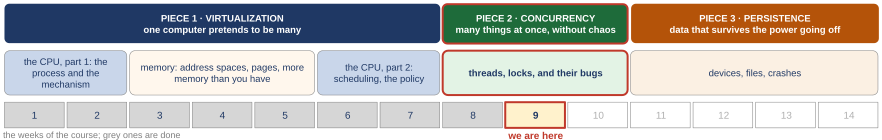

# Locks inside data structures, and waiting for something to happen

*Self-study guide · COMP3430 Operating Systems*

## Where this guide comes from {#source}

This guide follows *Operating Systems: Three Easy Pieces* (OSTEP) by Remzi H. Arpaci-Dusseau and Andrea C. Arpaci-Dusseau, which the authors publish free at [https://pages.cs.wisc.edu/~remzi/OSTEP](https://pages.cs.wisc.edu/~remzi/OSTEP/). The figures and examples credited to the textbook are theirs. The code the guide reads is from [xv6](https://github.com/mit-pdos/xv6-riscv), the teaching operating system from MIT, and its [xv6 book](https://mit-pdos.github.io/xv6-riscv-book/).

Read with this week:

- [OSTEP chapter 29. Lock-based Concurrent Data Structures](https://pages.cs.wisc.edu/~remzi/OSTEP/threads-locks-usage.pdf)
- [OSTEP chapter 30. Condition Variables](https://pages.cs.wisc.edu/~remzi/OSTEP/threads-cv.pdf)
- [OSTEP chapter 31. Semaphores](https://pages.cs.wisc.edu/~remzi/OSTEP/threads-sema.pdf)
- The xv6 source.

## Part 0. Where we are, and what this week stands on {#part-0}

This part does three jobs before the new material starts. It shows where this week sits in the course. It rebuilds the four ideas from last week that this week uses on every page: the race, the lock, the instruction inside the lock, and the way a waiter sleeps. And it gives you just enough of the C language and the shell to read the short programs the week is built on. Everything later uses these words without stopping, so if one is shaky, fix it here.

A few words first. The **operating system** (the **OS**) is the program that runs the computer and shares it between all the other programs; its core is called the **kernel**, and this guide uses the two words for the same thing. A **program** is a file of instructions; a **process** is a program while it is running. The **CPU** (the processor) is the part of the computer that runs instructions, one after another. A modern chip holds several CPUs side by side; each one is called a **core**, and this guide uses "CPU" and "core" for the same thing. **Memory** (RAM) is where a running program's data and instructions live. A **thread** is a point of execution inside a program: its own place in the code and its own **stack** (the memory where a function keeps its local variables and where the computer remembers which function called which), sharing the program's data with the other threads of that program. The textbook is OSTEP, *Operating Systems: Three Easy Pieces*; the guide names its chapters, sections and figures, and gives a printed page number only where there is no other way to find a passage. Last week defined it properly; this week every program has several threads from the first page.

#### The course map

<figure markdown="1">
{width=100%}
<figcaption markdown="1">Figure 0.1. The three pieces of the course, the weeks behind us in grey, and this week, the second week of the second piece.</figcaption>
</figure>

An operating system has three big jobs, and the course takes them in order. The first is **virtualization**: one computer pretends to be many, so every program behaves as if it had its own CPU and its own memory. The second is **concurrency**: many things happening at once, without chaos. The third is **persistence**: data that survives the power going off. Figure 0.1 shows the first piece finished and the second piece one week in. This week is the second week of concurrency, and the block runs three weeks.

Each step of the course so far answered the question the step before it left open. The words in rows 1 to 7 belong to those weeks and their guides; this week leans on only a few of them (the scheduler, the page table, a cache), each explained again where it comes back, and row 8 is the one to have in mind.

1. **The process**: a running program with its own view of the machine. Left open: how does a program get the OS to do anything for it?
2. **Limited direct execution**: the program runs on the real CPU; a trap (a forced jump into the kernel), a system call (a request a program makes to the kernel) or a timer hands control back. Left open: how is memory shared without programs seeing each other?
3. **The address space**: a private memory numbered from 0, translated by base and bounds (two registers that shift and limit every address). Left open: one block per program wastes its empty middle.
4. **Segments, then pages and a TLB**: fixed-size pieces end the holes; the TLB (translation lookaside buffer) is a cache of translations (a cache is a small fast copy of recently used data) that makes lookups fast. Left open: the table is too big, and we assumed every page is in memory.
5. **A tree, and pages on disk**: the page table (the map from a program's addresses to real memory) stores only the parts in use; a page fault (the trap taken when a page is not in memory) brings a page back. Left open: which process runs next, and for how long?
6. **Scheduling**: turnaround (arrival to finish) for work, response (arrival to first run) for people; a scheduler (the part of the OS that picks who runs) that learns a job's type. Left open: a priority ranks jobs; it cannot promise anyone a share.
7. **A share, then many CPUs**: tickets (a job's share of the CPU, counted as lottery tickets) and Linux's weights (its numbers for the same share; Linux is the operating system on most servers and on Android phones); a queue per CPU, or one queue with a lock. Left open: two CPUs take the same job from one queue; what is the lock?
8. **Threads, the race, the lock**: a second point of execution in one program; a lock from one instruction the hardware will not split, plus a sleep queue. Left open: a lock guards one variable; and how does a thread wait for an event?
9. **This week: locks inside data structures; waiting.** Where the lock goes in a counter, a list and a table, and how to keep it from making threads wait; a second tool, the condition variable, for waiting until another thread has done something; then the semaphore, a counter that threads can wait on.

The two things row 8 left open are the two halves of this week.

#### What last week built, and what this week uses

Four ideas from last week come back on every page of this one. Each gets a few lines here, with the code it came from, so you do not have to go back. The listings use a few C symbols (`void *`, `for`, `printf` with `%s`) that the primer "Reading the C in this guide", later in this part, explains; read them as prose first, and come back if a symbol stops you.

**The race.** Last week's `counter.c` had two threads that each add 1 to the same number 10,000,000 times. The right total is 2 × 10,000,000 = 20,000,000.

```c linenums="4" hl_lines="1 6"
static volatile int counter = 0;   // shared by both threads

void *mythread(void *arg) {
    printf("%s: begin\n", (char *) arg);
    for (int i = 0; i < 10000000; i++) {
        counter = counter + 1;     // the dangerous line
    }
```

Line 4 declares `counter`, one number shared by both threads. It is a **global variable**: a variable declared outside every function, so every function of the program can use it, and there is exactly one copy. `static` means the name belongs to this file only. `volatile` tells the compiler to fetch the variable from memory on every use, never from a stale copy kept in a register (a storage cell inside the CPU, explained two sentences down). `int` is a whole number. Line 9 is the dangerous line. It looks like one step in C. But the **compiler** (the program that turns C into machine code; here `gcc`) turns it into three machine steps. **Load** the number from memory into a **register**, one of a few dozen tiny storage cells inside the CPU. **Add** 1 in the register. **Store** the register back to memory. The add happens in a register that only this thread can see. Here is how an add gets lost:

| step | thread A | thread B | counter |
|---|---|---|---|
| 1 | load 50, add: 51 in a register | | 50 |
| 2 | switched out (the OS gives the CPU to B) | load 50, add, store 51 | 51 |
| 3 | store 51 | | 51: one add lost |

Two adds happened, and the counter rose by one. Three runs of `counter.c` on last week's machine (`counter.out`) printed three different wrong totals, 10,798,495, 11,268,287 and 10,445,986, each short by about half; the timed run below is a fourth, with a fourth wrong total. Two words from last week name this:

- a **race condition**: the result depends on which thread runs when, because a thread can land in the gap between another thread's load and store;
- a **critical section**: the lines that touch shared data; they need **mutual exclusion**, one thread inside at a time.

**The lock.** `counter_mutex.c` is the same program plus three lines.

```c linenums="4" hl_lines="2 7 9"
static volatile int counter = 0;   // shared by both threads
static pthread_mutex_t lock = PTHREAD_MUTEX_INITIALIZER;

void *mythread(void *arg) {
    printf("%s: begin\n", (char *) arg);
    for (int i = 0; i < 10000000; i++) {
        pthread_mutex_lock(&lock);
        counter = counter + 1;     // the critical section
        pthread_mutex_unlock(&lock);
    }
```

Line 5 declares the lock: one global variable of type `pthread_mutex_t`, the lock type of the POSIX thread library (**POSIX**, the Portable Operating System Interface, is the standard that Linux and macOS follow for these calls; **pthread** is short for POSIX thread). `PTHREAD_MUTEX_INITIALIZER` starts it free, with nobody inside. A **mutex** is a mutual exclusion lock. Line 10 takes the lock: `pthread_mutex_lock()` waits if another thread holds it, then enters. Line 12 gives it back: `pthread_mutex_unlock()` lets the next waiter in. (`&lock` is the address of `lock`; the calls take an address so that they can change the lock itself.) So only the thread holding the lock can be between its load and its store. The other thread stops at its `pthread_mutex_lock()` call until the holder unlocks, so its load always comes after the store, and both adds count. The price, from `counter_time.out` on last week's machine (`$` marks the command that was typed; `time` runs it and prints how long it took; `real 0m1.298s` is 0 minutes 1.298 seconds of wall-clock time):

```text
$ time ./counter
main: done with both (counter = 12235707)
real	0m0.057s
$ time ./counter_mutex
main: done with both (counter = 20000000)
real	0m1.298s
```

Without the lock, wrong and fast: 0.057 s. With the lock, 20,000,000 every time, in 1.298 s, which is 1.298 / 0.057 = 22.8, about 23 times slower. Notice where the lock lived: a global, next to the counter, taken by the one function that touched the counter. We, the callers, had to remember it. This week asks what happens when the shared thing is a whole structure that any part of a program may call.

**The instruction inside the lock.** A lock cannot be built from plain loads and stores: two threads can both test a flag, see 0, and both set it to 1. Last week's `taslock.c` built a lock from one instruction the hardware will not split.

```c linenums="5" hl_lines="1 5 10"
static volatile int flag = 0;             // 0: lock is free, 1: lock is held

void lock(void) {
    // test-and-set: write 1, get the old value back, in ONE instruction
    while (__sync_lock_test_and_set(&flag, 1) == 1)
        ;                          // spin-wait (do nothing)
}

void unlock(void) {
    __sync_lock_release(&flag);    // store 0
}
```

Line 5: the lock's whole state is one `int`, 0 for free and 1 for held. Line 9: **test-and-set** writes a 1 into the flag and hands back the old value, in one instruction, so nothing can slip in between the read and the write. Old value 0: the lock was free a moment ago and is ours now. Old value 1: somebody else has it; the `while` loop runs again, and that loop is the spin. `__sync_lock_test_and_set` is the name gcc gives the instruction. `==` means "is equal to". The lone `;` on line 10 is an empty loop body, so the loop does nothing but check again. Line 14: unlock stores a 0, and the next test-and-set from a waiter gets the 0 and goes in. A lock whose waiters keep testing in a loop is a **spin lock**. Three runs printed 20,000,000 every time. xv6, the small teaching kernel this course reads, builds its lock function, `acquire()`, from the same loop, with two additions a kernel needs: it turns interrupts off first (an **interrupt** is a hardware signal that makes the CPU drop what it is doing and run the kernel; if one arrived while this CPU held the lock and its handler, the kernel code that runs when an interrupt arrives, wanted the same lock, the handler would spin forever, because the holder cannot run until the handler returns), and after the loop it issues a **fence**, an instruction that keeps the loads and stores inside the lock from being moved ahead of it (a CPU and a compiler may reorder memory operations for speed when nothing says they must not; the fence says they must not cross it). Two things were still wrong with the lock. It is not fair. And a waiter spins away its whole time slice doing nothing; a time slice is the stretch of CPU time the scheduler gives a thread before it switches to another.

**The waiter sleeps.** The OS fix for spinning: a waiting thread sleeps on a queue, and the thread that unlocks wakes one sleeper.

<figure markdown="1">
{width=70%}
<figcaption markdown="1">Figure 0.2. Linux keeps the state of a mutex in one integer, the lock word (one field of the 48-byte `pthread_mutex_t`; the rest is bookkeeping). 0: free. 1: held, nobody waiting. 2: held, somebody may be asleep. T1 is inside with the word at 2; T2 is asleep in the kernel on the queue for the lock word's address (zz marks a sleeping thread, here and in every later picture).</figcaption>
</figure>

Figure 0.2 is last week's last picture. The fast path never enters the kernel: test-and-set turns the 0 into a 1 in **user space** (the program's own side, outside the kernel), and unlock turns it back. The kernel is called in two places only: when a thread finds the word already at 1, it sets it to 2 and asks the kernel to put it to sleep; and when an unlock finds a 2, it asks the kernel to wake someone. A **futex** (fast userspace mutex) is a pair of Linux **system calls** on an address: futex wait puts the caller to sleep until somebody wakes that address; futex wake wakes one thread sleeping on it. The kernel keeps the queue of sleepers for each address. The unlock sees 2, stores 0 and calls futex wake; T2 wakes, runs test-and-set again, and gets in. Nobody spun. Two captures from last week's machine show the two halves. `strace`, a tool that lists the system calls a program makes (`-f`: its threads too; `-c`: count them in a summary; `-e trace=futex`: only the futex calls), saw 25,642 futex calls in a `counter_mutex` run and a single one in a run with one thread and no contention (no second thread ever wanting the lock). The summary row of each run in `futex_strace.out` (strace's columns: percent of the time, seconds, microseconds per call, calls, errors, the call's name; an error here is a futex wait that returned at once because the lock word had already changed):

```text
$ strace -f -c -e trace=futex ./counter_mutex
100.00    0.329279          12     25642      7944 futex
$ strace -f -c -e trace=futex ./counter_mutex1    (one thread, no contention)
  0.00    0.000000           0         1           futex
```
 And `longcs`, a program whose two threads hold a lock for a long stretch at a time, was run pinned to one core (`taskset -c 0`, explained below) once with a mutex and once with a spin lock: the mutex took 0.45 s, the spin lock 0.67 s. Sleeping beat spinning. The two rows of `longcs.out`:

```text
$ taskset -c 0 ./longcs spin   ->  spin lock: 0.67 s
$ taskset -c 0 ./longcs mutex   ->  mutex lock: 0.45 s
```

- Check this: say the three machine steps of `counter = counter + 1`, and where the other thread's load must land to lose an add. (Load, add, store; between this thread's load and its store.)
- Check this: say what test-and-set hands back when the lock is free, and when it is held. (0; 1.)
- Check this: say when a Linux mutex calls the kernel. (Only when a thread finds the lock word at 1 and must sleep, and when the unlocker sees a 2 and must wake someone.)

#### Reading the C in this guide

The week's programs are written in **C**, the language the kernel and most system programs are written in. You do not need to write C to follow the guide, but you need to read about forty symbols. Each is explained again where it first appears, and [Appendix A](appendix.md#appendix-a) collects them all. Here are the ones that appear on almost every page.

- Memory is a long row of numbered cells. A **bit** is one binary digit, 0 or 1; a **byte** is 8 bits, and each memory cell holds one byte, so an address counts bytes. An `int` takes 32 bits, which is 4 bytes, on every machine in this guide (the C standard allows other sizes; Linux and macOS on today's CPUs use 4). A `char` is one byte, usually one character of text.
- A **variable** is a named storage place. `int count = 0;` makes a variable called `count` that holds a whole number and starts at 0. The semicolon ends a statement.
- A **function** is a named piece of code. `int get(counter_t *c) { ... }` defines a function called `get` that takes one input, `c`, and gives back an `int`; the curly braces hold its body. `return` ends the function and hands back its result. `void` as a result type means the function gives nothing back; `(void)` as its input list means it takes no input. A thread's function has the form `void *worker(void *arg)`; that `void *` is a pointer, two bullets down. `main` is the function where every C program starts; the listings often leave it out.
- A **struct** is a bundle of named fields kept together in memory. `typedef struct __counter_t { int value; } counter_t;` declares a bundle with one field, `value`, under the long name `__counter_t` (used only here), and `typedef` gives it the short name `counter_t`, so the rest of the program can say `counter_t`. `c.value` is the field `value` of the bundle `c`.
- A **pointer** is a variable that holds the address of something else in memory. `&x` means "the address of `x`". If `p` holds an address, `*p` means "the thing at that address". In a declaration, `counter_t *c` means "`c` is a pointer to a `counter_t`". `c->value` reads one field of the bundle a pointer points at: the arrow `->` is "the field `value` of the thing `c` points to". `void *p` means "`p` is a pointer to something of a type not stated"; the code that uses it must say what it really points at. `NULL` is the pointer that points at nothing. `(char *) arg` is a **cast**: it tells the compiler to treat `arg` as a pointer to text from here on.
- `x++` adds 1 to `x`; `x--` subtracts 1; `x += n` means `x = x + n`. Inside a bigger expression, `x++` hands over the old value of `x` and then adds 1, so `a[x++]` uses the old `x` as the index and moves `x` on. Between two whole numbers `/` divides and drops the fraction (`7 / 2` is 3), and `%` gives the remainder (`7 % 2` is 1, `103 % 101` is 2). `*` between two values multiplies.
- An **array** is a row of numbered elements of one type, stored one after another. `int local[4];` makes four `int`s side by side, 16 bytes in a row; `local[0]` is the first, `local[3]` the last. `buffer[fill]` is element number `fill` of `buffer`.
- `#define LOOPS 1000000` makes `LOOPS` a name for the number 1,000,000; the compiler replaces the name by the number.
- `for (int i = 0; i < 10; i++) { ... }` repeats the body 10 times: `i` starts at 0, the body runs while `i < 10`, and `i++` adds 1 to `i` after each pass. `while (c) { ... }` repeats as long as `c` is true. `if (c) { ... }` runs the body once, only if `c` is true. `==` means "is equal to", `!=` "is not equal to", `<` "is less than", `>=` "is at least", `<=` "is at most", `&&` "and", `||` "or".
- `printf("...")` prints text; `%d` in the text is replaced by the next number given, `%s` by the next piece of text, and `\n` is a line break.
- `//` starts a comment: the rest of the line is a note for people, ignored by the computer. `...` in a listing means lines left out.

#### Reading the shell lines in this guide

The captures show the commands that produced them, typed into the **shell**, the program that reads a command line and runs it. A few signs appear over and over:

- `$` at the start of a line is the shell's prompt: what follows is the command that was typed. Lines without `$` are the output.
- `./counter_lock 4` runs the program `counter_lock` from the current folder (`./` means "this folder") with one input, `4`; here that is the number of threads.
- `/usr/bin/time -f 'real %e s  user %U s' ./join_spin` runs `./join_spin` and then prints how long it took: `%e` is the **real time**, the wall-clock time from start to finish, and `%U` is the **user time**, the CPU time spent running the program's own code, added up over all its threads. Two threads that are both busy for the whole run have a user time of about twice the real time.
- `taskset -c 0 ./join_spin` runs the program on CPU 0 only, so that its threads must take turns on one CPU.
- `timeout 5 ./pc_onecv` stops the program after 5 seconds if it has not finished; `a; b` runs `a`, then `b`; `echo "exit status $?"` prints the **exit status** of the last command, a number a program leaves behind when it ends: 0 means it finished normally, 124 means `timeout` stopped it, and 134 means it stopped itself with an `assert` (explained in [Section 4.1](class-2.md#sec-4-1)). `stdbuf -oL` makes a program print each line at once instead of saving lines up.
- `a | b` is a **pipe**: the output of command `a` becomes the input of command `b`. [Chapter 4](class-2.md#chapter-4) opens the pipe up; it is this week's buffer inside the kernel.
- `getconf LEVEL1_DCACHE_LINESIZE` asks Linux for one setting of the machine, here the size of a cache line ([Section 2.7](class-1.md#sec-2-7)).

[Appendix A](appendix.md#appendix-a) has a table of every shell command the guide uses.

#### The machines, and the units

The measurements in this guide come from a Linux virtual machine (a **virtual machine**, or **VM**, is a computer simulated by software on another computer) running Ubuntu 22.04 on an ARM processor (the processor family in phones and in Apple's recent Macs) with 4 CPUs and Linux 6.8; Ubuntu is one of the packaged versions of Linux. This guide calls it the 4-CPU Linux VM. The story of the week runs from 1 thread to 4, so the measurements need a machine that can really run 4 threads at once. The recap captures above, and the three wrong totals, come from last week's machine, an Ubuntu 24.04 computer with an x86-64 processor (the 64-bit Intel and AMD family) and 2 cores. One check in [Section 4.5](class-2.md#sec-4-5) was rerun on a third machine, the Linux computer this guide was built on, and is marked as such there.

Times this week are small. A **millisecond** (ms) is a thousandth of a second, a **microsecond** (µs) a millionth: 1 s = 1,000 ms = 1,000,000 µs. The counter captures print seconds with four decimal places, so 0.0042 s is 4.2 ms; the longer runs print two or three. "A is N times as long as B" means A divided by B: 0.0944 / 0.0042 = 22.5 (the two runs of [Section 2.1](class-1.md#sec-2-1)). "A is N times faster than B" means B's time divided by A's: 0.606 / 0.113 = 5.4 ([Section 6.6](class-2.md#sec-6-6)). Check this: a run of 0.99 s of CPU against one of 0.46 s ([Section 3.6](class-1.md#sec-3-6)) used 0.99 / 0.46 = 2.2 times as much, the first form.
