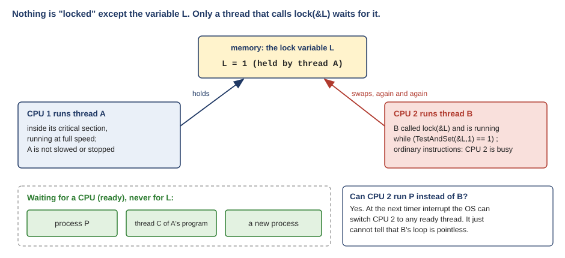
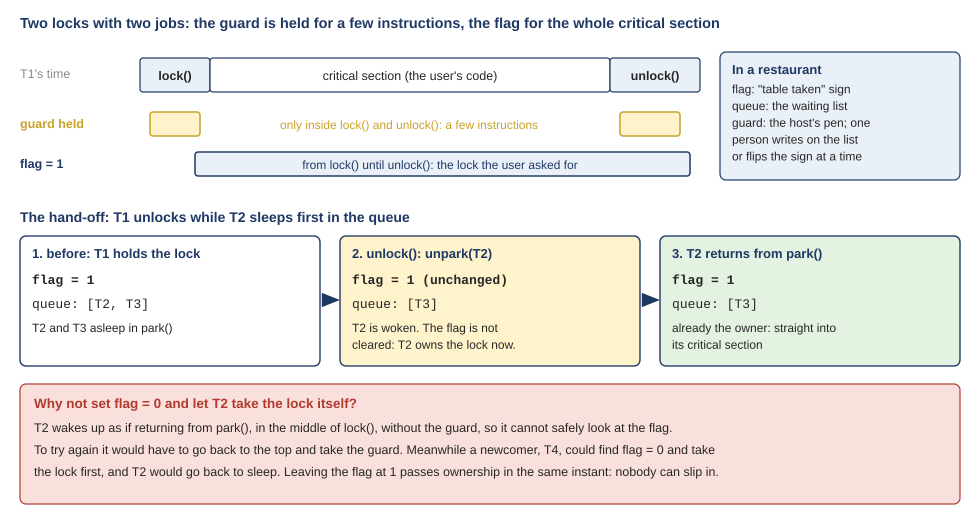

# Q&A: how a lock is built, and locks inside data structures

*COMP3430 Operating Systems · questions on OSTEP chapters 28 and 29*

These are the questions you sent in after reading OSTEP chapter 28 ([Locks](https://pages.cs.wisc.edu/~remzi/OSTEP/threads-locks.pdf)) and chapter 29 ([Lock-based Concurrent Data Structures](https://pages.cs.wisc.edu/~remzi/OSTEP/threads-locks-usage.pdf)), quoted exactly as you wrote them. Several of you were stuck on the same idea from different sides, so the questions are grouped by topic, and each group opens with a short recap of the idea it rests on.

Each answer starts with a short paragraph, **What is underneath**, that names the picture behind the question. Most of the confusion came from a handful of wrong or missing pictures, and fixing the picture usually answers the question by itself. The last group is different: it takes six sentences from your summaries that are close but not quite right, and puts them right.

## A. What a lock locks {#a}

!!! abstract "Recap"

    A lock is an ordinary variable in memory: an `int` flag, or a `pthread_mutex_t`. The programmer makes one lock for each piece of shared data and puts `lock(&L)` and `unlock(&L)` around the lines of code that touch that data. Those lines are a **critical section**. "Thread A holds L" means: A called `lock(&L)` and has not yet called `unlock(&L)`. A thread that calls `lock(&L)` while A holds L must wait. Nothing else waits: not the CPU, not the other threads, not the OS. (W08 [Section 2.6](https://annie983284450-1.github.io/NNU-CS3430-selfstudyguide/w08/class-1/#sec-2-6) and [Section 3.4](https://annie983284450-1.github.io/NNU-CS3430-selfstudyguide/w08/class-1/#sec-3-4).)

### Q1. "Confusion: why is the critical section presumably short for multiple CPUS?" {#q1 data-toc-label="Q1. Why the critical section is 'presumably short' on several CPUs"}

Where to reread: OSTEP 28.8, Evaluating Spin Locks; W08 [Section 6.1](https://annie983284450-1.github.io/NNU-CS3430-selfstudyguide/w08/class-2/#sec-6-1) and [Section 6.6](https://annie983284450-1.github.io/NNU-CS3430-selfstudyguide/w08/class-2/#sec-6-6).

**What is underneath.** The word "presumably" carries the whole sentence. It is not a fact about machines with several CPUs. It is an assumption about how programmers write critical sections, and the spin lock is a good choice only while that assumption is true.

Here is the sentence from 28.8: "However, presumably the critical section is short, and thus soon the lock becomes available, and is acquired by Thread B." Read "presumably" as "we are assuming". Having more CPUs does not make a critical section shorter. The code inside it decides its length. And programmers keep that code short on purpose. `counter = counter + 1` is three instructions: load, add, store. Putting a node at the front of a list is two pointer writes. W09 [Extra 2](https://annie983284450-1.github.io/NNU-CS3430-selfstudyguide/w09/class-1/#extra-2) is that habit as a rule: lock only the lines that touch shared data. A few dozen instructions take well under a microsecond.

So why does the book need the assumption at all? Because a spinner pays for every moment it spins, and on two CPUs it spins exactly as long as the holder stays inside. Thread A, the holder, keeps running on CPU 1 the whole time, so it is making progress while B waits on CPU 2. When A's section is short, B's spin is short, and the cost is a sliver of CPU 2's time (Figure Q.1, top). If A's section is long, say A reads a file while it holds the lock, then B burns CPU 2 for that whole time (Figure Q.1, bottom). The assumption has failed, and spinning is now a bad idea, however many CPUs there are.

<figure markdown="1">

<figcaption markdown="1">Figure Q.1. Two CPUs, one spin lock. B spins exactly as long as A stays inside. Short section: B loses a sliver. Long section: B burns CPU 2 for the whole section.</figcaption>
</figure>

On one CPU the assumption does not save you. Even a short section can be cut in the middle by a timer interrupt, and then the holder cannot run until the spinner's time slice ends (W08 [Section 6.1](class-2.md#sec-6-1)). That is the contrast 28.8 draws: one CPU is painful; several CPUs are fine, *if* the section is short.

The W08 measurement used long sections on purpose, about 1 ms each. On 2 cores the spin lock and the sleeping mutex tied, 0.44 s against 0.45 s, because the holder kept running on the other core. But the waiting core spent that time spinning, and no other program could use it.

### Q2. "And why cant a thread on CPU 2 start a new process while a thread on CPU 1 is locked?" {#q2 data-toc-label="Q2. Why a thread on CPU 2 cannot start something else"}

Where to reread: OSTEP 28.7 (the end) and 28.8; W08 [Section 1.3](https://annie983284450-1.github.io/NNU-CS3430-selfstudyguide/w08/class-1/#sec-1-3) and [Section 5.1](https://annie983284450-1.github.io/NNU-CS3430-selfstudyguide/w08/class-2/#sec-5-1).

**What is underneath.** Two pictures are mixed together here. "A thread on CPU 1 is locked" pictures the lock as something that happens to a thread or to a CPU. A lock is a variable in memory, and the only thread that is stuck is one that asks for that same variable. And "CPU 2 cannot start something else" is true only for the moments when the thread on CPU 2 is itself running a spin loop.

Take it one piece at a time, with Figure Q.2.

- **Nobody "is locked".** Thread A holds lock L. A keeps running at full speed on CPU 1. Holding a lock does not slow the holder down or stop it.
- **CPU 2 is busy because of what B is doing.** In the book's example, thread B on CPU 2 called `lock(&L)` and is running the spin loop `while (TestAndSet(&L, 1) == 1) ;`. That loop is ordinary instructions, and CPU 2 is executing them. CPU 2 is "busy" in the same way it is busy running any program.
- **CPU 2 can still run a new process.** At the next timer interrupt, the OS can take CPU 2 away from B and run any other ready process or thread, as it can with any running program. That is the preemptive scheduler of OSTEP 28.7, which spin locks rely on. What the OS cannot do is notice that B's loop is pointless. To the OS, a spinning thread looks like a thread doing real work. Fixing that is the job of the sleeping locks in the rest of chapter 28: a sleeping lock tells the OS "I am waiting", and the OS gives the CPU to someone else at once.
- **Other processes never wait for L.** A process has its own address space, so the threads of another process cannot even see L. Thread C of A's own program waits only if it also calls `lock(&L)`.

<figure markdown="1">

<figcaption markdown="1">Figure Q.2. Only the variable L is held. A runs inside its critical section on CPU 1; B spins on CPU 2 because it asked for L. Ready threads that never call lock(&L) never wait for it, and the OS can switch CPU 2 to any of them at the next timer interrupt.</figcaption>
</figure>

### Q3. "Is there only 1 critical section available across the whole system?" {#q3 data-toc-label="Q3. Whether there is only one critical section in the whole system"}

Where to reread: W08 [Section 2.6](https://annie983284450-1.github.io/NNU-CS3430-selfstudyguide/w08/class-1/#sec-2-6) and [Section 2.7](https://annie983284450-1.github.io/NNU-CS3430-selfstudyguide/w08/class-1/#sec-2-7); W09 [Section 2.11](https://annie983284450-1.github.io/NNU-CS3430-selfstudyguide/w09/class-1/#sec-2-11) and [Extra 5](https://annie983284450-1.github.io/NNU-CS3430-selfstudyguide/w09/class-1/#extra-5).

**What is underneath.** "Critical section" sounds like a place, one special room in the machine. It is not a place. It is a piece of code: the lines in a program that touch one particular piece of shared data. The same summary called it "a critical state", which hides the same picture. A critical section is a stretch of code, not a state the thread is in. Every piece of shared data has its own critical sections and its own lock.

So no: there are as many critical sections as there are pieces of shared data, and a real kernel has thousands. Some you have already met:

- `counter_mutex.c` in W08 has one mutex, protecting one counter.
- The hash table of W09 has 101 locks, one per bucket. Two lookups that land in different buckets run at the same time.
- xv6 protects its free-page list with `kmem.lock` (W08 [Section 2.7](class-1.md#sec-2-7)). Every process has its own `p->lock` (W09 [Section 4.11](https://annie983284450-1.github.io/NNU-CS3430-selfstudyguide/w09/class-2/#sec-4-11)), and every disk buffer has a lock of its own.

**Mutual exclusion is per lock.** At most one thread is inside the critical sections of lock L at a time. Two threads holding two different locks run their critical sections at the same moment, on different CPUs, and that is the reason to have many locks (Figure Q.3).

<figure markdown="1">

<figcaption markdown="1">Figure Q.3. One lock per shared thing. Four threads are inside four different critical sections on four CPUs at once. T5 waits only because it asked for the lock T1 holds.</figcaption>
</figure>

Your picture did once exist. When Linux first ran on machines with several CPUs, it used one lock for the whole kernel, the "big kernel lock", so only one CPU at a time could run kernel code. As machines got more CPUs, that lock became the bottleneck, and Linux replaced it with many small ones (W09 [Extra 5](class-1.md#extra-5)).

## B. The atomic instructions {#b}

!!! abstract "Recap"

    An atomic instruction reads a memory cell and writes it in one step that nothing can land inside. An interrupt comes before it or after it, never in the middle, and when two CPUs use the same cell at once, the hardware puts their accesses in order. **Test-and-set** (atomic exchange) writes a new value and returns the old one. **Compare-and-swap** writes the new value only if the cell still holds the value you expected, and returns the old value either way. **Fetch-and-add** adds 1 and returns the old value. **Load-linked** and **store-conditional** are a pair of instructions that together act like one. (W08 [Section 5.1](https://annie983284450-1.github.io/NNU-CS3430-selfstudyguide/w08/class-2/#sec-5-1), [Section 5.6](https://annie983284450-1.github.io/NNU-CS3430-selfstudyguide/w08/class-2/#sec-5-6) and [Extra 4](https://annie983284450-1.github.io/NNU-CS3430-selfstudyguide/w08/class-2/#extra-4).)

### Q4. "28.7 and 28.9 (test-and-set vs. compare-and-swap): I originally had these backwards. Test-and-set always swaps, and compare-and-swap only swaps if the value matches what’s expected." {#q4 data-toc-label="Q4. Test-and-set and compare-and-swap, the right way round"}

Where to reread: OSTEP 28.7 and 28.9; W08 [Section 5.1](class-2.md#sec-5-1) and [Extra 4](class-1.md#extra-4).

**What is underneath.** Your corrected version is right. What makes the two so easy to swap in memory is that, used as a lock, they behave exactly alike, so the lock code gives you nothing to tell them apart by. The difference only appears when the cell can hold something other than 0 or 1.

First the lock. Put the two side by side on a flag that is either 0 or 1 (Figure Q.4, top). On a free flag, both write 1 and return 0, so you got the lock. On a held flag, test-and-set writes 1 again, which changes nothing, and compare-and-swap writes nothing; both return 1, so you spin. Same answers in every case. That is why 28.9 says a spin lock built with compare-and-swap behaves identically to the test-and-set one.

The names help: **test-and-set** sets, no questions asked. **Compare-and-swap** compares first.

Now the case where they differ. A shared counter holds 41, and a thread wants to add 1 without any lock (Figure Q.4, bottom). It reads 41, computes 42, and calls `CompareAndSwap(&c, 41, 42)`: "make it 42, but only if it is still 41". If no other thread got there first, the call returns 41, and c is 42. If another thread already made it 42, the call returns 42, which is not the 41 it expected, and it writes nothing. The thread simply starts again with 42 and tries 42 to 43. No add is ever lost, and no thread ever waits on a lock. Test-and-set cannot do this, because it can only write a value fixed in advance; it has no way to say "only if it is still 41". This read, compute, compare-and-swap, retry pattern is the basis of **lock-free** data structures (W08 [Extra 4](class-1.md#extra-4)).

<figure markdown="1">

<figcaption markdown="1">Figure Q.4. Top: as a lock, test-and-set and compare-and-swap give the same results. Bottom: adding 1 to a counter with no lock, which only compare-and-swap can do; if another thread changed the value first, the swap writes nothing and the thread tries again.</figcaption>
</figure>

On real processors: x86 has `xchg` (test-and-set) and `cmpxchg` (compare-and-swap). C programs reach them through `atomic_exchange()` and `atomic_compare_exchange_strong()`. xv6's `acquire()` uses RISC-V's `amoswap`, a test-and-set (W08 [Section 5.3](https://annie983284450-1.github.io/NNU-CS3430-selfstudyguide/w08/class-2/#sec-5-3)).

### Q5. "Load-linked and store-conditional was also confusing. I’m not even really sure how to ask for clarification on it because I don’t understand it enough to know what questions to ask." {#q5 data-toc-label="Q5. Load-linked and store-conditional, and what to ask about them"}

Where to reread: OSTEP 28.10, Load-Linked and Store-Conditional; W08 [Extra 4](class-1.md#extra-4).

**What is underneath.** It is confusing for a real reason. It is two instructions doing the job of one, and the book's C version (Figure 28.5) hides the one piece of hardware that makes it work: a note the CPU keeps on the address between the two instructions. Once that note is visible, the rest follows.

When you do not know what to ask about a new mechanism, these four questions work for almost any of them. What does each part do on its own? What is remembered between the parts? What makes it fail, and what happens then? Why was it designed this way? Here they are for load-linked and store-conditional.

**1. What does each instruction do on its own?** Load-linked is an ordinary load: it reads the value at an address into a register. In addition, the CPU makes a note: "I am watching this address". That note is called a **reservation**. Store-conditional writes a value to the address, but only if the reservation is still there. It returns 1 if it wrote, and 0 if it did not; on failure it writes nothing.

**2. What is remembered between them?** Only the reservation: one watched address, kept in the CPU's hardware.

**3. What makes the store fail?** Any write to that address by someone else, between your load-linked and your store-conditional, erases your reservation. Then your store-conditional fails. (On real chips a few other events, such as an interrupt, can also erase it. That only costs one more trip round the loop.) Figure Q.5 traces the case the book describes in 28.10. Both threads load-link a 0. T2 stores first and succeeds; that write erases T1's reservation. So T1's store fails, writes nothing, and T1 goes back to loading, finds a 1, and spins. Only one of the two gets the lock.

<figure markdown="1">

<figcaption markdown="1">Figure Q.5. Two threads both load-link a 0. T2's store-conditional succeeds and writes 1, which erases T1's reservation, so T1's store-conditional fails and writes nothing. Below: the one-line lock from OSTEP 28.10, read piece by piece.</figcaption>
</figure>

The bottom of Figure Q.5 reads the short version of the lock from 28.10, the one a student suggested:

```c
void lock(lock_t *lock) {
    while (LoadLinked(&lock->flag) ||
          !StoreConditional(&lock->flag, 1))
        ; // spin
}
```

C evaluates `||` from left to right and stops as soon as one side is true. If the load returns 1, the lock is held, and C loops again without even trying the store. If the load returns 0, C tries the store. A successful store returns 1, `!1` is 0, both sides are false, and the loop ends with the lock yours. A failed store returns 0, `!0` is 1, and the loop starts over.

**4. Why design it this way, and not as one instruction?** Classic RISC processors, such as MIPS and early ARM, kept every memory instruction simple: an instruction either loads or stores, never both. Load-linked and store-conditional keep that rule and still give an atomic update. (Newer designs added one-instruction atomics as well: RISC-V has `amoswap`, the test-and-set in xv6's `acquire()`, and ARM added swap and compare-and-swap instructions in 2016. Both still keep load-linked and store-conditional.) The pair is also general: put any computation between them and you get an atomic version of it. Fetch-and-add, for example, is a three-step loop: load-link the value, add 1, store-conditional; if the store failed, go round again.

On real chips: RISC-V calls them `lr.w` and `sc.w`, and ARM `ldxr` and `stxr`. One trap if you ever read real code: both `sc.w` and `stxr` write 0 on success and nonzero on failure, the opposite of the book's convention.

## C. Sleeping instead of spinning {#c}

!!! abstract "Recap"

    OSTEP Figure 28.9's lock has three parts. The **flag** says whether the lock is held. The **queue** lists the threads asleep waiting for it. The **guard** is a tiny spin lock that protects the flag and the queue while `lock()` and `unlock()` read and change them, a few instructions at a time. A thread that finds the flag at 1 writes its id on the queue, lets go of the guard and calls `park()`, which puts it to sleep. `unlock()` either sets the flag to 0, if nobody is waiting, or calls `unpark()` on the first thread in the queue and leaves the flag at 1. (W08 [Section 6.3](https://annie983284450-1.github.io/NNU-CS3430-selfstudyguide/w08/class-2/#sec-6-3) and [Section 6.4](https://annie983284450-1.github.io/NNU-CS3430-selfstudyguide/w08/class-2/#sec-6-4).)

For reference, the lock and unlock of Figure 28.9, with the book's line numbers:

```{.c .numberLines startFrom="13"}
void lock(lock_t *m) {
    while (TestAndSet(&m->guard, 1) == 1)
        ; //acquire guard lock by spinning
    if (m->flag == 0) {
        m->flag = 1; // lock is acquired
        m->guard = 0;
    } else {
        queue_add(m->q, gettid());
        m->guard = 0;
        park();
    }
}

void unlock(lock_t *m) {
    while (TestAndSet(&m->guard, 1) == 1)
          ; //acquire guard lock by spinning
    if (queue_empty(m->q))
          m->flag = 0; // let go of lock; no one wants it
    else
          unpark(queue_remove(m->q)); // hold lock
                                            // (for next thread!)
    m->guard = 0;
}
```

### Q6. "28.14 (park/unpark with queues): following the guard lock, the queue, and why the lock gets handed directly to the next thread." {#q6 data-toc-label="Q6. The guard, the queue, and why the lock is handed straight over"}

Where to reread: OSTEP 28.14; W08 [Section 6.3](class-2.md#sec-6-3).

**What is underneath.** There are two locks in this code, and they protect different things for very different lengths of time. The guard protects the lock's own bookkeeping for a few instructions. The flag is the lock the user asked for, held for the whole critical section. Read them as one thing and the code makes no sense. The hand-off then follows from one fact: a thread woken from `park()` does not hold the guard, so it cannot safely look at the flag.

**Two locks, two jobs.** Follow T1 through one lock and unlock (Figure Q.6, top). T1 holds the guard only inside `lock()` (lines 14 to 18) and inside `unlock()` (lines 27 to 34): a few instructions each time. The flag is 1 from the end of `lock()` until `unlock()`: the whole critical section, which may be long. A restaurant has the same three parts. The flag is the "table taken" sign. The queue is the waiting list. The guard is the host's pen: only one person at a time may write on the list or flip the sign, and only for a few seconds.

Why the guard is needed at all: the flag and the queue must change together. Suppose a thread looks at the flag, sees 1, and decides to join the queue. Before it has joined, the owner unlocks, finds the queue empty, and sets the flag to 0. Now the first thread joins the queue and sleeps, and nobody is coming to wake it. The guard stops this by making "look at the flag, then join the queue" one unit that the owner cannot get between.

**The hand-off.** Now T1 unlocks while T2 and T3 sleep in the queue (Figure Q.6, middle). Line 29: the queue is not empty. Line 32: T1 removes T2 and unparks it, and does **not** set the flag to 0. When T2 wakes, it continues right after its `park()` on line 22 and leaves `lock()`, already the owner. The lock went from T1 to T2 directly.

<figure markdown="1">

<figcaption markdown="1">Figure Q.6. Top: the guard is held for a few instructions inside lock() and unlock(); the flag for the whole critical section. Middle: the hand-off; the flag stays 1, and T2 wakes up already owning the lock. Bottom: why the flag is not cleared.</figcaption>
</figure>

Why not clear the flag and let T2 take the lock itself? The book's own answer: T2 wakes up "as if it is returning from park()", in the middle of `lock()`, and it does not hold the guard there, so it cannot even try to set the flag. To try, it would have to go back to line 14 and take the guard again. In that time a newcomer, T4, could arrive, find the flag at 0, and take the lock first. T2 would then find the flag at 1 and go back to sleep, after having waited longest. Leaving the flag at 1 passes ownership in the same instant T1 decides, so nobody can slip in, and the queue order is kept.

Linux makes the other choice, and W08 [Section 6.5](https://annie983284450-1.github.io/NNU-CS3430-selfstudyguide/w08/class-2/#sec-6-5) shows the price: its mutex stores 0 and lets the woken thread compete, which is faster when the woken thread would take a while to get a CPU, but no longer first come, first served.

### Q7. "I also was confused about what determines which thread is to be given access to lock. The scheduler does that I assume." {#q7 data-toc-label="Q7. What decides which thread gets the lock next"}

Where to reread: OSTEP 28.14, the first paragraph; W08 [Section 5.2](https://annie983284450-1.github.io/NNU-CS3430-selfstudyguide/w08/class-2/#sec-5-2), [Section 5.5](https://annie983284450-1.github.io/NNU-CS3430-selfstudyguide/w08/class-2/#sec-5-5), [Section 5.6](class-2.md#sec-5-6) and [Section 6.3](class-2.md#sec-6-3).

**What is underneath.** Two separate decisions are being treated as one. Who gets a CPU next is the scheduler's decision. Who gets the lock next is the lock's decision. Your guess is right for the first locks in the chapter, and that is exactly the problem 28.14 opens with: "The scheduler determines which thread runs next; if the scheduler makes a bad choice, a thread runs that must either spin waiting for the lock ... or yield the CPU immediately." The point of the queue lock is to take the lock decision away from the scheduler.

Lock by lock (Figure Q.7):

- **Spin lock (test-and-set).** Nobody decides. When the holder stores 0, the first swap to land wins. Which swap lands first depends on which threads happen to be running at that moment, which is the scheduler's doing, and on hardware timing. That is why it is unfair: a thread can lose every round.
- **Ticket lock.** Arrival order decides. Your ticket number is fixed the moment you arrive, and each unlock moves `turn` on by 1. The scheduler still decides when the winner gets to run, but not who wins.
- **Queue lock (Figure 28.9).** The lock's own queue decides. `unlock()` removes the first name in the queue and hands it the lock. The scheduler only decides when the woken thread gets a CPU to carry on.
- **Linux mutex (futex).** Partly the kernel, partly timing. The kernel wakes one sleeper and makes no promise about which; and a thread that is already running can take the freed lock before the woken one does.

<figure markdown="1">

<figcaption markdown="1">Figure Q.7. Who gets the lock next, lock by lock. The scheduler decides who gets a CPU; only the ticket lock and the queue lock make the lock's own decision fair.</figcaption>
</figure>

### Q8. "Does every other thread in this case go to sleep while one has access to the lock?" {#q8 data-toc-label="Q8. Whether every other thread sleeps while one holds the lock"}

Where to reread: W08 [Section 6.3](class-2.md#sec-6-3), Step 1 and Step 2.

**What is underneath.** "Every other thread" should be "every other thread that asks for this lock while it is held". A lock touches only the threads that call `lock()` on it, and only while it is held. The rest of the program, and the rest of the system, carries on.

Figure Q.8 is a snapshot of one moment. T1 holds the lock m. T2 and T3 called `lock(m)`, found the flag at 1, wrote their names in the queue, and are asleep in `park()`. Asleep means **blocked**: the thread uses no CPU until someone wakes it. T4 is doing work that never touches m, so it runs, or waits for a CPU, as usual. T5 holds a different lock, n, and m does not concern it at all.

<figure markdown="1">

<figcaption markdown="1">Figure Q.8. A snapshot. Only T2 and T3, which asked for m while it was held, are asleep. T1's unlock wakes T2 only; T3 sleeps until T2 unlocks.</figcaption>
</figure>

Three more details answer the rest of the question.

- **A thread that finds the lock free never sleeps.** On lines 16 to 18 it sees flag 0, sets it to 1, gives the guard back and goes straight in. The queue is used only when somebody actually has to wait.
- **Sleepers are woken one at a time.** Each `unlock()` wakes exactly one thread, the first in the queue. When T1 unlocks, only T2 wakes; T3 keeps sleeping until T2 unlocks.
- **Before sleeping, a thread does spin a little: on the guard.** If another thread holds the guard, a newcomer spins on line 14. But the guard is held for only a few instructions, never for the user's critical section, so that spin is short.

### Q9. "I understand that park/unpark puts threads to sleep, but I’m still not fully sure how the race that setpark() fixes happens step by step." {#q9 data-toc-label="Q9. The race that setpark() fixes, step by step"}

Where to reread: OSTEP 28.14, the last three paragraphs; W08 [Section 6.4](class-2.md#sec-6-4).

**What is underneath.** The race lives in a gap of exactly one line: between `m->guard = 0;` on line 21 and `park();` on line 22. What turns that gap into a bug is one fact the book states only in passing: `unpark()` on a thread that is still awake does nothing, and leaves no trace. Think of `unpark()` as knocking on a bedroom door. If nobody is in bed yet, the knock is simply lost. Once that is clear, the race and the fix both follow.

The setting: one CPU, T1 holds the lock, and T2 calls `lock()`. Figure Q.9 traces the bad timing, one line at a time.

1. T2 takes the guard (line 14).
2. The flag is 1, so T2 adds itself to the queue (line 20).
3. T2 lets go of the guard (line 21). T2 has decided to sleep, but it is still awake. Now a timer interrupt arrives, and the OS switches to T1.
4. T1 finishes its critical section and calls `unlock()`. It takes the guard (line 27).
5. The queue is not empty, so T1 removes T2 and calls `unpark(T2)` (line 32). T2 is not asleep, so nothing happens. The flag stays 1, because the lock now belongs to T2.
6. T1 lets go of the guard (line 34) and carries on. Later, the OS switches back to T2.
7. T2 runs line 22, `park()`, and falls asleep.

Now look at the state. The flag is 1, so the lock is held, and its owner is T2. T2 is asleep. The queue is empty, because T1 removed T2 in step 5, so no future `unlock()` will ever wake T2. Every later caller of `lock()` sees the flag at 1, joins the queue and sleeps too. The wake-up came in step 5, before the sleep in step 7, and so it was lost. The book calls this the **wakeup/waiting race**.

<figure markdown="1">

<figcaption markdown="1">Figure Q.9. The seven steps. The unpark in step 5 reaches T2 while it is still awake and does nothing; the park in step 7 then sleeps forever. Bottom: with setpark() between steps 2 and 3, the early unpark is recorded and the park returns at once.</figcaption>
</figure>

**The fix.** Solaris adds a third call, `setpark()`, which T2 makes between steps 2 and 3. It means "I am about to park". If an `unpark()` arrives after `setpark()` and before `park()`, the system records it, and the `park()` that follows returns at once instead of sleeping. In step 5 the knock is now remembered; in step 7, T2's `park()` sees it and returns. T2 continues, as the owner of the lock.

Why not just keep the guard until after `park()`, so T1 cannot get in during the gap? The book asks exactly this: "What would happen if the release of the guard lock came after the park(), and not before? Hint: something bad." T2 would fall asleep while holding the guard. T1's `unlock()` would then spin on line 27 forever, waiting for a guard that only a sleeping thread can release. On one CPU it would spin away every time slice it gets. That is why the guard has to be released before `park()`, and why the gap exists at all.

### Q10. "I’d like more detail on how that gap realistically gets closed." {#q10 data-toc-label="Q10. How real systems close that gap"}

Where to reread: OSTEP 28.14 (the last paragraph) and 28.15; W08 [Section 6.5](class-2.md#sec-6-5); W09 [Section 3.9](https://annie983284450-1.github.io/NNU-CS3430-selfstudyguide/w09/class-1/#sec-3-9) and [Section 4.11](https://annie983284450-1.github.io/NNU-CS3430-selfstudyguide/w09/class-2/#sec-4-11).

**What is underneath.** The gap exists because "decide to sleep" and "be asleep" are two separate steps, and a waker can act between them. Every real system closes it in one of two ways. Either it **remembers** a wake-up that arrives early, or it makes the check and the sleep **one step** that a waker cannot get between. Q9 showed the first way. Real systems more often use the second.

Figure Q.10 shows three real systems side by side.

<figure markdown="1">

<figcaption markdown="1">Figure Q.10. Three real ways to close the gap. Solaris remembers an early wake-up. Linux re-checks the lock word inside the kernel before sleeping. xv6 takes the process's own lock before it releases the caller's lock, so no wake-up can land in between.</figcaption>
</figure>

**Solaris: remember it.** That is `setpark()`, from Q9.

**Linux: check again, inside the kernel.** `futex_wait(address, expected)` sleeps only if the value at the address still equals `expected`. The kernel makes that check and puts the thread on the address's queue as one step, with respect to any `futex_wake()` on the same address. Meanwhile, the unlocking thread changes the lock word *before* it calls `futex_wake()`. So there are only two possible orders. Either the waiter's check sees the changed word, and `futex_wait()` returns at once instead of sleeping; or the waiter is already on the queue when the wake arrives. No wake-up can fall in between. You have seen this happen. In the strace run of W08 [Section 6.5](class-2.md#sec-6-5), 7,944 of the futex calls came back as "errors" with `EAGAIN`: each one was a waiter whose check found the word already changed, so the kernel did not put it to sleep. That is the gap of Q9, closed, 7,944 times in one run.

**xv6: hand the guard to the kernel.** The last paragraph of 28.14 suggests one more way: "A different solution could pass the guard into the kernel. In that case, the kernel could take precautions to atomically release the lock and dequeue the running thread." xv6's `sleep()` does exactly that. From `kernel/proc.c` in the students' xv6 tree, lines 551 to 558:

```{.c .numberLines startFrom="551"}
  acquire(&p->lock);  //DOC: sleeplock1
  release(lk);

  // Go to sleep.
  p->chan = chan;
  p->state = SLEEPING;

  sched();
```

`lk` is the caller's lock, playing the guard's role. Before it lets go of `lk` (line 552), `sleep()` takes `p->lock`, the sleeping process's own lock (line 551). And `wakeup()` must take that same `p->lock` before it can mark a process as runnable again. So between "decided to sleep" and "asleep", nobody can wake this process: the wake-up waits until the process has finished lying down (W09 [Section 4.11](class-2.md#sec-4-11) traces who releases `p->lock` after the switch).

xv6 even builds Figure 28.9's whole lock this way. Its **sleep lock**, from `kernel/sleeplock.c`:

```c
void
acquiresleep(struct sleeplock *lk)
{
  acquire(&lk->lk);
  while (lk->locked) {
    sleep(lk, &lk->lk);
  }
  lk->locked = 1;
  lk->pid = myproc()->pid;
  release(&lk->lk);
}
```

`lk->lk` is a spin lock playing the guard. `lk->locked` is the flag. `sleep()` and `wakeup()` play `park()` and `unpark()`, with the gap already closed inside `sleep()`. One difference from Figure 28.9: xv6's `wakeup()` wakes every sleeper on the address, so each one checks `lk->locked` again in the `while` loop, and all but one go back to sleep.

So, realistically, nobody writes park and unpark by hand. In your own programs, `pthread_mutex_lock()` on Linux is built on `futex_wait()`, and the gap is already closed for you.

## D. Spin or sleep, and the futex {#d}

!!! abstract "Recap"

    Waiting has two kinds of cost, and they behave differently. **Spinning** costs CPU time for as long as the wait lasts. **Sleeping** costs a fixed amount, however short the wait turns out to be: a system call to go to sleep, a context switch away, a system call by the unlocker to wake you, and a wait for the scheduler to give you a CPU again. So spinning is cheap for short waits and expensive for long ones, and sleeping is the reverse. A **two-phase lock** spins for a while first, and sleeps only if that did not work. (OSTEP 28.16; W08 Section 6.5 and Section 6.6.)

### Q11. "I did not understand how spinning is helpful in this case. In the two phase lock setting, how is spinning helpful?" {#q11 data-toc-label="Q11. How spinning helps in a two-phase lock"}

Where to reread: OSTEP 28.16, Two-Phase Locks; W08 [Section 6.1](class-2.md#sec-6-1) and [Section 6.6](class-2.md#sec-6-6).

**What is underneath.** Chapter 28 spends pages showing that spinning wastes CPU, so it looks strange when 28.16 brings it back. The missing piece is that sleeping is not free either. Going to sleep and being woken up costs a fixed amount of work and time. If the lock was about to be freed anyway, that fixed cost is pure waste, and a short spin would have been cheaper.

Figure Q.11 puts the two waiters side by side, with illustrative times (not a measurement). Start with the case 28.16 has in mind: "spinning can be useful, particularly if the lock is about to be released." A critical section of a few dozen instructions is well under a microsecond (W08 [Section 6.1](class-2.md#sec-6-1)). The spinning waiter notices the 0 the moment it is stored and goes in. The sleeping waiter has to make a system call to sleep, be switched out, wait for the holder's wake-up call, and then wait again for the scheduler to give it a CPU. All of that takes microseconds, many times longer than the section it was waiting for.

<figure markdown="1">

<figcaption markdown="1">Figure Q.11. Top: the lock is freed almost at once; the spinner gets in long before the sleeper is back on a CPU. Bottom: the lock is held for a long time; the spinner burns a CPU for the whole wait, while the sleeper's CPU runs other threads. Illustrative times, not a measurement.</figcaption>
</figure>

Now the other case: the holder keeps the lock for a long time. The spinner burns a whole CPU for the whole wait; the sleeper pays its fixed cost once and its CPU runs other threads in the meantime.

Neither waiter is right in both cases, and you cannot tell in advance which case you are in. The two-phase lock bets on the first case and caps its loss in the second. Phase 1: spin for a short while, in case the holder is about to unlock. If it does, you skipped the sleep and the wake-up entirely. Phase 2: if the lock is still held, stop spinning and sleep. You lost only the short spin, not the whole wait. Q12 is about how long "a short while" should be.

### Q12. "I’m also not sure how a real system decides how long to spin before sleeping in a two-phase lock," {#q12 data-toc-label="Q12. How a real system decides how long to spin"}

Where to reread: OSTEP 28.16; W08 [Section 6.5](class-2.md#sec-6-5) and [Section 6.6](class-2.md#sec-6-6).

**What is underneath.** A spinner cannot know how long the holder will keep the lock, so any spin limit is a bet. Real systems use one of three rules. The cleverest one replaces "how long should I spin?" with a question that does have an answer: "is the holder running right now?"

**Rule 1: a fixed count, which you can tune.** glibc, the C library on Linux, offers an "adaptive" mutex (`PTHREAD_MUTEX_ADAPTIVE_NP`). Its manual says the tunable `glibc.pthread.mutex_spin_count` "sets the maximum number of times a thread should spin on the lock before calling into the kernel to block", and that "the default value of this tunable is 100". The default mutex does not spin at all: it makes one quick try and then sleeps (W08 [Section 6.5](class-2.md#sec-6-5)). The book's Linux lock, Figure 28.10, also "only spins once".

**Rule 2: spin for as long as one sleep would cost.** Call the cost of one sleep and wake-up C. The rule: spin for up to C, then sleep. Figure Q.12 shows why this is a good bet whatever the wait W turns out to be.

- If W is shorter than C, you spin for W and get in. Even someone who knew W in advance could not do better.
- If W is longer than C, you spin for C and then sleep for another C: 2C in total. Someone who knew W in advance would have slept at once and paid C.

So this rule never costs more than twice the best possible choice, and you did not need to know W. Rules like this were studied by Karlin and colleagues in 1991, in a paper on "competitive spinning".

<figure markdown="1">

<figcaption markdown="1">Figure Q.12. Your cost against how long the lock stays held (W). Spinning up to C and then sleeping never costs more than 2C, and never more than twice the best choice you could have made knowing W in advance. Bottom: what real systems do.</figcaption>
</figure>

**Rule 3: spin only while the holder is running.** This is what the Linux kernel's own mutex does. Its design document describes the middle step of taking a mutex, called optimistic spinning, as: it "tries to spin for acquisition while the lock owner is running and there are no other tasks ready to run that have higher priority". And it gives the reason: "if the lock owner is running, it is likely to release the lock soon." If the owner is not running, because it was switched out or is waiting for the disk, the lock cannot be freed soon, so the waiter sleeps at once. That is exactly the one-CPU disaster of W08 [Section 6.1](class-2.md#sec-6-1), avoided by asking the right question.

### Q13. "What still confuses me is how to decide between a spin lock and a sleeping lock, because that was never made clear in the chapter." {#q13 data-toc-label="Q13. How to choose between a spin lock and a sleeping lock"}

Where to reread: OSTEP 28.8, 28.14 and 28.16; W08 [Section 6.6](class-2.md#sec-6-6).

**What is underneath.** You are right that the chapter never puts it in one place. It gives the ingredients in three different sections: the three cases of 28.8, the queue of 28.14, the two-phase lock of 28.16. Put together, the decision comes down to three questions, asked in order.

1. **Must the waiter never sleep?** Code that runs with interrupts turned off, such as an interrupt handler or kernel code that has called `push_off()`, may not switch to another thread, and sleeping means switching. There the spin lock is the only option. That is why xv6's `acquire()` turns interrupts off and spins (W08 [Section 5.3](class-2.md#sec-5-3)).
2. **Can the holder stop running while it holds the lock?** It might wait for the disk, or there might be more threads than CPUs, or only one CPU. Then a waiter would spin while the holder cannot finish: use a sleeping lock.
3. **Is the critical section a few instructions, and does each waiter have a CPU of its own?** Then the wait ends when the section ends, sooner than a sleep and wake-up could, and a spin lock is fine.

If you are not sure, use a sleeping lock that may spin briefly first. In a user program that simply means `pthread_mutex_t`.

<figure markdown="1">

<figcaption markdown="1">Figure Q.13. The three questions as a flowchart, with an xv6 example for each answer, and the W08 measurement that backs it.</figcaption>
</figure>

xv6 shows both answers inside one kernel. It protects its free-page list with a spin lock, `kmem.lock`, because the critical section is a few instructions. But it protects each disk buffer and each inode with a **sleep lock** (`kernel/sleeplock.c`, the code in Q10), because the kernel holds those while it waits for the disk, which takes milliseconds. Spinning for milliseconds would waste a whole CPU.

The W08 measurement is the same rule with numbers. With 1 ms critical sections, on 2 cores the spin lock and the mutex tied (0.44 s and 0.45 s), because the holder kept running. On 1 core the spin lock took 0.67 s and the mutex still 0.45 s: the spinner was holding the only CPU, the one the holder needed to finish (W08 [Section 6.6](class-2.md#sec-6-6)).

### Q14. "Finally, the futex code’s bit manipulation is still hard for me to follow." {#q14 data-toc-label="Q14. The bit manipulation in the futex code"}

Where to reread: OSTEP 28.15, Figure 28.10; W08 [Section 6.5](class-2.md#sec-6-5).

**What is underneath.** The code packs two numbers into one 32-bit `int`, and every trick in it makes sense once you see the two fields. Bit 31, the top bit, says whether the lock is held. The other 31 bits count the threads that are interested in the lock. One more fact makes the code readable: in a signed `int`, the top bit is the sign bit, so "held" and "the `int` is negative" are the same test.

Here is Figure 28.10 again, with the book's line numbers:

```{.c .numberLines startFrom="1"}
void mutex_lock (int *mutex) {
  int v;
  /* Bit 31 was clear, we got the mutex (the fastpath) */
  if (atomic_bit_test_set (mutex, 31) == 0)
    return;
  atomic_increment (mutex);
  while (1) {
      if (atomic_bit_test_set (mutex, 31) == 0) {
          atomic_decrement (mutex);
          return;
      }
      /* We have to waitFirst make sure the futex value
         we are monitoring is truly negative (locked). */
      v = *mutex;
      if (v >= 0)
        continue;
      futex_wait (mutex, v);
  }
}

void mutex_unlock (int *mutex) {
  /* Adding 0x80000000 to counter results in 0 if and
     only if there are not other interested threads */
  if (atomic_add_zero (mutex, 0x80000000))
    return;

    /* There are other threads waiting for this mutex,
       wake one of them up. */
    futex_wake (mutex);
}
```

(The comment on line 12 has a typo in the book: it means "We have to wait. First make sure...".)

<figure markdown="1">

<figcaption markdown="1">Figure Q.14. Top: the two fields of the lock word, and four example values. Middle: why adding 0x80000000 clears bit 31 and leaves the count alone. Bottom: the word through one contended lock and unlock.</figcaption>
</figure>

The table at the top of Figure Q.14 gives four values worth knowing. `0x00000000` is free with nobody waiting. `0x80000000` is held with nobody waiting; as a signed `int` that is −2,147,483,648, about minus 2.1 billion: a negative number. `0x80000002` is held with 2 threads waiting. `0x00000002` is free, with 2 threads still counted: the state just after an unlock, before the woken thread takes the lock.

Now the lines, one at a time.

- **Line 4**, `atomic_bit_test_set(mutex, 31)`: set bit 31 to 1 and return its old value, in one atomic step. This is test-and-set on a single bit. If the old bit was 0, the lock was free and is now yours. This is the fast path: one atomic instruction, no kernel.
- **Line 6**, `atomic_increment(mutex)`: you did not get it, so add 1 to the whole word. Bit 31 is untouched, and the count in the low 31 bits goes up by one: "one more thread is interested".
- **Lines 8 to 10**: try bit 31 again. If you get the lock this time, line 9 takes your 1 back off the count, because you are no longer waiting.
- **Lines 14 to 16**: read the word into `v`. If `v >= 0`, bit 31 is clear, so the lock was just freed. Do not sleep; loop and try again.
- **Line 17**, `futex_wait(mutex, v)`: sleep, but only if the word still equals `v`. If anything changed in the meantime, an unlock or another waiter arriving, the call returns at once and the loop tries again. This is the Q10 check that closes the gap.
- **Line 24**, `atomic_add_zero(mutex, 0x80000000)`: add 0x80000000 and report whether the result is 0. This one line does the whole unlock.

Why does *adding* 0x80000000 unlock? Because 0x80000000 is a single 1 at bit 31, and bit 31 is 1 while the lock is held. In binary, 1 + 1 = 10: bit 31 becomes 0, and the carry would go into bit 32, which does not exist in a 32-bit word, so it simply falls off the end (Figure Q.14, middle). The low 31 bits, the count, are not touched. So one atomic add does two jobs at once: it clears "held", and its result is exactly the count of interested threads. If that result is 0, nobody is waiting, and unlock returns without ever calling the kernel. Otherwise line 29 wakes one sleeper.

The bottom of Figure Q.14 follows the word through one contended lock and unlock: T1 locks (0x80000000), T2 fails and counts itself (0x80000001) and sleeps, T1's unlock leaves 0x00000001 and wakes T2, and T2 takes the lock and removes itself from the count.

W08 [Section 6.5](class-2.md#sec-6-5) follows a newer glibc lock word with three values: 0 (free), 1 (held, nobody waiting) and 2 (held, maybe somebody waiting). It is the same idea with less detail. The book's word keeps an exact count; the newer one keeps only "maybe". Both exist so that a lock and an unlock with nobody else around stay in user space and cost one atomic instruction each.

## E. Locks inside data structures {#e}

!!! abstract "Recap"

    Chapter 29's method has two steps. First make the structure correct with one lock, taken by every function that touches it. Then, only if a measurement shows that the lock is the bottleneck, split what is shared, so that threads take different locks. The approximate counter splits one count into a local count per CPU plus a global count. The hash table splits one list into many buckets. The Michael and Scott queue splits one lock into a head lock and a tail lock. (W09 [Section 2.3](https://annie983284450-1.github.io/NNU-CS3430-selfstudyguide/w09/class-1/#sec-2-3), [Section 2.13](https://annie983284450-1.github.io/NNU-CS3430-selfstudyguide/w09/class-1/#sec-2-13), and Extras 1 to 4.)

### Q15. "Then in Chapter 29, I’d like more detail on how the approximate counter’s threshold S affects accuracy versus speed," {#q15 data-toc-label="Q15. How the threshold S trades accuracy for speed"}

Where to reread: OSTEP 29.1, Figure 29.6; W09 [Section 2.5](https://annie983284450-1.github.io/NNU-CS3430-selfstudyguide/w09/class-1/#sec-2-5) and [Extra 1](https://annie983284450-1.github.io/NNU-CS3430-selfstudyguide/w09/class-1/#extra-1).

**What is underneath.** Both effects come from one fact. S is how many adds a local count holds back before it reports them to the global count. Holding back more adds means fewer trips to the shared lock, which is the speed. It also means more adds the global count has not seen yet, which is the inaccuracy. One knob, two consequences that always move together.

**Speed.** Every add takes its own local lock, which no other thread wants, so it never waits there. Only one add in S also takes the global lock, the one all threads share. With 4 threads making 1,000,000 adds each, there are 4,000,000 adds, so about 4,000,000 / S trips to the global lock (each thread makes one trip per full batch of S; leftovers stay local). With S = 1, every add takes the global lock: 4,000,000 trips, and the run was even slower than the plain one-lock counter (0.157 s against 0.0944 s). With S = 32: 4,000,000 / 32 = 125,000 trips. With S = 1024: each thread makes 976 trips (see the end of this answer), 4 × 976 = 3,904.

**Accuracy.** Each local count can be holding up to S adds that the global count has not received. With 4 local counts, `get()`, which reads only the global count, can be behind the truth by up to 4 × S. OSTEP states the general form: the global count lags "by at most the number of CPUs multiplied by S".

Figure Q.15 puts both on one chart, from the sweep in W09 [Extra 1](class-1.md#extra-1) (4 threads, 1,000,000 adds each, on the 4-CPU Linux VM).

<figure markdown="1">

<figcaption markdown="1">Figure Q.15. The S sweep measured in W09 [Extra 1](class-1.md#extra-1). The time falls fast up to S = 32 and then barely moves, while the worst lag, 4 × S, keeps growing. Below each bar: the trips to the global lock, and the worst lag.</figcaption>
</figure>

Read the two rows under the bars together. From S = 1 to S = 32, the time falls from 0.157 s to 0.0065 s, about 24 times faster (0.157 / 0.0065 ≈ 24), while the worst lag grows only from 4 to 128. From S = 32 to S = 1024, the time hardly moves (0.0065 s to 0.0055 s), while the worst lag grows 32 times, from 128 to 4,096. Past the knee, raising S buys almost no speed and keeps costing accuracy.

One detail in the measured output shows the lag directly. At the end of each run, `main` prints what is `still local`: adds sitting in local counts that never reached S. Each thread made 1,000,000 adds, and with S = 1024, 1,000,000 = 976 × 1024 + 576, so each thread ends with 576 adds unreported: 4 × 576 = 2,304, exactly the `still local 2304` in the run. With S = 32, 1,000,000 divides evenly by 32, so nothing is left over (`still local 0`).

### Q16. "or how to choose a good threshold S for the sloppy counter." {#q16 data-toc-label="Q16. How to choose a good S"}

Where to reread: OSTEP 29.1; W09 [Section 2.5](class-1.md#sec-2-5) and [Extra 1](class-1.md#extra-1).

**What is underneath.** The book gives no formula, because "good" depends on two things the counter cannot know: how far behind the readers of the count can afford to be, and how fast the particular machine is. So choosing S is a short recipe, not a formula: decide the accuracy you need, then measure for speed.

1. **Ask what the reading is used for.** A statistics counter (packets received, pages mapped) is read rarely and only shown to people; being thousands behind is fine. A count that decides something, such as "is this user over the disk quota?", may need the exact value.
2. **Turn the tolerable lag into a largest S.** The lag is at most CPUs × S, so S can be at most the tolerable lag divided by the number of CPUs.
3. **Measure, and take the smallest S at the knee.** Run a sweep like Figure 29.6, or W09 [Extra 1](class-1.md#extra-1), on the real machine. On the 4-CPU VM the knee was about S = 32: almost all of the speed, with a lag of at most 128.

Real kernels follow the same recipe. Linux has an approximate counter, `struct percpu_counter` in `lib/percpu_counter.c`, and calls S the **batch**. It sets the batch from the number of CPUs online: `percpu_counter_batch = max(32, nr*2);`, where `nr` is the number of CPUs. So the batch is at least 32, the same knee the VM sweep found, and grows on bigger machines.

Linux also shows how to get both speed and exactness. It has two ways to read the counter. `percpu_counter_read()` returns just the global count: fast, and possibly behind. `percpu_counter_sum()` adds every CPU's local count to it; its comment calls it "a more accurate but much slower version". And when the kernel compares the counter against a limit, it uses the cheap reading whenever that is safe (Figure Q.16). The rough reading is off by at most batch × CPUs. If the limit is farther away than that, the rough answer to "above or below?" cannot be wrong, and no sum is needed. Only when the rough reading is close to the limit does the kernel pay for the exact sum. The code's own comments say "Check to see if rough count will be sufficient for comparison" and "Need to use precise count".

<figure markdown="1">

<figcaption markdown="1">Figure Q.16. Linux's approximate counter. Case 1: the rough reading is far from the limit, so the true total, which lies within batch × CPUs of it, is safely on one side. Case 2: the band crosses the limit, so the kernel adds up every CPU's count. Bottom: the recipe for choosing S.</figcaption>
</figure>

So step 4 of the recipe: if only one use of the counter needs the exact value, sum the local counts for that use alone, and keep S large for everything else.

### Q17. "and on why the Michael and Scott queue needs a dummy node." {#q17 data-toc-label="Q17. Why the Michael and Scott queue needs a dummy node"}

Where to reread: OSTEP 29.3, Figure 29.9; W09 [Extra 4](https://annie983284450-1.github.io/NNU-CS3430-selfstudyguide/w09/class-1/#extra-4).

**What is underneath.** Without the dummy, the empty queue is a special case. When the queue is empty, both `head` and `tail` are NULL, and the first enqueue and the last dequeue must each change *both* pointers. Changing both means holding both locks, and that brings back the waiting the two locks were meant to remove, plus a risk of deadlock. The dummy node removes the special case. (F4 below puts right a sentence about the dummy from one of the summaries.)

Start with the queue that has no dummy (Figure Q.17, top).

- **Empty:** `head = NULL`, `tail = NULL`.
- **Enqueue into the empty queue:** the new node is both the first and the last, so the enqueuer must set `tail` and also `head`. It needs the head lock as well as the tail lock.
- **Dequeue the last item:** the queue becomes empty, so the dequeuer must set `head` to NULL and also `tail`. It needs the tail lock as well as the head lock.

Now the enqueuer takes the tail lock and then the head lock, while the dequeuer takes the head lock and then the tail lock. If each grabs its first lock at the same moment, each waits forever for the other's: a **deadlock**. Taking the two locks in one fixed order would avoid the deadlock, but the empty-queue cases would still need both locks, and the code would need special cases to tell when. The dummy removes those cases altogether.

<figure markdown="1">

<figcaption markdown="1">Figure Q.17. Top: without a dummy, an enqueue into an empty queue and a dequeue of the last item must both change head and tail, so each needs both locks. Bottom: with the dummy, enqueue only touches the tail side and dequeue only the head side. Below: the authors' own sentence.</figcaption>
</figure>

With the dummy (Figure Q.17, bottom), `Queue_Init()` makes one empty node and points both `head` and `tail` at it. The list never has zero nodes again, so the special case is gone.

- **Enqueue** links the new node after the current last node and moves `tail`. It writes `tail->next` and `tail`, and never `head`.
- **Dequeue** reads the value from the node *after* the dummy, `head->next`, moves `head` to that node, and frees the old dummy. The node it just read becomes the new dummy; its value is now ignored. It writes only `head`, and never `tail`.
- **Empty** is now `head->next == NULL`, which the dequeuer can see from the head side alone (Figure 29.9, the `new_head == NULL` check).

One honest caveat, the same one W09 [Extra 4](class-1.md#extra-4) makes. When the queue is empty, `head` and `tail` both point at the dummy, so an enqueue writing `dummy->next` and a dequeue reading it touch the same field at the same moment, under different locks. By the strict rule of W09 [Section 1.6](class-1.md#sec-1-6) that is a race. The book's code lives with it, and the original paper relies on the machine reading and writing a pointer in one step; a stricter version would take both locks when the queue is empty.

The authors say it in one sentence in their 1996 paper: "Because of the dummy node, enqueuers never have to access Head, and dequeuers never have to access Tail, thus avoiding potential deadlock problems that arise from processes trying to acquire the locks in different orders." OSTEP's shorter version: the dummy "enables the separation of head and tail operations".

### Q18. "(Also, why is it called Michael and Scott anyways? Could they not get any more creative?)" {#q18 data-toc-label="Q18. Why it is called Michael and Scott"}

Where to reread: OSTEP 29.3 and its reference [MS98].

**What is underneath.** Nothing confusing here, just a naming habit worth knowing: in this field, an algorithm is usually named after the people who published it.

The queue is named after its two authors, Maged M. Michael and Michael L. Scott, of the University of Rochester. They published it in 1996 in "Simple, Fast, and Practical Non-Blocking and Blocking Concurrent Queue Algorithms", at the PODC conference. OSTEP cites their 1998 journal paper. And yes, one author's last name and the other's first name are both Michael.

The creativity went into the paper instead (Figure Q.18). The two-lock queue of Figure 29.9 is the *second* algorithm in it. The first is a queue that uses no locks at all, built on compare-and-swap (the lock-free pattern of Q4). That one is in wide use today: Java's `ConcurrentLinkedQueue` is based on it, and its documentation cites the paper by name.

<figure markdown="1">

<figcaption markdown="1">Figure Q.18. The 1996 paper and its two algorithms: a lock-free queue, behind Java's ConcurrentLinkedQueue, and the two-lock queue of OSTEP Figure 29.9. Michael L. Scott is also the S in the MCS lock.</figcaption>
</figure>

The same habit gives you Dekker's and Peterson's algorithms (W08 [Extra 5](https://annie983284450-1.github.io/NNU-CS3430-selfstudyguide/w08/class-2/#extra-5)) and Lamport's bakery algorithm. And Michael Scott shows up once more: the **MCS lock** is named for Mellor-Crummey and Scott, the same Michael L. Scott. The Linux kernel's mutex uses an MCS-style lock to line up the threads that are spinning on it (the optimistic spinning of Q12), so that only one spinner at a time competes for the mutex.

### Q19. "29.3 and 29.4 (queue and hash table): I mixed the dummy node up with the linked list, and I didn’t know what a hash table did." {#q19 data-toc-label="Q19. What a hash table does"}

Where to reread: OSTEP 29.4; W09 [Section 2.9](https://annie983284450-1.github.io/NNU-CS3430-selfstudyguide/w09/class-1/#sec-2-9), [Section 2.11](class-1.md#sec-2-11) and [Section 2.12](https://annie983284450-1.github.io/NNU-CS3430-selfstudyguide/w09/class-1/#sec-2-12).

**What is underneath.** Section 29.4 takes the hash table for granted. It says only that it builds "a simple hash table that does not resize", and goes straight to its locks, as if you had met hash tables in a data structures course. Until the structure itself is clear, the point about its locks cannot land. (The dummy node belongs to the queue of 29.3, not to the list or the hash table; Q17 explains what it is for.)

**The problem a hash table solves.** You keep many keys, and you want to find one fast. In one linked list of 10,000 keys, a lookup starts at the front and compares key after key, up to 10,000 steps (W09 [Section 2.9](class-1.md#sec-2-9)).

**The idea.** Keep many short lists instead of one long one, in an array. Each short list is a **bucket**. Then use a rule, the **hash function**, that computes from the key which bucket the key belongs in. OSTEP's table has 101 buckets, and the rule is `key % 101`, the remainder after dividing the key by 101. To insert 103: 103 % 101 = 2, so 103 goes into bucket 2. To look up 103 later, compute 2 again, and walk only bucket 2. With 10,000 keys spread over 101 buckets, each bucket holds about 10,000 / 101 ≈ 99 keys, so a lookup walks about 99 keys instead of 10,000 (Figure Q.19). A library does the same with author names: you go straight to the shelf for "M" and never look at the rest.

<figure markdown="1">

<figcaption markdown="1">Figure Q.19. Left: one list, walked from the front. Right: 101 short lists, each with its own lock; the key's remainder after dividing by 101 picks the one list to walk.</figcaption>
</figure>

**Why chapter 29 cares.** Give each bucket its own lock. A thread looking up 57 locks bucket 57; a thread looking up 103 locks bucket 2. Different keys usually land in different buckets, so the threads take different locks, and their walks run at the same time. That is the whole of Figure 29.10: one lock per bucket instead of one lock for the table. On the 4-CPU VM, 4 threads did their lookups about 2 times faster than 1 (W09 [Section 2.12](class-1.md#sec-2-12)).

Hash tables are everywhere: Python's `dict` and Java's `HashMap` are hash tables.

## F. Six sentences from the summaries, put right {#f}

These sentences come from your summaries. Each one is close, and each hides a small wrong picture that would cause trouble later, so here they are put right.

### F1. "I also learned about correctness and how you want to avoid spin locks if you want correctness." {#f1 data-toc-label="F1. Spin locks and correctness"}

Where to reread: OSTEP 28.8 and the aside "More Reason To Avoid Spinning: Priority Inversion" in 28.14; W08 [Extra 6](https://annie983284450-1.github.io/NNU-CS3430-selfstudyguide/w08/class-2/#extra-6).

The book uses "correct" in two senses, and the sentence mixes them. In the main sense of 28.8, a spin lock **is** correct: it provides mutual exclusion. 28.8 asks "does it provide mutual exclusion?" and answers "yes ... Thus, we have a correct lock." The sentence you remember comes from the aside on **priority inversion**, which uses "correctness" in a second sense: the whole system hangs.

Here is how, on one CPU (Figure Q.20). The scheduler always runs the high-priority thread T2 when it can. T2 is blocked on I/O, so low-priority T1 runs, takes a spin lock, and enters its critical section. The I/O finishes, the scheduler switches to T2 at once, and T2 tries to take the lock and spins. T1 must run to unlock, but the scheduler never runs T1 while T2 can run. Only T1 was ever inside, so mutual exclusion held; but the system is stuck.

<figure markdown="1">

<figcaption markdown="1">Figure Q.20. Priority inversion with a spin lock. Mutual exclusion holds, since only T1 was ever inside, but T2 spins forever and T1 is never scheduled again.</figcaption>
</figure>

With a spin lock, the aside's first answer is simply to avoid spin locks. But it also says that does not fully cure the problem: with three threads, a sleeping lock can get stuck the same way, when a medium-priority thread keeps running while the high-priority one waits for the low-priority holder. Its more general fix is **priority inheritance**: while a low-priority thread holds a lock that a higher-priority thread waits for, the holder temporarily runs at the waiter's priority, so it can finish and unlock. (Its third option is simplest: give all threads the same priority.)

### F2. "Concurrent counters without locks: simple, works correctly, easy." {#f2 data-toc-label="F2. The counter without locks"}

Where to reread: OSTEP 29.1, Figures 29.1 and 29.2; W09 [Section 1.2](https://annie983284450-1.github.io/NNU-CS3430-selfstudyguide/w09/class-1/#sec-1-2).

The simple counter that works correctly is the one **with** one lock, Figure 29.2. Without a lock, `counter++` is three instructions (load, add, store), a second thread can run in the gap, and adds are lost. In W09 [Section 1.2](class-1.md#sec-1-2), four threads without a lock lost most of their adds.

The mix-up is easy to make, because of how the PDF is laid out (Figure Q.21). The sentence "This concurrent counter is simple and works correctly" sits right under the caption "Figure 29.1: A Counter Without Locks". But the sentence goes on: "it simply adds a single lock, which is acquired when calling a routine that manipulates the data structure". It describes Figure 29.2, "A Counter With Locks", which is printed on the next page.

<figure markdown="1">

<figcaption markdown="1">Figure Q.21. How the page reads: the sentence about the simple, correct counter sits under the caption of Figure 29.1, but it describes Figure 29.2, printed on the next page.</figcaption>
</figure>

### F3. "Ticket lock: when a thread wants to get a lock, perform a fetch and add on the ticket value. That value is now the threads “turn” and acquires the lock." {#f3 data-toc-label="F3. The ticket lock's two numbers"}

Where to reread: OSTEP 28.11, Figure 28.7; W08 [Section 5.6](class-2.md#sec-5-6).

The fetch-and-add gives the thread its **ticket**, its place in line, not the lock. The ticket lock keeps two numbers: `ticket`, the next number to hand out, and `turn`, the number being served now. A thread gets the lock only when `turn` equals its own ticket, `myturn`. In Figure 28.7, line 12 takes the number, line 13 waits until the sign shows it, and line 18, the unlock, calls the next number (Figure Q.22).

<figure markdown="1">

<figcaption markdown="1">Figure Q.22. The ticket dispenser and the "now serving" sign. B holds ticket 1, and turn is 1, so B is inside; C holds 2 and waits. Taking a ticket does not give you the lock; the match does.</figcaption>
</figure>

### F4. "The Michael and Scott queue uses one lock on the head and one on the tail, plus a dummy node that keeps them from pointing at the same node." {#f4 data-toc-label="F4. What the dummy node guarantees"}

Where to reread: OSTEP 29.3, Figure 29.9; W09 [Extra 4](class-1.md#extra-4).

When the queue is empty, `head` and `tail` *do* point at the same node: the dummy. `Queue_Init()` even says so: `q->head = q->tail = tmp;`. What the dummy guarantees is something else: an enqueue never has to change `head`, and a dequeue never has to change `tail`, so each side takes only its own lock. Figure Q.17 in Q17 shows both cases, and the end of Q17 notes the one field both sides can touch when the queue is empty.

### F5. "29.2 (malloc in the linked list): at first I didn’t see why it mattered where malloc was placed. It reserves space, not items, so it doesn’t need the lock." {#f5 data-toc-label="F5. Why malloc() needs no list lock"}

Where to reread: OSTEP 29.2, Figures 29.7 and 29.8; W09 [Extra 2](class-1.md#extra-2).

"Reserves space" is right about what `malloc()` does, but it is not the reason it needs no lock. The reason is that a lock is for **shared data**, and nothing `malloc()` touches is shared with the list's other threads (Figure Q.23). The new node is private: only the inserting thread knows its address, until the two lines that link it into the list. Those two lines are the critical section. And `malloc()` itself is safe to call from many threads at once, because the C library protects its own heap data with its own lock. That lock belongs to the library, not to the list.

<figure markdown="1">

<figcaption markdown="1">Figure Q.23. While the node is being made, only one thread knows its address, so no lock is needed. The two lines that link it in make it shared, so those two lines take the lock.</figcaption>
</figure>

Moving `malloc()` out of the lock has a second benefit, which is the one 29.2 stresses: if `malloc()` fails, the function returns before it has taken the lock, so there is no lock to forget to release on that rare path.

### F6. "The thread could be interrupted before attempting the store-conditional. Another thread can then do the same." {#f6 data-toc-label="F6. The end of the LL/SC story"}

Where to reread: OSTEP 28.10; Q5 above.

This stops halfway through the story, just before the part that matters. Both threads now hold a loaded 0 and are about to store. Only one store-conditional succeeds. The other fails, because the flag was written after its load-linked, so it writes nothing and goes back to spinning. Figure Q.5 in Q5 traces it step by step.

## The ideas, in one place {#ideas}

1. **A lock is a variable that protects one piece of shared data.** Only threads that ask for that same lock wait for it. There are as many locks and critical sections as there are shared things. A critical section is code, and "presumably short" is a promise the programmer keeps by writing it short.
2. **As locks, the atomic instructions all behave the same; they differ in what else they can build.** Test-and-set always writes. Compare-and-swap compares first, which makes lock-free updates possible. Load-linked puts a watch on an address, and store-conditional writes only if the watch survived.
3. **A sleeping lock is a flag, a queue, and a guard.** The flag is the lock you want, held for the whole critical section. The queue lists who waits. The guard protects both for a few instructions. The lock's rule decides who goes next; the scheduler only decides when. Only threads that find this lock held go to sleep.
4. **A lost wake-up is a gap between deciding to sleep and being asleep.** It is closed by remembering an early wake-up (`setpark()`) or by making the check and the sleep one step (`futex_wait()`, xv6's `sleep()`).
5. **Spinning costs time per wait; sleeping costs a fixed amount.** Spin when the holder is running and the section is short; sleep otherwise. Two-phase locks spin briefly first: up to a count, or for about the cost of a sleep, or while the owner is running. In a user program, use `pthread_mutex_t`.
6. **Splitting a lock always trades something.** S trades accuracy for speed, with a lag of at most CPUs × S. Buckets trade one long walk for many short ones that can run at once. The dummy node trades one empty node for never needing both of the queue's locks.
