# Q&A: how a lock is built, and locks inside data structures

*COMP3430 Operating Systems · questions on OSTEP chapters 28 and 29*

These are the questions you sent in after reading OSTEP chapter 28 ([Locks](https://pages.cs.wisc.edu/~remzi/OSTEP/threads-locks.pdf)) and chapter 29 ([Lock-based Concurrent Data Structures](https://pages.cs.wisc.edu/~remzi/OSTEP/threads-locks-usage.pdf)), quoted exactly as you wrote them. Most of them came from one sentence of the book read on its own. So this page answers each one inside the book's own argument, in the same three steps every time.

1. **Recap.** What we were studying when the question came up, in case you have forgotten it.
2. **The passage in OSTEP.** The paragraph your question came from, word for word, with the key phrase in bold, and then what that paragraph is arguing, step by step. `[…]` marks words left out.
3. **The answer**, which starts from that argument.

The topics follow the order of the two chapters. The questions you asked are numbered Q1 to Q19. F1 to F6 are sentences from your summaries that are close but not quite right; each sits in the topic it belongs to.

## 1. The spin lock on several CPUs {#t1}

!!! abstract "Recap"

    A lock is an ordinary variable in memory: an `int` flag, or a `pthread_mutex_t`. The programmer makes one lock for each piece of shared data and puts `lock(&L)` and `unlock(&L)` around the lines of code that touch that data. Those lines are a **critical section**. The **spin lock** is the lock built on test-and-set: a thread that finds the lock taken keeps trying in a loop until it gets it. Section 28.4 gives three criteria for any lock (correctness, fairness, performance), and section 28.8 applies them to the spin lock: correct, not fair, and its cost depends on how many CPUs there are. (W08 [Section 2.6](https://annie983284450-1.github.io/NNU-CS3430-selfstudyguide/w08/class-1/#sec-2-6), [Section 3.4](https://annie983284450-1.github.io/NNU-CS3430-selfstudyguide/w08/class-1/#sec-3-4) and [Section 5.1](https://annie983284450-1.github.io/NNU-CS3430-selfstudyguide/w08/class-2/#sec-5-1).)

All three questions in this topic were written right after section 28.8. Q1 and Q2 come from its paragraph on cost; Q3 is answered by sections 28.1 and 28.2.

**The passage in OSTEP** (§28.8, Evaluating Spin Locks: the third criterion, performance):

> For spin locks, in the single CPU case, performance overheads can be quite painful; imagine the case where the thread holding the lock is preempted within a critical section. The scheduler might then run every other thread (imagine there are N − 1 others), each of which tries to acquire the lock. In this case, each of those threads will spin for the duration of a time slice before giving up the CPU, a waste of CPU cycles.
>
> However, on multiple CPUs, spin locks work reasonably well **(if the number of threads roughly equals the number of CPUs)**. The thinking goes as follows: imagine Thread A on CPU 1 and Thread B on CPU 2, both contending for a lock. If Thread A (CPU 1) grabs the lock, and then Thread B tries to, B will spin (on CPU 2). However, **presumably the critical section is short**, and thus soon the lock becomes available, and is acquired by Thread B. Spinning to wait for a lock held on another processor doesn’t waste many cycles in this case, and thus can be effective.

**What the passage argues.**

1. One CPU: the holder is switched out inside its section. Every waiter spins a whole time slice, and the spin cannot end, because the holder is not running.
2. Several CPUs, about one thread per CPU: A keeps running on CPU 1 while B spins on CPU 2.
3. So B waits at most as long as the rest of A's critical section.
4. If that section is short (OSTEP assumes so: “presumably”), the wait is short, and spinning “can be effective”.

<figure markdown="1">
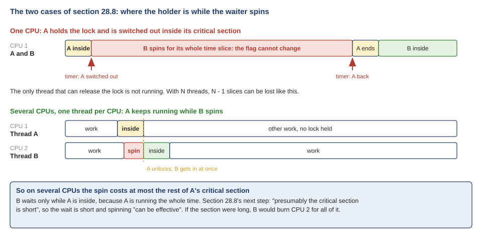
<figcaption markdown="1">Figure Q.1. The two cases of section 28.8 as time bars. On one CPU the holder is switched out and B spins its whole time slice. On several CPUs A keeps running, so B spins at most for the rest of A's critical section.</figcaption>
</figure>

### Q1. "Confusion: why is the critical section presumably short for multiple CPUS?" {#q1 data-toc-label="Q1. Why the critical section is 'presumably short' on several CPUs"}

Where to reread: OSTEP 28.8, Evaluating Spin Locks; W08 [Section 6.1](https://annie983284450-1.github.io/NNU-CS3430-selfstudyguide/w08/class-2/#sec-6-1) and [Section 6.6](https://annie983284450-1.github.io/NNU-CS3430-selfstudyguide/w08/class-2/#sec-6-6).

**In the passage.** "Presumably" is the step that makes the passage's argument work. On two CPUs, step 3 says, B waits at most as long as the rest of A's critical section. That is cheap only if the section is short, and the book assumes it is: "presumably the critical section is short". So the sentence is not a fact about machines with several CPUs. It is an assumption about the code, and the conclusion ("doesn't waste many cycles") holds only while the assumption does.

Read "presumably" as "we are assuming". Having more CPUs does not make a critical section shorter; the code inside it decides its length. And programmers keep that code short on purpose. `counter = counter + 1` is three instructions: load, add, store. Putting a node at the front of a list is two pointer writes. W09 [Extra 2](https://annie983284450-1.github.io/NNU-CS3430-selfstudyguide/w09/class-1/#extra-2) is that habit as a rule: lock only the lines that touch shared data. A few dozen instructions take well under a microsecond.

So the book needs the assumption because a spinner pays for every moment it spins. Thread A, the holder, keeps running on CPU 1 the whole time, so it is making progress while B waits on CPU 2. When A's section is short, B's spin is short, and the cost is a sliver of CPU 2's time (Figure Q.2, top). If A's section is long, say A reads a file while it holds the lock, then B burns CPU 2 for that whole time (Figure Q.2, bottom). The assumption has failed, and spinning is now a bad idea, however many CPUs there are.

<figure markdown="1">
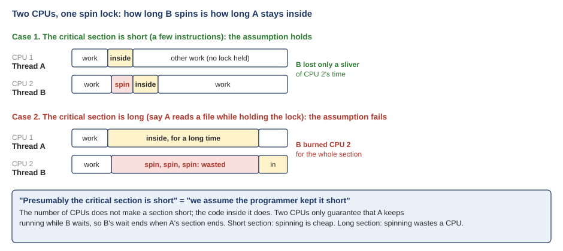
<figcaption markdown="1">Figure Q.2. Two CPUs, one spin lock. B spins at most as long as A stays inside. Short section: B loses a sliver. Long section: B burns CPU 2 for the whole section.</figcaption>
</figure>

On one CPU the assumption does not save you, and that is the passage's first paragraph. Even a short section can be cut in the middle by a timer interrupt, and then the holder cannot run until the spinner's time slice ends (W08 [Section 6.1](https://annie983284450-1.github.io/NNU-CS3430-selfstudyguide/w08/class-2/#sec-6-1)). That is the contrast 28.8 draws: one CPU is painful; several CPUs are fine, *if* the section is short.

The W08 measurement used long sections on purpose, about 1 ms each. On 2 cores the spin lock and the sleeping mutex tied, 0.44 s against 0.45 s, because the holder kept running on the other core. But the waiting core spent that time spinning, and no other program could use it.

### Q2. "And why cant a thread on CPU 2 start a new process while a thread on CPU 1 is locked?" {#q2 data-toc-label="Q2. Why CPU 2 just spins instead of doing something else"}

Where to reread: OSTEP 28.7 (the end) and 28.8; W08 [Section 1.3](https://annie983284450-1.github.io/NNU-CS3430-selfstudyguide/w08/class-1/#sec-1-3) and [Section 5.1](https://annie983284450-1.github.io/NNU-CS3430-selfstudyguide/w08/class-2/#sec-5-1).

**In the passage.** The setting matters: "if the number of threads roughly equals the number of CPUs". Thread A holds the lock on CPU 1, and thread B spins on CPU 2 because it asked for the same lock. In that setting, spinning is the cheapest thing CPU 2 can do, and that is why the book calls it "effective".

Take it one piece at a time, with Figure Q.3.

- **Nobody "is locked" except the lock variable.** Thread A holds lock L and keeps running at full speed on CPU 1. Holding a lock does not slow the holder down or stop it. CPU 2 is busy only because thread B called `lock(&L)` too and is running the spin loop `while (TestAndSet(&L, 1) == 1) ;`, ordinary instructions.
- **CPU 2 can run another process.** At the next timer interrupt the OS can take CPU 2 away from B and run any other ready process, as it can with any running program. That is the preemptive scheduler of OSTEP 28.7, which spin locks rely on. What the spin lock never does is give the CPU up by itself.
- **In the book's setting, nobody else wants CPU 2.** With about one thread per CPU, every thread already has a CPU, so no ready thread is waiting for CPU 2. B's spinning takes CPU time from nobody, and it ends as soon as A's short section ends.
- **Giving CPU 2 away would cost more.** B would make a system call to give up the CPU, the system would switch to another thread, and when A unlocks a moment later, it would switch back. Two context switches take far longer than A's few instructions.

<figure markdown="1">
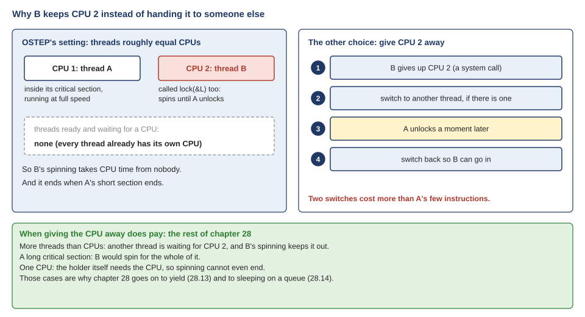
<figcaption markdown="1">Figure Q.3. Why B keeps CPU 2. In the book's setting every thread already has its own CPU, so B's spin takes time from nobody; handing CPU 2 over and back costs two switches. Bottom: the cases where giving the CPU away does pay.</figcaption>
</figure>

Change the setting and the answer changes. With more threads than CPUs, another thread is waiting for CPU 2 and B's spinning keeps it out. With a long section, B spins for all of it. With one CPU, the holder itself needs the CPU, so the spin cannot even end. Those are the cases where handing the CPU over wins, and they are exactly where chapter 28 goes next: yield (28.13) and sleeping on a queue (28.14).

**The passage in OSTEP** (§28.1, Locks: The Basic Idea, and §28.2, Pthread Locks):

> A lock is just a variable, and thus to use one, you must declare a lock variable of some kind (such as mutex above). This lock variable (or just “lock” for short) holds the state of the lock at any instant in time.
>
> […] You might also notice here that the POSIX version passes a variable to lock and unlock, as **we may be using different locks to protect different variables**. Doing so can increase concurrency: instead of one big lock that is used any time any critical section is accessed (a coarse-grained locking strategy), one will often protect different data and data structures with different locks, thus allowing more threads to be in locked code at once (a more fine-grained approach).

**What the passage argues.**

1. A lock is a variable, declared like any other.
2. OSTEP's examples share one variable (balance), so they show one lock and one critical section.
3. A real program shares many things, and each can get its own lock.
4. One lock for everything is “coarse-grained”; one lock per piece of data is “fine-grained”, and lets more threads into locked code at once.

### Q3. "Is there only 1 critical section available across the whole system?" {#q3 data-toc-label="Q3. Whether there is only one critical section in the whole system"}

Where to reread: W08 [Section 2.6](https://annie983284450-1.github.io/NNU-CS3430-selfstudyguide/w08/class-1/#sec-2-6) and [Section 2.7](https://annie983284450-1.github.io/NNU-CS3430-selfstudyguide/w08/class-1/#sec-2-7); W09 [Section 2.11](https://annie983284450-1.github.io/NNU-CS3430-selfstudyguide/w09/class-1/#sec-2-11) and [Extra 5](https://annie983284450-1.github.io/NNU-CS3430-selfstudyguide/w09/class-1/#extra-5).

**In the passage.** Sections 28.1 and 28.2 answer this directly: a lock is a variable, and "we may be using different locks to protect different variables". The question comes up because the examples of chapter 28, the two threads of 28.8 included, share a single variable. One variable means one lock and one critical section, so it is easy to picture that as the whole system.

"Critical section" sounds like a place, one special room in the machine. It is a piece of code: the lines in a program that touch one particular piece of shared data. The same summary called it "a critical state", which hides the same picture. So there are as many critical sections as there are pieces of shared data, and a real kernel has thousands. Some you have already met:

- `counter_mutex.c` in W08 has one mutex, protecting one counter.
- The hash table of W09 has 101 locks, one per bucket. Two lookups that land in different buckets run at the same time.
- xv6 protects its free-page list with `kmem.lock` (W08 [Section 2.7](https://annie983284450-1.github.io/NNU-CS3430-selfstudyguide/w08/class-1/#sec-2-7)). Every process has its own `p->lock` (W09 [Section 4.11](https://annie983284450-1.github.io/NNU-CS3430-selfstudyguide/w09/class-2/#sec-4-11)), and every disk buffer has a lock of its own.

**Mutual exclusion is per lock.** At most one thread is inside the critical sections of lock L at a time. Two threads holding two different locks run their critical sections at the same moment, on different CPUs, and that is the reason to have many locks (Figure Q.4). The passage's two words for this are coarse-grained (one big lock) and fine-grained (many small ones).

<figure markdown="1">
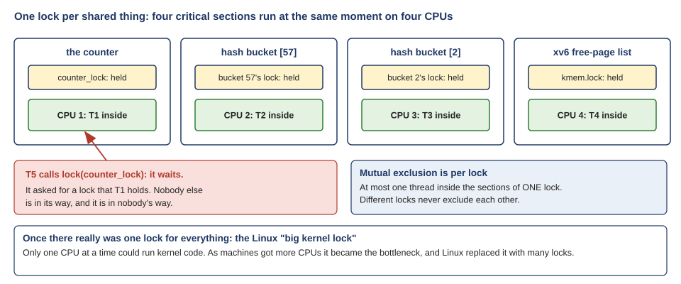
<figcaption markdown="1">Figure Q.4. One lock per shared thing. Four threads are inside four different critical sections on four CPUs at once. T5 waits only because it asked for the lock T1 holds.</figcaption>
</figure>

Your picture did once exist. When Linux first ran on machines with several CPUs, it used one lock for the whole kernel, the "big kernel lock", so only one CPU at a time could run kernel code. That is the coarse-grained extreme. As machines got more CPUs, that lock became the bottleneck, and Linux replaced it with many small ones (W09 [Extra 5](class-1.md#extra-5)).

## 2. Spin locks and correctness {#t2}

!!! abstract "Recap"

    Section 28.8 judged the spin lock correct, because it gives mutual exclusion: only one thread is ever inside. Later in chapter 28 an aside says spin locks should be avoided on some systems, for correctness. Both sentences are true, because they mean different things by "correct". (W08 [Extra 6](https://annie983284450-1.github.io/NNU-CS3430-selfstudyguide/w08/class-2/#extra-6).)

**The passage in OSTEP** (§28.8, then the aside on priority inversion in §28.14):

> The most important aspect of a lock is correctness: does it provide mutual exclusion? The answer here is yes: the spin lock only allows a single thread to enter the critical section at a time. **Thus, we have a correct lock.**
>
> […] One good reason to avoid spin locks is performance: as described in the main text, if a thread is interrupted while holding a lock, other threads that use spin locks will spend a large amount of CPU time just waiting for the lock to become available. However, it turns out there is another interesting reason to avoid spin locks **on some systems: correctness**. The problem to be wary of is known as priority inversion […].
>
> […] Now, the problem. Assume T2 is blocked for some reason. So T1 runs, grabs a spin lock, and enters a critical section. T2 now becomes unblocked (perhaps because an I/O completed), and the CPU scheduler immediately schedules it (thus descheduling T1). T2 now tries to acquire the lock, and because it can’t (T1 holds the lock), it just keeps spinning. Because the lock is a spin lock, T2 spins forever, and **the system is hung**.

**What the passage argues.**

1. Sense 1 (§28.8): does the lock give mutual exclusion? The spin lock does.
2. Sense 2 (the aside): does the whole system keep working?
3. “On some systems”: those whose scheduler always runs a higher-priority thread first (T2 over T1).
4. There a lock that is correct in sense 1 can hang the machine: sense 2 fails.

### F1. "I also learned about correctness and how you want to avoid spin locks if you want correctness." {#f1 data-toc-label="F1. Spin locks and correctness"}

Where to reread: OSTEP 28.8 and the aside "More Reason To Avoid Spinning: Priority Inversion" in 28.14; W08 [Extra 6](https://annie983284450-1.github.io/NNU-CS3430-selfstudyguide/w08/class-2/#extra-6).

**In the passage.** The summary repeats the aside, and what it leaves out is which correctness, and on which systems. In the main sense of 28.8, a spin lock **is** correct: "does it provide mutual exclusion? The answer here is yes ... Thus, we have a correct lock." The aside uses "correctness" in a second sense, the whole system keeps working, and limits it to "some systems": those whose scheduler always runs a higher-priority thread first.

Here is how it goes wrong, on one CPU (Figure Q.5). The scheduler always runs the high-priority thread T2 when it can. T2 is blocked on I/O, so low-priority T1 runs, takes a spin lock, and enters its critical section. The I/O finishes, the scheduler switches to T2 at once, and T2 tries to take the lock and spins. T1 must run to unlock, but the scheduler never runs T1 while T2 can run. Only T1 was ever inside, so mutual exclusion held; but the system is stuck: "the system is hung".

<figure markdown="1">
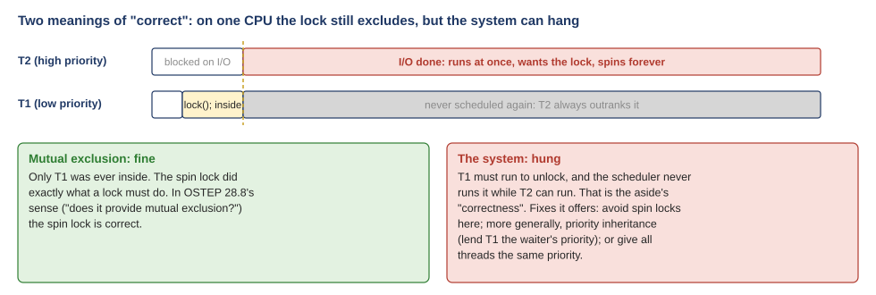
<figcaption markdown="1">Figure Q.5. Priority inversion with a spin lock. Mutual exclusion holds, since only T1 was ever inside, but T2 spins forever and T1 is never scheduled again.</figcaption>
</figure>

With a spin lock, the aside's first answer is simply to avoid spin locks. But it also says that does not fully cure the problem: with three threads, a sleeping lock can get stuck the same way, when a medium-priority thread keeps running while the high-priority one waits for the low-priority holder. Its more general fix is **priority inheritance**: while a low-priority thread holds a lock that a higher-priority thread waits for, the holder temporarily runs at the waiter's priority, so it can finish and unlock. (Its third option is simplest: give all threads the same priority.) This really happened: in 1997 the Mars Pathfinder lander kept resetting itself until engineers found a priority inversion and fixed it from Earth by turning priority inheritance on.

## 3. Compare-and-swap, load-linked and store-conditional {#t3}

!!! abstract "Recap"

    An atomic instruction reads a memory cell and writes it in one step that nothing can land inside. An interrupt comes before it or after it, never in the middle, and when two CPUs use the same cell at once, the hardware puts their accesses in order. **Test-and-set** (atomic exchange) writes a new value and returns the old one; the spin lock is built on it. Sections 28.9 and 28.10 show two more ways the hardware can build the same lock: **compare-and-swap**, which writes the new value only if the cell still holds the value you expected, and returns the old value either way; and **load-linked** with **store-conditional**, a pair of instructions that together act like one. (W08 [Section 5.1](https://annie983284450-1.github.io/NNU-CS3430-selfstudyguide/w08/class-2/#sec-5-1), [Section 5.6](https://annie983284450-1.github.io/NNU-CS3430-selfstudyguide/w08/class-2/#sec-5-6) and [Extra 4](https://annie983284450-1.github.io/NNU-CS3430-selfstudyguide/w08/class-2/#extra-4).)

**The passage in OSTEP** (§28.9, Compare-And-Swap):

> The basic idea is for compare-and-swap to test whether the value at the address specified by ptr is equal to expected; **if so, update the memory location pointed to by ptr with the new value. If not, do nothing.** In either case, return the original value at that memory location, thus allowing the code calling compare-and-swap to know whether it succeeded or not.
>
> […] Finally, as you may have sensed, compare-and-swap is a more powerful instruction than test-and-set. We will make some use of this power in the future when we briefly delve into topics such as lock-free synchronization [H91]. However, if we just build a simple spin lock with it, **its behavior is identical to the spin lock we analyzed above**.

**What the passage argues.**

1. Test-and-set: write the new value and return the old one, every time.
2. Compare-and-swap: write only if the cell holds the expected value; return the old value either way.
3. Used as a lock (expected 0, new 1) the two give the same answers: “identical”.
4. The extra power, writing only if nothing changed, is saved for later: lock-free synchronization.

### Q4. "28.7 and 28.9 (test-and-set vs. compare-and-swap): I originally had these backwards. Test-and-set always swaps, and compare-and-swap only swaps if the value matches what’s expected." {#q4 data-toc-label="Q4. Test-and-set and compare-and-swap, the right way round"}

Where to reread: OSTEP 28.7 and 28.9; W08 [Section 5.1](https://annie983284450-1.github.io/NNU-CS3430-selfstudyguide/w08/class-2/#sec-5-1) and [Extra 4](https://annie983284450-1.github.io/NNU-CS3430-selfstudyguide/w08/class-2/#extra-4).

**In the passage.** Your corrected version is right, and the passage explains why the two are so easy to swap in memory: "if we just build a simple spin lock with it, its behavior is identical to the spin lock we analyzed above." Used as a lock, they give the same answers, so the lock code gives you nothing to tell them apart by. The difference is the "more powerful" part the passage saves for later, and it only appears when the cell can hold something other than 0 or 1.

First the lock. Put the two side by side on a flag that is either 0 or 1 (Figure Q.6, top). On a free flag, both write 1 and return 0, so you got the lock. On a held flag, test-and-set writes 1 again, which changes nothing, and compare-and-swap writes nothing; both return 1, so you spin. Same answers in every case.

The names help: **test-and-set** sets, no questions asked. **Compare-and-swap** compares first.

Now the case where they differ. A shared counter holds 41, and a thread wants to add 1 without any lock (Figure Q.6, bottom). It reads 41, computes 42, and calls `CompareAndSwap(&c, 41, 42)`: "make it 42, but only if it is still 41". If no other thread got there first, the call returns 41, and c is 42. If another thread already made it 42, the call returns 42, which is not the 41 it expected, and it writes nothing. The thread simply starts again with 42 and tries 42 to 43. No add is ever lost, and no thread ever waits on a lock. Test-and-set cannot do this, because it can only write a value fixed in advance; it has no way to say "only if it is still 41". This read, compute, compare-and-swap, retry pattern is the basis of **lock-free** data structures, the "lock-free synchronization [H91]" the passage mentions (W08 [Extra 4](https://annie983284450-1.github.io/NNU-CS3430-selfstudyguide/w08/class-2/#extra-4)).

<figure markdown="1">

<figcaption markdown="1">Figure Q.6. Top: as a lock, test-and-set and compare-and-swap give the same results. Bottom: adding 1 to a counter with no lock, which only compare-and-swap can do; if another thread changed the value first, the swap writes nothing and the thread tries again.</figcaption>
</figure>

On real processors: x86 has `xchg` (test-and-set) and `cmpxchg` (compare-and-swap). C programs reach them through `atomic_exchange()` and `atomic_compare_exchange_strong()`. xv6's `acquire()` uses RISC-V's `amoswap`, a test-and-set (W08 [Section 5.3](https://annie983284450-1.github.io/NNU-CS3430-selfstudyguide/w08/class-2/#sec-5-3)).

**The passage in OSTEP** (§28.10, Load-Linked and Store-Conditional):

> The load-linked operates much like a typical load instruction, and simply fetches a value from memory and places it in a register. The key difference comes with the store-conditional, which only succeeds (and updates the value stored at the address just load-linked from) **if no intervening store to the address has taken place**. In the case of success, the store-conditional returns 1 and updates the value at ptr to value; if it fails, the value at ptr is not updated and 0 is returned.
>
> […] The lock() code is the only interesting piece. First, a thread spins waiting for the flag to be set to 0 (and thus indicate the lock is not held). Once so, the thread tries to acquire the lock via the store-conditional; if it succeeds, the thread has atomically changed the flag’s value to 1 and thus can proceed into the critical section.

Figure 28.6: Using LL/SC To Build A Lock (lock() only):

```c
void lock(lock_t *lock) {
  while (1) {
    while (LoadLinked(&lock->flag) == 1)
      ; // spin until it’s zero
    if (StoreConditional(&lock->flag, 1) == 1)
      return; // if set-it-to-1 was a success: all done
    // otherwise: try it all over again
  }
}
```

**What the passage argues.**

1. Load-linked: an ordinary load.
2. Store-conditional: writes only if no other store hit that address since the load-linked; returns 1 if it wrote, 0 if not.
3. lock(): load-link the flag until it reads 0, then store-conditional a 1.
4. A 0 back means someone stored in between: start over.

### Q5. "Load-linked and store-conditional was also confusing. I’m not even really sure how to ask for clarification on it because I don’t understand it enough to know what questions to ask." {#q5 data-toc-label="Q5. Load-linked and store-conditional, and what to ask about them"}

Where to reread: OSTEP 28.10, Load-Linked and Store-Conditional; W08 [Extra 4](https://annie983284450-1.github.io/NNU-CS3430-selfstudyguide/w08/class-2/#extra-4).

**In the passage.** The whole pair turns on one phrase: the store-conditional succeeds only "if no intervening store to the address has taken place". The book's C version (Figure 28.5) hides the piece of hardware behind that phrase: a note the CPU keeps on the address between the two instructions. Once that note is visible, the rest follows.

When you do not know what to ask about a new mechanism, these four questions work for almost any of them. What does each part do on its own? What is remembered between the parts? What makes it fail, and what happens then? Why was it designed this way? Here they are for load-linked and store-conditional.

**1. What does each instruction do on its own?** Load-linked is an ordinary load: it reads the value at an address into a register. In addition, the CPU makes a note: "I am watching this address". That note is called a **reservation**, a watch on the address. Store-conditional writes a value to the address, but only if the watch is still there. It returns 1 if it wrote, and 0 if it did not; on failure it writes nothing.

**2. What is remembered between them?** Only the watch: one address, kept in the CPU's hardware. "No intervening store" is checked against it.

**3. What makes the store fail?** Any store to that address by someone else, between your load-linked and your store-conditional, erases your watch. Then your store-conditional fails. (On real chips a few other events, such as an interrupt, can also erase it. That only costs one more trip round the loop.) Figure Q.7 traces the case the book describes in 28.10. Both threads load-link a 0. T2 stores first and succeeds; that write erases T1's watch. So T1's store fails, writes nothing, and T1 goes back to loading, finds a 1, and spins. Only one of the two gets the lock.

<figure markdown="1">
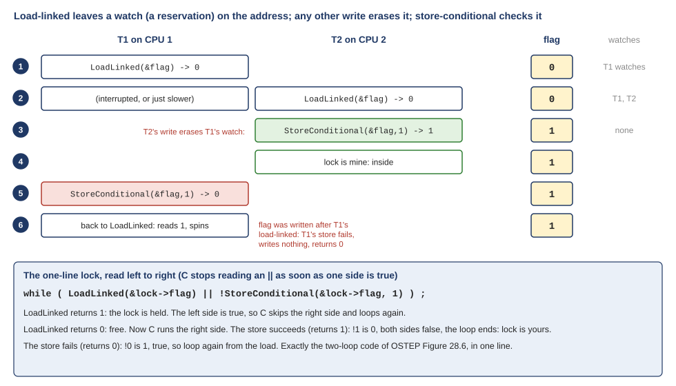
<figcaption markdown="1">Figure Q.7. Two threads both load-link a 0. T2's store-conditional succeeds and writes 1, which erases T1's watch, so T1's store-conditional fails and writes nothing. Below: the one-line lock from OSTEP 28.10, read piece by piece.</figcaption>
</figure>

The bottom of Figure Q.7 reads the short version of the lock from 28.10, the one a student suggested in the book:

```c
void lock(lock_t *lock) {
    while (LoadLinked(&lock->flag) ||
          !StoreConditional(&lock->flag, 1))
        ; // spin
}
```

C evaluates `||` from left to right and stops as soon as one side is true. If the load returns 1, the lock is held, and C loops again without even trying the store. If the load returns 0, C tries the store. A successful store returns 1, `!1` is 0, both sides are false, and the loop ends with the lock yours. A failed store returns 0, `!0` is 1, and the loop starts over.

**4. Why design it this way, and not as one instruction?** Classic RISC processors, such as MIPS and early ARM, kept every memory instruction simple: an instruction either loads or stores, never both. Load-linked and store-conditional keep that rule and still give an atomic update. (Newer designs added one-instruction atomics as well: RISC-V has `amoswap`, the test-and-set in xv6's `acquire()`, and ARM added swap and compare-and-swap instructions in 2016. Both still keep load-linked and store-conditional.) The pair is also general: put any computation between them and you get an atomic version of it. Fetch-and-add, for example, is a three-step loop: load-link the value, add 1, store-conditional; if the store failed, go round again.

On real chips: RISC-V calls them `lr.w` and `sc.w`, and ARM `ldxr` and `stxr`. One trap if you ever read real code: both `sc.w` and `stxr` write 0 on success and nonzero on failure, the opposite of the book's convention.

**The passage in OSTEP** (§28.10, Load-Linked and Store-Conditional: how the store-conditional can fail):

> Note how failure of the store-conditional might arise. One thread calls lock() and executes the load-linked, returning 0 as the lock is not held. Before it can attempt the store-conditional, it is interrupted and another thread enters the lock code, also executing the load-linked instruction, and also getting a 0 and continuing.
>
> *(the summary stops here; this note is not the book's text)*
>
> At this point, two threads have each executed the load-linked and each are about to attempt the store-conditional. **The key feature of these instructions is that only one of these threads will succeed in updating the flag to 1 and thus acquire the lock**; the second thread to attempt the store-conditional will fail (because the other thread updated the value of flag between its load-linked and store-conditional) and thus have to try to acquire the lock again.

**What the passage argues.**

1. Thread 1 load-links the flag: 0.
2. It is interrupted; thread 2 load-links the flag: also 0.
3. Both are about to store-conditional a 1.
4. Only one succeeds. The other fails, since the flag changed after its load-link.
5. The loser tries again: only one thread gets the lock.

### F6. "The thread could be interrupted before attempting the store-conditional. Another thread can then do the same." {#f6 data-toc-label="F6. The end of the LL/SC story"}

Where to reread: OSTEP 28.10; Q5 above.

**In the passage.** Both parts of the summary are true, and they are where the book's story gets interesting, not where it ends. The summary stops one sentence too early. The next sentence is the point of the whole pair: "only one of these threads will succeed in updating the flag to 1 and thus acquire the lock".

Both threads now hold a loaded 0 and are about to store. Whichever stores first wins: in Figure Q.7, T2 writes the 1 and is inside. That write is exactly the event that erases T1's watch. So when T1 finally tries its store-conditional, it is refused: it writes nothing and returns 0, and the flag keeps the winner's 1. T1 goes back to load-linked, reads 1, and spins like any other waiter. Two threads loaded a 0, but only one got the lock.

## 4. The ticket lock {#t4}

!!! abstract "Recap"

    The spin lock gives mutual exclusion, but it is unfair: whichever waiter swaps first after an unlock gets in, so one thread can lose every round. Section 28.11 fixes fairness with another atomic instruction, **fetch-and-add** (add 1 and return the old value), and a lock made of two numbers, like the ticket and the "now serving" sign at a bakery. (W08 [Section 5.5](https://annie983284450-1.github.io/NNU-CS3430-selfstudyguide/w08/class-2/#sec-5-5) and [Section 5.6](https://annie983284450-1.github.io/NNU-CS3430-selfstudyguide/w08/class-2/#sec-5-6).)

**The passage in OSTEP** (§28.11, Fetch-And-Add):

> Instead of a single value, this solution uses a ticket and turn variable in combination to build a lock. The basic operation is pretty simple: when a thread wishes to acquire a lock, it first does an atomic fetch-and-add on the ticket value; **that value is now considered this thread’s “turn” (myturn)**. The globally shared lock->turn is then used to determine which thread’s turn it is; **when (myturn == turn) for a given thread, it is that thread’s turn to enter the critical section**. Unlock is accomplished simply by incrementing the turn such that the next waiting thread (if there is one) can now enter the critical section.

**What the passage argues.**

1. ticket: the next number to hand out.
2. Fetch-and-add on ticket gives you a number; OSTEP calls it your turn, myturn.
3. lock->turn: the number being served now, shared by all threads.
4. You enter only when myturn == lock->turn.
5. Unlock adds 1 to lock->turn: the next number is called.

### F3. "Ticket lock: when a thread wants to get a lock, perform a fetch and add on the ticket value. That value is now the threads “turn” and acquires the lock." {#f3 data-toc-label="F3. The ticket lock's numbers"}

Where to reread: OSTEP 28.11, Figure 28.7; W08 [Section 5.6](https://annie983284450-1.github.io/NNU-CS3430-selfstudyguide/w08/class-2/#sec-5-6).

**In the passage.** The first half of the summary is the book's own wording: "that value is now considered this thread's 'turn' (myturn)". So the slip is only the last three words. The same paragraph says when you have the lock: "when (myturn == turn) for a given thread, it is that thread's turn to enter the critical section." Taking a ticket does not give you the lock.

Keep three numbers apart. `lock->ticket` is the dispenser: the next number to hand out. `myturn` is the number each thread holds, the value its fetch-and-add returned. `lock->turn` is the shared "now serving" sign. In Figure 28.7, line 12 takes your number and moves the dispenser on, line 13 waits until the sign shows your number, and line 18, the unlock, moves the sign on to call the next number (Figure Q.8). The lock is yours at the moment `lock->turn == myturn`, not when you take the ticket. That is also where the fairness comes from: with ticket 2, at most 2 threads are served before you.

<figure markdown="1">
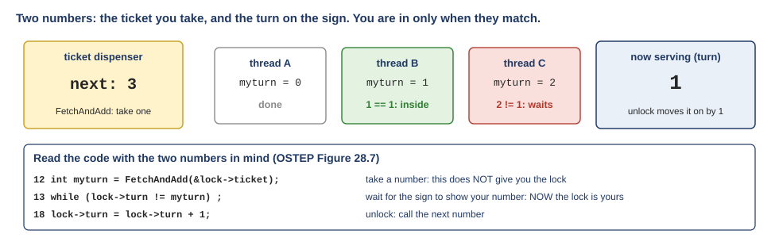
<figcaption markdown="1">Figure Q.8. The ticket dispenser and the "now serving" sign. B holds ticket 1, and turn is 1, so B is inside; C holds 2 and waits. Taking a ticket does not give you the lock; the match does.</figcaption>
</figure>

## 5. Sleeping instead of spinning {#t5}

!!! abstract "Recap"

    Every lock so far waits by spinning, and on one CPU that wastes whole time slices: the waiter spins while the holder cannot run. Section 28.13 tries giving the CPU up at once (yield), which helps a little. Section 28.14 builds a **queue lock** (OSTEP Figure 28.9), a lock where waiters sleep. It has three parts. The **flag** says whether the lock is held. The **queue** lists the threads asleep waiting for it. The **guard** is a tiny spin lock that protects the flag and the queue while `lock()` and `unlock()` read and change them, a few instructions at a time. A thread that finds the flag at 1 writes its id on the queue, lets go of the guard and calls `park()`, which puts it to sleep. `unlock()` either sets the flag to 0, if nobody is waiting, or calls `unpark()` on the first thread in the queue and leaves the flag at 1. (W08 [Section 6.1](https://annie983284450-1.github.io/NNU-CS3430-selfstudyguide/w08/class-2/#sec-6-1), [Section 6.3](https://annie983284450-1.github.io/NNU-CS3430-selfstudyguide/w08/class-2/#sec-6-3) and [Section 6.4](https://annie983284450-1.github.io/NNU-CS3430-selfstudyguide/w08/class-2/#sec-6-4).)

For reference, the lock and unlock of Figure 28.9, with the book's line numbers:

```{.c .numberLines startFrom="13"}
void lock(lock_t *m) {
    while (TestAndSet(&m->guard, 1) == 1)
        ; //acquire guard lock by spinning
    if (m->flag == 0) {
        m->flag = 1; // lock is acquired
        m->guard = 0;
    } else {
        queue_add(m->q, gettid());
        m->guard = 0;
        park();
    }
}

void unlock(lock_t *m) {
    while (TestAndSet(&m->guard, 1) == 1)
          ; //acquire guard lock by spinning
    if (queue_empty(m->q))
          m->flag = 0; // let go of lock; no one wants it
    else
          unpark(queue_remove(m->q)); // hold lock
                                            // (for next thread!)
    m->guard = 0;
}
```

**The passage in OSTEP** (§28.14, Using Queues: Sleeping Instead Of Spinning):

> The real problem with our previous approaches is that they leave too much to chance. **The scheduler determines which thread runs next**; if the scheduler makes a bad choice, a thread runs that must either spin waiting for the lock (our first approach), or yield the CPU immediately (our second approach). Either way, there is potential for waste and no prevention of starvation.
>
> […] Thus, we must **explicitly exert some control over which thread next gets to acquire the lock** after the current holder releases it. To do this, we will need a little more OS support, as well as a queue to keep track of which threads are waiting to acquire the lock.
>
> For simplicity, we will use the support provided by Solaris, in terms of two calls: park() to put a calling thread to sleep, and unpark(threadID) to wake a particular thread as designated by threadID. These two routines can be used in tandem to build a lock that **puts a caller to sleep if it tries to acquire a held lock** and wakes it when the lock is free.

**What the passage argues.**

1. Spin and yield locks leave the next owner to chance: whichever thread the scheduler happens to run.
2. A bad choice: a waiter spins or yields; time is wasted, and nothing prevents starvation.
3. The fix: the lock itself decides who goes next.
4. It needs a queue of waiting threads, and two OS calls: park() to sleep, unpark(id) to wake one thread.

### Q7. "I also was confused about what determines which thread is to be given access to lock. The scheduler does that I assume." {#q7 data-toc-label="Q7. What decides which thread gets the lock next"}

Where to reread: OSTEP 28.14, the first paragraph; W08 [Section 5.2](https://annie983284450-1.github.io/NNU-CS3430-selfstudyguide/w08/class-2/#sec-5-2), [Section 5.5](https://annie983284450-1.github.io/NNU-CS3430-selfstudyguide/w08/class-2/#sec-5-5), [Section 5.6](https://annie983284450-1.github.io/NNU-CS3430-selfstudyguide/w08/class-2/#sec-5-6) and [Section 6.3](https://annie983284450-1.github.io/NNU-CS3430-selfstudyguide/w08/class-2/#sec-6-3).

**In the passage.** For the earlier locks your guess is right, and it is the first sentence of the passage: "The scheduler determines which thread runs next". The book calls that leaving "too much to chance", and it is the very problem the queue lock was built to fix: "we must explicitly exert some control over which thread next gets to acquire the lock".

Two separate decisions are in play. Who gets a CPU next is the scheduler's decision. Who gets the lock next is the lock's decision. Lock by lock (Figure Q.9):

- **Spin lock (test-and-set).** Nobody decides. When the holder stores 0, the first swap to land wins. Which swap lands first depends on which threads happen to be running at that moment, which is the scheduler's doing, and on hardware timing. That is why it is unfair: a thread can lose every round.
- **Ticket lock.** Arrival order decides. Your ticket number is fixed the moment you arrive, and each unlock moves `turn` on by 1. The scheduler still decides when the winner gets to run, but not who wins.
- **Queue lock (Figure 28.9).** The lock's own queue decides. `unlock()` removes the first name in the queue and hands it the lock. The scheduler only decides when the woken thread gets a CPU to carry on.
- **Linux mutex (futex, topic 6).** Partly the kernel, partly timing. The kernel wakes one sleeper and makes no promise about which; and a thread that is already running can take the freed lock before the woken one does.

<figure markdown="1">
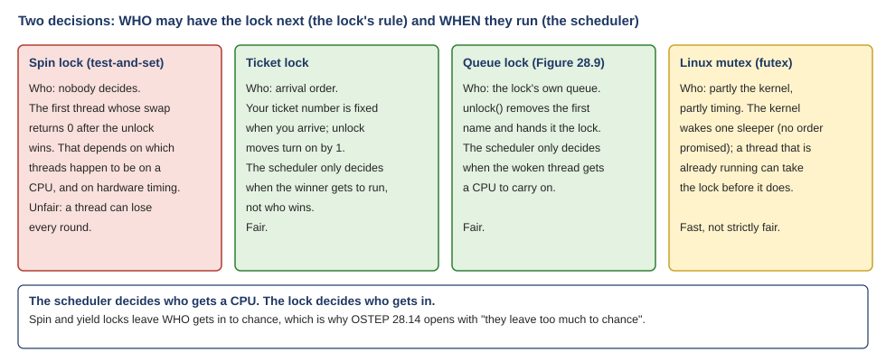
<figcaption markdown="1">Figure Q.9. Who gets the lock next, lock by lock. The scheduler decides who gets a CPU; only the ticket lock and the queue lock make the lock's own decision fair.</figcaption>
</figure>

### Q8. "Does every other thread in this case go to sleep while one has access to the lock?" {#q8 data-toc-label="Q8. Whether every other thread sleeps while one holds the lock"}

Where to reread: W08 [Section 6.3](https://annie983284450-1.github.io/NNU-CS3430-selfstudyguide/w08/class-2/#sec-6-3), Step 1 and Step 2.

**In the passage.** The last sentence of the passage says exactly who sleeps: the lock "puts a caller to sleep if it tries to acquire a held lock". Not every thread: only the threads that call `lock()` on this lock while it is held. The rest of the program, and the rest of the system, carries on.

Figure Q.10 is a snapshot of one moment. T1 holds the lock m. T2 and T3 called `lock(m)`, found the flag at 1, wrote their names in the queue, and are asleep in `park()`. Asleep means **blocked**: the thread uses no CPU until someone wakes it. T4 is doing work that never touches m, so it runs, or waits for a CPU, as usual. T5 holds a different lock, n, and m does not concern it at all.

<figure markdown="1">
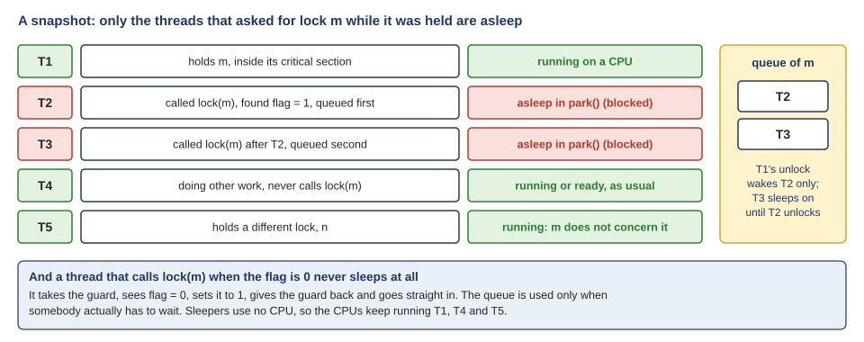
<figcaption markdown="1">Figure Q.10. A snapshot. Only T2 and T3, which asked for m while it was held, are asleep. T1's unlock wakes T2 only; T3 sleeps until T2 unlocks.</figcaption>
</figure>

Three more details answer the rest of the question.

- **A thread that finds the lock free never sleeps.** On lines 16 to 18 it sees flag 0, sets it to 1, gives the guard back and goes straight in. The queue is used only when somebody actually has to wait.
- **Sleepers are woken one at a time.** Each `unlock()` wakes exactly one thread, the first in the queue. When T1 unlocks, only T2 wakes; T3 keeps sleeping until T2 unlocks.
- **Before sleeping, a thread does spin a little: on the guard.** If another thread holds the guard, a newcomer spins on line 14. But the guard is held for only a few instructions, never for the user's critical section, so that spin is short.

**The passage in OSTEP** (§28.14, Using Queues: Sleeping Instead Of Spinning (after Figure 28.9)):

> You might notice how the guard is used […], basically as a **spin-lock around the flag and queue manipulations** the lock is using. This approach thus doesn’t avoid spin-waiting entirely; a thread might be interrupted while acquiring or releasing the lock, and thus cause other threads to spin-wait for this one to run again. However, the time spent spinning is quite limited (**just a few instructions inside the lock and unlock code, instead of the user-defined critical section**), and thus this approach may be reasonable.
>
> […] You might further detect that the flag does not get set back to 0 when another thread gets woken up. Why is this? Well, it is not an error, but rather a necessity! When a thread is woken up, it will be as if it is returning from park(); however, **it does not hold the guard at that point in the code and thus cannot even try to set the flag to 1**. Thus, we just pass the lock directly from the thread releasing the lock to the next thread acquiring it; flag is not set to 0 in-between.

**What the passage argues.**

1. The guard is a small spin lock that protects only the flag and the queue.
2. It is held for a few instructions inside lock() and unlock(), never for the user's critical section.
3. When a sleeper is woken, unlock() leaves the flag at 1.
4. The woken thread does not hold the guard, so it cannot touch the flag; the lock is handed straight to it.

### Q6. "28.14 (park/unpark with queues): following the guard lock, the queue, and why the lock gets handed directly to the next thread." {#q6 data-toc-label="Q6. The guard, the queue, and why the lock is handed straight over"}

Where to reread: OSTEP 28.14; W08 [Section 6.3](https://annie983284450-1.github.io/NNU-CS3430-selfstudyguide/w08/class-2/#sec-6-3).

**In the passage.** The two paragraphs above explain the two details that make Figure 28.9 hard to follow. The guard is "a spin-lock around the flag and queue manipulations", held for "just a few instructions inside the lock and unlock code, instead of the user-defined critical section". And the flag is left at 1 on a hand-off because the woken thread "does not hold the guard at that point in the code and thus cannot even try to set the flag to 1". So the code holds two locks, and they protect different things for very different lengths of time. Read them as one thing and the code makes no sense.

**Two locks, two jobs.** Follow T1 through one lock and unlock (Figure Q.11, top). T1 holds the guard only inside `lock()` (lines 14 to 18) and inside `unlock()` (lines 27 to 34): a few instructions each time. The flag is 1 from the end of `lock()` until `unlock()`: the whole critical section, which may be long. A restaurant has the same three parts. The flag is the "table taken" sign. The queue is the waiting list. The guard is the host's pen: only one person at a time may write on the list or flip the sign, and only for a few seconds.

The guard is needed because the flag and the queue must change together. Suppose a thread looks at the flag, sees 1, and decides to join the queue. Before it has joined, the owner unlocks, finds the queue empty, and sets the flag to 0. Now the first thread joins the queue and sleeps, and nobody is coming to wake it. The guard stops this by making "look at the flag, then join the queue" one unit that the owner cannot get between.

**The hand-off.** Now T1 unlocks while T2 and T3 sleep in the queue (Figure Q.11, middle). Line 29: the queue is not empty. Line 32: T1 removes T2 and unparks it, and does **not** set the flag to 0. When T2 wakes, it continues right after its `park()` on line 22 and leaves `lock()`, already the owner. The lock went from T1 to T2 directly.

<figure markdown="1">

<figcaption markdown="1">Figure Q.11. Top: the guard is held for a few instructions inside lock() and unlock(); the flag for the whole critical section. Middle: the hand-off; the flag stays 1, and T2 wakes up already owning the lock. Bottom: what would go wrong if T2 had to take the lock itself.</figcaption>
</figure>

**Why the flag stays at 1.** In Figure 28.9 the woken thread does not try again: it returns from `park()` and simply leaves `lock()` as the owner. So if `unlock()` set the flag to 0 instead, a newcomer could find the 0 and walk in too, and two threads would be inside. The only repair would be to make T2 try again, and that is what the book says it cannot do where it wakes up: it "does not hold the guard at that point in the code and thus cannot even try to set the flag to 1". To try, it would have to go back to line 14 and take the guard. In that time a newcomer, T4, could arrive, find the flag at 0, and take the lock first, and T2 would go back to sleep after having waited longest. Leaving the flag at 1 passes ownership in the same instant T1 decides, so nobody can slip in, and the queue order is kept.

Linux makes the other choice, and W08 [Section 6.5](https://annie983284450-1.github.io/NNU-CS3430-selfstudyguide/w08/class-2/#sec-6-5) shows the price: its mutex stores 0 and wakes a thread that then tries again, which is faster when the woken thread would take a while to get a CPU, but no longer first come, first served.

**The passage in OSTEP** (§28.14, Using Queues: Sleeping Instead Of Spinning (the last paragraphs)):

> Finally, you might notice the perceived race condition in the solution, just before the call to park(). With just the wrong timing, a thread will be **about to park**, assuming that it should sleep until the lock is no longer held. **A switch at that time to another thread** (say, a thread holding the lock) could lead to trouble, for example, if that thread then released the lock. **The subsequent park by the first thread would then sleep forever** (potentially), a problem sometimes called the wakeup/waiting race.
>
> Solaris solves this problem by adding a third system call: setpark(). By calling this routine, a thread can indicate it is about to park. If it then happens to be interrupted and another thread calls unpark before park is actually called, **the subsequent park returns immediately instead of sleeping**.

**What the passage argues.**

1. “About to park”: T2 has joined the queue and released the guard, but has not yet called park().
2. “A switch at that time”: T1 runs, unlocks, removes T2 from the queue and calls unpark(T2).
3. T2 is still awake, so that unpark does nothing.
4. “Sleep forever”: T2 then parks, and nobody is left to wake it.
5. setpark(): an unpark that comes early is remembered, so park() returns at once.

### Q9. "I understand that park/unpark puts threads to sleep, but I’m still not fully sure how the race that setpark() fixes happens step by step." {#q9 data-toc-label="Q9. The race that setpark() fixes, step by step"}

Where to reread: OSTEP 28.14, the last three paragraphs; W08 [Section 6.4](https://annie983284450-1.github.io/NNU-CS3430-selfstudyguide/w08/class-2/#sec-6-4).

**In the passage.** The book's description has four moments, in bold above: a thread "about to park", "a switch at that time to another thread", the holder releasing the lock, and then "the subsequent park by the first thread would then sleep forever". The race lives in a gap of exactly one line: between `m->guard = 0;` on line 21 and `park();` on line 22. What turns that gap into a bug is one fact the book states only in passing: `unpark()` on a thread that is still awake does nothing, and leaves no trace. Think of `unpark()` as knocking on a bedroom door. If nobody is in bed yet, the knock is simply lost.

The setting: one CPU, T1 holds the lock, and T2 calls `lock()`. Figure Q.12 traces the bad timing, one line at a time.

1. T2 takes the guard (line 14).
2. The flag is 1, so T2 adds itself to the queue (line 20).
3. T2 lets go of the guard (line 21). T2 has decided to sleep, but it is still awake: "about to park". Now a timer interrupt arrives, and the OS switches to T1: "a switch at that time".
4. T1 finishes its critical section and calls `unlock()`. It takes the guard (line 27).
5. The queue is not empty, so T1 removes T2 and calls `unpark(T2)` (line 32). T2 is not asleep, so nothing happens. The flag stays 1, because the lock now belongs to T2.
6. T1 lets go of the guard (line 34) and carries on. Later, the OS switches back to T2.
7. T2 runs line 22, `park()`, and falls asleep: "sleep forever".

Now look at the state. The flag is 1, so the lock is held, and its owner is T2. T2 is asleep. The queue is empty, because T1 removed T2 in step 5, so no future `unlock()` will ever wake T2. Every later caller of `lock()` sees the flag at 1, joins the queue and sleeps too. The wake-up came in step 5, before the sleep in step 7, and so it was lost. The book calls this the **wakeup/waiting race**.

<figure markdown="1">
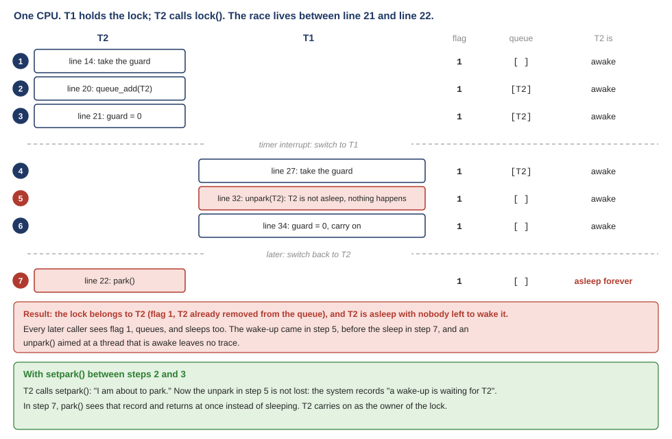
<figcaption markdown="1">Figure Q.12. The seven steps. The unpark in step 5 reaches T2 while it is still awake and does nothing; the park in step 7 then sleeps forever. Bottom: with setpark() between steps 2 and 3, the early unpark is recorded and the park returns at once.</figcaption>
</figure>

<!-- anim:setpark:start -->
Step through the seven steps yourself, without `setpark()` and then with it.

<div class="anim" data-anim="setpark" markdown="0"></div>
<!-- anim:setpark:end -->


**The fix.** Solaris adds a third call, `setpark()`, which T2 makes between steps 2 and 3. It means "I am about to park". If an `unpark()` arrives after `setpark()` and before `park()`, the system records it, and "the subsequent park returns immediately instead of sleeping". In step 5 the knock is now remembered; in step 7, T2's `park()` sees it and returns. T2 continues, as the owner of the lock.

The guard cannot simply be kept until after `park()`. The book asks exactly this: "What would happen if the release of the guard lock came after the park(), and not before? Hint: something bad." T2 would fall asleep while holding the guard. T1's `unlock()` would then spin on line 27 forever, waiting for a guard that only a sleeping thread can release. On one CPU it would spin away every time slice it gets. That is why the guard has to be released before `park()`, and why the gap exists at all.

## 6. Linux's futex {#t6}

!!! abstract "Recap"

    Linux builds the sleeping lock from one integer, the lock word, plus two kernel calls: `futex_wait()` to sleep on an address and `futex_wake()` to wake one sleeper. A lock and an unlock with nobody else around stay in user space and cost one atomic instruction each; the kernel is called only when a thread must sleep or be woken. W08 traced the current glibc lock word, which holds 0, 1 or 2. Section 28.15 prints an older version of the same library, Figure 28.10, which packs two numbers into one `int`. (W08 [Section 6.5](https://annie983284450-1.github.io/NNU-CS3430-selfstudyguide/w08/class-2/#sec-6-5); W09 [Section 3.9](https://annie983284450-1.github.io/NNU-CS3430-selfstudyguide/w09/class-1/#sec-3-9).)

**The passage in OSTEP** (§28.14 (the end) and §28.15, Different OS, Different Support):

> Solaris solves this problem by adding a third system call: setpark(). By calling this routine, a thread can indicate it is about to park. […]
>
> […] A different solution could **pass the guard into the kernel**. In that case, the kernel could take precautions to atomically release the lock and dequeue the running thread.
>
> […] Specifically, two calls are available. The call to futex_wait(address, expected) puts the calling thread to sleep, **assuming the value at address is equal to expected. If it is not equal, the call returns immediately**.

**What the passage argues.**

1. Fix 1: remember an early wake-up: setpark() (Solaris).
2. Fix 2: pass the guard into the kernel, which releases it and puts the thread to sleep as one step.
3. Fix 3: futex_wait() checks, inside the kernel, that the word still holds the expected value, and only then sleeps.
4. Fixes 2 and 3 make “check, then sleep” one step that no waker can get between.

### Q10. "I’d like more detail on how that gap realistically gets closed." {#q10 data-toc-label="Q10. How real systems close the gap before sleeping"}

Where to reread: OSTEP 28.14 (the last paragraph) and 28.15; W08 [Section 6.5](https://annie983284450-1.github.io/NNU-CS3430-selfstudyguide/w08/class-2/#sec-6-5); W09 [Section 3.9](class-1.md#sec-3-9) and [Section 4.11](class-2.md#sec-4-11).

**In the passage.** The book names three fixes, in three places, and they come in two kinds. The gap exists because "decide to sleep" and "be asleep" are two separate steps, and a waker can act between them. Either a system **remembers** a wake-up that arrives early (setpark()), or it makes the check and the sleep **one step** that a waker cannot get between (passing the guard into the kernel, and futex_wait()). Q9 showed the first kind. Real systems more often use the second.

Figure Q.13 shows three real systems side by side.

<figure markdown="1">
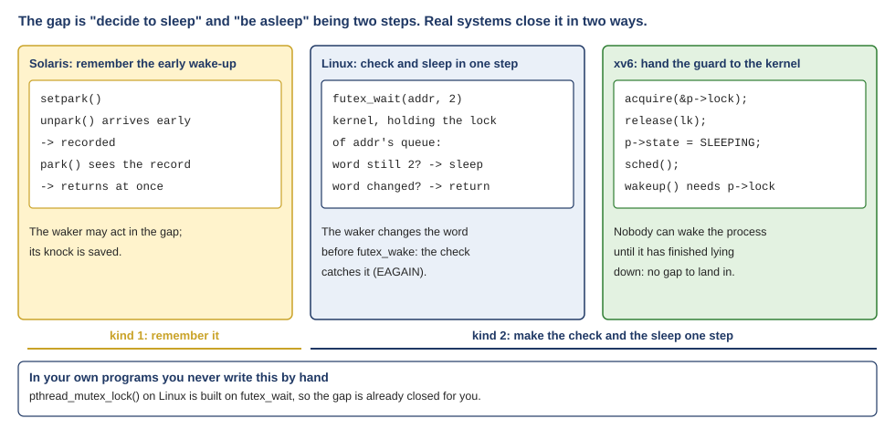
<figcaption markdown="1">Figure Q.13. Three real ways to close the gap. Solaris remembers an early wake-up. Linux re-checks the lock word inside the kernel before sleeping. xv6 takes the process's own lock before it releases the caller's lock, so no wake-up can land in between.</figcaption>
</figure>

**Solaris: remember it.** That is `setpark()`, from Q9.

**Linux: check again, inside the kernel.** `futex_wait(address, expected)` sleeps only if the value at the address still equals `expected`; "if it is not equal, the call returns immediately". The kernel makes that check and puts the thread on the address's queue as one step, with respect to any `futex_wake()` on the same address. Meanwhile, the unlocking thread changes the lock word *before* it calls `futex_wake()`. So there are only two possible orders. Either the waiter's check sees the changed word, and `futex_wait()` returns at once instead of sleeping; or the waiter is already on the queue when the wake arrives. No wake-up can fall in between. You have seen this happen. In the strace run of W08 [Section 6.5](https://annie983284450-1.github.io/NNU-CS3430-selfstudyguide/w08/class-2/#sec-6-5), 7,944 of the futex calls came back as "errors" with `EAGAIN`: each one was a waiter whose check found the word already changed, so the kernel did not put it to sleep. That is the gap of Q9, closed, 7,944 times in one run.

**xv6: hand the guard to the kernel.** This is the passage's "A different solution could pass the guard into the kernel. In that case, the kernel could take precautions to atomically release the lock and dequeue the running thread." xv6's `sleep()` does exactly that. From `kernel/proc.c` in the students' xv6 tree, lines 551 to 558:

```{.c .numberLines startFrom="551"}
  acquire(&p->lock);  //DOC: sleeplock1
  release(lk);

  // Go to sleep.
  p->chan = chan;
  p->state = SLEEPING;

  sched();
```

`lk` is the caller's lock, playing the guard's role. Before it lets go of `lk` (line 552), `sleep()` takes `p->lock`, the sleeping process's own lock (line 551). And `wakeup()` must take that same `p->lock` before it can mark a process as runnable again. So between "decided to sleep" and "asleep", nobody can wake this process: the wake-up waits until the process has finished lying down (W09 [Section 4.11](class-2.md#sec-4-11) traces who releases `p->lock` after the switch).

xv6 even builds Figure 28.9's whole lock this way. Its **sleep lock**, from `kernel/sleeplock.c`:

```c
void
acquiresleep(struct sleeplock *lk)
{
  acquire(&lk->lk);
  while (lk->locked) {
    sleep(lk, &lk->lk);
  }
  lk->locked = 1;
  lk->pid = myproc()->pid;
  release(&lk->lk);
}
```

`lk->lk` is a spin lock playing the guard. `lk->locked` is the flag. `sleep()` and `wakeup()` play `park()` and `unpark()`, with the gap already closed inside `sleep()`. One difference from Figure 28.9: xv6's `wakeup()` wakes every sleeper on the address, so each one checks `lk->locked` again in the `while` loop, and all but one go back to sleep.

So, realistically, nobody writes park and unpark by hand. In your own programs, `pthread_mutex_lock()` on Linux is built on `futex_wait()`, and the gap is already closed for you.

**The passage in OSTEP** (§28.15, Different OS, Different Support):

> This code snippet from lowlevellock.h in the nptl library (part of the gnu libc library) [L09] is interesting for a few reasons. First, it uses **a single integer to track both whether the lock is held or not (the high bit of the integer) and the number of waiters on the lock (all the other bits)**. Thus, **if the lock is negative, it is held** (because the high bit is set and that bit determines the sign of the integer).
>
> Second, the code snippet shows how to optimize for the common case, specifically when there is no contention for the lock; with only one thread acquiring and releasing a lock, very little work is done (the atomic bit test-and-set to lock and an atomic add to release the lock).

Figure 28.10, comments left out:

```c
 1 void mutex_lock (int *mutex) {
 2   int v;
 4   if (atomic_bit_test_set (mutex, 31) == 0)
 5     return;
 6   atomic_increment (mutex);
 7   while (1) {
 8     if (atomic_bit_test_set (mutex, 31) == 0) {
 9       atomic_decrement (mutex);
10       return;
11     }
14     v = *mutex;
15     if (v >= 0)
16       continue;
17     futex_wait (mutex, v);
18   }
19 }
21 void mutex_unlock (int *mutex) {
24   if (atomic_add_zero (mutex, 0x80000000))
25     return;
29   futex_wake (mutex);
30 }
```

Figure 28.10 is an older glibc lock word. The one traced in class keeps 0, 1 or 2. Both rely on futex_wait() checking the word inside the kernel.

**What the passage argues.**

1. Bit 31, the high bit: held or not.
2. All the other bits: how many threads are waiting.
3. The high bit is the sign bit, so held means negative.
4. With nobody competing: one bit test-and-set to lock, one add to unlock, and no kernel.

### Q14. "Finally, the futex code’s bit manipulation is still hard for me to follow." {#q14 data-toc-label="Q14. The bit manipulation in the futex code"}

Where to reread: OSTEP 28.15, Figure 28.10; W08 [Section 6.5](https://annie983284450-1.github.io/NNU-CS3430-selfstudyguide/w08/class-2/#sec-6-5).

**In the passage.** The passage gives the one fact you need to read the code: it uses "a single integer to track both whether the lock is held or not (the high bit of the integer) and the number of waiters on the lock (all the other bits)", and so "if the lock is negative, it is held". Bit 31, the top bit, says whether the lock is held. The other 31 bits count the threads that are interested in the lock. Once the two fields are clear, every line of the code is one of them being tested or changed.

Here is Figure 28.10 again, with the book's line numbers:

```{.c .numberLines startFrom="1"}
void mutex_lock (int *mutex) {
  int v;
  /* Bit 31 was clear, we got the mutex (the fastpath) */
  if (atomic_bit_test_set (mutex, 31) == 0)
    return;
  atomic_increment (mutex);
  while (1) {
      if (atomic_bit_test_set (mutex, 31) == 0) {
          atomic_decrement (mutex);
          return;
      }
      /* We have to waitFirst make sure the futex value
         we are monitoring is truly negative (locked). */
      v = *mutex;
      if (v >= 0)
        continue;
      futex_wait (mutex, v);
  }
}

void mutex_unlock (int *mutex) {
  /* Adding 0x80000000 to counter results in 0 if and
     only if there are not other interested threads */
  if (atomic_add_zero (mutex, 0x80000000))
    return;

    /* There are other threads waiting for this mutex,
       wake one of them up. */
    futex_wake (mutex);
}
```

(The comment on line 12 has a typo in the book: it means "We have to wait. First make sure...".)

<figure markdown="1">
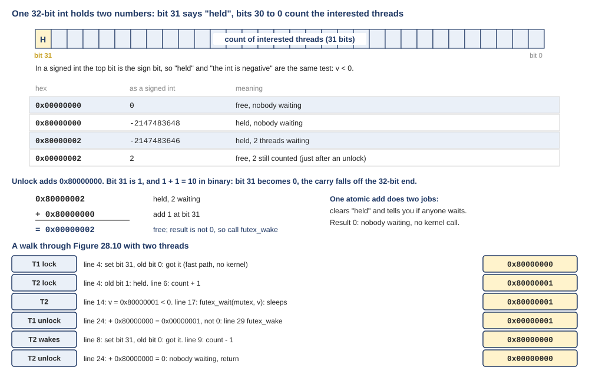
<figcaption markdown="1">Figure Q.14. Top: the two fields of the lock word, and four example values. Middle: why adding 0x80000000 clears bit 31 and leaves the count alone. Bottom: the word through one contended lock and unlock.</figcaption>
</figure>

The table at the top of Figure Q.14 gives four values worth knowing. `0x00000000` is free with nobody waiting. `0x80000000` is held with nobody waiting; as a signed `int` that is −2,147,483,648, about minus 2.1 billion: a negative number. `0x80000002` is held with 2 threads waiting. `0x00000002` is free, with 2 threads still counted: the state just after an unlock, before the woken thread takes the lock.

Now the lines, one at a time.

- **Line 4**, `atomic_bit_test_set(mutex, 31)`: set bit 31 to 1 and return its old value, in one atomic step. This is test-and-set on a single bit. If the old bit was 0, the lock was free and is now yours. This is the fast path: one atomic instruction, no kernel.
- **Line 6**, `atomic_increment(mutex)`: you did not get it, so add 1 to the whole word. Bit 31 is untouched, and the count in the low 31 bits goes up by one: "one more thread is interested". Then the loop starts.
- **Lines 8 to 10**: each time round, first try bit 31 again. If you get the lock this time, line 9 takes your 1 back off the count, because you are no longer waiting.
- **Lines 14 to 16**: the lock is still held, so read the word into `v`. If `v >= 0`, bit 31 is clear, so the lock was just freed. Do not sleep; loop and try again.
- **Line 17**, `futex_wait(mutex, v)`: sleep, but only if the word still equals `v`. If anything changed in the meantime, an unlock or another waiter arriving, the call returns at once and the loop tries again. This is the Q10 check that closes the gap.
- **Line 24**, `atomic_add_zero(mutex, 0x80000000)`: add 0x80000000 and report whether the result is 0. This one line does the whole unlock.

Adding 0x80000000 unlocks because 0x80000000 is a single 1 at bit 31, and bit 31 is 1 while the lock is held. In binary, 1 + 1 = 10: bit 31 becomes 0, and the carry would go into bit 32, which does not exist in a 32-bit word, so it simply falls off the end (Figure Q.14, middle). The low 31 bits, the count, are not touched. So one atomic add does two jobs at once: it clears "held", and its result is exactly the count of interested threads. If that result is 0, nobody is waiting, and unlock returns without ever calling the kernel. Otherwise line 29 wakes one sleeper.

The bottom of Figure Q.14 follows the word through one contended lock and unlock: T1 locks (0x80000000), T2 fails and counts itself (0x80000001) and sleeps, T1's unlock leaves 0x00000001 and wakes T2, and T2 takes the lock and removes itself from the count.

W08 [Section 6.5](https://annie983284450-1.github.io/NNU-CS3430-selfstudyguide/w08/class-2/#sec-6-5) follows the current glibc lock word with three values: 0 (free), 1 (held, nobody waiting) and 2 (held, maybe somebody waiting). It is the same idea with less detail. The book's word keeps an exact count; the newer one keeps only "maybe". Both rely on `futex_wait()` checking the word inside the kernel, and both exist so that a lock and an unlock with nobody else around stay in user space.

## 7. Two-phase locks {#t7}

!!! abstract "Recap"

    Waiting has two kinds of cost, and they behave differently. **Spinning** costs CPU time for as long as the wait lasts. **Sleeping** costs a fixed amount, however short the wait turns out to be: a system call to go to sleep, a context switch away, a system call by the unlocker to wake you, and a wait for the scheduler to give you a CPU again. So spinning is cheap for short waits and expensive for long ones, and sleeping is the reverse. Chapter 28 first waited by spinning, then removed the spinning by letting waiters sleep; its last section brings spinning back for a moment before sleeping. (W08 [Section 6.5](https://annie983284450-1.github.io/NNU-CS3430-selfstudyguide/w08/class-2/#sec-6-5) and [Section 6.6](https://annie983284450-1.github.io/NNU-CS3430-selfstudyguide/w08/class-2/#sec-6-6).)

**The passage in OSTEP** (§28.16, Two-Phase Locks):

> A two-phase lock realizes that **spinning can be useful, particularly if the lock is about to be released**. So in the first phase, the lock spins for a while, hoping that it can acquire the lock.
>
> However, if the lock is not acquired during the first spin phase, a second phase is entered, where the caller is put to sleep, and only woken up when the lock becomes free later. The Linux lock above is a form of such a lock, but **it only spins once**; a generalization of this could **spin in a loop for a fixed amount of time** before using futex support to sleep.
>
> Two-phase locks are yet another instance of a hybrid approach, where combining two good ideas may indeed yield a better one. Of course, whether it does **depends strongly on many things, including the hardware environment, number of threads, and other workload details**.

**What the passage argues.**

1. Spinning was the problem only when the wait is long.
2. Phase 1: spin a while, in case the lock is about to be released.
3. Phase 2: if not, sleep until woken.
4. Linux's lock spins once; a longer spin loop is the generalization.
5. Whether it pays depends on the hardware, the number of threads and the workload.

### Q11. "I did not understand how spinning is helpful in this case. In the two phase lock setting, how is spinning helpful?" {#q11 data-toc-label="Q11. How spinning helps in a two-phase lock"}

Where to reread: OSTEP 28.16, Two-Phase Locks; W08 [Section 6.1](https://annie983284450-1.github.io/NNU-CS3430-selfstudyguide/w08/class-2/#sec-6-1) and [Section 6.6](https://annie983284450-1.github.io/NNU-CS3430-selfstudyguide/w08/class-2/#sec-6-6).

**In the passage.** After pages against spinning, 28.16 says "spinning can be useful, particularly if the lock is about to be released". The missing piece is that sleeping is not free either. Going to sleep and being woken up costs a fixed amount of work and time. If the lock was about to be freed anyway, that fixed cost is pure waste, and a short spin would have been cheaper. That is the short wait of 28.8 again, where spinning was cheap.

Figure Q.15 puts the two waiters side by side, with illustrative times (not a measurement). Start with the case 28.16 has in mind, a lock about to be released. A critical section of a few dozen instructions is well under a microsecond (W08 [Section 6.1](https://annie983284450-1.github.io/NNU-CS3430-selfstudyguide/w08/class-2/#sec-6-1)). The spinning waiter notices the 0 the moment it is stored and goes in. The sleeping waiter has to make a system call to sleep, be switched out, wait for the holder's wake-up call, and then wait again for the scheduler to give it a CPU. All of that takes microseconds, many times longer than the section it was waiting for.

<figure markdown="1">

<figcaption markdown="1">Figure Q.15. Top: the lock is freed almost at once; the spinner gets in long before the sleeper is back on a CPU. Bottom: the lock is held for a long time; the spinner burns a CPU for the whole wait, while the sleeper's CPU runs other threads. Illustrative times, not a measurement.</figcaption>
</figure>

Now the other case: the holder keeps the lock for a long time. The spinner burns a whole CPU for the whole wait; the sleeper pays its fixed cost once and its CPU runs other threads in the meantime.

Neither waiter is right in both cases, and you cannot tell in advance which case you are in. The two-phase lock bets on the first case and caps its loss in the second. Phase 1: spin for a short while, in case the holder is about to unlock. If it does, you skipped the sleep and the wake-up entirely. Phase 2: if the lock is still held, stop spinning and sleep. You lost only the short spin, not the whole wait. Q12 is about how long "a short while" should be.

### Q12. "I’m also not sure how a real system decides how long to spin before sleeping in a two-phase lock," {#q12 data-toc-label="Q12. How a real system decides how long to spin"}

Where to reread: OSTEP 28.16; W08 [Section 6.5](https://annie983284450-1.github.io/NNU-CS3430-selfstudyguide/w08/class-2/#sec-6-5) and [Section 6.6](https://annie983284450-1.github.io/NNU-CS3430-selfstudyguide/w08/class-2/#sec-6-6).

**In the passage.** The book says only that the Linux lock "only spins once", and that a generalization "could spin in a loop for a fixed amount of time". It does not say how long, because no single value is right everywhere. A spinner cannot know how long the holder will keep the lock, so any spin limit is a bet. Real systems use one of three rules. The cleverest one replaces "how long should I spin?" with a question that does have an answer: "is the holder running right now?"

**Rule 1: a fixed count, which you can tune.** glibc, the C library on Linux, offers an "adaptive" mutex (`PTHREAD_MUTEX_ADAPTIVE_NP`). Its manual says the tunable `glibc.pthread.mutex_spin_count` "sets the maximum number of times a thread should spin on the lock before calling into the kernel to block", and that "the default value of this tunable is 100". The default mutex does not spin at all: it makes one quick try and then sleeps (W08 [Section 6.5](https://annie983284450-1.github.io/NNU-CS3430-selfstudyguide/w08/class-2/#sec-6-5)). The book's Linux lock, Figure 28.10, also "only spins once".

**Rule 2: spin for as long as one sleep would cost.** Call the cost of one sleep and wake-up C. The rule: spin for up to C, then sleep. Figure Q.16 shows why this is a good bet whatever the wait W turns out to be.

- If W is shorter than C, you spin for W and get in. Even someone who knew W in advance could not do better.
- If W is longer than C, you spin for C and then sleep for another C: 2C in total. Someone who knew W in advance would have slept at once and paid C.

So this rule never costs more than twice the best possible choice, and you did not need to know W. Rules like this were studied by Karlin and colleagues in 1991, in a paper on "competitive spinning".

<figure markdown="1">
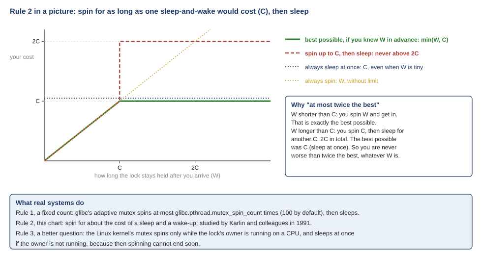
<figcaption markdown="1">Figure Q.16. Your cost against how long the lock stays held (W). Spinning up to C and then sleeping never costs more than 2C, and never more than twice the best choice you could have made knowing W in advance. Bottom: what real systems do.</figcaption>
</figure>

**Rule 3: spin only while the holder is running.** This is what the Linux kernel's own mutex does. Its design document describes the middle step of taking a mutex, called optimistic spinning, as: it "tries to spin for acquisition while the lock owner is running and there are no other tasks ready to run that have higher priority". And it gives the reason: "if the lock owner is running, it is likely to release the lock soon." If the owner is not running, because it was switched out or is waiting for the disk, the lock cannot be freed soon, so the waiter sleeps at once. That is exactly the one-CPU disaster of W08 [Section 6.1](https://annie983284450-1.github.io/NNU-CS3430-selfstudyguide/w08/class-2/#sec-6-1), avoided by asking the right question.

### Q13. "What still confuses me is how to decide between a spin lock and a sleeping lock, because that was never made clear in the chapter." {#q13 data-toc-label="Q13. How to choose between a spin lock and a sleeping lock"}

Where to reread: OSTEP 28.8, 28.12, 28.14 and 28.16; W08 [Section 6.6](https://annie983284450-1.github.io/NNU-CS3430-selfstudyguide/w08/class-2/#sec-6-6).

**In the passage.** The last sentence of 28.16 is the book's honest answer: whether the combination is better "depends strongly on many things, including the hardware environment, number of threads, and other workload details". You are right that the chapter never puts the decision in one place. It gives the pieces in three sections: several CPUs in 28.8, one CPU in 28.12, and "it depends" in 28.16. Put together, the decision comes down to three questions, asked in order.

1. **Is the waiter in code that may not sleep?** Sleeping means switching to another thread, and some code may not switch: an interrupt handler, or the scheduler itself. xv6 takes its spin locks in exactly those places, so they must spin. Its `acquire()` also turns interrupts off while a spin lock is held (its comment says "disable interrupts to avoid deadlock"): otherwise an interrupt handler on the same CPU could wait forever for a lock that CPU already holds (W08 [Section 5.3](https://annie983284450-1.github.io/NNU-CS3430-selfstudyguide/w08/class-2/#sec-5-3)).
2. **Can the holder stop running while it holds the lock?** It might wait for the disk, or there might be more threads than CPUs, or only one CPU. Then a waiter would spin while the holder cannot finish: use a sleeping lock.
3. **Is the critical section a few instructions, and does each waiter have a CPU of its own?** Then the wait ends when the section ends, sooner than a sleep and wake-up could, and a spin lock is fine.

If you are not sure, use a sleeping lock. In a user program that simply means `pthread_mutex_t`; glibc's version tries once in user space and sleeps in the kernel only if the lock is held (Q12, Rule 1).

<figure markdown="1">
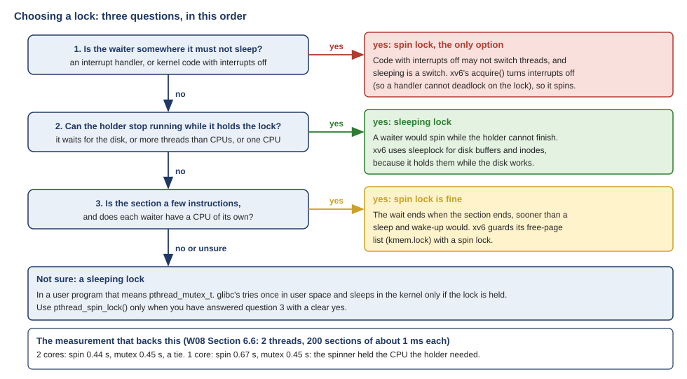
<figcaption markdown="1">Figure Q.17. The three questions as a flowchart, with an xv6 example for each answer, and the W08 measurement that backs it.</figcaption>
</figure>

xv6 shows both answers inside one kernel. It protects its free-page list with a spin lock, `kmem.lock`, because the critical section is a few instructions. But it protects each disk buffer and each inode (the file system's record for one file) with a **sleep lock** (`kernel/sleeplock.c`, the code in Q10), because the kernel holds those while it waits for the disk, which takes milliseconds. Spinning for milliseconds would waste a whole CPU.

The W08 measurement is the same rule with numbers. With 1 ms critical sections, on 2 cores the spin lock and the mutex tied (0.44 s and 0.45 s), because the holder kept running. On 1 core the spin lock took 0.67 s and the mutex still 0.45 s: the spinner was holding the only CPU, the one the holder needed to finish (W08 [Section 6.6](https://annie983284450-1.github.io/NNU-CS3430-selfstudyguide/w08/class-2/#sec-6-6)).

## 8. The counter {#t8}

!!! abstract "Recap"

    Chapter 29 puts locks inside data structures, and its method has two steps. First make the structure correct with one lock, taken by every function that touches it. Then, only if a measurement shows that the lock is the bottleneck, split what is shared, so that threads take different locks. The first structure is a counter. Without a lock it loses adds. With one lock it is exact, but four threads take far longer than one. The **approximate counter** gives each CPU its own local count and moves it into a global count every S adds: fast, and a little behind. (W09 [Section 1.2](https://annie983284450-1.github.io/NNU-CS3430-selfstudyguide/w09/class-1/#sec-1-2), [Section 2.3](https://annie983284450-1.github.io/NNU-CS3430-selfstudyguide/w09/class-1/#sec-2-3), [Section 2.5](https://annie983284450-1.github.io/NNU-CS3430-selfstudyguide/w09/class-1/#sec-2-5) and [Extra 1](https://annie983284450-1.github.io/NNU-CS3430-selfstudyguide/w09/class-1/#extra-1).)

**The passage in OSTEP** (§29.1, Concurrent Counters: Simple But Not Scalable):

> As you can see, the non-synchronized counter is a trivial data structure, requiring a tiny amount of code to implement. We now have our next challenge: how can we make this code thread safe? **Figure 29.2 shows how we do so.**
>
> *Figure 29.1: A Counter Without Locks* *(the caption is printed here, at the end of the code; this note is not the book's text)*
>
> This concurrent counter is simple and works correctly. In fact, it follows a design pattern common to the simplest and most basic concurrent data structures: **it simply adds a single lock**, which is acquired when calling a routine that manipulates the data structure, and is released when returning from the call.

**What the passage argues.**

1. Figure 29.1 is the counter without locks: “non-synchronized”.
2. The text asks how to make it thread safe, and points at Figure 29.2.
3. Figure 29.1's caption is printed in between, right above the next sentence.
4. That sentence goes on: it “simply adds a single lock”: it describes Figure 29.2.

### F2. "Concurrent counters without locks: simple, works correctly, easy." {#f2 data-toc-label="F2. The counter without locks"}

Where to reread: OSTEP 29.1, Figures 29.1 and 29.2; W09 [Section 1.2](class-1.md#sec-1-2).

**In the passage.** Read with the sentence before it, "this concurrent counter" is the one Figure 29.2 builds: the paragraph before ends "Figure 29.2 shows how we do so", and the sentence itself goes on, "it simply adds a single lock". So the simple counter that works correctly is the one **with** one lock.

Without a lock, `counter++` is three instructions (load, add, store), a second thread can run in the gap, and adds are lost. In W09 [Section 1.2](class-1.md#sec-1-2), four threads without a lock lost most of their adds.

The mix-up is easy to make, because of how the PDF is laid out (Figure Q.18). The sentence "This concurrent counter is simple and works correctly" sits right under the caption "Figure 29.1: A Counter Without Locks". But it describes Figure 29.2, "A Counter With Locks", which is printed on the next page.

<figure markdown="1">
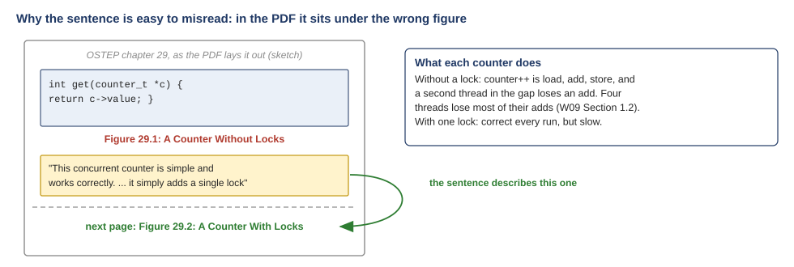
<figcaption markdown="1">Figure Q.18. How the page reads: the sentence about the simple, correct counter sits under the caption of Figure 29.1, but it describes Figure 29.2, printed on the next page.</figcaption>
</figure>

**The passage in OSTEP** (§29.1, Concurrent Counters: Scalable Counting, and Figure 29.6):

> How often this local-to-global transfer occurs is determined by a threshold S. **The smaller S is, the more the counter behaves like the non-scalable counter above; the bigger S is, the more scalable the counter, but the further off the global value might be from the actual count**. One could simply acquire all the local locks and the global lock (in a specified order, to avoid deadlock) to get an exact value, but that is not scalable.
>
> […] Figure 29.6 shows the importance of the threshold value S, with four threads each incrementing the counter 1 million times on four CPUs. If S is low, performance is poor (but the global count is always quite accurate); if S is high, performance is excellent, but the global count lags **(by at most the number of CPUs multiplied by S)**. This accuracy/performance tradeoff is what approximate counters enable.

**What the passage argues.**

1. Each CPU adds to its own count; every S adds it moves them into the global count.
2. Small S: many trips to the global lock: slow, but the global is nearly exact.
3. Large S: few trips: fast, but the global lags.
4. The lag is at most (number of CPUs) × S.
5. OSTEP gives the trade-off and a measurement, not a value for S.

### Q15. "Then in Chapter 29, I’d like more detail on how the approximate counter’s threshold S affects accuracy versus speed," {#q15 data-toc-label="Q15. How the threshold S trades accuracy for speed"}

Where to reread: OSTEP 29.1, Figure 29.6; W09 [Section 2.5](class-1.md#sec-2-5) and [Extra 1](class-1.md#extra-1).

**In the passage.** The passage states the trade-off in one sentence ("the smaller S is, the more the counter behaves like the non-scalable counter above; the bigger S is, the more scalable the counter, but the further off the global value might be from the actual count") and gives the bound on the lag. Both effects come from one fact: S is how many adds a local count holds back before it reports them to the global count. Holding back more adds means fewer trips to the shared lock, which is the speed. It also means more adds the global count has not seen yet, which is the inaccuracy. One knob, two consequences that always move together.

**Speed.** Every add takes its own local lock, which no other thread wants, so it never waits there. Only one add in S also takes the global lock, the one all threads share. With 4 threads making 1,000,000 adds each, there are 4,000,000 adds, so about 4,000,000 / S trips to the global lock (each thread makes one trip per full batch of S; leftovers stay local). With S = 1, every add takes the global lock: 4,000,000 trips, and the run was even slower than the plain one-lock counter (0.157 s against 0.0944 s). With S = 32: 4,000,000 / 32 = 125,000 trips. With S = 1024: each thread makes 976 trips (see the end of this answer), 4 × 976 = 3,904.

**Accuracy.** Each local count can be holding up to S adds that the global count has not received. With 4 local counts, `get()`, which reads only the global count, can be behind the truth by up to 4 × S. That is the passage's bound: the global count lags "by at most the number of CPUs multiplied by S". (The passage also mentions the exact alternative: "acquire all the local locks and the global lock ... to get an exact value, but that is not scalable". Q16 shows how Linux uses it only when it must.)

Figure Q.19 puts both on one chart, from the sweep in W09 [Extra 1](class-1.md#extra-1) (4 threads, 1,000,000 adds each, on the 4-CPU Linux VM, with each thread's local count on its own cache line).

<figure markdown="1">
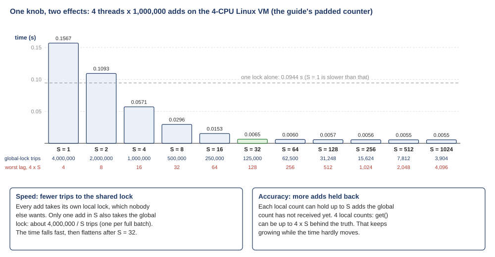
<figcaption markdown="1">Figure Q.19. The S sweep measured in W09 [Extra 1](class-1.md#extra-1). The time falls fast up to S = 32 and then barely moves, while the worst lag, 4 × S, keeps growing. Below each bar: the trips to the global lock, and the worst lag.</figcaption>
</figure>

Read the two rows under the bars together. From S = 1 to S = 32, the time falls from 0.157 s to 0.0065 s, about 24 times faster (0.157 / 0.0065 ≈ 24), while the worst lag grows only from 4 to 128. From S = 32 to S = 1024, the time hardly moves (0.0065 s to 0.0055 s), while the worst lag grows 32 times, from 128 to 4,096. Past the knee, raising S buys almost no speed and keeps costing accuracy.

One detail in the measured output shows the lag directly. At the end of each run, `main` prints what is `still local`: adds sitting in local counts that never reached S. Each thread made 1,000,000 adds, and with S = 1024, 1,000,000 = 976 × 1024 + 576, so each thread ends with 576 adds unreported: 4 × 576 = 2,304, exactly the `still local 2304` in the run. With S = 32, 1,000,000 divides evenly by 32, so nothing is left over (`still local 0`).

### Q16. "or how to choose a good threshold S for the sloppy counter." {#q16 data-toc-label="Q16. How to choose a good S"}

Where to reread: OSTEP 29.1; W09 [Section 2.5](class-1.md#sec-2-5) and [Extra 1](class-1.md#extra-1).

**In the passage.** The book stops at the trade-off and a measurement, Figure 29.6; it gives no value for S. That is because "good" depends on two things the counter cannot know: how far behind the readers of the count can afford to be, and how fast the particular machine is. So choosing S is a short recipe, not a formula: decide the accuracy you need, then measure for speed.

1. **Ask what the reading is used for.** A statistics counter (packets received, pages mapped) is read rarely and only shown to people; being thousands behind is fine. A count that decides something, such as "is this user over the disk quota?", may need the exact value.
2. **Turn the tolerable lag into a largest S.** The lag is at most CPUs × S, so S can be at most the tolerable lag divided by the number of CPUs.
3. **Measure, and take the smallest S at the knee.** Run a sweep like Figure 29.6, or W09 [Extra 1](class-1.md#extra-1), on the real machine. On the 4-CPU VM the knee was about S = 32: almost all of the speed, with a lag of at most 128.

Real kernels follow the same recipe. Linux has an approximate counter, `struct percpu_counter` in `lib/percpu_counter.c`, and calls S the **batch**. It sets the batch from the number of CPUs online: `percpu_counter_batch = max(32, nr*2);`, where `nr` is the number of CPUs. So the batch is at least 32, the same knee the VM sweep found, and grows on bigger machines.

Linux also shows how to get both speed and exactness. It has two ways to read the counter. `percpu_counter_read()` returns just the global count: fast, and possibly behind. `percpu_counter_sum()` adds every CPU's local count to it; its comment calls it "a more accurate but much slower version". And when the kernel compares the counter against a limit, it uses the cheap reading whenever that is safe (Figure Q.20). The rough reading is off by at most batch × CPUs. If the limit is farther away than that, the rough answer to "above or below?" cannot be wrong, and no sum is needed. Only when the rough reading is close to the limit does the kernel pay for the exact sum. The code's own comments say "Check to see if rough count will be sufficient for comparison" and "Need to use precise count".

<figure markdown="1">

<figcaption markdown="1">Figure Q.20. Linux's approximate counter. Case 1: the rough reading is far from the limit, so the true total, which lies within batch × CPUs of it, is safely on one side. Case 2: the band crosses the limit, so the kernel adds up every CPU's count. Bottom: the recipe for choosing S.</figcaption>
</figure>

So step 4 of the recipe: if only one use of the counter needs the exact value, sum the local counts for that use alone, and keep S large for everything else.

## 9. The list {#t9}

!!! abstract "Recap"

    The list of section 29.2 first takes its lock at the top of insert, before `malloc()` makes the new node. The book then moves the lock so that it covers only the two lines that link the node into the shared list, and `malloc()` ends up outside it. (W09 [Section 2.9](https://annie983284450-1.github.io/NNU-CS3430-selfstudyguide/w09/class-1/#sec-2-9) and [Extra 2](https://annie983284450-1.github.io/NNU-CS3430-selfstudyguide/w09/class-1/#extra-2).)

**The passage in OSTEP** (§29.2, Concurrent Linked Lists):

> As you can see in the code, the code simply acquires a lock in the insert routine upon entry, and releases it upon exit. One small tricky issue arises if malloc() happens to fail (a rare case); in this case, **the code must also release the lock before failing the insert**.
>
> […] Specifically, we can rearrange the code a bit so that the lock and release only surround the actual critical section in the insert code, and that a common exit path is used in the lookup code. The former works because part of the lookup actually need not be locked; assuming that malloc() itself is thread-safe, each thread can call into it without worry of race conditions or other concurrency bugs. **Only when updating the shared list does a lock need to be held**.

**What the passage argues.**

1. Reason 1: with the lock taken first, a failed malloc() must unlock too: a rare path, easy to get wrong.
2. Reason 2: malloc() touches nothing the list shares, and OSTEP assumes it is thread-safe (the C library on Linux makes it so).
3. So lock only the lines that update the shared list.
4. (The sentence says “lookup”, but the code it describes is the insert.)

### F5. "29.2 (malloc in the linked list): at first I didn’t see why it mattered where malloc was placed. It reserves space, not items, so it doesn’t need the lock." {#f5 data-toc-label="F5. Why malloc() needs no list lock"}

Where to reread: OSTEP 29.2, Figures 29.7 and 29.8; W09 [Extra 2](class-1.md#extra-2).

**In the passage.** "Reserves space" is right about what `malloc()` does, but the book's reasons are different, and there are two of them. The rule: "Only when updating the shared list does a lock need to be held". And the rare path: with the lock taken first, a failed `malloc()` means "the code must also release the lock before failing the insert". (One small thing to know when you reread it: the sentence says "part of the lookup actually need not be locked", but the code it describes, with `malloc()` in it, is the insert.)

A lock is for **shared data**, and nothing `malloc()` touches is shared with the list's other threads (Figure Q.21). The new node is private: only the inserting thread knows its address, until the two lines that link it into the list (`new->next = L->head; L->head = new;`). Those two lines are the critical section. And `malloc()` itself must be safe to call from many threads at once; the book says "assuming that malloc() itself is thread-safe", and on Linux that holds, because the C library protects its own heap data with its own lock. That lock belongs to the library, not to the list.

<figure markdown="1">
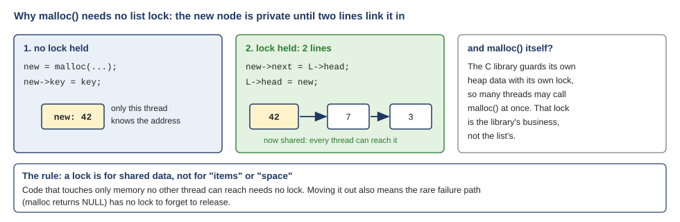
<figcaption markdown="1">Figure Q.21. While the node is being made, only one thread knows its address, so no lock is needed. The two lines that link it in make it shared, so those two lines take the lock.</figcaption>
</figure>

Moving `malloc()` out of the lock also fixes the rare path: if `malloc()` fails, the function returns before it has taken the lock, so there is no lock to forget to release. Section 29.2 cites a study of Linux kernel patches in which nearly 40% of the bugs were on rarely taken code paths like this one.

## 10. The queue {#t10}

!!! abstract "Recap"

    Section 29.3's queue has two locks: one at the head, where items leave, and one at the tail, where items arrive, so an enqueue and a dequeue can run at the same time. A **dummy node**, an empty node made when the queue is set up, lets the two ends work separately. Michael and Scott designed it. (W09 [Extra 4](https://annie983284450-1.github.io/NNU-CS3430-selfstudyguide/w09/class-1/#extra-4).)

**The passage in OSTEP** (§29.3, Concurrent Queues):

> Instead, we’ll take a look at a slightly more concurrent queue **designed by Michael and Scott [MS98]**. The data structures and code used for this queue are found in Figure 29.9 on the following page.
>
> If you study this code carefully, you’ll notice that there are two locks, one for the head of the queue, and one for the tail. The goal of these two locks is to enable concurrency of enqueue and dequeue operations. In the common case, **the enqueue routine will only access the tail lock, and dequeue only the head lock**.
>
> One trick used by Michael and Scott is to add a dummy node (allocated in the queue initialization code); **this dummy enables the separation of head and tail operations**.

**What the passage argues.**

1. Two locks: the tail lock for enqueue, the head lock for dequeue.
2. Goal: an enqueue and a dequeue at the same time.
3. The dummy is a node made by Queue_Init(), with no value in it.
4. “Separation of head and tail operations”: enqueue never touches head, dequeue never touches tail.
5. The name: the two people who designed it.

### Q17. "and on why the Michael and Scott queue needs a dummy node." {#q17 data-toc-label="Q17. Why the Michael and Scott queue needs a dummy node"}

Where to reread: OSTEP 29.3, Figure 29.9; W09 [Extra 4](class-1.md#extra-4).

**In the passage.** The book says the dummy "enables the separation of head and tail operations", and leaves the reason to you. The reason shows when you take the dummy away. Without it, the empty queue is a special case: both `head` and `tail` are NULL, and the first enqueue and the last dequeue must each change *both* pointers. Changing both means holding both locks, and that brings back the waiting the two locks were meant to remove, plus a risk of deadlock.

Start with the queue that has no dummy (Figure Q.22, top).

- **Empty:** `head = NULL`, `tail = NULL`.
- **Enqueue into the empty queue:** the new node is both the first and the last, so the enqueuer must set `tail` and also `head`. It needs the head lock as well as the tail lock.
- **Dequeue the last item:** the queue becomes empty, so the dequeuer must set `head` to NULL and also `tail`. It needs the tail lock as well as the head lock.

Now the enqueuer takes the tail lock and then the head lock, while the dequeuer takes the head lock and then the tail lock. If each grabs its first lock at the same moment, each waits forever for the other's: a **deadlock**. Taking the two locks in one fixed order would avoid the deadlock, but the empty-queue cases would still need both locks, and the code would need special cases to tell when. The dummy removes those cases altogether.

<figure markdown="1">

<figcaption markdown="1">Figure Q.22. Top: without a dummy, an enqueue into an empty queue and a dequeue of the last item must both change head and tail, so each needs both locks. Bottom: with the dummy, enqueue only touches the tail side and dequeue only the head side. Below: the authors' own sentence.</figcaption>
</figure>

With the dummy (Figure Q.22, bottom), `Queue_Init()` makes one empty node and points both `head` and `tail` at it. The list never has zero nodes again, so the special case is gone.

- **Enqueue** links the new node after the current last node and moves `tail`. It writes `tail->next` and `tail`, and never `head`.
- **Dequeue** reads the value from the node *after* the dummy, `head->next`, moves `head` to that node, and frees the old dummy. The node it just read becomes the new dummy; its value is now ignored. It writes only `head`, and never `tail`.
- **Empty** is now `head->next == NULL`, which the dequeuer can see from the head side alone (Figure 29.9, the `new_head == NULL` check).

So in this code the passage's "common case" is in fact every case: an enqueue never takes the head lock, and a dequeue never takes the tail lock.

One honest caveat, the same one W09 [Extra 4](class-1.md#extra-4) makes. When the queue is empty, `head` and `tail` both point at the dummy, so an enqueue writing `dummy->next` and a dequeue reading it touch the same field at the same moment, under different locks. By the strict rule of W09 [Section 1.6](class-1.md#sec-1-6) that is a race. The book's code lives with it, and the original paper relies on the machine reading and writing a pointer in one step; a stricter version would take both locks when the queue is empty.

The authors say it in one sentence in their 1996 paper: "Because of the dummy node, enqueuers never have to access Head, and dequeuers never have to access Tail, thus avoiding potential deadlock problems that arise from processes trying to acquire the locks in different orders."

### F4. "The Michael and Scott queue uses one lock on the head and one on the tail, plus a dummy node that keeps them from pointing at the same node." {#f4 data-toc-label="F4. What the dummy node guarantees"}

Where to reread: OSTEP 29.3, Figure 29.9; W09 [Extra 4](class-1.md#extra-4).

**In the passage.** "Separation of head and tail operations" is about which pointer each side changes, not about where the pointers point. When the queue is empty, `head` and `tail` *do* point at the same node: the dummy. `Queue_Init()` even says so: `q->head = q->tail = tmp;`. What the dummy guarantees is something else: an enqueue never has to change `head`, and a dequeue never has to change `tail`, so each side takes only its own lock. Figure Q.22 in Q17 shows both cases, and the end of Q17 notes the one field both sides can touch when the queue is empty.

### Q18. "(Also, why is it called Michael and Scott anyways? Could they not get any more creative?)" {#q18 data-toc-label="Q18. Why it is called Michael and Scott"}

Where to reread: OSTEP 29.3 and its reference [MS98].

**In the passage.** The first sentence already answers it: the queue was "designed by Michael and Scott [MS98]". In this field, an algorithm is usually named after the people who published it.

The queue is named after its two authors, Maged M. Michael and Michael L. Scott, of the University of Rochester. They published it in 1996 in "Simple, Fast, and Practical Non-Blocking and Blocking Concurrent Queue Algorithms", at the PODC conference. OSTEP cites their 1998 journal paper, [MS98]. And yes, one author's last name and the other's first name are both Michael.

The creativity went into the paper instead (Figure Q.23). The two-lock queue of Figure 29.9 is the *second* algorithm in it. The first is a queue that uses no locks at all, built on compare-and-swap (the lock-free pattern of Q4). That one is in wide use today: Java's `ConcurrentLinkedQueue` is based on it, and its documentation cites the paper by name.

<figure markdown="1">
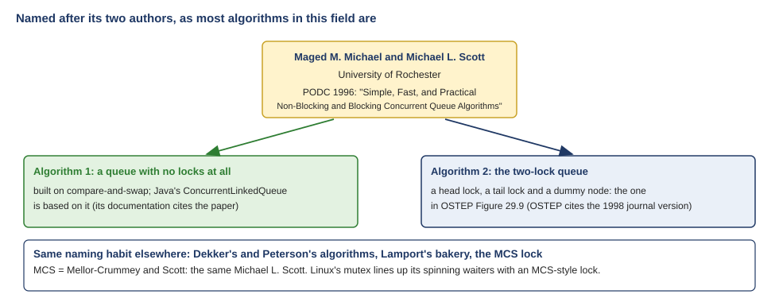
<figcaption markdown="1">Figure Q.23. The 1996 paper and its two algorithms: a lock-free queue, behind Java's ConcurrentLinkedQueue, and the two-lock queue of OSTEP Figure 29.9. Michael L. Scott is also the S in the MCS lock.</figcaption>
</figure>

The same habit gives you Dekker's and Peterson's algorithms (W08 [Extra 5](https://annie983284450-1.github.io/NNU-CS3430-selfstudyguide/w08/class-2/#extra-5)) and Lamport's bakery algorithm. And Michael Scott shows up once more: the **MCS lock** is named for Mellor-Crummey and Scott, the same Michael L. Scott. The Linux kernel's mutex uses an MCS-style lock to line up the threads that are spinning on it (the optimistic spinning of Q12), so that only one spinner at a time competes for the mutex.

## 11. The hash table {#t11}

!!! abstract "Recap"

    Section 29.4 builds a hash table out of the lists of section 29.2: many short lists, each with its own lock, and the key decides which list to use. The book assumes you already know what a hash table is. (W09 Section 2.9, Section 2.11 and [Section 2.12](https://annie983284450-1.github.io/NNU-CS3430-selfstudyguide/w09/class-1/#sec-2-12).)

**The passage in OSTEP** (§29.4, Concurrent Hash Table):

> We end our discussion with a simple and widely applicable concurrent data structure, the hash table. We’ll focus on a simple hash table that does not resize; […]
>
> This concurrent hash table (Figure 29.10) is straightforward, is **built using the concurrent lists we developed earlier**, and works incredibly well. The reason for its good performance is that instead of having a single lock for the entire structure, **it uses a lock per hash bucket (each of which is represented by a list)**. Doing so enables many concurrent operations to take place.

Figure 29.10 (Hash_Init left out):

```c
#define BUCKETS (101)
typedef struct __hash_t {
  list_t lists[BUCKETS];
} hash_t;
int Hash_Insert(hash_t *H, int key) {
  return List_Insert(&H->lists[key % BUCKETS], key);
}
int Hash_Lookup(hash_t *H, int key) {
  return List_Lookup(&H->lists[key % BUCKETS], key);
}
```

**What the passage argues.**

1. OSTEP does not explain what a hash table is; it assumes you know.
2. Here it is a fixed array of 101 buckets, and each bucket is one list of section 29.2.
3. key % BUCKETS picks the bucket.
4. One lock per bucket instead of one for the table: many operations at once.

### Q19. "29.3 and 29.4 (queue and hash table): I mixed the dummy node up with the linked list, and I didn’t know what a hash table did." {#q19 data-toc-label="Q19. What a hash table does"}

Where to reread: OSTEP 29.4; W09 [Section 2.9](class-1.md#sec-2-9), [Section 2.11](class-1.md#sec-2-11) and [Section 2.12](class-1.md#sec-2-12).

**In the passage.** Section 29.4 takes the hash table for granted. It says only that it builds "a simple hash table that does not resize", "built using the concurrent lists we developed earlier", and goes straight to its locks, as if you had met hash tables in a data structures course. Until the structure itself is clear, the point about its locks cannot land. (The dummy node belongs to the queue of 29.3, not to the list or the hash table; Q17 explains what it is for.)

**The problem a hash table solves.** You keep many keys, and you want to find one fast. In one linked list of 10,000 keys, a lookup starts at the front and compares key after key, up to 10,000 steps (W09 [Section 2.9](class-1.md#sec-2-9)).

**The idea.** Keep many short lists instead of one long one, in an array. Each short list is a **bucket**. Then use a rule, the **hash function**, that computes from the key which bucket the key belongs in. OSTEP's table has 101 buckets, and the rule is `key % 101`, the remainder after dividing the key by 101. To insert 103: 103 % 101 = 2, so 103 goes into bucket 2. To look up 103 later, compute 2 again, and walk only bucket 2. With 10,000 keys spread over 101 buckets, each bucket holds about 10,000 / 101 ≈ 99 keys, so a lookup walks about 99 keys instead of 10,000 (Figure Q.24). A library does the same with author names: you go straight to the shelf for "M" and never look at the rest.

<figure markdown="1">
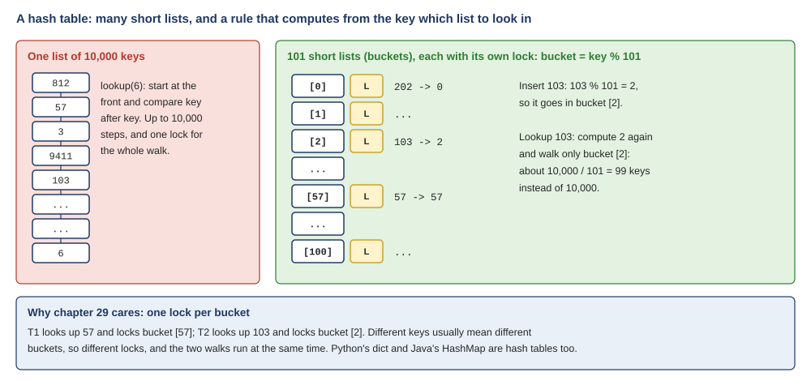
<figcaption markdown="1">Figure Q.24. Left: one list, walked from the front. Right: 101 short lists, each with its own lock; the key's remainder after dividing by 101 picks the one list to walk.</figcaption>
</figure>

**Why chapter 29 cares.** Give each bucket its own lock: "a lock per hash bucket (each of which is represented by a list)". A thread looking up 57 locks bucket 57; a thread looking up 103 locks bucket 2. Different keys usually land in different buckets, so the threads take different locks, and their walks run at the same time. That is the whole of Figure 29.10: one lock per bucket instead of one lock for the table. On the 4-CPU VM, 4 threads did their lookups about 2 times faster than 1 (W09 [Section 2.12](class-1.md#sec-2-12)).

The mix-up with the dummy is understandable, because the queue is itself a linked list. What makes it different is one extra empty node at the front, the dummy. The plain list and the lists inside the hash table start straight with real nodes.

Hash tables are everywhere: Python's `dict` and Java's `HashMap` are hash tables too, though they arrange their buckets differently from OSTEP's lists.

## Four reading habits {#habits}

Most of these questions were cleared up by reading one sentence together with the sentences around it. Four habits help with the rest of the book.

1. **Read a sentence with the one before it and the one after it.** "This concurrent counter is simple and works correctly" points back to Figure 29.2 (F2); the ticket's "turn" is explained in the next clause (F3); the LL/SC story ends one sentence after the summary did (F6).
2. **Watch for the words that carry an assumption.** "Presumably", "if the number of threads roughly equals the number of CPUs", "on some systems": the claim holds only under them (Q1, Q2, F1).
3. **Remember that the book's examples are the smallest case.** One lock, one shared variable, two threads. Real programs have many locks, many critical sections and many threads (Q3).
4. **Trace the code with two threads and a mean scheduler.** Interrupt at the worst moment, as section 28.7 suggests ("pretend you are a malicious scheduler"): that is how the LL/SC story and the setpark() race become clear (Q5, F6, Q9).
