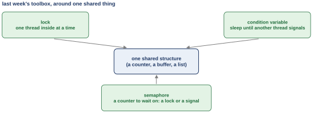
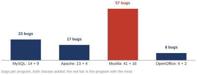
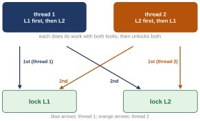

# First class: concurrency bugs, the two common patterns, and deadlock (OSTEP 32.1 to 32.3) {#class-1}

<!-- classmap:start -->
<details class="abstract cmap-details" markdown="0" open>
<summary>Map of this class: the questions, and the steps of each</summary>
<div class="cmap-wrap">
<svg xmlns="http://www.w3.org/2000/svg" viewBox="0 0 796 1556" class="cmap" role="img" aria-label="Map of this class: each question, why we ask it, its steps, how we know, and what it settles; each box a link to its section">
<style>.cmap .cmap-link rect{transition:filter .15s} .cmap .cmap-link:hover rect{stroke-width:2.2;filter:drop-shadow(0 2px 4px rgba(0,0,0,.18))} .cmap .cmap-link:hover text{text-decoration:underline}</style>
<rect x="0" y="0" width="796" height="1556" fill="#ffffff"/>
<text x="10" y="20" font-family="Source Sans 3, Helvetica Neue, Arial, sans-serif" font-size="12" font-weight="700" letter-spacing=".05em" fill="#a0632a">WEEK 10 · MAP OF THIS CLASS</text>
<text x="10" y="36" font-family="Source Sans 3, Helvetica Neue, Arial, sans-serif" font-size="10.5" fill="#5b6675">Each question: why we ask it, the steps that answer it, how we know, and what it settles. Every box opens its section.</text>
<rect x="10" y="48" width="51" height="15" rx="3" fill="#b23a48"/>
<text x="16" y="59" font-family="Source Sans 3, Helvetica Neue, Arial, sans-serif" font-size="9.5" font-weight="600" fill="#fff">Problem</text>
<text x="66" y="59" font-family="Source Sans 3, Helvetica Neue, Arial, sans-serif" font-size="10" fill="#5b6675">why we ask: what breaks</text>
<rect x="192.9" y="48" width="51" height="15" rx="3" fill="#1f6f8b"/>
<text x="198.9" y="59" font-family="Source Sans 3, Helvetica Neue, Arial, sans-serif" font-size="9.5" font-weight="600" fill="#fff">Concept</text>
<text x="249" y="59" font-family="Source Sans 3, Helvetica Neue, Arial, sans-serif" font-size="10" fill="#5b6675">the idea, one step at a time</text>
<rect x="400.3" y="48" width="90" height="15" rx="3" fill="#5b7a2a"/>
<text x="406.3" y="59" font-family="Source Sans 3, Helvetica Neue, Arial, sans-serif" font-size="9.5" font-weight="600" fill="#fff">Worked example</text>
<text x="496" y="59" font-family="Source Sans 3, Helvetica Neue, Arial, sans-serif" font-size="10" fill="#5b6675">traced by hand</text>
<rect x="10" y="68" width="79" height="15" rx="3" fill="#a0632a"/>
<text x="16" y="79" font-family="Source Sans 3, Helvetica Neue, Arial, sans-serif" font-size="9.5" font-weight="600" fill="#fff">Real machine</text>
<text x="94" y="79" font-family="Source Sans 3, Helvetica Neue, Arial, sans-serif" font-size="10" fill="#5b6675">measured on a real computer</text>
<rect x="240.5" y="68" width="74" height="15" rx="3" fill="#6b4fa0"/>
<text x="246.5" y="79" font-family="Source Sans 3, Helvetica Neue, Arial, sans-serif" font-size="9.5" font-weight="600" fill="#fff">Real kernel</text>
<text x="319" y="79" font-family="Source Sans 3, Helvetica Neue, Arial, sans-serif" font-size="10" fill="#5b6675">read in xv6 or Linux</text>
<rect x="431.1" y="68" width="90" height="15" rx="3" fill="#2a7a6b"/>
<text x="437.1" y="79" font-family="Source Sans 3, Helvetica Neue, Arial, sans-serif" font-size="9.5" font-weight="600" fill="#fff">Check yourself</text>
<text x="526" y="79" font-family="Source Sans 3, Helvetica Neue, Arial, sans-serif" font-size="10" fill="#5b6675">what is settled, what is open</text>
<rect x="10" y="88" width="46" height="15" rx="3" fill="#7a7a7a"/>
<text x="16" y="99" font-family="Source Sans 3, Helvetica Neue, Arial, sans-serif" font-size="9.5" font-weight="600" fill="#fff">Deeper</text>
<text x="61" y="99" font-family="Source Sans 3, Helvetica Neue, Arial, sans-serif" font-size="10" fill="#5b6675">optional</text>
<a href="#opening-1" class="cmap-link"><title>Where we left off: every tool in hand, and our own programs still broke</title><rect x="10" y="122" width="206" height="61" rx="6" fill="#f3f4f6" stroke="#9aa3b2" stroke-width="1.1"/><text x="20" y="138" font-family="Source Sans 3, Helvetica Neue, Arial, sans-serif" font-size="11.5" font-style="italic" fill="#3a4350">Where we left off: every tool in</text><text x="20" y="153" font-family="Source Sans 3, Helvetica Neue, Arial, sans-serif" font-size="11.5" font-style="italic" fill="#3a4350">hand, and our own programs still</text><text x="20" y="168" font-family="Source Sans 3, Helvetica Neue, Arial, sans-serif" font-size="11.5" font-style="italic" fill="#3a4350">broke</text></a>
<a href="#sec-1-1" class="cmap-link"><title>1.1 Problem: We have all the tools, and real programs still break</title><rect x="384" y="205" width="400" height="27" rx="6" fill="#ffffff" stroke="#b23a48" stroke-width="1.1"/><rect x="390" y="211" width="51" height="15" rx="3" fill="#b23a48"/><text x="396" y="221.5" font-family="Source Sans 3, Helvetica Neue, Arial, sans-serif" font-size="9.5" font-weight="600" fill="#fff">Problem</text><text x="448" y="223" font-family="Source Sans 3, Helvetica Neue, Arial, sans-serif" font-size="11.5" fill="#1b2430">1.1 We have all the tools, and real programs still break</text></a>
<path d="M352,218 C368,218 368,218 384,218" fill="none" stroke="#b23a48" stroke-width="1.4"/>
<rect x="248" y="206" width="104" height="26" rx="13" fill="#ffffff" stroke="#b23a48" stroke-width="1.5"/>
<text x="300.0" y="222" text-anchor="middle" font-family="Source Sans 3, Helvetica Neue, Arial, sans-serif" font-size="11.5" font-weight="700" fill="#b23a48">Why we ask</text>
<a href="#sec-1-2" class="cmap-link"><title>1.2 Concept: A study of four big programs: 74 of 105 bugs were not deadlocks</title><rect x="384" y="244" width="400" height="42" rx="6" fill="#ffffff" stroke="#1f6f8b" stroke-width="1.1"/><rect x="390" y="250" width="51" height="15" rx="3" fill="#1f6f8b"/><text x="396" y="260.5" font-family="Source Sans 3, Helvetica Neue, Arial, sans-serif" font-size="9.5" font-weight="600" fill="#fff">Concept</text><text x="448" y="262" font-family="Source Sans 3, Helvetica Neue, Arial, sans-serif" font-size="11.5" fill="#1b2430">1.2 A study of four big programs: 74 of 105 bugs were</text><text x="448" y="277" font-family="Source Sans 3, Helvetica Neue, Arial, sans-serif" font-size="11.5" fill="#1b2430">not deadlocks</text></a>
<path d="M352,265 C368,265 368,265 384,265" fill="none" stroke="#1f6f8b" stroke-width="1.4"/>
<rect x="248" y="252" width="104" height="26" rx="13" fill="#ffffff" stroke="#1f6f8b" stroke-width="1.5"/>
<text x="300.0" y="269" text-anchor="middle" font-family="Source Sans 3, Helvetica Neue, Arial, sans-serif" font-size="11.5" font-weight="700" fill="#1f6f8b">The steps</text>
<a href="#sec-1-3" class="cmap-link"><title>1.3 Check yourself: What the first question settled</title><rect x="384" y="298" width="400" height="27" rx="6" fill="#ffffff" stroke="#2a7a6b" stroke-width="1.1"/><rect x="390" y="304" width="90" height="15" rx="3" fill="#2a7a6b"/><text x="396" y="314.5" font-family="Source Sans 3, Helvetica Neue, Arial, sans-serif" font-size="9.5" font-weight="600" fill="#fff">Check yourself</text><text x="487" y="316" font-family="Source Sans 3, Helvetica Neue, Arial, sans-serif" font-size="11.5" fill="#1b2430">1.3 What the first question settled</text></a>
<a href="#summary-1" class="cmap-link"><title>The answer</title><rect x="384" y="329" width="400" height="76" rx="6" fill="#eef7f4" stroke="#2a7a6b" stroke-width="1.1"/><text x="394" y="345" font-family="Source Sans 3, Helvetica Neue, Arial, sans-serif" font-size="11.5" fill="#1b2430">The answer: A study of MySQL, Apache, Mozilla and OpenOffice: 74</text><text x="394" y="360" font-family="Source Sans 3, Helvetica Neue, Arial, sans-serif" font-size="11.5" fill="#1b2430">of 105 bugs were not deadlocks, and 31 were deadlocks, in which</text><text x="394" y="375" font-family="Source Sans 3, Helvetica Neue, Arial, sans-serif" font-size="11.5" fill="#1b2430">threads wait for each other forever. So the common patterns came</text><text x="394" y="390" font-family="Source Sans 3, Helvetica Neue, Arial, sans-serif" font-size="11.5" fill="#1b2430">first.</text></a>
<path d="M352,352 C368,352 368,312 384,312" fill="none" stroke="#2a7a6b" stroke-width="1.4"/>
<path d="M352,352 C368,352 368,367 384,367" fill="none" stroke="#2a7a6b" stroke-width="1.4"/>
<rect x="248" y="338" width="104" height="26" rx="13" fill="#ffffff" stroke="#2a7a6b" stroke-width="1.5"/>
<text x="300.0" y="356" text-anchor="middle" font-family="Source Sans 3, Helvetica Neue, Arial, sans-serif" font-size="11.5" font-weight="700" fill="#2a7a6b">What it settles</text>
<path d="M216,307 C232,307 232,218 248,218" fill="none" stroke="#a0632a" stroke-width="1.4"/>
<path d="M216,307 C232,307 232,265 248,265" fill="none" stroke="#a0632a" stroke-width="1.4"/>
<path d="M216,307 C232,307 232,352 248,352" fill="none" stroke="#a0632a" stroke-width="1.4"/>
<a href="#chapter-1" class="cmap-link"><title>Q1. Which concurrency bugs actually show up in big real programs?</title><rect x="10" y="273" width="206" height="68" rx="8" fill="#ffffff" stroke="#a0632a" stroke-width="1.9"/><circle cx="28" cy="293" r="11" fill="#a0632a"/><text x="28" y="297" text-anchor="middle" font-family="Source Sans 3, Helvetica Neue, Arial, sans-serif" font-size="11" font-weight="700" fill="#fff">Q1</text><text x="48" y="297" font-family="Source Sans 3, Helvetica Neue, Arial, sans-serif" font-size="12.5" font-weight="600" fill="#1b2430">Which concurrency bugs</text><text x="48" y="313" font-family="Source Sans 3, Helvetica Neue, Arial, sans-serif" font-size="12.5" font-weight="600" fill="#1b2430">actually show up in big</text><text x="48" y="329" font-family="Source Sans 3, Helvetica Neue, Arial, sans-serif" font-size="12.5" font-weight="600" fill="#1b2430">real programs?</text></a>
<text x="113.0" y="427" text-anchor="middle" font-family="Source Sans 3, Helvetica Neue, Arial, sans-serif" font-size="10" font-style="italic" fill="#6b7482">↓ what is left open leads to the next question</text>
<a href="#sec-2-1" class="cmap-link"><title>2.1 Problem: A check, then a use, and another thread in between</title><rect x="384" y="439" width="400" height="27" rx="6" fill="#ffffff" stroke="#b23a48" stroke-width="1.1"/><rect x="390" y="445" width="51" height="15" rx="3" fill="#b23a48"/><text x="396" y="455.5" font-family="Source Sans 3, Helvetica Neue, Arial, sans-serif" font-size="9.5" font-weight="600" fill="#fff">Problem</text><text x="448" y="457" font-family="Source Sans 3, Helvetica Neue, Arial, sans-serif" font-size="11.5" fill="#1b2430">2.1 A check, then a use, and another thread in between</text></a>
<a href="#sec-2-6" class="cmap-link"><title>2.6 Problem: Thread 2 assumes thread 1 already did something</title><rect x="384" y="470" width="400" height="27" rx="6" fill="#ffffff" stroke="#b23a48" stroke-width="1.1"/><rect x="390" y="476" width="51" height="15" rx="3" fill="#b23a48"/><text x="396" y="486.5" font-family="Source Sans 3, Helvetica Neue, Arial, sans-serif" font-size="9.5" font-weight="600" fill="#fff">Problem</text><text x="448" y="488" font-family="Source Sans 3, Helvetica Neue, Arial, sans-serif" font-size="11.5" fill="#1b2430">2.6 Thread 2 assumes thread 1 already did something</text></a>
<path d="M352,468 C368,468 368,452 384,452" fill="none" stroke="#b23a48" stroke-width="1.4"/>
<path d="M352,468 C368,468 368,484 384,484" fill="none" stroke="#b23a48" stroke-width="1.4"/>
<rect x="248" y="455" width="104" height="26" rx="13" fill="#ffffff" stroke="#b23a48" stroke-width="1.5"/>
<text x="300.0" y="472" text-anchor="middle" font-family="Source Sans 3, Helvetica Neue, Arial, sans-serif" font-size="11.5" font-weight="700" fill="#b23a48">Why we ask</text>
<a href="#sec-2-2" class="cmap-link"><title>2.2 Concept: The MySQL lines, made runnable: a check, a use, a NULL store</title><rect x="384" y="509" width="400" height="42" rx="6" fill="#ffffff" stroke="#1f6f8b" stroke-width="1.1"/><rect x="390" y="515" width="51" height="15" rx="3" fill="#1f6f8b"/><text x="396" y="525.5" font-family="Source Sans 3, Helvetica Neue, Arial, sans-serif" font-size="9.5" font-weight="600" fill="#fff">Concept</text><text x="448" y="527" font-family="Source Sans 3, Helvetica Neue, Arial, sans-serif" font-size="11.5" fill="#1b2430">2.2 The MySQL lines, made runnable: a check, a use, a</text><text x="448" y="542" font-family="Source Sans 3, Helvetica Neue, Arial, sans-serif" font-size="11.5" fill="#1b2430">NULL store</text></a>
<a href="#sec-2-4" class="cmap-link"><title>2.4 Concept: A lock around the check-and-use closes the gap</title><rect x="384" y="555" width="400" height="27" rx="6" fill="#ffffff" stroke="#1f6f8b" stroke-width="1.1"/><rect x="390" y="561" width="51" height="15" rx="3" fill="#1f6f8b"/><text x="396" y="571.5" font-family="Source Sans 3, Helvetica Neue, Arial, sans-serif" font-size="9.5" font-weight="600" fill="#fff">Concept</text><text x="448" y="573" font-family="Source Sans 3, Helvetica Neue, Arial, sans-serif" font-size="11.5" fill="#1b2430">2.4 A lock around the check-and-use closes the gap</text></a>
<a href="#sec-2-7" class="cmap-link"><title>2.7 Concept: The Mozilla lines, made runnable: a create, a store, a read</title><rect x="384" y="586" width="400" height="42" rx="6" fill="#ffffff" stroke="#1f6f8b" stroke-width="1.1"/><rect x="390" y="592" width="51" height="15" rx="3" fill="#1f6f8b"/><text x="396" y="602.5" font-family="Source Sans 3, Helvetica Neue, Arial, sans-serif" font-size="9.5" font-weight="600" fill="#fff">Concept</text><text x="448" y="604" font-family="Source Sans 3, Helvetica Neue, Arial, sans-serif" font-size="11.5" fill="#1b2430">2.7 The Mozilla lines, made runnable: a create, a store,</text><text x="448" y="619" font-family="Source Sans 3, Helvetica Neue, Arial, sans-serif" font-size="11.5" fill="#1b2430">a read</text></a>
<a href="#sec-2-9" class="cmap-link"><title>2.9 Concept: A condition variable makes the new thread wait for the store</title><rect x="384" y="632" width="400" height="42" rx="6" fill="#ffffff" stroke="#1f6f8b" stroke-width="1.1"/><rect x="390" y="638" width="51" height="15" rx="3" fill="#1f6f8b"/><text x="396" y="648.5" font-family="Source Sans 3, Helvetica Neue, Arial, sans-serif" font-size="9.5" font-weight="600" fill="#fff">Concept</text><text x="448" y="650" font-family="Source Sans 3, Helvetica Neue, Arial, sans-serif" font-size="11.5" fill="#1b2430">2.9 A condition variable makes the new thread wait for</text><text x="448" y="665" font-family="Source Sans 3, Helvetica Neue, Arial, sans-serif" font-size="11.5" fill="#1b2430">the store</text></a>
<path d="M352,592 C368,592 368,530 384,530" fill="none" stroke="#1f6f8b" stroke-width="1.4"/>
<path d="M352,592 C368,592 368,568 384,568" fill="none" stroke="#1f6f8b" stroke-width="1.4"/>
<path d="M352,592 C368,592 368,607 384,607" fill="none" stroke="#1f6f8b" stroke-width="1.4"/>
<path d="M352,592 C368,592 368,653 384,653" fill="none" stroke="#1f6f8b" stroke-width="1.4"/>
<rect x="248" y="578" width="104" height="26" rx="13" fill="#ffffff" stroke="#1f6f8b" stroke-width="1.5"/>
<text x="300.0" y="596" text-anchor="middle" font-family="Source Sans 3, Helvetica Neue, Arial, sans-serif" font-size="11.5" font-weight="700" fill="#1f6f8b">The steps</text>
<a href="#sec-2-3" class="cmap-link"><title>2.3 Real machine: All three runs crash: exit status 139, a NULL pointer used</title><rect x="384" y="686" width="400" height="42" rx="6" fill="#ffffff" stroke="#a0632a" stroke-width="1.1"/><rect x="390" y="692" width="79" height="15" rx="3" fill="#a0632a"/><text x="396" y="702.5" font-family="Source Sans 3, Helvetica Neue, Arial, sans-serif" font-size="9.5" font-weight="600" fill="#fff">Real machine</text><text x="476" y="704" font-family="Source Sans 3, Helvetica Neue, Arial, sans-serif" font-size="11.5" fill="#1b2430">2.3 All three runs crash: exit status 139, a NULL</text><text x="476" y="719" font-family="Source Sans 3, Helvetica Neue, Arial, sans-serif" font-size="11.5" fill="#1b2430">pointer used</text></a>
<a href="#sec-2-5" class="cmap-link"><title>2.5 Real machine: The fixed version: 10,000,000 rounds per run, no crash</title><rect x="384" y="732" width="400" height="42" rx="6" fill="#ffffff" stroke="#a0632a" stroke-width="1.1"/><rect x="390" y="738" width="79" height="15" rx="3" fill="#a0632a"/><text x="396" y="748.5" font-family="Source Sans 3, Helvetica Neue, Arial, sans-serif" font-size="9.5" font-weight="600" fill="#fff">Real machine</text><text x="476" y="750" font-family="Source Sans 3, Helvetica Neue, Arial, sans-serif" font-size="11.5" fill="#1b2430">2.5 The fixed version: 10,000,000 rounds per run,</text><text x="476" y="765" font-family="Source Sans 3, Helvetica Neue, Arial, sans-serif" font-size="11.5" fill="#1b2430">no crash</text></a>
<a href="#sec-2-8" class="cmap-link"><title>2.8 Real machine: As printed, 0 crashes in 1,000; a slower store, 300 of 300</title><rect x="384" y="778" width="400" height="42" rx="6" fill="#ffffff" stroke="#a0632a" stroke-width="1.1"/><rect x="390" y="784" width="79" height="15" rx="3" fill="#a0632a"/><text x="396" y="794.5" font-family="Source Sans 3, Helvetica Neue, Arial, sans-serif" font-size="9.5" font-weight="600" fill="#fff">Real machine</text><text x="476" y="796" font-family="Source Sans 3, Helvetica Neue, Arial, sans-serif" font-size="11.5" fill="#1b2430">2.8 As printed, 0 crashes in 1,000; a slower store,</text><text x="476" y="811" font-family="Source Sans 3, Helvetica Neue, Arial, sans-serif" font-size="11.5" fill="#1b2430">300 of 300</text></a>
<a href="#sec-2-10" class="cmap-link"><title>2.10 Real machine: The fix, measured: 200 runs with the slow store, 0 crashes</title><rect x="384" y="824" width="400" height="42" rx="6" fill="#ffffff" stroke="#a0632a" stroke-width="1.1"/><rect x="390" y="830" width="79" height="15" rx="3" fill="#a0632a"/><text x="396" y="840.5" font-family="Source Sans 3, Helvetica Neue, Arial, sans-serif" font-size="9.5" font-weight="600" fill="#fff">Real machine</text><text x="476" y="842" font-family="Source Sans 3, Helvetica Neue, Arial, sans-serif" font-size="11.5" fill="#1b2430">2.10 The fix, measured: 200 runs with the slow</text><text x="476" y="857" font-family="Source Sans 3, Helvetica Neue, Arial, sans-serif" font-size="11.5" fill="#1b2430">store, 0 crashes</text></a>
<path d="M352,776 C368,776 368,707 384,707" fill="none" stroke="#a0632a" stroke-width="1.4"/>
<path d="M352,776 C368,776 368,753 384,753" fill="none" stroke="#a0632a" stroke-width="1.4"/>
<path d="M352,776 C368,776 368,799 384,799" fill="none" stroke="#a0632a" stroke-width="1.4"/>
<path d="M352,776 C368,776 368,845 384,845" fill="none" stroke="#a0632a" stroke-width="1.4"/>
<rect x="248" y="763" width="104" height="26" rx="13" fill="#ffffff" stroke="#a0632a" stroke-width="1.5"/>
<text x="300.0" y="780" text-anchor="middle" font-family="Source Sans 3, Helvetica Neue, Arial, sans-serif" font-size="11.5" font-weight="700" fill="#a0632a">How we know</text>
<a href="#sec-2-11" class="cmap-link"><title>2.11 Check yourself: What the second question settled</title><rect x="384" y="878" width="400" height="27" rx="6" fill="#ffffff" stroke="#2a7a6b" stroke-width="1.1"/><rect x="390" y="884" width="90" height="15" rx="3" fill="#2a7a6b"/><text x="396" y="894.5" font-family="Source Sans 3, Helvetica Neue, Arial, sans-serif" font-size="9.5" font-weight="600" fill="#fff">Check yourself</text><text x="487" y="896" font-family="Source Sans 3, Helvetica Neue, Arial, sans-serif" font-size="11.5" fill="#1b2430">2.11 What the second question settled</text></a>
<a href="#summary-1" class="cmap-link"><title>The answer</title><rect x="384" y="909" width="400" height="91" rx="6" fill="#eef7f4" stroke="#2a7a6b" stroke-width="1.1"/><text x="394" y="925" font-family="Source Sans 3, Helvetica Neue, Arial, sans-serif" font-size="11.5" fill="#1b2430">The answer: An atomicity violation: lines meant to run as one</text><text x="394" y="940" font-family="Source Sans 3, Helvetica Neue, Arial, sans-serif" font-size="11.5" fill="#1b2430">piece, left unprotected, such as MySQL&#x27;s check and use with a gap</text><text x="394" y="955" font-family="Source Sans 3, Helvetica Neue, Arial, sans-serif" font-size="11.5" fill="#1b2430">between them (our run crashed with exit status 139); fixed by one</text><text x="394" y="970" font-family="Source Sans 3, Helvetica Neue, Arial, sans-serif" font-size="11.5" fill="#1b2430">lock around every access. An order violation: one thread assumes</text><text x="394" y="985" font-family="Source Sans 3, Helvetica Neue, Arial, sans-serif" font-size="11.5" fill="#1b2430">another has already acted (Mozilla; …</text></a>
<path d="M352,939 C368,939 368,892 384,892" fill="none" stroke="#2a7a6b" stroke-width="1.4"/>
<path d="M352,939 C368,939 368,954 384,954" fill="none" stroke="#2a7a6b" stroke-width="1.4"/>
<rect x="248" y="926" width="104" height="26" rx="13" fill="#ffffff" stroke="#2a7a6b" stroke-width="1.5"/>
<text x="300.0" y="943" text-anchor="middle" font-family="Source Sans 3, Helvetica Neue, Arial, sans-serif" font-size="11.5" font-weight="700" fill="#2a7a6b">What it settles</text>
<path d="M216,722 C232,722 232,468 248,468" fill="none" stroke="#a0632a" stroke-width="1.4"/>
<path d="M216,722 C232,722 232,592 248,592" fill="none" stroke="#a0632a" stroke-width="1.4"/>
<path d="M216,722 C232,722 232,776 248,776" fill="none" stroke="#a0632a" stroke-width="1.4"/>
<path d="M216,722 C232,722 232,939 248,939" fill="none" stroke="#a0632a" stroke-width="1.4"/>
<a href="#chapter-2" class="cmap-link"><title>Q2. What are the two common non-deadlock patterns, and how is each one fixed?</title><rect x="10" y="680" width="206" height="84" rx="8" fill="#ffffff" stroke="#a0632a" stroke-width="1.9"/><circle cx="28" cy="700" r="11" fill="#a0632a"/><text x="28" y="704" text-anchor="middle" font-family="Source Sans 3, Helvetica Neue, Arial, sans-serif" font-size="11" font-weight="700" fill="#fff">Q2</text><text x="48" y="704" font-family="Source Sans 3, Helvetica Neue, Arial, sans-serif" font-size="12.5" font-weight="600" fill="#1b2430">What are the two common</text><text x="48" y="720" font-family="Source Sans 3, Helvetica Neue, Arial, sans-serif" font-size="12.5" font-weight="600" fill="#1b2430">non-deadlock patterns,</text><text x="48" y="736" font-family="Source Sans 3, Helvetica Neue, Arial, sans-serif" font-size="12.5" font-weight="600" fill="#1b2430">and how is each one</text><text x="48" y="752" font-family="Source Sans 3, Helvetica Neue, Arial, sans-serif" font-size="12.5" font-weight="600" fill="#1b2430">fixed?</text></a>
<text x="113.0" y="1022" text-anchor="middle" font-family="Source Sans 3, Helvetica Neue, Arial, sans-serif" font-size="10" font-style="italic" fill="#6b7482">↓ what is left open leads to the next question</text>
<a href="#sec-3-1" class="cmap-link"><title>3.1 Problem: Two locks, two threads, opposite order: each waits for the other</title><rect x="384" y="1034" width="400" height="42" rx="6" fill="#ffffff" stroke="#b23a48" stroke-width="1.1"/><rect x="390" y="1040" width="51" height="15" rx="3" fill="#b23a48"/><text x="396" y="1050.5" font-family="Source Sans 3, Helvetica Neue, Arial, sans-serif" font-size="9.5" font-weight="600" fill="#fff">Problem</text><text x="448" y="1052" font-family="Source Sans 3, Helvetica Neue, Arial, sans-serif" font-size="11.5" fill="#1b2430">3.1 Two locks, two threads, opposite order: each waits</text><text x="448" y="1067" font-family="Source Sans 3, Helvetica Neue, Arial, sans-serif" font-size="11.5" fill="#1b2430">for the other</text></a>
<path d="M352,1055 C368,1055 368,1055 384,1055" fill="none" stroke="#b23a48" stroke-width="1.4"/>
<rect x="248" y="1042" width="104" height="26" rx="13" fill="#ffffff" stroke="#b23a48" stroke-width="1.5"/>
<text x="300.0" y="1059" text-anchor="middle" font-family="Source Sans 3, Helvetica Neue, Arial, sans-serif" font-size="11.5" font-weight="700" fill="#b23a48">Why we ask</text>
<a href="#sec-3-2" class="cmap-link"><title>3.2 Concept: Figure 32.6 as a program: two threads, two locks, a loop</title><rect x="384" y="1088" width="400" height="42" rx="6" fill="#ffffff" stroke="#1f6f8b" stroke-width="1.1"/><rect x="390" y="1094" width="51" height="15" rx="3" fill="#1f6f8b"/><text x="396" y="1104.5" font-family="Source Sans 3, Helvetica Neue, Arial, sans-serif" font-size="9.5" font-weight="600" fill="#fff">Concept</text><text x="448" y="1106" font-family="Source Sans 3, Helvetica Neue, Arial, sans-serif" font-size="11.5" fill="#1b2430">3.2 Figure 32.6 as a program: two threads, two locks, a</text><text x="448" y="1121" font-family="Source Sans 3, Helvetica Neue, Arial, sans-serif" font-size="11.5" fill="#1b2430">loop</text></a>
<a href="#sec-3-4" class="cmap-link"><title>3.4 Concept: Holds and wants as arrows: a cycle means deadlock</title><rect x="384" y="1134" width="400" height="27" rx="6" fill="#ffffff" stroke="#1f6f8b" stroke-width="1.1"/><rect x="390" y="1140" width="51" height="15" rx="3" fill="#1f6f8b"/><text x="396" y="1150.5" font-family="Source Sans 3, Helvetica Neue, Arial, sans-serif" font-size="9.5" font-weight="600" fill="#fff">Concept</text><text x="448" y="1152" font-family="Source Sans 3, Helvetica Neue, Arial, sans-serif" font-size="11.5" fill="#1b2430">3.4 Holds and wants as arrows: a cycle means deadlock</text></a>
<a href="#sec-3-5" class="cmap-link"><title>3.5 Concept: Conditions 1 and 2: own a lock, keep it while waiting</title><rect x="384" y="1165" width="400" height="42" rx="6" fill="#ffffff" stroke="#1f6f8b" stroke-width="1.1"/><rect x="390" y="1171" width="51" height="15" rx="3" fill="#1f6f8b"/><text x="396" y="1181.5" font-family="Source Sans 3, Helvetica Neue, Arial, sans-serif" font-size="9.5" font-weight="600" fill="#fff">Concept</text><text x="448" y="1183" font-family="Source Sans 3, Helvetica Neue, Arial, sans-serif" font-size="11.5" fill="#1b2430">3.5 Conditions 1 and 2: own a lock, keep it while</text><text x="448" y="1198" font-family="Source Sans 3, Helvetica Neue, Arial, sans-serif" font-size="11.5" fill="#1b2430">waiting</text></a>
<a href="#sec-3-6" class="cmap-link"><title>3.6 Concept: Conditions 3 and 4: locks are never taken away; the waits circle</title><rect x="384" y="1211" width="400" height="42" rx="6" fill="#ffffff" stroke="#1f6f8b" stroke-width="1.1"/><rect x="390" y="1217" width="51" height="15" rx="3" fill="#1f6f8b"/><text x="396" y="1227.5" font-family="Source Sans 3, Helvetica Neue, Arial, sans-serif" font-size="9.5" font-weight="600" fill="#fff">Concept</text><text x="448" y="1229" font-family="Source Sans 3, Helvetica Neue, Arial, sans-serif" font-size="11.5" fill="#1b2430">3.6 Conditions 3 and 4: locks are never taken away; the</text><text x="448" y="1244" font-family="Source Sans 3, Helvetica Neue, Arial, sans-serif" font-size="11.5" fill="#1b2430">waits circle</text></a>
<path d="M352,1170 C368,1170 368,1109 384,1109" fill="none" stroke="#1f6f8b" stroke-width="1.4"/>
<path d="M352,1170 C368,1170 368,1148 384,1148" fill="none" stroke="#1f6f8b" stroke-width="1.4"/>
<path d="M352,1170 C368,1170 368,1186 384,1186" fill="none" stroke="#1f6f8b" stroke-width="1.4"/>
<path d="M352,1170 C368,1170 368,1232 384,1232" fill="none" stroke="#1f6f8b" stroke-width="1.4"/>
<rect x="248" y="1158" width="104" height="26" rx="13" fill="#ffffff" stroke="#1f6f8b" stroke-width="1.5"/>
<text x="300.0" y="1174" text-anchor="middle" font-family="Source Sans 3, Helvetica Neue, Arial, sans-serif" font-size="11.5" font-weight="700" fill="#1f6f8b">The steps</text>
<a href="#sec-3-3" class="cmap-link"><title>3.3 Real machine: The run stops printing and never ends; the timeout kills it</title><rect x="384" y="1265" width="400" height="42" rx="6" fill="#ffffff" stroke="#a0632a" stroke-width="1.1"/><rect x="390" y="1271" width="79" height="15" rx="3" fill="#a0632a"/><text x="396" y="1281.5" font-family="Source Sans 3, Helvetica Neue, Arial, sans-serif" font-size="9.5" font-weight="600" fill="#fff">Real machine</text><text x="476" y="1283" font-family="Source Sans 3, Helvetica Neue, Arial, sans-serif" font-size="11.5" fill="#1b2430">3.3 The run stops printing and never ends; the</text><text x="476" y="1298" font-family="Source Sans 3, Helvetica Neue, Arial, sans-serif" font-size="11.5" fill="#1b2430">timeout kills it</text></a>
<path d="M352,1286 C368,1286 368,1286 384,1286" fill="none" stroke="#a0632a" stroke-width="1.4"/>
<rect x="248" y="1273" width="104" height="26" rx="13" fill="#ffffff" stroke="#a0632a" stroke-width="1.5"/>
<text x="300.0" y="1290" text-anchor="middle" font-family="Source Sans 3, Helvetica Neue, Arial, sans-serif" font-size="11.5" font-weight="700" fill="#a0632a">How we know</text>
<a href="#sec-3-7" class="cmap-link"><title>3.7 Check yourself: What the third question settled</title><rect x="384" y="1319" width="400" height="27" rx="6" fill="#ffffff" stroke="#2a7a6b" stroke-width="1.1"/><rect x="390" y="1325" width="90" height="15" rx="3" fill="#2a7a6b"/><text x="396" y="1335.5" font-family="Source Sans 3, Helvetica Neue, Arial, sans-serif" font-size="9.5" font-weight="600" fill="#fff">Check yourself</text><text x="487" y="1337" font-family="Source Sans 3, Helvetica Neue, Arial, sans-serif" font-size="11.5" fill="#1b2430">3.7 What the third question settled</text></a>
<a href="#summary-1" class="cmap-link"><title>The answer</title><rect x="384" y="1350" width="400" height="106" rx="6" fill="#eef7f4" stroke="#2a7a6b" stroke-width="1.1"/><text x="394" y="1366" font-family="Source Sans 3, Helvetica Neue, Arial, sans-serif" font-size="11.5" fill="#1b2430">The answer: Two threads taking two locks in opposite orders hung.</text><text x="394" y="1381" font-family="Source Sans 3, Helvetica Neue, Arial, sans-serif" font-size="11.5" fill="#1b2430">The run under timeout stopped in round 1 and was killed with exit</text><text x="394" y="1396" font-family="Source Sans 3, Helvetica Neue, Arial, sans-serif" font-size="11.5" fill="#1b2430">status 124. A second run, looked at with ps, showed all three</text><text x="394" y="1411" font-family="Source Sans 3, Helvetica Neue, Arial, sans-serif" font-size="11.5" fill="#1b2430">threads asleep in the same futex call at 0.0% CPU. The code says</text><text x="394" y="1426" font-family="Source Sans 3, Helvetica Neue, Arial, sans-serif" font-size="11.5" fill="#1b2430">that the two workers wait for a mutex and main waits in</text><text x="394" y="1441" font-family="Source Sans 3, Helvetica Neue, Arial, sans-serif" font-size="11.5" fill="#1b2430">pthread_join(). …</text></a>
<path d="M352,1388 C368,1388 368,1332 384,1332" fill="none" stroke="#2a7a6b" stroke-width="1.4"/>
<path d="M352,1388 C368,1388 368,1403 384,1403" fill="none" stroke="#2a7a6b" stroke-width="1.4"/>
<rect x="248" y="1374" width="104" height="26" rx="13" fill="#ffffff" stroke="#2a7a6b" stroke-width="1.5"/>
<text x="300.0" y="1392" text-anchor="middle" font-family="Source Sans 3, Helvetica Neue, Arial, sans-serif" font-size="11.5" font-weight="700" fill="#2a7a6b">What it settles</text>
<path d="M216,1247 C232,1247 232,1055 248,1055" fill="none" stroke="#a0632a" stroke-width="1.4"/>
<path d="M216,1247 C232,1247 232,1170 248,1170" fill="none" stroke="#a0632a" stroke-width="1.4"/>
<path d="M216,1247 C232,1247 232,1286 248,1286" fill="none" stroke="#a0632a" stroke-width="1.4"/>
<path d="M216,1247 C232,1247 232,1388 248,1388" fill="none" stroke="#a0632a" stroke-width="1.4"/>
<a href="#chapter-3" class="cmap-link"><title>Q3. What exactly is a deadlock, and what must be true for one to happen?</title><rect x="10" y="1205" width="206" height="84" rx="8" fill="#ffffff" stroke="#a0632a" stroke-width="1.9"/><circle cx="28" cy="1225" r="11" fill="#a0632a"/><text x="28" y="1229" text-anchor="middle" font-family="Source Sans 3, Helvetica Neue, Arial, sans-serif" font-size="11" font-weight="700" fill="#fff">Q3</text><text x="48" y="1229" font-family="Source Sans 3, Helvetica Neue, Arial, sans-serif" font-size="12.5" font-weight="600" fill="#1b2430">What exactly is a</text><text x="48" y="1245" font-family="Source Sans 3, Helvetica Neue, Arial, sans-serif" font-size="12.5" font-weight="600" fill="#1b2430">deadlock, and what must</text><text x="48" y="1261" font-family="Source Sans 3, Helvetica Neue, Arial, sans-serif" font-size="12.5" font-weight="600" fill="#1b2430">be true for one to</text><text x="48" y="1277" font-family="Source Sans 3, Helvetica Neue, Arial, sans-serif" font-size="12.5" font-weight="600" fill="#1b2430">happen?</text></a>
<a href="#summary-1" class="cmap-link"><title>What the first class settled</title><rect x="10" y="1490" width="206" height="50" rx="7" fill="#555e6b"/><text x="21" y="1509" font-family="Source Sans 3, Helvetica Neue, Arial, sans-serif" font-size="12" font-weight="600" fill="#fff">Summary: What the first class</text><text x="21" y="1525" font-family="Source Sans 3, Helvetica Neue, Arial, sans-serif" font-size="12" font-weight="600" fill="#fff">settled</text></a>
</svg>
</div>
<p><a href="../maps/class-1.svg" target="_blank" rel="noopener">Open the map in its own tab</a></p>
</details>
<!-- classmap:end -->

## <span class="lbl lbl-roadmap">Roadmap</span> Where we left off: every tool in hand, and our own programs still broke {#opening-1 data-toc-label="[Roadmap] Where we left off: every tool in hand, and our own programs still broke"}

The last two weeks built a toolbox, and three things in it are settled.

- Threads share one memory, so two threads can touch the same variable.
- A lock makes a region of code one piece: one thread inside at a time.
- A condition variable, or a semaphore started at 0, makes one thread wait until another has done something. A semaphore started at 1 is a lock.

<figure markdown="1">
{width=60%}
<figcaption markdown="1">Figure 1.1. Last week's toolbox, around one shared thing: a lock, a condition variable and a semaphore, each able to guard one shared structure such as a counter, a buffer or a list.</figcaption>
</figure>

Figure 1.1 is the toolbox as one picture. Each tool does exactly what it promises. A lock keeps one thread at a time inside the dangerous lines, and the others wait at the lock. A condition variable lets a thread sleep until another thread signals that something changed, and then check again. A semaphore is one counter: start it at 1 and it is a lock, start it at 0 and it is a wait for one event.

And yet two of our own programs broke. The counter with no lock lost most of its adds. The buffer with the mutex taken before the wait hung, and a guard had to kill it after 5 seconds. Where a tool was used, it worked exactly as promised: the buffer's mutex let one thread in at a time. The counter used no tool at all. Either way the bug was in how the program used the tools, or did not use them, and none of these three tools can prevent that. A lock, a condition variable or a semaphore does what it is told; it cannot see that it was left out, or put in the wrong place.

So what is left open is this. The hang was cured by moving one line, and nothing yet says why that worked, or what exactly a program needs in order to hang. And nothing stops a programmer from making the same kind of mistake again. The sensible next step is to look at the mistakes that real programs made, to learn what to look out for. That is OSTEP chapter 32, and it gives the first class three questions:

1. Which concurrency bugs actually show up in big real programs? ([Chapter 1](#chapter-1))
2. What are the two common non-deadlock patterns, and how is each one fixed? ([Chapter 2](#chapter-2))
3. What exactly is a deadlock, and what must be true for one to happen? ([Chapter 3](#chapter-3))

Each question opens the next. The first asks four big real programs which concurrency bugs they had, and lets the numbers say what to study first. The second takes the two patterns that cover almost all of the bugs that are not deadlocks. For each one we make the real example from the chapter runnable, watch it fail, and fix it with a tool from last week. The third is the question we sidestepped last week: what a deadlock is, exactly, and what must be true for one to happen. The last part of the class answers the three in this order.

## Chapter 1. Which concurrency bugs show up in big real programs {#chapter-1}

*The question this chapter answers: which concurrency bugs actually show up in big real programs?*

### 1.1 <span class="lbl lbl-problem">Problem</span> We have all the tools, and real programs still break {#sec-1-1 data-toc-label="1.1 [Problem] We have all the tools, and real programs still break"}

What we have is the toolbox of Figure 1.1: one shared structure, and three tools that can guard it. Each tool works exactly as promised.

Where it breaks is our own two programs. Case 1: no tool used. Four threads added to one counter with nothing protecting it, and only 1,037,269 to 1,071,121 of the 4,000,000 adds survived (`counter_nolock.out`, Part 0). Case 2: a tool in the wrong place. The buffer took the mutex before it waited for an item; both sides fell asleep, and the guard killed the program after 5 seconds with exit status 124 (`pcsem_deadlock.out`, Part 0).

In case 2 the tool obeyed its orders: the mutex let one thread in at a time, as promised. In case 1 there was no tool to obey anything. Either way the mistake was in the program around the tools: a gap nobody closed, or a lock in the wrong spot.

Why should the mistakes come in patterns at all, and not in endless variety? Because the tools themselves do what they promise, whatever went wrong sits in the lines around them. And a tool can be used in a handful of ways only: you take it or you forget it, you place it before a step or after it, you put it here or over there. So one would expect only a handful of ways to misuse it, and the same few mistakes in one program after another. That is what a **pattern** is: one kind of mistake that keeps coming back.

OSTEP's chapter 32 names its central question (the book calls each chapter's central question its **crux**) "how to handle common concurrency bugs", and its answer starts from the patterns:

> "Concurrency bugs tend to come in a variety of common patterns. Knowing which ones to look out for is the first step to writing more robust, correct concurrent code."

So what we need is to know which patterns really occur, drawn from real programs rather than from theory, and then the tool that cures each one. The study in the next part gives the start of that. It sorts the bugs into two classes and counts each class. Inside the first class it names two patterns that cover almost all of it, and [Chapter 2](#chapter-2) takes them one at a time. The chapter, which is this guide's source for the study, names patterns for the first class only, and it does not give a list of every pattern there is. Our two cases fall into its two classes, one into each.

- What this part settled: the bugs are in how the tools are used, and there are only a few ways to use them, so the bugs should come in a few patterns.
- What it leaves open: which patterns, and how often they show up. The next part gives the study's counts.

*The argument in one line:* why do bugs come in patterns? the tools work as promised → so the mistakes are in the lines around them | a tool is used in only a few ways: taken or not, before or after, here or there | together → one would expect only a few ways to get it wrong → the same few mistakes in one program after another.

### 1.2 <span class="lbl lbl-concept">Concept</span> A study of four big programs: 74 of 105 bugs were not deadlocks {#sec-1-2 data-toc-label="1.2 [Concept] A study of four big programs: 74 of 105 bugs were not deadlocks"}

We need the patterns of real bugs, not of imagined ones, and somebody has already done the counting. A 2008 study by Lu, Park, Seo and Zhou went through four big **open-source** programs (programs whose code is public) and examined the concurrency bugs that had been found and fixed in each. Because these are bugs that real developers found and fixed in mature programs, they show what actually goes wrong in practice, not what could go wrong in theory. They are only the bugs that were found, though. A bug that hides well ([Section 2.8](#sec-2-8) shows that some do) may never be found, and then it is never counted. So the shares below describe the bugs that were found and fixed, not every bug these programs ever had. OSTEP's chapter 32 is built on this study; its Figure 32.1 is the summary, redrawn here as a table:

| program | what it is | not deadlock | deadlock |
|---|---|---|---|
| MySQL | a database server | 14 | 9 |
| Apache | a web server | 13 | 4 |
| Mozilla | a web browser | 41 | 16 |
| OpenOffice | an office suite | 6 | 2 |
| total | | 74 | 31 |

How to read the columns: each row is one program; "not deadlock" and "deadlock" count its concurrency bugs of each class, which the next paragraph defines.

<figure markdown="1">
{width=70%}
<figcaption markdown="1">Figure 1.2. Bugs per program, both classes added: MySQL 14 + 9 = 23, Apache 13 + 4 = 17, Mozilla 41 + 16 = 57, OpenOffice 6 + 2 = 8. The red bar is the program with the most.</figcaption>
</figure>

The arithmetic. All together there were 74 + 31 = 105 bugs. Check it by rows: 23 + 17 + 57 + 8 = 105. Of the 105, 74 were not deadlocks, and 74 / 105 = 0.705, about 70%. The other 31 were deadlocks, and 31 / 105 = 0.295, about 30%; the two shares add up to 100%. Each share can also be checked the other way, by multiplying back: 0.705 × 105 = 74.0, and 0.295 × 105 = 31.0. Figure 1.2 shows that the browser had by far the most, 57 of the 105, and OpenOffice the fewest, 8.

The study sorts the bugs into two classes: the deadlocks, and every other concurrency bug.

- A **non-deadlock bug** is any concurrency bug that is not a deadlock. The name is the whole definition. Most often the program runs on and computes the wrong thing, or it crashes. Our counter ran to the end and printed a wrong total, and the first program of [Chapter 2](#chapter-2) crashes. A non-deadlock bug can even make a program stop for good, as long as no thread is stuck because another thread has something it wants. For example, a thread can sleep forever waiting for a wake-up that already came and went, the lost wake-up of Part 0. [Exercise 11](review.md#exercises) builds one. There another thread ends up waiting for the sleeper too, and [Answer 11](review.md#answers) shows why that still is not a deadlock. 74 of the 105.
- A **deadlock bug** makes threads wait for each other forever: each one waits for something that another one in the group has, so the waits go round in a circle and none of them can move. The program does not crash; it stops moving and never ends. Our buffer did that, and Figure 0.2 draws its circle. 31 of the 105.

So a program that stops is not always deadlocked. The test this guide uses for a deadlock is a circle of holds and wants: each thread waits for something that the next one holds. When this guide says that threads "wait for each other forever", it means that circle.

Most bugs belong to the first class, so the common patterns come first, and deadlock second; that is also the order of the chapter. Inside the first class the study names two patterns, which [Chapter 2](#chapter-2) shows and names one at a time. It also gives one more number, which [Chapter 2](#chapter-2) comes back to: those two patterns cover 97% of the 74 non-deadlock bugs. That percentage is the study's own figure, which the chapter quotes; nothing in this guide counts it again. It comes to 0.97 × 74 = 71.8, about 72 bugs. The chapter does not say what the other 3%, about 2 bugs, were, so this guide cannot list every pattern either.

- What this part settled: in four big programs, 74 of the 105 bugs, about 7 in 10, were not deadlock bugs. The other 31, about 3 in 10, were deadlock bugs, in which threads wait for each other forever.
- What it leaves open: what the common bugs look like in real code, and which tool cures each one.

*The argument in one line:* why start from a study instead of from theory, and what order does it set? bugs that were found and fixed in mature code → what actually went wrong in practice, among the bugs that were found | 74 of 105 were not deadlocks → so that larger class comes first, deadlock second | inside that class the study names two patterns, which cover 97% of it → so the class is studied through those two.

### 1.3 <span class="lbl lbl-check">Check yourself</span> What the first question settled {#sec-1-3 data-toc-label="1.3 [Check yourself] What the first question settled"}

Before the first pattern, a stop to make sure the first answer is solid.

Settled:

- Concurrency bugs should come in a few patterns, by the argument of [Section 1.1](#sec-1-1). The study was not a test of that argument. It sorted its own non-deadlock bugs by kind and found that two patterns cover 97% of them, and [Chapter 2](#chapter-2) shows the two. The study sorts the bugs into two classes and counts each. The chapter names no patterns for the deadlock class, and it does not list every pattern there is.
- In a study of four big programs, 74 of the 105 bugs were not deadlocks. 31 were deadlocks, in which threads wait for each other forever.

Still open:

- What the non-deadlock patterns look like in code, and which tool fixes each one.
- Then deadlock itself: what has to be true for a program to stop the way last week's buffer did.

You should now be able to say which class each of our own two failures belongs to. The counter race (no lock) is a non-deadlock bug: the program ran on and printed a wrong total, and no thread waited for another. Last week's hang (the mutex taken outside the wait) is a deadlock bug, because its two threads waited for each other: the consumer for the item the producer still had, and the producer for the mutex the consumer held. That the program stopped is not enough on its own. The circle of waits is what makes it a deadlock.

## Chapter 2. The two common non-deadlock patterns, and how each is fixed {#chapter-2}

*The question this chapter answers: what are the two common non-deadlock patterns, and how is each one fixed?*

### 2.1 <span class="lbl lbl-problem">Problem</span> A check, then a use, and another thread in between {#sec-2-1 data-toc-label="2.1 [Problem] A check, then a use, and another thread in between"}

The study said most concurrency bugs are not deadlocks. The first pattern behind them is easiest to see as a picture, before any code.

<figure markdown="1">
{width=60%}
<figcaption markdown="1">Figure 2.1. What we have: one pointer, `proc_info`, that leads to some text, shared by two threads. Thread 1 checks that `proc_info` is not NULL and then prints the text it points to. Thread 2 stores NULL into `proc_info`, meaning "no text right now".</figcaption>
</figure>

What we have, in Figure 2.1, is one pointer that two threads share. A pointer holds the address where something sits in memory; this one leads to a piece of text. Thread 1 asks whether the pointer is NULL, and if it is not, prints the text. Thread 2 sets the pointer to NULL. Each thread, read on its own, is correct: thread 1 even checks before it uses.

Where it breaks is one order of the two threads' steps:

| step | thread 1 | thread 2 | what is true now |
|---|---|---|---|
| 1 | check: non-NULL, yes | | the text is there |
| 2 | (switched out, or slower) | store NULL | `proc_info` is NULL |
| 3 | print through `proc_info` | | reads NULL: crash |

How to read it: time runs down the rows; each row is one step by one thread, and the last column is the state after it. In step 1 the check passes. In step 2 thread 2 stores NULL; this can happen because the scheduler switched thread 1 out for a moment, or simply because thread 2 runs on another CPU at the same time. In step 3 thread 1 resumes and prints through a pointer that now leads nowhere, and the program crashes. Between the check and the use there is a gap, and the other thread's store can land in it. The check said yes; by the time of the use, the answer is no.

So what we need is for the check and the use to happen with nothing in between, as one piece. We already own a tool that makes a region of code one piece, and it comes in [Section 2.4](#sec-2-4), after we have watched the crash on a real machine. The shape of the fix is already clear: whatever stops thread 2 from storing must stop it for the whole stretch from the check to the use.

- What this part settled: the bug is a gap between a check and a use, and another thread's store can land in it.
- What it leaves open: whether this happens in real code, and on a real machine. The next part runs the real lines.

*The argument in one line:* where is the gap? thread 1 checks, then uses, in two steps → thread 2 can store NULL between them → the use reads NULL → so the check and the use must run as one piece.

### 2.2 <span class="lbl lbl-concept">Concept</span> The MySQL lines, made runnable: a check, a use, a NULL store {#sec-2-2 data-toc-label="2.2 [Concept] The MySQL lines, made runnable: a check, a use, a NULL store"}

The picture said a store can land between a check and a use. To see it happen, we need the real lines in a program that runs. OSTEP's Figure 32.2 prints the MySQL lines (MySQL is a database server) as seven numbered lines. Two are labels that say which thread runs the code under them, `Thread 1::` and `Thread 2::`. One is blank. The other four are code: the check and the print in thread 1, the closing brace of the `if`, and the store of NULL in thread 2. Four lines of code do not run by themselves, so here they are in a small program. Each thread is put in a loop that runs forever. One unlucky order of steps is enough to crash the program, and every round of the loops is a new chance for that order. The comments at the right edge of the listing are five of the figure's lines, as the figure prints them: the two labels, the check, the print and the store. The brace and the blank line are left out.

*`W10_demos/atomicity.c` lines 7 to 27 (OSTEP Figure 32.2 made runnable); `main`, which starts the two threads, comes at the end of the next part.*

```c linenums="7" hl_lines="1 2 7 8 17"
struct thd_t { char *proc_info; };
struct thd_t *thd;
char text[] = "Copying to tmp table";

void *thread1(void *arg) {                  // Thread 1::
    for (;;) {
        if (thd->proc_info) {               //   if (thd->proc_info) {
            fputs(thd->proc_info, stdout);  //     fputs(thd->proc_info, ...);
            fputs("\r", stdout);
        }
    }
    return NULL;
}

void *thread2(void *arg) {                  // Thread 2::
    for (;;) {
        thd->proc_info = NULL;              //   thd->proc_info = NULL;
        thd->proc_info = text;
    }
    return NULL;
}
```

The code has three pieces.

- Lines 7 to 9 are the shared thing. Line 7 declares a bundle type `struct thd_t` with one field, `proc_info`, a pointer to text. Line 8 declares `thd`, a pointer to the one such bundle, which both threads use; `main` makes the bundle and points its field at `text`. Line 9 is the text itself, a row of characters. `thd->proc_info` is the field `proc_info` of the bundle `thd` leads to.
- Lines 11 to 19 are thread 1. Line 12, `for (;;)`, loops forever. Line 13 is the check: is the pointer non-NULL? Line 14 is the use: `fputs()` prints a text, and `fputs(thd->proc_info, stdout)` prints the text the pointer leads to on stdout, the normal output. Line 15 prints `"\r"`, which moves back to the start of the line, so the next print writes over this one. It matters only if you run the program without throwing its output away: then the text is rewritten in place on one line instead of filling the screen. In every run below the output goes to `/dev/null`, so it changes nothing there. The check and the use are two separate lines, and between two lines the other thread can run.
- Lines 21 to 27 are thread 2. It flips the pointer forever: to NULL on line 23, and back to the text on line 24. In any round, one of its NULLs can land between thread 1's lines 13 and 14. Whether that happens, and how soon, only a run can show. (The `return NULL;` after each endless loop, lines 18 and 26, is never reached. It is there because a thread's function promises to hand back a pointer, as the primer in Part 0 says, and NULL is the pointer that says "nothing".)

The order the two threads' steps happen to fall in is called the **interleaving**. One round of thread 1, with the gap marked:

1. thread 1 checks `proc_info` (line 13);
2. if it is non-NULL, thread 1 goes on to the use; here, between the two lines, thread 2 may store NULL (line 23);
3. thread 1 uses `proc_info` (line 14);
4. if it is NULL now, the program crashes; if not, thread 1 loops back to step 1.

Step 2 is the gap: two lines of C, with room between them for the other thread.

- What this part settled: the MySQL pattern is two threads, a check and a use on one side, a store of NULL on the other, and nothing to keep the store out of the gap between them.
- What it leaves open: whether the bad interleaving really happens, and how a crash looks. The next part runs the program.

*The argument in one line:* why loop forever? one bad interleaving is enough to crash, and every round is a new chance for it → so both threads loop forever → in any round, one of thread 2's NULLs can land in thread 1's gap.

### 2.3 <span class="lbl lbl-machine">Real machine</span> All three runs crash: exit status 139, a NULL pointer used {#sec-2-3 data-toc-label="2.3 [Real machine] All three runs crash: exit status 139, a NULL pointer used"}

[Section 2.2](#sec-2-2) said the bad interleaving can come in any round. Whether it does, and how soon, only a run can show. Three runs on the 4-CPU Linux VM, with the program's text output thrown away so that only the ending shows (`W10_demos/atomicity.out`; the file's first line, which names the machine, is left out):

```text
$ gcc -g -Wall -pthread -o atomicity atomicity.c
$ ./atomicity > /dev/null; echo $?
Segmentation fault (core dumped)
139
$ ./atomicity > /dev/null; echo $?
Segmentation fault (core dumped)
139
$ ./atomicity > /dev/null; echo $?
Segmentation fault (core dumped)
139
```

The first line compiles the program. `gcc` is the C compiler; `-g` keeps debugging information, `-Wall` turns on all warnings, `-pthread` adds thread support, and `-o atomicity` names the output program. These runs need only `-pthread` and `-o`. The other two are the usual way to compile every program this week: `-g` would let a debugger (a program for examining another program while it runs) name the line where a crash happened, and `-Wall` would print a warning if the compiler saw a likely mistake. The capture shows no warning, and nothing in this guide uses a debugger. Then three runs, and all three ended the same way: a segmentation fault, and exit status 139. The capture holds no times, so it does not say how long a run lasted. What it shows is that each of the three runs ended by itself, with the same crash, although both threads were written to loop forever.

To read the 139 we need one more meaning of an old word. A **signal**, here, is a one-word message the OS sends to a program; it is not the condition-variable signal of Part 0, where one thread woke another. **SIGSEGV** is the signal the OS sends to a program that touched memory it does not own, and by default it kills the program. Reading through a NULL pointer is exactly that. SIGSEGV is signal number 11 (a fixed number in Linux's list of signals, which the command `kill -l` prints), and the shell reports a program killed by a signal as 128 plus the signal's number. The 128 is not worked out from anything. It is a fixed rule of the shell. A program can also end on its own with a number above 128, so the rule reads a status as a signal only when the run was killed. Here it was: each run also printed `Segmentation fault (core dumped)`.

- segmentation fault: the signal SIGSEGV, number 11;
- the shell reports a death by signal as 128 + its number, a fixed rule;
- 128 + 11 = 139.

So 139 means the program died of SIGSEGV. The line `Segmentation fault (core dumped)` is printed by the shell, not by the program. That is why it still shows, although the program's output went to `/dev/null`. Here "core" has a second meaning, not the CPU core of Part 0: it is an old word for a program's memory. So "core dumped" means the OS saved a snapshot of the dead program's memory for later study.

The capture only shows that the program died. The table below is the one order of steps that can make it die, with the real names, because the use can read NULL only if the store landed after the check:

| step | thread 1 | thread 2 | what is true now |
|---|---|---|---|
| 1 | `if (thd->proc_info)`: yes | | `proc_info` points to the text |
| 2 | (switched out, or slower) | `thd->proc_info = NULL` | `proc_info` points to nothing |
| 3 | `fputs(thd->proc_info, ...)` | | reads NULL: SIGSEGV |

Why does it crash? There is a gap between the moment thread 1 checks the pointer and the moment it uses it. Thread 2's store of NULL can land in that gap. Then the use reads NULL, which points nowhere, and the OS stops the program with a segmentation fault, which the shell reports as exit status 139.

Each thread is correct alone, and thread 1 even checks before it uses. The crash needs the two threads to meet at one exact point. With both threads looping without end, that meeting came in each of the three runs. In a real program the threads do other work between these lines, and the meeting can be rare. So a bug that fires only when two threads meet at one exact point can stay hidden in a shipped program for a long time.

- What this part settled: the gap is real; on 4 CPUs, three runs of three crashed with SIGSEGV.
- What it leaves open: the fix. The check and the use must become one piece, and the next part does that with a lock.

*The argument in one line:* why does it crash? a gap between the check and the use → a store can land in the gap → the use reads NULL → segmentation fault: the OS sends SIGSEGV, signal 11 → the shell reports 128 + 11 = exit 139.

??? note "The program behind the crashing runs (you can skip this listing)"

    *`W10_demos/atomicity.c`, lines 29 to 38: `main`.* Line 30 asks for memory the size of one bundle: `malloc(n)` hands out `n` bytes of memory, and `sizeof(*thd)` is the size of the bundle `thd` points to. Line 31 points its field at the text. Lines 33 and 34 start the two threads: `pthread_create(&p1, NULL, thread1, NULL)` starts a new thread running `thread1()` and stores its name in `p1`, of type `pthread_t` (the type that names a thread). Lines 35 and 36 call `pthread_join()`, which waits for a thread to finish; here they never finish, since both loop forever, and the program ends only by crashing.
    
    ```c linenums="29"
    int main(int argc, char *argv[]) {
        thd = malloc(sizeof(*thd));
        thd->proc_info = text;
        pthread_t p1, p2;
        pthread_create(&p1, NULL, thread1, NULL);
        pthread_create(&p2, NULL, thread2, NULL);
        pthread_join(p1, NULL);
        pthread_join(p2, NULL);
        return 0;
    }
    ```
    
    To build and run: `gcc -g -Wall -pthread -o atomicity atomicity.c`, then `./atomicity > /dev/null; echo $?`. Running these lines is optional: every output the guide uses is printed in it. To try them you need a Linux computer with gcc and the program files, which each listing's caption names and which are kept together in a folder called `W10_demos`. That folder is not part of this guide or its website, and this guide gives no way to get it. The listings also leave out a few lines at the top of each file, so the files cannot be rebuilt from the guide alone. So read each "To build and run" line in this guide as a record of how the captures were made, not as a step you are expected to take.
    
### 2.4 <span class="lbl lbl-concept">Concept</span> A lock around the check-and-use closes the gap {#sec-2-4 data-toc-label="2.4 [Concept] A lock around the check-and-use closes the gap"}

The check and the use must be one piece, and the tool for one piece is a lock. But a lock only keeps out threads that also take it. So both threads must take the same lock, around every line that touches the pointer. That is OSTEP's Figure 32.3, made runnable below. Two other things changed from [Section 2.2](#sec-2-2): each thread now stops after 10,000,000 rounds, so that the run can end, and thread 1 counts how often the use ran, so that the run can report it. The number 10,000,000 is the program's own setting (line 8 below); the file gives no reason for that size, only that the threads stop so the result can be checked.

*`W10_demos/atomicity_fixed.c`, lines 8 and 9, then 16 to 25 (thread 1), then 29 to 37 (thread 2). Lines 11 to 14, between the first two pieces, are the bundle, `thd` and the text of [Section 2.2](#sec-2-2), plus `long used = 0;`, the counter of uses.*

```c linenums="8" hl_lines="2"
#define LOOPS 10000000
pthread_mutex_t proc_info_lock = PTHREAD_MUTEX_INITIALIZER;
```

```c linenums="16" hl_lines="3 4 5 9"
void *thread1(void *arg) {                  // Thread 1::
    for (long i = 0; i < LOOPS; i++) {
        pthread_mutex_lock(&proc_info_lock);
        if (thd->proc_info) {               //   if (thd->proc_info) {
            fputs(thd->proc_info, stdout);  //     fputs(thd->proc_info, ...);
            fputs("\r", stdout);
            used++;
        }
        pthread_mutex_unlock(&proc_info_lock);
    }
```

```c linenums="29" hl_lines="3 4 5 6 7 8"
void *thread2(void *arg) {                  // Thread 2::
    for (long i = 0; i < LOOPS; i++) {
        pthread_mutex_lock(&proc_info_lock);
        thd->proc_info = NULL;              //   thd->proc_info = NULL;
        pthread_mutex_unlock(&proc_info_lock);
        pthread_mutex_lock(&proc_info_lock);
        thd->proc_info = text;
        pthread_mutex_unlock(&proc_info_lock);
    }
```

Read it in three pieces.

- Line 8 makes `LOOPS` a name for 10,000,000, the rounds per thread; `long i` (lines 17 and 30) is a whole-number counter with room for big values. Line 9 is the new lock, `proc_info_lock`. It belongs to the pointer: every line in the two threads that touches `proc_info` takes it first. `main`, listed at the end of the next part, sets the pointer once, on line 43, before it starts the threads on lines 45 and 46. No other thread exists yet, so that line needs no lock.
- Thread 1, lines 18 to 24: lock, check, use, unlock. Line 18 takes the lock. Lines 19 and 20 are the same check and the same `fputs()` as before, now inside one locked region. Line 22, `used++`, counts the uses for the report at the end. Line 24 gives the lock back.
- Thread 2, lines 31 to 36: lock, store, unlock, twice. Each of its two stores takes the same lock (lines 31 and 34) and gives it back (lines 33 and 36). There are two locked regions, and not one around both stores, for a reason. With one region, the text would be back in the pointer before thread 2 let go of the lock, so thread 1 could never find NULL at all. The run would then no longer test the case the book's thread 2 creates, a NULL in the pointer while thread 1 is running. With two regions the pointer still holds NULL between line 33 and line 34, and the lock is free then, so thread 1 can still meet the NULL, but only at its check, never between its check and its use.

One round of thread 1, with the gap closed:

1. thread 1 takes the lock (line 18);
2. if thread 2 holds it, thread 1 waits here until thread 2 unlocks;
3. thread 1 checks `proc_info` (line 19) and, if non-NULL, uses it (line 20);
4. thread 1 unlocks (line 24);
5. only now may thread 2 take the lock and store.

Why does one lock close the gap? Both regions take the same lock, so while thread 1 stands between its check and its use, thread 2 is held at its lock call and cannot store. The store cannot land in the gap any more, and the check-and-use runs as one piece, which is what the code assumed all along. A lock taken by thread 1 alone would stop nobody; the gap closes only because thread 2 takes the same lock before every store. The chapter adds one line of honesty: any other code that touches this field has to take the lock as well, or the gap is back.

Now the name, after the thing. A stretch of code that should run as one piece, **atomic** (from the Greek for "cannot be cut"), but is not protected, so that another thread's access lands inside it, is an **atomicity violation**. The fix is a lock around every access to the shared thing, which makes the region atomic again.

- What this part settled: an atomicity violation is cured by one lock, taken by every thread around every line that touches the shared thing.
- What it leaves open: a test. What makes the fix right is the argument from the code: every line in the two threads that touches the shared field takes the same lock, so the store can never land in the gap. The next part runs the fixed program next to the crashing one; passing runs are evidence for that argument, not proof of it.

*The argument in one line:* why does one lock close the gap? the same lock in both threads → thread 2 must wait while thread 1 is between its check and its use → nothing can land in the gap | a lock in thread 1 alone would stop nobody: thread 2 must take it too.

### 2.5 <span class="lbl lbl-machine">Real machine</span> The fixed version: 10,000,000 rounds per run, no crash {#sec-2-5 data-toc-label="2.5 [Real machine] The fixed version: 10,000,000 rounds per run, no crash"}

The claim is that with the lock, a yes at the check can never meet a NULL at the use. The broken version crashed in all three runs. Its capture does not record how many rounds a run lasted before it crashed, so there is no round count to match. The test is simpler: if the reasoning is right, the fixed program should never crash, however many rounds it runs. Here each thread runs 10,000,000. Three runs of the fixed program on the 4-CPU Linux VM, then one of the three runs of [Section 2.3](#sec-2-3) again for comparison (`W10_demos/atomicity_fixed.out` and `atomicity.out`):

```text
$ gcc -g -Wall -pthread -o atomicity_fixed atomicity_fixed.c
$ ./atomicity_fixed > /dev/null; echo $?
10000000 rounds, pointer in use 4951494 times, no crash
0
$ ./atomicity_fixed > /dev/null; echo $?
10000000 rounds, pointer in use 4361073 times, no crash
0
$ ./atomicity_fixed > /dev/null; echo $?
10000000 rounds, pointer in use 4171485 times, no crash
0
```

```text
$ ./atomicity > /dev/null; echo $?
Segmentation fault (core dumped)
139
```

(the broken version's three runs all looked like this one). The arithmetic:

- 3 runs × 10,000,000 rounds each, exit status 0 every time: all three finished normally.
- The use ran 4,171,485 to 4,951,494 times of the 10,000,000 rounds; in the other rounds, thread 1 found NULL. In the first run that is 10,000,000 − 4,951,494 = 5,048,506 rounds, and in the third 10,000,000 − 4,171,485 = 5,828,515: more than half each time, since half of 10,000,000 is 5,000,000.
- The capture does not say why NULL came up so often. The code shows only that it can. The pointer holds NULL from line 32 until line 35. In between, after line 33 and before line 34, the lock is free for a moment, so thread 1 can take the lock while the pointer is NULL. How often that happens depends on how the two threads' lock calls take turns, and the program does not record that.

Why does the report line still show, although the output goes to `/dev/null`? `main`, listed at the end of this part, prints it with `fprintf(stderr, ...)` on the error stream, the second output channel, which `>` does not redirect. The text that thread 1 prints goes to the normal output, which is thrown away. The words `no crash` are fixed text in that line: the program prints them whenever it reaches the line, and it cannot check for a crash itself. The evidence is that the line was printed at all, after both threads had finished, and that the exit status was 0.

Why can the use never see NULL now? While thread 1 stands between its check and its use, the lock keeps thread 2 out, so whatever the check saw is still true when the use runs. Finding NULL at the check was never the bug: the `if` simply skips the use, and it did that before the fix as well. Thread 2 still stores NULL and the text 10,000,000 times each, and thread 1 still finds NULL more than half the time; that is allowed, because a NULL found at the check only makes the `if` skip the use. The one dangerous case was a yes that had turned into a NULL, and that case is what the lock takes away.

The study's own definition of an atomicity violation says the same thing in its own words:

> "The desired serializability among multiple memory accesses is violated (i.e. a code region is intended to be atomic, but the atomicity is not enforced during execution)."

"i.e." is short for "that is". **Serializability** means "as if one at a time, in some order". In plain words: a region meant to run as one piece did not.

- What this part settled: the first pattern, its name and its cure. Three runs of 10,000,000 rounds, no crash, where the unlocked version crashed in all three runs (how many rounds those lasted was not recorded). The runs are evidence for the argument of [Section 2.4](#sec-2-4), not proof of it. What makes the fix right is that argument from the code: every line in the two threads that touches the shared field takes the lock. [Section 2.8](#sec-2-8) shows why a passing run cannot be more than evidence.
- What it leaves open: the second pattern, which is about order, not about a gap.

*The argument in one line:* why can the use never see NULL now? the lock holds thread 2 off between the check and the use → so a yes at the check is still a yes at the use | a NULL at the check: the `if` skips the use, with or without the lock | together → the use never meets a NULL: the only dangerous case is gone.

??? note "The program behind the fixed runs (you can skip this listing)"

    *`W10_demos/atomicity_fixed.c`, lines 41 to 51: `main`.* It is the `main` of [Section 2.3](#sec-2-3), plus line 49: after both threads have finished their 10,000,000 rounds (`pthread_join()` returns now, because the loops end), it prints the report on the error stream. `fprintf(stderr, ...)` is `printf` aimed at the error stream; `%d` takes `LOOPS` and `%ld` takes `used`.
    
    ```c linenums="41" hl_lines="9"
    int main(int argc, char *argv[]) {
        thd = malloc(sizeof(*thd));
        thd->proc_info = text;
        pthread_t p1, p2;
        pthread_create(&p1, NULL, thread1, NULL);
        pthread_create(&p2, NULL, thread2, NULL);
        pthread_join(p1, NULL);
        pthread_join(p2, NULL);
        fprintf(stderr, "%d rounds, pointer in use %ld times, no crash\n", LOOPS, used);
        return 0;
    }
    ```
    
    To build and run: `gcc -g -Wall -pthread -o atomicity_fixed atomicity_fixed.c`, then `./atomicity_fixed > /dev/null; echo $?`.
    
### 2.6 <span class="lbl lbl-problem">Problem</span> Thread 2 assumes thread 1 already did something {#sec-2-6 data-toc-label="2.6 [Problem] Thread 2 assumes thread 1 already did something"}

The first pattern was a gap inside one thread's two steps. The second is about the order of two threads' steps: one thread counts on another having already done its part. Again we start from a picture.

<figure markdown="1">
{width=60%}
<figcaption markdown="1">Figure 2.2. What we have: thread 1 creates thread 2, then stores a pointer to thread 2's record in a shared variable `mThread` (blue arrow, "stores"); thread 2 at once reads a field of that record through `mThread`, assuming the pointer is already there (orange arrow, "reads"). `mThread` is NULL at first.</figcaption>
</figure>

What we have, in Figure 2.2, is one thread that creates a second one. After the create returns, thread 1 stores a pointer to the new thread's record in a shared variable called `mThread`. That record is the thread's **handle**: a small bundle that describes the thread, which the program reaches through a pointer. Thread 2, as its first act, follows `mThread` to read a field of the record, taking for granted that the pointer has been stored.

Where it breaks is the order of two steps, the store and the read:

| order | thread 1 | thread 2 | what happened |
|---|---|---|---|
| A | create; store `mThread` | read `mThread`: fine | the store came first |
| B | create ... | read `mThread`: NULL, crash | the read came first |

How to read it: each row is one possible order of the same two threads. Order A is what the programmer pictured. Order B is just as legal: the moment thread 2 exists it may run, on another CPU, before thread 1 reaches the store. Then `mThread` is still NULL, and reading a field through it crashes. Nothing forces order A. The programmer pictured it and never wrote it down, and the program works on days when thread 1 is fast.

So what we need is a way to make thread 2 wait until thread 1 has done its part. That is what a condition variable was for last week (Part 0): one thread waits for a state that another thread sets.

- What this part settled: the second pattern is an order that must hold, the store before the read, and that nothing enforces.
- What it leaves open: the real lines, and whether order B happens on a real machine.

*The argument in one line:* which line must run first? thread 2 reads through `mThread` at once → it assumes the store came first → nothing forces that order → so thread 2 must be made to wait for the store.

### 2.7 <span class="lbl lbl-concept">Concept</span> The Mozilla lines, made runnable: a create, a store, a read {#sec-2-7 data-toc-label="2.7 [Concept] The Mozilla lines, made runnable: a create, a store, a read"}

To see whether order B happens, we need the lines in a program. OSTEP's Figure 32.4 prints the Mozilla lines (Mozilla is the web browser) as nine numbered lines: the two labels `Thread 1::` and `Thread 2::`, one blank line, and six lines of code. The code is two short functions, each with its first line, one line of work and its closing brace. In thread 1, `init()` creates a thread and stores its handle in `mThread`; in thread 2, the new thread's function `mMain()` reads `mThread->State`. In Mozilla the create and the store are one line, `mThread = PR_CreateThread(mMain, ...)`, where `PR_CreateThread` is Mozilla's own name for "create a thread"; the pointer is stored only when that call returns. Here is the same shape with the standard thread calls. The comments at the right edge are four of the book's lines: the two labels, the read and the create-and-store line.

*`W10_demos/ordering.c` lines 8 to 23 (OSTEP Figure 32.4 made runnable); `main` calls `init()` and is listed at the end of the next part.*

```c linenums="8" hl_lines="2 6 13 14"
struct Thread { pthread_t id; int State; };
struct Thread *mThread = NULL;
int mState;

void *mMain(void *arg) {                    // Thread 2::
    mState = mThread->State;                //   mState = mThread->State;
    return NULL;
}

void init() {                               // Thread 1::
    struct Thread *t = malloc(sizeof(*t));
    t->State = 1;
    pthread_create(&t->id, NULL, mMain, NULL);
    mThread = t;                            //   mThread = PR_CreateThread(mMain, ...);
    pthread_join(t->id, NULL);
}
```

The code has three pieces.

- Lines 8 to 10 are the shared things. Line 8 declares `struct Thread`, the record that describes a thread (its handle): its id (the value that names the thread), of type `pthread_t`, and a whole number `State`. Line 9 declares `mThread`, the shared pointer to that record, NULL until `init()` stores it. Line 10 declares `mState`, the plain variable thread 2 copies `State` into.
- Lines 12 to 15 are thread 2. `mMain()` has one line of work, line 13: read `State` through `mThread`. It assumes the store already happened.
- Lines 17 to 23 are thread 1, the function `init()`. Line 18 asks for memory the size of one record (`malloc(sizeof(*t))`), and line 19 fills in `State`. Line 20 starts thread 2: `pthread_create(&t->id, NULL, mMain, NULL)` starts a new thread running `mMain()` and stores its id in `t->id` (the `NULL`s ask for default settings and pass no input). `&t->id` reads as `&(t->id)`: first `t->id`, the field `id` of the record `t` leads to, then `&`, the address of that field. So the call is told where to store the new thread's id. Only after that call returns does line 21 store the pointer into `mThread`. Line 22, `pthread_join()`, waits for thread 2 to finish.

The order the programmer pictured, step by step, and the one nothing rules out:

1. `init()` calls `pthread_create()` (line 20);
2. thread 2 exists now, and may run at once, on another CPU;
3. `init()` stores `mThread = t` (line 21);
4. `mMain()` reads `mThread->State` (line 13): fine.

The other order: `mMain()` runs line 13 before step 3, reads `mThread` while it is still NULL, and the program crashes.

- What this part settled: the Mozilla pattern is a create, then a store, with the new thread reading the stored pointer at once.
- What it leaves open: which order a real machine produces. The next part counts.

*The argument in one line:* what does thread 2 assume? `mMain()` reads `mThread->State` on its one line of work (line 13) → so it assumes that `mThread` already holds the record, that is, that thread 1's store on line 21 has happened | but thread 1 stores only after `pthread_create()` returns, and thread 2 may run at once, on another CPU → nothing makes the store come first | together → the assumption can be false, and then thread 2 reads through NULL.

### 2.8 <span class="lbl lbl-machine">Real machine</span> As printed, 0 crashes in 1,000; a slower store, 300 of 300 {#sec-2-8 data-toc-label="2.8 [Real machine] As printed, 0 crashes in 1,000; a slower store, 300 of 300"}

The program allows a crash, so the experiment is to run it many times and count. "As printed", in the title and below, means the program exactly as its listing appears in [Section 2.7](#sec-2-7), with nothing added. It has nothing to do with what the program prints. A small script, `runs.sh`, runs a program over and over and counts how the runs ended. Its loop, `W10_demos/runs.sh` lines 5 to 9:

```bash linenums="5" hl_lines="2 3"
for i in $(seq 1 $2); do
    timeout 10 "$1" >/dev/null 2>&1
    if [ $? -eq 0 ]; then ok=$((ok+1)); else crashed=$((crashed+1)); fi
done
echo "$2 runs of $1: ok=$ok crashed=$crashed"
```

How it reads. The script is called as `./runs.sh ./ordering 200`; inside it, `$1` is the first word after the script's name (the program, `./ordering`) and `$2` the second (the count, 200). Line 5 repeats the body once for each number from 1 to `$2`: `seq 1 200` lists the numbers 1 to 200, `$( ... )` runs the command inside it and puts its output in its place, and `do` opens the body that `done`, on line 8, closes. Line 6 runs the program with `timeout 10` in front, so a hang cannot stop the loop. The quotes around `$1` keep the program's name together as one word, even if it had a space in it. The limit is 10 seconds here and 5 in the hung-run captures; no result depends on the exact number. It only has to be longer than a normal run, and every run counted ok finished inside it. The line also throws away both of its outputs (`2>&1` sends the error stream to wherever the normal output goes, here `/dev/null`). Line 7 counts an exit status of 0 as ok and anything else as crashed (`[ $? -eq 0 ]` tests whether the exit status equals 0, and `$((ok+1))` is ok plus one). So "crashed" in its report means only "did not end with status 0". A run that `timeout` had to stop would end with 124 and would also count as crashed; the counts alone cannot tell a crash from a hang. Line 9 prints the two counts. (Line 4, not shown, starts both counts at 0; `then`, `else`, `fi` and `done` are the shell's words for the parts and the ends of the `if` and the `for`.)

First, the program as printed: one single run, then five batches of 200 (`W10_demos/ordering.out`; the compile line is left out):

```text
$ ./ordering; echo $?
mState = 1
0
$ ./runs.sh ./ordering 200
200 runs of ./ordering: ok=200 crashed=0
$ ./runs.sh ./ordering 200
200 runs of ./ordering: ok=200 crashed=0
$ ./runs.sh ./ordering 200
200 runs of ./ordering: ok=200 crashed=0
$ ./runs.sh ./ordering 200
200 runs of ./ordering: ok=200 crashed=0
$ ./runs.sh ./ordering 200
200 runs of ./ordering: ok=200 crashed=0
```

Not one crash. Then one line was added to `init()`: a loop that does nothing 100,000 times before the store, standing in for the other work a real `init()` does. The number 100,000 is not special, and the loop's time was not measured. It is simply a delay that turned out long enough to change which step comes first, as the counts below show. The new program is called `ordering_slow.c`. The capture starts with `diff`, which prints the lines in which two files differ, so you can see that this is the only change (`W10_demos/ordering_slow.out`; the compile line is left out):

```text
$ diff ordering.c ordering_slow.c
20a21
>     for (volatile int k = 0; k < 100000; k++) ; // init() does other work first
$ ./ordering_slow; echo $?
Segmentation fault (core dumped)
139
$ ./runs.sh ./ordering_slow 100
100 runs of ./ordering_slow: ok=0 crashed=100
$ ./runs.sh ./ordering_slow 100
100 runs of ./ordering_slow: ok=0 crashed=100
$ ./runs.sh ./ordering_slow 100
100 runs of ./ordering_slow: ok=0 crashed=100
```

How to read the `diff`: `20a21` means "after line 20 of the first file, add line 21 of the second"; line 20 is the `pthread_create()` line of the listing in [Section 2.7](#sec-2-7). The line after `>` is the added line. Its loop body is the lone `;`, which does nothing, and `volatile` means: the compiler must keep the loop even though it does nothing, so the loop really takes time.

The two counts:

- as printed: 5 × 200 = 1,000 runs, 0 crashes;
- with a short loop before the store: 3 × 100 = 300 runs, 300 counted as crashed. The script does not print each run's status. The single run shown first ended with 139, a segmentation fault. And `ordering_slow.c` has no lock, and waits only in `pthread_join()` for a thread that does one read, so it has nothing that could make it hang until `timeout` stops it.

The batch sizes, 200 at a time as printed and 100 at a time with the slow loop, are simply how the runs were taken. The captures give no other reason for them, and no result depends on them. What matters is the share: 0 of 1,000 against 300 of 300.

Why is a passing run not a proof? Nothing in the program orders the store and the read, so timing decides which comes first. On the 4-CPU Linux VM, as printed, the store came first every time, so the bug hid. The capture does not say why the store kept winning. The code shows how close the race is. The store, line 21, is the very next line after the create, line 20. The new thread must first be started, on another CPU, before it can reach its own first line. In these 1,000 runs thread 1 always got there first. Add a little work before the store, change nothing in the logic, and the read came first every time, and the program crashed. The logic of the program did not change by one bit; only the timing did. A run that passes only tells you that the timing happened to be kind. So 1,000 passing runs are evidence, not a proof that there is no bug.

- What this part settled: the order violation is real, and it hides; whether it fires depends on timing that nothing in the program controls.
- What it leaves open: the fix, which must make thread 2 wait for the store instead of hoping.

*The argument in one line:* why is a passing run not a proof? nothing orders the store and the read → timing decides | as printed, the store came first every time → the bug hid | a small delay before the store → the read came first every time → it crashed | together → the logic did not change, only the timing → a passing run says the timing was kind, not that the bug is gone.

??? note "The program behind the ordering runs (you can skip this listing)"

    *`W10_demos/ordering.c`, lines 25 to 29: `main`.* It calls `init()`, which creates thread 2 and waits for it, and then prints `mState`. A run that reaches line 27 prints `mState = 1`, because line 19 set `State` to 1; a run that crashes never gets there.
    
    ```c linenums="25"
    int main(int argc, char *argv[]) {
        init();
        printf("mState = %d\n", mState);
        return 0;
    }
    ```
    
    To build and run: `gcc -g -Wall -pthread -o ordering ordering.c`, then `./ordering; echo $?` once, or `./runs.sh ./ordering 200` for a batch. `ordering_slow.c` is built the same way.
    
### 2.9 <span class="lbl lbl-concept">Concept</span> A condition variable makes the new thread wait for the store {#sec-2-9 data-toc-label="2.9 [Concept] A condition variable makes the new thread wait for the store"}

If thread 2 must not read before thread 1 has stored, it needs a way to wait for that store, and waiting for something another thread does is what last week's condition variable is for. But a condition variable is only a queue to sleep in; it remembers nothing. So the program also needs a record of whether the store has happened yet, a **flag**: a variable that is 0 until the store and 1 after. And checking the flag and falling asleep are two steps, so a signal could land between them and be lost; the lock closes that gap, exactly as in Part 0. That gives three pieces: a lock, a condition variable and a flag. Below is OSTEP's Figure 32.5 made runnable. Our version adds one line the book's figure does not have: the slow loop of [Section 2.8](#sec-2-8), line 28, kept in on purpose, because the program with that loop is the one that crashed 300 times in 300.

*`W10_demos/ordering_fixed.c`, lines 7 to 9, then 15 to 21 (thread 2), then 27 to 33 (thread 1, the middle of `init()`). Lines 11 to 13 are the record, `mThread` and `mState` of [Section 2.7](#sec-2-7); lines 24 to 26 and 34 to 35 are the rest of `init()`, as in [Section 2.7](#sec-2-7).*

```c linenums="7" hl_lines="1 2 3"
pthread_mutex_t mtLock = PTHREAD_MUTEX_INITIALIZER;
pthread_cond_t  mtCond = PTHREAD_COND_INITIALIZER;
int mtInit = 0;
```

```c linenums="15" hl_lines="2 3 4 5 6"
void *mMain(void *arg) {                    // Thread 2::
    pthread_mutex_lock(&mtLock);            //   wait for the thread to be initialized...
    while (mtInit == 0)
        pthread_cond_wait(&mtCond, &mtLock);
    pthread_mutex_unlock(&mtLock);
    mState = mThread->State;                //   mState = mThread->State;
    return NULL;
```

```c linenums="27" hl_lines="3 4 5 6 7"
    pthread_create(&t->id, NULL, mMain, NULL);
    for (volatile int k = 0; k < 100000; k++) ; // init() does other work first (the slow store)
    mThread = t;                            //   mThread = PR_CreateThread(mMain, ...);
    pthread_mutex_lock(&mtLock);            //   signal that the thread has been created...
    mtInit = 1;
    pthread_cond_signal(&mtCond);
    pthread_mutex_unlock(&mtLock);
```

Read it in three pieces.

- Lines 7 to 9 are the three new pieces. `mtInit` is the flag: 0 until the store, then 1. `mtCond` is the condition variable, the queue thread 2 sleeps in. `mtLock` is the lock. Checking the flag and going to sleep are two steps, and the lock keeps the signal from landing between them. Thread 1 must take the same lock before it can set the flag and signal, and thread 2 holds that lock from its check until `pthread_cond_wait()` has put it to sleep. The bug this rules out is the lost wake-up of Part 0: a signal sent before the sleeper is on the queue wakes nobody, and the sleeper then sleeps forever.
- Thread 2, lines 16 to 20: under the lock, while the flag is 0, sleep. Line 16 takes the lock. Lines 17 and 18: while `mtInit` is 0, `pthread_cond_wait()` gives the lock back and sleeps on `mtCond` in one step; when woken, it takes the lock again and the `while` checks the flag once more. Here only one thread waits, and the flag never goes back to 0, so the reason of Part 0 (by the time a woken consumer runs, another may have taken the item) does not apply. The `while` stays for two reasons. The POSIX standard lets the thread library wake a sleeper even when no signal was sent, and then the flag would still be 0. And checking again is always safe, so the rule for every wait on a condition variable is the one Part 0's consumer follows: wait in a `while`, not an `if`. Line 19 unlocks. Only when the flag is 1 does thread 2 reach line 20 and read `mThread`, and by then the store has happened.
- Thread 1, lines 29 to 33: store, then set the flag and signal. Line 28 is the slow loop, kept in. Line 29 stores the handle first. Then, under the lock (lines 30 and 33), line 31 sets the flag to 1 and line 32 signals. If thread 2 is asleep, the signal wakes it. If thread 2 has not reached its wait yet, it will find the flag already at 1 and never sleep.

Thread 2 now waits, step by step:

1. thread 2 takes `mtLock` (line 16);
2. it checks: is `mtInit` 0? (line 17);
3. if yes, it sleeps on `mtCond` (line 18), and when woken by thread 1's signal it goes back to step 2;
4. if no, it unlocks (line 19);
5. it reads `mThread->State` (line 20), which is safe now.

Why a flag, a lock and a queue? The read must come after the store, so the program needs a record of whether the store has happened; that is the flag `mtInit`. A flag at 0 means wait. Thread 2 could wait by checking the flag again and again, but that is spinning (Part 0). It would keep a CPU busy for as long as the store takes, here the whole slow loop of line 28, and do nothing useful. So thread 2 sleeps on the queue instead, and thread 1's signal wakes it. Looking at the flag and then falling asleep are separate actions, and a signal could land between them, so the reader does both under the lock, which rules out the lost wake-up. The writer stores, sets the flag and signals. Now the order is enforced by the program instead of hoped for from the scheduler.

Now the name. When an order that must hold, A before B, is never enforced, the bug is an **order violation**. The study's definition:

> "The desired order between two (groups of) memory accesses is flipped (i.e., A should always be executed before B, but the order is not enforced during execution)."

The fix is to make the thread that reads wait for a flag that the thread that stores sets. A condition variable does it here; a semaphore started at 0, the one of Part 0, would do the same job, with thread 1 posting after the store and thread 2 waiting before the read.

The two patterns together cover almost the whole common class. The chapter names the study of [Section 1.2](#sec-1-2) by its first author, Lu, followed by "et al.", short for "and others" (here Park, Seo and Zhou). In the chapter's words: "A large fraction (97%) of non-deadlock bugs studied by Lu et al. are either atomicity or order violations." That is the 97% of [Section 1.2](#sec-1-2): about 72 of the 74.

- What this part settled: an order violation is cured by making the reader wait for a flag the writer sets, with a lock and a condition variable (or a semaphore).
- What it leaves open: whether the fix holds with the slow store that crashed every run. The next part runs it.

*The argument in one line:* why a flag, a lock and a queue? the read must come after the store → a flag records whether the store has happened → a flag at 0 means wait → checking it again and again would keep a CPU busy (spinning) → so thread 2 sleeps on the queue until thread 1 signals | checking the flag and falling asleep are two steps, and a signal between them would be lost → so thread 2 holds the lock from its check until `pthread_cond_wait()`, which gives the lock back and falls asleep in one step | thread 1 stores, then takes the same lock to set the flag and signal (lines 29 to 33) | together → no signal can fall between the check and the sleep, and the flag is set only after the store → the order is enforced, not hoped for.

### 2.10 <span class="lbl lbl-machine">Real machine</span> The fix, measured: 200 runs with the slow store, 0 crashes {#sec-2-10 data-toc-label="2.10 [Real machine] The fix, measured: 200 runs with the slow store, 0 crashes"}

The slow store made the read win every time, 300 crashes in 300 runs. If the fix enforces the order, the same slow store should now cause no crash at all. 200 runs with `runs.sh`, on the 4-CPU Linux VM (`W10_demos/ordering_fixed.out`; the compile line is left out):

```text
$ ./ordering_fixed; echo $?
mState = 1
0
$ ./runs.sh ./ordering_fixed 200
200 runs of ./ordering_fixed: ok=200 crashed=0
```

The slow store is still there, so thread 2 may reach its wait before the store. If it does, it sleeps on `mtCond` until thread 1 stores, sets the flag and signals. If not, it finds the flag at 1 and never sleeps. Either way the read sees a handle that is no longer NULL. Which thread was first in a given run is not something the capture shows, and it does not need to: the order is enforced now, and the timing no longer matters.

[Section 2.8](#sec-2-8) had 300 runs with the slow store, and this part has 200. The counts differ only because the runs were taken that way. What is compared is the share: all 300 unfixed runs were counted as crashed, and none of the 200 fixed runs was.

- What this part settled: with the slow store that made the unfixed program crash every time, 200 runs of the fix ended with status 0. The runs are evidence for the fix, not proof of it, for the reason of [Section 2.8](#sec-2-8). What makes the fix right is the argument from the code in [Section 2.9](#sec-2-9): the flag is set only after the store, and the reader cannot get past its wait until the flag is set, whatever the timing.
- What it leaves open: nothing about the two patterns. The next part checks the chapter.

*The argument in one line:* why does the slow store not matter now? thread 2 waits for the flag, not for luck | if early: it sleeps until the signal, which comes after the store | if late: it finds the flag at 1, set after the store | together → either way it reads after the store.

### 2.11 <span class="lbl lbl-check">Check yourself</span> What the second question settled {#sec-2-11 data-toc-label="2.11 [Check yourself] What the second question settled"}

Before deadlock, a stop to make sure the two patterns are solid.

Settled:

- An atomicity violation: a stretch of code meant to run as one piece, left unprotected, so that another thread's access lands inside it. The MySQL example is a check and a use; the counter's load, add and store is another. Fixed by one lock around every access to the shared thing.
- An order violation: one thread assumes another has already acted; fixed by a condition variable that makes it wait for a flag.
- 97% of the study's 74 non-deadlock bugs were one of these two.
- Both are a control that is missing: a lock that is not there, or a wait that is not there. Our counter of [Section 1.1](#sec-1-1), which used no tool at all, was the same kind.

Still open:

- The other class, 31 of the 105: threads wait for each other forever, and the program stops. Last week's buffer did exactly that, and we fixed it by moving one line without saying what a hang needs in order to happen.

You should now be able to look at two threads' lines, name the pattern, and name the tool that fixes it. Lines that must run as one piece, such as a check and a use, or a load, an add and a store, while another thread changes the same thing, are an atomicity violation, cured by a lock. A read of something another thread has not yet set is an order violation, cured by a wait on a flag.

## Chapter 3. What a deadlock is, and what must be true for one {#chapter-3}

*The question this chapter answers: what exactly is a deadlock, and what must be true for one to happen?*

### 3.1 <span class="lbl lbl-problem">Problem</span> Two locks, two threads, opposite order: each waits for the other {#sec-3-1 data-toc-label="3.1 [Problem] Two locks, two threads, opposite order: each waits for the other"}

The two patterns of [Chapter 2](#chapter-2) cover almost all of the bugs that are not deadlocks; in our runs, one program crashed every time and the other could crash. The other class, 31 of the study's 105 bugs, is the one where threads wait for each other forever and the program stops, as last week's buffer did. Here it is in its smallest form, drawn out.

<figure markdown="1">
{width=60%}
<figcaption markdown="1">Figure 3.1. What we have: two locks, L1 and L2, and two threads that each need both. Thread 1 takes L1 first, then L2 (blue arrows); thread 2 takes L2 first, then L1 (orange arrows). Each does its work with both locks, then unlocks both.</figcaption>
</figure>

What we have, in Figure 3.1, is two locks guarding two things, and two threads that each need both. Thread 1 takes L1 first and L2 second; thread 2 takes them the other way round. The two diagonal arrows cross because the orders cross. Each thread, on its own, is correct.

Where it breaks is one order of the four lock calls:

| step | thread 1 | thread 2 | what is true now |
|---|---|---|---|
| 1 | lock L1: got it | | L1 held by thread 1 |
| 2 | (switched out, or slower) | lock L2: got it | L2 held by thread 2 |
| 3 | | lock L1: held, wait | thread 2 waits for thread 1 |
| 4 | lock L2: held, wait | | thread 1 waits for thread 2 |

After step 4 both threads wait. Thread 2 waits for thread 1 to release L1, and thread 1 waits for thread 2 to release L2. Neither will ever run again to unlock, so from then on nothing moves.

It may happen, but it does not have to. If thread 1 gets both locks before thread 2 reaches L2, thread 1 finishes, thread 2 goes next, and nothing is wrong. The hang needs the timing of step 2: thread 1 losing its CPU for a moment, or thread 2 running on another CPU and getting to L2 before thread 1 does. On 4 CPUs both ways are open.

OSTEP's chapter 32 has a crux for this too:

> "How should we build systems to prevent, avoid, or at least detect and recover from deadlock? Is this a real problem in systems today?"

The three verbs are three ways of dealing with deadlock, and the next class takes them in turn. To **prevent** deadlock is to write the program so that one can never form. To **avoid** it is to know in advance which locks each thread may take, and to schedule the threads so that none can form. To **detect and recover** is to let one happen now and then, notice it, and undo it.

The study gives part of an answer to the second half. In the four mature programs it examined in 2008, 31 of 105 concurrency bugs were deadlocks, so deadlock was a real problem in mature code then. The study cannot measure the systems of today; it shows that deadlock was common enough to count. For the first half, any fix needs to know what it is fighting. So what we need, before any fix, is a precise list of what must be true for two threads to be stuck. Every fix will work by crossing something off that list.

- What this part settled: two threads that take two locks in opposite orders can each end up holding the lock the other wants, and then both wait forever.
- What it leaves open: whether it happens on a real machine, and what exactly must be true for it.

*The argument in one line:* which thread is waiting for which? thread 1 holds L1 and wants L2 | thread 2 holds L2 and wants L1 | together → each waits for the other → neither can run to unlock.

### 3.2 <span class="lbl lbl-concept">Concept</span> Figure 32.6 as a program: two threads, two locks, a loop {#sec-3-2 data-toc-label="3.2 [Concept] Figure 32.6 as a program: two threads, two locks, a loop"}

The table said the hang may happen, not must. To see it, we need the figure's lock calls in a program that keeps trying, and that tells us what it holds when it stops. OSTEP's Figure 32.6 prints six lines, in two columns side by side, and numbers none of them. Each column is a label, `Thread 1:` or `Thread 2:`, and two lock calls under it. Counted as in Sections [2.2](#sec-2-2) and [2.7](#sec-2-7), two lines are labels and four are code. Thread 1 locks L1 then L2, and thread 2 locks L2 then L1. In the program below, each thread takes its two locks over and over, in a loop, and announces each lock as it gets it. If the program ever hangs, the reports simply stop, and the last lines printed tell us who held what.

*`W10_demos/deadlock.c` lines 7 to 30 (OSTEP Figure 32.6 made runnable); `main`, which starts the two threads, comes at the end of the next part.*

```c linenums="7" hl_lines="1 2 6 8 18 20"
pthread_mutex_t L1 = PTHREAD_MUTEX_INITIALIZER;
pthread_mutex_t L2 = PTHREAD_MUTEX_INITIALIZER;

void *thread1(void *arg) {                          // Thread 1:
    for (long i = 1; ; i++) {
        pthread_mutex_lock(&L1);                    //   pthread_mutex_lock(L1);
        fprintf(stderr, "thread 1: got L1, wants L2 (round %ld)\n", i);
        pthread_mutex_lock(&L2);                    //   pthread_mutex_lock(L2);
        fprintf(stderr, "thread 1: got L2\n");
        pthread_mutex_unlock(&L2);
        pthread_mutex_unlock(&L1);
    }
    return NULL;
}

void *thread2(void *arg) {                          // Thread 2:
    for (long i = 1; ; i++) {
        pthread_mutex_lock(&L2);                    //   pthread_mutex_lock(L2);
        fprintf(stderr, "thread 2: got L2, wants L1 (round %ld)\n", i);
        pthread_mutex_lock(&L1);                    //   pthread_mutex_lock(L1);
        fprintf(stderr, "thread 2: got L1\n");
        pthread_mutex_unlock(&L1);
        pthread_mutex_unlock(&L2);
    }
```

Read it in four pieces.

- Lines 7 and 8 are the two locks, L1 and L2, two mutexes, both free at the start.
- Thread 1, lines 12 to 15: lock L1, report, lock L2, report. `fprintf(stderr, ...)` prints on the error stream (Part 0). The program uses that stream for its reports because of the difference Part 0 describes. Text printed on stdout may be held back in memory and written out later, several lines at once. Text printed on stderr is written out at once. A program that hangs and is then killed may never write out what it was holding back. On stderr nothing is held back, so the last line on the screen really is the last report printed. Line 13 sits between the two lock calls, so printing it also adds a little time between taking L1 and asking for L2, the stretch in which, by [Section 3.1](#sec-3-1), thread 2 can take L2 first. [Section 3.3](#sec-3-3) says what the run shows and what it does not. `%ld` is where the round number `i` goes. The comments at the right edge show how Figure 32.6 prints the two lock lines.
- Lines 16 and 17: with both locks taken, unlock them and go round again. `for (long i = 1; ; i++)` counts the rounds from 1; its empty middle means there is no stop condition.
- Thread 2, lines 24 to 29: the same two locks in the opposite order, and the same reports.

One round of thread 1 (thread 2 is the mirror image, L2 first):

1. lock L1 (line 12);
2. report "got L1, wants L2" (line 13);
3. lock L2 (line 14); if thread 2 holds L2, wait here;
4. report "got L2" (line 15);
5. unlock both (lines 16 and 17), and round again, forever, as long as both threads keep getting both locks.

Step 3 is where a hang would show: thread 1 waits there with L1 in hand.

- What this part settled: a program that tries the two-lock order over and over, and reports every lock it gets.
- What it leaves open: whether it hangs, and how a hang looks from outside.

*The argument in one line:* why report every lock on the error stream? every lock is reported as it is taken → so the last line printed names the last lock taken | the error stream shows each line at once → so the last line on the screen really is the last one printed | together → when a hang stops the reports, the last lines show who holds what.

### 3.3 <span class="lbl lbl-machine">Real machine</span> The run stops printing and never ends; the timeout kills it {#sec-3-3 data-toc-label="3.3 [Real machine] The run stops printing and never ends; the timeout kills it"}

If the program deadlocks, it will never end on its own, so it is run with a guard: `timeout 5` kills it if it is still running after 5 seconds. One run on the 4-CPU Linux VM, from `W10_demos/deadlock.out`, lines 2 to 6. (The file's last line is a note: the program printed these two lines and then nothing until it was killed after 5 seconds, since silence cannot be printed.)

```text
$ gcc -g -Wall -pthread -o deadlock deadlock.c
$ timeout 5 ./deadlock; echo $?
thread 1: got L1, wants L2 (round 1)
thread 2: got L2, wants L1 (round 1)
124
```

Exit status 124 is `timeout`'s own code for "I had to kill it" (Part 0). So 124 does not come from our program; it says our program never finished. The two lines are the whole story. Thread 1 got L1 and wants L2. Thread 2 got L2 and wants L1. Both are in round 1, and they are already stuck. That is one run. The capture does not show whether the reports between the lock calls (lines 13 and 25) helped the hang come so early. Nor does it show that every run hangs in round 1. [Section 3.1](#sec-3-1) said the hang may happen and does not have to.

To look at the hung program from outside, it was started again in the background and then inspected with `ps`, a tool that lists running programs. This is a second run. Its reports were thrown away, so it does not show which round it stopped in. From `W10_demos/deadlock_ps.out`, lines 2 to 8:

```text
$ ./deadlock 2> /dev/null &
[1] 1083
$ ps -L -o tid,stat,pcpu,wchan:16,comm -C deadlock
    TID STAT %CPU WCHAN            COMMAND
   1083 Sl    0.0 futex_wait_queue deadlock
   1085 Sl    0.0 futex_wait_queue deadlock
   1086 Sl    0.0 futex_wait_queue deadlock
```

The command. `2> /dev/null` throws the reports away this time. A program in the background still prints to the same screen, so its reports could land in the middle of the next commands and of the `ps` listing. This run is there only to be looked at with `ps`, and the first run already showed what the reports say. The `&` at the end starts the program in the **background**: the shell does not wait for it, so the next command can be typed while it runs. `[1] 1083` is the shell's note that it started **job** 1 as process 1083 (every running program has a **process id**, a number the OS gives it). A job is the shell's own number for a program it started in the background, and commands such as `kill %1` use it. Then `ps -L -o tid,stat,pcpu,wchan:16,comm -C deadlock` lists the threads (`-L`) of every process named `deadlock` (`-C`), showing the columns named after `-o` (`wchan:16` asks for the WCHAN column, what a thread sleeps in, and makes it 16 characters wide; 16 is simply the width chosen in this command).

The columns, read for this run:

- **TID**, the thread id: one row per thread. The row whose TID equals the process id, 1083, is `main`, the thread that started the other two (its code is at the end of this part). Why that row is `main` is a design fact of Linux, not something the rows show: every program starts with one thread, the one that runs `main`, and the id of the process is the id of that first thread. Each thread started later gets a new id of its own. The other two rows, 1085 and 1086, are the two workers, thread 1 and thread 2. Which of the two is thread 1 the rows do not say, and nothing below depends on it. The rows also skip 1084. The capture does not say why, and nothing here depends on that either. `main` is asleep in `pthread_join()`, waiting for the two workers to finish, which they never will.
- **STAT** `Sl`: `S` means sleeping, so the kernel will not run this thread until something wakes it; `l` means a program with several threads.
- **%CPU** `0.0`: almost no processor time since the thread started. Nothing is spinning.
- **WCHAN**, what the thread sleeps in: `futex_wait_queue`, the kernel's wait queue for the futex (Part 0), the Linux call a lock uses to put a thread to sleep on an address and wake it there. The name is exactly 16 characters long, so it fills the column, and the capture alone cannot show whether a longer name was cut to fit. The source code of the Linux 6.8 kernel has a function with exactly this name. That is a reason to think the name is whole, but not a proof: a longer name that starts with the same 16 characters would look the same in this column. All three rows show the same call, so the capture alone cannot tell a wait for a mutex from a wait in `pthread_join()`. Reading the code tells us which is which. In a worker's loop, the calls that wait for the other thread are its two lock calls, so the two workers are asleep inside `pthread_mutex_lock()`, waiting for a mutex. `main` is asleep inside `pthread_join()` on line 38; it holds no lock, and the join sleeps through the same futex call, on its own address.
- **COMMAND**: the program's name.

So this is waiting, not a slow loop. A loop would show the thread in state `R`, running, and using CPU.

Why does it stop forever? Each thread has one of the two locks in hand and now wants the second. That second lock is held, so the ask blocks: the thread sleeps. Now neither thread runs, so neither of them ever gets as far as its unlock, both locks remain taken, and that is forever. A sleeper on a mutex is woken by an unlock, and only the holder unlocks; here the two holders are the two sleepers.

The program is not slow, and it has not printed a wrong answer. It has stopped, and stopping is its bug: it never finishes the work it was written to do. That is the study's second class: 31 of the 105 bugs were deadlocks of some kind. This program shows the shape the chapter uses as its example, two locks taken in opposite orders.

- What this part settled: the two-lock program can hang on a real machine. The run under `timeout` hung in round 1 and was killed with exit status 124. A second run, looked at with `ps`, showed all three threads asleep in the same futex call at 0.0% CPU. The code, not the rows, says that the two workers wait for a mutex and `main` waits in `pthread_join()`.
- What it leaves open: a way to see this shape in any program, and the exact list of what must be true for it.

*The argument in one line:* why does it stop forever? each thread holds one lock and asks for the other → the other is held, so the ask blocks → neither thread runs → so neither reaches its unlock → so the locks stay held: forever.

??? note "The program behind the hung runs (you can skip this listing)"

    *`W10_demos/deadlock.c`, lines 34 to 41: `main`.* Lines 36 and 37 start the two threads; lines 38 and 39 wait for them to finish with `pthread_join()`. In the hung run, `main` sleeps on line 38 forever, which is the row 1083 of the `ps` listing.
    
    ```c linenums="34" hl_lines="5"
    int main(int argc, char *argv[]) {
        pthread_t p1, p2;
        pthread_create(&p1, NULL, thread1, NULL);
        pthread_create(&p2, NULL, thread2, NULL);
        pthread_join(p1, NULL);
        pthread_join(p2, NULL);
        return 0;
    }
    ```
    
    To build and run: `gcc -g -Wall -pthread -o deadlock deadlock.c`, then `timeout 5 ./deadlock; echo $?`. To look from outside: `./deadlock 2> /dev/null &`, then the `ps` line above, then `kill %1` to stop it (`kill %1` ends job 1).
    
### 3.4 <span class="lbl lbl-concept">Concept</span> Holds and wants as arrows: a cycle means deadlock {#sec-3-4 data-toc-label="3.4 [Concept] Holds and wants as arrows: a cycle means deadlock"}

The run showed two threads stuck, but "stuck" is not yet a definition. To say exactly what a deadlock is, and to recognize one in any program, we draw who holds what and who wants what, from the hung run. The picture has a shape, and that shape is the whole definition.

<figure markdown="1">
{width=70%}
<figcaption markdown="1">Figure 3.2. The hung run as a picture, OSTEP Figure 32.7 redrawn with `deadlock.c`'s names. Solid arrow, "holds": the thread has the lock. Dashed arrow, "wanted by": the thread is waiting for the lock. Thread 1 holds L1, which is wanted by thread 2; thread 2 holds L2, which is wanted by thread 1.</figcaption>
</figure>

There are four boxes in Figure 3.2: the two threads and the two locks. A solid arrow from a thread to a lock means the thread has that lock. A dashed arrow from a lock to a thread means that thread is waiting for the lock. Thread 1 has L1, and thread 2 has L2, exactly as the two printed lines said. L1 is wanted by thread 2, and L2 is wanted by thread 1.

To read the picture we take a walk, and this guide always walks the same way. From a thread we go to the lock it wants, then from that lock to the thread that holds it, then on to the lock that thread wants, and so on. Each step answers one question about a thread: whom it is waiting for. The arrows are drawn the way OSTEP Figure 32.7 draws them, so that each one reads as a sentence in the direction it points: thread 1 holds L1, and L1 is wanted by thread 2. The walk asks a different question, whom a thread waits for, so it runs the other way. In Figure 3.2 the walk goes against the arrows: back along a dashed arrow from a thread to the lock it wants, and back along a solid arrow from that lock to its holder. In practice, each step is the same move. At a box, find the arrow that points at it, and go back to the box that arrow starts from. A loop of arrows is the same loop whichever way it is traced, so walking against them loses nothing.

Now start at thread 1 and walk. Thread 1 wants L2, and L2 is held by thread 2. Thread 2 wants L1, and L1 is held by thread 1. You end where you began. The walk has gone round a circle, which is called a **cycle**.

Why does a cycle mean deadlock? Every dashed arrow means some thread is waiting, and the solid arrow at the same lock says who has the lock it wants. On the walk, each thread is followed by the thread it waits for. When the walk closes into a ring, every thread on it wants a lock that the next one holds, and the next one is waiting too. No thread can take a step, because the step would need the next one to let go first. That ring is the sign of a deadlock.

And why does no cycle mean no deadlock among these locks? Without a ring, the walk from any thread never comes back to a box it has already passed, and there are only so many boxes, so the walk must stop. It stops in one of two places. Either it reaches a lock that nobody holds: then the thread that wants it simply takes it and goes on. Or it reaches a thread that wants no lock in the picture: no lock holds that thread back, and if it is not waiting for anything else either, it runs. Either way, the last thread on the walk can do its work and unlock. Then the thread just before it on the walk gets its lock and moves. Then the one before that moves, and so on back to the start.

The picture shows only what it draws, though. A thread can also wait for something that is not a box in it: `main` sleeps in `pthread_join()` until a thread ends ([Section 3.3](#sec-3-3)), and last week's consumer slept at a semaphore until an item came. So the no-cycle half says only this: among the things the picture draws, no ring of waits holds anyone. Whether an undrawn wait ends, the picture cannot say. To ask that, the thing waited for must be drawn as a box too, which is what Figure 0.2 does with the buffer's item.

- no cycle: the walk ends at a lock nobody holds, or at a thread that wants no lock in the picture. The last thread on the walk can go on and unlock, and the threads behind it move in turn. So among the drawn things no ring of waits holds anyone; a wait the picture does not draw is outside what it can say;
- a cycle: everyone on it waits for the next one, forever.

This drawing is called the **deadlock dependency graph**: threads and the things they hold and want as boxes, holds and wants as arrows. In this class's program every such thing is a lock. The textbook uses a wider word, **resource**: anything a thread can hold while another thread waits for it, a lock being the usual example. Last week's hang had two resources. One is a lock, the semaphore `mutex` started at 1. The other is the item the producer has ready: the consumer waits for it (`sem_wait(&full)`), and the producer keeps it, because it is stuck at the mutex before it can put the item in. Figure 0.2 draws both as boxes, and its arrows also close into a ring. The four conditions of the next two parts are stated for resources, as the textbook states them. They are said for locks, because `deadlock.c` has only locks; each one reads the same with "resource" in place of "lock", and [Section 3.5](#sec-3-5) reads condition 2 on both hold-and-wait links of the buffer's ring.

- What this part settled: a deadlock is a cycle of holds and wants.
- What it leaves open: what had to be true for the cycle to form. The next two parts list the four things.

*The argument in one line:* why does a cycle mean deadlock, and no cycle none? (solid: holds; dashed: wanted by; the walk: from a thread to the lock it wants, then to that lock's holder) a cycle: from thread 1 the walk leads round to thread 1 again → so each thread on the ring wants a lock the next one holds → none can take a step | no cycle: the walk never comes back to a box it has passed, and there are only so many boxes → so it must stop, at a lock nobody holds or at a thread that wants no lock in the picture → the last thread on the walk takes its lock or runs, does its work and unlocks → the threads behind it on the walk move in turn → so among the drawn things no ring of waits holds anyone (a wait the picture does not draw, such as `pthread_join()`, is outside it).

### 3.5 <span class="lbl lbl-concept">Concept</span> Conditions 1 and 2: own a lock, keep it while waiting {#sec-3-5 data-toc-label="3.5 [Concept] Conditions 1 and 2: own a lock, keep it while waiting"}

The picture says what a deadlock is. A fix needs more: the list of things that had to be true for the circle to form, so that it can cross one off. There are four, set out in a 1971 paper by Coffman, Elphick and Shoshani. The textbook states them for resources ([Section 3.4](#sec-3-4)). Below, each one is given first in the textbook's own words. Then it is said in plain words for locks, the only resources `deadlock.c` has. In the quotes, "e.g." means "for example". Resources **allocated** to a thread are the ones it has been given, and to **acquire** a lock is to take it. Three of the four can be read off lines of `deadlock.c`: conditions 1, 2 and 4. Condition 1, for example, shows at line 12: that is where the program takes a lock, and a lock is a thing only one thread can hold. Condition 3 has no line of its own. It says that nobody can take a lock away from its holder, and nothing in the program could: the lock library has no call that does it. A call that does not exist appears on no line. So condition 3 is a property of the library. The program shows it only indirectly, in that each lock is given back by its holder's own unlock ([Section 3.6](#sec-3-6)). Here are the first two.

**Condition 1.** The textbook's words:

> "Mutual exclusion: Threads claim exclusive control of resources that they require (e.g., a thread grabs a lock)."

In plain words: a thread that holds a lock has it to itself, so a lock can be held by one thread at a time. While thread 1 holds L1, thread 2 asking for L1 is made to wait. That is what a lock is for, and it is also the first thing a deadlock needs: if two threads could both own L1, nobody would be waiting. The name is **mutual exclusion**, the phrase we have used since the first lock. In the program it is line 12:

```c linenums="12"
        pthread_mutex_lock(&L1);                    //   pthread_mutex_lock(L1);
```

Only one thread can own L1 at a time.

**Condition 2.** The textbook's words:

> "Hold-and-wait: Threads hold resources allocated to them (e.g., locks that they have already acquired) while waiting for additional resources (e.g., locks that they wish to acquire)."

In plain words: a thread keeps the locks it already has while it waits for more. Thread 1 holds L1 and then asks for L2, without letting go of L1. If L2 is held, thread 1 waits for it with L1 still in hand. So it keeps one thing while it waits for another. The name is **hold-and-wait**. In the program it is line 14, two lines after line 12, with L1 still held:

```c linenums="14"
        pthread_mutex_lock(&L2);                    //   pthread_mutex_lock(L2);
```

The second lock is asked for with the first still in hand.

Which of the two is a choice? Here a **choice** means something the program's author can change while the program keeps its locks. Condition 1 is not a choice in that sense. It is the definition of a lock: one owner at a time. Take that away and nothing is left to call a lock, so as long as the program uses a lock, condition 1 holds. Making it false would mean doing without a lock for that data.

Hold-and-wait, on the other hand, describes how the program went about getting its second lock: with the first still in hand. That is the author's decision, and it can be made differently. We have already seen it made differently once, in last week's buffer.

In the hung buffer, the ring of Figure 0.2 had two hold-and-wait links, each a thread that keeps one thing while it waits for another. The consumer took the mutex (line 43 of the listing in Part 0) and then waited for an item (line 44) with the mutex still in hand. That is the solid arrow from the consumer to the mutex in Figure 0.2, kept while it waits. The producer had an item ready and waited for the mutex (line 32), with the item still in hand, because it cannot put the item in before it has the mutex. That is the solid arrow from the producer to its item, kept while it waits. The producer's loop also took the mutex before it waited for a free slot, lines 32 and 33, the same shape as the consumer's. The fix, in `W09_demos/pcsem.c`, moved each wait on `empty` or `full` in front of the mutex. The producer:

```c linenums="30" hl_lines="1 2"
        sem_wait(&empty);            // Line P1
        sem_wait(&mutex);            // Line P1.5 (MUTEX HERE)
        put(base + i);               // Line P2
        sem_post(&mutex);            // Line P2.5 (AND HERE)
        sem_post(&full);             // Line P3
```

The consumer:

```c linenums="41" hl_lines="1 2"
        sem_wait(&full);             // Line C1
        sem_wait(&mutex);            // Line C1.5 (MUTEX HERE)
        int tmp = get();             // Line C2
        sem_post(&mutex);            // Line C2.5 (AND HERE)
        sem_post(&empty);            // Line C3
```

The labels are the textbook's again. P1.5 and P2.5, and C1.5 and C2.5, are the lock and unlock lines, now set in between the old lines. The comments "MUTEX HERE" and "AND HERE" are the textbook's notes on where the mutex now sits.

- The producer, lines 30 to 34: wait for a free slot (line 30), then take the mutex (line 31), put the item in, give the mutex back (line 33), and post on `full`.
- The consumer, lines 41 to 45: wait for an item (line 41), then take the mutex (line 42), take the item out, give the mutex back (line 44), and post on `empty`.

Between taking the mutex and giving it back, each side only puts in or takes out one item. Neither waits on `empty` or `full` while it holds the mutex. So the thread that holds the mutex is never waiting for anything. That takes away the consumer's link of Figure 0.2: no thread keeps the mutex while it waits.

The producer's link is still there. A producer still has its item while it waits for the mutex on line 31, so it still keeps one thing while it waits for another. It also has the item while it waits for a free slot on line 30. But then it holds no mutex, and that wait is not a link of Figure 0.2's ring. What changed is how its wait for the mutex ends. The thread it waits for is the mutex holder, and the mutex holder never waits: it puts in or takes out one item and gives the mutex back. So that wait always ends. A ring needs every thread on it to be stuck, and the mutex holder never is, so the ring of Figure 0.2 can no longer close.

So the move did not take hold-and-wait out of the program everywhere. It took away the one hold-and-wait link that closed the ring, the mutex kept while waiting, and that was enough. The program kept its mutex; only the order of two lines changed on each side. So how a program holds and waits is something the author can change while keeping the locks, and last week's moved line is an example.

- What this part settled: conditions 1 and 2, mutual exclusion and hold-and-wait, in the textbook's words. Condition 1 comes with every lock. Condition 2 is how the program asks for its locks, and the author can change it while keeping them. Last week's moved line did: the thread that holds the mutex never waits now, so the one hold-and-wait link that closed the ring is gone. A producer still keeps its item while it waits for the mutex, but that wait always ends.
- What it leaves open: the other two conditions.

*The argument in one line:* which of the first two conditions can the author change while keeping the locks? (a choice: something the author can change while the program keeps its locks) condition 1 is what a lock is: drop it and there is no lock → so while the lock stays, condition 1 holds | condition 2 is how the program asked for the second lock: first still in hand → so the author can order the lines another way | last week's buffer: each wait on `empty` or `full` moved in front of the mutex (`pcsem.c` lines 30 and 31, 41 and 42) → so the mutex holder never waits: no thread keeps the mutex while it waits → a producer still keeps its item while it waits for the mutex, but the holder it waits for is never stuck, so that wait ends → so the ring of Figure 0.2 cannot close, and the mutex stayed | together → of the first two conditions, only condition 2 is a choice while the locks stay.

### 3.6 <span class="lbl lbl-concept">Concept</span> Conditions 3 and 4: locks are never taken away; the waits circle {#sec-3-6 data-toc-label="3.6 [Concept] Conditions 3 and 4: locks are never taken away; the waits circle"}

The other two conditions. One is about what nobody can do to a held lock; the other is the circle of the picture.

**Condition 3.** The textbook's words:

> "No preemption: Resources (e.g., locks) cannot be forcibly removed from threads that are holding them."

In plain words: nobody can take a lock away from the thread that holds it. The timer can take the CPU away from a thread, as we saw weeks ago; it cannot take a lock away. The thread library has no call that pries L1 out of thread 1's hand. Only the holder gives a lock back, by calling unlock, and a sleeping thread never reaches its unlock. The name is **no preemption**: **preemption** would mean taking the lock away by force, and locks do not allow it. So condition 3 is a property of the lock library, not of any one line of the program. In the program it shows in where locks are released: only by an unlock, which the holder runs by its own choice, on lines 16 and 17 in thread 1 and lines 28 and 29 in thread 2.

```c linenums="16"
        pthread_mutex_unlock(&L2);
        pthread_mutex_unlock(&L1);
```

```c linenums="28"
        pthread_mutex_unlock(&L1);
        pthread_mutex_unlock(&L2);
```

**Condition 4.** The textbook's words:

> "Circular wait: There exists a circular chain of threads such that each thread holds one or more resources (e.g., locks) that are being requested by the next thread in the chain."

In plain words: the waits form a circle. Thread 1 holds L1, which thread 2 asks for; thread 2 holds L2, which thread 1 asks for; and that brings the chain back to thread 1. This is the cycle of the picture. Here it is written as the walk of [Section 3.4](#sec-3-4), where each arrow means "go on to": from a thread to the lock it wants, and from a lock to the thread that holds it.

```text
thread 1 → L2 → thread 2 → L1 → thread 1
```

The name is **circular wait**. Conditions 1 to 3 are what lets such a circle form and keeps it from breaking; condition 4 is the circle itself.

All four, in one list, each true in the run that hung:

1. mutual exclusion: a thread that holds a lock has it to itself, one owner at a time;
2. hold-and-wait: a thread keeps the locks it holds while it waits for more;
3. no preemption: nobody can take a held lock away by force;
4. circular wait: a chain of threads that comes back to the first, in which each thread holds a lock that the next one asks for. Read in the direction of the walk of [Section 3.4](#sec-3-4), it is the same ring: each thread wants a lock that the next one on the walk holds.

The chapter states the sentence the whole next class rests on:

> "If any of these four conditions are not met, deadlock cannot occur."

Why does one missing condition mean that a deadlock cannot form? Think about what a wait on the ring needs in order to last forever. The lock has a single owner (1). That owner keeps it while waiting for the next lock (2). Nobody can take it from the owner (3). If condition 1 or 2 is missing for a wait on the ring, that wait ends, so it cannot hold a ring together. If condition 3 is missing, a thread's lock could be taken away, and then the wait could end, so the ring would not be stuck for good. Last week's moved line is the case of condition 2: the owner of the mutex never waits, so a wait for the mutex always ends ([Section 3.5](#sec-3-5)). If the fourth is missing, there is no ring to begin with. So a program in which one of the four can never be met cannot deadlock. This is about how the program is written, before it runs; it is not a way to end a deadlock that has already happened. So a fix has no need to fight all four; one is enough. The next class takes the four conditions one at a time, tries a fix for each, and weighs what each one costs.

- What this part settled: the four conditions, and that a deadlock needs all four at once.
- What it leaves open: which one to cross off, and what each choice costs.

*The argument in one line:* why does one missing condition mean that a deadlock cannot form? a wait on the ring lasts forever only while: the lock has one owner (1), who keeps it while waiting (2), and nobody can take it (3) → if 1 or 2 is missing for a wait on the ring, that wait ends, so it cannot hold a ring together | if 3 is missing, a lock could be taken away, and then the wait could end → so the ring is not stuck for good | if 4 is missing, there is no ring to begin with | together → a program in which one condition can never be met cannot deadlock → a fix needs to break one condition, not all four.

### 3.7 <span class="lbl lbl-check">Check yourself</span> What the third question settled {#sec-3-7 data-toc-label="3.7 [Check yourself] What the third question settled"}

Before the summary, a stop to make sure the third answer is solid.

Settled:

- A deadlock is a cycle: each thread wants a lock the next one holds, so nobody can move.
- In the two-lock deadlock of this class every lock does its job; the bug is the order the two locks are taken in. Last week's buffer was a lock taken in the wrong place, before a wait. Both are a control used wrong, while the two patterns of [Chapter 2](#chapter-2) were a control missing.
- Four conditions must all hold for it: mutual exclusion, hold-and-wait, no preemption, circular wait. Take any one away and it cannot happen.

Still open:

- Which condition to take away, and what each choice costs. That is the next class, with four attempts on one program, one for each condition, and then what to do when a deadlock cannot be ruled out in advance.

You should now be able to name the four conditions and point at where each one shows in a two-lock program. Line 12 is mutual exclusion, and line 14 is hold-and-wait. No preemption is a property of the lock library, not of a line; in the program it shows in the only releases, lines 16 and 17 and lines 28 and 29, where each holder lets go by its own choice. The opposite order of lines 12 and 14 against lines 24 and 26 is what lets circular wait form: when the timing goes as in [Section 3.1](#sec-3-1), the waits may close into a circle.

## <span class="lbl lbl-summary">Summary</span> What the first class settled {#summary-1 data-toc-label="[Summary] What the first class settled"}

The three questions of the first class, with their answers:

1. **Which concurrency bugs actually show up in big real programs?** A study of MySQL, Apache, Mozilla and OpenOffice: 74 of 105 bugs were not deadlocks, and 31 were deadlocks, in which threads wait for each other forever. So the common patterns came first.
2. **What are the two common non-deadlock patterns, and how is each one fixed?** An atomicity violation: lines meant to run as one piece, left unprotected, such as MySQL's check and use with a gap between them (our run crashed with exit status 139); fixed by one lock around every access. An order violation: one thread assumes another has already acted (Mozilla; 0 crashes in 1,000 runs as printed, 300 of 300 with a slower store); fixed by a condition variable that makes it wait for a flag. Together, 97% of the 74 non-deadlock bugs.
3. **What exactly is a deadlock, and what must be true for one to happen?** Two threads taking two locks in opposite orders hung. The run under `timeout` stopped in round 1 and was killed with exit status 124. A second run, looked at with `ps`, showed all three threads asleep in the same futex call at 0.0% CPU. The code says that the two workers wait for a mutex and `main` waits in `pthread_join()`. Drawn as holds and wants, the picture is a cycle, and the cycle is the deadlock. Four conditions must all hold: mutual exclusion, hold-and-wait, no preemption, circular wait. If any one is not met, it cannot happen. Last week's moved line made sure that the thread holding the mutex never waits for an item or a free slot. A producer still keeps its item while it waits for the mutex, but that wait always ends, because the mutex holder never waits. So the one hold-and-wait link that closed the ring, the mutex kept while waiting, is gone.

The words of the class: non-deadlock bug, deadlock bug, atomicity violation, order violation, NULL, SIGSEGV and exit status 139, timeout and exit status 124, dependency graph, cycle, mutual exclusion, hold-and-wait, no preemption, circular wait.

In short: about 72 of the study's 105 bugs were atomicity violations or order violations (97% of its 74 non-deadlock bugs; 72 / 105 = 0.686, about 69%, or about 7 in 10; check: 0.686 × 105 = 72.0). In our examples of both, the cure was a lock or a wait that had been missing. A deadlock is a cycle of holds and wants, and it needs all four conditions.
