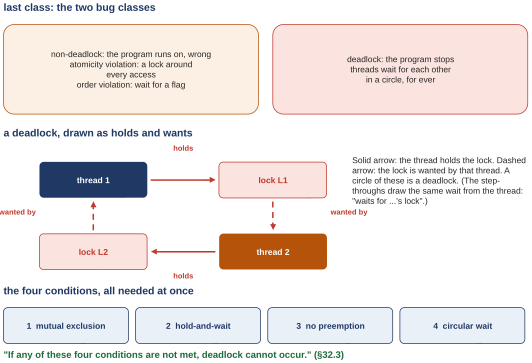
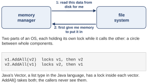
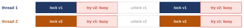
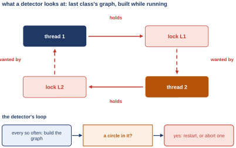
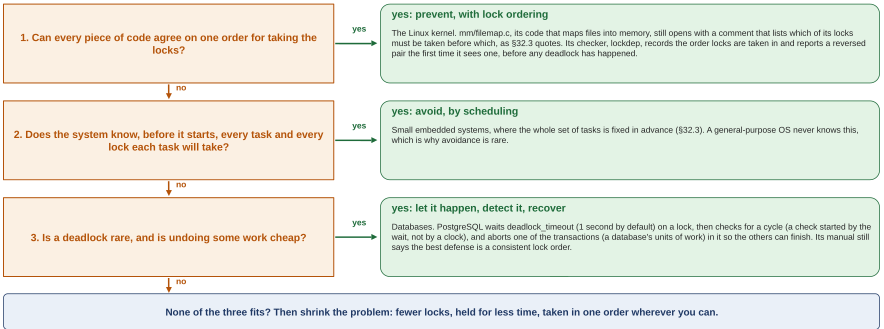
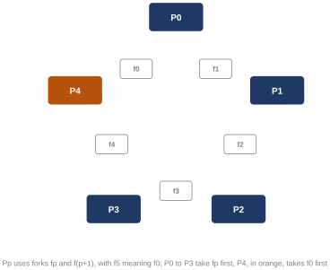

# Second class: why deadlocks happen, four ways to prevent one, the other attitudes, and a server with no threads (OSTEP 32.3, 32.4 and 33) {#class-2}

<!-- classmap:start -->
<details class="abstract cmap-details" markdown="0" open>
<summary>Map of this class: the questions, and the steps of each</summary>
<div class="cmap-wrap">
<svg xmlns="http://www.w3.org/2000/svg" viewBox="0 0 796 1710" class="cmap" role="img" aria-label="Map of this class: each question, why we ask it, its steps, how we know, and what it settles; each box a link to its section">
<style>.cmap .cmap-link rect{transition:filter .15s} .cmap .cmap-link:hover rect{stroke-width:2.2;filter:drop-shadow(0 2px 4px rgba(0,0,0,.18))} .cmap .cmap-link:hover text{text-decoration:underline}</style>
<rect x="0" y="0" width="796" height="1710" fill="#ffffff"/>
<text x="10" y="20" font-family="Source Sans 3, Helvetica Neue, Arial, sans-serif" font-size="12" font-weight="700" letter-spacing=".05em" fill="#a0632a">WEEK 10 · MAP OF THIS CLASS</text>
<text x="10" y="36" font-family="Source Sans 3, Helvetica Neue, Arial, sans-serif" font-size="10.5" fill="#5b6675">Each question: why we ask it, the steps that answer it, how we know, and what it settles. Every box opens its section.</text>
<rect x="10" y="48" width="51" height="15" rx="3" fill="#b23a48"/>
<text x="16" y="59" font-family="Source Sans 3, Helvetica Neue, Arial, sans-serif" font-size="9.5" font-weight="600" fill="#fff">Problem</text>
<text x="66" y="59" font-family="Source Sans 3, Helvetica Neue, Arial, sans-serif" font-size="10" fill="#5b6675">why we ask: what breaks</text>
<rect x="192.9" y="48" width="51" height="15" rx="3" fill="#1f6f8b"/>
<text x="198.9" y="59" font-family="Source Sans 3, Helvetica Neue, Arial, sans-serif" font-size="9.5" font-weight="600" fill="#fff">Concept</text>
<text x="249" y="59" font-family="Source Sans 3, Helvetica Neue, Arial, sans-serif" font-size="10" fill="#5b6675">the idea, one step at a time</text>
<rect x="400.3" y="48" width="90" height="15" rx="3" fill="#5b7a2a"/>
<text x="406.3" y="59" font-family="Source Sans 3, Helvetica Neue, Arial, sans-serif" font-size="9.5" font-weight="600" fill="#fff">Worked example</text>
<text x="496" y="59" font-family="Source Sans 3, Helvetica Neue, Arial, sans-serif" font-size="10" fill="#5b6675">traced by hand</text>
<rect x="10" y="68" width="79" height="15" rx="3" fill="#a0632a"/>
<text x="16" y="79" font-family="Source Sans 3, Helvetica Neue, Arial, sans-serif" font-size="9.5" font-weight="600" fill="#fff">Real machine</text>
<text x="94" y="79" font-family="Source Sans 3, Helvetica Neue, Arial, sans-serif" font-size="10" fill="#5b6675">measured on a real computer</text>
<rect x="240.5" y="68" width="74" height="15" rx="3" fill="#6b4fa0"/>
<text x="246.5" y="79" font-family="Source Sans 3, Helvetica Neue, Arial, sans-serif" font-size="9.5" font-weight="600" fill="#fff">Real kernel</text>
<text x="319" y="79" font-family="Source Sans 3, Helvetica Neue, Arial, sans-serif" font-size="10" fill="#5b6675">read in xv6 or Linux</text>
<rect x="431.1" y="68" width="90" height="15" rx="3" fill="#2a7a6b"/>
<text x="437.1" y="79" font-family="Source Sans 3, Helvetica Neue, Arial, sans-serif" font-size="9.5" font-weight="600" fill="#fff">Check yourself</text>
<text x="526" y="79" font-family="Source Sans 3, Helvetica Neue, Arial, sans-serif" font-size="10" fill="#5b6675">what is settled, what is open</text>
<rect x="10" y="88" width="46" height="15" rx="3" fill="#7a7a7a"/>
<text x="16" y="99" font-family="Source Sans 3, Helvetica Neue, Arial, sans-serif" font-size="9.5" font-weight="600" fill="#fff">Deeper</text>
<text x="61" y="99" font-family="Source Sans 3, Helvetica Neue, Arial, sans-serif" font-size="10" fill="#5b6675">optional</text>
<a href="#opening-2" class="cmap-link"><title>Where we left off: four conditions, all needed</title><rect x="10" y="122" width="206" height="46" rx="6" fill="#f3f4f6" stroke="#9aa3b2" stroke-width="1.1"/><text x="20" y="138" font-family="Source Sans 3, Helvetica Neue, Arial, sans-serif" font-size="11.5" font-style="italic" fill="#3a4350">Where we left off: four</text><text x="20" y="153" font-family="Source Sans 3, Helvetica Neue, Arial, sans-serif" font-size="11.5" font-style="italic" fill="#3a4350">conditions, all needed</text></a>
<a href="#sec-4-1" class="cmap-link"><title>4.1 Problem: Simple deadlocks look avoidable, so why do they happen?</title><rect x="384" y="190" width="400" height="42" rx="6" fill="#ffffff" stroke="#b23a48" stroke-width="1.1"/><rect x="390" y="196" width="51" height="15" rx="3" fill="#b23a48"/><text x="396" y="206.5" font-family="Source Sans 3, Helvetica Neue, Arial, sans-serif" font-size="9.5" font-weight="600" fill="#fff">Problem</text><text x="448" y="208" font-family="Source Sans 3, Helvetica Neue, Arial, sans-serif" font-size="11.5" fill="#1b2430">4.1 Simple deadlocks look avoidable, so why do they</text><text x="448" y="223" font-family="Source Sans 3, Helvetica Neue, Arial, sans-serif" font-size="11.5" fill="#1b2430">happen?</text></a>
<path d="M352,211 C368,211 368,211 384,211" fill="none" stroke="#b23a48" stroke-width="1.4"/>
<rect x="248" y="198" width="104" height="26" rx="13" fill="#ffffff" stroke="#b23a48" stroke-width="1.5"/>
<text x="300.0" y="215" text-anchor="middle" font-family="Source Sans 3, Helvetica Neue, Arial, sans-serif" font-size="11.5" font-weight="700" fill="#b23a48">Why we ask</text>
<a href="#sec-4-2" class="cmap-link"><title>4.2 Concept: vector_add(): two locks the caller never sees</title><rect x="384" y="244" width="400" height="27" rx="6" fill="#ffffff" stroke="#1f6f8b" stroke-width="1.1"/><rect x="390" y="250" width="51" height="15" rx="3" fill="#1f6f8b"/><text x="396" y="260.5" font-family="Source Sans 3, Helvetica Neue, Arial, sans-serif" font-size="9.5" font-weight="600" fill="#fff">Concept</text><text x="448" y="262" font-family="Source Sans 3, Helvetica Neue, Arial, sans-serif" font-size="11.5" fill="#1b2430">4.2 vector_add(): two locks the caller never sees</text></a>
<path d="M352,258 C368,258 368,258 384,258" fill="none" stroke="#1f6f8b" stroke-width="1.4"/>
<rect x="248" y="244" width="104" height="26" rx="13" fill="#ffffff" stroke="#1f6f8b" stroke-width="1.5"/>
<text x="300.0" y="262" text-anchor="middle" font-family="Source Sans 3, Helvetica Neue, Arial, sans-serif" font-size="11.5" font-weight="700" fill="#1f6f8b">The steps</text>
<a href="#sec-4-3" class="cmap-link"><title>4.3 Real machine: Swapped arguments hung all 3 runs; the same order finished</title><rect x="384" y="283" width="400" height="42" rx="6" fill="#ffffff" stroke="#a0632a" stroke-width="1.1"/><rect x="390" y="289" width="79" height="15" rx="3" fill="#a0632a"/><text x="396" y="299.5" font-family="Source Sans 3, Helvetica Neue, Arial, sans-serif" font-size="9.5" font-weight="600" fill="#fff">Real machine</text><text x="476" y="301" font-family="Source Sans 3, Helvetica Neue, Arial, sans-serif" font-size="11.5" fill="#1b2430">4.3 Swapped arguments hung all 3 runs; the same</text><text x="476" y="316" font-family="Source Sans 3, Helvetica Neue, Arial, sans-serif" font-size="11.5" fill="#1b2430">order finished</text></a>
<path d="M352,304 C368,304 368,304 384,304" fill="none" stroke="#a0632a" stroke-width="1.4"/>
<rect x="248" y="291" width="104" height="26" rx="13" fill="#ffffff" stroke="#a0632a" stroke-width="1.5"/>
<text x="300.0" y="308" text-anchor="middle" font-family="Source Sans 3, Helvetica Neue, Arial, sans-serif" font-size="11.5" font-weight="700" fill="#a0632a">How we know</text>
<a href="#sec-4-4" class="cmap-link"><title>4.4 Check yourself: What the first question settled</title><rect x="384" y="337" width="400" height="27" rx="6" fill="#ffffff" stroke="#2a7a6b" stroke-width="1.1"/><rect x="390" y="343" width="90" height="15" rx="3" fill="#2a7a6b"/><text x="396" y="353.5" font-family="Source Sans 3, Helvetica Neue, Arial, sans-serif" font-size="9.5" font-weight="600" fill="#fff">Check yourself</text><text x="487" y="355" font-family="Source Sans 3, Helvetica Neue, Arial, sans-serif" font-size="11.5" fill="#1b2430">4.4 What the first question settled</text></a>
<path d="M352,350 C368,350 368,350 384,350" fill="none" stroke="#2a7a6b" stroke-width="1.4"/>
<rect x="248" y="338" width="104" height="26" rx="13" fill="#ffffff" stroke="#2a7a6b" stroke-width="1.5"/>
<text x="300.0" y="354" text-anchor="middle" font-family="Source Sans 3, Helvetica Neue, Arial, sans-serif" font-size="11.5" font-weight="700" fill="#2a7a6b">What it settles</text>
<a href="#extra-1" class="cmap-link"><title>Extra 1 Deeper, Q4: select(): ask the kernel which clients have something waiting</title><rect x="384" y="376" width="400" height="42" rx="6" fill="#fafafa" stroke="#7a7a7a" stroke-width="1.1" stroke-dasharray="4 3"/><rect x="390" y="382" width="68" height="15" rx="3" fill="#7a7a7a"/><text x="396" y="392.5" font-family="Source Sans 3, Helvetica Neue, Arial, sans-serif" font-size="9.5" font-weight="600" fill="#fff">Deeper, Q4</text><text x="465" y="394" font-family="Source Sans 3, Helvetica Neue, Arial, sans-serif" font-size="11.5" fill="#5b6675">Extra 1 select(): ask the kernel which clients have</text><text x="465" y="409" font-family="Source Sans 3, Helvetica Neue, Arial, sans-serif" font-size="11.5" fill="#5b6675">something waiting</text></a>
<a href="#extra-2" class="cmap-link"><title>Extra 2 Deeper, Q4: One handler that blocks makes every client wait</title><rect x="384" y="422" width="400" height="42" rx="6" fill="#fafafa" stroke="#7a7a7a" stroke-width="1.1" stroke-dasharray="4 3"/><rect x="390" y="428" width="68" height="15" rx="3" fill="#7a7a7a"/><text x="396" y="438.5" font-family="Source Sans 3, Helvetica Neue, Arial, sans-serif" font-size="9.5" font-weight="600" fill="#fff">Deeper, Q4</text><text x="465" y="440" font-family="Source Sans 3, Helvetica Neue, Arial, sans-serif" font-size="11.5" fill="#5b6675">Extra 2 One handler that blocks makes every client</text><text x="465" y="455" font-family="Source Sans 3, Helvetica Neue, Arial, sans-serif" font-size="11.5" fill="#5b6675">wait</text></a>
<a href="#extra-3" class="cmap-link"><title>Extra 3 Deeper, Q4: Asynchronous I/O: start the read, return at once, ask later</title><rect x="384" y="468" width="400" height="42" rx="6" fill="#fafafa" stroke="#7a7a7a" stroke-width="1.1" stroke-dasharray="4 3"/><rect x="390" y="474" width="68" height="15" rx="3" fill="#7a7a7a"/><text x="396" y="484.5" font-family="Source Sans 3, Helvetica Neue, Arial, sans-serif" font-size="9.5" font-weight="600" fill="#fff">Deeper, Q4</text><text x="465" y="486" font-family="Source Sans 3, Helvetica Neue, Arial, sans-serif" font-size="11.5" fill="#5b6675">Extra 3 Asynchronous I/O: start the read, return at</text><text x="465" y="501" font-family="Source Sans 3, Helvetica Neue, Arial, sans-serif" font-size="11.5" fill="#5b6675">once, ask later</text></a>
<a href="#extra-4" class="cmap-link"><title>Extra 4 Deeper, Q4: What stays hard with events, and the verdict of OSTEP section 33.9</title><rect x="384" y="514" width="400" height="42" rx="6" fill="#fafafa" stroke="#7a7a7a" stroke-width="1.1" stroke-dasharray="4 3"/><rect x="390" y="520" width="68" height="15" rx="3" fill="#7a7a7a"/><text x="396" y="530.5" font-family="Source Sans 3, Helvetica Neue, Arial, sans-serif" font-size="9.5" font-weight="600" fill="#fff">Deeper, Q4</text><text x="465" y="532" font-family="Source Sans 3, Helvetica Neue, Arial, sans-serif" font-size="11.5" fill="#5b6675">Extra 4 What stays hard with events, and the verdict</text><text x="465" y="547" font-family="Source Sans 3, Helvetica Neue, Arial, sans-serif" font-size="11.5" fill="#5b6675">of OSTEP section 33.9</text></a>
<path d="M352,466 C368,466 368,397 384,397" fill="none" stroke="#7a7a7a" stroke-width="1.4" stroke-dasharray="4 3"/>
<path d="M352,466 C368,466 368,443 384,443" fill="none" stroke="#7a7a7a" stroke-width="1.4" stroke-dasharray="4 3"/>
<path d="M352,466 C368,466 368,489 384,489" fill="none" stroke="#7a7a7a" stroke-width="1.4" stroke-dasharray="4 3"/>
<path d="M352,466 C368,466 368,535 384,535" fill="none" stroke="#7a7a7a" stroke-width="1.4" stroke-dasharray="4 3"/>
<rect x="248" y="453" width="104" height="26" rx="13" fill="#ffffff" stroke="#7a7a7a" stroke-width="1.5" stroke-dasharray="4 3"/>
<text x="300.0" y="470" text-anchor="middle" font-family="Source Sans 3, Helvetica Neue, Arial, sans-serif" font-size="11.5" font-weight="700" fill="#7a7a7a">Going deeper</text>
<path d="M216,375 C232,375 232,211 248,211" fill="none" stroke="#a0632a" stroke-width="1.4"/>
<path d="M216,375 C232,375 232,258 248,258" fill="none" stroke="#a0632a" stroke-width="1.4"/>
<path d="M216,375 C232,375 232,304 248,304" fill="none" stroke="#a0632a" stroke-width="1.4"/>
<path d="M216,375 C232,375 232,350 248,350" fill="none" stroke="#a0632a" stroke-width="1.4"/>
<path d="M216,375 C232,375 232,466 248,466" fill="none" stroke="#a0632a" stroke-width="1.4" stroke-dasharray="4 3"/>
<a href="#chapter-4" class="cmap-link"><title>Q1. Why do deadlocks happen in real code, when a two-lock one looks so easy to avoid?</title><rect x="10" y="333" width="206" height="84" rx="8" fill="#ffffff" stroke="#a0632a" stroke-width="1.9"/><circle cx="28" cy="353" r="11" fill="#a0632a"/><text x="28" y="357" text-anchor="middle" font-family="Source Sans 3, Helvetica Neue, Arial, sans-serif" font-size="11" font-weight="700" fill="#fff">Q1</text><text x="48" y="357" font-family="Source Sans 3, Helvetica Neue, Arial, sans-serif" font-size="12.5" font-weight="600" fill="#1b2430">Why do deadlocks happen</text><text x="48" y="373" font-family="Source Sans 3, Helvetica Neue, Arial, sans-serif" font-size="12.5" font-weight="600" fill="#1b2430">in real code, when a</text><text x="48" y="389" font-family="Source Sans 3, Helvetica Neue, Arial, sans-serif" font-size="12.5" font-weight="600" fill="#1b2430">two-lock one looks so</text><text x="48" y="405" font-family="Source Sans 3, Helvetica Neue, Arial, sans-serif" font-size="12.5" font-weight="600" fill="#1b2430">easy to avoid?</text></a>
<text x="113.0" y="578" text-anchor="middle" font-family="Source Sans 3, Helvetica Neue, Arial, sans-serif" font-size="10" font-style="italic" fill="#6b7482">↓ what is left open leads to the next question</text>
<a href="#sec-5-1" class="cmap-link"><title>5.1 Problem: Break one condition, and deadlock cannot happen</title><rect x="384" y="590" width="400" height="27" rx="6" fill="#ffffff" stroke="#b23a48" stroke-width="1.1"/><rect x="390" y="596" width="51" height="15" rx="3" fill="#b23a48"/><text x="396" y="606.5" font-family="Source Sans 3, Helvetica Neue, Arial, sans-serif" font-size="9.5" font-weight="600" fill="#fff">Problem</text><text x="448" y="608" font-family="Source Sans 3, Helvetica Neue, Arial, sans-serif" font-size="11.5" fill="#1b2430">5.1 Break one condition, and deadlock cannot happen</text></a>
<path d="M352,604 C368,604 368,604 384,604" fill="none" stroke="#b23a48" stroke-width="1.4"/>
<rect x="248" y="590" width="104" height="26" rx="13" fill="#ffffff" stroke="#b23a48" stroke-width="1.5"/>
<text x="300.0" y="608" text-anchor="middle" font-family="Source Sans 3, Helvetica Neue, Arial, sans-serif" font-size="11.5" font-weight="700" fill="#b23a48">Why we ask</text>
<a href="#sec-5-2" class="cmap-link"><title>5.2 Concept: Attempt 1, circular wait: everyone uses one order</title><rect x="384" y="629" width="400" height="27" rx="6" fill="#ffffff" stroke="#1f6f8b" stroke-width="1.1"/><rect x="390" y="635" width="51" height="15" rx="3" fill="#1f6f8b"/><text x="396" y="645.5" font-family="Source Sans 3, Helvetica Neue, Arial, sans-serif" font-size="9.5" font-weight="600" fill="#fff">Concept</text><text x="448" y="647" font-family="Source Sans 3, Helvetica Neue, Arial, sans-serif" font-size="11.5" fill="#1b2430">5.2 Attempt 1, circular wait: everyone uses one order</text></a>
<a href="#sec-5-3" class="cmap-link"><title>5.3 Concept: Attempt 2, hold-and-wait: take every lock in one step</title><rect x="384" y="660" width="400" height="42" rx="6" fill="#ffffff" stroke="#1f6f8b" stroke-width="1.1"/><rect x="390" y="666" width="51" height="15" rx="3" fill="#1f6f8b"/><text x="396" y="676.5" font-family="Source Sans 3, Helvetica Neue, Arial, sans-serif" font-size="9.5" font-weight="600" fill="#fff">Concept</text><text x="448" y="678" font-family="Source Sans 3, Helvetica Neue, Arial, sans-serif" font-size="11.5" fill="#1b2430">5.3 Attempt 2, hold-and-wait: take every lock in one</text><text x="448" y="693" font-family="Source Sans 3, Helvetica Neue, Arial, sans-serif" font-size="11.5" fill="#1b2430">step</text></a>
<a href="#sec-5-4" class="cmap-link"><title>5.4 Concept: Attempt 3, no preemption: try the second lock, or back off</title><rect x="384" y="706" width="400" height="42" rx="6" fill="#ffffff" stroke="#1f6f8b" stroke-width="1.1"/><rect x="390" y="712" width="51" height="15" rx="3" fill="#1f6f8b"/><text x="396" y="722.5" font-family="Source Sans 3, Helvetica Neue, Arial, sans-serif" font-size="9.5" font-weight="600" fill="#fff">Concept</text><text x="448" y="724" font-family="Source Sans 3, Helvetica Neue, Arial, sans-serif" font-size="11.5" fill="#1b2430">5.4 Attempt 3, no preemption: try the second lock, or</text><text x="448" y="739" font-family="Source Sans 3, Helvetica Neue, Arial, sans-serif" font-size="11.5" fill="#1b2430">back off</text></a>
<a href="#sec-5-6" class="cmap-link"><title>5.6 Concept: Attempt 4, mutual exclusion: update with one instruction, no lock</title><rect x="384" y="752" width="400" height="42" rx="6" fill="#ffffff" stroke="#1f6f8b" stroke-width="1.1"/><rect x="390" y="758" width="51" height="15" rx="3" fill="#1f6f8b"/><text x="396" y="768.5" font-family="Source Sans 3, Helvetica Neue, Arial, sans-serif" font-size="9.5" font-weight="600" fill="#fff">Concept</text><text x="448" y="770" font-family="Source Sans 3, Helvetica Neue, Arial, sans-serif" font-size="11.5" fill="#1b2430">5.6 Attempt 4, mutual exclusion: update with one</text><text x="448" y="785" font-family="Source Sans 3, Helvetica Neue, Arial, sans-serif" font-size="11.5" fill="#1b2430">instruction, no lock</text></a>
<path d="M352,712 C368,712 368,642 384,642" fill="none" stroke="#1f6f8b" stroke-width="1.4"/>
<path d="M352,712 C368,712 368,681 384,681" fill="none" stroke="#1f6f8b" stroke-width="1.4"/>
<path d="M352,712 C368,712 368,727 384,727" fill="none" stroke="#1f6f8b" stroke-width="1.4"/>
<path d="M352,712 C368,712 368,773 384,773" fill="none" stroke="#1f6f8b" stroke-width="1.4"/>
<rect x="248" y="698" width="104" height="26" rx="13" fill="#ffffff" stroke="#1f6f8b" stroke-width="1.5"/>
<text x="300.0" y="716" text-anchor="middle" font-family="Source Sans 3, Helvetica Neue, Arial, sans-serif" font-size="11.5" font-weight="700" fill="#1f6f8b">The steps</text>
<a href="#sec-5-5" class="cmap-link"><title>5.5 Real machine: No run hung, but the retries point to livelock</title><rect x="384" y="806" width="400" height="27" rx="6" fill="#ffffff" stroke="#a0632a" stroke-width="1.1"/><rect x="390" y="812" width="79" height="15" rx="3" fill="#a0632a"/><text x="396" y="822.5" font-family="Source Sans 3, Helvetica Neue, Arial, sans-serif" font-size="9.5" font-weight="600" fill="#fff">Real machine</text><text x="476" y="824" font-family="Source Sans 3, Helvetica Neue, Arial, sans-serif" font-size="11.5" fill="#1b2430">5.5 No run hung, but the retries point to livelock</text></a>
<a href="#sec-5-7" class="cmap-link"><title>5.7 Real machine: Four fixes, one job: all finish, at different prices</title><rect x="384" y="837" width="400" height="42" rx="6" fill="#ffffff" stroke="#a0632a" stroke-width="1.1"/><rect x="390" y="843" width="79" height="15" rx="3" fill="#a0632a"/><text x="396" y="853.5" font-family="Source Sans 3, Helvetica Neue, Arial, sans-serif" font-size="9.5" font-weight="600" fill="#fff">Real machine</text><text x="476" y="855" font-family="Source Sans 3, Helvetica Neue, Arial, sans-serif" font-size="11.5" fill="#1b2430">5.7 Four fixes, one job: all finish, at different</text><text x="476" y="870" font-family="Source Sans 3, Helvetica Neue, Arial, sans-serif" font-size="11.5" fill="#1b2430">prices</text></a>
<path d="M352,842 C368,842 368,820 384,820" fill="none" stroke="#a0632a" stroke-width="1.4"/>
<path d="M352,842 C368,842 368,858 384,858" fill="none" stroke="#a0632a" stroke-width="1.4"/>
<rect x="248" y="830" width="104" height="26" rx="13" fill="#ffffff" stroke="#a0632a" stroke-width="1.5"/>
<text x="300.0" y="846" text-anchor="middle" font-family="Source Sans 3, Helvetica Neue, Arial, sans-serif" font-size="11.5" font-weight="700" fill="#a0632a">How we know</text>
<a href="#sec-5-8" class="cmap-link"><title>5.8 Check yourself: What the second question settled</title><rect x="384" y="891" width="400" height="27" rx="6" fill="#ffffff" stroke="#2a7a6b" stroke-width="1.1"/><rect x="390" y="897" width="90" height="15" rx="3" fill="#2a7a6b"/><text x="396" y="907.5" font-family="Source Sans 3, Helvetica Neue, Arial, sans-serif" font-size="9.5" font-weight="600" fill="#fff">Check yourself</text><text x="487" y="909" font-family="Source Sans 3, Helvetica Neue, Arial, sans-serif" font-size="11.5" fill="#1b2430">5.8 What the second question settled</text></a>
<path d="M352,904 C368,904 368,904 384,904" fill="none" stroke="#2a7a6b" stroke-width="1.4"/>
<rect x="248" y="892" width="104" height="26" rx="13" fill="#ffffff" stroke="#2a7a6b" stroke-width="1.5"/>
<text x="300.0" y="908" text-anchor="middle" font-family="Source Sans 3, Helvetica Neue, Arial, sans-serif" font-size="11.5" font-weight="700" fill="#2a7a6b">What it settles</text>
<a href="#extra-5" class="cmap-link"><title>Extra 5 Deeper, Q2: The lock-free insert, step by step: one swap fails and retries</title><rect x="384" y="930" width="400" height="42" rx="6" fill="#fafafa" stroke="#7a7a7a" stroke-width="1.1" stroke-dasharray="4 3"/><rect x="390" y="936" width="68" height="15" rx="3" fill="#7a7a7a"/><text x="396" y="946.5" font-family="Source Sans 3, Helvetica Neue, Arial, sans-serif" font-size="9.5" font-weight="600" fill="#fff">Deeper, Q2</text><text x="465" y="948" font-family="Source Sans 3, Helvetica Neue, Arial, sans-serif" font-size="11.5" fill="#5b6675">Extra 5 The lock-free insert, step by step: one swap</text><text x="465" y="963" font-family="Source Sans 3, Helvetica Neue, Arial, sans-serif" font-size="11.5" fill="#5b6675">fails and retries</text></a>
<a href="#extra-6" class="cmap-link"><title>Extra 6 Deeper, Q2: The dining philosophers again: one reversed reach breaks the circle</title><rect x="384" y="976" width="400" height="42" rx="6" fill="#fafafa" stroke="#7a7a7a" stroke-width="1.1" stroke-dasharray="4 3"/><rect x="390" y="982" width="68" height="15" rx="3" fill="#7a7a7a"/><text x="396" y="992.5" font-family="Source Sans 3, Helvetica Neue, Arial, sans-serif" font-size="9.5" font-weight="600" fill="#fff">Deeper, Q2</text><text x="465" y="994" font-family="Source Sans 3, Helvetica Neue, Arial, sans-serif" font-size="11.5" fill="#5b6675">Extra 6 The dining philosophers again: one reversed</text><text x="465" y="1009" font-family="Source Sans 3, Helvetica Neue, Arial, sans-serif" font-size="11.5" fill="#5b6675">reach breaks the circle</text></a>
<path d="M352,974 C368,974 368,951 384,951" fill="none" stroke="#7a7a7a" stroke-width="1.4" stroke-dasharray="4 3"/>
<path d="M352,974 C368,974 368,997 384,997" fill="none" stroke="#7a7a7a" stroke-width="1.4" stroke-dasharray="4 3"/>
<rect x="248" y="961" width="104" height="26" rx="13" fill="#ffffff" stroke="#7a7a7a" stroke-width="1.5" stroke-dasharray="4 3"/>
<text x="300.0" y="978" text-anchor="middle" font-family="Source Sans 3, Helvetica Neue, Arial, sans-serif" font-size="11.5" font-weight="700" fill="#7a7a7a">Going deeper</text>
<path d="M216,806 C232,806 232,604 248,604" fill="none" stroke="#a0632a" stroke-width="1.4"/>
<path d="M216,806 C232,806 232,712 248,712" fill="none" stroke="#a0632a" stroke-width="1.4"/>
<path d="M216,806 C232,806 232,842 248,842" fill="none" stroke="#a0632a" stroke-width="1.4"/>
<path d="M216,806 C232,806 232,904 248,904" fill="none" stroke="#a0632a" stroke-width="1.4"/>
<path d="M216,806 C232,806 232,974 248,974" fill="none" stroke="#a0632a" stroke-width="1.4" stroke-dasharray="4 3"/>
<a href="#chapter-5" class="cmap-link"><title>Q2. Which of the four conditions can we break, and what does each break cost?</title><rect x="10" y="764" width="206" height="84" rx="8" fill="#ffffff" stroke="#a0632a" stroke-width="1.9"/><circle cx="28" cy="784" r="11" fill="#a0632a"/><text x="28" y="788" text-anchor="middle" font-family="Source Sans 3, Helvetica Neue, Arial, sans-serif" font-size="11" font-weight="700" fill="#fff">Q2</text><text x="48" y="788" font-family="Source Sans 3, Helvetica Neue, Arial, sans-serif" font-size="12.5" font-weight="600" fill="#1b2430">Which of the four</text><text x="48" y="804" font-family="Source Sans 3, Helvetica Neue, Arial, sans-serif" font-size="12.5" font-weight="600" fill="#1b2430">conditions can we break,</text><text x="48" y="820" font-family="Source Sans 3, Helvetica Neue, Arial, sans-serif" font-size="12.5" font-weight="600" fill="#1b2430">and what does each break</text><text x="48" y="836" font-family="Source Sans 3, Helvetica Neue, Arial, sans-serif" font-size="12.5" font-weight="600" fill="#1b2430">cost?</text></a>
<text x="113.0" y="1040" text-anchor="middle" font-family="Source Sans 3, Helvetica Neue, Arial, sans-serif" font-size="10" font-style="italic" fill="#6b7482">↓ what is left open leads to the next question</text>
<a href="#sec-6-1" class="cmap-link"><title>6.1 Problem: Prevention needs everyone to follow the rule</title><rect x="384" y="1052" width="400" height="27" rx="6" fill="#ffffff" stroke="#b23a48" stroke-width="1.1"/><rect x="390" y="1058" width="51" height="15" rx="3" fill="#b23a48"/><text x="396" y="1068.5" font-family="Source Sans 3, Helvetica Neue, Arial, sans-serif" font-size="9.5" font-weight="600" fill="#fff">Problem</text><text x="448" y="1070" font-family="Source Sans 3, Helvetica Neue, Arial, sans-serif" font-size="11.5" fill="#1b2430">6.1 Prevention needs everyone to follow the rule</text></a>
<path d="M352,1066 C368,1066 368,1066 384,1066" fill="none" stroke="#b23a48" stroke-width="1.4"/>
<rect x="248" y="1052" width="104" height="26" rx="13" fill="#ffffff" stroke="#b23a48" stroke-width="1.5"/>
<text x="300.0" y="1070" text-anchor="middle" font-family="Source Sans 3, Helvetica Neue, Arial, sans-serif" font-size="11.5" font-weight="700" fill="#b23a48">Why we ask</text>
<a href="#sec-6-2" class="cmap-link"><title>6.2 Concept: Avoidance: never run together threads that could form a circle</title><rect x="384" y="1091" width="400" height="42" rx="6" fill="#ffffff" stroke="#1f6f8b" stroke-width="1.1"/><rect x="390" y="1097" width="51" height="15" rx="3" fill="#1f6f8b"/><text x="396" y="1107.5" font-family="Source Sans 3, Helvetica Neue, Arial, sans-serif" font-size="9.5" font-weight="600" fill="#fff">Concept</text><text x="448" y="1109" font-family="Source Sans 3, Helvetica Neue, Arial, sans-serif" font-size="11.5" fill="#1b2430">6.2 Avoidance: never run together threads that could</text><text x="448" y="1124" font-family="Source Sans 3, Helvetica Neue, Arial, sans-serif" font-size="11.5" fill="#1b2430">form a circle</text></a>
<a href="#sec-6-3" class="cmap-link"><title>6.3 Concept: Detect and recover: let it happen, find the circle, restart</title><rect x="384" y="1137" width="400" height="42" rx="6" fill="#ffffff" stroke="#1f6f8b" stroke-width="1.1"/><rect x="390" y="1143" width="51" height="15" rx="3" fill="#1f6f8b"/><text x="396" y="1153.5" font-family="Source Sans 3, Helvetica Neue, Arial, sans-serif" font-size="9.5" font-weight="600" fill="#fff">Concept</text><text x="448" y="1155" font-family="Source Sans 3, Helvetica Neue, Arial, sans-serif" font-size="11.5" fill="#1b2430">6.3 Detect and recover: let it happen, find the circle,</text><text x="448" y="1170" font-family="Source Sans 3, Helvetica Neue, Arial, sans-serif" font-size="11.5" fill="#1b2430">restart</text></a>
<a href="#sec-6-4" class="cmap-link"><title>6.4 Concept: Which attitude fits? Three questions, in order</title><rect x="384" y="1183" width="400" height="27" rx="6" fill="#ffffff" stroke="#1f6f8b" stroke-width="1.1"/><rect x="390" y="1189" width="51" height="15" rx="3" fill="#1f6f8b"/><text x="396" y="1199.5" font-family="Source Sans 3, Helvetica Neue, Arial, sans-serif" font-size="9.5" font-weight="600" fill="#fff">Concept</text><text x="448" y="1201" font-family="Source Sans 3, Helvetica Neue, Arial, sans-serif" font-size="11.5" fill="#1b2430">6.4 Which attitude fits? Three questions, in order</text></a>
<path d="M352,1150 C368,1150 368,1112 384,1112" fill="none" stroke="#1f6f8b" stroke-width="1.4"/>
<path d="M352,1150 C368,1150 368,1158 384,1158" fill="none" stroke="#1f6f8b" stroke-width="1.4"/>
<path d="M352,1150 C368,1150 368,1196 384,1196" fill="none" stroke="#1f6f8b" stroke-width="1.4"/>
<rect x="248" y="1138" width="104" height="26" rx="13" fill="#ffffff" stroke="#1f6f8b" stroke-width="1.5"/>
<text x="300.0" y="1154" text-anchor="middle" font-family="Source Sans 3, Helvetica Neue, Arial, sans-serif" font-size="11.5" font-weight="700" fill="#1f6f8b">The steps</text>
<a href="#sec-6-5" class="cmap-link"><title>6.5 Check yourself: What the third question settled</title><rect x="384" y="1222" width="400" height="27" rx="6" fill="#ffffff" stroke="#2a7a6b" stroke-width="1.1"/><rect x="390" y="1228" width="90" height="15" rx="3" fill="#2a7a6b"/><text x="396" y="1238.5" font-family="Source Sans 3, Helvetica Neue, Arial, sans-serif" font-size="9.5" font-weight="600" fill="#fff">Check yourself</text><text x="487" y="1240" font-family="Source Sans 3, Helvetica Neue, Arial, sans-serif" font-size="11.5" fill="#1b2430">6.5 What the third question settled</text></a>
<path d="M352,1236 C368,1236 368,1236 384,1236" fill="none" stroke="#2a7a6b" stroke-width="1.4"/>
<rect x="248" y="1222" width="104" height="26" rx="13" fill="#ffffff" stroke="#2a7a6b" stroke-width="1.5"/>
<text x="300.0" y="1240" text-anchor="middle" font-family="Source Sans 3, Helvetica Neue, Arial, sans-serif" font-size="11.5" font-weight="700" fill="#2a7a6b">What it settles</text>
<path d="M216,1152 C232,1152 232,1066 248,1066" fill="none" stroke="#a0632a" stroke-width="1.4"/>
<path d="M216,1152 C232,1152 232,1150 248,1150" fill="none" stroke="#a0632a" stroke-width="1.4"/>
<path d="M216,1152 C232,1152 232,1236 248,1236" fill="none" stroke="#a0632a" stroke-width="1.4"/>
<a href="#chapter-6" class="cmap-link"><title>Q3. If we cannot prevent a deadlock, what else can we do?</title><rect x="10" y="1118" width="206" height="68" rx="8" fill="#ffffff" stroke="#a0632a" stroke-width="1.9"/><circle cx="28" cy="1138" r="11" fill="#a0632a"/><text x="28" y="1142" text-anchor="middle" font-family="Source Sans 3, Helvetica Neue, Arial, sans-serif" font-size="11" font-weight="700" fill="#fff">Q3</text><text x="48" y="1142" font-family="Source Sans 3, Helvetica Neue, Arial, sans-serif" font-size="12.5" font-weight="600" fill="#1b2430">If we cannot prevent a</text><text x="48" y="1158" font-family="Source Sans 3, Helvetica Neue, Arial, sans-serif" font-size="12.5" font-weight="600" fill="#1b2430">deadlock, what else can</text><text x="48" y="1174" font-family="Source Sans 3, Helvetica Neue, Arial, sans-serif" font-size="12.5" font-weight="600" fill="#1b2430">we do?</text></a>
<text x="113.0" y="1271" text-anchor="middle" font-family="Source Sans 3, Helvetica Neue, Arial, sans-serif" font-size="10" font-style="italic" fill="#6b7482">↓ what is left open leads to the next question</text>
<a href="#sec-7-1" class="cmap-link"><title>7.1 Problem: Threads bring locks, deadlock, and no say in who runs when</title><rect x="384" y="1283" width="400" height="42" rx="6" fill="#ffffff" stroke="#b23a48" stroke-width="1.1"/><rect x="390" y="1289" width="51" height="15" rx="3" fill="#b23a48"/><text x="396" y="1299.5" font-family="Source Sans 3, Helvetica Neue, Arial, sans-serif" font-size="9.5" font-weight="600" fill="#fff">Problem</text><text x="448" y="1301" font-family="Source Sans 3, Helvetica Neue, Arial, sans-serif" font-size="11.5" fill="#1b2430">7.1 Threads bring locks, deadlock, and no say in who</text><text x="448" y="1316" font-family="Source Sans 3, Helvetica Neue, Arial, sans-serif" font-size="11.5" fill="#1b2430">runs when</text></a>
<path d="M352,1304 C368,1304 368,1304 384,1304" fill="none" stroke="#b23a48" stroke-width="1.4"/>
<rect x="248" y="1291" width="104" height="26" rx="13" fill="#ffffff" stroke="#b23a48" stroke-width="1.5"/>
<text x="300.0" y="1308" text-anchor="middle" font-family="Source Sans 3, Helvetica Neue, Arial, sans-serif" font-size="11.5" font-weight="700" fill="#b23a48">Why we ask</text>
<a href="#sec-7-2" class="cmap-link"><title>7.2 Concept: An event loop: wait, handle one event, repeat; no locks</title><rect x="384" y="1337" width="400" height="42" rx="6" fill="#ffffff" stroke="#1f6f8b" stroke-width="1.1"/><rect x="390" y="1343" width="51" height="15" rx="3" fill="#1f6f8b"/><text x="396" y="1353.5" font-family="Source Sans 3, Helvetica Neue, Arial, sans-serif" font-size="9.5" font-weight="600" fill="#fff">Concept</text><text x="448" y="1355" font-family="Source Sans 3, Helvetica Neue, Arial, sans-serif" font-size="11.5" fill="#1b2430">7.2 An event loop: wait, handle one event, repeat; no</text><text x="448" y="1370" font-family="Source Sans 3, Helvetica Neue, Arial, sans-serif" font-size="11.5" fill="#1b2430">locks</text></a>
<path d="M352,1358 C368,1358 368,1358 384,1358" fill="none" stroke="#1f6f8b" stroke-width="1.4"/>
<rect x="248" y="1345" width="104" height="26" rx="13" fill="#ffffff" stroke="#1f6f8b" stroke-width="1.5"/>
<text x="300.0" y="1362" text-anchor="middle" font-family="Source Sans 3, Helvetica Neue, Arial, sans-serif" font-size="11.5" font-weight="700" fill="#1f6f8b">The steps</text>
<a href="#sec-7-3" class="cmap-link"><title>7.3 Check yourself: What the fourth question settled</title><rect x="384" y="1391" width="400" height="27" rx="6" fill="#ffffff" stroke="#2a7a6b" stroke-width="1.1"/><rect x="390" y="1397" width="90" height="15" rx="3" fill="#2a7a6b"/><text x="396" y="1407.5" font-family="Source Sans 3, Helvetica Neue, Arial, sans-serif" font-size="9.5" font-weight="600" fill="#fff">Check yourself</text><text x="487" y="1409" font-family="Source Sans 3, Helvetica Neue, Arial, sans-serif" font-size="11.5" fill="#1b2430">7.3 What the fourth question settled</text></a>
<path d="M352,1404 C368,1404 368,1404 384,1404" fill="none" stroke="#2a7a6b" stroke-width="1.4"/>
<rect x="248" y="1392" width="104" height="26" rx="13" fill="#ffffff" stroke="#2a7a6b" stroke-width="1.5"/>
<text x="300.0" y="1408" text-anchor="middle" font-family="Source Sans 3, Helvetica Neue, Arial, sans-serif" font-size="11.5" font-weight="700" fill="#2a7a6b">What it settles</text>
<a href="#extra-1" class="cmap-link"><title>Extra 1 Deeper, Q4: select(): ask the kernel which clients have something waiting</title><rect x="384" y="1430" width="400" height="42" rx="6" fill="#fafafa" stroke="#7a7a7a" stroke-width="1.1" stroke-dasharray="4 3"/><rect x="390" y="1436" width="68" height="15" rx="3" fill="#7a7a7a"/><text x="396" y="1446.5" font-family="Source Sans 3, Helvetica Neue, Arial, sans-serif" font-size="9.5" font-weight="600" fill="#fff">Deeper, Q4</text><text x="465" y="1448" font-family="Source Sans 3, Helvetica Neue, Arial, sans-serif" font-size="11.5" fill="#5b6675">Extra 1 select(): ask the kernel which clients have</text><text x="465" y="1463" font-family="Source Sans 3, Helvetica Neue, Arial, sans-serif" font-size="11.5" fill="#5b6675">something waiting</text></a>
<a href="#extra-2" class="cmap-link"><title>Extra 2 Deeper, Q4: One handler that blocks makes every client wait</title><rect x="384" y="1476" width="400" height="42" rx="6" fill="#fafafa" stroke="#7a7a7a" stroke-width="1.1" stroke-dasharray="4 3"/><rect x="390" y="1482" width="68" height="15" rx="3" fill="#7a7a7a"/><text x="396" y="1492.5" font-family="Source Sans 3, Helvetica Neue, Arial, sans-serif" font-size="9.5" font-weight="600" fill="#fff">Deeper, Q4</text><text x="465" y="1494" font-family="Source Sans 3, Helvetica Neue, Arial, sans-serif" font-size="11.5" fill="#5b6675">Extra 2 One handler that blocks makes every client</text><text x="465" y="1509" font-family="Source Sans 3, Helvetica Neue, Arial, sans-serif" font-size="11.5" fill="#5b6675">wait</text></a>
<a href="#extra-3" class="cmap-link"><title>Extra 3 Deeper, Q4: Asynchronous I/O: start the read, return at once, ask later</title><rect x="384" y="1522" width="400" height="42" rx="6" fill="#fafafa" stroke="#7a7a7a" stroke-width="1.1" stroke-dasharray="4 3"/><rect x="390" y="1528" width="68" height="15" rx="3" fill="#7a7a7a"/><text x="396" y="1538.5" font-family="Source Sans 3, Helvetica Neue, Arial, sans-serif" font-size="9.5" font-weight="600" fill="#fff">Deeper, Q4</text><text x="465" y="1540" font-family="Source Sans 3, Helvetica Neue, Arial, sans-serif" font-size="11.5" fill="#5b6675">Extra 3 Asynchronous I/O: start the read, return at</text><text x="465" y="1555" font-family="Source Sans 3, Helvetica Neue, Arial, sans-serif" font-size="11.5" fill="#5b6675">once, ask later</text></a>
<a href="#extra-4" class="cmap-link"><title>Extra 4 Deeper, Q4: What stays hard with events, and the verdict of OSTEP section 33.9</title><rect x="384" y="1568" width="400" height="42" rx="6" fill="#fafafa" stroke="#7a7a7a" stroke-width="1.1" stroke-dasharray="4 3"/><rect x="390" y="1574" width="68" height="15" rx="3" fill="#7a7a7a"/><text x="396" y="1584.5" font-family="Source Sans 3, Helvetica Neue, Arial, sans-serif" font-size="9.5" font-weight="600" fill="#fff">Deeper, Q4</text><text x="465" y="1586" font-family="Source Sans 3, Helvetica Neue, Arial, sans-serif" font-size="11.5" fill="#5b6675">Extra 4 What stays hard with events, and the verdict</text><text x="465" y="1601" font-family="Source Sans 3, Helvetica Neue, Arial, sans-serif" font-size="11.5" fill="#5b6675">of OSTEP section 33.9</text></a>
<path d="M352,1520 C368,1520 368,1451 384,1451" fill="none" stroke="#7a7a7a" stroke-width="1.4" stroke-dasharray="4 3"/>
<path d="M352,1520 C368,1520 368,1497 384,1497" fill="none" stroke="#7a7a7a" stroke-width="1.4" stroke-dasharray="4 3"/>
<path d="M352,1520 C368,1520 368,1543 384,1543" fill="none" stroke="#7a7a7a" stroke-width="1.4" stroke-dasharray="4 3"/>
<path d="M352,1520 C368,1520 368,1589 384,1589" fill="none" stroke="#7a7a7a" stroke-width="1.4" stroke-dasharray="4 3"/>
<rect x="248" y="1507" width="104" height="26" rx="13" fill="#ffffff" stroke="#7a7a7a" stroke-width="1.5" stroke-dasharray="4 3"/>
<text x="300.0" y="1524" text-anchor="middle" font-family="Source Sans 3, Helvetica Neue, Arial, sans-serif" font-size="11.5" font-weight="700" fill="#7a7a7a">Going deeper</text>
<path d="M216,1448 C232,1448 232,1304 248,1304" fill="none" stroke="#a0632a" stroke-width="1.4"/>
<path d="M216,1448 C232,1448 232,1358 248,1358" fill="none" stroke="#a0632a" stroke-width="1.4"/>
<path d="M216,1448 C232,1448 232,1404 248,1404" fill="none" stroke="#a0632a" stroke-width="1.4"/>
<path d="M216,1448 C232,1448 232,1520 248,1520" fill="none" stroke="#a0632a" stroke-width="1.4" stroke-dasharray="4 3"/>
<a href="#chapter-7" class="cmap-link"><title>Q4. Could we be concurrent without threads, and without their bugs?</title><rect x="10" y="1414" width="206" height="68" rx="8" fill="#ffffff" stroke="#a0632a" stroke-width="1.9"/><circle cx="28" cy="1434" r="11" fill="#a0632a"/><text x="28" y="1438" text-anchor="middle" font-family="Source Sans 3, Helvetica Neue, Arial, sans-serif" font-size="11" font-weight="700" fill="#fff">Q4</text><text x="48" y="1438" font-family="Source Sans 3, Helvetica Neue, Arial, sans-serif" font-size="12.5" font-weight="600" fill="#1b2430">Could we be concurrent</text><text x="48" y="1454" font-family="Source Sans 3, Helvetica Neue, Arial, sans-serif" font-size="12.5" font-weight="600" fill="#1b2430">without threads, and</text><text x="48" y="1470" font-family="Source Sans 3, Helvetica Neue, Arial, sans-serif" font-size="12.5" font-weight="600" fill="#1b2430">without their bugs?</text></a>
<a href="#summary-2" class="cmap-link"><title>What the second class settled</title><rect x="10" y="1644" width="206" height="50" rx="7" fill="#555e6b"/><text x="21" y="1663" font-family="Source Sans 3, Helvetica Neue, Arial, sans-serif" font-size="12" font-weight="600" fill="#fff">Summary: What the second class</text><text x="21" y="1679" font-family="Source Sans 3, Helvetica Neue, Arial, sans-serif" font-size="12" font-weight="600" fill="#fff">settled</text></a>
</svg>
</div>
<p><a href="../maps/class-2.svg" target="_blank" rel="noopener">Open the map in its own tab</a></p>
</details>
<!-- classmap:end -->

## <span class="lbl lbl-roadmap">Roadmap</span> Where we left off: four conditions, all needed {#opening-2 data-toc-label="[Roadmap] Where we left off: four conditions, all needed"}

The first class ended with a program that stopped. In `deadlock.c` ([Section 3.2](class-1.md#sec-3-2)), thread 1 takes lock L1 and then lock L2, and thread 2 takes L2 and then L1. One run printed two lines and then nothing, until `timeout` killed it with exit status 124 ([Section 3.3](class-1.md#sec-3-3)).

The first class also gave that hang a name and a shape. A **deadlock** is a group of threads in which each one waits for a lock that another one in the group holds, so that none of them can ever go on. Drawn as holds and wants ([Section 3.4](class-1.md#sec-3-4)), it is a circle. And it needs four conditions at the same time (Sections [3.5](class-1.md#sec-3-5) and [3.6](class-1.md#sec-3-6)):

1. **Mutual exclusion**: a lock can be held by one thread at a time.
2. **Hold-and-wait**: a thread keeps the lock it already has while it waits for another one.
3. **No preemption**: nobody can take a lock away from the thread that holds it; only the holder gives it back.
4. **Circular wait**: the waits form a circle, each thread waiting for the next, and the last one for the first.

<figure markdown="1">
{width=72%}
<figcaption markdown="1">Figure 4.1. Last class in one picture. Top: the two classes of bugs. Middle: a deadlock drawn as holds and wants; a solid arrow means "holds", a dashed arrow "wanted by". Bottom: the four conditions, and the sentence that this class rests on.</figcaption>
</figure>

The sentence at the bottom of Figure 4.1 is the key to this class. OSTEP puts it this way: "If any of these four conditions are not met, deadlock cannot occur." So to make deadlock impossible, it is enough to make one condition impossible, in advance, in the code. (That does not unstick a program that has already hung, as [Section 3.6](class-1.md#sec-3-6) said.) Each way of doing it has a price, and this class prices all four.

But first there is a puzzle. Last class's deadlock has an obvious fix, which last class did not try: make thread 2 take L1 first too. If a deadlock is that easy to fix once you see it, why do real programs keep having them?

The four questions of this class, in order:

1. Why do deadlocks happen in real code, when a two-lock one looks so easy to avoid? ([Chapter 4](#chapter-4))
2. Which of the four conditions can we break, and what does each break cost? ([Chapter 5](#chapter-5))
3. If we cannot prevent a deadlock, what else can we do? ([Chapter 6](#chapter-6))
4. Could we be concurrent without threads, and without their bugs? ([Chapter 7](#chapter-7))

- What this part settled: a deadlock needs all four conditions at once, so removing any one of them is enough.
- What it leaves open: why real code deadlocks at all, and which condition to remove at what price.

*The argument in one line:* why did deadlock.c hang on round 1? thread 1 holds L1 and asks for L2 | thread 2 holds L2 and asks for L1 | together → each waits for the other → neither runs again to unlock.

## Chapter 4. Why deadlocks happen in real code {#chapter-4}

*The question this chapter answers: why do deadlocks happen in real code, when a two-lock one looks so easy to avoid?*

### 4.1 <span class="lbl lbl-problem">Problem</span> Simple deadlocks look avoidable, so why do they happen? {#sec-4-1 data-toc-label="4.1 [Problem] Simple deadlocks look avoidable, so why do they happen?"}

The obvious fix for last class's program is one rule: both threads take L1 first. Then nobody can hold L2 without first holding L1, so whichever thread gets L1 also finds L2 free. No circle can form. A rule that simple should have made deadlock rare. It has not, and OSTEP gives two reasons.

<figure markdown="1">
{width=48%}
<figcaption markdown="1">Figure 4.2. Where it breaks, in two pictures. Top: two parts of an operating system that need each other. Bottom: Java's Vector, whose AddAll() hides its two locks inside.</figcaption>
</figure>

The first reason is size. In a big system, whole parts call each other. Inside an operating system, the **memory manager** (the part that decides which pages of a program are in memory; a page is the fixed-size block in which the OS moves memory to and from disk) may need to read a page in from disk, so it calls the **file system** (the part that keeps files on disk). The file system then needs a page of memory to read the data into, so it calls the memory manager. Each part needs the other. If each takes its own lock and then calls the other, the circle of waits runs between two whole components, not between two lines of one function. Nobody looking at one part alone can see it.

The second reason is hiding. Good software hides how a piece of code works behind its **interface**, the set of calls other code uses. Hiding the inside of a component behind its interface is called **encapsulation**. It makes big programs easier to build, and here it hides exactly what we would need to see.

OSTEP's example comes from Java, a programming language in which a class is a type that bundles data with the functions, called methods, that work on it. Java's `Vector` class is a growable list with a lock inside. Its method `AddAll()` adds every element of one vector to another. A call `v1.AddAll(v2)` adds `v2` into `v1`. To do that safely it locks both vectors, in an order set by its arguments; OSTEP's example says first `v1`, the one being added to, then `v2`, the one being read. Now suppose another thread calls `v2.AddAll(v1)` at nearly the same moment. That call locks `v2` first and then `v1`. The two calls take the same two locks in opposite orders, which is exactly `deadlock.c`. Yet neither caller wrote a single lock call. The order came from the order of the arguments.

So what we need is this hidden deadlock in a program we can run, so that every fix in this class has one concrete program to work on.

- What this part settled: deadlocks keep happening because big systems have parts that need each other, and because interfaces hide their locks, so two callers can take them in opposite orders without seeing it.
- What it leaves open: the hidden order, in code we can run.

*The argument in one line:* why do deadlocks keep happening? big systems: parts call each other while holding their own locks → a circle between whole parts | inside an interface like AddAll(), lock order = argument order → callers who swap arguments swap the locks, unseen.

### 4.2 <span class="lbl lbl-concept">Concept</span> vector_add(): two locks the caller never sees {#sec-4-2 data-toc-label="4.2 [Concept] vector_add(): two locks the caller never sees"}

[Section 4.1](#sec-4-1) left us needing `AddAll()` in a form we can run. The OSTEP authors' lecture notes have one, in C. In it a vector is 100 numbers bundled with its own lock, and one function, `vector_add(dst, src)`, adds the vector `src` into the vector `dst`. I made it use the same lock calls as the rest of this course and called it `vector_deadlock.c`.

First the vector type. `typedef` gives a bundle of fields (a `struct`) a name of its own, here `vector_t`. `VECTOR_SIZE` is 100.

*`W10_demos/vector_deadlock.c` lines 12 to 15: a vector is 100 numbers and its own lock.*

```c linenums="12" hl_lines="3"
typedef struct {
    int values[VECTOR_SIZE];
    pthread_mutex_t lock;
} vector_t;
```

Then the function and the two threads. `void` before the function's name means it hands nothing back. `v1` and `v2` are two vectors, and `v1.lock` means the lock inside `v1` (the dot picks a field of a bundle itself, where `->` picks it through a pointer). In the listing, `i <= LOOPS` means "i is at most LOOPS".

*`W10_demos/vector_deadlock.c` lines 23 to 44, comments trimmed. `main`, not shown, starts the two threads and waits for them; before that, `vector_init()`, also not shown, makes each vector's lock free with `pthread_mutex_init()`.*

```c linenums="23" hl_lines="2 3 14 20"
void vector_add(vector_t *dst, vector_t *src) {
    pthread_mutex_lock(&dst->lock);
    pthread_mutex_lock(&src->lock);
    for (int i = 0; i < VECTOR_SIZE; i++)
        dst->values[i] = dst->values[i] + src->values[i];
    pthread_mutex_unlock(&src->lock);
    pthread_mutex_unlock(&dst->lock);
}

vector_t v1, v2;

void *thread1(void *arg) {
    for (long i = 1; i <= LOOPS; i++)
        vector_add(&v1, &v2);
    return NULL;
}

void *thread2(void *arg) {
    for (long i = 1; i <= LOOPS; i++)
        vector_add(&v2, &v1);
    return NULL;
}
```

- Line 24 locks `dst`, the vector being added to. Line 25 then locks `src`, the vector being read, while still holding `dst`'s lock. So the order of the two locks is simply the order of the two arguments.
- Lines 26 and 27 add the 100 numbers, one by one. Lines 28 and 29 give both locks back.
- Line 36: thread 1 calls `vector_add(&v1, &v2)`, which adds `v2` into `v1`, 1,000,000 times (`LOOPS`). That is `v1.AddAll(v2)`.
- Line 42: thread 2 calls `vector_add(&v2, &v1)`, which adds `v1` into `v2`. That is `v2.AddAll(v1)`.

Look at lines 36 and 42. There is no lock call in either of them. The callers only pass two vectors.

Here is what happens when the two calls meet at the wrong moment. Inside the function, line 24 for thread 1 means "lock `v1`", because thread 1 passed `v1` first. The very same line for thread 2 means "lock `v2`". If each thread gets past line 24 before the other reaches line 25, then:

| step | thread 1, in `vector_add(&v1, &v2)` | thread 2, in `vector_add(&v2, &v1)` | what is true now |
|---|---|---|---|
| 1 | line 24: lock `v1.lock`: got it | | `v1.lock` held by thread 1 |
| 2 | | line 24: lock `v2.lock`: got it | `v2.lock` held by thread 2 |
| 3 | line 25: lock `v2.lock`: held, sleep | | thread 1 waits for thread 2 |
| 4 | | line 25: lock `v1.lock`: held, sleep | thread 2 waits for thread 1 |

After step 4, each thread holds the lock the other one waits for. It is the circle of [Section 3.4](class-1.md#sec-3-4), and the program prints nothing per lock, so this order of steps is a reading of the code. The next part shows that the real runs end exactly this way.


<!-- anim:vector10:start -->
Step through the hang yourself: the same line 24 takes a different first lock in each thread, and the circle closes at line 25.

<div class="anim" data-anim="vector10" markdown="0"></div>
<!-- anim:vector10:end -->

- What this part settled: `vector_add()` is `AddAll()` in C; its lock order is the argument order, so two callers that pass the same two vectors in opposite orders take the same two locks in opposite orders.
- What it leaves open: whether this really hangs on a machine, and whether passing the same order really cures it.

*The argument in one line:* why does the caller decide the lock order? line 24 locks the first argument → line 25 locks the second while holding the first → swapped arguments mean swapped lock order → if both threads pass line 24 before either passes line 25, the circle of [Section 3.4](class-1.md#sec-3-4).

### 4.3 <span class="lbl lbl-machine">Real machine</span> Swapped arguments hung all 3 runs; the same order finished {#sec-4-3 data-toc-label="4.3 [Real machine] Swapped arguments hung all 3 runs; the same order finished"}

[Section 4.2](#sec-4-2) read the hang from the code. Two programs, run three times each, say whether it is real. The first is the program as written, three times, each under `timeout 5`, which kills a program still running after 5 seconds and then reports exit status 124. `echo $?` prints the **exit status**, the number a program hands back when it ends; 0 means a normal finish.

*`W10_demos/vector_deadlock.out`, without the compile line and the first `# platform` line (the course's Linux virtual machine: Ubuntu 22.04, a version of Linux, on an ARM processor, the kind in most phones, with 4 CPUs).*

```text
$ timeout 5 ./vector_deadlock; echo $?
124
$ timeout 5 ./vector_deadlock; echo $?
124
$ timeout 5 ./vector_deadlock; echo $?
124
```

All three runs hung. None printed its "done" line (the line a finished run prints, as the `vector_sameorder` capture below shows), and `timeout` killed each one. 

A second run, started in the background with `&` as in [Section 3.3](class-1.md#sec-3-3), without `timeout`, was looked at with `ps`:

*`W10_demos/vector_deadlock_ps.out`, without the `# platform` line.*

```text
$ ./vector_deadlock &
[1] 7
$ ps -L -o tid,stat,pcpu,wchan:16,comm -C vector_deadlock
    TID STAT %CPU WCHAN            COMMAND
      7 Sl    0.0 futex_wait_queue vector_deadlock
      9 Sl    0.0 futex_wait_queue vector_deadlock
     10 Sl    0.0 futex_wait_queue vector_deadlock
```

Thread 7 is `main`, waiting in `pthread_join()` for the two workers, as in [Section 3.3](class-1.md#sec-3-3); threads 9 and 10 are the two workers. All three are asleep (`S`; `l` marks a program with several threads) in the kernel's futex queue, at 0.0% CPU. As [Section 3.3](class-1.md#sec-3-3) said, this capture alone cannot tell a wait for a lock from the wait in `pthread_join()`; the code says the workers wait at line 25. They are not busy; they are stuck.

The second program is a **named variant**, `vector_sameorder`: the same program with one call changed. On line 42, thread 2 now makes the same call as thread 1, `vector_add(&v1, &v2)`, so both threads lock `v1` first.

*`W10_demos/vector_sameorder.out`, without the compile line. `/usr/bin/time -f 'real %e s'` prints how many seconds the run took by the clock. The limit is `timeout 20` here, for runs that are expected to finish, so that a slow finish is not cut off.*

```text
$ /usr/bin/time -f 'real %e s' timeout 20 ./vector_sameorder; echo $?
done: 1000000 rounds of vector_add() per thread
real 0.52 s
0
$ /usr/bin/time -f 'real %e s' timeout 20 ./vector_sameorder; echo $?
done: 1000000 rounds of vector_add() per thread
real 0.86 s
0
$ /usr/bin/time -f 'real %e s' timeout 20 ./vector_sameorder; echo $?
done: 1000000 rounds of vector_add() per thread
real 0.82 s
0
```

All three runs finished: 2 threads × 1,000,000 calls = 2,000,000 calls of `vector_add()`, in 0.52 to 0.86 seconds, exit status 0 every time.

The function `vector_add()` is the same in both programs. Only the order of two arguments in one call changed. With the same order, both threads ask for `v1.lock` first. Nobody can hold `v2.lock` without first holding `v1.lock`, so whoever gets `v1.lock` meets no competition for `v2.lock`, so no circle can form. With the order swapped, each thread can hold one lock while it asks for the other. That needs both threads to pass line 24 before either passes line 25, and with 1,000,000 calls each it happened in every one of our 3 runs. It may happen, not must: 3 runs are evidence, not proof. The caller decided the lock order without ever seeing a lock.

- What this part settled: the hidden opposite order hung all 3 runs; the same order finished all 3; the difference was two arguments.
- What it leaves open: which of the four conditions to break, so that the program works whatever order the callers pass.

*The argument in one line:* why does one order hang and the other finish? same order: both ask for v1 first → the loser waits at v1, holding nothing → the winner gets v2 too → no circle | swapped: each can hold one and want the other → a circle whenever both pass line 24 first.

### 4.4 <span class="lbl lbl-check">Check yourself</span> What the first question settled {#sec-4-4 data-toc-label="4.4 [Check yourself] What the first question settled"}

The first question asked why deadlocks happen in real code, when a two-lock one looks so easy to avoid. The answer has two parts. In a big system, whole components need each other, so a circle of waits can run between them. And an interface hides its locks, so two callers can take the same locks in opposite orders without ever seeing them. Our C version of `AddAll()` hung in all 3 runs because of two swapped arguments.

You should now be able to look at two calls of a function that locks its arguments, and say whether the locks inside can be taken in opposite orders. [Exercise 13](review.md#exercise-13) asks exactly that.

Still open: all four conditions hold in `vector_deadlock.c`, so which one do we break, and what does it cost?

## Chapter 5. Which condition to break, and what each break costs {#chapter-5}

*The question this chapter answers: which of the four conditions can we break, and what does each break cost?*

### 5.1 <span class="lbl lbl-problem">Problem</span> Break one condition, and deadlock cannot happen {#sec-5-1 data-toc-label="5.1 [Problem] Break one condition, and deadlock cannot happen"}

All four conditions hold in `vector_deadlock.c`, and each one can be pointed at:

1. Mutual exclusion: a vector's lock has one owner at a time, so a thread that asks for a held one must wait (in the hang, at line 25).
2. Hold-and-wait: line 25 asks for the second lock while line 24's lock is still held.
3. No preemption: only `pthread_mutex_unlock()` ever gives a lock back.
4. Circular wait: the two calls take the two locks in opposite orders.

A deadlock needs all four conditions at the same time. So if any one of them can never hold, no deadlock can happen. That gives four places to break it. But no break is free. A fix may need knowledge the programmer does not have, it may make the program slower, or it may bring a new way for the program to fail.

So we will try four attempts, one for each condition, in the order OSTEP takes them, which starts with the one used most in practice: circular wait first, then hold-and-wait, then no preemption, then mutual exclusion. Each attempt gets the same two questions. Does deadlock become impossible? And what do we give up? Making deadlock impossible in advance, by writing the code so that one of the four conditions can never hold, is called **prevention**.

- What this part settled: breaking any one condition prevents deadlock, so there are four candidate fixes, each to be judged by whether it works and what it costs.
- What it leaves open: the four fixes themselves.

*The argument in one line:* why is one broken condition enough? a deadlock needs all four at once → so if even one can never hold → no deadlock | four conditions: four places to break it.

### 5.2 <span class="lbl lbl-concept">Concept</span> Attempt 1, circular wait: everyone uses one order {#sec-5-2 data-toc-label="5.2 [Concept] Attempt 1, circular wait: everyone uses one order"}

The circle of [Section 4.2](#sec-4-2) formed because the two threads took the two locks in opposite orders. If every thread took its locks in the same order, nobody could end up waiting around a circle. That is the idea of attempt 1. The catch is that `vector_add()` gets its two locks from the caller, in whatever order the caller passed them, so the function must pick the order itself. Its callers then need no rule, but every function that takes more than one lock must follow the same order.

OSTEP's tip for this is to order locks by their address. Every vector sits at some address in memory, and two addresses can be compared like two numbers. So the function always locks the vector with the lower address first, whichever argument it is.

*`W10_demos/vector_order.c` lines 22 to 34, comments trimmed. Everything else is `vector_deadlock.c`.*

```c linenums="22" hl_lines="2 3 4 6 7"
void vector_add(vector_t *dst, vector_t *src) {
    if (dst < src) {
        pthread_mutex_lock(&dst->lock);
        pthread_mutex_lock(&src->lock);
    } else {
        pthread_mutex_lock(&src->lock);
        pthread_mutex_lock(&dst->lock);
    }
    for (int i = 0; i < VECTOR_SIZE; i++)
        dst->values[i] = dst->values[i] + src->values[i];
    pthread_mutex_unlock(&src->lock);
    pthread_mutex_unlock(&dst->lock);
}
```

- Line 23 compares the two addresses: `dst < src` is true when `dst` sits lower in memory.
- Lines 24 and 25: if it does, lock `dst` first, then `src`.
- Lines 27 and 28: otherwise lock `src` first, then `dst`. Either way, the lower vector is locked first.
- Lines 30 to 33 are unchanged: add, then unlock both.

The two threads still pass their arguments in opposite orders, as in the hang. But inside, both threads now go for the same vector first, so neither can hold the later lock while it asks for the earlier one. Here is why that rules out every circle. Go around any circle of waits, and you come back to the lock you started from. So the locks cannot only get later as you go: somewhere on the circle a thread must hold a lock that comes later in the order while it asks for one that comes earlier. With one fixed order, no thread ever asks backward like that, so the circle can never close. [Section 5.7](#sec-5-7) shows the program running.

The price is discipline. The order is only a convention, an agreement that every programmer must know and keep. One routine (one function) written by someone who forgets it brings the deadlock back. And in a big system the order must be known everywhere: OSTEP points at the Linux code that maps files into memory (so that reading the memory reads the file), which lists its lock orders in a comment at the top of the file. Taking locks in one agreed order is called **lock ordering**. OSTEP calls it "probably the most practical prevention technique".

- What this part settled: one fixed order, here by address, breaks circular wait and prevents the deadlock without changing anything else; its price is a convention that every programmer must follow.
- What it leaves open: the other three conditions, and whether a fix that needs no convention exists.

*The argument in one line:* why does one fixed order rule out a circle? one rule: lower address first → a thread asks only above what it holds → along any chain of waits, addresses climb → a climbing chain never returns to its start → no circle.

### 5.3 <span class="lbl lbl-concept">Concept</span> Attempt 2, hold-and-wait: take every lock in one step {#sec-5-3 data-toc-label="5.3 [Concept] Attempt 2, hold-and-wait: take every lock in one step"}

The hang of [Section 4.2](#sec-4-2) closed while each thread held part of its locks and waited for the rest, in the gap between its first lock call and its second. That is the hold-and-wait condition at work. Attempt 2 closes the gap: a thread collects all the locks it needs in one protected step, while nobody else can be collecting. That needs one more lock, a single **global** lock (one shared by the whole program), used only around taking locks. The book calls it `prevention`.

*`W10_demos/vector_allatonce.c` lines 16 and 24 to 33, comments trimmed. Everything else is `vector_deadlock.c`.*

```c linenums="24" hl_lines="2 3 4 5"
void vector_add(vector_t *dst, vector_t *src) {
    pthread_mutex_lock(&prevention);
    pthread_mutex_lock(&dst->lock);
    pthread_mutex_lock(&src->lock);
    pthread_mutex_unlock(&prevention);
    for (int i = 0; i < VECTOR_SIZE; i++)
        dst->values[i] = dst->values[i] + src->values[i];
    pthread_mutex_unlock(&src->lock);
    pthread_mutex_unlock(&dst->lock);
}
```

Line 16, not in the listing, makes the extra lock: `pthread_mutex_t prevention = PTHREAD_MUTEX_INITIALIZER;`, a lock that starts free.

- Line 25 takes `prevention`. Lines 26 and 27 take the two vector locks. Line 28 gives `prevention` back. Only one thread at a time can be between lines 25 and 28.
- Lines 29 to 32 are unchanged.

Why this works, even with the arguments in opposite orders. OSTEP's idea is to take all the locks at once, atomically: lines 25 to 28 act as one step, because no other thread can be collecting at the same time. So no two threads can each hold part of their locks while waiting for the rest, which is the hold-and-wait the hang needed. Threads can still wait, but every wait ends. A thread waiting at line 25 waits for the collector, the one thread between lines 25 and 28. In this program the vector locks are taken only between lines 25 and 28, under `prevention`. So whoever holds the lock the collector wants is not collecting; it already holds all its locks, and it will finish and unlock. So the collector's wait ends, and with it the wait at line 25.

There are two prices. First, a caller must know every lock it will need before it starts, and encapsulation hides exactly that. Here `vector_add()` knows its own two locks, so the price is hidden; it bites in a longer routine that calls other code whose locks it cannot see, the way `AddAll()`'s caller does not even know that there are locks inside. Second, in a longer routine every lock must be taken at the start, not when it is needed, so fewer threads can run at the same time.

- What this part settled: taking every lock in one protected step breaks hold-and-wait, so no two threads can each hold part of their locks, and prevents the deadlock; its price is knowing every lock in advance and running less at once.
- What it leaves open: a fix that lets a thread keep its normal order and still never get stuck.

*The argument in one line:* why does the extra lock help? the hang needed two threads, each holding part of its locks | here vector locks are taken only under prevention → only one thread collects at a time | together: every other holder already has all its locks → it finishes, so every wait ends.

### 5.4 <span class="lbl lbl-concept">Concept</span> Attempt 3, no preemption: try the second lock, or back off {#sec-5-4 data-toc-label="5.4 [Concept] Attempt 3, no preemption: try the second lock, or back off"}

No preemption means nobody takes a lock away from the thread that holds it. Attempt 3 breaks that condition in a gentle way: when the second lock is busy, the holder gives its own first lock back and starts over. In OSTEP's words, the thread can "preempt their own ownership" of the lock in a graceful way; nobody takes it by force. The effect is that no thread ever waits while holding a lock, so the circle cannot close.

That needs a lock call that does not sleep. **`pthread_mutex_trylock()`** takes the lock if it is free and reports success, which is the return value 0; if the lock is held, it returns at once with an error code, which is any value other than 0, instead of going to sleep. Its short name is **trylock**.

*`W10_demos/vector_trylock.c` lines 24 to 36, comments trimmed. `retry` counts how often a thread started over.*

```c linenums="24" hl_lines="2 3 4 5 6 7"
void vector_add(vector_t *dst, vector_t *src, long *retry) {
top:
    pthread_mutex_lock(&dst->lock);
    if (pthread_mutex_trylock(&src->lock) != 0) {
        pthread_mutex_unlock(&dst->lock);
        (*retry)++;
        goto top;
    }
    for (int i = 0; i < VECTOR_SIZE; i++)
        dst->values[i] = dst->values[i] + src->values[i];
    pthread_mutex_unlock(&src->lock);
    pthread_mutex_unlock(&dst->lock);
}
```

- Line 25, `top:`, is a **label**, a name for a line that `goto` can jump back to.
- Line 26 takes the first lock the ordinary way.
- Line 27 only tries for the second. `!= 0` means "is not 0": the lock was busy.
- Lines 28 to 30: give the first lock back, add 1 to this thread's retry count, and `goto top`, which jumps back to line 25. `long *retry` points at this thread's own counter, and `(*retry)++` adds 1 to it.
- Lines 32 to 35, reached only with both locks held, do the work as before.

Here is the moment that hung `vector_deadlock.c`, run through this code. Thread 1 has passed `&v1, &v2` and thread 2 `&v2, &v1`, as before.

1. Thread 1 takes `v1.lock` at line 26. Thread 2 takes `v2.lock` at line 26. So far this is exactly the hang.
2. Thread 1 tries for `v2.lock` at line 27. Thread 2 holds it, so trylock reports busy at once. Thread 1 does not sleep.
3. Thread 1 gives `v1.lock` back (line 28), counts one retry, and jumps back to `top`. For a moment it holds nothing at all.
4. Thread 2 tries for `v1.lock` at line 27. It is free now, so thread 2 gets it, holds both, adds, and unlocks both.
5. Thread 1 starts again at line 26, with both locks free.

No circle could form, because the thread that met a busy lock let go of its own. This order of steps is a reading of the code; the program prints only its totals.


<!-- anim:trylock10:start -->
Step through attempt 3 yourself: the moment that hung the last program, with trylock in place of the second lock.

<div class="anim" data-anim="trylock10" markdown="0"></div>
<!-- anim:trylock10:end -->

- What this part settled: trylock plus giving back the first lock breaks no preemption from the inside: the holder gives up its own lock, so no thread ever waits while holding, and no deadlock can form.
- What it leaves open: what the retries cost, and whether the two threads could keep getting in each other's way.

*The argument in one line:* why can backing off not hang? line 26 waits only while holding nothing | trylock never sleeps | on busy, line 28 gives the first lock back | together: no thread waits while holding a lock → no circle.

### 5.5 <span class="lbl lbl-machine">Real machine</span> No run hung, but the retries point to livelock {#sec-5-5 data-toc-label="5.5 [Real machine] No run hung, but the retries point to livelock"}

[Section 5.4](#sec-5-4) argued that attempt 3 cannot hang. Five runs on the same Linux virtual machine test that, and they also count the retries: how often a thread gave its first lock back and started over.

*`W10_demos/vector_trylock.out`, without the compile line.*

```text
$ timeout 20 ./vector_trylock; echo $?
done: 1000000 rounds of vector_add() per thread; retries: thread 1 942930, thread 2 237657
0
$ timeout 20 ./vector_trylock; echo $?
done: 1000000 rounds of vector_add() per thread; retries: thread 1 609658, thread 2 199293
0
$ timeout 20 ./vector_trylock; echo $?
done: 1000000 rounds of vector_add() per thread; retries: thread 1 548691, thread 2 280583
0
$ timeout 20 ./vector_trylock; echo $?
done: 1000000 rounds of vector_add() per thread; retries: thread 1 605449, thread 2 250427
0
$ timeout 20 ./vector_trylock; echo $?
done: 1000000 rounds of vector_add() per thread; retries: thread 1 505936, thread 2 197619
0
```

Every run finished with exit status 0. Not one hung. But the retries are large. In the first run, thread 1 started over 942,930 times in 1,000,000 calls: 942,930 / 1,000,000 = 0.94 restarts per call on average. One call can restart many times, so this is not the share of calls that collided. In the other four runs thread 1 averaged from 505,936 / 1,000,000 = 0.51 to 609,658 / 1,000,000 = 0.61 restarts per call. The two threads bumped into each other constantly. Why thread 1 always retried more than thread 2, the capture cannot tell: the totals are all the program prints.

That points at a new danger. Suppose both threads take their first lock at the same moment, both fail their trylock at the same moment, both give back at the same moment, and both start again in step, every time.

<figure markdown="1">
{width=60%}
<figcaption markdown="1">Figure 5.1. The worst case of attempt 3, as a drawing (not a capture): both threads lock, fail, give back and lock again in step, so neither ever holds both locks.</figcaption>
</figure>

Neither thread ever holds both locks, so neither gets any work done, and yet neither is asleep. Threads that keep running but make no progress, because each keeps undoing its own work in response to the other, are in a **livelock**. It is not a deadlock: no thread ever waits while holding a lock, because each gives its lock back. But it is just as stuck. The two side by side:

| | deadlock | livelock |
|---|---|---|
| the threads | asleep, each waiting | awake, retrying |
| CPU use | none (0.0%) | busy |
| locks held | each holds one, forever | taken and given back |
| progress | none | none, if they retry in step |
| the fix | break a condition | a random delay before retrying |

The usual cure for livelock is to wait a random amount of time before trying again, so that the two threads drift out of step. That makes staying in step unlikely, not impossible. None of our 5 runs stayed in step for ever: each finished, after many collisions, which cost time.

- What this part settled: attempt 3 never hung in five runs, but thread 1 averaged half a restart per call or more (0.94 in the first run), and in the worst case they could retry in step forever: livelock.
- What it leaves open: a fix that removes the waiting for a lock altogether.

*The argument in one line:* why is livelock not a deadlock, and still a problem? each thread gives its lock back → no thread waits while holding → so not a deadlock | both back off and retry in step → neither gets both locks → busy, no progress.

### 5.6 <span class="lbl lbl-concept">Concept</span> Attempt 4, mutual exclusion: update with one instruction, no lock {#sec-5-6 data-toc-label="5.6 [Concept] Attempt 4, mutual exclusion: update with one instruction, no lock"}

The last condition is mutual exclusion itself. If there is no lock at all, nobody can hold a lock while waiting, and no circle of waits can form. But then how do threads update shared data safely? OSTEP shows it on a shared list rather than on the vectors, because a list makes the danger easy to see. A **list** here is a chain of **nodes**; each node holds a value and a pointer to the next node. Putting a node at the front takes two steps: point the new node at the current first node, then make the new node the first. If two threads both do the first step before either does the second, the second thread's store overwrites the first's, and one node drops off the list. Say the list holds A. Thread 1 points its node n1 at A, and thread 2 points n2 at A. Thread 1 makes n1 the first node, then thread 2 makes n2 the first node. Now the list is n2, then A: nothing points at n1, and it is lost. Attempt 4 hands the protection to one hardware instruction. ([Section 5.7](#sec-5-7) comes back to the vectors.)

The instruction is **compare-and-swap**, often shortened to **CAS**. It looks at a word in memory (one machine-sized number). If the word still holds the value you expected, it stores a new value and reports success; if not, it changes nothing and reports failure. The hardware does all of it as one step that no other thread can split. OSTEP writes what it does in C:

*OSTEP section 32.3: compare-and-swap, written as C. In hardware it is one instruction.*

```c linenums="1"
int CompareAndSwap(int *address, int expected, int new) {
    if (*address == expected) {
        *address = new;
        return 1;  // success
    }
    return 0;      // failure
}
```

OSTEP's example puts a new node at the front of a shared list. The shared variable `head` points at the first node. `node_t` is the type of one node.

*`W10_demos/cas_insert.c` lines 42 to 49, comments trimmed. `__sync_bool_compare_and_swap()` is gcc's name for compare-and-swap.*

```c linenums="42" hl_lines="5 6 7"
void insert_cas(int value) {
    node_t *n = malloc(sizeof(node_t));
    assert(n != NULL);
    n->value = value;
    do {
        n->next = head;
    } while (__sync_bool_compare_and_swap(&head, n->next, n) == 0);
}
```

- Lines 43 to 45 make the new node `n` and fill in its value. `malloc()` hands out memory for one node; `assert()` stops the program if that failed.
- Line 47 points the new node at the node that is first right now. It is also how the thread remembers which `head` it saw.
- Line 48 tries the swap: if `head` still equals the value the thread saw, make `n` the new head. If `head` no longer holds the value the thread saw, because another thread inserted in the meantime, the swap writes nothing, returns 0, and `do { ... } while (...)` sends the thread back to line 47 to look again.

No lock is ever held, so no deadlock is possible. A thread whose swap fails simply tries again with what it sees now. A data structure built this way, with instructions like compare-and-swap instead of locks, is called **lock-free**. [Extra 5](#extra-5) walks two inserts at once, step by step.

The price: an unlucky thread can lose the swap again and again while other threads win, so it may wait a long time (a thread that never gets its turn is said to **starve**). OSTEP adds that livelock is still a possibility, so that a robust version is more complex than this snippet. And a whole list that can also delete and search without locks is very hard to get right. OSTEP calls it "non-trivial", which is why such structures come from well-tested libraries.

- What this part settled: compare-and-swap lets a thread update shared data with no lock, so nothing is ever held and no deadlock can form; the price is retries, possible livelock, and hard code.
- What it leaves open: how the four fixes compare on the same job.

*The argument in one line:* why can no deadlock happen without a lock? no lock at all → nothing is ever held → nobody waits for a holder → no circle | a failed swap writes nothing; the thread tries again.

### 5.7 <span class="lbl lbl-machine">Real machine</span> Four fixes, one job: all finish, at different prices {#sec-5-7 data-toc-label="5.7 [Real machine] Four fixes, one job: all finish, at different prices"}

Four attempts, each argued from its code. One run of each on the same job shows whether each one finished, and what each costs. Every program runs two threads with 1,000,000 calls each, and the arguments in opposite orders, as in the hang. The programs are named by attempt: `vector_order` is attempt 1 (one fixed order), `vector_allatonce` is attempt 2 (all at once), `vector_trylock` is attempt 3 (try and back off), and `vector_nolock` is attempt 4, with no locks. `vector_nolock` rewrites the body of `vector_add()`: it adds each number with one atomic add instruction (atomic: done as one step that no other thread can split), `__sync_fetch_and_add()`, instead of taking any lock.

| program | condition broken | finished? | time | note |
|---|---|---|---|---|
| vector_deadlock | none | no: exit 124 | killed at 20.00 s | the original |
| vector_order (attempt 1) | circular wait | yes | 0.33 s | lower address first |
| vector_allatonce (attempt 2) | hold-and-wait | yes | 0.61 s | one global lock around collecting |
| vector_trylock (attempt 3) | no preemption | yes | 0.77 s | retries 651,748 and 233,267 (thread 1, thread 2; this run) |
| vector_nolock (attempt 4) | mutual exclusion | yes | 1.36 s | one atomic add per number: code below |

*The numbers come from `W10_demos/vector_compare.out`: one run of each, timed with `/usr/bin/time` (real: seconds by the clock), with `timeout 20` in front of each.*

*`W10_demos/vector_nolock.c` lines 21 to 24, comments trimmed.*

```c linenums="21"
void vector_add(vector_t *dst, vector_t *src) {
    for (int i = 0; i < VECTOR_SIZE; i++)
        __sync_fetch_and_add(&dst->values[i], src->values[i]);
}
```

All four fixes finished, and the original hung. Each time is a single run, and times vary from run to run: the same-order program of [Section 4.3](#sec-4-3) took anywhere from 0.52 to 0.86 seconds over 3 runs, a spread of 0.86 − 0.52 = 0.34 seconds. That is larger than some gaps here (0.61 to 0.77 is 0.16 s) and smaller than others (0.77 to 1.36 is 0.59 s), and it comes from another program. So these single runs do not rank the fixes by speed; what they show is that each one finished. `vector_order`'s 0.33 seconds is even below the range of `vector_sameorder`, which takes its locks in the same order every time; one run cannot say why. `vector_nolock` uses fetch-and-add rather than compare-and-swap. An add needs no retry loop, because the hardware reads, adds and stores as one step. Putting a node at the head of a list has no such single instruction: the thread must read `head`, point its node at it, and only then store, so it uses compare-and-swap to store only if `head` still holds what it read. What makes the fixed order the everyday choice is that it changes nothing else in the code. The version without locks also promises less. Before, one call added a whole vector as one piece; now each number is added on its own, and another thread can see a vector half added.

The list insert of [Section 5.6](#sec-5-6) was measured the same way, with 4 threads (the program uses 4, so that inserts collide often) each inserting 100,000 nodes, so 4 × 100,000 = 400,000 inserts, and the list counted afterwards. There are three versions: `nolock` with no protection, `lock` with one lock around the two pointer lines (`n->next = head;` and `head = n;`), and `cas`, the `insert_cas()` above.

*`W10_demos/cas_insert.out`, the first run of each version.*

```text
nolock: 4 threads x 100000 inserts = 400000; nodes on the list: 180991; lost: 219009
lock: 4 threads x 100000 inserts = 400000; nodes on the list: 400000; lost: 0
cas: 4 threads x 100000 inserts = 400000; nodes on the list: 400000; lost: 0
```

The insert with no protection at all lost 219,009 of 400,000 nodes, about half (219,009 / 400,000 = 0.55). The insert with a lock and the lock-free insert lost none.

- What this part settled: all four prevention fixes finished, though the lock-free vector does a weaker job (another thread can see it half added); ordering changes only the order of the lock calls, which is why it is the everyday choice for code that takes several locks. Lock-free structures are used too, from well-tested libraries.
- What it leaves open: every fix so far is a rule the programmer writes into the code.

*The argument in one line:* why is lock ordering the one used in practice? all four finish → so the price decides → ordering costs a rule everyone follows | each other fix adds a cost of its own: every lock known first, livelock, or a vector seen half added | together: of the four, ordering costs least.

### 5.8 <span class="lbl lbl-check">Check yourself</span> What the second question settled {#sec-5-8 data-toc-label="5.8 [Check yourself] What the second question settled"}

The second question asked which of the four conditions we can break, and what each break costs. All four can be broken:

- Circular wait, by taking locks in one fixed order. It costs a convention every programmer must follow.
- Hold-and-wait, by taking all locks in one protected step. It costs knowing every lock in advance, and running less at once.
- No preemption, by trying the second lock and giving the first back. It costs retries, and it risks livelock.
- Mutual exclusion, by updating with one atomic instruction and no lock: compare-and-swap on the list, an atomic add on the vectors. It costs retries and possible livelock (compare-and-swap), a vector another thread can see half added (the atomic add), and code that is hard to write for whole structures.

In practice, lock ordering is the one to use. You should now be able to name, for any of these fixes, the condition it breaks and the price it pays. [Exercise 14](review.md#exercise-14) asks that.

Still open: every one of these is a rule written into the code. What if some code cannot be changed, or one programmer slips?

## Chapter 6. What else we can do when we cannot prevent it {#chapter-6}

*The question this chapter answers: if we cannot prevent a deadlock, what else can we do?*

### 6.1 <span class="lbl lbl-problem">Problem</span> Prevention needs everyone to follow the rule {#sec-6-1 data-toc-label="6.1 [Problem] Prevention needs everyone to follow the rule"}

All four prevention fixes share one weakness: each depends on every programmer who writes code that takes locks following it, in every place. OSTEP says it plainly about lock ordering: "ordering is just a convention, and a sloppy programmer can easily ignore the locking protocol". One routine, written by someone else, that takes two locks in the other order is enough to make the deadlock possible again for the whole program. And some code we cannot change at all, such as a library we did not write, or the programs that users run against a shared database.

So we need two other attitudes. One uses advance knowledge of which locks every thread will take, and never runs together the threads that could form a circle. The other gives up on stopping deadlocks: it lets one happen now and then, notices it, and recovers.

- What this part settled: prevention depends on every programmer following a rule, which is not always possible.
- What it leaves open: the two other attitudes, avoidance and detect-and-recover.

*The argument in one line:* why look past prevention? every fix so far is a rule in the code → one programmer who skips it brings deadlock back | some code cannot be changed at all.

### 6.2 <span class="lbl lbl-concept">Concept</span> Avoidance: never run together threads that could form a circle {#sec-6-2 data-toc-label="6.2 [Concept] Avoidance: never run together threads that could form a circle"}

[Section 6.1](#sec-6-1) asked for an attitude that does not depend on how the code takes its locks. The first one works inside the scheduler, the part of the OS that picks which thread runs on which CPU. If the scheduler knew in advance which locks each thread will take, it could keep apart the threads that might form a circle.

OSTEP's example has 2 CPUs and 4 threads, T1 to T4. In the first case, the threads want these locks:

| | T1 | T2 | T3 | T4 |
|---|---|---|---|---|
| L1 | yes | yes | no | no |
| L2 | yes | yes | yes | no |

T1 and T2 both want both locks, so a circle could form between them if both were partway through at once. The scheduler never lets them overlap: one runs to the end before the other starts. Running on different CPUs is not enough, and neither is taking turns on one CPU, since a thread switched out in the middle still holds its locks. T3 wants only L2, so it may run beside either of them: to be on a circle, a thread must hold one lock while it waits for another, so a thread that takes only one lock never is.

<figure markdown="1">
{width=48%}
<figcaption markdown="1">Figure 6.1. Case A: one schedule that cannot deadlock. T1 and T2 run one after the other on CPU 2; T3 and T4 run on CPU 1, beside them; T3 may overlap either, since it takes only L2. Box lengths are drawn equal; the book gives no times.</figcaption>
</figure>

In the second case, three threads want both locks:

| | T1 | T2 | T3 | T4 |
|---|---|---|---|---|
| L1 | yes | yes | yes | no |
| L2 | yes | yes | yes | no |

Now T1, T2 and T3 must never run at the same time as each other, so they run one after another; OSTEP's drawing puts them on one CPU, and the other CPU sits idle once T4 is done. The whole job takes longer.

<figure markdown="1">
{width=48%}
<figcaption markdown="1">Figure 6.2. Case B: T1, T2 and T3 take turns on CPU 2, while CPU 1 runs T4 and then sits idle.</figcaption>
</figure>

Using advance knowledge of which locks each thread will take, to schedule threads so that a circle can never form, is called **avoidance**. The best-known example is Dijkstra's **Banker's algorithm**, from 1964, which grants a request only if every task (a thread, or a job) can still finish afterwards. OSTEP only names it: the idea is to decide, at each lock request, whether granting it could lead to a deadlock, the way a careful banker lends only if every customer can still be paid. In terms of the four conditions, avoidance goes after circular wait: the threads that could close a circle never run at once. Its price is the one Figure 6.2 shows: performance, because threads that could have run at once are kept apart. And it needs full knowledge of every task and every lock before anything runs, which only small systems with a fixed set of tasks, such as embedded systems (computers built into a device, like the controller of a car's brakes), usually have. So avoidance is not a general-purpose solution.

- What this part settled: a scheduler that knows every thread's locks in advance can keep apart the threads that could form a circle; the price is lost concurrency, and the knowledge it needs is rarely available.
- What it leaves open: what to do when nobody knows the locks in advance.

*The argument in one line:* why does keeping T1 and T2 apart work? a circle needs two threads that each want both locks | the table: only T1 and T2 do | together: never let T1 and T2 overlap in time → no circle.

### 6.3 <span class="lbl lbl-concept">Concept</span> Detect and recover: let it happen, find the circle, restart {#sec-6-3 data-toc-label="6.3 [Concept] Detect and recover: let it happen, find the circle, restart"}

Avoidance needs knowledge that a general system does not have. The last attitude needs no knowledge in advance at all. If deadlocks are rare, and starting over is cheap, then paying for prevention all through the code can cost more than the deadlocks do. So this attitude lets a deadlock happen, and looks for it now and then.

<figure markdown="1">
{width=48%}
<figcaption markdown="1">Figure 6.3. What a detector looks at: the dependency graph of the first class, built while the system runs, and the detector's loop: every so often, build the graph and look for a circle.</figcaption>
</figure>

A **deadlock detector** keeps the picture of [Section 3.4](class-1.md#sec-3-4) up to date while the system runs: which thread holds which lock, and which thread waits for which. Every so often it searches that picture for a circle. A circle is exactly a deadlock, so when it finds one, the system restarts, or, in a database, aborts one of the transactions (a database's units of work) on the circle. In a database, aborting means ending one transaction and releasing every lock it held, so the others can go on; a database can do that because it keeps track of its own locks. Plain pthread locks have no such undo: killing one thread of a program does not give its locks back. Finding a deadlock after it has happened, by looking for a circle of holds and wants, is called **detection**. OSTEP says many database systems work this way.

The reasoning behind it is a piece of engineering advice that OSTEP calls Tom West's law, after the engineer at the center of Tracy Kidder's Soul of a New Machine: "Not everything worth doing is worth doing well." If a bad thing happens rarely and costs little when it does, do not spend a great deal to prevent it. If you are building a space shuttle, do the opposite. And if your computer froze once a year, you would just restart it. That is detect and recover, with you as the detector.

- What this part settled: detect and recover lets deadlocks happen rarely, finds them as circles in the graph of holds and wants, and restarts the system or, in a database, aborts one transaction; it fits when deadlocks are rare and undoing work is cheap.
- What it leaves open: how a real system chooses among the three attitudes.

*The argument in one line:* why let it happen at all? prevention: paid all through the code | a rare deadlock, cheap to restart: paid only when it happens | a check now and then: a small, occasional cost | together: rare deadlocks and cheap restarts: detection costs less.

### 6.4 <span class="lbl lbl-concept">Concept</span> Which attitude fits? Three questions, in order {#sec-6-4 data-toc-label="6.4 [Concept] Which attitude fits? Three questions, in order"}

Three attitudes, each fitting a different kind of system. OSTEP describes them one by one. One way to choose, built from OSTEP's descriptions (OSTEP itself gives no such procedure), is to ask three questions, in this order.

<figure markdown="1">
{width=90%}
<figcaption markdown="1">Figure 6.4. The decision, as a flowchart: three questions in order, each with the attitude it leads to and a real system that uses it.</figcaption>
</figure>

1. **Can every piece of code agree on one order for taking the locks?** If yes, prevent, with lock ordering. The Linux kernel does this. Its code that maps files into memory, `mm/filemap.c`, still opens with the comment OSTEP quotes, listing which locks must be taken before which. And its lock checker, called **lockdep**, records the order in which locks are taken while the kernel runs, and reports a pair taken in reverse order the first time it sees one, before any deadlock has actually happened.
2. **If not: does the system know, before it starts, every task and every lock each task will take?** If yes, avoid, by scheduling. That mostly means small embedded systems, whose set of tasks is fixed in advance. A general-purpose OS never knows this.
3. **If not: is a deadlock rare, and is undoing some work cheap?** If yes, let it happen, detect it and recover. Databases do this. PostgreSQL, a database, waits on a lock for a set time, 1 second by default (a setting the administrator can change), before it checks for a circle, because its manual says the check is relatively expensive; if it finds one, it aborts one of the transactions (a database's units of work) in it so the others can finish. Its manual still says that the best defense is a consistent lock order.

If none of the three fits, make the problem smaller: fewer locks, held for less time, taken in one order wherever possible.

- What this part settled: Linux prevents with ordering, embedded systems may avoid, databases detect and recover. The questions go from the attitudes that never deadlock to the one that does; where deadlocks are rare and a restart is cheap, that last one can still be the cheapest, which is why databases use it.
- What it leaves open: all three attitudes exist because threads share data under locks.

*The argument in one line:* why ask in this order? prevention: no deadlock; works in any code that follows its rule | avoidance: no deadlock; needs every lock known in advance | detection: deadlocks happen; each costs a restart | together: first what works anywhere, last what lets deadlocks happen.

### 6.5 <span class="lbl lbl-check">Check yourself</span> What the third question settled {#sec-6-5 data-toc-label="6.5 [Check yourself] What the third question settled"}

The third question asked what else we can do when we cannot prevent a deadlock. There are three attitudes in all. Prevention changes the code so that one condition can never hold. Avoidance schedules threads using full knowledge of their locks, which is rarely available. Detect and recover lets a deadlock happen rarely, finds the circle, and restarts the system or, in a database, aborts one transaction. Linux prevents, embedded systems may avoid, and databases detect.

You should now be able to look at a system and say which attitude fits it, and why. [Exercise 15](review.md#exercise-15) asks that.

Still open: all of this exists because threads share memory and take locks. Can we be concurrent without threads at all?

## Chapter 7. Concurrent without threads: the event loop {#chapter-7}

*The question this chapter answers: could we be concurrent without threads, and without their bugs?*

### 7.1 <span class="lbl lbl-problem">Problem</span> Threads bring locks, deadlock, and no say in who runs when {#sec-7-1 data-toc-label="7.1 [Problem] Threads bring locks, deadlock, and no say in who runs when"}

Everything in Chapters 4 to 6 came from threads sharing data under locks. A **server**, a program that answers requests from many clients over the network, is usually built that way: each request gets its own thread, and the threads share data under locks. Chapter 33 of OSTEP names two problems with that design. The first is the whole of this week: managing concurrency correctly is hard, and missing locks, deadlock and other bugs can arise. The second is control. With threads, the program never chooses which thread runs next. The OS scheduler does, and a scheduler written to work for every program sometimes chooses badly for a particular one.

So the chapter's crux is:

> "How can we build a concurrent server without using threads, and thus retain control over concurrency as well as avoid some of the problems that seem to plague multi-threaded applications?"

What we need is a way to serve many clients at once that needs no locks, and that lets the program decide what runs next.

- What this part settled: threads bring locks and their bugs, and take away control over what runs when.
- What it leaves open: a way to serve many clients at once without threads.

*The argument in one line:* why look beyond threads? threads share memory → shared memory needs locks → locks bring this week's bugs | the OS picks who runs, not the program → it does not know which thread this program needs next.

### 7.2 <span class="lbl lbl-concept">Concept</span> An event loop: wait, handle one event, repeat; no locks {#sec-7-2 data-toc-label="7.2 [Concept] An event loop: wait, handle one event, repeat; no locks"}

[Section 7.1](#sec-7-1) asked for concurrency without threads. The answer is a single loop. It waits for something to happen, does the small amount of work that thing needs, and goes back to waiting. That is the whole server. OSTEP writes it in **pseudocode**, code written to show an idea rather than to compile:

*OSTEP section 33.1: the event loop, in pseudocode.*

```text
while (1) {
    events = getEvents();
    for (e in events)
        processEvent(e);
}
```

`while (1)` loops for ever (1 counts as true). `getEvents()` waits until something has happened, such as a message arriving from a client, and returns the list of what happened. Each thing that happened is an **event**. `processEvent(e)` runs the code for one event, to its end. The one loop is called the **event loop**, and the code that processes one kind of event is an **event handler**.

<figure markdown="1">
{width=72%}
<figcaption markdown="1">Figure 7.1. The event loop as a flowchart: wait for events, take the next one, run its handler to the end, and go round again.</figcaption>
</figure>

Three things follow from that loop.

1. **No locks are needed.** There is one thread, and it runs one handler at a time, to its end. No other handler can start in the middle of it, so no two handlers ever touch the same data at the same moment, and there is nothing for a lock to protect.
2. **The program schedules.** Which event to handle next is now the program's choice, not the OS's. It can pick; the simple loop above takes them in order.
3. **The price is one hard rule: a handler must never block.** To **block** is to stop and wait, for example for a disk read to finish. If a handler blocks, the only thread is stuck, and every other client waits with it.

- What this part settled: one loop that handles one event at a time needs no locks and picks its own order; its one rule is that a handler never blocks.
- What it leaves open: how the loop learns what has arrived, and what one blocking handler costs. The extras show both, measured. And on many CPUs the locks come back, because several handlers must then run at once and share data again.

*The argument in one line:* why are no locks needed? one thread → one handler runs at a time, to its end → no handler is interrupted by another → nothing is shared at the same moment | but a handler that blocks stops everyone.

### 7.3 <span class="lbl lbl-check">Check yourself</span> What the fourth question settled {#sec-7-3 data-toc-label="7.3 [Check yourself] What the fourth question settled"}

The fourth question asked whether we could be concurrent without threads. Yes: one loop that handles one event at a time needs no locks and picks its own order, as long as no handler ever blocks. Not every problem goes away, though; [Extra 4](#extra-4) lists what stays hard. You should now be able to explain why an event loop needs no locks, and what a blocking call does to it. [Exercise 17](review.md#exercise-17) asks that.

## <span class="lbl lbl-summary">Summary</span> What the second class settled {#summary-2 data-toc-label="[Summary] What the second class settled"}

The four questions of the second class, with their answers:

1. **Why do deadlocks happen in real code, when a two-lock one looks so easy to avoid?** Parts of big systems need each other, and interfaces hide their locks. `vector_add()`, `AddAll()` in C, hung in all 3 runs when two callers passed the same two vectors in opposite orders.
2. **Which of the four conditions can we break, and what does each break cost?** All four: one fixed order (a convention everyone must follow), all locks at once (knowing every lock in advance, less concurrency), try and back off (retries, livelock), and no locks with one atomic instruction (retries with compare-and-swap, a vector seen half added with an atomic add, and hard code for whole structures). All four finished on the same job, the last with a weaker promise; lock ordering is the everyday choice.
3. **If we cannot prevent a deadlock, what else can we do?** Avoid it by scheduling, when every task's locks are known in advance; or let it happen, detect the circle and recover, as databases do.
4. **Could we be concurrent without threads, and without their bugs?** An event loop: one thread handles one event at a time, so no locks are needed and the program picks its own order, as long as no handler blocks.

The words of the class: encapsulation, prevention, lock ordering, trylock, livelock, compare-and-swap, lock-free, avoidance, Banker's algorithm, detection, event loop, event handler, block.

OSTEP closes its part on concurrency with three pieces of advice, which are a good summary of the whole week. Keep it simple: use simple, well-tested ways for threads to interact, such as a plain lock or a producer-consumer queue (last week's shared buffer). Use concurrency only when you really need it. And when you need parallelism (work actually done at the same moment on several CPUs), look for it in a simpler form first, such as Map-Reduce, a way of writing parallel data processing in which the programmer writes no locks.

## Going deeper, second class (optional) {#extras-2}

These extras follow the deeper slides of the second class. Read them if you want to see the event loop in real code, or the lock-free insert run step by step. Nothing in the class depends on them; [Exercise 17](review.md#exercise-17) and the last of the ten points use one measurement from [Extra 2](#extra-2).

### Extra 1 <span class="lbl lbl-deeper">Deeper, Q4</span> select(): ask the kernel which clients have something waiting {#extra-1 data-toc-label="Extra 1 [Deeper, Q4] select(): ask the kernel which clients have something waiting"}

[Section 7.2](#sec-7-2) left open how the loop learns what has arrived. On Linux, the answer is a system call named `select()`. A program hands it a set of connections and goes to sleep until at least one of them has something waiting; `select()` then leaves only the ready ones in the set. A connection is named by a **descriptor**, the small number the OS uses for an open connection or file.

`select_server` is a small echo server built on it: one thread, one loop, and every line a client sends comes back with `echo: ` in front.

*`W10_demos/select_server.c` lines 26 to 43, comments trimmed (OSTEP Figure 33.1 as a small echo server).*

```c linenums="26" hl_lines="3 4 7 10 11 17"
    while (1) {
        fd_set readFDs;
        FD_ZERO(&readFDs);
        FD_SET(listener, &readFDs);
        int maxFD = listener;
        for (int i = 0; i < nclients; i++) {
            FD_SET(clients[i], &readFDs);
            if (clients[i] > maxFD) maxFD = clients[i];
        }
        select(maxFD + 1, &readFDs, NULL, NULL, NULL);
        if (FD_ISSET(listener, &readFDs)) {
            int c = accept(listener, NULL, NULL);
            clients[nclients++] = c;
            fprintf(stderr, "server: client %d connected (fd %d)\n", nclients, c);
        }
        for (int i = 0; i < nclients; i++) {
            if (!FD_ISSET(clients[i], &readFDs)) continue;
            int n = read(clients[i], buf, sizeof(buf) - 1);
```

- Lines 27 to 34 build the set of descriptors to watch. `fd_set` is a set of descriptors; `FD_ZERO()` empties it and `FD_SET()` adds one. The set holds `listener`, the **socket** where new clients arrive (a socket is a network connection point, which the program reads and writes like a file), and every connected client: `clients[i]` is the descriptor of the i-th one, and `nclients` how many there are.
- Line 35: `select()` sleeps until at least one descriptor in the set has something waiting. Its first argument, `maxFD + 1`, is how many descriptors to look at, counting from 0, so the largest plus one; the three `NULL`s say there is no set to watch for writing, none for errors, and no time limit.
- Lines 36 to 40: `FD_ISSET()` asks whether a descriptor is in the ready set (and `!` in front means "not"). A ready `listener` means a new client, which `accept()` takes; `clients[nclients++] = c;` stores its descriptor `c` at the end of the list and adds 1 to the count, and `fd %d` prints that descriptor.
- Lines 41 to 43: for each client that has sent a line, read it into `buf`, a row of characters (`int n = read(...)`: `n` is how many characters arrived; `sizeof(buf) - 1` leaves room for the end-of-text mark); `continue` skips a client that has nothing waiting. The data is already there, so `read()` does not wait. Line 49, not shown, ends the text, and lines 50 to 52, not shown, write it back with `echo: ` in front; they are the handler's whole job.

5555 is the network **port**, the number clients use to reach this server. `client.sh` is a small script: it sends each of its lines a second apart, and prints the time of every reply (hours:minutes:seconds). Two clients, A and B, took turns with the one server thread, their lines interleaved.

*`W10_demos/select.out`, without the compile line.*

```text
$ ./select_server 5555 &
$ ./client.sh A 5555 "hello from A" "A again" &
20:04:57.13 A sends: hello from A
20:04:57.13 A got:   echo: hello from A
$ ./client.sh B 5555 "hello from B" "B again"
20:04:57.54 B sends: hello from B
20:04:57.54 B got:   echo: hello from B
20:04:58.14 A sends: A again
20:04:58.14 A got:   echo: A again
20:04:58.54 B sends: B again
20:04:58.54 B got:   echo: B again
```

Every reply came back within the same hundredth of a second as its line, for both clients, from one thread with no locks. The two clients took turns rather than sending at the same instant, so this capture shows one thread serving two connections, not two requests at the same moment.

### Extra 2 <span class="lbl lbl-deeper">Deeper, Q4</span> One handler that blocks makes every client wait {#extra-2 data-toc-label="Extra 2 [Deeper, Q4] One handler that blocks makes every client wait"}

[Section 7.2](#sec-7-2) said a handler must never block. `block_server`, a copy of `select_server` with two lines added (lines 53 and 54, just before the reply; a header comment three lines longer shifts the rest, so the reply is lines 55 to 57), breaks that rule on purpose: a line that starts with "slow" makes its handler sleep 3 seconds before replying. The sleep stands in for a disk read, or any other call that waits.

*`W10_demos/block_server.c` lines 53 and 54, comments trimmed: the added lines. `strncmp(buf, "slow", 4) == 0` is true when the line starts with the 4 letters "slow".*

```c linenums="53"
            if (strncmp(buf, "slow", 4) == 0)
                sleep(3);
```

Client A sends a slow line. A moment later, client B sends an ordinary one.

*`W10_demos/block.out`, without the compile line. It uses port 5556, a different number from `select_server`'s 5555, so the two servers cannot get in each other's way.*

```text
$ ./block_server 5556 &
$ ./client.sh A 5556 "slow hello from A" &
20:05:01.07 A sends: slow hello from A
$ ./client.sh B 5556 "hello from B"
20:05:01.47 B sends: hello from B
20:05:04.07 B got:   echo: hello from B
20:05:04.07 A got:   echo: slow hello from A
```

The arithmetic, in seconds after 20:05: A's reply came at 01.07 + 3 = 04.07, as its handler's sleep says. B sent its line at 01.47 and got its reply at 04.07, so B waited 04.07 − 01.47 = 2.60 seconds for a job that takes no time. B's line had nothing to do with A's. But the one loop was asleep inside A's handler, so nobody read B's line until A's handler returned. Both replies left within the same hundredth of a second; which of the two lines the clients printed first does not matter. With a thread per client, only A would have waited.

*The argument in one line:* why did B wait? one thread runs every handler | A's slow line put its handler to sleep 3 s | together: nobody read B's line meanwhile → B waited for A.

### Extra 3 <span class="lbl lbl-deeper">Deeper, Q4</span> Asynchronous I/O: start the read, return at once, ask later {#extra-3 data-toc-label="Extra 3 [Deeper, Q4] Asynchronous I/O: start the read, return at once, ask later"}

If a handler must not block on a disk read, it needs a read that starts and returns at once, and a way to learn later that it finished. `select()` cannot help here: it works for network connections, but, as [Extra 4](#extra-4) says, not in the same simple way for disk files. That is **asynchronous I/O** (I/O: input and output, here reading from disk). OSTEP shows the interface on a Mac; Linux has the same calls, from the POSIX standard. The program fills in a small structure that describes the read:

*OSTEP section 33.6: the structure and the two calls, simplified.*

```text
struct aiocb {
    int    aio_fildes;   // File descriptor
    off_t  aio_offset;   // File offset
    volatile void *aio_buf; // Location of buffer
    size_t aio_nbytes;   // Length of transfer
};

int aio_read(struct aiocb *aiocbp);
int aio_error(const struct aiocb *aiocbp);
```

- `aio_fildes`: which file to read from. `aio_offset`: where in the file to start. `aio_nbytes`: how many bytes to read. `aio_buf`: where in memory to put them (`volatile` here: the memory may change behind the program's back, because the read fills it later; `const` in `aio_error()`: the call does not change the structure). `off_t` and `size_t` are whole-number types for an offset and a size.
- `aio_read()` starts the read and returns at once.
- `aio_error()` says whether it has finished: 0 once the read is done, `EINPROGRESS` while it is not. Asking again and again is called polling; some systems send the program a signal when the read completes instead.

That raises a new problem. Say a client asks for a file: the server reads it from disk, then sends it to the client's connection, `sd`. A thread that calls `read()` and then writes the data still has `sd` in its own variables. An event handler that started an asynchronous read has already returned, and a function's own variables exist only while it runs, so nothing remembers which client the data was for. So, before returning, the handler writes it down: a table, looked up by the file's descriptor, that says what to do when that read completes, for example "when the read on descriptor 7 is done, send the data to connection 12". Such a saved note is called a **continuation**.

*The argument in one line:* why the table? the handler returns before the read ends → its variables are gone → so it writes down what to do next.

### Extra 4 <span class="lbl lbl-deeper">Deeper, Q4</span> What stays hard with events, and the verdict of OSTEP section 33.9 {#extra-4 data-toc-label="Extra 4 [Deeper, Q4] What stays hard with events, and the verdict of OSTEP section 33.9"}

Events remove locks as long as one thread runs every handler. Section 33.8 of OSTEP lists four difficulties that remain.

1. **Many CPUs bring the locks back.** To use more than one CPU, several handlers must run at the same time, and then they share data again and need locks.
2. **A page fault blocks anyway.** If a handler touches memory whose data is still out on disk (a **page fault**), it waits for the disk, and the loop waits with it. OSTEP calls this kind of blocking hard to avoid.
3. **Calls can change under you.** If a routine changes from non-blocking to blocking in a new version, every handler that calls it must be rewritten.
4. **Disk and network never quite match.** `select()` handles network connections, while disk reads need the asynchronous calls, or a small pool of threads, as a research web server called Flash did (OSTEP section 33.6 mentions it). So real servers mix them.

The chapter's verdict: "both threads and events are likely to persist as two different approaches to the same concurrency problem for many years to come."

### Extra 5 <span class="lbl lbl-deeper">Deeper, Q2</span> The lock-free insert, step by step: one swap fails and retries {#extra-5 data-toc-label="Extra 5 [Deeper, Q2] The lock-free insert, step by step: one swap fails and retries"}

[Section 5.6](#sec-5-6) said that a thread whose compare-and-swap fails simply tries again. Here is one way it happens, with two threads inserting at the same moment into a list that holds one node, A. Thread 1 has made a new node `n1`, and thread 2 a new node `n2`. The steps follow `insert_cas()` of [Section 5.6](#sec-5-6); the program prints only its totals, so this order of steps is a reading of the code.

| step | thread 1 | thread 2 | `head` | `n1->next` | `n2->next` |
|---|---|---|---|---|---|
| 1 | line 47: `n1->next = head` | | A | A | |
| 2 | | line 47: `n2->next = head` | A | A | A |
| 3 | | line 48: swap A for n2: succeeds | n2 | A | A |
| 4 | line 48: swap A for n1: `head` is n2, fails | | n2 | A | A |
| 5 | line 47 again: `n1->next = head` | | n2 | n2 | A |
| 6 | line 48: swap n2 for n1: succeeds | | n1 | n2 | A |

Step 4 is the one that matters. A plain store there would have set `head` to `n1`, which points at A, and `n2` would have vanished from the list: that is how the unprotected insert of [Section 5.7](#sec-5-7) lost about half its nodes. The compare refused, thread 1 looked again, and in the end the list is `n1`, then `n2`, then A. No lock was held at any step.


<!-- anim:casinsert10:start -->
Step through the two inserts yourself: thread 2 swaps first, thread 1's swap fails, and thread 1 looks again.

<div class="anim" data-anim="casinsert10" markdown="0"></div>
<!-- anim:casinsert10:end -->

### Extra 6 <span class="lbl lbl-deeper">Deeper, Q2</span> The dining philosophers again: one reversed reach breaks the circle {#extra-6 data-toc-label="Extra 6 [Deeper, Q2] The dining philosophers again: one reversed reach breaks the circle"}

Last week's dining philosophers look different with this week's words. Five philosophers sit at a round table, with one fork between each pair, and each needs the two forks beside it to eat.

<figure markdown="1">
{width=40%}
<figcaption markdown="1">Figure E6.1. Five philosophers, P0 to P4, and five forks between them. P4, in orange, reaches for its forks in the other order.</figcaption>
</figure>

Philosopher P*p* uses forks f*p* and f(*p*+1), with f(4+1) being f0. P0 to P3 pick up f*p* first, the fork on their left, and P4 picks up f0 first, the one on its right; Figure E6.1 marks P4 in orange. If every philosopher picked up the left fork first, all five could end up holding one fork each and waiting for the next: hold-and-wait, and a circle of waits that goes all the way round the table. That is a deadlock. Last week's guide (OSTEP section 31.6) fixed this by letting one philosopher, P4, pick up the right fork first. Now we can name what that breaks: circular wait. The forks are no longer all reached for in the same direction around the table, so the waits cannot close into a circle. Now every philosopher takes its lower-numbered fork first (P4 takes f0 before f4): one order for everyone. It is lock ordering again, the same idea as attempt 1.

*The argument in one line:* why does one reversed reach work? P0 to P3 already take their lower-numbered fork first → P4 reversed: f0 before f4 → now every philosopher takes its lower-numbered fork first → one order for all forks → a chain of waits only climbs, as in attempt 1 → no circle.
