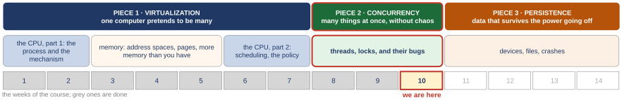

# Concurrency bugs and deadlock: the two common patterns, four ways to prevent a deadlock, and a server without threads

*Self-study guide · COMP3430 Operating Systems*

## Where this guide comes from {#source}

This guide follows *Operating Systems: Three Easy Pieces* (OSTEP) by Remzi H. Arpaci-Dusseau and Andrea C. Arpaci-Dusseau, which the authors publish free at [https://pages.cs.wisc.edu/~remzi/OSTEP](https://pages.cs.wisc.edu/~remzi/OSTEP/). The figures and examples credited to the textbook are theirs. The code the guide reads is from [xv6](https://github.com/mit-pdos/xv6-riscv), the teaching operating system from MIT, and its [xv6 book](https://mit-pdos.github.io/xv6-riscv-book/).

Read with this week:

- [OSTEP chapter 32. Common Concurrency Problems](https://pages.cs.wisc.edu/~remzi/OSTEP/threads-bugs.pdf)
- [OSTEP chapter 33. Event-based Concurrency (Advanced)](https://pages.cs.wisc.edu/~remzi/OSTEP/threads-events.pdf)
- [OSTEP chapter 34. Summary Dialogue on Concurrency](https://pages.cs.wisc.edu/~remzi/OSTEP/threads-dialogue.pdf)

## Part 0. Where we are, and what this week stands on {#part-0}

This part does four jobs before the new material starts. It shows where this week sits in the course. It gives you just enough of the C language and the shell to read the short programs the week is built on. It rebuilds the tools from the last two weeks that this week takes apart: the lock, the condition variable and the semaphore (a counter that threads can wait on). The condition variable and the semaphore come with the code they came from. The lock comes as its two calls, and [Section 2.4](class-1.md#sec-2-4) shows it in a whole program. And it shows the one program of last week that hung, because this week explains why it hung. Everything later uses these words without stopping, so if one is shaky, fix it here.

A few words first. The **operating system** (the **OS**) is the program that runs the computer and shares it between all the other programs; its core is called the **kernel**. A **program** is a file of instructions; a **process** is a program while it is running. The **CPU** (the processor) is the part of the computer that runs instructions, one after another. A modern chip holds several CPUs side by side; each one is called a **core**, and this guide uses "CPU" and "core" for the same thing. **Memory** is where a running program's data and instructions live. A **thread** is a point of execution inside a program: its own place in the code and its own **stack** (the memory where a function keeps its local variables), sharing the program's data with the other threads of that program. Two threads of one program can therefore read and write the same variable. **Linux** is one widely used operating system; macOS and Windows are two others. The textbook is OSTEP, *Operating Systems: Three Easy Pieces*; the guide names its chapters, sections and figures.

#### The course map

<figure markdown="1">
{width=100%}
<figcaption markdown="1">Figure 0.1. The three pieces of the course, the weeks behind us in grey, and this week marked "we are here": the last week of the second piece.</figcaption>
</figure>

An operating system has three big jobs, and the course takes them in order. The first is **virtualization**: one computer pretends to be many, so every program behaves as if it had its own CPU and its own memory. The second is **concurrency**: many things happening at once, without chaos. The third is **persistence**: data that survives the power going off. Figure 0.1 shows the first piece finished and the second piece in its third and last week.

Each step of the course so far answered the question the step before it left open. The words in rows 1 to 7 belong to those weeks and their guides. This week uses only three of them. The first is the process of row 1, defined in the word list above. The second is the timer of row 2, which can take the CPU away from a running program. The third is the scheduler (the part of the OS that picks which thread runs next). Rows 8 and 9 are the ones to have in mind.

1. **The process**: a running program with its own view of the machine. Left open: how does a program get the OS to do anything for it?
2. **Limited direct execution**: the program runs on the real CPU; a trap (a forced jump into the kernel), a system call (a request a program makes to the kernel) or the timer hands control back. The timer is a hardware clock that, at regular moments, forces such a jump, so the OS gets the CPU back even from a program that never asks for anything. Left open: how is memory shared without programs seeing each other?
3. **The address space**: a private memory numbered from 0, translated by base and bounds (two numbers that shift and limit every address). Left open: one block per program wastes its empty middle.
4. **Segments, then pages and a TLB**: memory cut first into a few pieces of different sizes, called segments, then into many pieces of one fixed size, called pages. Fixed-size pieces end the holes (the unused gaps that pieces of different sizes leave between them). The page table is the map from a program's addresses to real memory, and the TLB is a small fast copy of its recent translations. Left open: the page table is too big, and we assumed every page is in memory.
5. **A tree, and pages on disk**: the page table stores only the parts in use; a page fault (the trap taken when a page is not in memory) brings a page back. Left open: which process runs next, and for how long?
6. **Scheduling**: a scheduler that learns a job's type. Left open: a priority ranks jobs; it cannot promise anyone a share.
7. **A share, then many CPUs**: tickets and Linux's weights (two ways to give each job a share of the CPU); a queue per CPU, or one queue with a lock. Left open: two CPUs take the same job from one queue; what is the lock?
8. **Threads, the race, the lock**: a second point of execution in one program; a lock from one instruction the hardware will not split, plus a sleep queue. Left open: a lock guards one variable; and how does a thread wait for an event?
9. **Locks inside structures; waiting**: one lock per structure, split into several locks, one per part, when a measurement says one lock is too slow (last week's list became 101 short lists, each with its own lock; 101 is the textbook's choice, not a result); a condition variable, or a semaphore, to wait for an event. Left open: every tool is in hand, and a program using them still hung.
10. **This week: the bugs.** Which concurrency bugs real programs have. The two patterns behind most of them, and the tool that fixes each. Then deadlock, the kind of hang we met last week ("The hang", below), in which threads wait for each other forever: what it is exactly, and the four things that must all be true for it to happen. Which of the four to take away comes in the next class.

Row 9 left one thing open, and this week is about it: we own every tool, and one of our own programs still hung.

#### Reading the C in this guide

The week's programs are written in **C**, the language the kernel and most system programs are written in. You do not need to write C to follow the guide, but you need to read the symbols it uses. Each is explained again where it first appears, and [Appendix A](appendix.md#appendix-a) collects them all in one table. Here are the ones that appear on almost every page.

- Memory is a long row of numbered cells, one **byte** (8 binary digits) each, so an address counts bytes. An `int` is a whole number; `long` is a whole number with room for bigger values. `char` is one byte, usually one character of text.
- A **variable** is a named storage place. `int mtInit = 0;` makes a variable called `mtInit` that holds a whole number and starts at 0. The semicolon ends a statement. A **global variable** is declared outside every function, so every function and every thread of the program uses the same one.
- A **function** is a named piece of code. `void *thread1(void *arg) { ... }` defines a function called `thread1`; the curly braces hold its body. `return` is the line that ends the function and hands back its result. `void` alone as a result type means the function gives nothing back. `void *`, with the star, means something else: a pointer to anything at all. (A pointer holds the address of something in memory; the pointer bullet below explains it.) A thread's function always has the form `void *name(void *arg)`. It takes one input, `arg`, a pointer that can carry anything to the new thread, and it hands back one pointer of the same kind when it ends. The programs this week pass their threads no input and want nothing back, so `arg` goes unused and each thread function ends with `return NULL;`. `NULL` is the pointer that points at nothing; the pointer bullet below says more. `main` is the function where every C program starts; the listings often leave it out. It is written `int main(int argc, char *argv[])`. The **command line** is the line typed to start a program, such as `./pc 1`; the shell part below shows how such lines are read. `argc` is how many words were typed on it, the program's own name included, and `argv` holds the words themselves. The `*` and the `[]` in `char *argv[]` make it an array of pointers. An array is a numbered row of elements of one type; here the elements are addresses, one per word, each leading to a piece of text. The pointer and array bullets below explain both signs. The `int` in front says that `main` hands back a whole number. That number becomes the program's **exit status**, a number a program leaves behind when it ends (`return 0;` is a normal end, and the shell part below shows how to read it). Only `pc.c` uses them (the `1` in `./pc 1`, below); the other programs ignore them.
- A **struct** is a bundle of named fields kept together in memory. `struct thd_t { char *proc_info; };` declares a bundle type with one field, `proc_info`.
- A **pointer** is a variable that holds the address of something else in memory. `&x` means "the address of `x`". In a declaration, `char *p` means "`p` is a pointer to a character", which in practice means a pointer to a piece of text. Outside a declaration, a `*` in front of a pointer's name means the thing it points to: if `t` points to a bundle, `*t` is that bundle. `sizeof(*t)` is the size of that bundle in bytes, and `malloc(n)` hands out `n` bytes of memory. If `thd` is a pointer to such a bundle, `thd->proc_info` reads its field `proc_info`: the arrow `->` is "the field of the thing this pointer leads to". **NULL** is the pointer value that points at nothing. Following a NULL pointer, to read what it points at, crashes the program.
- `if (p) { ... }` runs the body only if `p` is not 0; for a pointer, that means only if `p` is not NULL. `while (c) { ... }` repeats as long as `c` is true. `for (int i = 0; i < 10; i++) { ... }` repeats the body 10 times: `i` starts at 0, the body runs while `i < 10`, and `i++` adds 1 to `i` after each pass. `for (;;)` has nothing between its semicolons, so it never stops: it is a loop with no end. `==` means "is equal to"; a single `=` stores a value. `!=` means "is not equal to", `<` "is less than", and `>=` "is at least".
- `x++` adds 1 to `x`. `seen[tmp]++` adds 1 to element number `tmp` of the **array** `seen`, a row of numbered elements of one type. In a declaration, `[]` after a name makes that name an array. `char text[] = "...";` is a row of characters that holds a text. `char *argv[]` is an array whose elements are of type `char *`, pointers to text: an array of pointers, one per word typed.
- `#define LOOPS 10000000` makes `LOOPS` a name for the number 10,000,000 in the program where the line appears (`atomicity_fixed.c`; each program sets its own `LOOPS`); the compiler (the program that turns C into machine code) replaces the name by the number.
- `printf("...")` prints text; `%d` in the text is replaced by the next whole number given, `%ld` by the next `long`, and `\n` ends the line.
- `//` starts a comment: the rest of the line is a note for people, ignored by the computer. `...` in a listing means lines left out.

#### Reading the shell lines in this guide

The guide prints **captures**: what was typed and what the programs printed, saved as text when the runs were made. Each one is kept in a file whose name ends in `.out`, such as `counter_nolock.out`. A `.out` file is a saved copy of a run's output, not a program. The captures show the commands that produced them, typed into the **shell**, the program that reads a command line and runs it. A few signs appear over and over:

- `$` at the start of a line is the shell's prompt: what follows is the command that was typed. Lines without `$` are the output.
- `./atomicity` runs the program `atomicity` from the current folder (`./` means "this folder").
- `a; b` runs `a`, then `b`. `echo` prints its words. `$?` is the exit status of the last program, the number it left behind when it ended (the C part above): 0 means it finished normally. So `./atomicity; echo $?` runs the program and then prints how it ended. Two other values matter this week: 124, and 139, which [Section 2.3](class-1.md#sec-2-3) explains.
- `timeout 5 ./pcsem_deadlock` runs the program and kills it if it is still running after 5 seconds; it then leaves exit status 124, its own code for "I had to stop it".
- A running program has two output channels: its normal output, called **stdout**, and an **error stream**, called **stderr**, meant for messages. Both go to the screen unless the command line sends them elsewhere. They differ in one way that [Section 3.2](class-1.md#sec-3-2) uses. Text a C program prints on stdout may be held back in memory for a while and written out later, several lines at once. Text it prints on stderr is written out at once. `> /dev/null` sends the normal output to `/dev/null`, a file that throws away everything written to it. `2> /dev/null` does the same for the error stream only.
- `/usr/bin/time -f 'real %e s' ./pc 1` runs `./pc 1` and then prints how many seconds it took.

[Appendix A](appendix.md#appendix-a) has a table of every shell command the guide uses.

#### The machine, and the units

Every capture this week comes from a Linux virtual machine. A **virtual machine**, or **VM**, is a computer simulated by software on another computer. Strictly, the name Linux belongs to the kernel; a packaged version of Linux adds the shell and the other programs around that kernel. This one runs Ubuntu 22.04, one such packaged version, and its kernel is Linux 6.8. So 22.04 is the version of the package, and 6.8 the version of the kernel. It runs on an ARM processor (the processor family in phones and in Apple's recent Macs) with 4 CPUs. This guide calls it the 4-CPU Linux VM. It is the same machine as last week's captures. The software that runs the VM runs its 4 CPUs on the real processor cores of the computer underneath (a **core** is one CPU inside a processor chip). That computer has more than 4 cores, so all 4 of the VM's CPUs can be running at the same moment, each on its own real core. That is why the 4 CPUs matter: up to four threads of one program can truly run at the same moment, one on each CPU. The programs were compiled with gcc, the C compiler, version 11.4.

Times are not used in the first class: the numbers that matter are counts (how many runs crashed) and exit statuses. The second class times a few runs, and says each time how far one run can be trusted. Some of last week's captures below print a time as well, because they were taken that way. Two of those times, 21.66 and 2.99 seconds, get a word where they appear; the others are only part of the captures as they were taken. One unit appears: a **microsecond** is a millionth of a second, so 100,000 microseconds is 100,000 / 1,000,000 = 0.1 s.

#### What the last two weeks built, and what this week uses

Four ideas come back on every page of this week. Each gets a few lines here, so you do not have to go back: the race with last week's capture, the lock with its two calls, and the condition variable and the semaphore with the code they came from. The listings use the C symbols of the primer above (`*`, `->`, `&`, `while`); go back to it if a symbol stops you.

**The race.** A **race condition** is a bug whose result depends on which thread runs when. Last week's counter kept its count in a bundle with one field, `value`, and its function `increment()` was given a pointer `c` to that bundle. Its one line, `c->value++`, adds 1 to the field `value` of the bundle `c` points to: a shared count. It looks like one step, but the CPU does it in three. It will **load** the number from memory into a **register** (one of a few dozen tiny storage cells inside the CPU), **add** 1 in the register, and **store** the register back to memory. If another thread loads the same number between this thread's load and its store, both store the same new value, and one add is lost. The lines that touch shared data are a **critical section**, and they need **mutual exclusion**: one thread inside at a time. Last week's counter without a lock showed the damage. Four threads each added 1 a million times, so the right total was 4 × 1,000,000 = 4,000,000. Three runs on the 4-CPU Linux VM (described above), from the capture `W09_demos/counter_nolock.out` (`W09_demos` is the folder of last week's programs and captures; `W10_demos` holds this week's):

```text
$ ./counter_nolock 4
4 threads  total 1071121  time 0.0035 s
$ ./counter_nolock 4
4 threads  total 1037269  time 0.0035 s
$ ./counter_nolock 4
4 threads  total 1067050  time 0.0034 s
```

The totals run from 1,037,269 to 1,071,121, a little over a quarter of 4,000,000 (a quarter is 1,000,000). Most of the adds were lost. The capture counts the adds that survived; it does not show how the others were lost. One reading fits the size of the loss. On 4 CPUs the four threads can run at the same moment. If all four load the same number, each adds 1 in its own register and stores it back, so the count goes up by 1 for four adds, and three of the four are lost. If that happened almost every time, about a quarter of the adds would survive, which is what the runs show. That is a reading of the numbers, not something the program measured.

**The lock.** A **lock** (also called a **mutex**, short for mutual exclusion lock) is the tool for one thread at a time. `pthread_mutex_lock(&m)` takes the lock `m`, and waits if another thread holds it; `pthread_mutex_unlock(&m)` gives it back, and lets the next waiter in. The **pthread** functions are the thread library of **POSIX**, the standard that Linux and macOS follow. A lock is built on one instruction that the hardware will not split. A Linux lock does not make its waiters **spin**, that is, run a loop that checks the lock again and again and keeps the CPU busy the whole time. A waiting thread sleeps inside the kernel, on a queue kept for the lock's address, until the holder unlocks. The Linux calls for that sleep and that wake-up are called the **futex** (fast userspace mutex). **User space** is everything outside the kernel, where ordinary programs run. The name says that a lock nobody is waiting for is taken and given back right there, with no call into the kernel; the kernel is called only when a thread has to sleep or be woken. You will see the word once more, in a listing of a hung program in [Chapter 3](class-1.md#chapter-3).

**The condition variable.** A lock lets a thread wait until nobody else is inside. Sometimes a thread must wait for something to happen instead, such as an item arriving in a buffer. A **buffer** is a row of places, called **slots**, where items wait after one thread makes them and before another thread uses them. The word "bounded" means that the buffer has a fixed number of slots, so it can be full, and then a thread with a new item must wait. A **condition variable** is a queue a thread can sleep in until another thread signals it. Last week's bounded buffer used one lock and two condition variables, one queue for each side: producers put items into a buffer, consumers take them out. Here is the consumer, from `W09_demos/pc.c`:

```c linenums="27" hl_lines="1 2"
pthread_cond_t empty = PTHREAD_COND_INITIALIZER, fill = PTHREAD_COND_INITIALIZER;
pthread_mutex_t mutex = PTHREAD_MUTEX_INITIALIZER;
```

```c linenums="44" hl_lines="3 4 5 7 8"
void *consumer(void *arg) {
    for (int i = 0; i < ITEMS; i++) {
        pthread_mutex_lock(&mutex);              // c1
        while (count == 0)                       // c2
            pthread_cond_wait(&fill, &mutex);    // c3
        int tmp = get();                         // c4
        pthread_cond_signal(&empty);             // c5
        pthread_mutex_unlock(&mutex);            // c6
        seen[tmp]++;   // each item is consumed by exactly one thread, so no lock needed
    }
    return NULL;
}
```

- Lines 27 and 28 make the tools this consumer uses: two condition variables and one lock. `pthread_cond_t` is the type of a condition variable; `empty` is the queue where producers sleep when the buffer is full, and `fill` is the queue where consumers sleep when it is empty. `PTHREAD_COND_INITIALIZER` starts a queue with nobody in it. `pthread_mutex_t` is the type of a lock; `PTHREAD_MUTEX_INITIALIZER` starts it free.
- Line 46 takes the lock. (`ITEMS` is the number of items each consumer takes, 500,000, and `count` is the number of items in the buffer right now.)
- Lines 47 and 48: while the buffer holds no item (`count == 0`), sleep on `fill`. `pthread_cond_wait()` is the call to sleep on a condition variable: `pthread_cond_wait(&fill, &mutex)` gives the lock back and falls asleep in one step. Here is what could go wrong if the check and the sleep were two separate steps with the lock free between them. (1) The consumer finds `count == 0` and decides to sleep. (2) Before it is asleep, a producer puts an item in and signals `fill`. Nobody is asleep on `fill` yet, so the signal wakes nobody and is gone. (3) The consumer now falls asleep, and no signal is left to wake it, although an item is waiting. That bug is called a **lost wake-up**. Holding the lock from the check until the one-step call rules it out, because the producer needs the lock to put the item in and signal. When the thread is woken, it takes the lock again before the call returns, and the `while` checks `count` once more. A **signal** only wakes a sleeper; it does not promise that the item is still there by the time the sleeper runs.
- Line 49 takes one item out with `get()`. Line 50 signals `empty`, waking one sleeping producer, because a slot is now free. Line 51 gives the lock back.
- Line 52, `seen[tmp]++`, adds 1 to element number `tmp` of `seen`, an array (a row of numbered counts, one per item), so the run can check at the end that no item was lost or taken twice.
- The comments `// c1` to `// c6` at the right are the textbook's names for these six lines. OSTEP labels each line of its buffer code that way, so that a run can be traced line by line. This guide uses the file's line numbers instead.

With two producers of 500,000 items each, so 2 × 500,000 = 1,000,000 items, and two consumers, the first two runs of `W09_demos/pc.out` printed this. The first run had a buffer of one slot, the second a buffer of ten:

```text
$ /usr/bin/time -f 'real %e s' ./pc 1
MAX 1: 1000000 items, 1000000 consumed exactly once
real 21.66 s
$ /usr/bin/time -f 'real %e s' ./pc 10
MAX 10: 1000000 items, 1000000 consumed exactly once
real 2.99 s
```

The `1` after `./pc` is the number of slots in the buffer. The program reads it from its command line (line 58 of `pc.c`, not shown) and keeps it in `MAX`, the variable for the number of slots; the output's first words, `MAX 1`, repeat it. In both runs every item was taken exactly once. The third line is the time the first run took, 21.66 seconds. This week does not use it; it is part of the capture as it was taken. It is long because of the one slot. The buffer holds at most one item, so producers and consumers must take turns for every one of the 1,000,000 items. The second run, with 10 slots (`./pc 10`), did the same work in 2.99 seconds (the capture's last line). Keep this tool in mind: one of the two fixes of [Chapter 2](class-1.md#chapter-2) is exactly this shape, a variable, a lock and a queue to sleep in.

**The semaphore.** A **semaphore** is one counter with two operations. `sem_wait()` takes one away from the count, and if the count is now below 0, the caller sleeps until another thread calls `sem_post()`, the other operation (below). So in the textbook's version the count can go below 0, and then it tells how many threads are asleep: −1 means one thread is waiting, −2 means two. This guide uses the textbook's version to read the code. Linux's own semaphore, the one the programs in this guide call, behaves the same way: it puts a thread to sleep and wakes it in the same cases. It keeps its numbers differently, though. Its count never goes below 0, and it keeps track of the sleepers apart, so a program that asked for the count while a thread waits would be told 0. So a −1 in this guide is the textbook's bookkeeping, a way to follow what the code does. None of the runs here prints a semaphore's count. `sem_post()` is the other side: it adds one, and if any thread is asleep, it wakes one of them. The start value picks the job. Started at 1, it is a lock, as in `W09_demos/sem_lock.c`:

```c linenums="11" hl_lines="3 5"
void *worker(void *arg) {
    for (int i = 0; i < LOOPS; i++) {
        sem_wait(&m);
        counter++;                      // critical section here
        sem_post(&m);
    }
    return NULL;
}
```

In this program `LOOPS` is 1,000,000, the adds per thread. (Each program sets its own `LOOPS`; in `atomicity_fixed.c`, [Section 2.4](class-1.md#sec-2-4), it is 10,000,000.) Line 21 of the same file, `sem_init(&m, 0, 1);`, starts `m` at 1 (the `0` says the semaphore is shared between threads, not processes). The first thread's `sem_wait()` takes the count from 1 to 0 and goes in; a second thread's `sem_wait()` would take it to −1 in the textbook's count (Linux's stays at 0), so that thread sleeps until the first one posts. Four threads of 1,000,000 adds each printed `4 threads  total 4000000` in all three runs of `sem_lock.out`, the right total, 4 × 1,000,000. Started at 0, a semaphore makes one thread wait for one event, as in `W09_demos/join_sem.c`:

```c linenums="11" hl_lines="3 8 13"
void *child(void *arg) {
    printf("child\n");
    sem_post(&s);                       // signal here: child is done
    return NULL;
}

int main(int argc, char *argv[]) {
    sem_init(&s, 0, 0);                 // X = 0
    printf("parent: begin\n");
    pthread_t c;
    pthread_create(&c, NULL, child, NULL);
    usleep(100000);                     // let the child run first
    sem_wait(&s);                       // wait here for child
    printf("parent: end\n");
    return 0;
}
```

Line 18 starts `s` at 0 (the comment's X is the book's name for a semaphore's start value). Lines 20 and 21 start the child: `pthread_t` is the type that names a thread, and `pthread_create(&c, NULL, child, NULL)` starts a new thread running the function `child()` and stores its name in `c` (the two `NULL`s ask for default settings and pass the new thread no input). If the parent's `sem_wait()` on line 23 came first, it would take the textbook's count to −1 (Linux's would stay at 0), and the parent would sleep until the child's `sem_post()` on line 13. Line 22, `usleep(100000)`, pauses the parent for 100,000 microseconds, a tenth of a second, before it waits. The file's opening comment says why the pause is there: so that the child posts before the parent waits. That is the order in which the semaphore has to remember something. The post takes the count to 1, and when the parent's wait comes, it takes the count back to 0 and goes on at once, without sleeping. A pause makes that order likely, but it does not force it, and nothing in the program checks which order happened. The capture cannot show it either. Both runs in `join_sem.out` print the same three lines, `parent: begin`, then `child`, then `parent: end`, and either order would print them. The semaphore gives the right result in both orders, and that, not the pause, is what makes the program correct.

**The hang.** Last week the buffer was also built with semaphores: `empty` counts the free slots, `full` counts the items, and a semaphore `mutex` started at 1 is the lock. The first place we put that lock made the program hang. The consumer of `W09_demos/pcsem_deadlock.c`:

```c linenums="41" hl_lines="3 4"
void *consumer(void *arg) {
    for (int i = 0; i < ITEMS; i++) {
        sem_wait(&mutex);            // Line C0 (NEW LINE)
        sem_wait(&full);             // Line C1
        int tmp = get();             // Line C2
        sem_post(&empty);            // Line C3
        sem_post(&mutex);            // Line C4 (NEW LINE)
```

The comments at the right are the textbook's labels for these lines (OSTEP Figure 31.11 names them C0 to C4). The words "NEW LINE" mark the two lines that the figure adds to the version before it: the lock on line 43 and the unlock on line 47. Line 43 takes the lock before anything else. Line 44 then waits for an item. The producer's loop in the same file has the same shape, with a free slot in place of an item:

```c linenums="31" hl_lines="2 3"
    for (int i = 0; i < ITEMS; i++) {
        sem_wait(&mutex);            // Line P0 (NEW LINE)
        sem_wait(&empty);            // Line P1
        put(base + i);               // Line P2
        sem_post(&full);             // Line P3
        sem_post(&mutex);            // Line P4 (NEW LINE)
```

Line 32 takes the lock, and line 33 waits for a free slot. Line 34 puts the item in: `put()` adds one number to the buffer, and `base + i` is this producer's next number. The labels P0 to P4 are the textbook's, like C0 to C4.

Which thread reaches the lock first matters. If a producer took it first, it would find a free slot, put its item in and let go, and the consumer would then find the item. The hang needs a consumer to take the lock while the buffer is empty. The program is written to make that likely. Its `main` starts the two consumers on line 58, pauses on line 59 (`usleep(100000);`, with the comment "let a consumer go first"), and starts the two producers on line 60. In the order this aims for, a consumer takes the lock on line 43, finds the buffer empty on line 44, and sleeps with the lock still in hand. A producer then arrives with its first item. Its line 32 asks for the lock, and the lock belongs to the sleeping consumer, so the producer sleeps too. The pause makes this order likely, not certain, and the capture below shows only that the run hung.

<figure markdown="1">
{width=70%}
<figcaption markdown="1">Figure 0.2. Who has what, and who waits for what, in the hung buffer. A solid arrow means "has": the consumer has the mutex, the producer has an item to put in. A dashed arrow means "waited for by": the mutex is waited for by the producer, the item is waited for by the consumer.</figcaption>
</figure>

Follow the arrows in Figure 0.2 and they go round in a circle: each thread waits for something the other one still has. The consumer has the mutex. The producer still has its item, not by choice, but because it is stuck at the mutex before it can put the item in. Neither can move, so neither will ever let go. A hang like this one, in which threads wait for each other forever, is called a **deadlock**. [Section 1.2](class-1.md#sec-1-2) gives the definition, and [Chapter 3](class-1.md#chapter-3) says exactly what a deadlock needs. The run was stopped by a guard after 5 seconds (`pcsem_deadlock.out`; `timeout 5` kills a program still running after 5 seconds, and exit status 124 is its sign that it had to; both are explained in the shell primer above):

```text
$ timeout 5 ./pcsem_deadlock; echo "exit status $?"
exit status 124
```

The fix was to take the mutex only after the wait on `full`, so that a consumer never sleeps holding it (`W09_demos/pcsem.c`, lines 41 to 45). The producer's lines moved the same way, and [Section 3.5](class-1.md#sec-3-5) shows both. Then every item was consumed exactly once. We moved one line on each side and it worked. We never said why a program hangs, or what has to be true for it to hang. [Chapter 3](class-1.md#chapter-3) answers both, and [Section 3.5](class-1.md#sec-3-5) says exactly what the move changed.

- Check this: say the three machine steps of `c->value++`, and where the other thread's load must land to lose an add. (Load, add, store; between this thread's load and its store.)
- Check this: say why the consumer checks `count` in a `while` and not once. (A signal only wakes it; by the time it runs, another consumer may have taken the item.)
- Check this: say what a semaphore started at 1 does, and one started at 0. (At 1, the first wait gets in and the second sleeps: a lock. At 0, the first wait sleeps until a post: a wait for one event.)
- Check this: say who holds what in the hung buffer. (The consumer has the mutex and waits for an item; the producer has an item and waits for the mutex.)
