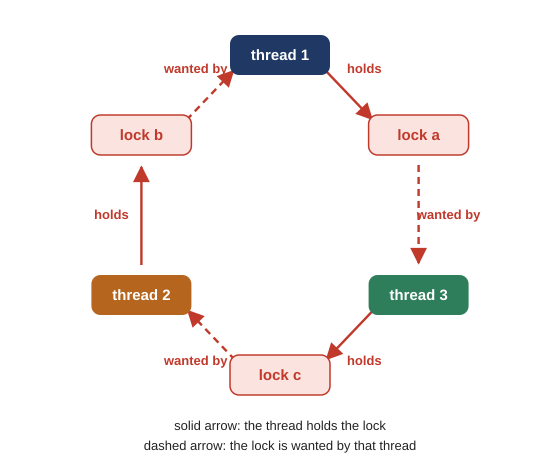
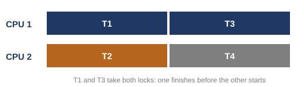

# Exercises and answers

## The first class in ten points {#the-week}

1. Every tool from the last two weeks works as promised, and our own programs still broke, because the bugs are in how the tools are used or left out. A tool can be used in only a few ways, so one would expect the bugs to come in a few patterns; that is an argument, and the study did not test it. Separately, the study sorted its 74 non-deadlock bugs by kind and found that two patterns cover 97% of them.
2. A study of four big open-source programs (MySQL, Apache, Mozilla, OpenOffice) counted the concurrency bugs that were found and fixed: 105 in all. 74 were not deadlocks, and 31 were deadlocks. A non-deadlock bug is any bug that is not a deadlock: the program may run on and be wrong, crash, or even stop with no circle of holds and wants. In a deadlock bug, threads wait for each other forever, in a circle.
3. The first common pattern is a stretch of code meant to run as one piece, left unprotected, so that another thread's access lands inside it: an atomicity violation. In the MySQL example it is a check and a use of a shared pointer, with a gap where another thread's store can land.
4. The MySQL lines, made runnable with both threads looping, crashed in all three runs: the use read a NULL pointer, the OS sent SIGSEGV (signal 11), and the shell reported exit status 128 + 11 = 139.
5. One lock, taken by every thread around every line that touches the shared thing, makes the check and the use one piece again; three runs of 10,000,000 rounds each finished with no crash.
6. The second common pattern is one thread assuming another has already acted, with nothing enforcing the order: an order violation, here a new thread reading a handle before its creator has stored it.
7. As printed, the Mozilla lines never crashed in 1,000 runs, and with one short loop of other work before the store they crashed in 300 of 300; the logic did not change, only the timing, so a passing run is evidence, not proof, that a program is correct.
8. A flag, a lock and a condition variable make the reader wait until the writer has stored, set the flag and signaled, so the order is enforced rather than hoped for; with the slow store kept in, 200 runs had no crash, which is evidence for that argument; what makes the fix right is the argument from the code. The two patterns together cover 97% of the study's 74 non-deadlock bugs.
9. Two threads that take two locks in opposite orders can each hold the lock the other wants; one run hung in round 1 until `timeout` killed it with exit status 124. A second run, looked at with `ps`, showed all three threads asleep in the same futex call at 0.0% CPU. Reading the code, not the rows, says that the two workers wait for a mutex and `main` waits in `pthread_join()`.
10. Drawn as holds and wants, a deadlock is a cycle, and it needs four conditions at once (mutual exclusion, hold-and-wait, no preemption, circular wait), so a fix only has to make one of them fail. Last week's moved line did that for the buffer's ring: the thread that holds the mutex never waits now, so the one hold-and-wait link that closed the ring is gone. A producer still keeps its item while it waits for the mutex, but that wait always ends. The next class takes the conditions one at a time and tries a fix for each.

## The second class in ten points {#the-second}

1. A two-lock deadlock looks easy to avoid, since one fixed order fixes it, yet real programs keep deadlocking, for two reasons: parts of big systems need each other, and interfaces hide their locks.
2. `vector_add(dst, src)`, Java's `AddAll()` in C, locks its first argument and then its second, so the lock order is the argument order; two callers that pass the same two vectors in opposite orders take the same locks in opposite orders without writing a lock call.
3. That version hung in all 3 runs (exit status 124 from `timeout`); with thread 2's call changed to the same order, all 3 runs finished in under a second.
4. A deadlock needs all four conditions at once, so breaking any one prevents it; each break has a price.
5. Attempt 1 breaks circular wait with one fixed order, here the lower address first: going round a circle, someone would have to ask for an earlier lock while holding a later one, and nobody does. The price is a convention every programmer must follow. It is the one used in practice.
6. Attempt 2 breaks hold-and-wait by collecting every lock in one step guarded by a global `prevention` lock, so no two threads can each hold part of their locks. The price is knowing every lock in advance, which encapsulation hides, and running less at once.
7. Attempt 3 breaks no preemption from the inside: with trylock, a thread that finds its second lock busy gives its first lock back and starts over. It never hung in 5 runs, but thread 1 averaged half a restart per call or more (0.94 in the first run); in the worst case two threads can back off in step forever, which is livelock.
8. Attempt 4 breaks mutual exclusion: compare-and-swap updates a shared pointer only if it still holds the value the thread saw, so no lock is ever held. The price is retries and code that is hard to write; with no protection at all, the same insert lost about half of 400,000 nodes, and with compare-and-swap it lost none.
9. When prevention cannot be relied on, a system can avoid deadlock by scheduling, if it knows every task's locks in advance (embedded systems), or let deadlocks happen, find the circle and recover (databases such as PostgreSQL).
10. An event loop serves many clients with one thread: one handler at a time, so no locks are needed and the program picks its own order, as long as no handler ever blocks; one handler that slept 3 seconds made an unrelated client wait 2.60 seconds.

## Exercises {#exercises}
<!-- answers folded under their exercises -->

Try each one on paper before you look at the answers. The method each one needs is in the section named in brackets.

### Exercise 1 {#exercise-1}

Say which class each of our own two failures belongs to: the counter with no lock, and last week's buffer with the mutex taken before the wait. Say why, in one sentence each. ([Section 1.2](class-1.md#sec-1-2) and [Section 1.3](class-1.md#sec-1-3))

<details class="success answer" id="answer-1" markdown="1">
<summary>Answer 1 <span class="hint">click to show</span></summary>

The counter with no lock is a non-deadlock bug: the program ran to the end and printed a wrong total (1,037,269 to 1,071,121 instead of 4,000,000). The buffer with the mutex taken before the wait is a deadlock bug. The consumer slept holding the mutex and waiting for an item. The producer slept waiting for the mutex, with its item still in hand. So each waited for the other, and the program stopped until `timeout` killed it.

</details>

### Exercise 2 {#exercise-2}

Here are two pieces of code from two different programs. For each, name the pattern and the tool that fixes it. (a) Thread 1 runs `if (q->head != NULL) print(q->head->name);` while thread 2 runs `q->head = NULL;`. (b) `main` creates a worker thread and then sets `log = open_log();`; the worker's first line is `write_line(log, "started");`. These are made-up lines. `q` points to a queue, and its field `head` points to the queue's first entry, so `q->head->name` follows two arrows: first to that entry, then to its field `name`. `print()`, `open_log()` and `write_line()` are made-up functions that print a text, open a log file and write a line into it. ([Section 2.1](class-1.md#sec-2-1) to [Section 2.9](class-1.md#sec-2-9))

<details class="success answer" id="answer-2" markdown="1">
<summary>Answer 2 <span class="hint">click to show</span></summary>

An atomicity violation: a check (`q->head != NULL`) and a use (`q->head->name`) with a gap between them, where thread 2's store of NULL can land. Fix: one lock, taken by both threads around every line that touches `q->head`. (b) An order violation: the worker assumes `main` has already set `log`, and nothing enforces that order; if the worker runs first, it uses a `log` that is not set yet. Fix: make the worker wait for a flag that `main` sets after `open_log()`, with a lock and a condition variable, or with a semaphore started at 0 that `main` posts and the worker waits on. (a)

</details>

### Exercise 3 {#exercise-3}

Name the four conditions for deadlock, and for each one point at the line or lines of `deadlock.c` where it shows. ([Section 3.5](class-1.md#sec-3-5) and [Section 3.6](class-1.md#sec-3-6))

<details class="success answer" id="answer-3" markdown="1">
<summary>Answer 3 <span class="hint">click to show</span></summary>

Mutual exclusion: line 12 (and line 24), `pthread_mutex_lock(&L1)`, because only one thread can own L1. Hold-and-wait: line 14, `pthread_mutex_lock(&L2)`, where thread 1 waits for L2, if it is held, while L1 is still in hand (line 26 is the same for thread 2). No preemption: no line creates it; it is a property of the lock library, which has no call that takes a lock from its holder. In the program it shows in lines 16 and 17 (and 28 and 29), the only releases, where each holder unlocks by its own choice. Circular wait: the opposite order, L1 then L2 in thread 1 (lines 12 and 14) against L2 then L1 in thread 2 (lines 24 and 26), which lets the waits close into the ring of the walk, thread 1 → L2 → thread 2 → L1 → thread 1.

</details>

### Exercise 4 {#exercise-4}

In the programs of this class, what was the main difference between what caused the non-deadlock bugs and what caused the deadlock bugs? ([Section 1.1](class-1.md#sec-1-1), [Section 1.2](class-1.md#sec-1-2), [Section 2.11](class-1.md#sec-2-11) and [Section 3.7](class-1.md#sec-3-7))

<details class="success answer" id="answer-4" markdown="1">
<summary>Answer 4 <span class="hint">click to show</span></summary>

[Section 1.1](class-1.md#sec-1-1) already named the two kinds with our own programs: the counter used no tool, and the buffer used a tool in the wrong place. In the programs of this class, a non-deadlock bug came from not enough control: a check and a use with no lock around them, or a read with nothing that makes it wait for the store. A deadlock came from using the control wrong: every lock did its job, and the way they were used formed a circle. In `deadlock.c` it was the order the two locks were taken in; in last week's buffer, the mutex taken before the wait. In our examples the first kind let the program run on and be wrong, or crash; the second stopped it, with each thread waiting for something the next one had, in a circle. A non-deadlock bug can also stop a program, as [Exercise 11](#exercise-11) shows, but no thread there is stuck because another has something it wants ([Answer 11](#answer-11)). This is what our examples show, not a rule proved for every bug.

</details>

### Exercise 5 {#exercise-5}

What are the four conditions that must hold for deadlock to occur? Explain each in your own words, and say why a deadlock could not form without it. [Exercise 3](#exercise-3) asked where each condition shows in `deadlock.c`. This one asks why a deadlock needs it. ([Section 3.6](class-1.md#sec-3-6))

<details class="success answer" id="answer-5" markdown="1">
<summary>Answer 5 <span class="hint">click to show</span></summary>

A lock can belong to one thread at a time (mutual exclusion). Without it, a thread that wants a held lock would simply get it too, and its wait would end. A thread keeps the lock it has while it waits for another (hold-and-wait). Without it, a waiting thread would hold nothing the next one needs, so nobody would be stuck behind it. Nobody can take a held lock away; only the holder gives it back (no preemption). Without it, a waiter could take the lock it wants, and its wait would end. The waits form a circle: each thread waits for the next, and the last waits for the first (circular wait). Without it, there is no ring at all. All four held in `deadlock.c`; if any one is not met, a deadlock cannot form.

</details>

### Exercise 6 {#exercise-6}

Using the table of [Section 1.2](class-1.md#sec-1-2): what share of the study's 31 deadlock bugs came from Mozilla, and what share of MySQL's own 23 bugs were deadlocks? Give each as a fraction and as a rounded percent, and check each the other way, by multiplying back as [Section 1.2](class-1.md#sec-1-2) does. ([Section 1.2](class-1.md#sec-1-2) and [Appendix A](appendix.md#appendix-a))

<details class="success answer" id="answer-6" markdown="1">
<summary>Answer 6 <span class="hint">click to show</span></summary>

Mozilla had 16 of the 31 deadlock bugs: 16 / 31 = 0.516, about 52%. Check: 0.516 × 31 = 16.0. MySQL had 9 deadlock bugs among its 14 + 9 = 23: 9 / 23 = 0.391, about 39%. Check: 0.391 × 23 = 9.0. (So MySQL's share of deadlocks, 39%, was higher than the whole study's 30%.)

</details>

### Exercise 7 {#exercise-7}

A program is run as `./prog; echo $?`. What does it print last if the program was killed by signal number 6? If the last line is 137, which signal number killed it? And what does exit status 124 tell you after `timeout 5 ./prog; echo $?`? ([Section 2.3](class-1.md#sec-2-3) and [Section 3.3](class-1.md#sec-3-3))

<details class="success answer" id="answer-7" markdown="1">
<summary>Answer 7 <span class="hint">click to show</span></summary>

Killed by signal 6: the shell prints 128 + 6 = 134. Exit status 137, from a run that was killed by a signal: 137 − 128 = 9, so signal number 9 killed it. The rule applies here only because the question says the run was killed; a program can also end on its own with 137. Exit status 124 after `timeout 5`: the program was still running after 5 seconds and `timeout` had to kill it; the program itself never finished, which for a program that should end quickly suggests a hang such as a deadlock.

</details>

### Exercise 8 {#exercise-8}

The second run in `W10_demos/atomicity_fixed.out` is:

```text
$ ./atomicity_fixed > /dev/null; echo $?
10000000 rounds, pointer in use 4361073 times, no crash
0
```

In how many rounds did thread 1 find NULL, and what fraction of the rounds is that? Why is a NULL at the check not a crash? ([Section 2.5](class-1.md#sec-2-5))

<details class="success answer" id="answer-8" markdown="1">
<summary>Answer 8 <span class="hint">click to show</span></summary>

Thread 1 ran 10,000,000 rounds and used the pointer 4,361,073 times, so it found NULL in 10,000,000 − 4,361,073 = 5,638,927 rounds. As a fraction: 5,638,927 / 10,000,000 = 0.564, a little more than half. Check: 4,361,073 + 5,638,927 = 10,000,000. A NULL at the check is not a crash because the `if` then skips the use; the dangerous case is only a yes at the check followed by a NULL at the use, and the lock rules that out.

</details>

### Exercise 9 {#exercise-9}

A bank account holds 80 dollars, kept in one shared variable, `balance`. Two threads each run `if (balance >= 50) balance = balance - 50;` once, with no lock. Write a step table (as in [Section 2.1](class-1.md#sec-2-1)) in which both withdrawals happen and the account ends at −20. Name the pattern, and give the fix. ([Section 2.1](class-1.md#sec-2-1) to [Section 2.4](class-1.md#sec-2-4))

<details class="success answer" id="answer-9" markdown="1">
<summary>Answer 9 <span class="hint">click to show</span></summary>

One step table that ends at −20 (each thread's line is a check, then a load, a subtract and a store):

| step | thread 1 | thread 2 | `balance` |
|---|---|---|---|
| 1 | check: 80 ≥ 50, yes | | 80 |
| 2 | (switched out, or slower) | check: 80 ≥ 50, yes | 80 |
| 3 | `balance = 80 − 50`: store 30 | | 30 |
| 4 | | `balance = 30 − 50`: store −20 | −20 |

Thread 2's check saw 80, but by the time of its use the balance was 30. This is an atomicity violation: a check and a use that should be one piece, with another thread's store in the gap. Fix: one lock, taken by both threads around the check and the subtraction together; then the second thread's check sees 30, finds 30 < 50, and skips the withdrawal.

</details>

### Exercise 10 {#exercise-10}

Three threads and three locks. Thread A holds L1 and waits for L2. Thread B holds L2 and waits for L3. Thread C holds L3 and waits for L1. Write the walk of [Section 3.4](class-1.md#sec-3-4) as a line of arrows, as in [Section 3.6](class-1.md#sec-3-6), starting at thread A, and say whether this is a deadlock. Then say what changes if thread C holds L3 and waits for nothing. ([Section 3.4](class-1.md#sec-3-4))

<details class="success answer" id="answer-10" markdown="1">
<summary>Answer 10 <span class="hint">click to show</span></summary>

The walk from thread A: thread A → L2 → thread B → L3 → thread C → L1 → thread A. Read: A wants L2, held by B; B wants L3, held by C; C wants L1, held by A. The walk comes back to A, so there is a cycle, and it is a deadlock: all three wait forever. If C holds L3 and waits for nothing, the dashed arrow from L1 to C is gone. The walk from A: A wants L2, held by B; B wants L3, held by C; C waits for nobody. The walk ends at C, so there is no cycle: C runs and unlocks L3, then B gets L3, runs and unlocks L2, then A gets L2 and runs.

</details>

### Exercise 11 {#exercise-11}

A programmer simplifies `ordering_fixed.c`: thread 2 keeps the lock but drops the flag and the `while`, so its lines 16 to 19 become `lock; pthread_cond_wait(&mtCond, &mtLock); unlock`, and thread 1 keeps only `lock; pthread_cond_signal(&mtCond); unlock` after its store. Everything else stays, including the slow loop of line 28 before the store. The simplified lines, written out:

```text
thread 2:  pthread_mutex_lock(&mtLock);
           pthread_cond_wait(&mtCond, &mtLock);
           pthread_mutex_unlock(&mtLock);
           mState = mThread->State;
thread 1:  for (volatile int k = 0; k < 100000; k++) ;   // line 28, the slow loop, kept
           mThread = t;
           pthread_mutex_lock(&mtLock);
           pthread_cond_signal(&mtCond);
           pthread_mutex_unlock(&mtLock);
```

Write one order of steps in which thread 2 sleeps forever, and say what the flag would have changed. The order you write only has to be possible, not likely: a program that can hang in even one possible order has a bug, however rarely that order comes up. ([Section 2.9](class-1.md#sec-2-9))

<details class="success answer" id="answer-11" markdown="1">
<summary>Answer 11 <span class="hint">click to show</span></summary>

One order that hangs. It only has to be possible, and it is: nothing in the simplified program stops thread 1 from reaching its signal before thread 2 reaches its wait.

1. thread 1 stores `mThread`, takes the lock, signals and unlocks; nobody is asleep on `mtCond`, so the signal wakes nobody and is gone;
2. thread 2 takes the lock and calls `pthread_cond_wait()`, which gives the lock back and puts it to sleep;
3. nothing will ever signal `mtCond` again, so thread 2 sleeps forever.

This is the lost wake-up: a condition variable remembers nothing, so a signal sent before the sleeper is on the queue is lost. With the flag, thread 2 would have checked `mtInit` under the lock in step 2, found it at 1, and never slept. The program never ends. To see whether it is a deadlock, apply the test of [Section 1.2](class-1.md#sec-1-2) and [Section 3.4](class-1.md#sec-3-4), a circle of holds and wants. Thread 2 sleeps in `pthread_cond_wait()`, waiting for a signal that was already sent in step 1. Thread 1 holds nothing that thread 2 wants: it gave `mtLock` back in step 1, and the signal it sent is gone. So there is no circle of holds and wants, and the hang is not a deadlock. Counting the join gives only a looser circle of waiting. Thread 1 goes on to the `pthread_join()` at the end of `init()` (line 34 of `ordering_fixed.c`) and waits there for thread 2 to finish, while thread 2 waits for a signal from thread 1. But that wait is not what keeps thread 2 asleep: even outside the join, thread 1 would have no second signal to send. The cause is an order the program needed and did nothing to enforce (the wait before the signal, or a record that the signal came): an order violation, the pattern of [Section 2.6](class-1.md#sec-2-6), a non-deadlock bug. Which order happens is timing again. The exercise keeps the slow loop before the store, and with that loop the read came before the store in all 300 runs of `ordering_slow` ([Section 2.8](class-1.md#sec-2-8)). So here thread 2 would probably reach its wait first, and the simplified program would usually work. Without the slow loop, the store came first in all 1,000 runs of `ordering`, so the losing order would be the likely one. How likely the order is does not change the answer. The order is possible, so the simplified program has a bug, and a program that is right for one order only is the bug of [Section 2.8](class-1.md#sec-2-8) again.

</details>

### Exercise 12 {#exercise-12}

In your own words, explain to a friend why 1,000 passing runs of `ordering.c` did not show that the program was correct, and what makes `ordering_fixed.c` correct whatever the timing. ([Section 2.8](class-1.md#sec-2-8) to [Section 2.10](class-1.md#sec-2-10))

<details class="success answer" id="answer-12" markdown="1">
<summary>Answer 12 <span class="hint">click to show</span></summary>

One possible answer. Nothing in `ordering.c` says that the store must happen before the read; the program just hopes it does. Which one comes first depends on timing: how quickly the new thread starts on another CPU against how quickly the creating thread reaches its next line. On that machine, as printed, the store always won, so 1,000 runs passed; adding one short loop before the store, with no change to the logic, made the read win and every run crash. So the passing runs only showed that the timing had been kind. `ordering_fixed.c` does not depend on timing: the reader checks a flag under a lock and sleeps until the writer has stored, set the flag and signaled. If the reader is early, it waits; if it is late, it finds the flag already set. Either way the read comes after the store, and 200 runs with the slow store had no crash.

</details>

### Exercise 13 {#exercise-13}

A program has a function `copy_settings(dst, src)` that, like `vector_add()`, locks `dst` and then `src`. Thread 1 calls `copy_settings(&home, &work)` in a loop, and thread 2 calls `copy_settings(&work, &home)` in a loop. Can the locks inside be taken in opposite orders? What changes if thread 2 calls `copy_settings(&home, &work)` instead? ([Section 4.2](class-2.md#sec-4-2) and [Section 4.3](class-2.md#sec-4-3))

<details class="success answer" id="answer-13" markdown="1">
<summary>Answer 13 <span class="hint">click to show</span></summary>

Yes. Inside `copy_settings()`, thread 1 locks `home` first and then `work`, while thread 2 locks `work` first and then `home`: the same two locks in opposite orders, exactly as with `vector_add(&v1, &v2)` and `vector_add(&v2, &v1)` in [Section 4.2](class-2.md#sec-4-2). If each thread gets its first lock before the other asks for its second, each waits for the other, and the program hangs. If thread 2 calls `copy_settings(&home, &work)` instead, both threads lock `home` first. Nobody can hold `work` without first holding `home`, so whoever gets `home` also finds `work` free, so no circle can form; that is the variant of [Section 4.3](class-2.md#sec-4-3), which finished every run.

</details>

### Exercise 14 {#exercise-14}

For each of the four prevention attempts, name the condition it breaks, say in one line how it breaks it, and give its price. Then say which one is used in practice, and why. ([Section 5.2](class-2.md#sec-5-2) to [Section 5.7](class-2.md#sec-5-7))

<details class="success answer" id="answer-14" markdown="1">
<summary>Answer 14 <span class="hint">click to show</span></summary>

| attempt | condition broken | how | price |
|---|---|---|---|
| 1 | circular wait | every thread takes its locks in one fixed order (here: lower address first) | a convention every programmer must know and follow |
| 2 | hold-and-wait | all locks taken in one step, guarded by a global `prevention` lock | every lock must be known in advance; less runs at once |
| 3 | no preemption | trylock the second lock; if busy, give the first back and start over | retries, and possible livelock |
| 4 | mutual exclusion | no lock: update with one atomic instruction (compare-and-swap, retrying if it fails; or an atomic add) | retries and possible livelock with compare-and-swap; a weaker promise for the vector; code that is hard to write |

Lock ordering is the everyday choice for code that takes several locks. It changes only the order of the lock calls, and each of the others adds a cost of its own: knowing every lock first, retries, or a weaker promise (`vector_nolock` let another thread see a vector half added).

</details>

### Exercise 15 {#exercise-15}

What are the differences in attitudes of deadlock prevention, avoidance, and detect and recover? Then say which attitude fits each of these systems, and why: (a) an operating system kernel whose developers all follow one written lock order; (b) the controller of a washing machine, whose four tasks and their locks are fixed when it is built, written by teams that cannot agree on one lock order; (c) a shared database, where users' queries take locks in whatever order the queries need, nobody knows in advance which locks a query will take, deadlocks are rare, and a query can simply be run again. ([Section 6.1](class-2.md#sec-6-1) to [Section 6.4](class-2.md#sec-6-4))

<details class="success answer" id="answer-15" markdown="1">
<summary>Answer 15 <span class="hint">click to show</span></summary>

Prevention changes the code so that one of the four conditions can never hold, and so deadlock is impossible. Avoidance leaves the code alone; it uses advance knowledge of which locks every thread will take, and schedules the threads so that no circle can form. Detect and recover accepts that a deadlock may happen; it looks for the circle now and then, and, when it finds one, restarts the system or, in a database, aborts one transaction. Put by when each acts: prevention when the code is written, avoidance when threads are scheduled, detection after a deadlock has happened. The three systems, with the questions of [Section 6.4](class-2.md#sec-6-4): (a) prevention, because every piece of code can agree on one order, so the first question already says yes; this is the Linux kernel's choice. (b) Avoidance. The teams cannot agree on one lock order, so the first question says no. But the controller knows every task and every lock before it starts, so the second question says yes; this is the kind of system OSTEP names for avoidance. (c) Detect and recover, because the users' queries cannot be made to follow one order and nobody knows their locks in advance; a deadlock is rare, and aborting one query is cheap, as PostgreSQL does.

</details>

### Exercise 16 {#exercise-16}

Which of the four deadlock conditions does deadlock avoidance by scheduling attempt to remove? Why is this impractical (in a general-purpose system)? ([Section 6.2](class-2.md#sec-6-2))

<details class="success answer" id="answer-16" markdown="1">
<summary>Answer 16 <span class="hint">click to show</span></summary>

Circular wait. The threads that could form a circle are never allowed to overlap, so the circle never forms. It is impractical for two reasons. The scheduler must know in advance every task and every lock each task will take, which a general-purpose OS never knows. And it gives up concurrency: threads that could have run at the same time are made to wait, as T1, T2 and T3 do in Figure 6.2.

</details>

### Exercise 17 {#exercise-17}

Explain why an event loop needs no locks. Then use the numbers of [Extra 2](class-2.md#extra-2): if A's handler had slept 5 seconds instead of 3, at what time would B's reply have come, and how long would B have waited? ([Section 7.2](class-2.md#sec-7-2) and [Extra 2](class-2.md#extra-2))

<details class="success answer" id="answer-17" markdown="1">
<summary>Answer 17 <span class="hint">click to show</span></summary>

An event loop is one thread, and it runs one handler at a time, to its end. No other thread exists to run in the middle of a handler, so no two handlers ever touch the same data at the same moment, and there is nothing for a lock to protect. With a 5-second sleep: A sent its line at 01.07 (seconds after 20:05), so A's handler would finish at 01.07 + 5 = 06.07, and the loop would read B's line only then. B sent at 01.47, so B's reply would come at about 06.07, after 06.07 − 01.47 = 4.60 seconds of waiting. Check: 01.47 + 4.60 = 06.07.

</details>

### Exercise 18 {#exercise-18}

Three vectors `a`, `b` and `c`, and three threads. Thread 1 calls `vector_add(&a, &b)`, thread 2 `vector_add(&b, &c)`, and thread 3 `vector_add(&c, &a)`, each in a loop. (a) With the `vector_add()` of `vector_deadlock.c`, write which lock each thread takes first and second, and the walk of [Section 3.4](class-1.md#sec-3-4) for the moment when each thread holds its first lock. Is it a deadlock? (b) With the `vector_add()` of `vector_order.c`, and `a` lower in memory than `b`, and `b` lower than `c`, which lock does each thread take first? Can the circle still form? ([Section 4.2](class-2.md#sec-4-2) and [Section 5.2](class-2.md#sec-5-2))

<details class="success answer" id="answer-18" markdown="1">
<summary>Answer 18 <span class="hint">click to show</span></summary>

With `vector_deadlock.c`, each call locks its first argument and then its second. Thread 1 takes `a`, then `b`; thread 2 takes `b`, then `c`; thread 3 takes `c`, then `a`. Suppose each thread holds its first lock. The walk from thread 1, drawn in Figure R.1: thread 1 → lock `b` → thread 2 → lock `c` → thread 3 → lock `a` → thread 1. Read: thread 1 wants `b`, held by thread 2; thread 2 wants `c`, held by thread 3; thread 3 wants `a`, held by thread 1. The walk comes back to thread 1, so it is a circle, and a deadlock: three threads, as in [Exercise 10](#exercise-10), not two. (a)

<figure markdown="1">
{width=55%}
<figcaption markdown="1">Figure R.1. [Exercise 18](#exercise-18) (a): each thread holds its first lock (solid arrow) and waits for its second (dashed arrow); the arrows go all the way round, so it is a deadlock.</figcaption>
</figure>

(b) With `vector_order.c`, each call locks the lower of its two vectors first. Thread 1 takes `a`, then `b`. Thread 2 takes `b`, then `c`. Thread 3's arguments are `c` and `a`, and `a` is lower, so thread 3 takes `a` first, then `c`. Now no thread ever holds a later lock while asking for an earlier one. Try the worst moment: thread 1 holds `a` and wants `b`; thread 2 holds `b` and wants `c`; thread 3 wants `a`, so it holds nothing yet. The walk from thread 1 goes to thread 2, which wants `c`, and `c` is free, so the walk ends: thread 2 gets `c`, finishes, and unlocks. No circle can form.

</details>

### Exercise 19 {#exercise-19}

The third run in `W10_demos/vector_trylock.out` printed `retries: thread 1 548691, thread 2 280583`, with 1,000,000 calls per thread, and exit status 0. How many restarts per call did each thread make, on average? How many times did the two threads start over in all? Was this run in livelock? Say why. ([Section 5.5](class-2.md#sec-5-5))

<details class="success answer" id="answer-19" markdown="1">
<summary>Answer 19 <span class="hint">click to show</span></summary>

Thread 1 made 548,691 / 1,000,000 = 0.55 restarts per call on average, a little more than half a restart per call. Thread 2 made 280,583 / 1,000,000 = 0.28. (One call can restart several times, so these are averages, not shares of calls.) In all: 548,691 + 280,583 = 829,274 restarts. Check the other way: 829,274 − 280,583 = 548,691. It was not livelock. Livelock means no progress, and this run made progress: each thread finished all 1,000,000 of its calls, the run printed its one done line, and exited with status 0. The threads collided often, which cost time, but every collision ended with one of them getting both locks.

</details>

### Exercise 20 {#exercise-20}

Avoidance on 2 CPUs. T1 takes L1 and L2. T2 takes only L2. T3 takes L1 and L2. T4 takes no locks. Which pairs of threads must never overlap? Give one schedule, as in Figure 6.1, that cannot deadlock. ([Section 6.2](class-2.md#sec-6-2))

<details class="success answer" id="answer-20" markdown="1">
<summary>Answer 20 <span class="hint">click to show</span></summary>

T1 and T3 both take L1 and L2, so they must never overlap: one must run to the end before the other starts. T2 takes only L2, so it may overlap anyone: a thread holding one lock cannot complete a circle. T4 takes no locks. One schedule, drawn in Figure R.2: CPU 1 runs T1 and then T3; CPU 2 runs T2 and then T4. T1 and T3 never overlap, and T2 overlaps T1, which is safe. (Other schedules work too, as long as T1 and T3 never overlap.)

<figure markdown="1">
{width=48%}
<figcaption markdown="1">Figure R.2. [Exercise 20](#exercise-20): one schedule that cannot deadlock. T1 and T3, the two threads that take both locks, run one after the other; T2 and T4 run beside them. Box lengths are drawn equal.</figcaption>
</figure>

</details>

### Exercise 21 {#exercise-21}

In your own words, explain to a friend why lock ordering prevents deadlock, why it is the fix used in practice, and the one thing it cannot protect against. ([Section 5.2](class-2.md#sec-5-2), [Section 5.7](class-2.md#sec-5-7) and [Section 6.1](class-2.md#sec-6-1))

<details class="success answer" id="answer-21" markdown="1">
<summary>Answer 21 <span class="hint">click to show</span></summary>

One possible answer. A deadlock is a circle of threads, each waiting for a lock that the next one holds. If you go round such a circle you come back to where you started, so somewhere on it a thread must hold a lock that comes later in the order while it asks for one that comes earlier. If every thread takes its locks in one agreed order, nobody ever asks backward like that, so the circle can never close. It is the fix used in practice because it costs almost nothing: the rest of the code stays as it was, and it adds no lock, no retry and no new way to fail beyond the rule itself. What it cannot protect against is a programmer who does not follow the order: one routine that takes two locks the other way round brings the deadlock back, which is why systems like Linux write their lock orders down and check them with a tool.

</details>
