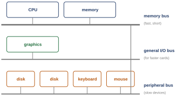
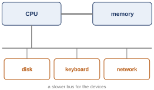
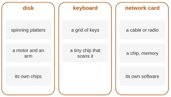
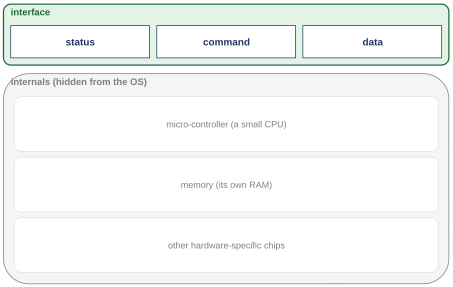
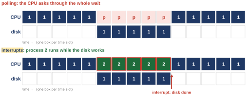
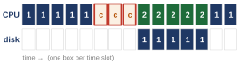
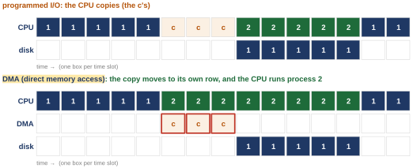
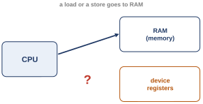
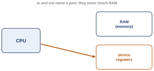
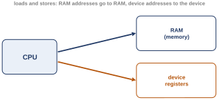

# First class: how the OS talks to a device, how the CPU keeps working meanwhile, and one driver per device (OSTEP 35 and 36) {#class-1}

<!-- classmap:start -->
<details class="abstract cmap-details" markdown="0" open>
<summary>Map of this class: the questions, and the steps of each</summary>
<div class="cmap-wrap">
<svg xmlns="http://www.w3.org/2000/svg" viewBox="0 0 796 2002" class="cmap" role="img" aria-label="Map of this class: each question, why we ask it, its steps, how we know, and what it settles; each box a link to its section">
<style>.cmap .cmap-link rect{transition:filter .15s} .cmap .cmap-link:hover rect{stroke-width:2.2;filter:drop-shadow(0 2px 4px rgba(0,0,0,.18))} .cmap .cmap-link:hover text{text-decoration:underline}</style>
<rect x="0" y="0" width="796" height="2002" fill="#ffffff"/>
<text x="10" y="20" font-family="Source Sans 3, Helvetica Neue, Arial, sans-serif" font-size="12" font-weight="700" letter-spacing=".05em" fill="#555e6b">WEEK 11 · MAP OF THIS CLASS</text>
<text x="10" y="36" font-family="Source Sans 3, Helvetica Neue, Arial, sans-serif" font-size="10.5" fill="#5b6675">Each question: why we ask it, the steps that answer it, how we know, and what it settles. Every box opens its section.</text>
<rect x="10" y="48" width="51" height="15" rx="3" fill="#b23a48"/>
<text x="16" y="59" font-family="Source Sans 3, Helvetica Neue, Arial, sans-serif" font-size="9.5" font-weight="600" fill="#fff">Problem</text>
<text x="66" y="59" font-family="Source Sans 3, Helvetica Neue, Arial, sans-serif" font-size="10" fill="#5b6675">why we ask: what breaks</text>
<rect x="192.9" y="48" width="51" height="15" rx="3" fill="#1f6f8b"/>
<text x="198.9" y="59" font-family="Source Sans 3, Helvetica Neue, Arial, sans-serif" font-size="9.5" font-weight="600" fill="#fff">Concept</text>
<text x="249" y="59" font-family="Source Sans 3, Helvetica Neue, Arial, sans-serif" font-size="10" fill="#5b6675">the idea, one step at a time</text>
<rect x="400.3" y="48" width="90" height="15" rx="3" fill="#5b7a2a"/>
<text x="406.3" y="59" font-family="Source Sans 3, Helvetica Neue, Arial, sans-serif" font-size="9.5" font-weight="600" fill="#fff">Worked example</text>
<text x="496" y="59" font-family="Source Sans 3, Helvetica Neue, Arial, sans-serif" font-size="10" fill="#5b6675">traced by hand</text>
<rect x="10" y="68" width="79" height="15" rx="3" fill="#a0632a"/>
<text x="16" y="79" font-family="Source Sans 3, Helvetica Neue, Arial, sans-serif" font-size="9.5" font-weight="600" fill="#fff">Real machine</text>
<text x="94" y="79" font-family="Source Sans 3, Helvetica Neue, Arial, sans-serif" font-size="10" fill="#5b6675">measured on a real computer</text>
<rect x="240.5" y="68" width="74" height="15" rx="3" fill="#6b4fa0"/>
<text x="246.5" y="79" font-family="Source Sans 3, Helvetica Neue, Arial, sans-serif" font-size="9.5" font-weight="600" fill="#fff">Real kernel</text>
<text x="319" y="79" font-family="Source Sans 3, Helvetica Neue, Arial, sans-serif" font-size="10" fill="#5b6675">read in xv6 or Linux</text>
<rect x="431.1" y="68" width="90" height="15" rx="3" fill="#2a7a6b"/>
<text x="437.1" y="79" font-family="Source Sans 3, Helvetica Neue, Arial, sans-serif" font-size="9.5" font-weight="600" fill="#fff">Check yourself</text>
<text x="526" y="79" font-family="Source Sans 3, Helvetica Neue, Arial, sans-serif" font-size="10" fill="#5b6675">what is settled, what is open</text>
<rect x="10" y="88" width="46" height="15" rx="3" fill="#7a7a7a"/>
<text x="16" y="99" font-family="Source Sans 3, Helvetica Neue, Arial, sans-serif" font-size="9.5" font-weight="600" fill="#fff">Deeper</text>
<text x="61" y="99" font-family="Source Sans 3, Helvetica Neue, Arial, sans-serif" font-size="10" fill="#5b6675">optional</text>
<a href="#opening-1" class="cmap-link"><title>Where we left off: a new piece, devices, and data that outlives the power</title><rect x="10" y="122" width="206" height="61" rx="6" fill="#f3f4f6" stroke="#9aa3b2" stroke-width="1.1"/><text x="20" y="138" font-family="Source Sans 3, Helvetica Neue, Arial, sans-serif" font-size="11.5" font-style="italic" fill="#3a4350">Where we left off: a new piece,</text><text x="20" y="153" font-family="Source Sans 3, Helvetica Neue, Arial, sans-serif" font-size="11.5" font-style="italic" fill="#3a4350">devices, and data that outlives</text><text x="20" y="168" font-family="Source Sans 3, Helvetica Neue, Arial, sans-serif" font-size="11.5" font-style="italic" fill="#3a4350">the power</text></a>
<a href="#sec-1-1" class="cmap-link"><title>1.1 Problem: Every device is different, and the OS must drive them all</title><rect x="384" y="205" width="400" height="42" rx="6" fill="#ffffff" stroke="#b23a48" stroke-width="1.1"/><rect x="390" y="211" width="51" height="15" rx="3" fill="#b23a48"/><text x="396" y="221.5" font-family="Source Sans 3, Helvetica Neue, Arial, sans-serif" font-size="9.5" font-weight="600" fill="#fff">Problem</text><text x="448" y="223" font-family="Source Sans 3, Helvetica Neue, Arial, sans-serif" font-size="11.5" fill="#1b2430">1.1 Every device is different, and the OS must drive</text><text x="448" y="238" font-family="Source Sans 3, Helvetica Neue, Arial, sans-serif" font-size="11.5" fill="#1b2430">them all</text></a>
<path d="M352,226 C368,226 368,226 384,226" fill="none" stroke="#b23a48" stroke-width="1.4"/>
<rect x="248" y="213" width="104" height="26" rx="13" fill="#ffffff" stroke="#b23a48" stroke-width="1.5"/>
<text x="300.0" y="230" text-anchor="middle" font-family="Source Sans 3, Helvetica Neue, Arial, sans-serif" font-size="11.5" font-weight="700" fill="#b23a48">Why we ask</text>
<a href="#sec-1-2" class="cmap-link"><title>1.2 Concept: Every device shows a few registers and hides the rest</title><rect x="384" y="259" width="400" height="42" rx="6" fill="#ffffff" stroke="#1f6f8b" stroke-width="1.1"/><rect x="390" y="265" width="51" height="15" rx="3" fill="#1f6f8b"/><text x="396" y="275.5" font-family="Source Sans 3, Helvetica Neue, Arial, sans-serif" font-size="9.5" font-weight="600" fill="#fff">Concept</text><text x="448" y="277" font-family="Source Sans 3, Helvetica Neue, Arial, sans-serif" font-size="11.5" fill="#1b2430">1.2 Every device shows a few registers and hides the</text><text x="448" y="292" font-family="Source Sans 3, Helvetica Neue, Arial, sans-serif" font-size="11.5" fill="#1b2430">rest</text></a>
<a href="#sec-1-3" class="cmap-link"><title>1.3 Concept: The protocol: wait, hand over the data, give the command, wait again</title><rect x="384" y="305" width="400" height="42" rx="6" fill="#ffffff" stroke="#1f6f8b" stroke-width="1.1"/><rect x="390" y="311" width="51" height="15" rx="3" fill="#1f6f8b"/><text x="396" y="321.5" font-family="Source Sans 3, Helvetica Neue, Arial, sans-serif" font-size="9.5" font-weight="600" fill="#fff">Concept</text><text x="448" y="323" font-family="Source Sans 3, Helvetica Neue, Arial, sans-serif" font-size="11.5" fill="#1b2430">1.3 The protocol: wait, hand over the data, give the</text><text x="448" y="338" font-family="Source Sans 3, Helvetica Neue, Arial, sans-serif" font-size="11.5" fill="#1b2430">command, wait again</text></a>
<path d="M352,303 C368,303 368,280 384,280" fill="none" stroke="#1f6f8b" stroke-width="1.4"/>
<path d="M352,303 C368,303 368,326 384,326" fill="none" stroke="#1f6f8b" stroke-width="1.4"/>
<rect x="248" y="290" width="104" height="26" rx="13" fill="#ffffff" stroke="#1f6f8b" stroke-width="1.5"/>
<text x="300.0" y="307" text-anchor="middle" font-family="Source Sans 3, Helvetica Neue, Arial, sans-serif" font-size="11.5" font-weight="700" fill="#1f6f8b">The steps</text>
<a href="#sec-1-4" class="cmap-link"><title>1.4 Real machine: xv6 prints a character this way: uartputc_sync()</title><rect x="384" y="359" width="400" height="42" rx="6" fill="#ffffff" stroke="#a0632a" stroke-width="1.1"/><rect x="390" y="365" width="79" height="15" rx="3" fill="#a0632a"/><text x="396" y="375.5" font-family="Source Sans 3, Helvetica Neue, Arial, sans-serif" font-size="9.5" font-weight="600" fill="#fff">Real machine</text><text x="476" y="377" font-family="Source Sans 3, Helvetica Neue, Arial, sans-serif" font-size="11.5" fill="#1b2430">1.4 xv6 prints a character this way:</text><text x="476" y="392" font-family="Source Sans 3, Helvetica Neue, Arial, sans-serif" font-size="11.5" fill="#1b2430">uartputc_sync()</text></a>
<a href="#sec-1-5" class="cmap-link"><title>1.5 Real machine: One character, step by step: ask, ask again, write</title><rect x="384" y="405" width="400" height="42" rx="6" fill="#ffffff" stroke="#a0632a" stroke-width="1.1"/><rect x="390" y="411" width="79" height="15" rx="3" fill="#a0632a"/><text x="396" y="421.5" font-family="Source Sans 3, Helvetica Neue, Arial, sans-serif" font-size="9.5" font-weight="600" fill="#fff">Real machine</text><text x="476" y="423" font-family="Source Sans 3, Helvetica Neue, Arial, sans-serif" font-size="11.5" fill="#1b2430">1.5 One character, step by step: ask, ask again,</text><text x="476" y="438" font-family="Source Sans 3, Helvetica Neue, Arial, sans-serif" font-size="11.5" fill="#1b2430">write</text></a>
<path d="M352,403 C368,403 368,380 384,380" fill="none" stroke="#a0632a" stroke-width="1.4"/>
<path d="M352,403 C368,403 368,426 384,426" fill="none" stroke="#a0632a" stroke-width="1.4"/>
<rect x="248" y="390" width="104" height="26" rx="13" fill="#ffffff" stroke="#a0632a" stroke-width="1.5"/>
<text x="300.0" y="407" text-anchor="middle" font-family="Source Sans 3, Helvetica Neue, Arial, sans-serif" font-size="11.5" font-weight="700" fill="#a0632a">How we know</text>
<a href="#sec-1-6" class="cmap-link"><title>1.6 Check yourself: What the first question settled</title><rect x="384" y="459" width="400" height="27" rx="6" fill="#ffffff" stroke="#2a7a6b" stroke-width="1.1"/><rect x="390" y="465" width="90" height="15" rx="3" fill="#2a7a6b"/><text x="396" y="475.5" font-family="Source Sans 3, Helvetica Neue, Arial, sans-serif" font-size="9.5" font-weight="600" fill="#fff">Check yourself</text><text x="487" y="477" font-family="Source Sans 3, Helvetica Neue, Arial, sans-serif" font-size="11.5" fill="#1b2430">1.6 What the first question settled</text></a>
<a href="#summary-1" class="cmap-link"><title>The answer</title><rect x="384" y="490" width="400" height="106" rx="6" fill="#eef7f4" stroke="#2a7a6b" stroke-width="1.1"/><text x="394" y="506" font-family="Source Sans 3, Helvetica Neue, Arial, sans-serif" font-size="11.5" fill="#1b2430">The answer: Every device shows the OS a few registers, in the</text><text x="394" y="521" font-family="Source Sans 3, Helvetica Neue, Arial, sans-serif" font-size="11.5" fill="#1b2430">textbook&#x27;s example status, command and data. The OS polls the</text><text x="394" y="536" font-family="Source Sans 3, Helvetica Neue, Arial, sans-serif" font-size="11.5" fill="#1b2430">status, writes the data, writes the command, and polls again;</text><text x="394" y="551" font-family="Source Sans 3, Helvetica Neue, Arial, sans-serif" font-size="11.5" fill="#1b2430">uartputc_sync() in xv6 polls the UART&#x27;s LSR (lines 118 and 119)</text><text x="394" y="566" font-family="Source Sans 3, Helvetica Neue, Arial, sans-serif" font-size="11.5" fill="#1b2430">and writes THR (line 120). Problem solved: one way of talking for</text><text x="394" y="581" font-family="Source Sans 3, Helvetica Neue, Arial, sans-serif" font-size="11.5" fill="#1b2430">every device. …</text></a>
<path d="M352,528 C368,528 368,472 384,472" fill="none" stroke="#2a7a6b" stroke-width="1.4"/>
<path d="M352,528 C368,528 368,543 384,543" fill="none" stroke="#2a7a6b" stroke-width="1.4"/>
<rect x="248" y="514" width="104" height="26" rx="13" fill="#ffffff" stroke="#2a7a6b" stroke-width="1.5"/>
<text x="300.0" y="532" text-anchor="middle" font-family="Source Sans 3, Helvetica Neue, Arial, sans-serif" font-size="11.5" font-weight="700" fill="#2a7a6b">What it settles</text>
<a href="#extra-1" class="cmap-link"><title>Extra 1 Deeper, Q1: The UART&#x27;s status register from outside: 0x60, ready</title><rect x="384" y="608" width="400" height="42" rx="6" fill="#fafafa" stroke="#7a7a7a" stroke-width="1.1" stroke-dasharray="4 3"/><rect x="390" y="614" width="68" height="15" rx="3" fill="#7a7a7a"/><text x="396" y="624.5" font-family="Source Sans 3, Helvetica Neue, Arial, sans-serif" font-size="9.5" font-weight="600" fill="#fff">Deeper, Q1</text><text x="465" y="626" font-family="Source Sans 3, Helvetica Neue, Arial, sans-serif" font-size="11.5" fill="#5b6675">Extra 1 The UART&#x27;s status register from outside:</text><text x="465" y="641" font-family="Source Sans 3, Helvetica Neue, Arial, sans-serif" font-size="11.5" fill="#5b6675">0x60, ready</text></a>
<a href="#extra-7" class="cmap-link"><title>Extra 7 Deeper, Q1: A modern PC: an I/O chip in the middle</title><rect x="384" y="654" width="400" height="27" rx="6" fill="#fafafa" stroke="#7a7a7a" stroke-width="1.1" stroke-dasharray="4 3"/><rect x="390" y="660" width="68" height="15" rx="3" fill="#7a7a7a"/><text x="396" y="670.5" font-family="Source Sans 3, Helvetica Neue, Arial, sans-serif" font-size="9.5" font-weight="600" fill="#fff">Deeper, Q1</text><text x="465" y="672" font-family="Source Sans 3, Helvetica Neue, Arial, sans-serif" font-size="11.5" fill="#5b6675">Extra 7 A modern PC: an I/O chip in the middle</text></a>
<path d="M352,644 C368,644 368,629 384,629" fill="none" stroke="#7a7a7a" stroke-width="1.4" stroke-dasharray="4 3"/>
<path d="M352,644 C368,644 368,668 384,668" fill="none" stroke="#7a7a7a" stroke-width="1.4" stroke-dasharray="4 3"/>
<rect x="248" y="632" width="104" height="26" rx="13" fill="#ffffff" stroke="#7a7a7a" stroke-width="1.5" stroke-dasharray="4 3"/>
<text x="300.0" y="648" text-anchor="middle" font-family="Source Sans 3, Helvetica Neue, Arial, sans-serif" font-size="11.5" font-weight="700" fill="#7a7a7a">Going deeper</text>
<path d="M216,445 C232,445 232,226 248,226" fill="none" stroke="#555e6b" stroke-width="1.4"/>
<path d="M216,445 C232,445 232,303 248,303" fill="none" stroke="#555e6b" stroke-width="1.4"/>
<path d="M216,445 C232,445 232,403 248,403" fill="none" stroke="#555e6b" stroke-width="1.4"/>
<path d="M216,445 C232,445 232,528 248,528" fill="none" stroke="#555e6b" stroke-width="1.4"/>
<path d="M216,445 C232,445 232,644 248,644" fill="none" stroke="#555e6b" stroke-width="1.4" stroke-dasharray="4 3"/>
<a href="#chapter-1" class="cmap-link"><title>Q1. How does the OS tell a device what to do, and what does the simple way cost?</title><rect x="10" y="403" width="206" height="84" rx="8" fill="#ffffff" stroke="#555e6b" stroke-width="1.9"/><circle cx="28" cy="423" r="11" fill="#555e6b"/><text x="28" y="427" text-anchor="middle" font-family="Source Sans 3, Helvetica Neue, Arial, sans-serif" font-size="11" font-weight="700" fill="#fff">Q1</text><text x="48" y="427" font-family="Source Sans 3, Helvetica Neue, Arial, sans-serif" font-size="12.5" font-weight="600" fill="#1b2430">How does the OS tell a</text><text x="48" y="443" font-family="Source Sans 3, Helvetica Neue, Arial, sans-serif" font-size="12.5" font-weight="600" fill="#1b2430">device what to do, and</text><text x="48" y="459" font-family="Source Sans 3, Helvetica Neue, Arial, sans-serif" font-size="12.5" font-weight="600" fill="#1b2430">what does the simple way</text><text x="48" y="475" font-family="Source Sans 3, Helvetica Neue, Arial, sans-serif" font-size="12.5" font-weight="600" fill="#1b2430">cost?</text></a>
<text x="113.0" y="703" text-anchor="middle" font-family="Source Sans 3, Helvetica Neue, Arial, sans-serif" font-size="10" font-style="italic" fill="#6b7482">↓ what is left open leads to the next question</text>
<a href="#sec-2-1" class="cmap-link"><title>2.1 Problem: While the CPU polls a slow disk, nothing else runs</title><rect x="384" y="715" width="400" height="27" rx="6" fill="#ffffff" stroke="#b23a48" stroke-width="1.1"/><rect x="390" y="721" width="51" height="15" rx="3" fill="#b23a48"/><text x="396" y="731.5" font-family="Source Sans 3, Helvetica Neue, Arial, sans-serif" font-size="9.5" font-weight="600" fill="#fff">Problem</text><text x="448" y="733" font-family="Source Sans 3, Helvetica Neue, Arial, sans-serif" font-size="11.5" fill="#1b2430">2.1 While the CPU polls a slow disk, nothing else runs</text></a>
<a href="#sec-2-7" class="cmap-link"><title>2.7 Problem: Copying a block word by word keeps the CPU busy again</title><rect x="384" y="746" width="400" height="42" rx="6" fill="#ffffff" stroke="#b23a48" stroke-width="1.1"/><rect x="390" y="752" width="51" height="15" rx="3" fill="#b23a48"/><text x="396" y="762.5" font-family="Source Sans 3, Helvetica Neue, Arial, sans-serif" font-size="9.5" font-weight="600" fill="#fff">Problem</text><text x="448" y="764" font-family="Source Sans 3, Helvetica Neue, Arial, sans-serif" font-size="11.5" fill="#1b2430">2.7 Copying a block word by word keeps the CPU busy</text><text x="448" y="779" font-family="Source Sans 3, Helvetica Neue, Arial, sans-serif" font-size="11.5" fill="#1b2430">again</text></a>
<path d="M352,752 C368,752 368,728 384,728" fill="none" stroke="#b23a48" stroke-width="1.4"/>
<path d="M352,752 C368,752 368,767 384,767" fill="none" stroke="#b23a48" stroke-width="1.4"/>
<rect x="248" y="738" width="104" height="26" rx="13" fill="#ffffff" stroke="#b23a48" stroke-width="1.5"/>
<text x="300.0" y="756" text-anchor="middle" font-family="Source Sans 3, Helvetica Neue, Arial, sans-serif" font-size="11.5" font-weight="700" fill="#b23a48">Why we ask</text>
<a href="#sec-2-2" class="cmap-link"><title>2.2 Concept: Sleep, run another process, and let the device interrupt</title><rect x="384" y="800" width="400" height="42" rx="6" fill="#ffffff" stroke="#1f6f8b" stroke-width="1.1"/><rect x="390" y="806" width="51" height="15" rx="3" fill="#1f6f8b"/><text x="396" y="816.5" font-family="Source Sans 3, Helvetica Neue, Arial, sans-serif" font-size="9.5" font-weight="600" fill="#fff">Concept</text><text x="448" y="818" font-family="Source Sans 3, Helvetica Neue, Arial, sans-serif" font-size="11.5" fill="#1b2430">2.2 Sleep, run another process, and let the device</text><text x="448" y="833" font-family="Source Sans 3, Helvetica Neue, Arial, sans-serif" font-size="11.5" fill="#1b2430">interrupt</text></a>
<a href="#sec-2-8" class="cmap-link"><title>2.8 Concept: DMA: say where the data is; a helper copies it</title><rect x="384" y="846" width="400" height="27" rx="6" fill="#ffffff" stroke="#1f6f8b" stroke-width="1.1"/><rect x="390" y="852" width="51" height="15" rx="3" fill="#1f6f8b"/><text x="396" y="862.5" font-family="Source Sans 3, Helvetica Neue, Arial, sans-serif" font-size="9.5" font-weight="600" fill="#fff">Concept</text><text x="448" y="864" font-family="Source Sans 3, Helvetica Neue, Arial, sans-serif" font-size="11.5" fill="#1b2430">2.8 DMA: say where the data is; a helper copies it</text></a>
<path d="M352,836 C368,836 368,821 384,821" fill="none" stroke="#1f6f8b" stroke-width="1.4"/>
<path d="M352,836 C368,836 368,860 384,860" fill="none" stroke="#1f6f8b" stroke-width="1.4"/>
<rect x="248" y="824" width="104" height="26" rx="13" fill="#ffffff" stroke="#1f6f8b" stroke-width="1.5"/>
<text x="300.0" y="840" text-anchor="middle" font-family="Source Sans 3, Helvetica Neue, Arial, sans-serif" font-size="11.5" font-weight="700" fill="#1f6f8b">The steps</text>
<a href="#sec-2-3" class="cmap-link"><title>2.3 Real machine: Request side: virtio_disk_rw() tells the disk, then sleeps</title><rect x="384" y="885" width="400" height="42" rx="6" fill="#ffffff" stroke="#a0632a" stroke-width="1.1"/><rect x="390" y="891" width="79" height="15" rx="3" fill="#a0632a"/><text x="396" y="901.5" font-family="Source Sans 3, Helvetica Neue, Arial, sans-serif" font-size="9.5" font-weight="600" fill="#fff">Real machine</text><text x="476" y="903" font-family="Source Sans 3, Helvetica Neue, Arial, sans-serif" font-size="11.5" fill="#1b2430">2.3 Request side: virtio_disk_rw() tells the disk,</text><text x="476" y="918" font-family="Source Sans 3, Helvetica Neue, Arial, sans-serif" font-size="11.5" fill="#1b2430">then sleeps</text></a>
<a href="#sec-2-4" class="cmap-link"><title>2.4 Real machine: Interrupt side: the handler marks the request done and wakes the sleeper</title><rect x="384" y="931" width="400" height="42" rx="6" fill="#ffffff" stroke="#a0632a" stroke-width="1.1"/><rect x="390" y="937" width="79" height="15" rx="3" fill="#a0632a"/><text x="396" y="947.5" font-family="Source Sans 3, Helvetica Neue, Arial, sans-serif" font-size="9.5" font-weight="600" fill="#fff">Real machine</text><text x="476" y="949" font-family="Source Sans 3, Helvetica Neue, Arial, sans-serif" font-size="11.5" fill="#1b2430">2.4 Interrupt side: the handler marks the request</text><text x="476" y="964" font-family="Source Sans 3, Helvetica Neue, Arial, sans-serif" font-size="11.5" fill="#1b2430">done and wakes the sleeper</text></a>
<a href="#sec-2-5" class="cmap-link"><title>2.5 Real machine: One disk read, step by step</title><rect x="384" y="977" width="400" height="27" rx="6" fill="#ffffff" stroke="#a0632a" stroke-width="1.1"/><rect x="390" y="983" width="79" height="15" rx="3" fill="#a0632a"/><text x="396" y="993.5" font-family="Source Sans 3, Helvetica Neue, Arial, sans-serif" font-size="9.5" font-weight="600" fill="#fff">Real machine</text><text x="476" y="995" font-family="Source Sans 3, Helvetica Neue, Arial, sans-serif" font-size="11.5" fill="#1b2430">2.5 One disk read, step by step</text></a>
<a href="#sec-2-6" class="cmap-link"><title>2.6 Real machine: Measured: 100 blocks read, 106 sleeps, 106 interrupts</title><rect x="384" y="1008" width="400" height="42" rx="6" fill="#ffffff" stroke="#a0632a" stroke-width="1.1"/><rect x="390" y="1014" width="79" height="15" rx="3" fill="#a0632a"/><text x="396" y="1024.5" font-family="Source Sans 3, Helvetica Neue, Arial, sans-serif" font-size="9.5" font-weight="600" fill="#fff">Real machine</text><text x="476" y="1026" font-family="Source Sans 3, Helvetica Neue, Arial, sans-serif" font-size="11.5" fill="#1b2430">2.6 Measured: 100 blocks read, 106 sleeps, 106</text><text x="476" y="1041" font-family="Source Sans 3, Helvetica Neue, Arial, sans-serif" font-size="11.5" fill="#1b2430">interrupts</text></a>
<a href="#sec-2-9" class="cmap-link"><title>2.9 Real machine: xv6 gives the disk the buffer&#x27;s address, not its bytes</title><rect x="384" y="1054" width="400" height="42" rx="6" fill="#ffffff" stroke="#a0632a" stroke-width="1.1"/><rect x="390" y="1060" width="79" height="15" rx="3" fill="#a0632a"/><text x="396" y="1070.5" font-family="Source Sans 3, Helvetica Neue, Arial, sans-serif" font-size="9.5" font-weight="600" fill="#fff">Real machine</text><text x="476" y="1072" font-family="Source Sans 3, Helvetica Neue, Arial, sans-serif" font-size="11.5" fill="#1b2430">2.9 xv6 gives the disk the buffer&#x27;s address, not</text><text x="476" y="1087" font-family="Source Sans 3, Helvetica Neue, Arial, sans-serif" font-size="11.5" fill="#1b2430">its bytes</text></a>
<path d="M352,990 C368,990 368,906 384,906" fill="none" stroke="#a0632a" stroke-width="1.4"/>
<path d="M352,990 C368,990 368,952 384,952" fill="none" stroke="#a0632a" stroke-width="1.4"/>
<path d="M352,990 C368,990 368,990 384,990" fill="none" stroke="#a0632a" stroke-width="1.4"/>
<path d="M352,990 C368,990 368,1029 384,1029" fill="none" stroke="#a0632a" stroke-width="1.4"/>
<path d="M352,990 C368,990 368,1075 384,1075" fill="none" stroke="#a0632a" stroke-width="1.4"/>
<rect x="248" y="978" width="104" height="26" rx="13" fill="#ffffff" stroke="#a0632a" stroke-width="1.5"/>
<text x="300.0" y="994" text-anchor="middle" font-family="Source Sans 3, Helvetica Neue, Arial, sans-serif" font-size="11.5" font-weight="700" fill="#a0632a">How we know</text>
<a href="#sec-2-10" class="cmap-link"><title>2.10 Check yourself: What the second question settled</title><rect x="384" y="1108" width="400" height="27" rx="6" fill="#ffffff" stroke="#2a7a6b" stroke-width="1.1"/><rect x="390" y="1114" width="90" height="15" rx="3" fill="#2a7a6b"/><text x="396" y="1124.5" font-family="Source Sans 3, Helvetica Neue, Arial, sans-serif" font-size="9.5" font-weight="600" fill="#fff">Check yourself</text><text x="487" y="1126" font-family="Source Sans 3, Helvetica Neue, Arial, sans-serif" font-size="11.5" fill="#1b2430">2.10 What the second question settled</text></a>
<a href="#summary-1" class="cmap-link"><title>The answer</title><rect x="384" y="1139" width="400" height="106" rx="6" fill="#eef7f4" stroke="#2a7a6b" stroke-width="1.1"/><text x="394" y="1155" font-family="Source Sans 3, Helvetica Neue, Arial, sans-serif" font-size="11.5" fill="#1b2430">The answer: Interrupts: the process sleeps, another runs, and the</text><text x="394" y="1170" font-family="Source Sans 3, Helvetica Neue, Arial, sans-serif" font-size="11.5" fill="#1b2430">device interrupts when it is done; on xv6, 106 requests cost 106</text><text x="394" y="1185" font-family="Source Sans 3, Helvetica Neue, Arial, sans-serif" font-size="11.5" fill="#1b2430">sleeps and 106 interrupts. DMA: the device copies the data itself</text><text x="394" y="1200" font-family="Source Sans 3, Helvetica Neue, Arial, sans-serif" font-size="11.5" fill="#1b2430">from an address it is given; xv6&#x27;s descriptors give the disk the</text><text x="394" y="1215" font-family="Source Sans 3, Helvetica Neue, Arial, sans-serif" font-size="11.5" fill="#1b2430">address of b-&gt;data, and the CPU touches none of its 1,024 bytes.</text><text x="394" y="1230" font-family="Source Sans 3, Helvetica Neue, Arial, sans-serif" font-size="11.5" fill="#1b2430">…</text></a>
<path d="M352,1176 C368,1176 368,1122 384,1122" fill="none" stroke="#2a7a6b" stroke-width="1.4"/>
<path d="M352,1176 C368,1176 368,1192 384,1192" fill="none" stroke="#2a7a6b" stroke-width="1.4"/>
<rect x="248" y="1164" width="104" height="26" rx="13" fill="#ffffff" stroke="#2a7a6b" stroke-width="1.5"/>
<text x="300.0" y="1180" text-anchor="middle" font-family="Source Sans 3, Helvetica Neue, Arial, sans-serif" font-size="11.5" font-weight="700" fill="#2a7a6b">What it settles</text>
<a href="#extra-2" class="cmap-link"><title>Extra 2 Deeper, Q2: On Linux too: one sleep per read, on the CPU a fifth of the time</title><rect x="384" y="1257" width="400" height="42" rx="6" fill="#fafafa" stroke="#7a7a7a" stroke-width="1.1" stroke-dasharray="4 3"/><rect x="390" y="1263" width="68" height="15" rx="3" fill="#7a7a7a"/><text x="396" y="1273.5" font-family="Source Sans 3, Helvetica Neue, Arial, sans-serif" font-size="9.5" font-weight="600" fill="#fff">Deeper, Q2</text><text x="465" y="1275" font-family="Source Sans 3, Helvetica Neue, Arial, sans-serif" font-size="11.5" fill="#5b6675">Extra 2 On Linux too: one sleep per read, on the CPU</text><text x="465" y="1290" font-family="Source Sans 3, Helvetica Neue, Arial, sans-serif" font-size="11.5" fill="#5b6675">a fifth of the time</text></a>
<a href="#extra-3" class="cmap-link"><title>Extra 3 Deeper, Q2: Polling instead: 8,000 loops per read, and done sooner</title><rect x="384" y="1303" width="400" height="42" rx="6" fill="#fafafa" stroke="#7a7a7a" stroke-width="1.1" stroke-dasharray="4 3"/><rect x="390" y="1309" width="68" height="15" rx="3" fill="#7a7a7a"/><text x="396" y="1319.5" font-family="Source Sans 3, Helvetica Neue, Arial, sans-serif" font-size="9.5" font-weight="600" fill="#fff">Deeper, Q2</text><text x="465" y="1321" font-family="Source Sans 3, Helvetica Neue, Arial, sans-serif" font-size="11.5" fill="#5b6675">Extra 3 Polling instead: 8,000 loops per read, and</text><text x="465" y="1336" font-family="Source Sans 3, Helvetica Neue, Arial, sans-serif" font-size="11.5" fill="#5b6675">done sooner</text></a>
<a href="#extra-4" class="cmap-link"><title>Extra 4 Deeper, Q2: Floods of interrupts: livelock, coalescing, and empty ones</title><rect x="384" y="1349" width="400" height="42" rx="6" fill="#fafafa" stroke="#7a7a7a" stroke-width="1.1" stroke-dasharray="4 3"/><rect x="390" y="1355" width="68" height="15" rx="3" fill="#7a7a7a"/><text x="396" y="1365.5" font-family="Source Sans 3, Helvetica Neue, Arial, sans-serif" font-size="9.5" font-weight="600" fill="#fff">Deeper, Q2</text><text x="465" y="1367" font-family="Source Sans 3, Helvetica Neue, Arial, sans-serif" font-size="11.5" fill="#5b6675">Extra 4 Floods of interrupts: livelock, coalescing,</text><text x="465" y="1382" font-family="Source Sans 3, Helvetica Neue, Arial, sans-serif" font-size="11.5" fill="#5b6675">and empty ones</text></a>
<a href="#extra-8" class="cmap-link"><title>Extra 8 Deeper, Q2: Interrupts and DMA are ideas from the 1950s</title><rect x="384" y="1395" width="400" height="27" rx="6" fill="#fafafa" stroke="#7a7a7a" stroke-width="1.1" stroke-dasharray="4 3"/><rect x="390" y="1401" width="68" height="15" rx="3" fill="#7a7a7a"/><text x="396" y="1411.5" font-family="Source Sans 3, Helvetica Neue, Arial, sans-serif" font-size="9.5" font-weight="600" fill="#fff">Deeper, Q2</text><text x="465" y="1413" font-family="Source Sans 3, Helvetica Neue, Arial, sans-serif" font-size="11.5" fill="#5b6675">Extra 8 Interrupts and DMA are ideas from the 1950s</text></a>
<path d="M352,1340 C368,1340 368,1278 384,1278" fill="none" stroke="#7a7a7a" stroke-width="1.4" stroke-dasharray="4 3"/>
<path d="M352,1340 C368,1340 368,1324 384,1324" fill="none" stroke="#7a7a7a" stroke-width="1.4" stroke-dasharray="4 3"/>
<path d="M352,1340 C368,1340 368,1370 384,1370" fill="none" stroke="#7a7a7a" stroke-width="1.4" stroke-dasharray="4 3"/>
<path d="M352,1340 C368,1340 368,1408 384,1408" fill="none" stroke="#7a7a7a" stroke-width="1.4" stroke-dasharray="4 3"/>
<rect x="248" y="1326" width="104" height="26" rx="13" fill="#ffffff" stroke="#7a7a7a" stroke-width="1.5" stroke-dasharray="4 3"/>
<text x="300.0" y="1344" text-anchor="middle" font-family="Source Sans 3, Helvetica Neue, Arial, sans-serif" font-size="11.5" font-weight="700" fill="#7a7a7a">Going deeper</text>
<path d="M216,1070 C232,1070 232,752 248,752" fill="none" stroke="#555e6b" stroke-width="1.4"/>
<path d="M216,1070 C232,1070 232,836 248,836" fill="none" stroke="#555e6b" stroke-width="1.4"/>
<path d="M216,1070 C232,1070 232,990 248,990" fill="none" stroke="#555e6b" stroke-width="1.4"/>
<path d="M216,1070 C232,1070 232,1176 248,1176" fill="none" stroke="#555e6b" stroke-width="1.4"/>
<path d="M216,1070 C232,1070 232,1340 248,1340" fill="none" stroke="#555e6b" stroke-width="1.4" stroke-dasharray="4 3"/>
<a href="#chapter-2" class="cmap-link"><title>Q2. How can the CPU do other work while a device waits or moves data?</title><rect x="10" y="1036" width="206" height="68" rx="8" fill="#ffffff" stroke="#555e6b" stroke-width="1.9"/><circle cx="28" cy="1056" r="11" fill="#555e6b"/><text x="28" y="1060" text-anchor="middle" font-family="Source Sans 3, Helvetica Neue, Arial, sans-serif" font-size="11" font-weight="700" fill="#fff">Q2</text><text x="48" y="1060" font-family="Source Sans 3, Helvetica Neue, Arial, sans-serif" font-size="12.5" font-weight="600" fill="#1b2430">How can the CPU do other</text><text x="48" y="1076" font-family="Source Sans 3, Helvetica Neue, Arial, sans-serif" font-size="12.5" font-weight="600" fill="#1b2430">work while a device</text><text x="48" y="1092" font-family="Source Sans 3, Helvetica Neue, Arial, sans-serif" font-size="12.5" font-weight="600" fill="#1b2430">waits or moves data?</text></a>
<text x="113.0" y="1444" text-anchor="middle" font-family="Source Sans 3, Helvetica Neue, Arial, sans-serif" font-size="10" font-style="italic" fill="#6b7482">↓ what is left open leads to the next question</text>
<a href="#sec-3-1" class="cmap-link"><title>3.1 Problem: A load reads memory; how does the CPU reach a device?</title><rect x="384" y="1456" width="400" height="42" rx="6" fill="#ffffff" stroke="#b23a48" stroke-width="1.1"/><rect x="390" y="1462" width="51" height="15" rx="3" fill="#b23a48"/><text x="396" y="1472.5" font-family="Source Sans 3, Helvetica Neue, Arial, sans-serif" font-size="9.5" font-weight="600" fill="#fff">Problem</text><text x="448" y="1474" font-family="Source Sans 3, Helvetica Neue, Arial, sans-serif" font-size="11.5" fill="#1b2430">3.1 A load reads memory; how does the CPU reach a</text><text x="448" y="1489" font-family="Source Sans 3, Helvetica Neue, Arial, sans-serif" font-size="11.5" fill="#1b2430">device?</text></a>
<a href="#sec-3-4" class="cmap-link"><title>3.4 Problem: The file system should not care which disk it is on</title><rect x="384" y="1502" width="400" height="27" rx="6" fill="#ffffff" stroke="#b23a48" stroke-width="1.1"/><rect x="390" y="1508" width="51" height="15" rx="3" fill="#b23a48"/><text x="396" y="1518.5" font-family="Source Sans 3, Helvetica Neue, Arial, sans-serif" font-size="9.5" font-weight="600" fill="#fff">Problem</text><text x="448" y="1520" font-family="Source Sans 3, Helvetica Neue, Arial, sans-serif" font-size="11.5" fill="#1b2430">3.4 The file system should not care which disk it is on</text></a>
<path d="M352,1492 C368,1492 368,1477 384,1477" fill="none" stroke="#b23a48" stroke-width="1.4"/>
<path d="M352,1492 C368,1492 368,1516 384,1516" fill="none" stroke="#b23a48" stroke-width="1.4"/>
<rect x="248" y="1480" width="104" height="26" rx="13" fill="#ffffff" stroke="#b23a48" stroke-width="1.5"/>
<text x="300.0" y="1496" text-anchor="middle" font-family="Source Sans 3, Helvetica Neue, Arial, sans-serif" font-size="11.5" font-weight="700" fill="#b23a48">Why we ask</text>
<a href="#sec-3-2" class="cmap-link"><title>3.2 Concept: Two ways: I/O instructions, or registers at addresses</title><rect x="384" y="1541" width="400" height="42" rx="6" fill="#ffffff" stroke="#1f6f8b" stroke-width="1.1"/><rect x="390" y="1547" width="51" height="15" rx="3" fill="#1f6f8b"/><text x="396" y="1557.5" font-family="Source Sans 3, Helvetica Neue, Arial, sans-serif" font-size="9.5" font-weight="600" fill="#fff">Concept</text><text x="448" y="1559" font-family="Source Sans 3, Helvetica Neue, Arial, sans-serif" font-size="11.5" fill="#1b2430">3.2 Two ways: I/O instructions, or registers at</text><text x="448" y="1574" font-family="Source Sans 3, Helvetica Neue, Arial, sans-serif" font-size="11.5" fill="#1b2430">addresses</text></a>
<a href="#sec-3-5" class="cmap-link"><title>3.5 Concept: A device driver hides the device behind block reads</title><rect x="384" y="1587" width="400" height="27" rx="6" fill="#ffffff" stroke="#1f6f8b" stroke-width="1.1"/><rect x="390" y="1593" width="51" height="15" rx="3" fill="#1f6f8b"/><text x="396" y="1603.5" font-family="Source Sans 3, Helvetica Neue, Arial, sans-serif" font-size="9.5" font-weight="600" fill="#fff">Concept</text><text x="448" y="1605" font-family="Source Sans 3, Helvetica Neue, Arial, sans-serif" font-size="11.5" fill="#1b2430">3.5 A device driver hides the device behind block reads</text></a>
<path d="M352,1578 C368,1578 368,1562 384,1562" fill="none" stroke="#1f6f8b" stroke-width="1.4"/>
<path d="M352,1578 C368,1578 368,1600 384,1600" fill="none" stroke="#1f6f8b" stroke-width="1.4"/>
<rect x="248" y="1564" width="104" height="26" rx="13" fill="#ffffff" stroke="#1f6f8b" stroke-width="1.5"/>
<text x="300.0" y="1582" text-anchor="middle" font-family="Source Sans 3, Helvetica Neue, Arial, sans-serif" font-size="11.5" font-weight="700" fill="#1f6f8b">The steps</text>
<a href="#sec-3-3" class="cmap-link"><title>3.3 Real machine: On xv6 the disk&#x27;s registers sit at 0x10001000</title><rect x="384" y="1626" width="400" height="27" rx="6" fill="#ffffff" stroke="#a0632a" stroke-width="1.1"/><rect x="390" y="1632" width="79" height="15" rx="3" fill="#a0632a"/><text x="396" y="1642.5" font-family="Source Sans 3, Helvetica Neue, Arial, sans-serif" font-size="9.5" font-weight="600" fill="#fff">Real machine</text><text x="476" y="1644" font-family="Source Sans 3, Helvetica Neue, Arial, sans-serif" font-size="11.5" fill="#1b2430">3.3 On xv6 the disk&#x27;s registers sit at 0x10001000</text></a>
<path d="M352,1640 C368,1640 368,1640 384,1640" fill="none" stroke="#a0632a" stroke-width="1.4"/>
<rect x="248" y="1626" width="104" height="26" rx="13" fill="#ffffff" stroke="#a0632a" stroke-width="1.5"/>
<text x="300.0" y="1644" text-anchor="middle" font-family="Source Sans 3, Helvetica Neue, Arial, sans-serif" font-size="11.5" font-weight="700" fill="#a0632a">How we know</text>
<a href="#sec-3-6" class="cmap-link"><title>3.6 Check yourself: What the third question settled</title><rect x="384" y="1665" width="400" height="27" rx="6" fill="#ffffff" stroke="#2a7a6b" stroke-width="1.1"/><rect x="390" y="1671" width="90" height="15" rx="3" fill="#2a7a6b"/><text x="396" y="1681.5" font-family="Source Sans 3, Helvetica Neue, Arial, sans-serif" font-size="9.5" font-weight="600" fill="#fff">Check yourself</text><text x="487" y="1683" font-family="Source Sans 3, Helvetica Neue, Arial, sans-serif" font-size="11.5" fill="#1b2430">3.6 What the third question settled</text></a>
<a href="#summary-1" class="cmap-link"><title>The answer</title><rect x="384" y="1696" width="400" height="106" rx="6" fill="#eef7f4" stroke="#2a7a6b" stroke-width="1.1"/><text x="394" y="1712" font-family="Source Sans 3, Helvetica Neue, Arial, sans-serif" font-size="11.5" fill="#1b2430">The answer: Privileged I/O instructions, or memory-mapped</text><text x="394" y="1727" font-family="Source Sans 3, Helvetica Neue, Arial, sans-serif" font-size="11.5" fill="#1b2430">registers; on xv6, 0x10001000 is the disk. A driver per device</text><text x="394" y="1742" font-family="Source Sans 3, Helvetica Neue, Arial, sans-serif" font-size="11.5" fill="#1b2430">hides it behind block reads and writes. Problem solved: the rest</text><text x="394" y="1757" font-family="Source Sans 3, Helvetica Neue, Arial, sans-serif" font-size="11.5" fill="#1b2430">of the kernel is device-neutral. Cost: special abilities are</text><text x="394" y="1772" font-family="Source Sans 3, Helvetica Neue, Arial, sans-serif" font-size="11.5" fill="#1b2430">lost, and drivers held most of Linux&#x27;s code in the 2001 study,</text><text x="394" y="1787" font-family="Source Sans 3, Helvetica Neue, Arial, sans-serif" font-size="11.5" fill="#1b2430">and many of the bugs.</text></a>
<path d="M352,1734 C368,1734 368,1678 384,1678" fill="none" stroke="#2a7a6b" stroke-width="1.4"/>
<path d="M352,1734 C368,1734 368,1749 384,1749" fill="none" stroke="#2a7a6b" stroke-width="1.4"/>
<rect x="248" y="1720" width="104" height="26" rx="13" fill="#ffffff" stroke="#2a7a6b" stroke-width="1.5"/>
<text x="300.0" y="1738" text-anchor="middle" font-family="Source Sans 3, Helvetica Neue, Arial, sans-serif" font-size="11.5" font-weight="700" fill="#2a7a6b">What it settles</text>
<a href="#extra-5" class="cmap-link"><title>Extra 5 Deeper, Q3: The IDE driver of OSTEP section 36.8 beside xv6&#x27;s virtio driver</title><rect x="384" y="1814" width="400" height="42" rx="6" fill="#fafafa" stroke="#7a7a7a" stroke-width="1.1" stroke-dasharray="4 3"/><rect x="390" y="1820" width="68" height="15" rx="3" fill="#7a7a7a"/><text x="396" y="1830.5" font-family="Source Sans 3, Helvetica Neue, Arial, sans-serif" font-size="9.5" font-weight="600" fill="#fff">Deeper, Q3</text><text x="465" y="1832" font-family="Source Sans 3, Helvetica Neue, Arial, sans-serif" font-size="11.5" fill="#5b6675">Extra 5 The IDE driver of OSTEP section 36.8 beside</text><text x="465" y="1847" font-family="Source Sans 3, Helvetica Neue, Arial, sans-serif" font-size="11.5" fill="#5b6675">xv6&#x27;s virtio driver</text></a>
<a href="#extra-6" class="cmap-link"><title>Extra 6 Deeper, Q3: xv6&#x27;s file system calls bread() and bwrite(), never the disk</title><rect x="384" y="1860" width="400" height="42" rx="6" fill="#fafafa" stroke="#7a7a7a" stroke-width="1.1" stroke-dasharray="4 3"/><rect x="390" y="1866" width="68" height="15" rx="3" fill="#7a7a7a"/><text x="396" y="1876.5" font-family="Source Sans 3, Helvetica Neue, Arial, sans-serif" font-size="9.5" font-weight="600" fill="#fff">Deeper, Q3</text><text x="465" y="1878" font-family="Source Sans 3, Helvetica Neue, Arial, sans-serif" font-size="11.5" fill="#5b6675">Extra 6 xv6&#x27;s file system calls bread() and bwrite(),</text><text x="465" y="1893" font-family="Source Sans 3, Helvetica Neue, Arial, sans-serif" font-size="11.5" fill="#5b6675">never the disk</text></a>
<path d="M352,1858 C368,1858 368,1835 384,1835" fill="none" stroke="#7a7a7a" stroke-width="1.4" stroke-dasharray="4 3"/>
<path d="M352,1858 C368,1858 368,1881 384,1881" fill="none" stroke="#7a7a7a" stroke-width="1.4" stroke-dasharray="4 3"/>
<rect x="248" y="1845" width="104" height="26" rx="13" fill="#ffffff" stroke="#7a7a7a" stroke-width="1.5" stroke-dasharray="4 3"/>
<text x="300.0" y="1862" text-anchor="middle" font-family="Source Sans 3, Helvetica Neue, Arial, sans-serif" font-size="11.5" font-weight="700" fill="#7a7a7a">Going deeper</text>
<path d="M216,1681 C232,1681 232,1492 248,1492" fill="none" stroke="#555e6b" stroke-width="1.4"/>
<path d="M216,1681 C232,1681 232,1578 248,1578" fill="none" stroke="#555e6b" stroke-width="1.4"/>
<path d="M216,1681 C232,1681 232,1640 248,1640" fill="none" stroke="#555e6b" stroke-width="1.4"/>
<path d="M216,1681 C232,1681 232,1734 248,1734" fill="none" stroke="#555e6b" stroke-width="1.4"/>
<path d="M216,1681 C232,1681 232,1858 248,1858" fill="none" stroke="#555e6b" stroke-width="1.4" stroke-dasharray="4 3"/>
<a href="#chapter-3" class="cmap-link"><title>Q3. How does the kernel reach a device, and keep the rest of itself the same for every device?</title><rect x="10" y="1639" width="206" height="84" rx="8" fill="#ffffff" stroke="#555e6b" stroke-width="1.9"/><circle cx="28" cy="1659" r="11" fill="#555e6b"/><text x="28" y="1663" text-anchor="middle" font-family="Source Sans 3, Helvetica Neue, Arial, sans-serif" font-size="11" font-weight="700" fill="#fff">Q3</text><text x="48" y="1663" font-family="Source Sans 3, Helvetica Neue, Arial, sans-serif" font-size="12.5" font-weight="600" fill="#1b2430">How does the kernel</text><text x="48" y="1679" font-family="Source Sans 3, Helvetica Neue, Arial, sans-serif" font-size="12.5" font-weight="600" fill="#1b2430">reach a device, and keep</text><text x="48" y="1695" font-family="Source Sans 3, Helvetica Neue, Arial, sans-serif" font-size="12.5" font-weight="600" fill="#1b2430">the rest of itself the</text><text x="48" y="1711" font-family="Source Sans 3, Helvetica Neue, Arial, sans-serif" font-size="12.5" font-weight="600" fill="#1b2430">same for every device?</text></a>
<a href="#summary-1" class="cmap-link"><title>What the first class settled</title><rect x="10" y="1936" width="206" height="50" rx="7" fill="#555e6b"/><text x="21" y="1955" font-family="Source Sans 3, Helvetica Neue, Arial, sans-serif" font-size="12" font-weight="600" fill="#fff">Summary: What the first class</text><text x="21" y="1971" font-family="Source Sans 3, Helvetica Neue, Arial, sans-serif" font-size="12" font-weight="600" fill="#fff">settled</text></a>
</svg>
</div>
<p><a href="../maps/class-1.svg" target="_blank" rel="noopener">Open the map in its own tab</a></p>
</details>
<!-- classmap:end -->

## <span class="lbl lbl-roadmap">Roadmap</span> Where we left off: a new piece, devices, and data that outlives the power {#opening-1 data-toc-label="[Roadmap] Where we left off: a new piece, devices, and data that outlives the power"}

Until now every program in this course lived inside the CPU and memory. It computed, it took locks, it slept and woke up, and all of that happened between the processor and RAM. Real programs do more. They read keys, show pictures and keep files. Three reasons say why a computer cannot stay inside the CPU and memory.

- **No input.** A program that never reads anything gives the same answer every time it runs.
- **No output.** A program that never writes anything out: then why run it at all?
- **No persistence.** Memory forgets everything when the power goes off. Data that must last needs somewhere else to live.

The textbook opens its chapter on devices with the first two, almost word for word. It concludes: "Clearly, for computer systems to be interesting, both input and output are required." The third reason gives the new piece of the course its name, **persistence**. The short dialogue that opens the piece says why it is worth weeks of work: "making information persist, despite computer crashes, disk failures, or power outages is a tough and interesting challenge."

So the new thing is the device. An **I/O device** (I/O is short for input/output) is hardware that a program uses to take in data or put it out: a disk, a keyboard, a screen, a network card. A device plugs into a **bus**, a shared set of wires that carries data between the parts of the computer: the CPU, memory and the devices.

<figure markdown="1">
{width=62%}
<figcaption markdown="1">Figure 1.1. Where devices sit: a ladder of buses (OSTEP Figure 36.1, redrawn). The CPU and memory share the fast, short memory bus; graphics sits on a general I/O bus for faster cards; disks, the keyboard and the mouse sit on a slow peripheral bus.</figcaption>
</figure>

Figure 1.1 shows where the devices plug in, and it is a ladder, not one bus. The textbook calls its three rungs the memory bus, a general I/O bus, and a peripheral bus. Why a ladder? A bus that carries data very fast has to be physically short. (Signals take time to travel along a wire, and on a long bus they arrive too late and too blurred for very fast transfers; the textbook simply says "physics".) So there is not much room along it to plug devices in. A fast bus is also expensive to build. So the fast, short bus is kept for the CPU and memory. Slow devices such as disks, keyboards and mice go on a cheaper bus further down, where many of them fit.

*The argument in one line:* why a ladder of buses? a fast bus must be short, so it has little room | a fast bus is costly to build | so slow devices go on a longer, cheaper bus further down.

This piece of the course takes its questions in order. This class asks how the operating system talks to a device. The next class opens up one device, the hard disk. After that come files, file systems (the part of the kernel that keeps files on a disk), and what happens to them in a crash.

So what is left open is this: a device is a separate piece of hardware, on its own bus, and the operating system has to make it do things. OSTEP chapter 36 answers that in three steps, and they are the three questions of this class:

1. How does the OS tell a device what to do, and what does the simple way cost? ([Chapter 1](#chapter-1))
2. How can the CPU do other work while a device waits or moves data? ([Chapter 2](#chapter-2))
3. How does the kernel reach a device, and keep the rest of itself the same for every device? ([Chapter 3](#chapter-3))

Each answer leaves a problem that the next question picks up. The first question takes the simplest possible way to talk to a device and finds its cost: a CPU that does nothing but ask. The second removes that cost, and that is where interrupts come in, and a helper that copies data so the CPU does not have to. The third asks how an instruction reaches a device at all, and how the kernel avoids having to know every device there is. The last part of the class answers the three in this order.

## Chapter 1. How the OS tells a device what to do, and what the simple way costs {#chapter-1}

*The question this chapter answers: how does the OS tell a device what to do, and what does the simple way cost?*

### 1.1 <span class="lbl lbl-problem">Problem</span> Every device is different, and the OS must drive them all {#sec-1-1 data-toc-label="1.1 [Problem] Every device is different, and the OS must drive them all"}

What we have is the picture of Figure 1.2: the CPU and memory, and below them, on a slower bus, the devices. The operating system has to tell each device what to do and get its data back.

<figure markdown="1">
{width=48%}
<figcaption markdown="1">Figure 1.2. What we have: the CPU and memory, and devices on a slower bus.</figcaption>
</figure>

Where it breaks is inside the devices. Look inside three of them, in Figure 1.3. A disk has spinning platters (round plates that hold the data), a motor and an arm, and chips of its own. A keyboard has a grid of keys and a tiny chip that scans it. A network card has a cable or a radio, a chip with memory, and software of its own. They have nothing in common inside: each is built differently, with its own chips, its own speed and its own software.

<figure markdown="1">
{width=48%}
<figcaption markdown="1">Figure 1.3. Where it breaks: inside, a disk, a keyboard and a network card have nothing in common.</figcaption>
</figure>

And there are not three devices but thousands of different ones, with new ones every year. A kernel that had to understand every chip inside every one of them could never be finished. OSTEP's chapter 36 puts the problem as its central question (the book calls each chapter's central question its **crux**):

> "How should I/O be integrated into systems? What are the general mechanisms? How can we make them efficient?"

So what we need is a way of talking to a device that does not depend on what is inside it. The shape of the answer: every device shows the operating system the same simple face, whatever it hides behind it. Then the question of what the OS needs to know about a disk has a short answer. It needs to know how to ask the disk for a block of data (a fixed-size piece, [Section 1.3](#sec-1-3)), and it can ignore how the disk gets the block.

- What this part settled: the operating system cannot learn the inside of every device, so it needs one simple face that every device shows.
- What it leaves open: what that face looks like. The next part draws it.

*The argument in one line:* why must every device show the same face? thousands of different devices, new ones every year → a kernel that knew every chip could never be finished → so the OS talks to one simple face, whatever is inside.

### 1.2 <span class="lbl lbl-concept">Concept</span> Every device shows a few registers and hides the rest {#sec-1-2 data-toc-label="1.2 [Concept] Every device shows a few registers and hides the rest"}

We need a face that every device can show, whatever is inside it. The textbook's answer is to think of a device the way you think of a small program: it offers a few controls on the outside and keeps how it works to itself. Figure 1.4 is the textbook's made-up device, simple on purpose, which it calls a **canonical device** (a standard example, not a real product).

<figure markdown="1">
{width=55%}
<figcaption markdown="1">Figure 1.4. A canonical device (OSTEP Figure 36.3, redrawn). Outside, the interface the OS sees: three registers, status, command and data. Inside, hidden from the OS: a micro-controller (a small CPU), memory of its own, and other hardware-specific chips.</figcaption>
</figure>

The device has two parts.

The top part is what the operating system sees: three registers. A **device register** is a small storage slot on the device itself, which the operating system can read or write, and that is how it controls the device. Do not confuse it with the CPU's registers of Part 0; a device register sits on the device, outside the CPU. The three are:

- **status**: says whether the device is busy;
- **command**: tells the device what to do;
- **data**: carries the bytes in or out.

The bottom part is hidden. A simple device is a chip or two. A complex one is a small computer of its own: its own small processor, its own memory, and **firmware**, the software that runs inside a device, on the device's own processor. The textbook notes that a **RAID controller**, a box that runs many disks together as one, can carry hundreds of thousands of lines of firmware.

Why show only a few registers? The operating system only ever reads and writes the few registers on the outside. Behind them the maker can put any chip and any firmware, and change it in the next model. As long as the registers mean the same thing, the same way of talking to the device keeps working. That fixed set of registers is the device's **interface**. The rules for using them, step by step, are its **protocol**, and the next part writes the simplest one down.

Real devices have more registers than these three, or fewer. The console chip of [Section 1.4](#sec-1-4) has no separate command register, and the disk of [Section 3.3](#sec-3-3) has many more. The idea stays the same: a few registers outside, everything else hidden.

- What this part settled: a device shows the OS a few registers, in the textbook's example status, command and data, and hides everything else.
- What it leaves open: in what order the OS should use the three to get one job done.

*The argument in one line:* why show only a few registers? the OS sees only the registers → the inside can be any chip, any firmware → one way of talking works whatever is inside.

### 1.3 <span class="lbl lbl-concept">Concept</span> The protocol: wait, hand over the data, give the command, wait again {#sec-1-3 data-toc-label="1.3 [Concept] The protocol: wait, hand over the data, give the command, wait again"}

We have three registers, and we need an order in which to use them to get one job done. The simplest order is the one you would use with a busy clerk at a counter: ask whether they are free, hand over your papers, say what you want done, and ask again until it is done. Here is the textbook's protocol, written in plain words rather than C:

```text
While (STATUS == BUSY)
  ; // wait until device is not busy
Write data to DATA register
Write command to COMMAND register
  (starts the device and executes the command)
While (STATUS == BUSY)
  ; // wait until device is done with your request
```

It has four steps.

1. **Wait until the device is free.** The operating system reads the status register, and reads it again, until the device is not busy. Asking again and again like this has a name: **polling**.
2. **Hand over the data.** It writes the data into the data register. The operating system moves data to and from a disk in fixed-size pieces called **blocks** (the disk itself counts in a smaller unit, the sector, [Section 2.9](#sec-2-9)), and a block of 4 KB (4,096 bytes), the textbook's example size, needs many such writes, one word at a time. A **word** here is 4 bytes, the amount the textbook's example moves in one store (the QEMU monitor of [Section 3.3](#sec-3-3) also calls 4 bytes a word); [Section 2.7](#sec-2-7) counts how many stores one block takes. The CPU does every one of those writes itself, and that is called **programmed I/O**, or **PIO**.
3. **Give the command.** Writing the command register starts the device. It also tells the device that its data is waiting in the data register.
4. **Wait until it is done.** The operating system polls the status register once more, until the device has finished. It may then read an error code, which says whether the job worked; the code is in the status register or, on some devices, in a separate error register.

Why does the OS keep asking? The operating system cannot look inside the device. The status register is its only way to know whether the device is busy. That is why the protocol reads it again and again until the answer changes, and that asking is called polling. Separately, in this protocol the CPU itself writes every word of the data into the data register. That is what programmed I/O means.

As a flow, the two waits are questions: "status busy?" If the answer is yes, ask again; if no, go on to the next box.

```text
STATUS busy? (yes: ask again) -> write DATA (the CPU copies each word)
  -> write COMMAND: the device starts -> STATUS busy? (yes: ask again) -> done
```

The protocol is simple, and it works. That is its strength. Its cost is in the two loops, and the rest of this chapter goes looking for it in a real kernel.

- What this part settled: the simplest protocol is poll, hand over the data, give the command, poll again; the polls and the copying are both done by the CPU.
- What it leaves open: whether a real kernel talks to a real device this way. The next part reads one.

*The argument in one line:* why does the OS keep asking? the OS cannot see inside the device → only STATUS says whether it is busy → so it reads STATUS again and again: polling | the CPU also writes every word of the data itself: programmed I/O.

### 1.4 <span class="lbl lbl-machine">Real machine</span> xv6 prints a character this way: uartputc_sync() {#sec-1-4 data-toc-label="1.4 [Real machine] xv6 prints a character this way: uartputc_sync()"}

The protocol is a textbook picture. Does a real kernel really talk to a real device this way? Every character the xv6 kernel prints goes out through one small chip, so its printing code is the place to look. The chip is a **UART**, short for universal asynchronous receiver-transmitter: a chip that sends and receives characters one at a time. It is the classic chip behind a computer's console, the text window where a kernel prints its messages. Under QEMU, what xv6's UART sends appears in the terminal window QEMU runs in. QEMU imitates a well-known model of this chip, the 16550.

Here is the function the xv6 kernel uses to send one character, from the students' copy of xv6, file `kernel/uart.c`:

```c linenums="106" hl_lines="13 14 15"
void
uartputc_sync(int c)
{
  if(panicking == 0)
    push_off();

  if(panicked){
    for(;;)
      ;
  }

  // wait for Transmit Holding Empty to be set in LSR.
  while((ReadReg(LSR) & LSR_TX_IDLE) == 0)
    ;
  WriteReg(THR, c);

  if(panicking == 0)
    pop_off();
}
```

And the names it uses, from the top of the same file:

```c linenums="22" hl_lines="2"
#define RHR 0                 // receive holding register (for input bytes)
#define THR 0                 // transmit holding register (for output bytes)
```

```c linenums="34" hl_lines="1 3"
#define LSR 5                 // line status register
#define LSR_RX_READY (1<<0)   // input is waiting to be read from RHR
#define LSR_TX_IDLE (1<<5)    // THR can accept another character to send
```

Read it by line number.

- Lines 109 and 110 switch interrupts off on this CPU while the character is printed, and lines 122 and 123 switch them back on. Interrupts are the signals of Part 0 that would make the CPU jump elsewhere in the kernel. Turning them off keeps the wait and the write together: an interrupt handler that ran in between could print a character of its own and fill THR again after the check. A **panic** is a fatal kernel error from which the kernel does not recover. `panicking` is a flag the kernel sets while it prints a panic message, and then this function leaves interrupts alone (lines 109 and 122). `push_off()` keeps a count of how many times interrupts were turned off, so that `pop_off()` turns them back on only at the last one. A panic can happen while the kernel is in the middle of anything, so the printing code then does as little as it can, because any of the kernel's own bookkeeping, this count included, might be half-updated. `panicked` is set once the message is out. Then any CPU that tries to print stops here forever (lines 112 to 115; `for(;;)` with an empty body loops without end), so the message stays readable.
- Lines 117 to 119 are the first wait of the protocol. `ReadReg(LSR)` reads the chip's **line status register**, LSR, which is register number 5 of the chip (line 34). It is this chip's status register. `& LSR_TX_IDLE` keeps only bit 5 of it, because line 36 defines `LSR_TX_IDLE` as `(1<<5)`, the number with only bit 5 set (Part 0's bits subsection). Bit 5 is 1 when the **transmit holding register**, THR, is empty and can take another character. While it is 0, the `while` loop with its empty body (the lone `;` on line 119) goes round and reads LSR again. That loop is polling.
- Line 120 writes the character into THR, register number 0 of the chip (line 23). THR is the chip's data register. `ReadReg()` and `WriteReg()` are macros defined in the same file (lines 38 and 39) that read and write one register of the chip by its number. How a plain line of C reaches a register on a chip is a question this class saves for [Chapter 3](#chapter-3).

Two of the protocol's four steps are missing. There is no separate command, and no wait at the end. Why does one write do two jobs? The transmit register holds exactly one character. When a new character lands there, the UART needs no other instruction. The only thing it can do with it is send it. So for this simple chip the data write is also the command. The protocol shrinks to one wait and one write. And the final wait is not needed either: the next call's first wait covers it, because the next character cannot go in until this one has moved on.

As a flow:

```text
uartputc_sync(c) -> line 118: read LSR -> bit 5 (TX_IDLE) is 0?
     yes: the chip is busy, read LSR again
     no:  line 120: write c into THR -> the UART sends c
```

- What this part settled: a real kernel talks to its console chip (here QEMU's imitation of a 16550 UART) with the textbook's protocol: one poll of the status register (lines 118 and 119), and one write that is both the data and the command (line 120).
- What it leaves open: what the poll costs. The next part runs the loop once, step by step.

*The argument in one line:* why does one write do two jobs? THR holds exactly one character → a new character there is all the UART needs to know → so the write is the data and the command at once | line 118's poll is the protocol's first wait → the next character cannot enter THR until this one has moved on → so the next call's poll covers the last wait → one wait and one write.

### 1.5 <span class="lbl lbl-machine">Real machine</span> One character, step by step: ask, ask again, write {#sec-1-5 data-toc-label="1.5 [Real machine] One character, step by step: ask, ask again, write"}

[Section 1.4](#sec-1-4) read the loop. What does it cost? Here is one call of `uartputc_sync()`, run step by step. It is a reading of the code, not a capture: the chip's timing is drawn to show the idea, not measured.

At the start, the kernel wants to print the letter A, so it calls `uartputc_sync('A')`. The UART is busy: it is sending the letter h on the wire, and the letter i waits in THR behind it. Bit 5 of LSR is therefore 0. The function first switches interrupts off (line 110), and then:

1. **Line 118 reads LSR.** Bit 5 is 0, because THR still holds i. So the `while` loop goes round. Times the CPU has asked: 1.
2. **Line 118 reads LSR again.** Still 0. Nothing has changed, and the CPU does nothing but ask. Times asked: 2. The CPU could be running another program instead.
3. **Meanwhile, inside the UART,** h finishes going out, and the chip moves i from THR onto the wire. THR is now empty, so the chip sets bit 5 to 1 by itself. The CPU did not do that; it has not even looked yet.
4. **Line 118 reads LSR once more.** Bit 5 is 1 now, so the loop ends. Times asked: 3.
5. **Line 120 writes A into THR.** That one store is the data and the command at once. A will go out after i, and bit 5 drops back to 0. If the kernel prints another character right after, that call will wait in the same loop.

| step | line the CPU runs | LSR bit 5 | THR | on the wire | times asked |
|---|---|---|---|---|---|
| start | 110 | 0 (THR full) | i | h | 0 |
| 1 | 118 | 0 | i | h | 1 |
| 2 | 118 | 0 | i | h | 2 |
| 3 | 118 (not yet run again) | 1 (THR empty) | (empty) | i | 2 |
| 4 | 118 | 1 | (empty) | i | 3 |
| 5 | 120 | 0 | A | i | 3 |

Three asks for one character. Only the last one learned anything new. A console chip is quick, so here the waste is small. On a slow device the CPU could ask far more times, and [Chapter 2](#chapter-2) starts from exactly that.


<!-- anim:w11uart:start -->
Step through it yourself: one call of uartputc_sync(), asking, asking again, and writing.

<div class="anim" data-anim="w11uart" markdown="0"></div>
<!-- anim:w11uart:end -->

- What this part settled: polling works, and its cost is visible: the CPU spends every pass of the loop asking, and runs nothing else.
- What it leaves open: how much that matters for a device far slower than a console chip.

### 1.6 <span class="lbl lbl-check">Check yourself</span> What the first question settled {#sec-1-6 data-toc-label="1.6 [Check yourself] What the first question settled"}

Before the second question, a stop to make sure the first answer is solid.

Settled:

- A device shows the operating system a few registers (in the textbook's example: status, command and data) and hides everything inside.
- The protocol: poll the status until the device is free, write the data, write the command, poll until it is done.
- `uartputc_sync()` in xv6 does the first wait (lines 118 and 119) and one write that is both the data and the command (line 120).

Still open:

- While the CPU polls, it does nothing else. For a quick chip that costs little. For a slow disk, the CPU would spend the whole wait just asking.

You should now be able to point at the poll, the data write and the command in `uartputc_sync()`, and name the register each one touches. The poll is lines 118 and 119, and it reads LSR, register 5. The data write is line 120, and it writes THR, register 0. The command is the same write: this chip needs no separate command.

## Chapter 2. How the CPU does other work while a device works {#chapter-2}

*The question this chapter answers: how can the CPU do other work while a device waits or moves data?*

### 2.1 <span class="lbl lbl-problem">Problem</span> While the CPU polls a slow disk, nothing else runs {#sec-2-1 data-toc-label="2.1 [Problem] While the CPU polls a slow disk, nothing else runs"}

What we have is the polling protocol of [Section 1.3](#sec-1-3): ask whether the device is busy, write the data, then the command, and ask again until it is done. `uartputc_sync()` in xv6 does the first wait of this flow: it reads the status register until the chip is free, then writes the character. The UART answered in a moment. A disk takes far longer.

Where it breaks shows on a timeline. Figure 2.1 draws time from left to right, one box per time slot. The top row is what the CPU does in each slot, and the bottom row is what the disk does. A box marked 1 belongs to process 1.

<figure markdown="1">
{width=60%}
<figcaption markdown="1">Figure 2.1. Polling a slow disk (the first timeline of OSTEP section 36.4, redrawn). Process 1 runs for five slots, then asks the disk for data. For the next five slots the disk works, and the CPU only asks "done yet?" (the p's, for polling). Then process 1 runs again.</figcaption>
</figure>

Process 1 runs for five slots, then asks the disk for data. From then on, the disk works, and the CPU spends five slots asking whether it is done. Every p is a wasted slot. The answer is no until the very last one. And no other process can use those slots, because the CPU is busy asking.

Why is polling a slow disk wasteful? A disk takes a very long time compared with one step of the CPU. While the CPU polls, it spends every one of those slots asking whether the disk is done. The answer is no until the very end. Meanwhile another process that could have used the CPU just waits. The textbook's crux for this part:

> "How can the OS check device status without frequent polling, and thus lower the CPU overhead required to manage the device?"

**Overhead** is work the CPU does that is not the useful work itself, here the asking. So what we need is a way for the CPU to do other work while the device works. The shape of the answer: the device itself tells the CPU when it is done, so nobody has to keep asking.

- What this part settled: polling a slow device spends whole slots of CPU time learning nothing, and blocks every other process meanwhile.
- What it leaves open: how the CPU can find out the device is done without asking.

*The argument in one line:* why is polling a slow disk wasteful? a disk request takes far longer than one CPU step → each "done yet?" learns nothing until the very end | while the CPU asks, no other process can use it.

### 2.2 <span class="lbl lbl-concept">Concept</span> Sleep, run another process, and let the device interrupt {#sec-2-2 data-toc-label="2.2 [Concept] Sleep, run another process, and let the device interrupt"}

If the asking is the waste, the obvious fix is to stop asking. Put the waiting process to sleep, give the CPU to someone else, and let the device say when it is done. The device says it with an interrupt.

An **interrupt**, as in Part 0, is a signal from hardware that makes the CPU stop what it is doing and jump into the kernel at a fixed place. The timer interrupt that lets the OS take the CPU back is one. A disk can raise one too. The place the CPU jumps to is the **interrupt handler**, also called the **interrupt service routine** (**ISR**): the piece of kernel code that runs for that interrupt. It finishes the request, for example by reading an error code from the device, and it wakes the process that was waiting.

<figure markdown="1">
{width=78%}
<figcaption markdown="1">Figure 2.2. Polling against interrupts (OSTEP section 36.4, its two timelines redrawn). Top: the CPU asks through the whole wait. Bottom: process 1 asks the disk and sleeps, process 2 runs while the disk works, and the disk's interrupt marks the end.</figcaption>
</figure>

The bottom row of Figure 2.2 is the new plan. What happens, in order:

1. Process 1 asks the disk for data, then sleeps.
2. The scheduler runs process 2. The five p's have become five 2's.
3. When the disk finishes, it raises an interrupt.
4. The handler wakes process 1, which can run again.

Why can process 2 run? Process 1 goes to sleep instead of asking, so the CPU is free, and the scheduler gives it to process 2. When the disk finishes, it raises an interrupt, and the handler wakes process 1 up. So in the middle stretch both the CPU and the disk are doing useful work at the same time. The textbook calls this the **overlap** of computation and I/O, and it is what interrupts buy.

- What this part settled: with interrupts, the waiting process sleeps, another one runs, and the device's interrupt ends the wait; the CPU and the device work at once.
- What it leaves open: whether a real kernel does this. The next two parts read the two halves of xv6's disk driver.

*The argument in one line:* why can process 2 run? process 1 sleeps instead of asking → the scheduler gives the CPU to process 2 → the disk raises an interrupt when it is done → the handler wakes process 1 → CPU and disk both busy in the middle.

### 2.3 <span class="lbl lbl-machine">Real machine</span> Request side: virtio_disk_rw() tells the disk, then sleeps {#sec-2-3 data-toc-label="2.3 [Real machine] Request side: virtio_disk_rw() tells the disk, then sleeps"}

Interrupts are the textbook's answer. Does a real kernel work this way? xv6 has a disk driver that does. A **driver** is the kernel code that talks to one kind of device; [Section 3.5](#sec-3-5) gives it its full meaning. The disk xv6 uses under QEMU is a **virtio** disk: virtio is a standard way for a program like QEMU to offer devices to the system it runs, simpler than imitating a real disk chip. The driver has two halves. This part reads the half that sends a request. What does it do once the request is sent?

A disk block lives in memory in a **buffer**, a struct from `kernel/buf.h` that holds one block and a few fields about it:

```c linenums="1" hl_lines="3 10"
struct buf {
  int valid;   // has data been read from disk?
  int disk;    // does disk "own" buf?
  uint dev;
  uint blockno;
  struct sleeplock lock;
  uint refcnt;
  struct buf *prev; // LRU cache list
  struct buf *next;
  uchar data[BSIZE];
};
```

Line 10 is the block itself: `data` is an array of `BSIZE` bytes (`uchar` is one byte), and `BSIZE` is 1,024 in xv6 (`kernel/fs.h`, line 6). So an xv6 block is 1,024 bytes. Line 3 is the field the driver uses to remember whether the disk still has this buffer: 1 while the disk is working on it, 0 when it is done. `blockno` (line 5) is the number of the block on the disk, and `dev` (line 4) the number of the disk it is on (xv6 has one). `uint` is a whole number that is never negative. The other fields (a lock for the buffer, a count of its users, and two pointers that link the buffers into the list of a cache, where LRU means least recently used) belong to the cache of [Extra 6](#extra-6); this chapter does not need them.

The function that reads or writes one block is `virtio_disk_rw(b, write)`, in `kernel/virtio_disk.c`. `b` is a pointer to the buffer, and `write` is 1 for a write and 0 for a read. Its first lines take the driver's lock:

```c linenums="215" hl_lines="6"
void
virtio_disk_rw(struct buf *b, int write)
{
  uint64 sector = b->blockno * (BSIZE / 512);

  acquire(&disk.vdisk_lock);
```

Line 218 turns the block number into the disk's own unit, the sector; [Section 2.9](#sec-2-9) explains it (one 1,024-byte block is 2 sectors of 512 bytes). Then, after the driver has filled in the request ([Section 2.9](#sec-2-9) reads that part too), come the lines that send it and wait:

```c linenums="267" hl_lines="2 6 11 15 18 19"
  // record struct buf for virtio_disk_intr().
  b->disk = 1;
  disk.info[idx[0]].b = b;

  // tell the device the first index in our chain of descriptors.
  disk.avail->ring[disk.avail->idx % NUM] = idx[0];

  __sync_synchronize();

  // tell the device another avail ring entry is available.
  disk.avail->idx += 1; // not % NUM ...

  __sync_synchronize();

  *R(VIRTIO_MMIO_QUEUE_NOTIFY) = 0; // value is queue number

  // Wait for virtio_disk_intr() to say request has finished.
  while(b->disk == 1) {
    sleep(b, &disk.vdisk_lock);
  }

  disk.info[idx[0]].b = 0;
  free_chain(idx[0]);

  release(&disk.vdisk_lock);
}
```

You do not need to follow every line. It marks the buffer, posts the request, pokes the disk once, and sleeps until the request is done. By line number:

1. **Remember that this buffer is with the disk.** Line 268 sets `b->disk` to 1: the disk has it now. Line 269 notes in the driver's table `disk.info[]` which buffer this request belongs to, so the other half can find it later.
2. **Put the request where the disk looks.** The request is described by a short chain of **descriptors**, small notes in memory that [Section 2.9](#sec-2-9) reads (why in memory and not in the disk's registers? The disk reads memory by itself, which [Section 2.8](#sec-2-8) explains, and a request in memory can hold addresses and many fields); `idx[0]` is the number of the first one. The driver hands the disk its requests through the **avail ring**, a list in memory where the driver puts requests for the disk to pick up (avail is short for "available"). Line 272 writes the request's first descriptor number into the next free place of the ring; `% NUM` keeps the place inside the ring, which has `NUM` = 8 places (`kernel/virtio.h`, line 50). Line 277 adds 1 to the ring's count, `disk.avail->idx`, which the disk reads to see how many requests have been posted. The count is never taken `% NUM`: it just keeps growing (until its 16 bits wrap around at 65,536, which both sides expect), and both sides take it `% NUM` when they need a place in the ring. That is what the comment "not % NUM" means. A count that only grows lets the disk see how many new requests there are by subtracting the count it saw last time. `__sync_synchronize()` (lines 274 and 279) is a **fence**: an instruction that keeps the CPU and the compiler from reordering memory writes across it, so that the disk sees the request before it sees the new count. Why would writes be reordered at all? Both the compiler and the CPU may change the order of memory writes that look independent, to run faster. For the program itself that is harmless, but the disk reads memory on its own, and it could see the new count before the request is in place.
3. **One write wakes up the disk.** Line 281 stores 0 into one of the disk's registers, its notify register. `R(...)` is a macro (Part 0) that turns a register's name into its address, and the `*` in front stores into that address; [Section 3.3](#sec-3-3) shows the macro. The comment on line 281 says the value written is the number of the request queue; xv6's disk has one queue, number 0. `VIRTIO_MMIO_QUEUE_NOTIFY` is that register's name (MMIO stands for memory-mapped I/O, which [Section 3.2](#sec-3-2) explains). That single store tells the disk to look at the avail ring. It looks like a store into memory, and how it reaches the disk instead is [Chapter 3](#chapter-3)'s question.
4. **Sleep until the disk is done.** Line 284 checks `b->disk`. It is still 1, because the disk has only just started. So line 285 calls `sleep(b, &disk.vdisk_lock)`: the process gives up the CPU until someone calls `wakeup(b)` on the same address. This is the same `sleep()` as in Part 0. `&disk.vdisk_lock` is the address of the driver's lock, which was taken at line 220.

After waking, the loop checks `b->disk` again, and lines 288 to 291 free the descriptors, so later requests can use them (there are only `NUM` of them), and release the lock.

So the request side is four steps, the last of which is the sleep, and there is no polling anywhere. As a flow:

```text
b->disk = 1 -> request onto the avail ring -> write the notify register
  -> b->disk still 1? sleep(b) -> woken and b->disk is 0: done
```

Why does `sleep()` take the lock? First, the danger. It is the lost wake-up of Part 0, in a driver. Suppose the handler could set `b->disk` to 0 and call `wakeup(b)` after the check at line 284 but before the sleep at line 285. Nobody would be asleep yet, so the wake-up would be lost, and the process would sleep forever: the disk interrupts only once per request.

The guard is the lock. The check of `b->disk` at line 284 happens with `disk.vdisk_lock` taken, at line 220. The interrupt handler needs that same lock, so it cannot slip in between the check and the sleep. `sleep()` hands the lock back and falls asleep in one step, so the wake-up cannot be missed.

How can letting go and falling asleep be one step? `sleep()` is in `kernel/proc.c`, which this guide does not list; here is what it does. Every xv6 process has a small lock of its own, which guards its state (running, ready, asleep). Before `sleep()` lets go of the driver's lock, it takes the process's own lock, and `wakeup()` must take that same lock to wake the process. So no wake-up can get in until the process is marked asleep.

On a machine with one CPU, as here, the guard is even simpler. Interrupts stay off while a CPU holds any xv6 lock (Part 0). From line 220 on, the CPU always holds one of the two locks until the process is asleep and the CPU has switched to another process. Only then are interrupts turned back on, so the disk's interrupt is taken while B runs, when there is a sleeper to wake. With several CPUs, the handler could run on another CPU, and there the locks are what make it wait.

Last, why check `b->disk` again after waking, the same habit as the `while` loop around a condition variable? Because `wakeup(b)` wakes every process asleep on `b`, and in general a process can be woken for other reasons, so the cheap and safe habit is to look again.

- What this part settled: xv6's request side posts the request, pokes the disk with one store, and sleeps, holding the driver's lock across the check so the wake-up cannot be lost.
- What it leaves open: the process is asleep now. Someone else has to wake it.

*The argument in one line:* why does sleep() take the lock? the lock is taken at line 220 and held at the check on line 284 → the handler needs the same lock to set b->disk = 0 → sleep() lets go and falls asleep as one step → so the wake-up cannot come between the check and the sleep | on one CPU, interrupts stay off while a lock is held → the handler cannot even run then | the request itself: b->disk = 1 → the request onto the avail ring → one notify store → sleep, with no polling.

### 2.4 <span class="lbl lbl-machine">Real machine</span> Interrupt side: the handler marks the request done and wakes the sleeper {#sec-2-4 data-toc-label="2.4 [Real machine] Interrupt side: the handler marks the request done and wakes the sleeper"}

The process is asleep, and the disk is working. When the disk finishes, who wakes the process up? The disk itself runs no kernel code; it can only raise a signal on its interrupt wire. So the answer has two parts: how the CPU gets from that signal to the disk driver, and what the driver's interrupt half then does.

**How the CPU gets there.** Every device's interrupt wire goes into one chip, the **PLIC**, short for platform-level interrupt controller. It collects the interrupt wires of all the devices and tells the CPU which one rang. Each device has a number for this, its **interrupt request number**, or **irq**; the disk's is 1. When the disk raises its interrupt, the CPU jumps into the kernel's trap code, and from there into `devintr()`, the kernel's first stop for a device interrupt, in `kernel/trap.c`:

```c linenums="185" hl_lines="6 10 14 15"
int
devintr()
{
  uint64 scause = r_scause();

  if(scause == 0x8000000000000009L){
    // this is a supervisor external interrupt, via PLIC.

    // irq indicates which device interrupted.
    int irq = plic_claim();

    if(irq == UART0_IRQ){
      uartintr();
    } else if(irq == VIRTIO0_IRQ){
      virtio_disk_intr();
    } else if(irq){
      printf("unexpected interrupt irq=%d\n", irq);
    }

    // the PLIC allows each device to raise at most one
    // interrupt at a time; tell the PLIC the device is
    // now allowed to interrupt again.
    if(irq)
      plic_complete(irq);

    return 1;
```

- Line 188 reads `scause`, a register of the RISC-V CPU that records the cause of the trap. (`r_scause()` is xv6's small function that reads it.)
- Line 190 checks for the one value that means "an interrupt from a device outside the CPU, through the PLIC". 0x8000000000000009 has 16 hex digits, and 16 × 4 = 64 bits, so its first digit holds bits 63 to 60. That digit is 8, binary 1000, so of its four bits only bit 63, the top bit of the whole number, is 1, and it says "this trap was an interrupt", and the 9 at the end is RISC-V's code for an external interrupt in supervisor mode; both are design facts of the RISC-V processor. **Supervisor mode** is RISC-V's name for kernel mode, which is why line 191's comment says "supervisor". The trailing `L` makes the number a long, 64-bit one.
- Line 194 asks the PLIC which device it was: `plic_claim()` returns that device's irq.
- Line 198 compares it with `VIRTIO0_IRQ`, the disk's number, which `kernel/memlayout.h` defines as 1 (line 26). Line 199 calls the disk driver's handler, `virtio_disk_intr()`. (Line 196 is the same test for the UART, whose number is 10. Line 201 prints a warning for a device the kernel does not know: `printf` prints text, `%d` is replaced by the number, and `\n` ends the line.)
- Lines 207 and 208 tell the PLIC the interrupt has been handled, so the device may interrupt again.

**What the handler does.** Here is `virtio_disk_intr()`, the other half of the driver, in `kernel/virtio_disk.c`:

```c linenums="294" hl_lines="4 12 19 27 28"
void
virtio_disk_intr()
{
  acquire(&disk.vdisk_lock);

  // the device won't raise another interrupt until we tell it
  // we've seen this interrupt, which the following line does.
  // this may race with the device writing new entries to
  // the "used" ring, in which case we may process the new
  // completion entries in this interrupt, and have nothing to do
  // in the next interrupt, which is harmless.
  *R(VIRTIO_MMIO_INTERRUPT_ACK) = *R(VIRTIO_MMIO_INTERRUPT_STATUS) & 0x3;

  __sync_synchronize();

  // the device increments disk.used->idx when it
  // adds an entry to the used ring.

  while(disk.used_idx != disk.used->idx){
    __sync_synchronize();
    int id = disk.used->ring[disk.used_idx % NUM].id;

    if(disk.info[id].status != 0)
      panic("virtio_disk_intr status");

    struct buf *b = disk.info[id].b;
    b->disk = 0;   // disk is done with buf
    wakeup(b);

    disk.used_idx += 1;
  }

  release(&disk.vdisk_lock);
}
```

1. **Take the driver's lock.** Line 297 takes `disk.vdisk_lock`, the same lock the request side holds while it checks `b->disk`. This is the lock of [Section 2.3](#sec-2-3)'s argument.
2. **Tell the disk the interrupt was seen.** Line 305 reads the disk register `VIRTIO_MMIO_INTERRUPT_STATUS`, which says why the disk interrupted, keeps its two lowest bits (`& 0x3`; 0x3 is binary 11), and writes them into the register `VIRTIO_MMIO_INTERRUPT_ACK` to **acknowledge** the interrupt. The two bits are the two reasons a virtio device can give: it finished a request, or its settings changed (a design fact of virtio). Writing them back says "seen" for whichever was set. Until then the disk will not raise the next one. The comment above it adds a detail that [Extra 4](#extra-4) comes back to: an interrupt may sometimes find nothing to do, "which is harmless".
3. **Walk the list of finished requests.** The disk puts each request it has finished on the **used ring**, the list in memory where the disk puts the requests it has finished. `disk.used->idx` is the disk's count of entries it has added, and `disk.used_idx` is the driver's count of those it has already handled. While the two differ (line 312), there is a new finished request, and line 314 finds its number, `id`. Lines 316 and 317 check the status byte the disk wrote for it ([Section 2.9](#sec-2-9) shows where the disk writes it): 0 means success, and anything else calls `panic()`, which stops the whole kernel.
4. **Mark the buffer done, and wake the sleeper.** Line 319 finds the buffer this request belongs to, in the table that line 269 of the request side filled in. Line 320 sets `b->disk` to 0, and line 321 calls `wakeup(b)`. Every process asleep on `b` becomes **runnable** again, that is, ready to be given the CPU, including the one that slept in `virtio_disk_rw()`. Line 323 counts the request as handled.

As a flow, from the wire to the wake-up:

```text
the disk raises an interrupt -> trap.c 190: from outside the CPU?
  -> 194: plic_claim() asks the PLIC: which device? -> 198: irq 1 is the disk
  -> virtio_disk_intr() -> b->disk = 0; wakeup(b)
```

Why does the handler, not the disk, wake the process? The disk can only raise a signal on its interrupt wire. The PLIC tells the kernel which device raised it, and the kernel jumps to that device's handler. Changing `b->disk` and waking the sleeper are kernel jobs that need kernel code, so it is the handler that finishes the request.

This also answers the question last week left open in Part 0: who wakes a program that waits for a disk? A piece of kernel code, the interrupt handler, which runs because the disk raised an interrupt.

- What this part settled: the disk's interrupt reaches `devintr()` through the PLIC, and the driver's handler sets `b->disk` to 0 and calls `wakeup(b)`, which makes the sleeping process runnable.
- What it leaves open: the two halves have been read apart. The next part runs them together, in the order they happen.

*The argument in one line:* why does the handler, not the disk, wake the process? the disk only raises a signal on a wire → the PLIC tells the kernel which device → the kernel runs that device's handler → the handler sets b->disk = 0 and wakes the sleeper.

### 2.5 <span class="lbl lbl-machine">Real machine</span> One disk read, step by step {#sec-2-5 data-toc-label="2.5 [Real machine] One disk read, step by step"}

The two halves were read apart. Here they are run once, in the order they happen. It is a reading of the code, not a capture; the next part counts real runs. The listing it follows is the two halves together, `kernel/virtio_disk.c` lines 268 to 286 and 319 to 321.

At the start, process A needs one block of a file that is not in memory. So the file system asked for it with its block read, `bread()`, which called `virtio_disk_rw()` ([Extra 6](#extra-6) shows that call). Process B is ready to run and waiting for the CPU. The picture has three parts: memory, with the buffer `b` and the two rings; the disk, with its notify register; and the CPU with the two processes.

1. **Line 268 sets `b->disk` to 1.** From now on, the buffer belongs to the disk until the handler hands it back. This one field is what A will sleep on and what the handler will change.
2. **Lines 272 and 277 post the request.** The request goes on the avail ring, in plain memory, and the ring's count goes up by 1. The disk has not been told anything yet.
3. **Line 281 writes once to the notify register.** That single store tells the disk to look at the avail ring, and the disk starts on the request.
4. **Line 285 calls `sleep(b)`, because `b->disk` is still 1.** Process A gives up the CPU, and the scheduler gives it to process B. The CPU is not idle and not asking: B gets it. This is the interrupts timeline of [Section 2.2](#sec-2-2), now in real code.
5. **The disk works without the CPU.** It copies the 1,024 bytes of the block straight into `b->data` in memory, adds an entry to the used ring to say this request is finished, and raises an interrupt. The CPU is still running B. No instruction of xv6's CPU touched those 1,024 bytes (under QEMU the computer underneath does the copying, [Section 2.9](#sec-2-9)); [Section 2.8](#sec-2-8) gives this a name.
6. **The interrupt pauses B for a moment.** B is still the running process; the CPU leaves its code to run the handler and will come back to it. The CPU runs `devintr()`, which calls `virtio_disk_intr()`. Line 320 sets `b->disk` to 0. The buffer is A's again.
7. **Line 321 calls `wakeup(b)`.** Process A, asleep on `b`, becomes ready to run again. It does not run at this moment; it waits for its turn on the CPU like any other ready process. One interrupt, one wake-up, and nobody polled.
8. **Later the scheduler runs A again.** A is back in its loop at line 284. `b->disk` is 0, so A leaves the loop, and `virtio_disk_rw()` returns with the block in `b->data`.

| step | line | `b->disk` | `b->data` | the disk | the CPU runs | A | B |
|---|---|---|---|---|---|---|---|
| start | | 0 | old bytes | idle | A (in the kernel) | running | ready |
| 1 | 268 | 1 | old bytes | idle | A | running | ready |
| 2 | 272, 277 | 1 | old bytes | idle | A | running | ready |
| 3 | 281 | 1 | old bytes | working | A | running | ready |
| 4 | 285 | 1 | old bytes | working | B | asleep on `b` | running |
| 5 | (the disk) | 1 | the block | done: interrupt | B | asleep on `b` | running |
| 6 | 320 | 0 | the block | done | the handler | asleep on `b` | paused by the interrupt |
| 7 | 321 | 0 | the block | done | the handler | ready (woken) | paused by the interrupt |
| 8 | 284 | 0 | the block | done | A | running | ready |

One request cost one notify, one sleep, one interrupt and one wake-up, and no polling at all.


<!-- anim:w11disk:start -->
Step through it yourself: the request side and the interrupt side of one disk read, in the order they happen.

<div class="anim" data-anim="w11disk" markdown="0"></div>
<!-- anim:w11disk:end -->

- What this part settled: run in order, the two halves make the interrupts timeline real: A sleeps, B runs, the disk copies the block and interrupts, the handler wakes A.
- What it leaves open: does every request really go this way? We can count.

### 2.6 <span class="lbl lbl-machine">Real machine</span> Measured: 100 blocks read, 106 sleeps, 106 interrupts {#sec-2-6 data-toc-label="2.6 [Real machine] Measured: 100 blocks read, 106 sleeps, 106 interrupts"}

The step-by-step run was a reading of the code. Does every request really end in one sleep and one interrupt? Count them on a real run of xv6 (under QEMU, with its emulated disk).

To count, three counters were added to the driver for this measurement, together with a line that prints them when Ctrl-P is typed. They are not in the students' copy of xv6. The file `w11_counters.patch` holds the added lines. Here are the ones that count, as the patch shows them. A `+` at the start of a line marks an added line; the patch adds three more counters. This part uses one of them, the total waiting time, below; a later line of the patch, `st_wait += r_time() - t0;`, adds up the wait (`r_time()` is explained just below).

```text
   *R(VIRTIO_MMIO_QUEUE_NOTIFY) = 0; // value is queue number
+  uint64 t0 = r_time();
+  st_reqs++;
...
   // Wait for virtio_disk_intr() to say request has finished.
   while(b->disk == 1) {
+    st_sleeps++;
     sleep(b, &disk.vdisk_lock);
   }
...
 virtio_disk_intr()
 {
   acquire(&disk.vdisk_lock);
+  st_intrs++;
```

So `st_reqs` counts requests, right after the notify of line 281. (`r_time()` reads a clock of the RISC-V CPU that counts 10 million ticks a second (a design fact of QEMU's RISC-V machine), that is 10,000,000 / 1,000,000 = 10 ticks a microsecond; the patch uses it to time the wait, and divides the ticks by 10 to get the microseconds it prints as `us waiting`.) `st_sleeps` counts every pass of the waiting loop, which is every call to `sleep()`. `st_intrs` counts every call of the interrupt handler.

The run needs a file of known size. `big.txt` was made for it: 1,600 lines of 64 bytes each. That is 1,600 × 64 = 102,400 bytes, and 102,400 / 1,024 = 100, so the file fills exactly 100 blocks of 1,024 bytes. (Check: 100 × 1,024 = 102,400.) Then xv6 was booted, Ctrl-P was typed to print the counters, `wc big.txt` read the whole file, and Ctrl-P printed the counters again. From `sleep_run01.out`:

```text
xv6 kernel is booting

init: starting sh
$ 
1 sleep  init
2 sleep  sh
disk: 44 requests, 44 sleeps, 44 interrupts, 44 completed in interrupts, 0 polling loops, 11109 us waiting
wc big.txt
1600 17600 102400 big.txt
$ 
1 sleep  init
2 sleep  sh
disk: 150 requests, 150 sleeps, 150 interrupts, 150 completed in interrupts, 0 polling loops, 35326 us waiting
QEMU: Terminated
```

How to read it. The lines `1 sleep  init` and `2 sleep  sh` are Ctrl-P's list of processes: process 1, `init`, and process 2, the shell `sh`, both asleep. The `disk:` line is the added counters. The first `disk:` line is the count after booting, before `wc` ran: 44 requests had already been made while xv6 started up. `wc` printed `1600 17600 102400 big.txt`: 1,600 lines, 17,600 words (each line of the file was made with 11 words, and 1,600 × 11 = 17,600) and 102,400 bytes, so it read the whole file. The second `disk:` line is the count after `wc`. The other fields are the patch's extra counters: requests finished inside the interrupt handler, passes of a polling loop (always 0 here; [Extra 3](#extra-3) uses it), and the total time spent waiting.

The arithmetic: 150 − 44 = 106 requests during `wc`, and the same 150 − 44 = 106 for the sleeps and for the interrupts. 100 of those requests read the file's 100 blocks. The other 6 are blocks the file system and the program needed, such as the program `wc` itself and the records that describe the file; this run does not split them. The three totals are equal: one sleep and one interrupt per request. Equal totals alone do not prove that each sleep was ended by its own interrupt, but the code does: only the handler sets `b->disk` to 0 and wakes the sleeper ([Section 2.4](#sec-2-4)).

That was one run. It was repeated 12 times, each time from a fresh copy of the disk, and a short script took the difference of the two `disk:` lines in each. From `xv6_summary.out`, the first part:

```text
sleep (as shipped)
  sleep_run01.out: 106 requests, 106 sleeps, 106 interrupts, 0 polling loops, 228 us per read
  sleep_run02.out: 106 requests, 106 sleeps, 106 interrupts, 0 polling loops, 214 us per read
  sleep_run03.out: 106 requests, 106 sleeps, 106 interrupts, 0 polling loops, 258 us per read
  sleep_run04.out: 106 requests, 106 sleeps, 106 interrupts, 0 polling loops, 265 us per read
  sleep_run05.out: 106 requests, 106 sleeps, 106 interrupts, 0 polling loops, 239 us per read
  sleep_run06.out: 106 requests, 106 sleeps, 106 interrupts, 0 polling loops, 280 us per read
  sleep_run07.out: 106 requests, 106 sleeps, 106 interrupts, 0 polling loops, 222 us per read
  sleep_run08.out: 106 requests, 106 sleeps, 106 interrupts, 0 polling loops, 222 us per read
  sleep_run09.out: 106 requests, 106 sleeps, 106 interrupts, 0 polling loops, 251 us per read
  sleep_run10.out: 106 requests, 106 sleeps, 106 interrupts, 0 polling loops, 242 us per read
  sleep_run11.out: 106 requests, 106 sleeps, 106 interrupts, 0 polling loops, 269 us per read
  sleep_run12.out: 106 requests, 106 sleeps, 106 interrupts, 0 polling loops, 290 us per read
  median 246 us per read (min 214, max 290)
```

All 12 runs gave the same 106, 106, 106. The last field is the waiting time per request, which the timing counter measured from the notify to the end of the wait. For run 1 it is (35,326 − 11,109) / 106 = 24,217 / 106 = 228.46 µs, printed as 228. Check: 228.46 × 106 = 24,216.8, about 24,217. The script calls each request a read, though 6 of the 106 were blocks other than the file's. The **median** is the middle value when the values are sorted. With 12 values there are two in the middle, the 6th and the 7th: sorted, the times run 214, 222, 222, 228, 239, 242, 251, 258, 265, 269, 280, 290, so the middle two are 242 and 251. The script works with the unrounded values. In the full captures of runs 10 and 9 (not printed here), the waits grew by 25,613 µs and 26,619 µs, and 25,613 / 106 = 241.6 and 26,619 / 106 = 251.1, so the median is (241.6 + 251.1) / 2 = 246.4, printed as 246 µs. That is about a quarter of a millisecond for one read on this emulated disk.

Why exactly 106 of each? On this emulated disk, every request found the disk still busy, so the driver slept once per request. When the disk finished, it raised one interrupt, and the handler woke the sleeper. So the three counts moved together, 106 each. On Linux, [Extra 4](#extra-4) shows interrupts that find nothing to do.

The textbook adds a warning in the same section: interrupts are not always better than polling. If a device is very fast, the first poll usually finds it done. Then sleeping, the interrupt and the wake-up cost more than the wait itself. So the rule is: poll a fast device, and use interrupts for a slow one. If the speed is not known, or is sometimes fast and sometimes slow, use a **hybrid**: poll for a short while, and if the device is still not done, sleep and let it interrupt. On this xv6, a polling driver did finish each read sooner; [Extra 3](#extra-3) measures it.

- What this part settled: on a real run, 106 requests cost 106 sleeps and 106 interrupts, in all 12 runs: one of each per request, as the code says.
- What it leaves open: interrupts free the CPU while the disk works. But step 2 of the textbook's protocol still had the CPU copy the data into the device. Is that copying a cost too?

*The argument in one line:* why exactly 106 of each? each request found the disk still busy: one sleep → the disk interrupts once when it is done → the handler wakes the sleeper → so the three counts match: 106 each | 100 file blocks + 6 other blocks = 106 requests → the same in all 12 runs.

### 2.7 <span class="lbl lbl-problem">Problem</span> Copying a block word by word keeps the CPU busy again {#sec-2-7 data-toc-label="2.7 [Problem] Copying a block word by word keeps the CPU busy again"}

What we have now is interrupts: the process sleeps, and process 2 runs while the disk works. That freed the CPU during the wait. But look again at step 2 of the protocol of [Section 1.3](#sec-1-3): before the disk can work, someone has to move the data into the device. (xv6's driver already avoids this, as step 5 of [Section 2.5](#sec-2-5) hinted; [Section 2.9](#sec-2-9) shows how. This part is about the textbook's protocol.)

Where it breaks is that copy. Figure 2.3 shows process 1 writing a block to the disk with programmed I/O. The CPU first copies the block into the device itself, one word at a time: those are the c's. Only then does the disk start, and only then can process 2 run.

<figure markdown="1">
{width=60%}
<figcaption markdown="1">Figure 2.3. Interrupts, but the CPU copies the data (the first timeline of OSTEP section 36.5, redrawn). Process 1 runs, then the CPU copies the block into the device (the c's); the disk works only after the copy, while process 2 runs.</figcaption>
</figure>

How much copying is that? The textbook's example block is 4 KB, and in its example one store moves one word of 4 bytes. (That is the textbook's assumption. xv6's 64-bit RISC-V CPU can store up to 8 bytes at once, which would halve the count but not change the point.) So one block is 4,096 / 4 = 1,024 separate stores. (Check: 1,024 × 4 = 4,096.) The three c's in the figure stand for all 1,024 of them.

Why is copying a CPU waste? With programmed I/O, the CPU itself moves every word of the block into the device. For a 4 KB block that is 1,024 separate stores of 4 bytes each. The disk cannot begin until they are done. Those are slots in which process 2 could have run. The textbook's crux:

> "With PIO, the CPU spends too much time moving data to and from devices by hand. How can we offload this work and thus allow the CPU to be more effectively utilized?"

So what we need is something other than the CPU to move the bytes. The shape of the answer: the CPU says where the data is and how much, and steps aside.

- What this part settled: interrupts free the CPU during the wait, but with programmed I/O the CPU still spends slots copying every word.
- What it leaves open: who else could do the copying.

*The argument in one line:* why is copying a CPU waste? with programmed I/O the CPU moves every word → 4,096 / 4 = 1,024 stores for one 4 KB block → the disk cannot start until the copy ends → process 2 waits for those slots.

### 2.8 <span class="lbl lbl-concept">Concept</span> DMA: say where the data is; a helper copies it {#sec-2-8 data-toc-label="2.8 [Concept] DMA: say where the data is; a helper copies it"}

If copying is the waste, hand the copying to a helper that can read and write memory by itself. That helper is the textbook's answer, and it has a name: **direct memory access**, or **DMA**. A **DMA engine** is a small, specialized device that copies data between memory and a device by itself, while the CPU does something else. When the copy is done, it raises one interrupt. The helper can be a separate DMA engine in the computer, or it can be built into the device itself, as it is in xv6's disk.

<figure markdown="1">
{width=78%}
<figcaption markdown="1">Figure 2.4. Programmed I/O against DMA (OSTEP section 36.5, its two timelines redrawn). Top: the CPU copies (the c's). Bottom: the copy moves to its own row, the DMA engine's, and the CPU runs process 2 the whole time.</figcaption>
</figure>

In the bottom timeline of Figure 2.4 there is a new row. The c's have moved onto it, and the CPU row is filled with process 2.

What does the operating system still do? It tells the engine three facts: where the data lives in memory, how much to copy, and which device it goes to. Then it is free. What happens, in order:

1. The OS writes the three facts: where, how much, which device.
2. The DMA engine copies; meanwhile the CPU runs process 2.
3. An interrupt says the copy is done.

Why does DMA free the CPU? Copying is plain, repetitive work that needs no thinking. A simple helper does it just as well. Then the processor only has to describe the job, and step aside. It is free to run process 2 the whole time.

- What this part settled: with DMA the CPU only describes the copy; a helper moves the bytes and raises one interrupt at the end.
- What it leaves open: what "describing the copy" looks like in a real driver. The next part reads xv6's.

*The argument in one line:* why does DMA free the CPU? copying is plain, repetitive work → a simple helper can do it as well as the CPU → so the CPU only describes the copy → and is free to run process 2.

### 2.9 <span class="lbl lbl-machine">Real machine</span> xv6 gives the disk the buffer's address, not its bytes {#sec-2-9 data-toc-label="2.9 [Real machine] xv6 gives the disk the buffer's address, not its bytes"}

xv6's disk driver already works this way, and it shows in the request it builds. Here is how xv6 builds the request, a few lines before the notify of [Section 2.3](#sec-2-3). Where are the 1,024 bytes of the block in it?

```c linenums="238" hl_lines="10 11 15 16 20 25"
  struct virtio_blk_req *buf0 = &disk.ops[idx[0]];

  if(write)
    buf0->type = VIRTIO_BLK_T_OUT; // write the disk
  else
    buf0->type = VIRTIO_BLK_T_IN; // read the disk
  buf0->reserved = 0;
  buf0->sector = sector;

  disk.desc[idx[0]].addr = (uint64) buf0;
  disk.desc[idx[0]].len = sizeof(struct virtio_blk_req);
  disk.desc[idx[0]].flags = VRING_DESC_F_NEXT;
  disk.desc[idx[0]].next = idx[1];

  disk.desc[idx[1]].addr = (uint64) b->data;
  disk.desc[idx[1]].len = BSIZE;
  if(write)
    disk.desc[idx[1]].flags = 0; // device reads b->data
  else
    disk.desc[idx[1]].flags = VRING_DESC_F_WRITE; // device writes b->data
  disk.desc[idx[1]].flags |= VRING_DESC_F_NEXT;
  disk.desc[idx[1]].next = idx[2];

  disk.info[idx[0]].status = 0xff; // device writes 0 on success
  disk.desc[idx[2]].addr = (uint64) &disk.info[idx[0]].status;
  disk.desc[idx[2]].len = 1;
  disk.desc[idx[2]].flags = VRING_DESC_F_WRITE; // device writes the status
  disk.desc[idx[2]].next = 0;
```

The code fills in three **descriptors**. A descriptor is a small note in memory that says where a piece of memory starts and how long it is, so that a device can read or write that memory directly. `disk.desc[]` is the driver's table of descriptors, and `idx[0]`, `idx[1]` and `idx[2]` are the numbers of the three it uses for this request. Each has an address (`addr`), a length (`len`), some flags, and the number of the next descriptor in the chain (`next`).

1. **Note 1: what to do, and which sector** (lines 238 to 250). `buf0` is the request header. `disk.ops[]` is the driver's table of headers, one per possible request, and `struct virtio_blk_req` is the header's type. Lines 240 to 243 say read or write: `VIRTIO_BLK_T_IN` for a read (data comes in to memory) and `VIRTIO_BLK_T_OUT` for a write (data goes out of memory to the disk). Line 244 sets a field the virtio standard keeps for later use to 0, and line 245 says which sector. A **sector** is the disk's own unit, 512 bytes, so one 1,024-byte block is 1,024 / 512 = 2 sectors; that is why line 218 of [Section 2.3](#sec-2-3) computed `sector = b->blockno * (BSIZE / 512)`. The next class says more about sectors. Lines 247 and 248 point the first descriptor, number `idx[0]`, at the header: its address, `(uint64) buf0` (the cast treats the address as a plain 64-bit number), and its length, `sizeof(struct virtio_blk_req)`, the header's size in bytes. Line 249's flag `VRING_DESC_F_NEXT` says another descriptor follows this one in the chain, and line 250 says which.
2. **Note 2: where the block is, and how long** (lines 252 to 259). This is the important one. Line 252 gives the disk the address of `b->data`, and line 253 the length `BSIZE`, 1,024 bytes. For a read, line 257 sets the flag `VRING_DESC_F_WRITE`: the disk writes into that memory. For a write, line 255 leaves it 0: the disk reads from that memory. Line 258 adds the flag `VRING_DESC_F_NEXT` with `|=` (Part 0: set that bit too), because a third note follows. The data itself is not copied anywhere.
3. **Note 3: where the disk writes its answer** (lines 261 to 265). One status byte. Line 261 fills it with 0xff first, and the disk writes 0 there on success. Filling it first means that if the disk never wrote the byte, it does not read as a success; [Section 2.4](#sec-2-4)'s handler checks it (lines 316 and 317).

After the notes, the request side of [Section 2.3](#sec-2-3) posts the chain on the avail ring, makes one store to the notify register, and sleeps. The flow of one read:

```text
fill 3 descriptors -> line 281: one notify -> sleep
  -> the disk copies 1,024 bytes into b->data itself -> one interrupt
```

Why hand over an address, not the bytes? Each descriptor tells the disk where a piece of memory is and how long it is. With that, the disk reads or writes the memory itself. So the CPU never touches any of the 1,024 bytes of the block. Compare programmed I/O: with 4-byte stores, one xv6 block would take 1,024 / 4 = 256 stores (the textbook's 4 KB block took 1,024, [Section 2.7](#sec-2-7)). (Under QEMU, the computer underneath does the copying on the pretend disk's behalf; on real hardware the disk's own DMA engine would. Either way, xv6's CPU does none of it.) Here the CPU writes the three descriptors, one avail ring entry and its count, and one notify, and then sleeps.

- What this part settled: xv6's disk driver uses DMA: it describes the block with descriptors, and the disk moves the bytes itself.
- What it leaves open: the code has been storing to device registers as if they were variables in memory. How does such a store reach a device?

*The argument in one line:* why hand over an address, not the bytes? the descriptor says where b->data is and how long → the disk reads or writes memory itself → the CPU touches none of the 1,024 bytes.

### 2.10 <span class="lbl lbl-check">Check yourself</span> What the second question settled {#sec-2-10 data-toc-label="2.10 [Check yourself] What the second question settled"}

Before the third question, a stop to make sure the second answer is solid.

Settled:

- An interrupt lets the CPU run another process while a device works: the waiting process sleeps, and the device's interrupt ends the wait.
- DMA lets the device copy the data itself, from an address it is given.
- xv6's disk driver does both. Per request: three descriptors, one notify, one sleep and one interrupt. Our run counted 106 sleeps and 106 interrupts for 106 requests.
- On a fast device, polling can still win.

Still open:

- The protocol said "read STATUS" as if a device register were a variable in memory, and xv6 wrote it just that way: `ReadReg(LSR)` reads like a variable, and so does the store to the notify register. Variables live in RAM. How does a CPU instruction reach a device at all?

You should now be able to draw the polling, interrupt and DMA timelines of Figure 2.2 and Figure 2.4 from memory, and point at the line of `virtio_disk_rw()` that sleeps. It is line 285, `sleep(b, &disk.vdisk_lock)`, inside the loop of line 284 that checks `b->disk`.

## Chapter 3. How the kernel reaches a device, and stays device-neutral {#chapter-3}

*The question this chapter answers: how does the kernel reach a device, and keep the rest of itself the same for every device?*

### 3.1 <span class="lbl lbl-problem">Problem</span> A load reads memory; how does the CPU reach a device? {#sec-3-1 data-toc-label="3.1 [Problem] A load reads memory; how does the CPU reach a device?"}

What we have is code that reads and writes device registers as if they were variables in memory. Here are the UART lines of [Section 1.4](#sec-1-4) again, from `kernel/uart.c`:

```c linenums="118" hl_lines="1 3"
  while((ReadReg(LSR) & LSR_TX_IDLE) == 0)
    ;
  WriteReg(THR, c);
```

Line 118 reads the UART's status register the way a program reads a variable, and line 120 writes its data register the way a program stores into one. The disk driver's line 281 in [Section 2.3](#sec-2-3) did the same with the disk's notify register.

Where it breaks is the path the instruction takes. An ordinary load puts its address on the memory bus, and the memory bus leads to RAM. That is what a load is for.

<figure markdown="1">
{width=48%}
<figcaption markdown="1">Figure 3.1. A load or a store goes to RAM. The registers we want sit on the device, and nothing yet says how a load could get there.</figcaption>
</figure>

Why can a plain load not reach a device? An ordinary load instruction names a memory address, and that address is answered by RAM. But the registers we want are on the device, not in any memory chip. So unless something extra is arranged, a load can never reach them. The textbook's crux:

> "How should the hardware communicate with a device? Should there be explicit instructions? Or are there other ways to do it?"

So what we need is some way for an instruction to name a device instead of memory. The shape of the answer: either special instructions that name a device, or addresses that the hardware sends to the device instead of to RAM.

- What this part settled: an ordinary load or store goes to RAM, so reaching a device register needs something extra.
- What it leaves open: what that something is. There are two answers, and both are still in use.

*The argument in one line:* why can a plain load not reach a device? a load names a memory address → the address goes to RAM → the device registers are not in RAM.

### 3.2 <span class="lbl lbl-concept">Concept</span> Two ways: I/O instructions, or registers at addresses {#sec-3-2 data-toc-label="3.2 [Concept] Two ways: I/O instructions, or registers at addresses"}

There are two answers to the crux, and computers today use both.

**The first way: special instructions that name a device.** The older way, used by IBM's big central computers, called mainframes, for many years, is to give the CPU **I/O instructions**: special instructions that read or write a device register. On x86 processors, the `in` instruction reads from a device and the `out` instruction writes to one. Instead of a memory address, each takes a **port**, a number that picks the device register. In C, a kernel reaches them through small functions such as `inb()` and `outb()` (the b is for one byte). The textbook's case study, an IDE disk driver from an older version of xv6 (IDE is an older standard way to attach a disk to a PC), uses them like this, in its Figure 36.6:

```text
while (((int r = inb(0x1f7)) & IDE_BSY) || !(r & IDE_DRDY))
  ; // loop until drive isn’t busy
...
outb(0x1f2, 1); // how many sectors?
```

The first two lines read the disk's status register, port 0x1f7, until the disk is not busy and is ready: the protocol's first wait. `IDE_BSY` and `IDE_DRDY` are names for the busy bit and the ready bit of that register, and `int r = ...` inside the condition keeps the value read in `r`, a shortcut of the textbook's simplified figure. The older xv6's buffer also had other fields than today's: `sector`, the sector number, and `flags` ([Extra 5](#extra-5)). The `...` stands for lines left out. The second writes 1 into port 0x1f2, the register that says how many sectors to move. [Extra 5](#extra-5) reads this driver beside xv6's.

<figure markdown="1">
{width=48%}
<figcaption markdown="1">Figure 3.2. The first way: in and out name a port; they never touch RAM.</figcaption>
</figure>

These instructions are **privileged**: only the kernel can run them (Part 0). If any program could talk to the disk directly, it could read or write any file, and so take over the machine. The textbook calls that "total chaos".

**The second way: registers that look like memory.** The hardware gives each device register an address, outside the range that RAM uses. An ordinary load or store to that address goes to the device instead of to RAM. This is **memory-mapped I/O**, often shortened to **MMIO**. No new instructions are needed: the protocol is written with plain loads and stores.

<figure markdown="1">
{width=48%}
<figcaption markdown="1">Figure 3.3. The second way: loads and stores go by address. RAM addresses go to RAM, device addresses go to the device.</figcaption>
</figure>

That is exactly what xv6 does. The UART's registers start at the address `UART0`, which is 0x10000000, and the macros of `kernel/uart.c` turn a register number into an address:

```c linenums="16" hl_lines="1"
#define Reg(reg) ((volatile unsigned char *)(UART0 + (reg)))
```

```c linenums="38" hl_lines="1 2"
#define ReadReg(reg) (*(Reg(reg)))
#define WriteReg(reg, v) (*(Reg(reg)) = (v))
```

Line 16 adds the register's number to the base address `UART0` and treats the result as the address of one byte (`unsigned char` is one byte; `volatile` is explained in [Section 3.3](#sec-3-3)). Line 38 reads the byte at that address, and line 39 stores a value there. So:

- `ReadReg(LSR)` is a plain load from 0x10000000 + 5 = 0x10000005.
- `WriteReg(THR, c)` is a plain store to 0x10000000 + 0 = 0x10000000.

How is that kept away from user programs, if no instruction is privileged? With the address space of Part 0. The kernel has a page table of its own too, for its own addresses. It maps those device addresses only into that page table, and never into a user process's page table. So user programs cannot reach the devices either.

Why are `in` and `out` privileged? If any program could talk to the disk directly, it could read or overwrite any file and take over the machine. So only the operating system may control devices. With I/O instructions, that is enforced by making `in` and `out` privileged, so only the kernel can run them. With memory-mapped I/O, the device addresses are simply mapped only into the kernel's address space. Neither way is clearly better; the memory-mapped way is nice because it needs no new instructions, and both are still in use today.

- What this part settled: a CPU reaches a device either with privileged I/O instructions that name a port, or with plain loads and stores to addresses the hardware sends to the device; xv6 on RISC-V uses addresses.
- What it leaves open: can we check, from outside, that xv6's address really is the disk?

*The argument in one line:* why are in and out privileged? in and out name a port, not a memory address → a program that could talk to the disk could read any file → only the OS may control devices → so in and out run only in the kernel | memory-mapped: device registers get addresses outside RAM → a plain load or store there goes to the device → those addresses are mapped only into the kernel.

### 3.3 <span class="lbl lbl-machine">Real machine</span> On xv6 the disk's registers sit at 0x10001000 {#sec-3-3 data-toc-label="3.3 [Real machine] On xv6 the disk's registers sit at 0x10001000"}

xv6 on RISC-V uses the second way. Can we check, from outside, that the address really is the disk? First, where xv6 says its devices are, in `kernel/memlayout.h`:

```c linenums="20" hl_lines="2 6"
// qemu puts UART registers here in physical memory.
#define UART0 0x10000000L
#define UART0_IRQ 10

// virtio mmio interface
#define VIRTIO0 0x10001000
#define VIRTIO0_IRQ 1
```

`#define` names a value (the trailing `L` makes it a long, 64-bit number). `UART0` and `VIRTIO0` are **base addresses**, the addresses where each device's registers start: the UART's at 0x10000000, and the disk's at 0x10001000. Each `_IRQ` is the device's interrupt number, which [Section 2.4](#sec-2-4) met. The word "physical" in line 20 means a real address on the machine, not one translated by a page table.

The disk driver turns a register's offset (its distance from the base, in bytes) into an address with a macro, in `kernel/virtio_disk.c`:

```c linenums="20" hl_lines="1"
#define R(r) ((volatile uint32 *)(VIRTIO0 + (r)))
```

`R(r)` gives the address of disk register `r`, as a pointer to a 32-bit number (`uint32`). `volatile` tells the compiler to really read or write the address every time the code says so. Without it, the compiler could keep a copy of the value in a CPU register and read it only once. That is right for memory but wrong for a device, because the device can change its register at any moment, behind the program's back.

At boot, the driver reads four registers there and checks their values, to make sure that a virtio disk really sits at that address before it uses it:

```c linenums="68" hl_lines="1 2 3 4"
  if(*R(VIRTIO_MMIO_MAGIC_VALUE) != 0x74726976 ||
     *R(VIRTIO_MMIO_VERSION) != 2 ||
     *R(VIRTIO_MMIO_DEVICE_ID) != 2 ||
     *R(VIRTIO_MMIO_VENDOR_ID) != 0x554d4551){
    panic("could not find virtio disk");
  }
```

`*R(...)` is a load from the register's address. `||` is C's "or", so one wrong value is enough to stop the kernel with a panic. The four registers sit at offsets 0x000, 0x004, 0x008 and 0x00c (`kernel/virtio.h`, lines 12 to 15): the first four 4-byte words from 0x10001000.

Now look from outside. The QEMU monitor of Part 0 can read the pretend machine's memory and devices without going through xv6. Unmodified xv6 sat at its shell prompt. The monitor was asked for the four words at 0x10001000, and for its map of what each address range is. From `qemu_monitor_raw.out`, with the monitor's keystroke echoes removed and only 3 of the map's lines kept:

```text
(qemu) xp /4wx 0x10001000
0000000010001000: 0x74726976 0x00000002 0x00000002 0x554d4551
(qemu) info mtree
  0000000010000000-0000000010000007 (prio 0, i/o): serial
  0000000010001000-00000000100011ff (prio 0, i/o): virtio-mmio
  0000000080000000-0000000087ffffff (prio 0, ram): riscv_virt_board.ram
```

`xp /4wx 0x10001000` means: show 4 words, in hex, at the address 0x10001000. `info mtree` is QEMU's map of what each address range is. `i/o` marks a range that belongs to a device, and `ram` a range of memory. `prio 0` is a priority QEMU uses when two ranges overlap; it does not matter here. `serial` is QEMU's name for the UART, which sends bits one after another, serially.

Reading the four values. **ASCII** is the code that stores one letter in one byte; in it, v is 0x76, i is 0x69, r is 0x72, t is 0x74, Q is 0x51, E is 0x45, M is 0x4d and U is 0x55 (design facts of ASCII). RISC-V stores a 4-byte word with its lowest byte first, at the lowest address. That order is called **little-endian**; it is a design choice of the processor. The low end of a hex number is its right-hand end, so the last two hex digits (one byte, Part 0) are the first byte. Read 0x74726976 from the right: 76, then 69, then 72, then 74.

- 0x74726976: bytes 0x76 0x69 0x72 0x74, which are the letters v i r t.
- 0x554d4551: bytes 0x51 0x45 0x4d 0x55, which are Q E M U.
- The middle two are 2 and 2: virtio version 2, and device type 2, a disk (lines 69 and 70).

Those are exactly the four values the driver checks. And the map says the range from 0x10001000 to 0x100011ff is `virtio-mmio`, a device, while RAM only starts at 0x80000000.

Why do these four values prove it is the disk? The driver checks for the text virt, version 2, device type 2 and the vendor QEMU. The QEMU monitor reads exactly those four values at 0x10001000, and RAM only begins at 0x80000000. So the ordinary load in the driver reached the disk's registers, not memory.

- What this part settled: on xv6 under QEMU, the disk's registers sit at 0x10001000 and the UART's at 0x10000000, and a plain load there reaches the device.
- What it leaves open: one driver can reach one disk. A real computer has many devices.

*The argument in one line:* why do these four values prove it is the disk? the driver expects "virt", 2, 2, "QEMU" → the monitor reads exactly these at 0x10001000 → RAM starts at 0x80000000 → so a plain load at 0x10001000 reached the disk | read from the low byte, 0x74726976 is v i r t and 0x554d4551 is Q E M U → info mtree marks 0x10001000 as virtio-mmio, i/o.

### 3.4 <span class="lbl lbl-problem">Problem</span> The file system should not care which disk it is on {#sec-3-4 data-toc-label="3.4 [Problem] The file system should not care which disk it is on"}

What we have is one disk and one driver for it. xv6 has one kind of disk. Its file system (the part of the kernel that keeps files on the disk) asks for a block through its block read, `bread()`, and `bread()` calls the one function that talks to the disk, `virtio_disk_rw()`.

Where it breaks is that real computers have many devices, of many kinds. The Linux VM is a small machine. Still, a search of its kernel's list for just three kinds of device finds 11 interrupt lines. `/proc/interrupts` is a file in which the Linux kernel keeps a count of interrupts for each interrupt line. From `devices.out`:

```text
$ grep -E "nvme|virtio|xhci" /proc/interrupts
 14:         66          0          0          0     GICv3  65 Level     virtio0
 15:        628          0          0          0     GICv3  71 Level     virtio1
 16:       4787          0          0          0     GICv3  72 Level     virtio2
 17:        165          0          0          0     GICv3  73 Level     virtio3
 18:        882          0          0          0     GICv3  74 Level     virtio4
 19:         15          0          0          0     GICv3  75 Level     virtio5
 20:          0          0          0          0     GICv3  76 Level     virtio6
 21:        798          0          0          0     GICv3  77 Level     virtio7
 22:      17696          0          0          0     GICv3  69 Level     nvme0q0, nvme0q1
 23:    1053569          0          0          0     GICv3  70 Level     nvme1q0, nvme1q1
 26:         49          0          0          0     GICv3  78 Level     xhci-hcd:usb1
```

`grep -E "nvme|virtio|xhci"` keeps only the lines that contain one of those three words (here the `|` inside the quotes means "or"). Each line is one interrupt line: its number, then one count for each of the 4 CPUs, then the interrupt controller (`GICv3`, the ARM counterpart of the PLIC) with its own number for the line and the kind of signal (`Level`), and last the name of the device. So the machine has eight virtio devices and two **NVMe** disks (here virtual ones: files on the Mac that the VM presents as NVMe disks, Part 0). NVMe, Non-Volatile Memory Express, is a fast kind of flash disk (flash memory, the kind in a USB stick, keeps data without power), and `nvme0q0` is a queue of the first one, a list of requests waiting for that disk; an NVMe disk can have several. Last comes `xhci-hcd`, the USB controller, the chip for plug-in devices such as keyboards. That is eleven, and a real server has many more.

Every kind of disk comes with its own registers and its own protocol. A file system that spoke to each of them directly would have to know all of them. And it would need changing every time a new kind of disk appeared. That is the opposite of a design you can keep working. The textbook's crux:

> "How can we keep most of the OS device-neutral, thus hiding the details of device interactions from major OS subsystems?"

**Device-neutral** means not depending on which device is attached. So what we need is one piece of code per device that knows its details, with everything above it asking only for "block N". Which part of the kernel should know about NVMe, and which should not? One small part should, and everything else should not even know NVMe exists.

- What this part settled: a file system that knew every disk would be rewritten for every new disk; the details have to live somewhere else.
- What it leaves open: what that somewhere is called, and what it costs.

*The argument in one line:* why not let the file system talk to each disk? every kind of disk has its own registers and protocol → a file system that knew them all → would be rewritten for every new disk.

### 3.5 <span class="lbl lbl-concept">Concept</span> A device driver hides the device behind block reads {#sec-3-5 data-toc-label="3.5 [Concept] A device driver hides the device behind block reads"}

We need one place for all the knowledge of one device, and the same simple request for everything above it: read block N, write block N. The textbook's answer is an age-old technique of systems: **abstraction**, hiding the details behind a simple interface.

<figure markdown="1">
{width=55%}
<figcaption markdown="1">Figure 3.4. The Linux file system stack (OSTEP Figure 36.4, redrawn), from top to bottom: the application; the POSIX API (open, read, write, close); the file system; the generic block interface (block read, block write); the generic block layer; the specific block interface (protocol-specific read and write); the device driver (SCSI, ATA, ...). The names are explained below the figure.</figcaption>
</figure>

Figure 3.4 is the Linux stack, from top to bottom. An application calls `read()` and `write()`, from the **POSIX API**, the standard set of file calls a program uses. The file system turns those into reads and writes of blocks. The **generic block layer** passes each request down. And at the bottom sits the driver. Between the layers are interfaces: the generic block interface (block read, block write) is the same for every disk, and the specific block interface below the block layer is different for each kind of disk. SCSI and ATA are two kinds of disk connection, each with its own driver.

- One piece of code per device that knows every detail of it is a **device driver**: the kernel code that knows one kind of device in detail and offers the rest of the kernel a simple, generic interface.
- The layer that takes block requests from every file system and hands each to the right driver is the **block layer**.

There is a price, and it comes in two parts.

- **Special abilities are lost.** A generic interface hides what a device can do beyond it. A SCSI disk can report detailed errors, but above the driver every error becomes the same generic **EIO**, the error code that means "input or output failed". Any extra detail the disk gave is lost to the file system.
- **Drivers pile up.** Every device anyone might plug in needs a driver, so drivers become a huge part of a kernel. A 2001 study found over 70% of Linux's code in drivers. They are often written by people who are not kernel specialists, the textbook says, so they have many more bugs and are a main source of kernel crashes.

xv6 has the same shape in miniature. Its file system calls `bread()` (in `kernel/bio.c`) whenever it needs a block, and `bwrite()` to write one back, and only these two call the driver, `virtio_disk_rw()`: `bread()` only when the block is not already in memory, `bwrite()` every time. [Extra 6](#extra-6) reads the code.

Why a layer of drivers? Every disk is offered to the rest of the kernel through the same block read and block write interface. So the file system is written once, and the details of each disk live in its own driver. The price is that drivers pile up: they became most of Linux's code in the 2001 study, and a main source of its crashes.

- What this part settled: one driver per device holds all its details, and the block layer gives every file system the same request, read or write block N; the cost is lost special abilities and a mountain of driver code.
- What it leaves open: what the disk does with "block N" once the driver hands it over. That is the next class.

*The argument in one line:* why a layer of drivers? one block interface for every disk → the file system is written once | each device still needs its own driver → so drivers become most of the code → often written by non-specialists, they cause many crashes | the generic interface hides special abilities → every disk error becomes EIO.

### 3.6 <span class="lbl lbl-check">Check yourself</span> What the third question settled {#sec-3-6 data-toc-label="3.6 [Check yourself] What the third question settled"}

Before the summary, a stop to make sure the third answer is solid.

Settled:

- A CPU reaches a device with privileged I/O instructions, or with loads and stores to addresses that the hardware sends to the device.
- xv6 on RISC-V uses addresses: 0x10000000 for the UART, 0x10001000 for the disk.
- A driver per device hides it behind block reads and writes.

Still open:

- What a disk does with "block N" once the driver hands it over, and why some orders of blocks cost far more than others. That is the next class.

You should now be able to say which line of xv6 reaches the disk's registers, and which part of the kernel the file system talks to instead. Every `*R(...)` in `virtio_disk.c` reaches a disk register, for example line 281, the store to the notify register, and lines 68 to 71, the four loads at boot. The file system talks to `bread()` and `bwrite()` instead, never to the driver directly.

## <span class="lbl lbl-summary">Summary</span> What the first class settled {#summary-1 data-toc-label="[Summary] What the first class settled"}

The three questions of the first class, with their answers:

1. **How does the OS tell a device what to do, and what does the simple way cost?** Every device shows the OS a few registers, in the textbook's example status, command and data. The OS polls the status, writes the data, writes the command, and polls again; `uartputc_sync()` in xv6 polls the UART's LSR (lines 118 and 119) and writes THR (line 120). Problem solved: one way of talking for every device. Cost: the CPU does nothing while it polls.
2. **How can the CPU do other work while a device waits or moves data?** Interrupts: the process sleeps, another runs, and the device interrupts when it is done; on xv6, 106 requests cost 106 sleeps and 106 interrupts. DMA: the device copies the data itself from an address it is given; xv6's descriptors give the disk the address of `b->data`, and the CPU touches none of its 1,024 bytes. Problem solved: the CPU is free while the device works. Cost: on a fast device, polling can win.
3. **How does the kernel reach a device, and keep the rest of itself the same for every device?** Privileged I/O instructions, or memory-mapped registers; on xv6, 0x10001000 is the disk. A driver per device hides it behind block reads and writes. Problem solved: the rest of the kernel is device-neutral. Cost: special abilities are lost, and drivers held most of Linux's code in the 2001 study, and many of the bugs.

The words of the class: I/O device, bus, device register, firmware, interface, protocol, polling, programmed I/O, UART, interrupt, interrupt handler, avail ring, PLIC, used ring, hybrid, DMA, descriptor, I/O instruction, memory-mapped I/O, QEMU monitor, `volatile`, device driver, block layer.

In short: two techniques for efficiency (interrupts and DMA), two ways to reach a device (I/O instructions and memory-mapped I/O), and one driver per device.

## Going deeper (optional) {#extras-1}

These eight parts go past what the class needs. Each one is tagged with the question of the class it deepens. Read any of them on its own. No exercise needs them; [Answer 2](review.md#answer-2) mentions two of them as extra evidence.

### Extra 1 <span class="lbl lbl-deeper">Deeper, Q1</span> The UART's status register from outside: 0x60, ready {#extra-1 data-toc-label="Extra 1 [Deeper, Q1] The UART's status register from outside: 0x60, ready"}

The QEMU monitor of [Section 3.3](#sec-3-3) can also read the register that `uartputc_sync()` polls, while xv6 sits at its prompt. It was asked for one byte at 0x10000005. From `qemu_monitor_raw.out`, with the keystroke echoes removed:

```text
(qemu) xp /1bx 0x10000005
0000000010000005: 0x60
```

`xp /1bx` means: show 1 byte, in hex. Why that address? 0x10000005 = 0x10000000 (`UART0`, the UART's base address) + 5 (`LSR`, line 34 of `kernel/uart.c`). So this is the line status register:

```c linenums="34" hl_lines="3"
#define LSR 5                 // line status register
#define LSR_RX_READY (1<<0)   // input is waiting to be read from RHR
#define LSR_TX_IDLE (1<<5)    // THR can accept another character to send
```

The arithmetic, with Part 0's bits: 0x60 = 0x40 + 0x20, which is bit 6 plus bit 5 (0x40 is 64, bit 6; 0x20 is 32, bit 5). Bit 5 is `LSR_TX_IDLE`, and it is 1, so a poll at line 118 at this moment would pass at once. Bit 0, `LSR_RX_READY`, is 0: no typed key is waiting in RHR, the receive register.

What does bit 6 mean? The chip's data sheet, which line 21 of `uart.c` points to, explains both bits. Bit 5 means the transmit holding register is empty, so the CPU can load the next character. Bit 6 is set when the transmit FIFO and the transmit shift register are both empty. A **FIFO** is a small first-in, first-out buffer, and the shift register is the part that puts the bits on the wire one by one. So bit 6 means everything has gone out. xv6 uses only bit 5.

What this shows: with nothing to print, the chip says ready. How often a poll passes on its first try while xv6 is actually printing was not measured.

### Extra 2 <span class="lbl lbl-deeper">Deeper, Q2</span> On Linux too: one sleep per read, on the CPU a fifth of the time {#extra-2 data-toc-label="Extra 2 [Deeper, Q2] On Linux too: one sleep per read, on the CPU a fifth of the time"}

Does Linux do what xv6 does: sleep, let someone else run, and wake on the interrupt? A small program, `diskio.c` (listed in [Appendix A](appendix.md#appendix-a)), reads a file straight from the disk and counts how often it went to sleep. It reads a 1 GiB file (1,073,741,824 bytes), 4 KB at a time, 20,000 times. It opens the file with **O_DIRECT**, a flag that makes each read go to the disk, instead of being served from the kernel's copy of recently read data in memory (the **page cache**). It reports the elapsed time, the CPU time it used, and how many times it went to sleep, which it takes from the kernel's counters for the process. The run was made on the Linux VM, whose test file sits on one of its NVMe disks. From `diskio_4k.out`, the first of 6 runs:

```text
$ ./diskio testfile seq 20000
sequential: 20000 reads of 4096 bytes
elapsed 0.754 s, 37.7 us per read, 103.6 MB/s
CPU time 0.152 s (20% of elapsed)
went to sleep 19999 times
```

`seq` means the blocks are read in order. `us` is microseconds. MB/s here means 1,048,576 bytes a second, because `diskio.c` divides by 1,024 × 1,024. **CPU time** is the time the process actually spent running on a CPU, in its own code or in the kernel on its behalf.

The arithmetic:

- Time per read: 0.754 s / 20,000 = 0.0000377 s = 37.7 µs, as printed.
- Rate: 20,000 × 4,096 = 81,920,000 bytes in 0.754 s, which is 81,920,000 / 0.754 = 108,647,215 bytes a second, and 108,647,215 / 1,048,576 = 103.6 MB/s, as printed.
- Share on the CPU: 0.152 / 0.754 = 0.20, so 20% of the time.
- CPU time per read: 0.152 s / 20,000 = 0.0000076 s = 7.6 µs, out of the 37.7 µs a read took.
- Sleeps: 19,999 for 20,000 reads, about one per read.

All 6 runs (3 in order, 3 at random places in the file) took between 0.733 and 0.766 s, used the CPU 20% or 21% of the time, and slept 20,000 times, except this one, at 19,999: one read in 20,000 did not sleep, and the capture does not show why.

Why is the CPU busy only a fifth of the time? Each read needed only about 7.6 microseconds of CPU work, while the whole read took about 37.7. The process slept through the rest, and the CPU was free. So the process held the CPU for only about a fifth of the time that passed.

What this shows: one sleep per read, and during each sleep the process left the CPU free for others. The VM's virtual disk is a file kept by the Mac underneath (Part 0), and it answers fast, about 38 µs a read, so on a slow disk the share would likely be smaller still.

*The argument in one line:* why is the CPU busy only a fifth of the time? a read takes about 37.7 µs in all → only about 7.6 µs of it is CPU work → the process sleeps through the rest → so CPU time is a fifth of the elapsed time.

### Extra 3 <span class="lbl lbl-deeper">Deeper, Q2</span> Polling instead: 8,000 loops per read, and done sooner {#extra-3 data-toc-label="Extra 3 [Deeper, Q2] Polling instead: 8,000 loops per read, and done sooner"}

The textbook says interrupts are not always better ([Section 2.6](#sec-2-6)). To see it, the same 106 reads of [Section 2.6](#sec-2-6) were run with a second version of the xv6 driver, made for this measurement. It asks the disk again and again instead of sleeping. Here is its waiting loop, from `w11_counters.patch`; it is built only when the compiler is given the switch `-DVDPOLL` (`-D` defines a name, here `VDPOLL`), and it is not in the students' tree:

```text
+#ifdef VDPOLL
+  // W11 polling variant: ask the device again and again whether it is done.
+  while(b->disk == 1) {
+    __sync_synchronize();
+    st_spins++;
+    if(disk.used_idx != disk.used->idx){
+      int id = disk.used->ring[disk.used_idx % NUM].id;
+      disk.info[id].b->disk = 0;
+      disk.used_idx += 1;
+    }
+  }
+#else
```

The one difference from the shipped driver: instead of `sleep()`, the loop looks at the used ring of [Section 2.4](#sec-2-4) again and again, to see whether the disk has finished, and `st_spins` counts the looks. The same patch also switches the disk's interrupt off in this version (it leaves the disk's irq out of the PLIC's enabled set, the list of devices the PLIC passes on to the CPU), so that no handler takes the finished request off the used ring; the polling loop does that job itself. `#ifdef VDPOLL` ... `#else` keeps the first part only when `VDPOLL` is defined.

From `xv6_summary.out`, the polling part, 12 runs from fresh copies of the disk:

```text
poll (the -DVDPOLL variant)
  poll_run01.out: 106 requests, 0 sleeps, 0 interrupts, 730093 polling loops, 94 us per read
  poll_run02.out: 106 requests, 0 sleeps, 0 interrupts, 11497721 polling loops, 1917 us per read
  poll_run03.out: 106 requests, 0 sleeps, 0 interrupts, 888191 polling loops, 119 us per read
  poll_run04.out: 106 requests, 0 sleeps, 0 interrupts, 967165 polling loops, 133 us per read
  poll_run05.out: 106 requests, 0 sleeps, 0 interrupts, 1068544 polling loops, 128 us per read
  poll_run06.out: 106 requests, 0 sleeps, 0 interrupts, 839782 polling loops, 111 us per read
  poll_run07.out: 106 requests, 0 sleeps, 0 interrupts, 755144 polling loops, 102 us per read
  poll_run08.out: 106 requests, 0 sleeps, 0 interrupts, 636406 polling loops, 121 us per read
  poll_run09.out: 106 requests, 0 sleeps, 0 interrupts, 848933 polling loops, 125 us per read
  poll_run10.out: 106 requests, 0 sleeps, 0 interrupts, 694544 polling loops, 78 us per read
  poll_run11.out: 106 requests, 0 sleeps, 0 interrupts, 1029935 polling loops, 139 us per read
  poll_run12.out: 106 requests, 0 sleeps, 0 interrupts, 587546 polling loops, 72 us per read
  median 120 us per read (min 72, max 1917); median 7966 polling loops per read
```

Side by side with the sleeping driver of [Section 2.6](#sec-2-6), over 12 runs each:

| | sleeping driver | polling driver |
|---|---|---|
| sleeps | 106 | 0 |
| interrupts | 106 | 0 |
| loops per read (median) | 0 | 7,966 |
| time per read (median) | 246 µs | 120 µs |

Loops per read, for run 1: 730,093 / 106 = 6,888. Divide each run's loops by 106 the same way and sort the 12 results: the two in the middle are 839,782 / 106 = 7,922.5 and 848,933 / 106 = 8,008.8, so the median ([Section 2.6](#sec-2-6)) is (7,922.5 + 8,008.8) / 2 = 7,965.6, printed as 7,966. The time per read the same way: the middle two are 119 and 121 µs (rounded), and the median is 120. In 11 of the 12 runs a read took between 72 and 139 µs; one run, run 2, took 1,917 µs a read, an outlier the capture does not explain.

What this shows, as our own finding: on this emulated disk, polling noticed the answer about twice as fast, 120 µs against 246 µs a read. Both numbers are the whole wait per read, including the disk's own work. If the emulated disk took about the same time in both setups, then going to sleep, handling the interrupt and waking up added about 246 − 120 = 126 µs a read here; the runs do not measure those costs separately. "Fast" is used here more loosely than in the textbook's rule ("the first poll usually finds it done"): the wait is short compared with sleeping and waking, though the loop still looked thousands of times: each look took only about 120 µs / 7,966 = 0.015 µs, so the loop looked thousands of times. And for those 120 µs the CPU did nothing else.

Why did polling finish sooner here? The emulated disk under QEMU answers quickly: the polling driver waited 120 microseconds a read. Going to sleep, handling the interrupt and waking the process again probably cost more here than the polling loop did; the runs do not measure them separately. That is why the polling driver noticed the answer sooner. The price is a CPU that did nothing else while it waited.

The rule of thumb, from the textbook: slow device, interrupts; fast device, poll; speed unknown or variable, a hybrid that polls a little while and then sleeps. Its tip adds one more reason to poll: a flood of interrupts can leave the CPU no time for anything else ([Extra 4](#extra-4)).

*The argument in one line:* why did polling finish sooner here? the emulated disk's own work is short → a polling driver notices the end at once: 120 µs a read → a sleeping driver adds the sleep, the interrupt and the wake-up: 246 µs a read → so polling returns first → but the CPU did nothing else meanwhile | if the disk took the same time both ways, the extra steps cost about 246 − 120 = 126 µs a read.

### Extra 4 <span class="lbl lbl-deeper">Deeper, Q2</span> Floods of interrupts: livelock, coalescing, and empty ones {#extra-4 data-toc-label="Extra 4 [Deeper, Q2] Floods of interrupts: livelock, coalescing, and empty ones"}

Interrupts have their own dangers. The textbook names two, and the Linux VM shows a third.

**Livelock.** Imagine network packets (pieces of network data) arriving so fast that each one interrupts the CPU. The operating system can end up handling only interrupts, and never running the program, say a web server, that should answer them. The system is busy all the time but makes no progress. That is **livelock**. Polling now and then gives the OS back control: it can let the server answer some requests before it looks for more packets.

**Coalescing.** A device that is about to raise an interrupt can first wait a little. Meanwhile other requests may finish, and then one interrupt reports all of them. That is **coalescing**: fewer interrupts, but each request waits a little longer to be reported, a common trade-off in systems.

**Interrupts with nothing to do.** On the Linux VM, `diskio` ([Extra 2](#extra-2)) read 5,000 random blocks while the kernel's own counters for the disk's interrupt line were read before and after. From `diskio_irq.out`, run 1 of 3, its last line wrapped here:

```text
$ ./diskio testfile rand 5000
random: 5000 reads of 4096 bytes
elapsed 0.191 s, 38.2 us per read, 102.2 MB/s
CPU time 0.039 s (21% of elapsed)
went to sleep 5000 times
interrupts on the disk's line (nvme1, irq 23): 15551;
  with no work for the driver: 10551; so with a finished read: 5000
```

The arithmetic: 15,551 interrupts for 5,000 reads. (The capture's times are themselves rounded, so a percent worked out from them, such as 0.039 / 0.191 = 20.4% against the printed 21%, can differ by one.) 15,551 − 10,551 = 5,000 came with a finished read, exactly one per read. The other 10,551 found nothing to do, and 10,551 / 15,551 = 0.68, about two in three. Runs 2 and 3 counted 15,353 and 15,246 interrupts, again with exactly 5,000 that came with a finished read.

What this shows, as our own finding: on this VM, about two interrupts in three found no work for the driver. The kernel counts those itself, in a file called `/proc/irq/23/spurious`, which keeps a count of the interrupts on line 23 that no driver claimed. xv6's own comment says that empty interrupts can happen there too, for one reason it names; the capture does not show why the VM's happened. In `virtio_disk_intr()` ([Section 2.4](#sec-2-4)), lines 299 to 304 say that the handler may handle new entries early "and have nothing to do in the next interrupt, which is harmless." Harmless means nothing goes wrong; each empty interrupt still costs the CPU a short trip into the kernel.

*The argument in one line:* why can interrupts be a problem? a flood of interrupts → the CPU only handles interrupts → no process runs: livelock | coalescing: one interrupt for several → fewer interrupts, each request waits a little longer | on the VM, about two interrupts in three found no work → each still cost the CPU a trip into a handler.

### Extra 5 <span class="lbl lbl-deeper">Deeper, Q3</span> The IDE driver of OSTEP section 36.8 beside xv6's virtio driver {#extra-5 data-toc-label="Extra 5 [Deeper, Q3] The IDE driver of OSTEP section 36.8 beside xv6's virtio driver"}

The textbook's case study is an older xv6 that ran on x86 PCs with an IDE disk. It does the same four jobs as the driver of [Chapter 2](#chapter-2), differently. Here are two of its functions, from OSTEP Figure 36.6 (a simplified copy of that driver):

```text
static void ide_start_request(struct buf *b) {
  ide_wait_ready();
  outb(0x3f6, 0); // generate interrupt
  outb(0x1f2, 1); // how many sectors?
  outb(0x1f3, b->sector & 0xff); // LBA goes here ...
  outb(0x1f4, (b->sector >> 8) & 0xff); // ... and here
  outb(0x1f5, (b->sector >> 16) & 0xff); // ... and here!
  outb(0x1f6, 0xe0 | ((b->dev&1)<<4) | ((b->sector>>24)&0x0f));
  if(b->flags & B_DIRTY){
    outb(0x1f7, IDE_CMD_WRITE); // this is a WRITE
    outsl(0x1f0, b->data, 512/4); // transfer data too!
  } else {
    outb(0x1f7, IDE_CMD_READ); // this is a READ (no data)
  }
}

void ide_rw(struct buf *b) {
  acquire(&ide_lock);
  for (struct buf **pp = &ide_queue; *pp; pp=&(*pp)->qnext)
    ; // walk queue
  *pp = b; // add request to end
  if (ide_queue == b) // if q is empty
    ide_start_request(b); // send req to disk
  while ((b->flags & (B_VALID|B_DIRTY)) != B_VALID)
    sleep(b, &ide_lock); // wait for completion
  release(&ide_lock);
}
```

`outb(port, value)` writes one byte to a port, and `outsl(port, address, n)` writes `n` 4-byte words from memory to a port, one by one. `>>` shifts a number right, the opposite of `<<`. Port 0x3f6 is the control register, and writing 0 there turns the drive's interrupt on (OSTEP Figure 36.5: that bit, E, set to 0 means "enable interrupt"). The `while` near the end of `ide_rw()` sleeps until the buffer is valid and no longer dirty, that is, until the request is done. The **LBA** (logical block address) is the sector's number on the disk, which the driver splits into bytes and writes into four registers; the line with `0xe0` fills the last of them, which Figure 36.5 of the textbook writes as "1B1D TOP4LBA": 0xe0 = 1110 0000 sets two fixed 1 bits and bit 6, B, which says "use the LBA"; `(b->dev&1)<<4` puts the drive number in bit 4, D; and `(b->sector>>24)&0x0f` puts the top 4 bits of the 28-bit LBA in bits 3 to 0 (the LBA has 3 × 8 + 4 = 28 bits: three whole registers and these 4 bits). The old xv6's buffer had fields that today's lacks: `sector`, the sector number, and `flags`. `B_VALID` and `B_DIRTY` are flags of the buffer: it holds the block's data, and it has changes not yet written to the disk. `ide_queue` is the driver's list of waiting requests, and `qnext` the next request in it. `IDE_CMD_WRITE` and `IDE_CMD_READ` are the drive's codes for the two commands. `static` marks a function used only inside its own file. The `for` line in `ide_rw()` walks the queue to its end: `pp` holds the address of a link (`**` is a pointer to a pointer), so the new request can be hooked onto the last link. The interrupt handler, `ide_intr()`, is summarized in the table, not shown.

| job | IDE driver (Figure 36.6, x86) | virtio driver (the students' xv6, RISC-V) |
|---|---|---|
| wait until ready | `ide_wait_ready()`: poll status with `inb(0x1f7)` | not needed: requests wait on the avail ring |
| start the request | `ide_start_request()`: `outb()` to 6 registers (0x3f6, 0x1f2 to 0x1f6) and the command to 0x1f7; for a write, `outsl()` copies the data itself: programmed I/O | `virtio_disk_rw()`: 3 descriptors, 1 store to the notify register; the disk copies: DMA |
| queue and sleep | `ide_rw()`: add to a queue, `sleep(b, &ide_lock)` | `virtio_disk_rw()`: `sleep(b, &disk.vdisk_lock)` |
| the interrupt | `ide_intr()`: read the data, wake, start the next | `virtio_disk_intr()`: `b->disk = 0`, `wakeup(b)` |

What changed. Neither driver polls while the disk works on a request; both sleep until an interrupt, and both wake the sleeper from the handler. The IDE driver polls only to wait until the drive is ready to take a request. But the old one reaches its disk with `in` and `out` instructions and copies the data itself, while the new one uses memory-mapped registers and lets the disk copy. `outsl(0x1f0, b->data, 512/4)` is 512 / 4 = 128 stores of 4 bytes for one 512-byte sector: programmed I/O, the c's of [Section 2.7](#sec-2-7).

### Extra 6 <span class="lbl lbl-deeper">Deeper, Q3</span> xv6's file system calls bread() and bwrite(), never the disk {#extra-6 data-toc-label="Extra 6 [Deeper, Q3] xv6's file system calls bread() and bwrite(), never the disk"}

xv6 has the layers of OSTEP Figure 36.4 in miniature. Where does the file system stop and the driver start? In `kernel/bio.c`:

```c linenums="91" hl_lines="7 8 9 21"
// Return a locked buf with the contents of the indicated block.
struct buf*
bread(uint dev, uint blockno)
{
  struct buf *b;

  b = bget(dev, blockno);
  if(!b->valid) {
    virtio_disk_rw(b, 0);
    b->valid = 1;
  }
  return b;
}

// Write b's contents to disk.  Must be locked.
void
bwrite(struct buf *b)
{
  if(!holdingsleep(&b->lock))
    panic("bwrite");
  virtio_disk_rw(b, 1);
}
```

- **`bread()`: ask the cache, then the driver.** The file system calls `bread()` whenever it needs a block. Line 97's `bget()` looks for the block in a small **cache** of recently used blocks kept in memory, and returns a buffer for it. If the buffer's copy is not valid (`!b->valid`; `!` means "not", line 98), `bread()` calls the driver, `virtio_disk_rw(b, 0)`, a read (line 99), and marks the copy valid.
- **`bwrite()`: always the driver.** `bwrite()` is the call that writes a block back. Line 111 always calls `virtio_disk_rw(b, 1)`, a write. Lines 109 and 110 first check that the caller holds the buffer's lock.

The xv6 stack, the same shape as Figure 3.4: the file system on top; below it `bread(dev, blockno)` and its question, "in the cache?"; then, only if not, `virtio_disk_rw(b, 0)`; then the disk. A later week covers that cache.

### Extra 7 <span class="lbl lbl-deeper">Deeper, Q1</span> A modern PC: an I/O chip in the middle {#extra-7 data-toc-label="Extra 7 [Deeper, Q1] A modern PC: an I/O chip in the middle"}

Today's ladder of buses has more rungs than Figure 1.1. The textbook sketches one real design, Intel's Z270 chipset (a **chipset** is the set of chips around the CPU, here mainly the I/O chip), in its Figure 36.2.

<figure markdown="1">
{width=90%}
<figcaption markdown="1">Figure E7.1. A modern PC (OSTEP Figure 36.2, redrawn). The CPU talks to memory and to graphics directly. Everything else goes through an I/O chip, joined to the CPU by Intel's DMI link: disks on eSATA, keyboard and mouse on USB, and the network and fast NVMe storage on PCIe. The names are explained below the figure.</figcaption>
</figure>

The CPU talks to memory and to graphics directly. Everything else goes through an I/O chip. The names on the links:

- **DMI** is Intel's own link between the CPU and the I/O chip.
- **PCIe** (Peripheral Component Interconnect Express) is the fast link for graphics cards, network cards and fast storage.
- **eSATA** (external Serial ATA) is a disk connection, the latest step of the ATA family.
- **USB** (Universal Serial Bus) is for slow plug-in devices such as a keyboard and a mouse.
- **NVMe** is a protocol for fast flash storage, attached on PCIe.

`devices.out` also holds the output of `lsblk`, a Linux command that lists the disks, and its TRAN (transport) column says `nvme` for both of the VM's disks: the kind of storage that Figure E7.1 places on PCIe. Here the NVMe disks are virtual: files on the Mac that the VM's software presents as NVMe devices.

### Extra 8 <span class="lbl lbl-deeper">Deeper, Q2</span> Interrupts and DMA are ideas from the 1950s {#extra-8 data-toc-label="Extra 8 [Deeper, Q2] Interrupts and DMA are ideas from the 1950s"}

Neither idea is new. Fast CPUs and slow devices made both of them obvious early.

- **Interrupts.** The UNIVAC of the early 1950s had some form of **interrupt vectoring** (a table that sends each interrupt to its own handler), though the exact year is unclear. Some think the TX-2, built at MIT's Lincoln Laboratory, was first with vectored interrupts; that is hardly clear either.
- **DMA.** Which machine first had DMA is debated. Knuth and others point to the DYSEAC, a "mobile" machine, which at the time meant it could be hauled in a trailer; others think the IBM SAGE was first. Either way, by the mid 1950s, devices wrote to memory directly and interrupted the CPU when they were done.

The textbook's own view is that the question "who was first?" matters less than the reason: once people built fast CPUs and slow devices, letting the CPU do something else while slow I/O is pending was an obvious idea. These facts come from the textbook's section 36.9 and the history it recommends, Mark Smotherman's summary "Interrupts" (2008).
