# Second class: what a disk promises, what one request costs, and in what order to serve a queue (OSTEP 37) {#class-2}

<!-- classmap:start -->
<details class="abstract cmap-details" markdown="0" open>
<summary>Map of this class: the questions, and the steps of each</summary>
<div class="cmap-wrap">
<svg xmlns="http://www.w3.org/2000/svg" viewBox="0 0 796 1849" class="cmap" role="img" aria-label="Map of this class: each question, why we ask it, its steps, how we know, and what it settles; each box a link to its section">
<style>.cmap .cmap-link rect{transition:filter .15s} .cmap .cmap-link:hover rect{stroke-width:2.2;filter:drop-shadow(0 2px 4px rgba(0,0,0,.18))} .cmap .cmap-link:hover text{text-decoration:underline}</style>
<rect x="0" y="0" width="796" height="1849" fill="#ffffff"/>
<text x="10" y="20" font-family="Source Sans 3, Helvetica Neue, Arial, sans-serif" font-size="12" font-weight="700" letter-spacing=".05em" fill="#555e6b">WEEK 11 · MAP OF THIS CLASS</text>
<text x="10" y="36" font-family="Source Sans 3, Helvetica Neue, Arial, sans-serif" font-size="10.5" fill="#5b6675">Each question: why we ask it, the steps that answer it, how we know, and what it settles. Every box opens its section.</text>
<rect x="10" y="48" width="51" height="15" rx="3" fill="#b23a48"/>
<text x="16" y="59" font-family="Source Sans 3, Helvetica Neue, Arial, sans-serif" font-size="9.5" font-weight="600" fill="#fff">Problem</text>
<text x="66" y="59" font-family="Source Sans 3, Helvetica Neue, Arial, sans-serif" font-size="10" fill="#5b6675">why we ask: what breaks</text>
<rect x="192.9" y="48" width="51" height="15" rx="3" fill="#1f6f8b"/>
<text x="198.9" y="59" font-family="Source Sans 3, Helvetica Neue, Arial, sans-serif" font-size="9.5" font-weight="600" fill="#fff">Concept</text>
<text x="249" y="59" font-family="Source Sans 3, Helvetica Neue, Arial, sans-serif" font-size="10" fill="#5b6675">the idea, one step at a time</text>
<rect x="400.3" y="48" width="90" height="15" rx="3" fill="#5b7a2a"/>
<text x="406.3" y="59" font-family="Source Sans 3, Helvetica Neue, Arial, sans-serif" font-size="9.5" font-weight="600" fill="#fff">Worked example</text>
<text x="496" y="59" font-family="Source Sans 3, Helvetica Neue, Arial, sans-serif" font-size="10" fill="#5b6675">traced by hand</text>
<rect x="10" y="68" width="79" height="15" rx="3" fill="#a0632a"/>
<text x="16" y="79" font-family="Source Sans 3, Helvetica Neue, Arial, sans-serif" font-size="9.5" font-weight="600" fill="#fff">Real machine</text>
<text x="94" y="79" font-family="Source Sans 3, Helvetica Neue, Arial, sans-serif" font-size="10" fill="#5b6675">measured on a real computer</text>
<rect x="240.5" y="68" width="74" height="15" rx="3" fill="#6b4fa0"/>
<text x="246.5" y="79" font-family="Source Sans 3, Helvetica Neue, Arial, sans-serif" font-size="9.5" font-weight="600" fill="#fff">Real kernel</text>
<text x="319" y="79" font-family="Source Sans 3, Helvetica Neue, Arial, sans-serif" font-size="10" fill="#5b6675">read in xv6 or Linux</text>
<rect x="431.1" y="68" width="90" height="15" rx="3" fill="#2a7a6b"/>
<text x="437.1" y="79" font-family="Source Sans 3, Helvetica Neue, Arial, sans-serif" font-size="9.5" font-weight="600" fill="#fff">Check yourself</text>
<text x="526" y="79" font-family="Source Sans 3, Helvetica Neue, Arial, sans-serif" font-size="10" fill="#5b6675">what is settled, what is open</text>
<rect x="10" y="88" width="46" height="15" rx="3" fill="#7a7a7a"/>
<text x="16" y="99" font-family="Source Sans 3, Helvetica Neue, Arial, sans-serif" font-size="9.5" font-weight="600" fill="#fff">Deeper</text>
<text x="61" y="99" font-family="Source Sans 3, Helvetica Neue, Arial, sans-serif" font-size="10" fill="#5b6675">optional</text>
<a href="#opening-2" class="cmap-link"><title>Where we left off: the driver hands the disk a sector number</title><rect x="10" y="122" width="206" height="46" rx="6" fill="#f3f4f6" stroke="#9aa3b2" stroke-width="1.1"/><text x="20" y="138" font-family="Source Sans 3, Helvetica Neue, Arial, sans-serif" font-size="11.5" font-style="italic" fill="#3a4350">Where we left off: the driver</text><text x="20" y="153" font-family="Source Sans 3, Helvetica Neue, Arial, sans-serif" font-size="11.5" font-style="italic" fill="#3a4350">hands the disk a sector number</text></a>
<a href="#sec-4-1" class="cmap-link"><title>4.1 Problem: The driver says &quot;sector 2&quot;. What does the disk promise?</title><rect x="384" y="190" width="400" height="42" rx="6" fill="#ffffff" stroke="#b23a48" stroke-width="1.1"/><rect x="390" y="196" width="51" height="15" rx="3" fill="#b23a48"/><text x="396" y="206.5" font-family="Source Sans 3, Helvetica Neue, Arial, sans-serif" font-size="9.5" font-weight="600" fill="#fff">Problem</text><text x="448" y="208" font-family="Source Sans 3, Helvetica Neue, Arial, sans-serif" font-size="11.5" fill="#1b2430">4.1 The driver says &quot;sector 2&quot;. What does the disk</text><text x="448" y="223" font-family="Source Sans 3, Helvetica Neue, Arial, sans-serif" font-size="11.5" fill="#1b2430">promise?</text></a>
<path d="M352,211 C368,211 368,211 384,211" fill="none" stroke="#b23a48" stroke-width="1.4"/>
<rect x="248" y="198" width="104" height="26" rx="13" fill="#ffffff" stroke="#b23a48" stroke-width="1.5"/>
<text x="300.0" y="215" text-anchor="middle" font-family="Source Sans 3, Helvetica Neue, Arial, sans-serif" font-size="11.5" font-weight="700" fill="#b23a48">Why we ask</text>
<a href="#sec-4-2" class="cmap-link"><title>4.2 Concept: To the OS, a disk is a row of numbered 512-byte sectors</title><rect x="384" y="244" width="400" height="42" rx="6" fill="#ffffff" stroke="#1f6f8b" stroke-width="1.1"/><rect x="390" y="250" width="51" height="15" rx="3" fill="#1f6f8b"/><text x="396" y="260.5" font-family="Source Sans 3, Helvetica Neue, Arial, sans-serif" font-size="9.5" font-weight="600" fill="#fff">Concept</text><text x="448" y="262" font-family="Source Sans 3, Helvetica Neue, Arial, sans-serif" font-size="11.5" fill="#1b2430">4.2 To the OS, a disk is a row of numbered 512-byte</text><text x="448" y="277" font-family="Source Sans 3, Helvetica Neue, Arial, sans-serif" font-size="11.5" fill="#1b2430">sectors</text></a>
<a href="#sec-4-3" class="cmap-link"><title>4.3 Concept: Inside: a spinning platter, with data in rings called tracks</title><rect x="384" y="290" width="400" height="42" rx="6" fill="#ffffff" stroke="#1f6f8b" stroke-width="1.1"/><rect x="390" y="296" width="51" height="15" rx="3" fill="#1f6f8b"/><text x="396" y="306.5" font-family="Source Sans 3, Helvetica Neue, Arial, sans-serif" font-size="9.5" font-weight="600" fill="#fff">Concept</text><text x="448" y="308" font-family="Source Sans 3, Helvetica Neue, Arial, sans-serif" font-size="11.5" fill="#1b2430">4.3 Inside: a spinning platter, with data in rings</text><text x="448" y="323" font-family="Source Sans 3, Helvetica Neue, Arial, sans-serif" font-size="11.5" fill="#1b2430">called tracks</text></a>
<a href="#sec-4-4" class="cmap-link"><title>4.4 Concept: One track: wait for the sector to come around</title><rect x="384" y="336" width="400" height="27" rx="6" fill="#ffffff" stroke="#1f6f8b" stroke-width="1.1"/><rect x="390" y="342" width="51" height="15" rx="3" fill="#1f6f8b"/><text x="396" y="352.5" font-family="Source Sans 3, Helvetica Neue, Arial, sans-serif" font-size="9.5" font-weight="600" fill="#fff">Concept</text><text x="448" y="354" font-family="Source Sans 3, Helvetica Neue, Arial, sans-serif" font-size="11.5" fill="#1b2430">4.4 One track: wait for the sector to come around</text></a>
<a href="#sec-4-5" class="cmap-link"><title>4.5 Concept: Many tracks: move the arm, wait for the spin, then read</title><rect x="384" y="367" width="400" height="42" rx="6" fill="#ffffff" stroke="#1f6f8b" stroke-width="1.1"/><rect x="390" y="373" width="51" height="15" rx="3" fill="#1f6f8b"/><text x="396" y="383.5" font-family="Source Sans 3, Helvetica Neue, Arial, sans-serif" font-size="9.5" font-weight="600" fill="#fff">Concept</text><text x="448" y="385" font-family="Source Sans 3, Helvetica Neue, Arial, sans-serif" font-size="11.5" fill="#1b2430">4.5 Many tracks: move the arm, wait for the spin, then</text><text x="448" y="400" font-family="Source Sans 3, Helvetica Neue, Arial, sans-serif" font-size="11.5" fill="#1b2430">read</text></a>
<a href="#sec-4-6" class="cmap-link"><title>4.6 Worked example: Two requests on the simulator&#x27;s disk: sector 10, then 18</title><rect x="384" y="413" width="400" height="42" rx="6" fill="#ffffff" stroke="#5b7a2a" stroke-width="1.1"/><rect x="390" y="419" width="90" height="15" rx="3" fill="#5b7a2a"/><text x="396" y="429.5" font-family="Source Sans 3, Helvetica Neue, Arial, sans-serif" font-size="9.5" font-weight="600" fill="#fff">Worked example</text><text x="487" y="431" font-family="Source Sans 3, Helvetica Neue, Arial, sans-serif" font-size="11.5" fill="#1b2430">4.6 Two requests on the simulator&#x27;s disk: sector</text><text x="487" y="446" font-family="Source Sans 3, Helvetica Neue, Arial, sans-serif" font-size="11.5" fill="#1b2430">10, then 18</text></a>
<path d="M352,350 C368,350 368,265 384,265" fill="none" stroke="#1f6f8b" stroke-width="1.4"/>
<path d="M352,350 C368,350 368,311 384,311" fill="none" stroke="#1f6f8b" stroke-width="1.4"/>
<path d="M352,350 C368,350 368,350 384,350" fill="none" stroke="#1f6f8b" stroke-width="1.4"/>
<path d="M352,350 C368,350 368,388 384,388" fill="none" stroke="#1f6f8b" stroke-width="1.4"/>
<path d="M352,350 C368,350 368,434 384,434" fill="none" stroke="#1f6f8b" stroke-width="1.4"/>
<rect x="248" y="336" width="104" height="26" rx="13" fill="#ffffff" stroke="#1f6f8b" stroke-width="1.5"/>
<text x="300.0" y="354" text-anchor="middle" font-family="Source Sans 3, Helvetica Neue, Arial, sans-serif" font-size="11.5" font-weight="700" fill="#1f6f8b">The steps</text>
<a href="#sec-4-7" class="cmap-link"><title>4.7 Check yourself: What the first question settled</title><rect x="384" y="467" width="400" height="27" rx="6" fill="#ffffff" stroke="#2a7a6b" stroke-width="1.1"/><rect x="390" y="473" width="90" height="15" rx="3" fill="#2a7a6b"/><text x="396" y="483.5" font-family="Source Sans 3, Helvetica Neue, Arial, sans-serif" font-size="9.5" font-weight="600" fill="#fff">Check yourself</text><text x="487" y="485" font-family="Source Sans 3, Helvetica Neue, Arial, sans-serif" font-size="11.5" fill="#1b2430">4.7 What the first question settled</text></a>
<a href="#summary-2" class="cmap-link"><title>The answer</title><rect x="384" y="498" width="400" height="91" rx="6" fill="#eef7f4" stroke="#2a7a6b" stroke-width="1.1"/><text x="394" y="514" font-family="Source Sans 3, Helvetica Neue, Arial, sans-serif" font-size="11.5" fill="#1b2430">The answer: Any disk: a row of fixed-size sectors (512 bytes on</text><text x="394" y="529" font-family="Source Sans 3, Helvetica Neue, Arial, sans-serif" font-size="11.5" fill="#1b2430">the textbook&#x27;s drives), asked for by number. Hard disk drives:</text><text x="394" y="544" font-family="Source Sans 3, Helvetica Neue, Arial, sans-serif" font-size="11.5" fill="#1b2430">only a one-sector write is all or nothing, so a larger write cut</text><text x="394" y="559" font-family="Source Sans 3, Helvetica Neue, Arial, sans-serif" font-size="11.5" fill="#1b2430">by a power failure is torn. Inside one: platters that spin,</text><text x="394" y="574" font-family="Source Sans 3, Helvetica Neue, Arial, sans-serif" font-size="11.5" fill="#1b2430">tracks of sectors, and a head on an arm. …</text></a>
<path d="M352,528 C368,528 368,480 384,480" fill="none" stroke="#2a7a6b" stroke-width="1.4"/>
<path d="M352,528 C368,528 368,544 384,544" fill="none" stroke="#2a7a6b" stroke-width="1.4"/>
<rect x="248" y="515" width="104" height="26" rx="13" fill="#ffffff" stroke="#2a7a6b" stroke-width="1.5"/>
<text x="300.0" y="532" text-anchor="middle" font-family="Source Sans 3, Helvetica Neue, Arial, sans-serif" font-size="11.5" font-weight="700" fill="#2a7a6b">What it settles</text>
<a href="#extra-9" class="cmap-link"><title>Extra 9 Deeper, Q1: One line turns xv6 block 1 into sectors 2 and 3</title><rect x="384" y="601" width="400" height="42" rx="6" fill="#fafafa" stroke="#7a7a7a" stroke-width="1.1" stroke-dasharray="4 3"/><rect x="390" y="607" width="68" height="15" rx="3" fill="#7a7a7a"/><text x="396" y="617.5" font-family="Source Sans 3, Helvetica Neue, Arial, sans-serif" font-size="9.5" font-weight="600" fill="#fff">Deeper, Q1</text><text x="465" y="619" font-family="Source Sans 3, Helvetica Neue, Arial, sans-serif" font-size="11.5" fill="#5b6675">Extra 9 One line turns xv6 block 1 into sectors 2 and</text><text x="465" y="634" font-family="Source Sans 3, Helvetica Neue, Arial, sans-serif" font-size="11.5" fill="#5b6675">3</text></a>
<a href="#extra-10" class="cmap-link"><title>Extra 10 Deeper, Q1: Track skew keeps in-order reads from missing a turn</title><rect x="384" y="647" width="400" height="42" rx="6" fill="#fafafa" stroke="#7a7a7a" stroke-width="1.1" stroke-dasharray="4 3"/><rect x="390" y="653" width="68" height="15" rx="3" fill="#7a7a7a"/><text x="396" y="663.5" font-family="Source Sans 3, Helvetica Neue, Arial, sans-serif" font-size="9.5" font-weight="600" fill="#fff">Deeper, Q1</text><text x="465" y="665" font-family="Source Sans 3, Helvetica Neue, Arial, sans-serif" font-size="11.5" fill="#5b6675">Extra 10 Track skew keeps in-order reads from missing</text><text x="465" y="680" font-family="Source Sans 3, Helvetica Neue, Arial, sans-serif" font-size="11.5" fill="#5b6675">a turn</text></a>
<a href="#extra-11" class="cmap-link"><title>Extra 11 Deeper, Q1: Outer tracks hold more, and the drive keeps a small cache</title><rect x="384" y="693" width="400" height="42" rx="6" fill="#fafafa" stroke="#7a7a7a" stroke-width="1.1" stroke-dasharray="4 3"/><rect x="390" y="699" width="68" height="15" rx="3" fill="#7a7a7a"/><text x="396" y="709.5" font-family="Source Sans 3, Helvetica Neue, Arial, sans-serif" font-size="9.5" font-weight="600" fill="#fff">Deeper, Q1</text><text x="465" y="711" font-family="Source Sans 3, Helvetica Neue, Arial, sans-serif" font-size="11.5" fill="#5b6675">Extra 11 Outer tracks hold more, and the drive keeps</text><text x="465" y="726" font-family="Source Sans 3, Helvetica Neue, Arial, sans-serif" font-size="11.5" fill="#5b6675">a small cache</text></a>
<path d="M352,668 C368,668 368,622 384,622" fill="none" stroke="#7a7a7a" stroke-width="1.4" stroke-dasharray="4 3"/>
<path d="M352,668 C368,668 368,668 384,668" fill="none" stroke="#7a7a7a" stroke-width="1.4" stroke-dasharray="4 3"/>
<path d="M352,668 C368,668 368,714 384,714" fill="none" stroke="#7a7a7a" stroke-width="1.4" stroke-dasharray="4 3"/>
<rect x="248" y="655" width="104" height="26" rx="13" fill="#ffffff" stroke="#7a7a7a" stroke-width="1.5" stroke-dasharray="4 3"/>
<text x="300.0" y="672" text-anchor="middle" font-family="Source Sans 3, Helvetica Neue, Arial, sans-serif" font-size="11.5" font-weight="700" fill="#7a7a7a">Going deeper</text>
<path d="M216,464 C232,464 232,211 248,211" fill="none" stroke="#555e6b" stroke-width="1.4"/>
<path d="M216,464 C232,464 232,350 248,350" fill="none" stroke="#555e6b" stroke-width="1.4"/>
<path d="M216,464 C232,464 232,528 248,528" fill="none" stroke="#555e6b" stroke-width="1.4"/>
<path d="M216,464 C232,464 232,668 248,668" fill="none" stroke="#555e6b" stroke-width="1.4" stroke-dasharray="4 3"/>
<a href="#chapter-4" class="cmap-link"><title>Q1. What does a disk look like from the outside, and what is inside?</title><rect x="10" y="430" width="206" height="68" rx="8" fill="#ffffff" stroke="#555e6b" stroke-width="1.9"/><circle cx="28" cy="450" r="11" fill="#555e6b"/><text x="28" y="454" text-anchor="middle" font-family="Source Sans 3, Helvetica Neue, Arial, sans-serif" font-size="11" font-weight="700" fill="#fff">Q1</text><text x="48" y="454" font-family="Source Sans 3, Helvetica Neue, Arial, sans-serif" font-size="12.5" font-weight="600" fill="#1b2430">What does a disk look</text><text x="48" y="470" font-family="Source Sans 3, Helvetica Neue, Arial, sans-serif" font-size="12.5" font-weight="600" fill="#1b2430">like from the outside,</text><text x="48" y="486" font-family="Source Sans 3, Helvetica Neue, Arial, sans-serif" font-size="12.5" font-weight="600" fill="#1b2430">and what is inside?</text></a>
<text x="113.0" y="757" text-anchor="middle" font-family="Source Sans 3, Helvetica Neue, Arial, sans-serif" font-size="10" font-style="italic" fill="#6b7482">↓ what is left open leads to the next question</text>
<a href="#sec-5-1" class="cmap-link"><title>5.1 Problem: Small reads everywhere, or one long run: which costs what?</title><rect x="384" y="769" width="400" height="42" rx="6" fill="#ffffff" stroke="#b23a48" stroke-width="1.1"/><rect x="390" y="775" width="51" height="15" rx="3" fill="#b23a48"/><text x="396" y="785.5" font-family="Source Sans 3, Helvetica Neue, Arial, sans-serif" font-size="9.5" font-weight="600" fill="#fff">Problem</text><text x="448" y="787" font-family="Source Sans 3, Helvetica Neue, Arial, sans-serif" font-size="11.5" fill="#1b2430">5.1 Small reads everywhere, or one long run: which costs</text><text x="448" y="802" font-family="Source Sans 3, Helvetica Neue, Arial, sans-serif" font-size="11.5" fill="#1b2430">what?</text></a>
<path d="M352,790 C368,790 368,790 384,790" fill="none" stroke="#b23a48" stroke-width="1.4"/>
<rect x="248" y="777" width="104" height="26" rx="13" fill="#ffffff" stroke="#b23a48" stroke-width="1.5"/>
<text x="300.0" y="794" text-anchor="middle" font-family="Source Sans 3, Helvetica Neue, Arial, sans-serif" font-size="11.5" font-weight="700" fill="#b23a48">Why we ask</text>
<a href="#sec-5-2" class="cmap-link"><title>5.2 Concept: One random 4 KB read on a fast drive takes about 6 ms</title><rect x="384" y="823" width="400" height="42" rx="6" fill="#ffffff" stroke="#1f6f8b" stroke-width="1.1"/><rect x="390" y="829" width="51" height="15" rx="3" fill="#1f6f8b"/><text x="396" y="839.5" font-family="Source Sans 3, Helvetica Neue, Arial, sans-serif" font-size="9.5" font-weight="600" fill="#fff">Concept</text><text x="448" y="841" font-family="Source Sans 3, Helvetica Neue, Arial, sans-serif" font-size="11.5" fill="#1b2430">5.2 One random 4 KB read on a fast drive takes about 6</text><text x="448" y="856" font-family="Source Sans 3, Helvetica Neue, Arial, sans-serif" font-size="11.5" fill="#1b2430">ms</text></a>
<a href="#sec-5-3" class="cmap-link"><title>5.3 Concept: Random reads get 0.66 MB/s; one long run gets 125</title><rect x="384" y="869" width="400" height="27" rx="6" fill="#ffffff" stroke="#1f6f8b" stroke-width="1.1"/><rect x="390" y="875" width="51" height="15" rx="3" fill="#1f6f8b"/><text x="396" y="885.5" font-family="Source Sans 3, Helvetica Neue, Arial, sans-serif" font-size="9.5" font-weight="600" fill="#fff">Concept</text><text x="448" y="887" font-family="Source Sans 3, Helvetica Neue, Arial, sans-serif" font-size="11.5" fill="#1b2430">5.3 Random reads get 0.66 MB/s; one long run gets 125</text></a>
<path d="M352,860 C368,860 368,844 384,844" fill="none" stroke="#1f6f8b" stroke-width="1.4"/>
<path d="M352,860 C368,860 368,882 384,882" fill="none" stroke="#1f6f8b" stroke-width="1.4"/>
<rect x="248" y="846" width="104" height="26" rx="13" fill="#ffffff" stroke="#1f6f8b" stroke-width="1.5"/>
<text x="300.0" y="864" text-anchor="middle" font-family="Source Sans 3, Helvetica Neue, Arial, sans-serif" font-size="11.5" font-weight="700" fill="#1f6f8b">The steps</text>
<a href="#sec-5-4" class="cmap-link"><title>5.4 Real machine: On a disk with no moving parts, random reads cost the same</title><rect x="384" y="908" width="400" height="42" rx="6" fill="#ffffff" stroke="#a0632a" stroke-width="1.1"/><rect x="390" y="914" width="79" height="15" rx="3" fill="#a0632a"/><text x="396" y="924.5" font-family="Source Sans 3, Helvetica Neue, Arial, sans-serif" font-size="9.5" font-weight="600" fill="#fff">Real machine</text><text x="476" y="926" font-family="Source Sans 3, Helvetica Neue, Arial, sans-serif" font-size="11.5" fill="#1b2430">5.4 On a disk with no moving parts, random reads</text><text x="476" y="941" font-family="Source Sans 3, Helvetica Neue, Arial, sans-serif" font-size="11.5" fill="#1b2430">cost the same</text></a>
<path d="M352,929 C368,929 368,929 384,929" fill="none" stroke="#a0632a" stroke-width="1.4"/>
<rect x="248" y="916" width="104" height="26" rx="13" fill="#ffffff" stroke="#a0632a" stroke-width="1.5"/>
<text x="300.0" y="933" text-anchor="middle" font-family="Source Sans 3, Helvetica Neue, Arial, sans-serif" font-size="11.5" font-weight="700" fill="#a0632a">How we know</text>
<a href="#sec-5-5" class="cmap-link"><title>5.5 Check yourself: What the second question settled</title><rect x="384" y="962" width="400" height="27" rx="6" fill="#ffffff" stroke="#2a7a6b" stroke-width="1.1"/><rect x="390" y="968" width="90" height="15" rx="3" fill="#2a7a6b"/><text x="396" y="978.5" font-family="Source Sans 3, Helvetica Neue, Arial, sans-serif" font-size="9.5" font-weight="600" fill="#fff">Check yourself</text><text x="487" y="980" font-family="Source Sans 3, Helvetica Neue, Arial, sans-serif" font-size="11.5" fill="#1b2430">5.5 What the second question settled</text></a>
<a href="#summary-2" class="cmap-link"><title>The answer</title><rect x="384" y="993" width="400" height="106" rx="6" fill="#eef7f4" stroke="#2a7a6b" stroke-width="1.1"/><text x="394" y="1009" font-family="Source Sans 3, Helvetica Neue, Arial, sans-serif" font-size="11.5" fill="#1b2430">The answer: Hard disk drives: seek + rotation + transfer. A</text><text x="394" y="1024" font-family="Source Sans 3, Helvetica Neue, Arial, sans-serif" font-size="11.5" fill="#1b2430">random 4 KB read takes about 6 ms on the Cheetah and about 13 ms</text><text x="394" y="1039" font-family="Source Sans 3, Helvetica Neue, Arial, sans-serif" font-size="11.5" fill="#1b2430">on the Barracuda, and on these two drives a long run in order is</text><text x="394" y="1054" font-family="Source Sans 3, Helvetica Neue, Arial, sans-serif" font-size="11.5" fill="#1b2430">about 190 to 340 times faster. A disk with no moving parts showed</text><text x="394" y="1069" font-family="Source Sans 3, Helvetica Neue, Arial, sans-serif" font-size="11.5" fill="#1b2430">no such gap. Problem solved: we can compute a drive&#x27;s speed from</text><text x="394" y="1084" font-family="Source Sans 3, Helvetica Neue, Arial, sans-serif" font-size="11.5" fill="#1b2430">its data sheet.</text></a>
<path d="M352,1030 C368,1030 368,976 384,976" fill="none" stroke="#2a7a6b" stroke-width="1.4"/>
<path d="M352,1030 C368,1030 368,1046 384,1046" fill="none" stroke="#2a7a6b" stroke-width="1.4"/>
<rect x="248" y="1018" width="104" height="26" rx="13" fill="#ffffff" stroke="#2a7a6b" stroke-width="1.5"/>
<text x="300.0" y="1034" text-anchor="middle" font-family="Source Sans 3, Helvetica Neue, Arial, sans-serif" font-size="11.5" font-weight="700" fill="#2a7a6b">What it settles</text>
<a href="#extra-12" class="cmap-link"><title>Extra 12 Deeper, Q2: Why an average seek covers one third of the disk</title><rect x="384" y="1111" width="400" height="42" rx="6" fill="#fafafa" stroke="#7a7a7a" stroke-width="1.1" stroke-dasharray="4 3"/><rect x="390" y="1117" width="68" height="15" rx="3" fill="#7a7a7a"/><text x="396" y="1127.5" font-family="Source Sans 3, Helvetica Neue, Arial, sans-serif" font-size="9.5" font-weight="600" fill="#fff">Deeper, Q2</text><text x="465" y="1129" font-family="Source Sans 3, Helvetica Neue, Arial, sans-serif" font-size="11.5" fill="#5b6675">Extra 12 Why an average seek covers one third of the</text><text x="465" y="1144" font-family="Source Sans 3, Helvetica Neue, Arial, sans-serif" font-size="11.5" fill="#5b6675">disk</text></a>
<a href="#extra-13" class="cmap-link"><title>Extra 13 Deeper, Q2: On the virtual disk, 256 times the data costs 4 times the time</title><rect x="384" y="1157" width="400" height="42" rx="6" fill="#fafafa" stroke="#7a7a7a" stroke-width="1.1" stroke-dasharray="4 3"/><rect x="390" y="1163" width="68" height="15" rx="3" fill="#7a7a7a"/><text x="396" y="1173.5" font-family="Source Sans 3, Helvetica Neue, Arial, sans-serif" font-size="9.5" font-weight="600" fill="#fff">Deeper, Q2</text><text x="465" y="1175" font-family="Source Sans 3, Helvetica Neue, Arial, sans-serif" font-size="11.5" fill="#5b6675">Extra 13 On the virtual disk, 256 times the data</text><text x="465" y="1190" font-family="Source Sans 3, Helvetica Neue, Arial, sans-serif" font-size="11.5" fill="#5b6675">costs 4 times the time</text></a>
<path d="M352,1155 C368,1155 368,1132 384,1132" fill="none" stroke="#7a7a7a" stroke-width="1.4" stroke-dasharray="4 3"/>
<path d="M352,1155 C368,1155 368,1178 384,1178" fill="none" stroke="#7a7a7a" stroke-width="1.4" stroke-dasharray="4 3"/>
<rect x="248" y="1142" width="104" height="26" rx="13" fill="#ffffff" stroke="#7a7a7a" stroke-width="1.5" stroke-dasharray="4 3"/>
<text x="300.0" y="1159" text-anchor="middle" font-family="Source Sans 3, Helvetica Neue, Arial, sans-serif" font-size="11.5" font-weight="700" fill="#7a7a7a">Going deeper</text>
<path d="M216,986 C232,986 232,790 248,790" fill="none" stroke="#555e6b" stroke-width="1.4"/>
<path d="M216,986 C232,986 232,860 248,860" fill="none" stroke="#555e6b" stroke-width="1.4"/>
<path d="M216,986 C232,986 232,929 248,929" fill="none" stroke="#555e6b" stroke-width="1.4"/>
<path d="M216,986 C232,986 232,1030 248,1030" fill="none" stroke="#555e6b" stroke-width="1.4"/>
<path d="M216,986 C232,986 232,1155 248,1155" fill="none" stroke="#555e6b" stroke-width="1.4" stroke-dasharray="4 3"/>
<a href="#chapter-5" class="cmap-link"><title>Q2. How long does one request take, and why does the order of blocks matter so much?</title><rect x="10" y="944" width="206" height="84" rx="8" fill="#ffffff" stroke="#555e6b" stroke-width="1.9"/><circle cx="28" cy="964" r="11" fill="#555e6b"/><text x="28" y="968" text-anchor="middle" font-family="Source Sans 3, Helvetica Neue, Arial, sans-serif" font-size="11" font-weight="700" fill="#fff">Q2</text><text x="48" y="968" font-family="Source Sans 3, Helvetica Neue, Arial, sans-serif" font-size="12.5" font-weight="600" fill="#1b2430">How long does one</text><text x="48" y="984" font-family="Source Sans 3, Helvetica Neue, Arial, sans-serif" font-size="12.5" font-weight="600" fill="#1b2430">request take, and why</text><text x="48" y="1000" font-family="Source Sans 3, Helvetica Neue, Arial, sans-serif" font-size="12.5" font-weight="600" fill="#1b2430">does the order of blocks</text><text x="48" y="1016" font-family="Source Sans 3, Helvetica Neue, Arial, sans-serif" font-size="12.5" font-weight="600" fill="#1b2430">matter so much?</text></a>
<text x="113.0" y="1221" text-anchor="middle" font-family="Source Sans 3, Helvetica Neue, Arial, sans-serif" font-size="10" font-style="italic" fill="#6b7482">↓ what is left open leads to the next question</text>
<a href="#sec-6-1" class="cmap-link"><title>6.1 Problem: Requests in arrival order can waste the arm&#x27;s travel</title><rect x="384" y="1233" width="400" height="27" rx="6" fill="#ffffff" stroke="#b23a48" stroke-width="1.1"/><rect x="390" y="1239" width="51" height="15" rx="3" fill="#b23a48"/><text x="396" y="1249.5" font-family="Source Sans 3, Helvetica Neue, Arial, sans-serif" font-size="9.5" font-weight="600" fill="#fff">Problem</text><text x="448" y="1251" font-family="Source Sans 3, Helvetica Neue, Arial, sans-serif" font-size="11.5" fill="#1b2430">6.1 Requests in arrival order can waste the arm&#x27;s travel</text></a>
<a href="#sec-6-3" class="cmap-link"><title>6.3 Problem: Nearest first can make a far request wait forever</title><rect x="384" y="1264" width="400" height="27" rx="6" fill="#ffffff" stroke="#b23a48" stroke-width="1.1"/><rect x="390" y="1270" width="51" height="15" rx="3" fill="#b23a48"/><text x="396" y="1280.5" font-family="Source Sans 3, Helvetica Neue, Arial, sans-serif" font-size="9.5" font-weight="600" fill="#fff">Problem</text><text x="448" y="1282" font-family="Source Sans 3, Helvetica Neue, Arial, sans-serif" font-size="11.5" fill="#1b2430">6.3 Nearest first can make a far request wait forever</text></a>
<a href="#sec-6-5" class="cmap-link"><title>6.5 Problem: Track-only rules ignore the spin, which can cost more</title><rect x="384" y="1295" width="400" height="42" rx="6" fill="#ffffff" stroke="#b23a48" stroke-width="1.1"/><rect x="390" y="1301" width="51" height="15" rx="3" fill="#b23a48"/><text x="396" y="1311.5" font-family="Source Sans 3, Helvetica Neue, Arial, sans-serif" font-size="9.5" font-weight="600" fill="#fff">Problem</text><text x="448" y="1313" font-family="Source Sans 3, Helvetica Neue, Arial, sans-serif" font-size="11.5" fill="#1b2430">6.5 Track-only rules ignore the spin, which can cost</text><text x="448" y="1328" font-family="Source Sans 3, Helvetica Neue, Arial, sans-serif" font-size="11.5" fill="#1b2430">more</text></a>
<path d="M352,1285 C368,1285 368,1246 384,1246" fill="none" stroke="#b23a48" stroke-width="1.4"/>
<path d="M352,1285 C368,1285 368,1278 384,1278" fill="none" stroke="#b23a48" stroke-width="1.4"/>
<path d="M352,1285 C368,1285 368,1316 384,1316" fill="none" stroke="#b23a48" stroke-width="1.4"/>
<rect x="248" y="1272" width="104" height="26" rx="13" fill="#ffffff" stroke="#b23a48" stroke-width="1.5"/>
<text x="300.0" y="1289" text-anchor="middle" font-family="Source Sans 3, Helvetica Neue, Arial, sans-serif" font-size="11.5" font-weight="700" fill="#b23a48">Why we ask</text>
<a href="#sec-6-2" class="cmap-link"><title>6.2 Concept: Serve the request on the nearest track first</title><rect x="384" y="1349" width="400" height="27" rx="6" fill="#ffffff" stroke="#1f6f8b" stroke-width="1.1"/><rect x="390" y="1355" width="51" height="15" rx="3" fill="#1f6f8b"/><text x="396" y="1365.5" font-family="Source Sans 3, Helvetica Neue, Arial, sans-serif" font-size="9.5" font-weight="600" fill="#fff">Concept</text><text x="448" y="1367" font-family="Source Sans 3, Helvetica Neue, Arial, sans-serif" font-size="11.5" fill="#1b2430">6.2 Serve the request on the nearest track first</text></a>
<a href="#sec-6-4" class="cmap-link"><title>6.4 Concept: The elevator: sweep across the disk, then sweep back</title><rect x="384" y="1380" width="400" height="27" rx="6" fill="#ffffff" stroke="#1f6f8b" stroke-width="1.1"/><rect x="390" y="1386" width="51" height="15" rx="3" fill="#1f6f8b"/><text x="396" y="1396.5" font-family="Source Sans 3, Helvetica Neue, Arial, sans-serif" font-size="9.5" font-weight="600" fill="#fff">Concept</text><text x="448" y="1398" font-family="Source Sans 3, Helvetica Neue, Arial, sans-serif" font-size="11.5" fill="#1b2430">6.4 The elevator: sweep across the disk, then sweep back</text></a>
<a href="#sec-6-6" class="cmap-link"><title>6.6 Concept: Add the seek and the spin; serve the smallest total</title><rect x="384" y="1411" width="400" height="27" rx="6" fill="#ffffff" stroke="#1f6f8b" stroke-width="1.1"/><rect x="390" y="1417" width="51" height="15" rx="3" fill="#1f6f8b"/><text x="396" y="1427.5" font-family="Source Sans 3, Helvetica Neue, Arial, sans-serif" font-size="9.5" font-weight="600" fill="#fff">Concept</text><text x="448" y="1429" font-family="Source Sans 3, Helvetica Neue, Arial, sans-serif" font-size="11.5" fill="#1b2430">6.6 Add the seek and the spin; serve the smallest total</text></a>
<a href="#sec-6-7" class="cmap-link"><title>6.7 Worked example: Sector 16 or sector 8 first? Both arms, step by step</title><rect x="384" y="1442" width="400" height="42" rx="6" fill="#ffffff" stroke="#5b7a2a" stroke-width="1.1"/><rect x="390" y="1448" width="90" height="15" rx="3" fill="#5b7a2a"/><text x="396" y="1458.5" font-family="Source Sans 3, Helvetica Neue, Arial, sans-serif" font-size="9.5" font-weight="600" fill="#fff">Worked example</text><text x="487" y="1460" font-family="Source Sans 3, Helvetica Neue, Arial, sans-serif" font-size="11.5" fill="#1b2430">6.7 Sector 16 or sector 8 first? Both arms, step</text><text x="487" y="1475" font-family="Source Sans 3, Helvetica Neue, Arial, sans-serif" font-size="11.5" fill="#1b2430">by step</text></a>
<a href="#sec-6-8" class="cmap-link"><title>6.8 Concept: Today the drive orders its queue; the OS merges first</title><rect x="384" y="1488" width="400" height="42" rx="6" fill="#ffffff" stroke="#1f6f8b" stroke-width="1.1"/><rect x="390" y="1494" width="51" height="15" rx="3" fill="#1f6f8b"/><text x="396" y="1504.5" font-family="Source Sans 3, Helvetica Neue, Arial, sans-serif" font-size="9.5" font-weight="600" fill="#fff">Concept</text><text x="448" y="1506" font-family="Source Sans 3, Helvetica Neue, Arial, sans-serif" font-size="11.5" fill="#1b2430">6.8 Today the drive orders its queue; the OS merges</text><text x="448" y="1521" font-family="Source Sans 3, Helvetica Neue, Arial, sans-serif" font-size="11.5" fill="#1b2430">first</text></a>
<path d="M352,1440 C368,1440 368,1362 384,1362" fill="none" stroke="#1f6f8b" stroke-width="1.4"/>
<path d="M352,1440 C368,1440 368,1394 384,1394" fill="none" stroke="#1f6f8b" stroke-width="1.4"/>
<path d="M352,1440 C368,1440 368,1424 384,1424" fill="none" stroke="#1f6f8b" stroke-width="1.4"/>
<path d="M352,1440 C368,1440 368,1463 384,1463" fill="none" stroke="#1f6f8b" stroke-width="1.4"/>
<path d="M352,1440 C368,1440 368,1509 384,1509" fill="none" stroke="#1f6f8b" stroke-width="1.4"/>
<rect x="248" y="1426" width="104" height="26" rx="13" fill="#ffffff" stroke="#1f6f8b" stroke-width="1.5"/>
<text x="300.0" y="1444" text-anchor="middle" font-family="Source Sans 3, Helvetica Neue, Arial, sans-serif" font-size="11.5" font-weight="700" fill="#1f6f8b">The steps</text>
<a href="#sec-6-9" class="cmap-link"><title>6.9 Check yourself: What the third question settled</title><rect x="384" y="1542" width="400" height="27" rx="6" fill="#ffffff" stroke="#2a7a6b" stroke-width="1.1"/><rect x="390" y="1548" width="90" height="15" rx="3" fill="#2a7a6b"/><text x="396" y="1558.5" font-family="Source Sans 3, Helvetica Neue, Arial, sans-serif" font-size="9.5" font-weight="600" fill="#fff">Check yourself</text><text x="487" y="1560" font-family="Source Sans 3, Helvetica Neue, Arial, sans-serif" font-size="11.5" fill="#1b2430">6.9 What the third question settled</text></a>
<a href="#summary-2" class="cmap-link"><title>The answer</title><rect x="384" y="1573" width="400" height="91" rx="6" fill="#eef7f4" stroke="#2a7a6b" stroke-width="1.1"/><text x="394" y="1589" font-family="Source Sans 3, Helvetica Neue, Arial, sans-serif" font-size="11.5" fill="#1b2430">The answer: Hard disk drives: SSTF is nearest first but can</text><text x="394" y="1604" font-family="Source Sans 3, Helvetica Neue, Arial, sans-serif" font-size="11.5" fill="#1b2430">starve. SCAN sweeps, so a far request gets its turn. SPTF counts</text><text x="394" y="1619" font-family="Source Sans 3, Helvetica Neue, Arial, sans-serif" font-size="11.5" fill="#1b2430">the spin too, inside the drive. Any disk: the OS merges adjacent</text><text x="394" y="1634" font-family="Source Sans 3, Helvetica Neue, Arial, sans-serif" font-size="11.5" fill="#1b2430">requests. Problem solved: less arm travel, and a far request no</text><text x="394" y="1649" font-family="Source Sans 3, Helvetica Neue, Arial, sans-serif" font-size="11.5" fill="#1b2430">longer waits forever.</text></a>
<path d="M352,1603 C368,1603 368,1556 384,1556" fill="none" stroke="#2a7a6b" stroke-width="1.4"/>
<path d="M352,1603 C368,1603 368,1618 384,1618" fill="none" stroke="#2a7a6b" stroke-width="1.4"/>
<rect x="248" y="1590" width="104" height="26" rx="13" fill="#ffffff" stroke="#2a7a6b" stroke-width="1.5"/>
<text x="300.0" y="1607" text-anchor="middle" font-family="Source Sans 3, Helvetica Neue, Arial, sans-serif" font-size="11.5" font-weight="700" fill="#2a7a6b">What it settles</text>
<a href="#extra-14" class="cmap-link"><title>Extra 14 Deeper, Q3: Fair sweeps, and waiting on purpose</title><rect x="384" y="1676" width="400" height="27" rx="6" fill="#fafafa" stroke="#7a7a7a" stroke-width="1.1" stroke-dasharray="4 3"/><rect x="390" y="1682" width="68" height="15" rx="3" fill="#7a7a7a"/><text x="396" y="1692.5" font-family="Source Sans 3, Helvetica Neue, Arial, sans-serif" font-size="9.5" font-weight="600" fill="#fff">Deeper, Q3</text><text x="465" y="1694" font-family="Source Sans 3, Helvetica Neue, Arial, sans-serif" font-size="11.5" fill="#5b6675">Extra 14 Fair sweeps, and waiting on purpose</text></a>
<a href="#extra-15" class="cmap-link"><title>Extra 15 Deeper, Q3: Linux merged blocks 33 and 34: three reads, two requests</title><rect x="384" y="1707" width="400" height="42" rx="6" fill="#fafafa" stroke="#7a7a7a" stroke-width="1.1" stroke-dasharray="4 3"/><rect x="390" y="1713" width="68" height="15" rx="3" fill="#7a7a7a"/><text x="396" y="1723.5" font-family="Source Sans 3, Helvetica Neue, Arial, sans-serif" font-size="9.5" font-weight="600" fill="#fff">Deeper, Q3</text><text x="465" y="1725" font-family="Source Sans 3, Helvetica Neue, Arial, sans-serif" font-size="11.5" fill="#5b6675">Extra 15 Linux merged blocks 33 and 34: three reads,</text><text x="465" y="1740" font-family="Source Sans 3, Helvetica Neue, Arial, sans-serif" font-size="11.5" fill="#5b6675">two requests</text></a>
<path d="M352,1712 C368,1712 368,1690 384,1690" fill="none" stroke="#7a7a7a" stroke-width="1.4" stroke-dasharray="4 3"/>
<path d="M352,1712 C368,1712 368,1728 384,1728" fill="none" stroke="#7a7a7a" stroke-width="1.4" stroke-dasharray="4 3"/>
<rect x="248" y="1700" width="104" height="26" rx="13" fill="#ffffff" stroke="#7a7a7a" stroke-width="1.5" stroke-dasharray="4 3"/>
<text x="300.0" y="1716" text-anchor="middle" font-family="Source Sans 3, Helvetica Neue, Arial, sans-serif" font-size="11.5" font-weight="700" fill="#7a7a7a">Going deeper</text>
<path d="M216,1493 C232,1493 232,1285 248,1285" fill="none" stroke="#555e6b" stroke-width="1.4"/>
<path d="M216,1493 C232,1493 232,1440 248,1440" fill="none" stroke="#555e6b" stroke-width="1.4"/>
<path d="M216,1493 C232,1493 232,1603 248,1603" fill="none" stroke="#555e6b" stroke-width="1.4"/>
<path d="M216,1493 C232,1493 232,1712 248,1712" fill="none" stroke="#555e6b" stroke-width="1.4" stroke-dasharray="4 3"/>
<a href="#chapter-6" class="cmap-link"><title>Q3. When many requests wait, in what order should they be served?</title><rect x="10" y="1459" width="206" height="68" rx="8" fill="#ffffff" stroke="#555e6b" stroke-width="1.9"/><circle cx="28" cy="1479" r="11" fill="#555e6b"/><text x="28" y="1483" text-anchor="middle" font-family="Source Sans 3, Helvetica Neue, Arial, sans-serif" font-size="11" font-weight="700" fill="#fff">Q3</text><text x="48" y="1483" font-family="Source Sans 3, Helvetica Neue, Arial, sans-serif" font-size="12.5" font-weight="600" fill="#1b2430">When many requests wait,</text><text x="48" y="1499" font-family="Source Sans 3, Helvetica Neue, Arial, sans-serif" font-size="12.5" font-weight="600" fill="#1b2430">in what order should</text><text x="48" y="1515" font-family="Source Sans 3, Helvetica Neue, Arial, sans-serif" font-size="12.5" font-weight="600" fill="#1b2430">they be served?</text></a>
<a href="#summary-2" class="cmap-link"><title>What the second class settled</title><rect x="10" y="1783" width="206" height="50" rx="7" fill="#555e6b"/><text x="21" y="1802" font-family="Source Sans 3, Helvetica Neue, Arial, sans-serif" font-size="12" font-weight="600" fill="#fff">Summary: What the second class</text><text x="21" y="1818" font-family="Source Sans 3, Helvetica Neue, Arial, sans-serif" font-size="12" font-weight="600" fill="#fff">settled</text></a>
</svg>
</div>
<p><a href="../maps/class-2.svg" target="_blank" rel="noopener">Open the map in its own tab</a></p>
</details>
<!-- classmap:end -->

## <span class="lbl lbl-roadmap">Roadmap</span> Where we left off: the driver hands the disk a sector number {#opening-2 data-toc-label="[Roadmap] Where we left off: the driver hands the disk a sector number"}

The first class was about any device at all. It ended at the disk driver, the part of the kernel that knows how to talk to one kind of disk. This class opens that one device and looks inside. The device is the **hard disk drive**: a machine with spinning plates and a moving arm. For decades it has been the main place where computers keep data that must last. File systems, the part of the kernel that keeps files on a disk, were designed around the way a hard disk drive behaves. So the disk comes before the file system.

Start from the code the first class ended with. These are two pieces of the xv6 disk driver, `kernel/virtio_disk.c`. The first is from the function `virtio_disk_rw()`, which sends one read or write to the disk.

```c linenums="281" hl_lines="1 5"
  *R(VIRTIO_MMIO_QUEUE_NOTIFY) = 0; // value is queue number

  // Wait for virtio_disk_intr() to say request has finished.
  while(b->disk == 1) {
    sleep(b, &disk.vdisk_lock);
  }
```

- Line 281 is how the driver asks. It stores a value into one register of the disk (`R(...)` names the register, as in the first class). That store tells the disk that a request is ready.
- Line 285 is how the driver waits. It calls `sleep()`, so the process gives up the CPU, and other processes run while the disk works. (The `&disk.vdisk_lock` is the driver's lock, which [Section 2.3](class-1.md#sec-2-3) explained.) In C, `b->disk` means the field named `disk` inside the buffer `b`, which is xv6's record for one block in memory. It stays 1 until the data has arrived.

The second piece is from `virtio_disk_intr()`, the function the kernel runs when the disk raises an **interrupt**, a signal from a device that makes the CPU stop and run a piece of the kernel.

```c linenums="320" hl_lines="1 2"
    b->disk = 0;   // disk is done with buf
    wakeup(b);
```

- Line 320 marks the buffer as done.
- Line 321 wakes the sleeping process.

Counted on a run of xv6 ([Section 2.6](class-1.md#sec-2-6)): reading a 100-block file cost 106 requests, 106 sleeps and 106 interrupts. Every request slept once and was woken by one interrupt.

*The argument in one line:* why sleep instead of asking again and again? a disk request takes far longer than one CPU step → asking in a loop wastes the CPU → so the process sleeps, and the interrupt wakes it.

As in the first class, each arrow → in such a line means "and so", and a bar `|` separates a second strand of the argument that runs beside the first.

The driver is only the middle layer of three. Figure 4.1 shows all three, and how one read passes through them.

<figure markdown="1">
{width=62%}
<figcaption markdown="1">Figure 4.1. The path of one read. The file system asks for block 1 with bread(). The disk driver, virtio_disk_rw(), turns block 1 into 2 sectors. The disk finds the data and copies it into memory, and an interrupt reports that it is done. From slide 3, following textbook section 36.7.</figcaption>
</figure>

A read starts at the top. The file system sees the disk as a row of numbered pieces called **blocks**. In xv6 a block is 1,024 bytes, and the function `bread()` reads one block by its number. The driver turns the block number into the disk's own unit, the **sector**, which is 512 bytes. One block is 1,024 / 512 = 2 sectors, so block 1 starts at sector 1 × 2 = 2 and covers sectors 2 and 3. (Check: block 0 is sectors 0 and 1, so block 1 must begin at sector 2.) Then the disk finds the data and puts a copy in memory, and the interrupt travels back up.

What the first class settled, and what it left open:

- Settled: the CPU does other work while a device works. An interrupt tells it when the device is done. The device copies the data into memory itself. One driver per device hides the details.
- Left open: the driver hands the disk sector numbers. We never said what a sector is on a real disk, or where it is.
- Left open: we never asked whether reading block 7 and then block 8 costs the same as reading block 7 and then block 90,000.

The two open points become the first two questions of this class, and the answer to the second leads to a third. They follow OSTEP chapter 37 in order.

1. What does a disk look like from the outside, and what is inside? ([Chapter 4](#chapter-4))
2. How long does one request take, and why does the order of blocks matter so much? ([Chapter 5](#chapter-5))
3. When many requests wait, in what order should they be served? ([Chapter 6](#chapter-6))

The first question looks at the outside first, what the operating system can ask a disk for, and then at the parts of the machine. The second puts a number on each part and adds the numbers up for one request. The third is about choosing an order, which is called **disk scheduling**. The summary at the end of the class answers the three in this order.

One word about scope before we start. There are several kinds of disk, and the rules of this class do not cover all of them.

- A **hard disk drive** (HDD) has spinning plates and a moving arm. In this class the word disk alone means a hard disk drive.
- An **SSD** (solid-state drive) is a disk built from transistors, the tiny switches that chips are made of. It has no moving parts.
- A **virtual disk** is a file that a program presents as a disk. The disk of a virtual machine is one, and so is xv6's disk under QEMU.

The outside view of the first question holds for all three. The inside, the cost and the ordering rules are about hard disk drives. Each section says which kind it is about when that matters.

## Chapter 4. What a disk looks like from the outside, and what is inside {#chapter-4}

*The question this chapter answers: what does a disk look like from the outside, and what is inside?*

### 4.1 <span class="lbl lbl-problem">Problem</span> The driver says "sector 2". What does the disk promise? {#sec-4-1 data-toc-label="4.1 [Problem] The driver says "sector 2". What does the disk promise?"}

What we have is small. At line 245 of the driver, one line writes a sector number into the request:

```c linenums="245" hl_lines="1"
  buf0->sector = sector;
```

`buf0` is the request the driver is filling in, and `sector` is the number it computed from the block number. The driver hands this over, and the disk does the rest. Figure 4.2 is the whole conversation.

<figure markdown="1">
{width=42%}
<figcaption markdown="1">Figure 4.2. What we have: the driver hands the disk a sector number. From slide 5.</figcaption>
</figure>

Where it breaks is one layer up. A file system will soon store files on this disk, and it has to plan. Here is a plan that can go wrong. A file system usually writes 4 KB at a time. That is 4,096 bytes, and 4,096 / 512 = 8 sectors. (Check: 8 × 512 = 4,096.) Suppose the power fails after 3 of the 8 sectors are written. Now 3 sectors hold new data and 5 hold old data. Is the disk allowed to leave things that way? The file system cannot plan until it knows what one request promises, and what it costs.

So what we need is two things, in order.

1. The promise the disk makes to the operating system: what can be asked for, and what is guaranteed.
2. The machine behind the promise, because the machine explains the costs.

OSTEP chapter 37 puts the problem as its central question, its crux:

> "How do modern hard-disk drives store data? What is the interface? How is the data actually laid out and accessed? How does disk scheduling improve performance?"

Keep the power-failure case in mind. The next section answers it.

- What this part settled: a file system cannot be designed until it knows what the disk promises for one request and what a request costs.
- What it leaves open: the promise itself. The next section states it.

### 4.2 <span class="lbl lbl-concept">Concept</span> To the OS, a disk is a row of numbered 512-byte sectors {#sec-4-2 data-toc-label="4.2 [Concept] To the OS, a disk is a row of numbered 512-byte sectors"}

We need to know what the disk promises. Start from the outside, because the outside is very simple. The outside of a device, meaning the requests it accepts and what it promises about them, is called its **interface**. Figure 4.3 is everything the operating system sees.

<figure markdown="1">
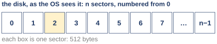{width=62%}
<figcaption markdown="1">Figure 4.3. The disk as the OS sees it: n sectors, numbered from 0 to n − 1. Each box is one sector of 512 bytes. From slide 6, following textbook section 37.1.</figcaption>
</figure>

The promise has two parts.

**Part one: a row of numbered pieces.** The disk is a long row of small pieces, and each piece has a number. A program reads or writes a piece by giving its number. One piece is a **sector**, and it holds 512 bytes. A disk with n sectors numbers them 0, 1, 2, and so on up to n − 1. (The last number is n − 1, not n, because the count starts at 0.) This part of the promise holds for any disk: a hard disk drive, an SSD or a virtual disk. (Some disks use larger sectors, such as 4,096 bytes. The idea is the same: numbered pieces of one fixed size.)

**Part two: only a one-sector write is all or nothing.** The drive guarantees one thing about a write. A write of a single sector is **atomic**, which means it happens completely or not at all. A write of several sectors has no such promise. Figure 4.4 is the answer to the power-failure case.

<figure markdown="1">
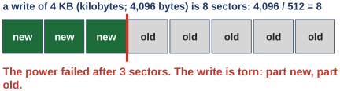{width=62%}
<figcaption markdown="1">Figure 4.4. A write of 4 KB is 8 sectors: 4,096 / 512 = 8. The power failed after 3 sectors. The write is torn: part new, part old. From slide 6, following textbook section 37.1.</figcaption>
</figure>

A 4 KB write is 8 separate sectors, and the power can fail between any two of them. Then some sectors are new and some are still old. That is called a **torn write**. So the answer to the question of [Section 4.1](#sec-4-1) is yes: the disk is allowed to leave 3 new sectors and 5 old ones. A file system has to be built to survive that, and a later class shows how. The textbook states this promise for hard disk drives, so this guide claims it only for them.

**One more thing, which nobody wrote down.** Everyone who uses a hard disk drive relies on a rule that is in no manual. The textbook calls it the "unwritten contract" of disk drives.

- Two blocks that are close together in the row are faster to reach than two blocks that are far apart.
- Reading or writing a run of blocks in order is the fastest of all.

Near is fast and far is slow. No drive maker promises that. So the reason cannot be in the interface. It has to be in the machine. The rest of this class explains why the rule is true.

A note on a loose word. People use **block** in two ways: for one sector, or for a file system's larger unit, often 4 KB. The textbook does both and says so. In the examples of this guide a sector is 512 bytes, and a block is the larger unit of whoever is speaking: 1,024 bytes for xv6, 4 KB for the textbook's file systems.

- What this part settled: from outside, a disk is a row of numbered sectors, 512 bytes each in this guide's examples, and on a hard disk drive only a one-sector write is all or nothing.
- What it leaves open: why near blocks are faster than far ones. No one promises it, so the cause must be inside. The next section opens the box.

*The argument in one line:* why can a 4 KB write tear? the drive promises one sector at a time | 4 KB is 8 sectors → the power can fail between two of them → some are new, some old.

### 4.3 <span class="lbl lbl-concept">Concept</span> Inside: a spinning platter, with data in rings called tracks {#sec-4-3 data-toc-label="4.3 [Concept] Inside: a spinning platter, with data in rings called tracks"}

Near is fast and far is slow, and nobody promised it. To see why, we need the parts of the machine. There are only a few, and every cost in the rest of this class comes from them. Figure 4.5 is the inside of a drive, seen from above.

<figure markdown="1">
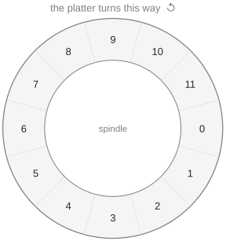{width=40%}
<figcaption markdown="1">Figure 4.5. One surface with a single track of 12 sectors, numbered 0 to 11. The platter turns counter-clockwise around the spindle. From slide 7, which redraws OSTEP Figure 37.1.</figcaption>
</figure>

- **The platter.** The data lives on a hard, round plate with a magnetic coating. The plate is a **platter**. The coating keeps its bits when the power is off, and that is why a disk can hold data that lasts. A drive may have one platter or several. Each platter has two sides, and each side is called a **surface**.
- **The spindle and the motor.** A motor spins the platters around the **spindle**, the axle in the center. While the drive is on, they spin at one fixed rate. The rate is counted in rotations per minute, written **RPM**. Typical drives turn 7,200 to 15,000 times a minute.
- **The track.** Data sits on a surface in rings of sectors. One ring is a **track**. Figure 4.5 has a single track with 12 sectors, so that we can follow every sector by eye. A real surface has many thousands of tracks, packed so tightly that hundreds fit in the width of a human hair.

In Figure 4.5 the platter turns counter-clockwise, the way the small arrow at the top shows. The numbers are painted on the platter, so they turn with it.

- What this part settled: a hard disk drive keeps its data on spinning platters, in rings of sectors called tracks.
- What it leaves open: how a sector on that spinning ring gets read. The next section adds the part that reads, and meets the first cost.

### 4.4 <span class="lbl lbl-concept">Concept</span> One track: wait for the sector to come around {#sec-4-4 data-toc-label="4.4 [Concept] One track: wait for the sector to come around"}

We have a spinning ring of sectors, and we want to read one of them. The platter cannot be stopped and the ring cannot be reached into. So the drive needs a part that reads, and a way to get the right sector to it.

The part is the **disk head**. It reads and writes the surface, and it sits at the end of the **disk arm**, right above the surface. There is one head for each surface. Figure 4.6 shows it over sector 6.

<figure markdown="1">
{width=70%}
<figcaption markdown="1">Figure 4.6. Left: the head is over sector 6, and a request arrives for sector 0, on the other side of the ring. The orange arc is the part of the platter that must pass under the head first: half a turn. Right: half a turn later, sector 0 is under the head. From slide 8, which redraws OSTEP Figure 37.2.</figcaption>
</figure>

Now a request comes in for sector 0, which is on the other side of the ring. The head cannot travel around the ring to get it. The only thing the drive can do is wait while the platter turns. Half a turn later, sector 0 arrives under the head and can be read. This waiting has a name: the **rotational delay**. It is the wait for the wanted sector to spin under the head.

We can put a number on it. Take a drive that turns 10,000 times a minute.

- One minute is 60 seconds, and one second is 1,000 ms, so one minute is 60 × 1,000 = 60,000 ms.
- 10,000 turns take 60,000 ms, so one turn takes 60,000 / 10,000 = 6 ms. (Check: 6 ms × 10,000 = 60,000 ms.)
- Half a turn takes 6 / 2 = 3 ms.

So the wait in Figure 4.6 is 3 ms. In the worst case the wanted sector has just passed the head, and the wait is almost a full turn, almost 6 ms. The sectors pass under the head in rising order: after sector 6 come 7, 8 and so on up to 11, then 0, 1 and so on. Sector 5 comes last. So for the head over sector 6, the worst case is a request for sector 5.

How long is the wait on average? The platter turns at one fixed speed, and the sector we want may sit at any point of the ring. It may be right at the head, or almost a whole turn away, and every position in between is equally likely. The middle of "no wait" and "a full turn" is half a turn. So on average the rotational delay is half a turn.

- What this part settled: on one track, the cost of a request is the rotational delay, half a turn on average.
- What it leaves open: a real disk has far more than one track, and the head may be on the wrong one. The next section adds that second cost.

*The argument in one line:* why half a turn on average? the platter turns at a fixed speed | the wanted sector can be anywhere on the ring, every position equally likely → half a turn on average.

### 4.5 <span class="lbl lbl-concept">Concept</span> Many tracks: move the arm, wait for the spin, then read {#sec-4-5 data-toc-label="4.5 [Concept] Many tracks: move the arm, wait for the spin, then read"}

One track is not realistic. A real surface has thousands of tracks, and the head can be over only one of them at a time. So a request may find the head on the wrong track. Waiting for the spin does not help then, because the wanted sector never passes under the head at all. Something has to move.

Figure 4.7 is a disk with three tracks. The outer track holds sectors 0 to 11, the middle track holds 12 to 23, and the inner track holds 24 to 35. On this disk the tracks line up: every sector of the middle track sits exactly beside a sector of the outer track, and its number is 12 higher. The inner track's numbers are 24 higher than the outer track's. For example, sector 6 on the outer track, sector 18 on the middle track and sector 30 on the inner track are side by side. On the left, the head is over the inner track, at sector 30, and the request is for sector 11, which is on the outer track.

<figure markdown="1">
{width=82%}
<figcaption markdown="1">Figure 4.7. Left: before. The head is on the inner track and sector 11 is wanted. The blue arrow is the seek to the outer track; the dashed arc is the part of the platter that passes the head meanwhile, about 3 sectors. Right: after the seek. The head is on the outer track, in the middle of sector 9; the orange arc is the remaining rotation, 1.5 sectors, before sector 11 begins. From slide 9, which redraws OSTEP Figure 37.3.</figcaption>
</figure>

Three things happen, in order.

1. **The seek.** The arm moves the head across to the right track. That move is a **seek**. A seek is slow for a machine. The arm must speed up, travel, slow down, and then settle exactly on the track. By the textbook's figures, the settling alone often takes 0.5 to 2 ms, because the drive must be certain it is on the right track and not just near it.
2. **The rotational delay.** While the arm was moving, the platter did not stop. In Figure 4.7 it turned by about 3 sectors. (The 3 is the textbook's figure for this seek; it depends on how long the seek takes.) Before the seek the head was at sector 30, in the middle of it, which is beside the middle of sector 30 − 24 = 6 of the outer track. Three sectors later it is over the middle of sector 6 + 3 = 9 of the outer track, as the drawing shows. It still has to wait for sector 11 to begin: the second half of sector 9 and all of sector 10, which is 0.5 + 1 = 1.5 sectors. That is the rotational delay again.
3. **The transfer.** Finally sector 11 passes under the head and is read. That last part is the **transfer**: reading or writing the sector as it passes under the head.

These are the three parts of every request, and their times add up. The textbook writes it as a formula:

T_I/O = T_seek + T_rotation + T_transfer

Read it this way. T_seek is the time the seek takes. T_rotation is the time spent on the rotational delay. T_transfer is the time of the transfer itself. T_I/O is the time of one whole request, where I/O is short for input/output. Each time is counted in milliseconds on a real drive.

- What this part settled: one request costs a seek, a rotational delay and a transfer, and the three times add.
- What it leaves open: the formula has no numbers in it yet. The next section watches the three parts add up on a small simulated disk.

*The argument in one line:* why three costs? three things happen in order: reach the track, wait for the sector, read the bytes → each takes time → three times, added.

### 4.6 <span class="lbl lbl-example">Worked example</span> Two requests on the simulator's disk: sector 10, then 18 {#sec-4-6 data-toc-label="4.6 [Worked example] Two requests on the simulator's disk: sector 10, then 18"}

The formula says three times add up, but so far the three parts are only names. To watch them add up with real numbers, we use a small program that comes with the textbook, the OSTEP **disk simulator**, `disk.py`. A simulator is a program that imitates a machine and reports what the machine would do. This one imitates a three-track disk laid out like the one in Figure 4.7, and prints how long each part of a request takes. Its timing is its own, so its numbers do not have to match the "about 3 sectors" of that figure. The simulator is not a real drive. Its numbers show how the parts add, not how fast a real drive is.

The simulator counts time in its own **time units**, not in milliseconds. Its disk is fixed by four design facts.

- Each track has 12 sectors, and one sector takes 30 time units to pass under the head. So a full turn is 12 × 30 = 360 units. The platter turns 1 degree per unit, since a full circle is 360 degrees.
- Moving the arm across one track takes 40 units.
- The tracks line up, as in Figure 4.7: a sector of the middle track has the number of the outer sector beside it plus 12, and a sector of the inner track has that number plus 24.
- At the start, the head is on the outer track, in the middle of sector 6.

The run below asks for sector 10 and then sector 18. In the command, `python3` runs a program written in the Python language, `-a 10,18` lists the sectors to ask for, and `-c` tells the simulator to print the times. The last three lines of its output are the result.

```text
$ python3 disk.py -a 10,18 -c
REQUESTS [10, 18]
Block:  10  Seek:  0  Rotate:105  Transfer: 30  Total: 135
Block:  18  Seek: 40  Rotate:170  Transfer: 30  Total: 240
TOTALS      Seek: 40  Rotate:275  Transfer: 60  Total: 375
```

The simulator calls a sector a block, and it prints the three parts of the formula for each request. The same numbers as a table:

| request | seek | rotate | transfer | total |
|---|---|---|---|---|
| sector 10 | 0 | 105 | 30 | 135 |
| sector 18 | 40 | 170 | 30 | 240 |
| both | 40 | 275 | 60 | 375 |

Every one of these numbers can be worked out by hand from the four design facts. The figures follow the head step by step. They are drawn to scale: the platter turns 1 degree per unit, so a wait of 105 units is an arc of 105 degrees. In each figure the thin lines are the borders between sectors, the two short red bars are the head, yellow marks a sector that is waiting, and green marks one that has been read. The head never moves around the ring. It only moves in and out.

**The first request: sector 10.**

<figure markdown="1">
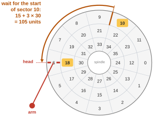{width=52%}
<figcaption markdown="1">Figure 4.8. The start. The head is on the outer track, in the middle of sector 6. Sectors 10 and 18 are waiting. The orange arc is the wait for the start of sector 10: 15 + 3 × 30 = 105 units. From slide 10.</figcaption>
</figure>

- Seek: sector 10 is on the outer track, where the head already is. The arm does not move. Seek = 0.
- Rotate: the head is in the middle of sector 6, so the second half of sector 6 must pass first. Half a sector is 30 / 2 = 15 units. Then sectors 7, 8 and 9 must pass, which is 3 × 30 = 90 units. So the wait is 15 + 90 = 105 units. That is the orange arc in Figure 4.8.
- Transfer: to read sector 10, all of it has to pass under the head. One sector is 30 units.
- Total: 0 + 105 + 30 = 135 units, as the first line of the output says.

**The second request: sector 18.**

<figure markdown="1">
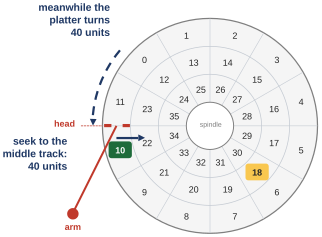{width=52%}
<figcaption markdown="1">Figure 4.9. Sector 10 has been read, and the head is at its end. Sector 18 is on the middle track. The blue arrow is the seek, 40 units; the dashed arc is the part of the platter that passes the head during those 40 units. From slide 12.</figcaption>
</figure>

- Seek: sector 18 is on the middle track, one track inward. One track costs 40 units. Seek = 40.
- The platter keeps turning during the seek. In 40 units it turns by 40 units. When the seek began, the head was at the end of sector 10, which is the border where sector 11 begins. Sector 11 takes 30 units to pass. So after 40 units the head is 40 − 30 = 10 units past the end of sector 11.

Which sector of the middle track is the head in now? On the outer track, the sector after 11 is sector 0, so the head would be 10 units into sector 0. The middle track's sector beside sector 0 is 0 + 12 = 12. So the head has landed 10 units into sector 12, as Figure 4.10 shows.

<figure markdown="1">
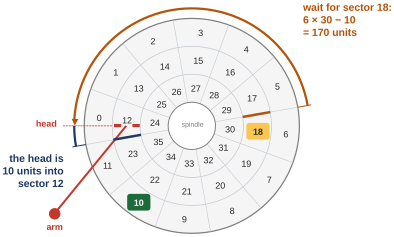{width=62%}
<figcaption markdown="1">Figure 4.10. After the seek. The head is on the middle track, 10 units into sector 12 (the small blue mark). The orange arc is the wait for sector 18: 6 × 30 − 10 = 170 units. From slide 13.</figcaption>
</figure>

- Rotate: sector 18 begins 6 sectors after sector 12 begins, because 18 − 12 = 6. Six sectors are 6 × 30 = 180 units. But the head is already 10 units into sector 12, so 10 of the 180 have gone by. The wait is 180 − 10 = 170 units.

<figure markdown="1">
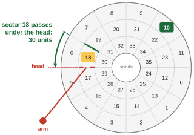{width=52%}
<figcaption markdown="1">Figure 4.11. After 170 units the head is on the border where sector 18 begins. The green arc is the transfer: sector 18 passes under the head in 30 units. From slide 14.</figcaption>
</figure>

- Transfer: 30 units, as before.
- Total: 40 + 170 + 30 = 240 units, as the second line of the output says.

**Both requests.** Add the columns: seek 0 + 40 = 40, rotate 105 + 170 = 275, transfer 30 + 30 = 60, and total 135 + 240 = 375. (Check: 40 + 275 + 60 = 375.) These are the simulator's TOTALS line.

Now look at where the time went. Of 375 units, the seek took 40 and the two transfers took 60. Waiting for the platter to turn took 275. On this disk and for these two requests, most of the time was the rotational delay. That is a result for this one example, not a law. [Chapter 5](#chapter-5) puts real milliseconds on the three parts.


<!-- anim:w11seek:start -->
Step through the two requests yourself: the platter turns to scale, and the table fills in one part at a time.

<div class="anim" data-anim="w11seek" markdown="0"></div>
<!-- anim:w11seek:end -->

- What this part settled: the three parts of a request can be computed and added, and the simulator's output agrees with the hand calculation.
- What it leaves open: the simulator counts in its own units. We still do not know how many milliseconds each part takes on a real drive.

### 4.7 <span class="lbl lbl-check">Check yourself</span> What the first question settled {#sec-4-7 data-toc-label="4.7 [Check yourself] What the first question settled"}

Before reading on, make sure you can do this without looking back: say what the disk must do to read sector 11 when the head sits over the inner track. ([Section 4.5](#sec-4-5) has the answer, in three steps.)

- Settled: to the OS a disk is a row of 512-byte sectors. Only a one-sector write is all or nothing. Inside, one request costs a seek, a rotational delay and a transfer.
- Still open: how big each of the three parts is on a real drive, and what that means for many small reads against one long read.

## Chapter 5. How long one request takes, and why the order of blocks matters {#chapter-5}

*The question this chapter answers: how long does one request take, and why does the order of blocks matter so much?*

### 5.1 <span class="lbl lbl-problem">Problem</span> Small reads everywhere, or one long run: which costs what? {#sec-5-1 data-toc-label="5.1 [Problem] Small reads everywhere, or one long run: which costs what?"}

What we have is the model of [Chapter 4](#chapter-4): one request costs a seek, a rotation and a transfer, as Figure 5.1 shows. But so far the three parts are only names.

<figure markdown="1">
{width=42%}
<figcaption markdown="1">Figure 5.1. What we have: the time of one request has three parts, and no real drive's numbers yet. From slide 17.</figcaption>
</figure>

Where it breaks is the first time we compare two programs. Figure 5.2 shows two ways of using a disk.

<figure markdown="1">
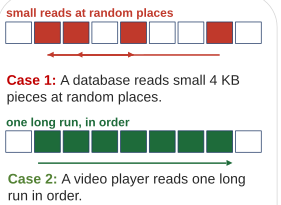{width=46%}
<figcaption markdown="1">Figure 5.2. Two ways of using a disk. Case 1: small reads at random places, with the arm jumping between them. Case 2: one long run, read in order. From slide 17, following textbook section 37.4.</figcaption>
</figure>

- **Case 1.** A database, a program that stores a large number of records and looks them up, reads small pieces of 4 KB from places all over the disk. The arm jumps for every piece.
- **Case 2.** A video player reads one long run of sectors in order. The arm hardly moves.

Everybody would guess that Case 2 is faster. But how much faster? Twice? A hundred times? The three names cannot say. An engineer who has to choose how a program stores its data needs the size of the gap, not just its direction.

So what we need is numbers: the three parts in milliseconds, from a real drive. Drive makers publish them in a **data sheet**, a short document that lists what a product can do. With those numbers we compute one random read, then one long run, and compare.

- What this part settled: the model needs real numbers before it can compare two ways of using a disk.
- What it leaves open: the numbers. The next section takes them from the data sheets of two real drives.

### 5.2 <span class="lbl lbl-concept">Concept</span> One random 4 KB read on a fast drive takes about 6 ms {#sec-5-2 data-toc-label="5.2 [Concept] One random 4 KB read on a fast drive takes about 6 ms"}

We need real numbers for the three parts. The textbook takes them from the data sheets of two real drives made by Seagate, a disk maker. The names are product names. The Cheetah 15K.5 is built for speed. The Barracuda is built to hold a lot of data cheaply. Three rows of the textbook's table (OSTEP Figure 37.5) are enough:

| | Cheetah 15K.5 | Barracuda |
|---|---|---|
| spin | 15,000 RPM | 7,200 RPM |
| average seek | 4 ms | 9 ms |
| top transfer rate | 125 MB/s | 105 MB/s |

MB/s means megabytes per second. A megabyte, MB, is 1,000 KB in this arithmetic, as the textbook counts it. So 125 MB/s is 125,000 KB every second. The top transfer rate is how fast data moves once the head is over it.

Now Case 1 on the Cheetah: one random read of 4 KB. We compute each of the three parts.

**Seek.** 4 ms. This comes straight from the data sheet. It is an average over many seeks, short and long.

**Rotation.** This is not on the data sheet, so we compute it from the spin, the same way as in [Section 4.4](#sec-4-4).

- 15,000 turns a minute, and a minute has 60 seconds: 15,000 / 60 = 250 turns a second.
- A second has 1,000 ms: 1,000 / 250 = 4 ms for one turn. (Check: 250 turns × 4 ms = 1,000 ms.)
- On average we wait half a turn: 4 / 2 = 2 ms.

**Transfer.** The drive moves 125,000 KB in one second, and we want 4 KB.

- 4 / 125,000 = 0.000032 seconds.
- In milliseconds: 0.000032 × 1,000 = 0.032 ms, about 0.03 ms.

**Total.** 4 + 2 + 0.03 = 6.03 ms, about 6 ms.

**Rate.** A rate is the amount of data divided by the time it took. Here it is 4 KB in 6 ms. That is 4 / 6 = 0.667 KB every millisecond. A second has 1,000 ms, so it is 0.667 × 1,000 = 667 KB a second, or about 0.67 MB/s. With the unrounded total of 6.03 ms it is 4 / 6.03 = 0.663, and the textbook prints 0.66 MB/s. From here on this guide uses the textbook's 0.66.

Stop and compare two numbers. This drive can transfer 125 MB every second. Reading small pieces at random places, it delivers less than 1 MB a second.

In each line of the calculation we kept track of the units. For example, 15,000 turns per minute divided by 60 seconds per minute leaves turns per second: the minutes cancel, the way units cancel in a chemistry class. That habit has a name: **dimensional analysis**. It keeps this kind of calculation honest. If the units do not come out as "ms per turn", the numbers were combined the wrong way round.

**The Barracuda, the same way.**

- Seek: 9 ms, from the data sheet.
- Rotation: 60,000 / 7,200 = 8.33 ms a turn, about 8.3. Half a turn is about 4.2 ms.
- Transfer: 4 / 105,000 = 0.000038 seconds, about 0.04 ms.
- Total: 9 + 4.2 + 0.04 = 13.24, about 13.2 ms.
- Rate: 4 / 13.2 = 0.30 KB every millisecond, about 0.30 MB/s. The textbook prints 0.31 MB/s, and these numbers do not reproduce its last digit. This guide still uses the textbook's 0.31, so that its numbers match the book's.

Where do the 6 ms of the Cheetah go? The seek and the rotation move metal: an arm swings and a plate turns. Moving metal takes milliseconds. The transfer of 4 KB takes 0.03 ms, which is 200 times less than the 6 ms total (6 / 0.03 = 200). So almost all of the time of a random read is spent on the moving parts, and almost none on the data.

- What this part settled: one random 4 KB read takes about 6 ms on the fast drive and about 13 ms on the big one, and nearly all of it is seek and rotation.
- What it leaves open: Case 2, the long run. The next section does the same arithmetic for it and puts the two side by side.

*The argument in one line:* where do the 6 ms go? seek and rotation move metal, which takes milliseconds | the transfer of 4 KB takes 0.03 ms → so almost all of the time is moving parts.

### 5.3 <span class="lbl lbl-concept">Concept</span> Random reads get 0.66 MB/s; one long run gets 125 {#sec-5-3 data-toc-label="5.3 [Concept] Random reads get 0.66 MB/s; one long run gets 125"}

We have Case 1. Now Case 2 on the same drive: one long run of 100 MB, read in order.

A long run pays for one seek, to get to the start, and one rotational delay, to wait for the first sector. After that the head stays on the data and only transfers, at the drive's top rate. (A long run does cross from track to track, but those moves are short; [Extra 10](#extra-10) looks at them.) On the Cheetah:

- Transfer: 100 MB at 125 MB/s takes 100 / 125 = 0.8 seconds, which is 800 ms.
- Seek and rotation, once: 4 + 2 = 6 ms. Against 800 ms that is less than 1 part in 100.
- So the rate is very nearly the top rate, 125 MB/s.

The Barracuda, the same way: 100 / 105 = 0.95 seconds, about 950 ms, and a rate of very nearly 105 MB/s.

Figure 5.3 puts both cases on both drives side by side. The bars are drawn to scale. The bars for the random reads are so short that they are only thin lines.

<figure markdown="1">
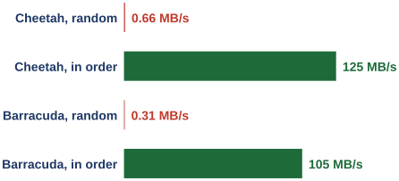{width=62%}
<figcaption markdown="1">Figure 5.3. Megabytes per second for the two cases on the two drives (the numbers of OSTEP Figure 37.6). Cheetah: 0.66 at random, 125 in order. Barracuda: 0.31 at random, 105 in order. Bar lengths are to scale. From slide 19.</figcaption>
</figure>

How big is the gap?

- Cheetah: 125 / 0.66 = 189.4, about 190 times.
- Barracuda: 105 / 0.31 = 338.7, about 340 times.

So a guess of "twice as fast" is far too low. On these two drives, data comes off the disk about 190 to 340 times faster when it is read in order. The exact factor belongs to the drive and to this comparison, 4 KB reads against a 100 MB run. Another drive gives another factor ([Exercise 13](review.md#exercise-13) has one). In each of these cases it is in the hundreds.

Both patterns have names, and now the names mean something.

- A **random workload** is many small reads or writes at scattered places. Workload is the word for the pattern of requests a program makes.
- A **sequential workload** is one long run of sectors read or written in order.

Why such a gap? A long run pays for one seek and one rotation, and after that it only transfers. A random workload pays for a seek and a rotation again for every 4 KB.

This gap is the reason for one of the oldest rules in systems. Use a disk in order whenever you can. When you cannot, at least move data in large chunks. That is the unwritten contract of [Section 4.2](#sec-4-2), now with its cause: reading in order is fast because it avoids moving the arm and waiting for the spin. [Chapter 6](#chapter-6) uses the other half: a seek to a near track is shorter than a seek to a far one.

- What this part settled: on the textbook's two hard disk drives, a sequential workload is about 190 to 340 times faster than a random one, because it pays for the moving parts once.
- What it leaves open: a way to test the explanation. If the gap really comes from the arm and the platter, a disk that has neither should not show it. The next section measures one.

*The argument in one line:* why such a gap? a long run pays one seek and one rotation → after that, only transfer | random reads pay a seek and a rotation for every 4 KB.

### 5.4 <span class="lbl lbl-machine">Real machine</span> On a disk with no moving parts, random reads cost the same {#sec-5-4 data-toc-label="5.4 [Real machine] On a disk with no moving parts, random reads cost the same"}

The last section explained the gap by the arm and the platter. An explanation should be tested. Here is a test: take a disk that has no arm and no platter, and read it both ways. If the explanation is right, the gap should be gone.

We measured one such disk: the virtual disk of the Linux VM. (An SSD has no arm and no platter either, but we did not measure an SSD, so this section claims nothing about SSDs.)

The test program is `diskio.c`, the same small program as in [Extra 2](class-1.md#extra-2); [Appendix A](appendix.md#appendix-a) lists all of it. Three of its lines matter here. Line 26 opens the file:

```c linenums="26" hl_lines="1"
  int fd = open(argv[1], O_RDONLY | O_DIRECT);
```

`open()` asks the kernel for access to a file, and `fd` is the number the kernel gives back to name the open file. (`int`, and `long` below, mean a whole number.) `argv[1]` is the file name typed on the command line. `O_RDONLY` means open the file for reading only. **O_DIRECT** is an option that makes every read go to the disk. Without it, Linux would often answer from a copy it keeps in memory, its cache, and we would be timing memory and not the disk. The `|` joins the two options.

Lines 39 to 42 are the loop that reads. Line 39 repeats lines 40 and 41 `n` times, with the counter `i` going 0, 1, 2 and so on; in these runs `n` is 20,000.

```c linenums="39" hl_lines="2 3"
  for (long i = 0; i < n; i++) {
    long b = rnd ? random() % nblocks : i % nblocks;
    if (pread(fd, buf, bs, b * bs) != bs) { perror("pread"); return 1; }
  }
```

- Line 40 picks the next block, `b`. The form `rnd ? X : Y` means "if `rnd` is set, use X, otherwise use Y", and `rnd` is set when the word `rand` is typed on the command line. So in random mode the block is `random() % nblocks`, a random number cut down to the number of blocks in the file (`%` is the remainder after division). In order mode it is `i % nblocks`: block 0, then 1, then 2, and so on. (The remainder only matters if the program is asked for more reads than the file has blocks; then it starts again at block 0.)
- Line 41 reads it. `pread(fd, buf, bs, b * bs)` reads `bs` bytes from the file into the memory at `buf`, starting at byte `b * bs` of the file. Here `bs` is 4,096, so block `b` starts at byte `b` × 4,096. If the read does not return all `bs` bytes, the rest of the line prints an error message and stops the program.

The program read 20,000 blocks of 4 KB in each mode. Here are two of the six runs, from `diskio_4k.out`. (That is the file the output was saved in. The other captures of this class name their files the same way.) Each run printed five lines; the command and the one output line that matters are shown for each.

```text
$ ./diskio testfile seq 20000
elapsed 0.754 s, 37.7 us per read, 103.6 MB/s
$ ./diskio testfile rand 20000
elapsed 0.745 s, 37.2 us per read, 104.9 MB/s
```

`seq` is the in-order mode and `rand` the random mode. `us` means microseconds. The MB/s at the end of each line is the program's own figure, which counts a megabyte as 1,048,576 bytes; this section does not use it. Check the first line: 0.754 seconds for 20,000 reads is 0.754 / 20,000 = 0.0000377 seconds, which is 37.7 microseconds a read, as printed.

Both orders take about 37 microseconds a read. Over all six runs, the three in-order runs took 37.7, 38.1 and 38.2 microseconds a read, and the three random runs took 37.2, 36.7 and 38.3. The two sets overlap. On this disk the gap is gone. On the Cheetah the gap was a factor of about 190.

Linux itself reports that it sees no spin on this disk. It keeps a small file for every disk that says whether the disk rotates. `nvme1n1` is the name Linux gives this disk. From `devices.out`:

```text
$ cat /sys/block/nvme1n1/queue/rotational
0
```

`cat` prints a file. The file holds 0, which means this disk does not rotate. It is the virtual disk of the Linux VM: a file on the computer underneath, with no arm and no platter of its own.

So the test came out the way the explanation predicted. A disk without an arm and a platter has no seek and no rotational delay, and on it a random read cost what an in-order read cost. One test on one disk does not prove the explanation, but it is what the explanation said would happen.

One caution about the 37 microseconds. The computer underneath the VM may answer some of these reads from its own memory. So 37 microseconds is not the speed of any real device. The file behind the virtual disk also sits on some storage of that computer, and we did not look at what kind it is. The careful statement is this: on this virtual disk, the order of the reads made no difference.

- What this part settled: on the one disk with no moving parts that we measured, the order of the reads made no difference. That fits the explanation that the gap belongs to the moving parts.
- What it leaves open: so far we looked at one request at a time. A real system has many requests waiting, and somebody has to choose their order.

*The argument in one line:* why no gap here? the gap came from the seek and the rotation | this disk has no arm and no platter → a random read costs what an in-order read costs.

### 5.5 <span class="lbl lbl-check">Check yourself</span> What the second question settled {#sec-5-5 data-toc-label="5.5 [Check yourself] What the second question settled"}

Before reading on, make sure you can do this without looking back: compute the time of one random request and the transfer rate of a drive from its RPM, its average seek time and its top transfer rate. ([Section 5.2](#sec-5-2) is the method. [Exercise 13](review.md#exercise-13) gives you a drive to try it on.)

- Settled: a random 4 KB read on a hard disk drive costs milliseconds, almost all of it seek and rotation. So one long run in order is far faster, about 190 to 340 times on the textbook's two drives. The one disk with no moving parts that we measured showed no such gap.
- Still open: when many requests wait at once, somebody can choose the order. Which order is best?

## Chapter 6. In what order to serve a queue of requests {#chapter-6}

*The question this chapter answers: when many requests wait, in what order should they be served?*

All the rules of this chapter are for a drive with an arm, which means a hard disk drive. The last section says which part of the story also holds for other disks.

### 6.1 <span class="lbl lbl-problem">Problem</span> Requests in arrival order can waste the arm's travel {#sec-6-1 data-toc-label="6.1 [Problem] Requests in arrival order can waste the arm's travel"}

What we have is a cost for one request: a seek, a rotation and a transfer. But a busy system does not have one request. Many programs ask for blocks at once, and the requests wait in line. A line of waiting requests is a **queue**.

The simplest thing to do with a queue is to serve it in the order the requests arrived. Here is a case where that goes badly. It uses the three-track disk again: outer track 0 to 11, middle track 12 to 23, inner track 24 to 35. The head is on the inner track and has just read sector 30. Two requests are waiting. The request for sector 2 arrived first, and the request for sector 21 arrived second. Figure 6.1 shows them.

<figure markdown="1">
{width=34%}
<figcaption markdown="1">Figure 6.1. Where arrival order breaks. The head has just read sector 30 on the inner track. Sector 2, on the outer track, was asked for first; sector 21, on the middle track, second. In arrival order the arm crosses the whole disk, then comes back. From slide 22.</figcaption>
</figure>

Sector 2 is on the outer track, two tracks away. Sector 21 is on the middle track, one track away. In arrival order the arm goes all the way out for sector 2 and then has to come back for sector 21. That is 2 + 1 = 3 tracks of travel. The other order, 21 and then 2, needs 1 + 1 = 2 tracks, and the arm never turns around.

So the order is a choice, and some choices waste time. The part of the system that makes the choice is the **disk scheduler**. Given the requests that are waiting, it decides which one to serve next.

The disk scheduler has an advantage that a CPU scheduler does not have. In the scheduling classes earlier in the course, the best simple rule was **shortest job first** (SJF): serve the job that takes the least time first. Its weakness was that a CPU scheduler cannot know how long a job will run. A disk scheduler can make a good guess. The cost of a request depends on how far away it is, and the scheduler knows the number of every waiting request, which tells it roughly how far away each one is. So it can do what CPU schedulers only wish for, and try to serve the shortest job first.

So what we need is a rule that picks the cheapest request next. The first try is the obvious one.

- What this part settled: when requests wait in a queue, the order they are served in changes the total cost, and a disk scheduler can estimate each request's cost.
- What it leaves open: which rule to use. The next section tries the simplest: go to the closest request.

### 6.2 <span class="lbl lbl-concept">Concept</span> Serve the request on the nearest track first {#sec-6-2 data-toc-label="6.2 [Concept] Serve the request on the nearest track first"}

We need a rule that picks a cheap request. A seek costs more the farther the arm has to go. So the first idea is simple: of all the waiting requests, go to the one on the nearest track. This rule is called **shortest seek time first**, written **SSTF**.

In our example, sector 21 is one track away and sector 2 is two tracks away. SSTF serves 21 first and then 2. Figure 6.2 shows how far each request is from the head, counted in the simulator's time units.

<figure markdown="1">
{width=58%}
<figcaption markdown="1">Figure 6.2. The head has just finished sector 30 on the inner track; sectors 21 and 2 wait. The inner arc: sector 21 arrives in 60 units, 40 of seek and 20 of waiting. The outer arc: sector 2 arrives in 210 units, 80 of seek and 130 of waiting. From slide 23, which redraws OSTEP Figure 37.7.</figcaption>
</figure>

Read the two arcs this way. The head is at the end of sector 30, which is where sector 31 begins. The tracks line up ([Section 4.6](#sec-4-6)), so that same place is where sector 31 − 12 = 19 begins on the middle track and where sector 31 − 24 = 7 begins on the outer track.

- Sector 21 begins 2 sectors after sector 19 begins, which is 2 × 30 = 60 units away. The arm needs 40 of those units to move one track, so the head waits the other 20.
- Sector 2 begins 7 sectors after sector 7 begins (count 7, 8, 9, 10, 11, 0, 1), which is 7 × 30 = 210 units away. The arm needs 2 × 40 = 80 units to move two tracks, so the head waits the other 130.

How much does the order matter? We ran both orders on the simulator. Its head always starts on the outer track, so each run first asks for sector 30, only to put the head in place. The first line of each output is that set-up request, and we do not count it or derive its numbers. From `sim_30_21_2.out` and `sim_30_2_21.out`:

```text
$ python3 disk.py -a 30,21,2 -c
Block:  30  Seek: 80  Rotate:265  Transfer: 30  Total: 375
Block:  21  Seek: 40  Rotate: 20  Transfer: 30  Total:  90
Block:   2  Seek: 40  Rotate: 80  Transfer: 30  Total: 150
$ python3 disk.py -a 30,2,21 -c
Block:  30  Seek: 80  Rotate:265  Transfer: 30  Total: 375
Block:   2  Seek: 80  Rotate:130  Transfer: 30  Total: 240
Block:  21  Seek: 40  Rotate:140  Transfer: 30  Total: 210
```

The two requests that count, in each order:

| order | first request | second request | both |
|---|---|---|---|
| 21, then 2 (nearest first) | 90 | 150 | 90 + 150 = 240 |
| 2, then 21 (arrival order) | 240 | 210 | 240 + 210 = 450 |

Nearest first needs 240 units, and arrival order needs 450. That is about half the time. Where does the saving come from? Add the columns of the output.

- Seek: nearest first 40 + 40 = 80 units. Arrival order 80 + 40 = 120 units. Less arm travel, as expected.
- Rotate: nearest first 20 + 80 = 100 units. Arrival order 130 + 140 = 270 units. In this example nearest first also happens to wait less for the spin, and that saving is even larger.

The waits of the second request in each run can be worked out the same way, starting from where the head is after the first request.

- First run, sector 2 after sector 21: the head is at the end of sector 21, where sector 22 begins. On the outer track that is where sector 22 − 12 = 10 begins. Sector 2 begins 4 sectors later (10, 11, 0, 1), 4 × 30 = 120 units away. The seek takes 40, so the wait is 120 − 40 = 80.
- Second run, sector 21 after sector 2: the head is at the end of sector 2, where sector 3 begins. On the middle track that is where sector 3 + 12 = 15 begins. Sector 21 begins 21 − 15 = 6 sectors later, 6 × 30 = 180 units away. The seek takes 40, so the wait is 180 − 40 = 140.

The second saving is luck. SSTF did not look at the spin at all. [Section 6.5](#sec-6-5) comes back to that.

There is one practical problem with SSTF. The operating system does not see tracks. It sees only the row of block numbers of [Section 4.2](#sec-4-2). The fix is easy, because the numbers run along the tracks in order, as Figure 4.7 shows. So blocks with close numbers are usually close on the disk. So the operating system serves the request with the nearest block number instead. That rule is **nearest block first**, **NBF**.

- What this part settled: serving the nearest track first (SSTF, or NBF with block numbers) cuts the arm's travel, and in the example it cut the total from 450 units to 240.
- What it leaves open: SSTF has a second problem that is much more serious than the first. The next section shows it.

*The argument in one line:* why is nearest first cheaper here? less arm travel: 80 units of seek instead of 120 | here also less waiting for the spin: 100 units instead of 270.

### 6.3 <span class="lbl lbl-problem">Problem</span> Nearest first can make a far request wait forever {#sec-6-3 data-toc-label="6.3 [Problem] Nearest first can make a far request wait forever"}

What we have is SSTF, which always picks the request on the nearest track. It worked for sectors 21 and 2.

Where it breaks: imagine that requests for the inner track keep arriving, one after another. The head is already on the inner track, so each new request is on the nearest track, zero tracks away. The request for sector 2, on the outer track, is never the nearest one. So the disk never gets to it, however long it waits. Figure 6.3 shows the situation.

<figure markdown="1">
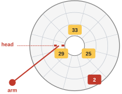{width=34%}
<figcaption markdown="1">Figure 6.3. Where nearest first breaks. Requests for the inner track (25, 29, 33) keep arriving. The request for sector 2, in red on the outer track, is never the nearest, so it is never served. From slide 24.</figcaption>
</figure>

This problem has a name from CPU scheduling. **Starvation** is a request or a job that waits forever because others always go first.

So what we need is an order that still serves nearby requests together, but gives every track its turn. The textbook states it as its second crux:

> "How can we implement SSTF-like scheduling but avoid starvation?"

- What this part settled: a rule that always takes the nearest request can starve a far one.
- What it leaves open: a rule that keeps most of the saving and starves nobody. The fix was worked out long ago, and you have ridden in it.

### 6.4 <span class="lbl lbl-concept">Concept</span> The elevator: sweep across the disk, then sweep back {#sec-6-4 data-toc-label="6.4 [Concept] The elevator: sweep across the disk, then sweep back"}

We need a rule that serves nearby requests together and still reaches every track. An elevator already works that way. Think of an elevator going down from floor 10 to floor 1. Someone gets in at floor 3 and presses 4. The elevator does not turn around, even though floor 4 is closer than floor 1. It finishes its trip down first.

The disk head can do the same. Figure 6.4 shows it in three pictures, read left to right.

<figure markdown="1">
![Figure 6.4. The elevator on the three-track disk. Picture 1: sweep 1 goes outward; the head serves 29, then 16, then 2, as it reaches each track. Picture 2: 25 and 33 arrive for the inner track; the head does not turn back. Picture 3: at the edge the head turns around, and sweep 2 serves 25 and 33. Yellow: waiting. Green: served. Orange: arrived during sweep 1. The platter is drawn at the same angle in all three pictures, because this rule chooses by track only. From slide 25, following textbook section 37.5.](figs/c2_scan.svg){width=100%}
<figcaption markdown="1">Figure 6.4. The elevator on the three-track disk. Picture 1: sweep 1 goes outward; the head serves 29, then 16, then 2, as it reaches each track. Picture 2: 25 and 33 arrive for the inner track; the head does not turn back. Picture 3: at the edge the head turns around, and sweep 2 serves 25 and 33. Yellow: waiting. Green: served. Orange: arrived during sweep 1. The platter is drawn at the same angle in all three pictures, because this rule chooses by track only. From slide 25, following textbook section 37.5.</figcaption>
</figure>

- **Picture 1.** The head starts on the inner track, and three requests are waiting, one on each track: 29 on the inner track, 16 on the middle track, 2 on the outer track. The head moves outward and serves each request when it reaches that request's track. So the order is 29, then 16, then 2.
- **Picture 2.** The head is on the middle track, halfway through. Two new requests arrive, for sectors 25 and 33, on the inner track, which the head has already left. Under nearest first, requests like these kept the head on the inner track, and sector 2 starved. Here the head does not turn back. It goes on to the outer track and serves sector 2.
- **Picture 3.** At the outer edge the head turns around. It moves inward and serves 25 and 33 when it reaches the inner track. Their wait lasted until the head came back, and then it ended.

The example in Figure 6.4 was made for this picture. It is not a simulator run, and it claims no times.

The words:

- One pass of the head across the disk, from inner to outer or from outer to inner, is a **sweep**.
- The rule of moving the head one way and serving every request it passes, and only then turning around, is called **SCAN**. It is also called the elevator rule.
- A request for a track that the head has already passed on this sweep is not served at once. It waits for the next sweep. It does not wait forever.
- One corner remains. If requests kept arriving for the very track the head is on, a plain SCAN could stay there. A version the textbook calls F-SCAN closes that corner: during a sweep it serves only the requests that were already waiting when the sweep began, and puts later ones aside for the next sweep.

There is one refinement. Plain SCAN goes back and forth. On every round trip it passes the middle tracks twice, once in each direction, but it reaches each edge only once. So requests on the middle tracks wait less than requests at the edges. **C-SCAN**, short for circular SCAN, sweeps in one direction only and then jumps back to the start. It is a little fairer to the inner and outer tracks. [Extra 14](#extra-14) counts how much fairer.

- What this part settled: SCAN keeps nearby requests together, and a request behind the head is picked up on the next sweep. With the F-SCAN refinement, no request can be passed over forever.
- What it leaves open: SSTF and SCAN share a blind spot. Both look only at tracks. The next section shows what they cannot see.

*The argument in one line:* why does nobody starve? the head serves every request it passes | at the end it turns around → a request behind it is served on the way back.

### 6.5 <span class="lbl lbl-problem">Problem</span> Track-only rules ignore the spin, which can cost more {#sec-6-5 data-toc-label="6.5 [Problem] Track-only rules ignore the spin, which can cost more"}

What we have is two rules, SSTF (the nearest track) and SCAN (the next track on the sweep). Both choose by looking at tracks only.

Where it breaks: a request does not only need the arm on its track. It also has to wait for the spin, and [Chapter 4](#chapter-4) showed that the wait can be the larger part. Look at the case in Figure 6.5. The head has just read sector 30 on the inner track. Two requests are waiting: sector 16 on the middle track, one track away, and sector 8 on the outer track, two tracks away.

<figure markdown="1">
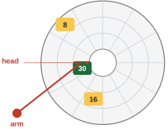{width=34%}
<figcaption markdown="1">Figure 6.5. Where track-only rules break. The head has just read sector 30. Sector 16 is one track away, but it has already passed the head. Sector 8 is two tracks away, and about to arrive. From slide 26, following OSTEP Figure 37.8.</figcaption>
</figure>

A track-only rule picks 16 and looks no further. But sector 16 has already gone past the head, so it needs most of a turn to come around again. Sector 8 is farther away in tracks, but it is about to arrive. A rule that looks only at tracks cannot see that difference, so it cannot tell which of the two is really cheaper.

So what we need is a rule that counts both costs for each request, the seek and the rotation, and picks the smaller sum. The textbook's third crux:

> "How can we implement an algorithm that more closely approximates SJF by taking both seek and rotation into account?"

Which should come next, 16 or 8? Decide what you think before reading on. The honest answer has two halves, and the next section shows both.

- What this part settled: SSTF and SCAN can pick a request that is near in tracks and far in rotation.
- What it leaves open: how to count both costs, and what the answer is for 16 against 8.

### 6.6 <span class="lbl lbl-concept">Concept</span> Add the seek and the spin; serve the smallest total {#sec-6-6 data-toc-label="6.6 [Concept] Add the seek and the spin; serve the smallest total"}

We need to count the seek and the rotation together. Do that for the two requests of Figure 6.5, and the answer to "16 or 8?" turns out to be: it depends. It depends on how fast the arm is compared with the spin.

We let the simulator serve both orders at two arm speeds. Its normal arm needs 40 units to cross a track. Its option `-S 4` makes the arm 4 times faster: 40 / 4 = 10 units a track. As in [Section 6.2](#sec-6-2), each run first asks for sector 30 to put the head in place, and the table counts only the two requests after it.

| arm speed | 16, then 8 | 8, then 16 | better |
|---|---|---|---|
| 40 units a track | 300 + 120 = 420 | 420 + 240 = 660 | 16 first |
| 10 units a track | 300 + 120 = 420 | 60 + 240 = 300 | 8 first |

The order "16, then 8" costs 420 at both speeds. Both arms reach each sector's track before the sector comes around, so in both runs each sector is read at the moment it arrives. A faster arm only gets there sooner and waits longer ([Section 6.7](#sec-6-7) shows the positions). The order "8, then 16" is different, because there the slow arm is late and the fast arm is in time.

With the slow arm, going to 16 first is better, 420 units against 660. With the fast arm, the result turns around: going to 8 first costs 300 units against 420. The next section walks through both winning runs step by step and shows where each number comes from. The reason, in short:

- A slow arm reaches the outer track after sector 8 has gone by. Then the drive loses a whole turn waiting for it to come around again.
- A fast arm reaches the outer track just before sector 8 does, and reads it at once.

The rule that handles both cases does not guess. For each waiting request it adds the seek time and the rotational delay. The sum is the time needed to get the head into position, the **positioning time**. Then it serves the request with the smallest sum. This rule is **shortest positioning time first**, **SPTF**. It is the closest a disk gets to shortest job first.

Here are the positioning times of the two requests at the start, for each arm. A positioning time does not include the 30 units of transfer, so each one is 30 less than that request's cost when it is served first. [Section 6.7](#sec-6-7) derives every number in the table.

| arm speed | sector 16: seek + wait | sector 8: seek + wait | SPTF serves |
|---|---|---|---|
| 40 units a track | 40 + 230 = 270 | 80 + 310 = 390 | 16 first |
| 10 units a track | 10 + 260 = 270 | 20 + 10 = 30 | 8 first |

SPTF has a price. To compute a request's rotational delay, the scheduler must know exactly where the head is in the platter's turn at this moment. The operating system does not know that. It does not even know where one track ends and the next begins. Only the drive knows. So SPTF runs inside the drive.

- What this part settled: the cheapest next request is the one with the smallest seek plus rotation, and which one that is depends on the drive. SPTF computes it, inside the drive.
- What it leaves open: the numbers in the table. The next section derives them.

*The argument in one line:* why does it depend on the arm? slow arm: sector 8 passes before the head arrives, so a full turn is lost | fast arm: the head arrives first and reads 8 at once.

### 6.7 <span class="lbl lbl-example">Worked example</span> Sector 16 or sector 8 first? Both arms, step by step {#sec-6-7 data-toc-label="6.7 [Worked example] Sector 16 or sector 8 first? Both arms, step by step"}

The first table of [Section 6.6](#sec-6-6) gave four totals. This section derives all four from the simulator's rules, the two winning runs step by step and the two losing ones more briefly, the same way [Section 4.6](#sec-4-6) did: 30 units a sector, a full turn of 360 units, and the tracks lined up.

Both runs start from the same position. The head has just read sector 30 on the inner track, so it is at the end of sector 30. As in [Section 6.2](#sec-6-2), that is also where sector 19 begins on the middle track and where sector 7 begins on the outer track.

- Sector 8, on the outer track, begins 1 sector after sector 7 begins. It arrives at the head's position in 1 × 30 = 30 units.
- Sector 16, on the middle track, has already passed. From the start of sector 19, count the sectors until 16 begins: 19, 20, 21, 22, 23, 12, 13, 14, 15. That is 9 sectors, so sector 16 comes around in 9 × 30 = 270 units.

**The slow arm: 40 units a track.**

<figure markdown="1">
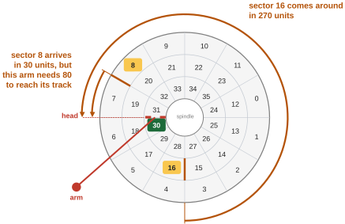{width=62%}
<figcaption markdown="1">Figure 6.6. The slow arm, at the start. Sector 8 arrives in 30 units, but this arm needs 80 units to reach its track. Sector 16 comes around in 270 units. From slide 28.</figcaption>
</figure>

Sector 8 is close in angle, but it is two tracks away. This arm needs 2 × 40 = 80 units to get there, and sector 8 arrives in 30. The arm will miss it. Sector 16 is one track away, 40 units of seek, and it needs 270 units to come around. The arm has plenty of time. So the drive goes to sector 16 first. From `sim_30_16_8.out`, the two requests that count:

```text
$ python3 disk.py -a 30,16,8 -c
Block:  16  Seek: 40  Rotate:230  Transfer: 30  Total: 300
Block:   8  Seek: 40  Rotate: 50  Transfer: 30  Total: 120
```

- Sector 16: the seek takes 40 units. Sector 16 arrives after 270 units, and 40 of them were spent seeking, so the wait is 270 − 40 = 230. With the transfer: 40 + 230 + 30 = 300.

<figure markdown="1">
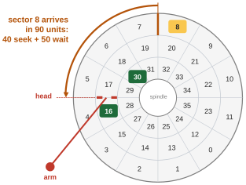{width=52%}
<figcaption markdown="1">Figure 6.7. The slow arm, after sector 16 is read. The head is on the middle track. Sector 8 arrives in 90 units: 40 of seek and 50 of waiting. From slide 29.</figcaption>
</figure>

- Sector 8: the head is now at the end of sector 16, which is where sector 17 begins. On the outer track that is where sector 17 − 12 = 5 begins. Sector 8 begins 3 sectors later (5, 6, 7), which is 3 × 30 = 90 units away. The seek takes 40 of them, so the wait is 90 − 40 = 50. With the transfer: 40 + 50 + 30 = 120.
- Both: 300 + 120 = 420 units.

What if the slow arm had gone to sector 8 first? It needs 80 units to get there, but sector 8 arrived after 30. It comes around again one full turn later, at 30 + 360 = 390 units. So the wait is 390 − 80 = 310 units, almost a whole turn, and the request costs 80 + 310 + 30 = 420 by itself. After that, the head is at the end of sector 8, where sector 9 begins, which on the middle track is where sector 9 + 12 = 21 begins. Sector 16 begins 7 sectors later (21, 22, 23, 12, 13, 14, 15), 7 × 30 = 210 units away. The seek takes 40, the wait is 210 − 40 = 170, and the request costs 40 + 170 + 30 = 240. So that order totals 420 + 240 = 660, and the simulator prints the same.

**The fast arm: 10 units a track.**

<figure markdown="1">
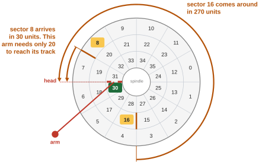{width=62%}
<figcaption markdown="1">Figure 6.8. The fast arm, at the start. The same disk and the same two requests. Sector 8 still arrives in 30 units, and this arm needs only 20 units to reach its track. From slide 31.</figcaption>
</figure>

Everything is the same, except that the arm now crosses a track in 10 units. Two tracks take 2 × 10 = 20 units. Sector 8 arrives in 30. This time the arm gets there first. So the drive goes to sector 8 first. From `sim_30_8_16_S4.out`, the two requests that count:

```text
$ python3 disk.py -a 30,8,16 -S 4 -c
Block:   8  Seek: 20  Rotate: 10  Transfer: 30  Total:  60
Block:  16  Seek: 10  Rotate:200  Transfer: 30  Total: 240
```

<figure markdown="1">
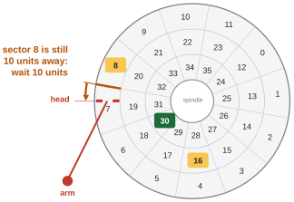{width=52%}
<figcaption markdown="1">Figure 6.9. The fast arm, after 20 units. The arm is on the outer track, and sector 8 is still 10 units away. From slide 32.</figcaption>
</figure>

- Sector 8: the seek takes 20 units. Sector 8 arrives after 30, so the head waits 30 − 20 = 10 units. With the transfer: 20 + 10 + 30 = 60.

<figure markdown="1">
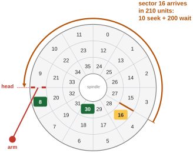{width=58%}
<figcaption markdown="1">Figure 6.10. The fast arm, after sector 8 is read. Sector 16 arrives in 210 units: 10 of seek and 200 of waiting. From slide 33.</figcaption>
</figure>

- Sector 16: the head is at the end of sector 8, which is where sector 9 begins. On the middle track that is where sector 9 + 12 = 21 begins. Count to sector 16: 21, 22, 23, 12, 13, 14, 15. That is 7 sectors, 7 × 30 = 210 units away. The seek back takes 10, so the wait is 210 − 10 = 200. With the transfer: 10 + 200 + 30 = 240.
- Both: 60 + 240 = 300 units.

With this fast arm the other order, 16 first, costs 300 + 120 = 420 on the simulator. The fast arm reaches the middle track after 10 units and waits 270 − 10 = 260 for sector 16, so that request costs 10 + 260 + 30 = 300. Then sector 8 is 90 units away, as it was for the slow arm. The seek takes 10, the wait is 90 − 10 = 80, and the request costs 10 + 80 + 30 = 120. So with the slow arm, 16 first wins by 420 to 660. With the fast arm, 8 first wins by 300 to 420. The best order really does depend on how fast the arm is compared with the spin, and a rule has to add both to find it.


<!-- anim:w11sptf:start -->
Step through both runs yourself: the slow arm, which goes to sector 16 first, and the fast arm, which goes to sector 8 first.

<div class="anim" data-anim="w11sptf" markdown="0"></div>
<!-- anim:w11sptf:end -->

- What this part settled: every number in the table of [Section 6.6](#sec-6-6) follows from the seek and the rotation of each request. In this example, adding the two finds the cheaper order at either arm speed.
- What it leaves open: how the work is shared between the operating system and the drive in a real system.

### 6.8 <span class="lbl lbl-concept">Concept</span> Today the drive orders its queue; the OS merges first {#sec-6-8 data-toc-label="6.8 [Concept] Today the drive orders its queue; the OS merges first"}

SPTF needs the head's exact position, and only the drive knows it. So who does the scheduling in a real system? In old systems the operating system did all of it: it looked at the waiting requests, picked the best one, and sent it to the disk. Today the work is shared, as Figure 6.11 shows.

<figure markdown="1">
{width=62%}
<figcaption markdown="1">Figure 6.11. Who schedules. The OS picks a few requests and merges adjacent ones. The drive orders them by SPTF with the exact head position. Below: three requests arrive, for blocks 33, then 8, then 34; blocks 33 and 34 are joined, and two requests reach the disk. From slide 35, following textbook section 37.5.</figcaption>
</figure>

- **The operating system** hands the drive a few requests at a time. The textbook's example is 16 requests. (That 16 is a count of requests, not a sector number.)
- **The drive** serves them in the best order, by SPTF, because it knows where its head is and how its tracks are laid out. This half is about hard disk drives.

The operating system still has one important job before it hands requests over. Suppose requests come in for blocks 33, then 8, then 34. Blocks 33 and 34 sit next to each other on the disk. So the operating system joins them into a single request for two blocks. This is called **I/O merging**: joining requests for adjacent blocks into one larger request.

Why merge? Each request costs some fixed work, however small it is: it must be sent, the process sleeps, the device answers with an interrupt, and the process is woken. Two adjacent blocks that travel as one request pay for that work once.

We tested merging on Linux, on the Linux VM. A small program, `merge.c` ([Extra 15](#extra-15) lists its two main lines), asks for exactly these three blocks at once, so that all three wait in the queue together. Linux keeps counters for every disk, and the program reads them before and after. From `merge.out`:

```text
$ ./merge testfile nvme1n1
asked for blocks 33, 8, 34 (3 reads)
device completed 2 reads; the block layer merged 1
```

The **block layer** is the part of the Linux kernel between the file system and the disk drivers. Three reads were asked for. The disk completed 2, and 1 request was merged into another: 3 − 1 = 2. All 5 runs gave the same result.

The disk in this test is the virtual disk of [Section 5.4](#sec-5-4), which has no arm. So merging does not depend on an arm. The reason for merging, less fixed work per block, applies to any disk, so this half of the story is not special to hard disk drives.

- What this part settled: the drive orders its own queue, because only it knows where its head is. The OS hands over a few requests at a time and merges adjacent ones first.
- What it leaves open: nothing more about ordering. The next part sums up the third question.

*The argument in one line:* why merge? each request costs some fixed work, whatever its size | two adjacent blocks travel as one request → that work is done once.

### 6.9 <span class="lbl lbl-check">Check yourself</span> What the third question settled {#sec-6-9 data-toc-label="6.9 [Check yourself] What the third question settled"}

Before reading on, make sure you can do this without looking back: order a queue of three requests by arrival, by SSTF and by SCAN, and say which rule can starve a request. ([Exercise 15](review.md#exercise-15) gives you a queue to try.)

- Settled: nearest first (SSTF, or NBF in the OS) cuts seeks but can starve a far request. The elevator sweeps, so every track gets its turn. SPTF also counts the rotation, and runs inside the drive. The OS merges adjacent requests first.
- Still open: we know how a disk serves blocks. How are files and directories built on top of those blocks?

## <span class="lbl lbl-summary">Summary</span> What the second class settled {#summary-2 data-toc-label="[Summary] What the second class settled"}

The three questions of the second class, with their answers:

1. **What does a disk look like from the outside, and what is inside?** Any disk: a row of fixed-size sectors (512 bytes on the textbook's drives), asked for by number. Hard disk drives: only a one-sector write is all or nothing, so a larger write cut by a power failure is torn. Inside one: platters that spin, tracks of sectors, and a head on an arm. Problem solved: the file system now knows what one request promises.
2. **How long does one request take, and why does the order of blocks matter so much?** Hard disk drives: seek + rotation + transfer. A random 4 KB read takes about 6 ms on the Cheetah and about 13 ms on the Barracuda, and on these two drives a long run in order is about 190 to 340 times faster. A disk with no moving parts showed no such gap. Problem solved: we can compute a drive's speed from its data sheet.
3. **When many requests wait, in what order should they be served?** Hard disk drives: SSTF is nearest first but can starve. SCAN sweeps, so a far request gets its turn. SPTF counts the spin too, inside the drive. Any disk: the OS merges adjacent requests. Problem solved: less arm travel, and a far request no longer waits forever.

The words of the class: sector, atomic, torn write, platter, surface, spindle, RPM, track, disk head, disk arm, rotational delay, seek, transfer, data sheet, dimensional analysis, random workload, sequential workload, queue, disk scheduler, SSTF, NBF, starvation, SCAN, sweep, C-SCAN, SPTF, I/O merging.

In short: a disk gives the operating system numbered blocks and nothing more. People want files with names, inside folders. The next class starts to build files and directories on top of the blocks (OSTEP chapters 39 and 40).

## Going deeper on disks (optional) {#extras-2}

These seven parts go past what the second class needs. Each one is tagged with the question of the class it deepens. Read any of them on its own. Only [Exercise 11](review.md#exercise-11) needs one of them, and it says so.

### Extra 9 <span class="lbl lbl-deeper">Deeper, Q1</span> One line turns xv6 block 1 into sectors 2 and 3 {#extra-9 data-toc-label="Extra 9 [Deeper, Q1] One line turns xv6 block 1 into sectors 2 and 3"}

The file system counts in blocks. The disk counts in sectors. Somebody has to convert, and in xv6 it is the first line of the driver function `virtio_disk_rw()`, in `kernel/virtio_disk.c`:

```c linenums="216" hl_lines="3"
virtio_disk_rw(struct buf *b, int write)
{
  uint64 sector = b->blockno * (BSIZE / 512);
```

And the size of a block is set in `kernel/fs.h`:

```c linenums="6" hl_lines="1"
#define BSIZE 1024  // block size
```

- Line 218 multiplies the block number by the number of sectors in one block. `b->blockno` is the block number, a field of the buffer `b`. `struct buf` is xv6's record for one block in memory, and `uint64` means a 64-bit whole number.
- Line 6 of `fs.h` says that `BSIZE`, the size of one xv6 block, is 1,024 bytes. `#define` gives a number a name.

So `BSIZE / 512` is 1,024 / 512 = 2 sectors for each block, and block 1 begins at sector 1 × 2 = 2. It covers sectors 2 and 3, as Figure E9.1 shows. Try another: block 7 begins at sector 7 × 2 = 14 and covers sectors 14 and 15.

<figure markdown="1">
{width=62%}
<figcaption markdown="1">Figure E9.1. Sectors on the disk, numbered from 0. Block 1 of xv6 is sectors 2 and 3. From slide 39.</figcaption>
</figure>

The two words are easy to mix up. A block is the file system's unit, and a sector is the disk's.

### Extra 10 <span class="lbl lbl-deeper">Deeper, Q1</span> Track skew keeps in-order reads from missing a turn {#extra-10 data-toc-label="Extra 10 [Deeper, Q1] Track skew keeps in-order reads from missing a turn"}

A long read in order must sooner or later cross from one track to the next. After sector 11, the last sector of the outer track, the next sector in order is 12, on the middle track. The head needs a short time to move there, even though it is only one track.

On the disks drawn so far, the tracks line up: sector 12 begins exactly where sector 11 ends. So while the head moves, the start of sector 12 slips past. The head would then wait almost a full turn for sector 12 to come around again. A read in order, the fast kind, would lose a turn at every track boundary.

So real drives shift each track by a few sectors against its neighbor. That shift is the **track skew**. Figure E10.1 shows a skew of 2 sectors.

<figure markdown="1">
{width=52%}
<figcaption markdown="1">Figure E10.1. Track skew of 2 sectors. Sector 12 starts 2 sectors after sector 11 ends, and each track starts 2 sectors later than the one outside it. The orange arc is the 2 sectors that pass while the arm moves to the next track. From slide 40, which redraws OSTEP Figure 37.4.</figcaption>
</figure>

With the skew, 2 sectors pass under the head while the arm changes track, and sector 12 arrives just as the head is ready.

### Extra 11 <span class="lbl lbl-deeper">Deeper, Q1</span> Outer tracks hold more, and the drive keeps a small cache {#extra-11 data-toc-label="Extra 11 [Deeper, Q1] Outer tracks hold more, and the drive keeps a small cache"}

Two more facts about real drives, and one danger that returns in a later class.

- **Zones.** A ring near the edge is longer than a ring near the center, so it has room for more sectors. Drives group their tracks into **zones**. Every track in a zone has the same number of sectors, and the outer zones have more sectors on each track than the inner ones.
- **The cache.** A drive has a little memory of its own, usually around 8 or 16 MB by the textbook's figures. It is the drive's **cache**, also called the track buffer. When the drive reads one sector, it may keep the whole track in that memory. Then a request for a nearby sector is answered without touching the platter.
- **When is a write done?** With a cache, the drive has a choice. It can report a write as done as soon as the data is in its cache. That is **write back** caching. Or it can report it only once the data is on the platter. That is **write through**.
- **The danger.** Write back makes the drive look faster. But if the power fails at that moment, data that the drive reported as written is lost. A file system that needs its writes to reach the disk in a certain order can break. A later class, on how file systems survive crashes, comes back to this.

### Extra 12 <span class="lbl lbl-deeper">Deeper, Q2</span> Why an average seek covers one third of the disk {#extra-12 data-toc-label="Extra 12 [Deeper, Q2] Why an average seek covers one third of the disk"}

The data sheets of [Section 5.2](#sec-5-2) gave an average seek time. People often say that an average seek is one third of a full seek, the seek from one edge of the disk to the other. The rule is about distance, and here is where it comes from.

Say the disk is N tracks wide. A seek from track x to track y covers the distance between them: the larger number minus the smaller. To get the average distance, take every possible pair of a starting track and a target track, add up the distances, and divide by the number of pairs.

Try it with a small disk of N = 4 tracks, numbered 1 to 4. There are 4 × 4 = 16 pairs. The table gives the distance for each pair.

| from ↓, to → | 1 | 2 | 3 | 4 |
|---|---|---|---|---|
| 1 | 0 | 1 | 2 | 3 |
| 2 | 1 | 0 | 1 | 2 |
| 3 | 2 | 1 | 0 | 1 |
| 4 | 3 | 2 | 1 | 0 |

The rows add up to 6, 4, 4 and 6, so the sum is 20, and the average is 20 / 16 = 1.25 tracks. One third of 4 would be 1.33. That is close but not equal, because 4 tracks are few.

For a real disk, with many thousands of tracks, the textbook does the sum with calculus (a way of adding up very many very small pieces). The sum of all the distances comes to about N³ / 3. For few tracks this is only approximate: for N = 4 it gives 64 / 3 = 21.3, against the table's 20. The more tracks, the closer it gets. The number of pairs is N × N = N². So the average is (N³ / 3) / N² = N / 3: one third of the full width. For example, on a disk with N = 300 tracks, an average seek crosses about 300 / 3 = 100 tracks.

### Extra 13 <span class="lbl lbl-deeper">Deeper, Q2</span> On the virtual disk, 256 times the data costs 4 times the time {#extra-13 data-toc-label="Extra 13 [Deeper, Q2] On the virtual disk, 256 times the data costs 4 times the time"}

[Section 5.3](#sec-5-3) ended with a piece of advice: when you cannot use a disk in order, at least move data in large chunks. [Section 5.4](#sec-5-4) showed that the gap between random and in-order reads vanishes on a disk with no moving parts. Does the advice about large chunks vanish too?

We ran `diskio` again on the virtual disk of the Linux VM, with one more word on the command line: the size of each read in bytes. From `diskio_sizes.out`, the command and the one output line that matters, for two runs:

```text
$ ./diskio testfile seq 1024 1048576
elapsed 0.159 s, 155.1 us per read, 6449.4 MB/s
$ ./diskio testfile seq 20000 512
elapsed 0.767 s, 38.3 us per read, 12.7 MB/s
```

The first run made 1,024 reads of 1,048,576 bytes each, which is 1 MiB (1,024 × 1,024 bytes). The second made 20,000 reads of 512 bytes each. Compare them with the 4 KB reads of [Section 5.4](#sec-5-4), which took 37.7 microseconds each.

- Size: a 1 MiB read carries 1,048,576 / 4,096 = 256 times the data of a 4 KB read.
- Time: it takes 155.1 / 37.7 = 4.1 times as long.
- And a tiny read of 512 bytes took 38.3 microseconds, about the same as a 4 KB read at 37.7.

(Dividing 0.159 seconds by 1,024 reads gives 155.3; the program divides the unrounded time, so its 155.1 is the better figure.)

So small reads cost about the same whatever their size, and a read 256 times larger costs only about 4 times more. In this test every request had a fixed price, although no arm and no platter were involved. One large read is far cheaper than 256 small ones: 256 small reads would take 256 × 37.7 = 9,651 microseconds, against 155.1 for the one large read.

So in this test, the advice about large chunks still held on a disk with no moving parts.

One caution about the first line. A rate of 6,449 MB/s (the program's own MB, 1,048,576 bytes) is far more than a disk delivers. The VM's disk is a file on the computer underneath, and that computer very likely answered these reads from its own memory. So the 155.1 microseconds are not the speed of any real device. What the comparison shows is the fixed price per request, not how fast a disk is.

### Extra 14 <span class="lbl lbl-deeper">Deeper, Q3</span> Fair sweeps, and waiting on purpose {#extra-14 data-toc-label="Extra 14 [Deeper, Q3] Fair sweeps, and waiting on purpose"}

Two refinements of the elevator of [Section 6.4](#sec-6-4).

**Fair sweeps.** [Section 6.4](#sec-6-4) said that plain SCAN favors the middle tracks and that C-SCAN is fairer. Figure E14.1 counts it, on a disk with 5 tracks numbered 1 (outer) to 5 (inner). Each box is one step of the head, and the number in it is the track the head visits.

<figure markdown="1">
{width=62%}
<figcaption markdown="1">Figure E14.1. Top: SCAN, back and forth. The head visits tracks 1 2 3 4 5 4 3 2 1 2 3. Track 3 gets a visit every 4 steps; track 1 waits 8 steps. Bottom: C-SCAN, one way only. The head visits 1 2 3 4 5 1 2 3 4 5 1, and every track gets a visit every 5 steps. From slide 44, following textbook section 37.5.</figcaption>
</figure>

- SCAN: track 3, the middle one, is visited at steps 3, 7 and 11, so every 4 steps. Track 1 is visited at steps 1 and 9, so it waits 8 steps.
- C-SCAN: track 1 is visited at steps 1, 6 and 11, and track 3 at steps 3 and 8. Every track gets a visit every 5 steps.

So SCAN reaches the middle track twice as often as an edge track, and C-SCAN visits all tracks equally often. (The row counts the jump back from track 5 to track 1 as one step, although the arm crosses the whole disk.)

**Waiting on purpose.** A scheduler normally sends a request to the disk the moment it has one. Then the disk never sits idle while a request waits. But sometimes it is better to wait a very short time instead, because a request for a nearby block may be about to arrive. Serving that one next is cheaper than going far away and coming back. Holding a request back on purpose for this reason is **anticipatory scheduling**.

### Extra 15 <span class="lbl lbl-deeper">Deeper, Q3</span> Linux merged blocks 33 and 34: three reads, two requests {#extra-15 data-toc-label="Extra 15 [Deeper, Q3] Linux merged blocks 33 and 34: three reads, two requests"}

[Section 6.8](#sec-6-8) showed the result of the merging test. This part shows the program behind it and the kernel's own counters. The program is `merge.c`. Two of its lines do the work.

```c linenums="26" hl_lines="1"
  long blocks[3] = {33, 8, 34};
```

Line 26 lists the three blocks to read: 33, 8 and 34. `long blocks[3]` is a list of 3 whole numbers.

```c linenums="46" hl_lines="1"
  if (syscall(SYS_io_submit, ctx, 3, cbs) != 3) { perror("io_submit"); return 1; }
```

Line 46 hands the kernel all three reads in a single call. `SYS_io_submit` is the Linux system call for **asynchronous I/O**: a program submits several reads at once and collects the results later, instead of waiting for each one before sending the next. That is what makes the three requests wait in the queue together, so the kernel has a chance to merge two of them. `syscall()` makes a system call by its name, and the `3` is the number of reads submitted. `ctx` names the kernel's record of this program's asynchronous reads, and `cbs` is the list of the three reads. The call returns how many reads the kernel accepted, and the line checks that it is 3.

The run, from `merge.out`:

```text
$ ./merge testfile nvme1n1
asked for blocks 33, 8, 34 (3 reads)
device completed 2 reads; the block layer merged 1
```

The kernel keeps counters for every disk: how many reads the disk completed, and how many requests were merged into another. The program reads them before and after its three reads and prints the difference. The disk completed 2 reads, and 1 request was merged. All 5 runs gave this result.

Linux also says which scheduler it uses for this disk. From `devices.out`:

```text
$ cat /sys/block/nvme1n1/queue/scheduler
none [mq-deadline]
```

The file lists the choices, and the brackets mark the one in use: `mq-deadline`. That scheduler keeps the waiting requests sorted by their place on the disk and also gives each one a time limit, so that none waits too long. The other choice, `none`, would mean that Linux does not reorder requests at all. So disk scheduling is not history. The operating system still merges requests, and can put them in order, before the drive sees them, and Linux lets an administrator pick the scheduler for each disk.

*The argument in one line:* why two requests, not three? three requests wait together → blocks 33 and 34 are next to each other → the kernel sends one request for both.

#### The program merge.c (you can skip this listing)

Here is all of `merge.c`, from `W11_demos/merge.c`. In plain words: it opens a file with O_DIRECT, so that each read goes to the disk. It prepares three reads of 4,096 bytes, for blocks 33, 8 and 34 of the file. It reads the disk's two counters, submits the three reads in one call, waits until all three are done, reads the counters again, and prints the differences. Words from the C library and from Linux: `fopen()`, `fscanf()` and `fclose()` open, read and close a text file; `snprintf()` builds a file name; `posix_memalign()` asks for memory that starts at a multiple of 4,096, which O_DIRECT requires; `memset()` fills a record with zeros; `struct iocb` is Linux's record for one asynchronous read; `SYS_io_setup` prepares the kernel to accept such reads and `SYS_io_getevents` waits for them to finish; `perror()` prints an error message.

```c linenums="1" hl_lines="26 46"
// merge.c: hand the kernel three disk reads at once, for blocks 33, 8 and 34
// (the request stream of Figure 37.8), and let the block layer decide what
// to send to the device. Uses Linux asynchronous I/O (io_submit), so all
// three requests are queued before any of them is issued.
// Reads /sys/block/<dev>/stat before and after: field 1 is reads completed,
// field 2 is reads merged into another request.
#define _GNU_SOURCE
#include <fcntl.h>
#include <linux/aio_abi.h>
#include <stdio.h>
#include <stdlib.h>
#include <string.h>
#include <sys/syscall.h>
#include <unistd.h>

static void stat2(const char *dev, long *ios, long *merges) {
  char path[128];
  snprintf(path, sizeof path, "/sys/block/%s/stat", dev);
  FILE *f = fopen(path, "r");
  if (!f || fscanf(f, "%ld %ld", ios, merges) != 2) { perror(path); exit(1); }
  fclose(f);
}

int main(int argc, char *argv[]) {
  if (argc < 3) { fprintf(stderr, "usage: %s file dev\n", argv[0]); return 1; }
  long blocks[3] = {33, 8, 34};
  const long bs = 4096;
  int fd = open(argv[1], O_RDONLY | O_DIRECT);
  if (fd < 0) { perror("open"); return 1; }
  aio_context_t ctx = 0;
  if (syscall(SYS_io_setup, 8, &ctx) < 0) { perror("io_setup"); return 1; }
  struct iocb cb[3], *cbs[3];
  for (int i = 0; i < 3; i++) {
    void *buf;
    if (posix_memalign(&buf, 4096, bs) != 0) return 1;
    memset(&cb[i], 0, sizeof cb[i]);
    cb[i].aio_fildes = fd;
    cb[i].aio_lio_opcode = IOCB_CMD_PREAD;
    cb[i].aio_buf = (unsigned long)buf;
    cb[i].aio_nbytes = bs;
    cb[i].aio_offset = blocks[i] * bs;
    cbs[i] = &cb[i];
  }
  long ios0, m0, ios1, m1;
  stat2(argv[2], &ios0, &m0);
  if (syscall(SYS_io_submit, ctx, 3, cbs) != 3) { perror("io_submit"); return 1; }
  struct io_event ev[3];
  if (syscall(SYS_io_getevents, ctx, 3, 3, ev, NULL) != 3) { perror("io_getevents"); return 1; }
  stat2(argv[2], &ios1, &m1);
  printf("asked for blocks %ld, %ld, %ld (3 reads)\n", blocks[0], blocks[1], blocks[2]);
  printf("device completed %ld reads; the block layer merged %ld\n", ios1 - ios0, m1 - m0);
  return 0;
}
```

To build and run it on a Linux computer. `gcc` is the C compiler, and `-o merge` names the program it makes. (The file must be at least 35 blocks of 4,096 bytes long, and the last word is the name of the disk the file is on, as the command `lsblk`, which lists the disks, shows it.)

```text
$ gcc -g -Wall -O0 -o merge merge.c
$ ./merge testfile nvme1n1
```
