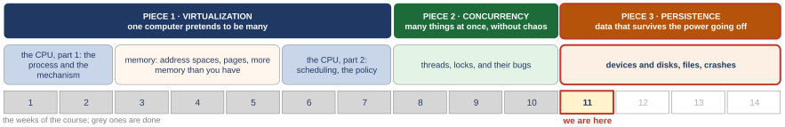
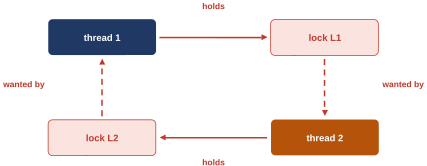

# I/O devices and hard disk drives

*Self-study guide · COMP3430 Operating Systems*

## Where this guide comes from {#source}

This guide follows *Operating Systems: Three Easy Pieces* (OSTEP) by Remzi H. Arpaci-Dusseau and Andrea C. Arpaci-Dusseau, which the authors publish free at [https://pages.cs.wisc.edu/~remzi/OSTEP](https://pages.cs.wisc.edu/~remzi/OSTEP/). The figures and examples credited to the textbook are theirs. The code the guide reads is from [xv6](https://github.com/mit-pdos/xv6-riscv), the teaching operating system from MIT, and its [xv6 book](https://mit-pdos.github.io/xv6-riscv-book/).

Read with this week:

- [OSTEP chapter 35. A Dialogue on Persistence](https://pages.cs.wisc.edu/~remzi/OSTEP/dialogue-persistence.pdf)
- [OSTEP chapter 36. I/O Devices](https://pages.cs.wisc.edu/~remzi/OSTEP/file-devices.pdf)
- [OSTEP chapter 37. Hard Disk Drives](https://pages.cs.wisc.edu/~remzi/OSTEP/file-disks.pdf)

## Part 0. Where we are, and what this week stands on {#part-0}

This part does five jobs before the new material starts. It shows where this week sits in the course. It gives you just enough C to read the short pieces of kernel code the week is built on, and just enough about bits and hexadecimal (base-16) numbers to read the values those pieces put into a device. It says how to read the outputs captured on two machines, and what the units mean. And it rebuilds the ideas from earlier weeks that this week uses: the trap and the interrupt, the address space, the sleeping process with its lost wake-up, and last week's deadlock. Everything later uses these words without stopping, so if one is shaky, fix it here.

A few words first. The **operating system** (the **OS**) is the program that runs the computer and shares it between all the other programs; its core is called the **kernel**. A **program** is a file of instructions; a **process** is a program while it is running. The **CPU** (the processor) is the part of the computer that runs **instructions**, the small steps a program is made of, one after another. **Memory**, also called **RAM**, is where a running program's data and instructions live. Memory is a long row of numbered cells of one **byte** each, and a cell's number is its **address**. Inside the CPU are a few dozen tiny storage cells of its own, called **registers**; the CPU does its arithmetic there. An instruction that copies a value from memory into a register is a **load**, and one that copies a register into memory is a **store**. The textbook is OSTEP, *Operating Systems: Three Easy Pieces*; the guide names its chapters, sections and figures.

#### The course map

<figure markdown="1">
{width=100%}
<figcaption markdown="1">Figure 0.1. The three pieces of the course, the weeks behind us in grey, and this week marked "we are here": the first week of the third piece.</figcaption>
</figure>

An operating system has three big jobs, and the course takes them in order. The first is **virtualization**: one computer pretends to be many, so every program behaves as if it had its own CPU and its own memory. The second is **concurrency**: many things happening at once, without chaos. The third is **persistence**: data that survives the power going off. Figure 0.1 shows the first two pieces finished and the third one starting this week.

Each step of the course so far answered the question the step before it left open. The words in rows 1 to 9 belong to those weeks and their guides; the rows are reminders, and a word in them that this week does not use is not explained again here. This week leans on four of them: the trap and the timer from row 2, the address space from row 3, the scheduler from row 6, and the lost wake-up from row 9. (The scheduler is the part of the OS that picks which process runs next.) The subsection "What the earlier weeks built" at the end of this part restates each of them. Row 10 is the one to have in mind.

1. **The process**: a running program with its own view of the machine. Left open: how does a program get the OS to do anything for it?
2. **Limited direct execution**: the program runs on the real CPU; a trap (a forced jump into the kernel), a system call (a request a program makes to the kernel) or a timer hands control back. Left open: how is memory shared without programs seeing each other?
3. **The address space**: a private memory numbered from 0, translated by base and bounds (two numbers that shift and limit every address). Left open: one block per program wastes its empty middle.
4. **Segments, then pages and a TLB**: fixed-size pieces end the holes; the TLB is a small fast copy of recent translations. Left open: the table is too big, and we assumed every page is in memory.
5. **A tree, and pages on disk**: the page table (the map from a program's addresses to real memory) stores only the parts in use; a page fault (the trap taken when a page is not in memory) brings a page back. Left open: which process runs next, and for how long?
6. **Scheduling**: turnaround time for batch work, response time for people; a scheduler that learns a job's type. Left open: a priority ranks jobs; it cannot promise anyone a share.
7. **A share, then many CPUs**: tickets and Linux's weights; a queue per CPU, or one shared queue. Left open: two CPUs take the same job from one queue; what is the lock?
8. **Threads, the race, the lock**: a second point of execution in one program; a lock from one instruction the hardware will not split. Left open: how does a thread wait for an event?
9. **Locks inside structures; waiting**: condition variables and semaphores, with which a thread sleeps until another thread acts. Left open: every tool is in hand, and a program using them still hung.
10. **The bugs, and deadlock**: most bugs are a missing lock or a missing wait; a deadlock needs four conditions. Left open: everything we built lives in memory, and memory is wiped when the power goes.
11. **This week: devices, then disks.** How the operating system tells a device what to do, and how the CPU keeps working while the device does it. Then, in the next class, what is inside a hard disk, and what one request to it costs.

Row 10 left something open that no lock can fix, and this week starts on it: all the data we have built lives in memory, and memory forgets it when the power goes.

#### Reading the C in this guide

The kernel code this week is written in **C**, the language most kernels are written in. You do not need to write C to follow the guide, but you need to read the symbols it uses. Each one is explained again where it first appears. Here are the ones that appear on almost every page.

- A **variable** is a named storage place. `int c` is a variable called `c` that holds a whole number. `uint32` and `uint64` are whole numbers that are never negative and take 32 and 64 bits; a bit is one binary digit, 0 or 1, and the next subsection explains bits. The semicolon ends a statement. `//` starts a comment, a note for people that the computer ignores. `...` in a listing means lines left out.
- A **function** is a named piece of code. `void uartputc_sync(int c) { ... }` defines a function called `uartputc_sync` that takes one whole number, `c`; the curly braces hold its body, and `void` says it hands nothing back. A function is named in the guide with its parentheses, as in `uartputc_sync()`.
- `while (x) { ... }` repeats the body as long as `x` is true. `while (x) ;` is a loop with an empty body: the lone semicolon does nothing, so the loop only tests `x` again and again until it is false. `for (i = 0; i < n; i++) { ... }` repeats its body: it sets `i` to 0, runs the body while `i < n` (`i` is less than `n`), and adds 1 to `i` after each pass. `for(;;)` is a loop that never stops. `if (x) ... else ...` runs one of two things.
- `==` means "is equal to", `!=` "is not equal to"; a single `=` stores a value. `x += 1` adds 1 to `x`, and `x++` does the same. `||` means "or", and `!x` means "not `x`". `a % b` is the remainder when `a` is divided by `b`. A `*` after a type name, as in `unsigned char *` or `uint32 *`, means "pointer to" that type, so `(volatile uint32 *) x` treats `x` as the address of a 32-bit number (pointers and `volatile` are explained below).
- A **struct** is a bundle of named fields kept together in memory. A **pointer** is a variable that holds the address of something in memory. `&x` means "the address of `x`". `*p`, with the star in front, means "the thing at the address `p`". If `b` points to a struct, `b->disk` is its field `disk`: the arrow `->` is "the field of the thing this pointer leads to". `disk.desc` is the field `desc` of a struct called `disk` that is not a pointer. `a[i]` is element number `i` of the array `a`, a row of numbered elements of one type.
- `#define NAME value` makes `NAME` a name for `value`. The **compiler**, the program that turns C into machine instructions, replaces the name everywhere it appears. A `#define` with parentheses, such as `#define R(r) ...`, is a **macro**: a small text pattern that the compiler fills in, like a function that is expanded in place.
- `(uint64) x` is a **cast**: it treats `x` as a 64-bit number. The guide uses it when an address is stored as a plain number. `sizeof(x)` is the size of `x` in bytes.
- `volatile` is a word in front of a type that tells the compiler: really read or write this address every time the code says so, and never reuse a copy kept in a register. [Section 3.3](class-1.md#sec-3-3) says why device code needs it.
- `a & b`, `a | b` and `a << n` work on the bits of a number; the next subsection explains them. `a |= b` sets in `a` every bit that is 1 in `b`.

#### Bits and hexadecimal numbers

A **bit** is one binary digit, 0 or 1. A byte is 8 bits. The bits of a number are counted from the right, starting at 0. So in the 8-bit number 0010 0000 (the space is only for reading), bit 5 is 1 and all the others are 0. Bit k is worth 2 to the power k, so bit 5 is worth 2 × 2 × 2 × 2 × 2 = 32.

Device code writes numbers in **hexadecimal**, base 16, marked by `0x` in front. The 16 digits are 0 to 9 and then a to f for 10 to 15. Each hex digit stands for exactly 4 bits, so two hex digits make one byte (4 + 4 = 8 bits), which is why kernels like it: you can read the bits straight off. For example, 0x60 is the digits 6 and 0. The digit 6 is 0110 and the digit 0 is 0000, so 0x60 = 0110 0000 in bits. Bits 6 and 5 are 1. Check it in decimal: 6 × 16 + 0 = 96, and bit 6 plus bit 5 is 64 + 32 = 96. Every hex digit becomes 4 bits the same way: write it as a sum of 8, 4, 2 and 1. So 1 is 0001, 2 is 0010, 5 is 4 + 1 = 0101, a (10) is 8 + 2 = 1010, and f (15) is 1111.

Three operators work on bits. `1 << 5` shifts a 1 left by 5 places, so it is the number with only bit 5 set: 0010 0000, which is 32, or 0x20. `a & b` (one ampersand, between two numbers) keeps a bit only where both `a` and `b` have it; so `x & (1 << 5)` is 0 if bit 5 of `x` is 0, and not 0 if it is 1. That is how code tests one bit. `a | b` keeps a bit where either one has it, so it adds a bit. The `&` of "the address of `x`", in front of a single name, is a different use of the same sign. The context always tells them apart.

Addresses are written in hex too. 0x10000000 is a 1 followed by seven zeros in hex, which is 16 to the power 7 = 268,435,456 in decimal. You will not need that decimal value. What matters is adding a small number to an address: 0x10000000 + 5 = 0x10000005. Two more habits. Leading zeros change nothing, so 0x0000000010000000 is 0x10000000. And two hex numbers of the same length compare digit by digit from the left, just like decimal ones: 0x10001050 is bigger than 0x10001000, because they agree up to the last three digits and 050 is more than 000.

#### Reading the captures in this guide

The guide prints **captures**: what was typed and what came back, saved as text when the runs were made. Each one is kept in a file whose name ends in `.out`, such as `sleep_run01.out`. A capture is a saved copy of a run's output, not a program. Three kinds appear.

- **The xv6 shell.** xv6 is a small teaching operating system from MIT; the course reads its code. Its **shell**, the program that reads the commands a person types and runs them, prints `$` and waits for a command. `wc big.txt` runs the program `wc` (word count), which prints how many lines, words and bytes the file `big.txt` has. Typing Ctrl-P (hold the Control key and press P) makes the xv6 kernel print a list of its processes; for the measurements of [Section 2.6](class-1.md#sec-2-6) it also prints a line of counters.
- **The QEMU monitor.** xv6 runs under **QEMU**, a program that pretends to be a whole computer. Pressing Ctrl-A and then c switches to QEMU's own command window, the **QEMU monitor**, whose prompt is `(qemu)`. It can read the pretend machine's memory and devices from outside. [Section 3.3](class-1.md#sec-3-3) explains its two commands.
- **The Linux shell.** `$` at the start of a line is the prompt: what follows was typed. Lines without `$` are the output. `./diskio testfile seq 20000` runs the program `diskio` from the current folder (`./` means "this folder") with three words after its name. Only the optional parts at the end of the guide use it, and they explain it there.

#### The two machines, and the units

The captures come from two machines, and the guide always says which.

- **xv6 under QEMU.** QEMU pretends to be a computer with a **RISC-V** processor (RISC-V is a family of processors, like the x86 family in most PCs) and 1 CPU. QEMU was version 8.2.2, and it ran on a computer with an Intel x86-64 processor and Ubuntu 24.04, a packaged version of Linux, which is an operating system. The disk that xv6 uses is a file on that computer, and QEMU plays the part of the disk hardware. The guide calls this "xv6 under QEMU".
- **The Linux VM.** A **virtual machine**, or **VM**, is a computer simulated by software on another computer. This one runs Ubuntu 22.04 with the Linux kernel 6.8, on an ARM processor (the family in phones and in Apple's recent Macs), with 4 CPUs. The computer underneath it is a Mac, and its disks are files kept on the Mac. It is the same VM as in the last weeks. The guide calls it the Linux VM.

The units. A **microsecond**, written µs (or `us` in a capture, where the Greek letter µ cannot be typed), is a millionth of a second; a **millisecond**, ms, is a thousandth. So 1 ms = 1,000 µs. In this guide **KB** means 1,024 bytes, as the textbook uses it for blocks: a 4 KB block is 4 × 1,024 = 4,096 bytes. The size of a block depends on the system. The textbook's examples use blocks of 4 KB, and xv6 uses blocks of 1,024 bytes ([Section 2.3](class-1.md#sec-2-3)). A **MiB** is 1,024 × 1,024 = 1,048,576 bytes, and a **GiB** is 1,024 × 1,024 × 1,024 = 1,073,741,824 bytes. A program in [Extra 2](class-1.md#extra-2) reports MB/s; there it means 1,048,576 bytes a second, and the extra says so again.

#### What the earlier weeks built, and what this week uses

Five ideas from earlier weeks come back this week: the first four in the chapters, and the fifth, last week's hang, as the starting point of the class (its four conditions close that week's story; this week does not use them as tools). Each gets a few lines here, so you do not have to go back.

**Two modes, and the trap.** The CPU runs in one of two modes. In **user mode**, where programs run, some instructions are forbidden. In **kernel mode**, where the kernel runs, everything is allowed. An instruction that only kernel mode may run is called **privileged**. A program that wants the kernel to do something makes a **system call**: a special instruction that switches the CPU to kernel mode and jumps into the kernel, at a place the kernel chose in advance. That forced jump into the kernel is called a **trap**.

**The interrupt.** An **interrupt** is a trap caused by hardware rather than by the program. Something outside the running instructions raises a signal, and the CPU stops what it is doing and jumps into the kernel at its fixed place. The example from the first weeks is the **timer interrupt**. A clock in the hardware interrupts the CPU at regular moments, many times a second. So the kernel gets the CPU back even from a program that never makes a system call. This week a second kind matters: a device can raise an interrupt too. The piece of kernel code that the CPU runs for an interrupt is its **interrupt handler**; [Section 2.2](class-1.md#sec-2-2) says more. In xv6, every interrupt and trap from a device ends up in one kernel function, `devintr()`, which [Section 2.4](class-1.md#sec-2-4) reads.

**The address space.** Every process sees its own private memory, numbered from 0, called its **address space**. The hardware translates each address a process uses into a real address in RAM, using a **page table** that the kernel fills in. A process can only reach what its page table maps. So the kernel decides what each process can touch, and it can keep something out of every user process simply by never putting it in their page tables. [Section 3.2](class-1.md#sec-3-2) uses exactly this.

**The sleeping process, and the scheduler.** A process is in one of a few states. It can be **running** on a CPU. It can be **ready** (also called **runnable**): able to run and waiting for a CPU. Or it can be **sleeping** (also called **blocked**): waiting for some event, and not to be run until the event happens. The **scheduler** picks which ready process runs next. Switching the CPU from one process to another is a **context switch**. In xv6 a process goes to sleep with `sleep(chan, lock)`, where `chan` is any address the sleeper and the waker agree on (the "channel"). Another piece of code later calls `wakeup(chan)`, and every process asleep on that address becomes ready again. The second argument is a lock the caller is holding. `sleep()` lets go of it and falls asleep as one step, so that no wake-up can slip in between ([Section 2.3](class-1.md#sec-2-3) shows how), and takes it back on waking.

Why the lock? In the condition-variable week (a condition variable is a queue a thread sleeps in until another thread signals it) we met the **lost wake-up**. A thread checks a condition, finds it false, and is about to sleep. Before it actually sleeps, another thread makes the condition true and calls `wakeup()`. Nobody is asleep yet, so the wake-up is lost, and the first thread then sleeps forever. The cure was a lock. The sleeper holds a lock while it checks the condition, and `sleep()` releases that lock only when the sleeper is asleep. The waker has to take the same lock before it can change the condition, so it cannot slip in between the check and the sleep. The same week taught a second habit: check the condition in a `while` loop, not an `if`, and check it again after waking. Both habits come back in [Section 2.3](class-1.md#sec-2-3).

A **lock** in the xv6 kernel is taken with `acquire(&lock)` and given back with `release(&lock)`. A CPU that waits for such a lock spins: it asks again and again until the lock is free. While a CPU holds one, xv6 also turns interrupts off on that CPU, with a pair of functions called `push_off()` and `pop_off()`. The reason: an interrupt handler on the same CPU might need the same lock. It would then wait for a lock that its own CPU holds, and that CPU cannot go on until the handler ends, so it would wait forever. With interrupts off, the interrupt simply waits until the lock is released. [Section 1.4](class-1.md#sec-1-4) meets the pair alone, and [Section 2.3](class-1.md#sec-2-3) relies on this rule.

**Last week: the hang, as holds and wants.** Last week ended with a program that hung for good, drawn as a graph of who holds what and who wants what.

<figure markdown="1">
{width=60%}
<figcaption markdown="1">Figure 0.2. The hang of last class, as holds and wants: thread 1 holds lock L1 and wants L2; thread 2 holds L2 and wants L1. A solid arrow is "holds", a dashed arrow is "wanted by", and the four arrows close a circle.</figcaption>
</figure>

In Figure 0.2, thread 1 holds lock L1 and waits for L2, while thread 2 holds L2 and waits for L1. The arrows close a circle, and nobody can move. A deadlock like this needs four conditions at the same time:

1. **Mutual exclusion**: only one thread can own a lock.
2. **Hold-and-wait**: a thread keeps what it holds while it asks for more.
3. **No preemption**: nobody can take a lock away from its holder.
4. **Circular wait**: the waits form a closed circle.

Why must all four hold? The circle of waits is the fourth condition itself. The other three make every wait on that circle last forever. The lock belongs to one thread. The thread keeps it while it waits. And nobody can take it away. So if any one of the four is missing, the circle cannot stay closed: without condition 4 there is no circle at all, and without any of conditions 1 to 3 some wait on it ends. That is how every fix for deadlock works: take away one of the four.

*The argument in one line:* why does a deadlock need all four? the circle is condition 4 → conditions 1 to 3 make each wait on it last → take away any one → no circle forms, or one wait ends and it opens.

Last week also left two things open, and both point outside the CPU and memory. A thread of a program that waits for a lock is usually put to sleep until another thread wakes it. But who wakes a program that waits for a disk? A disk is hardware, not a thread, and it runs no code of ours. And everything we have built lives in memory, which forgets everything when the power goes. The first class of this week answers the first question. The second question is the work of the weeks after it.
