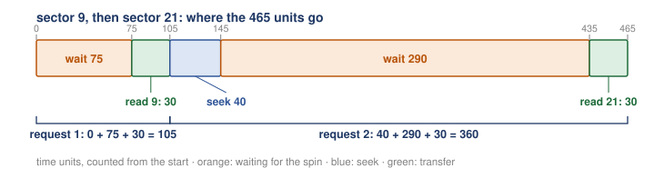
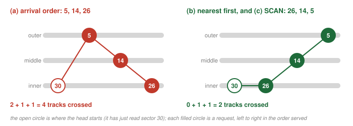

# Exercises and answers

## The first class in ten points {#the-week}

1. Programs need input, output and data that outlasts the power, so the operating system has to drive devices: hardware on its own bus, a ladder of buses with the fast, short ones near the CPU.
2. Devices differ completely inside, so each one shows the OS the same kind of simple face: a few registers (in the textbook's example status, command and data), with everything else hidden.
3. The simplest protocol polls the status until the device is free, writes the data, writes the command, and polls again; polling is the asking, and programmed I/O is the CPU copying the data itself.
4. xv6's `uartputc_sync()` is that protocol for a console chip: line 118 polls bit 5 of the UART's LSR, and line 120's one write into THR is both the data and the command.
5. Polling a slow device wastes every slot of the wait, so the waiting process sleeps instead, another process runs, and the device raises an interrupt when it is done; the handler wakes the sleeper, and the CPU and the device work at once.
6. xv6's disk driver posts a request on the avail ring, writes the notify register once, and sleeps under its lock so the wake-up cannot be lost; the disk's interrupt reaches `devintr()` through the PLIC, and `virtio_disk_intr()` sets `b->disk` to 0 and calls `wakeup(b)`.
7. Counted on a run of xv6 under QEMU, `wc` on a 100-block file cost 106 requests, 106 sleeps and 106 interrupts in all 12 runs; on a fast device, though, polling can win, and a hybrid polls a little before it sleeps.
8. Copying a block word by word keeps the CPU busy again (1,024 stores for the textbook's 4 KB block), so with DMA the CPU only says where the data is, how much, and which device, and a helper copies it; xv6's descriptors give the disk the address of `b->data`, and the CPU touches none of its 1,024 bytes.
9. A plain load goes to RAM, so a device is reached either with privileged I/O instructions that name a port (x86 `in` and `out`) or with memory-mapped I/O; on xv6 the disk's registers sit at 0x10001000, which the QEMU monitor confirms by reading "virt", 2, 2, "QEMU" there.
10. One device driver per device keeps the rest of the kernel device-neutral behind block reads and writes, at the price of lost special abilities and a mountain of driver code; what a disk does with "block N" is the next class.

## The second class in ten points {#the-week-2}

1. To the operating system any disk is a row of numbered sectors of one fixed size (512 bytes on the textbook's drives), read or written by number; the xv6 driver turns block 1 into sectors 2 and 3.
2. On a hard disk drive only a one-sector write is all or nothing, so a 4 KB write of 8 sectors can be torn by a power failure: some sectors new, some old.
3. Inside a hard disk drive, platters spin around a spindle at a fixed rate, data sits in rings of sectors called tracks, and a head at the end of an arm reads and writes.
4. One request costs three things in order, and their times add: the seek (move the arm to the track), the rotational delay (wait for the sector, half a turn on average), and the transfer.
5. On the textbook's simulated disk, sector 10 and then sector 18 cost 0 + 105 + 30 = 135 and 40 + 170 + 30 = 240 time units, and 275 of the 375 units were waiting for the spin.
6. With real data-sheet numbers, one random 4 KB read on the Cheetah takes 4 + 2 + 0.03, about 6 ms, and almost all of it is moving parts.
7. A long run in order pays for one seek and one rotation and then only transfers, so it is about 190 to 340 times faster than random reads on the two drives; a virtual disk with no moving parts showed no such gap.
8. A queue served in arrival order wastes arm travel; nearest track first (SSTF, or nearest block first in the OS) cut the example from 450 units to 240, but it can starve a far request.
9. The elevator (SCAN) sweeps across the tracks and back, so a request behind the head is served on the next sweep; shortest positioning time first (SPTF) adds the seek and the rotation, and whether sector 16 or sector 8 goes first depends on the arm's speed.
10. SPTF needs the head's exact position, so the drive orders its own queue, and the operating system hands it a few requests at a time after merging adjacent ones: Linux turned three reads into two requests.

## Exercises {#exercises}
<!-- answers folded under their exercises -->

Try each one on paper before you open its answer. The method each one needs is in the section named in brackets. Exercises 1 to 9 are on the first class, and Exercises 10 to 18 are on the second class.

### Exercise 1 {#exercise-1}

How does programmed I/O differ from DMA (direct memory access)? Which offers better performance and efficiency? ([Section 2.7](class-1.md#sec-2-7) and [Section 2.8](class-1.md#sec-2-8))

Answer 1 click to show

With programmed I/O, the CPU moves every word between memory and the device itself: for a 4 KB block that is 4,096 / 4 = 1,024 stores, and the CPU can run nothing else while it copies. With DMA, the CPU only says where the data is in memory, how much to copy, and which device; the DMA engine copies, and the CPU runs another process meanwhile, until one interrupt says the copy is done. DMA is better whenever there is much data to move, because the CPU is free for the whole copy. For a tiny transfer, such as the UART's one character, the CPU simply writes it, as [Section 1.4](class-1.md#sec-1-4) showed.

### Exercise 2 {#exercise-2}

When is it better to poll a device instead of using interrupts? When is it the reverse? What about a hybrid? ([Section 2.2](class-1.md#sec-2-2) and [Section 2.6](class-1.md#sec-2-6))

Answer 2 click to show

Poll a fast device: if the wait is short (in the textbook's example, the first poll usually finds the device done), then a sleep, an interrupt and a wake-up cost more than the wait. Use interrupts for a slow device: the CPU can run another process meanwhile, instead of spending the whole wait asking. If the speed varies or is unknown, use a hybrid: poll for a little while, and if the device is still not done, sleep and let it interrupt. Beyond the body, two optional parts add evidence: on xv6's emulated disk, polling returned sooner, about 120 µs a read against 246 µs, though it looped about 8,000 times a read ([Extra 3](class-1.md#extra-3)); and a flood of interrupts is one more reason to poll at times (livelock, [Extra 4](class-1.md#extra-4)).

### Exercise 3 {#exercise-3}

With programmed I/O, one store moves one 4-byte word. (a) How many stores does the CPU make to send one xv6 block of 1,024 bytes to a device? One 512-byte sector? A 16 KB block? (b) With xv6's DMA driver, how many of the block's 1,024 bytes does the CPU copy? ([Section 2.7](class-1.md#sec-2-7) and [Section 2.9](class-1.md#sec-2-9))

Answer 3 click to show

One xv6 block: 1,024 / 4 = 256 stores (check: 256 × 4 = 1,024). One sector: 512 / 4 = 128 stores (check: 128 × 4 = 512). A 16 KB block: 16 × 1,024 = 16,384 bytes, and 16,384 / 4 = 4,096 stores (check: 4,096 × 4 = 16,384). (b) None. The descriptor of line 252 gives the disk the address of `b->data` and line 253 its length; the disk copies the 1,024 bytes itself. The CPU writes the descriptors, the avail ring entry and its count, and one store to the notify register, and then sleeps. (a)

### Exercise 4 {#exercise-4}

Here are the two `disk:` lines of `sleep_run01.out` from [Section 2.6](class-1.md#sec-2-6), with only the first and last counts kept: after booting, `44 requests, ..., 11109 us waiting`; after `wc big.txt`, `150 requests, ..., 35326 us waiting`. (a) How many requests did `wc` cost? (b) What was the average waiting time per request during booting, and during `wc`? Give each to one decimal place, and check each by multiplying back. ([Section 2.6](class-1.md#sec-2-6))

Answer 4 click to show

150 − 44 = 106 requests. (b) During booting: 11,109 µs over 44 requests, 11,109 / 44 = 252.5 µs per request (check: 252.5 × 44 = 11,110, which is 11,109 up to the rounding). During `wc`: the waiting grew by 35,326 − 11,109 = 24,217 µs over 106 requests, so 24,217 / 106 = 228.46, about 228.5 µs per request (check: 228.46 × 106 = 24,216.8, about 24,217). `xv6_summary.out` prints this run's 228.46 as "228 us per read". (a)

### Exercise 5 {#exercise-5}

The UART's line status register LSR reads (a) 0x21, (b) 0x01, (c) 0x60. For each value, write it in bits, say which bits are set, and say whether the loop at line 118 of `uartputc_sync()` ends or goes round. Also: at what address does `ReadReg(LSR)` load? (Part 0, [Section 1.4](class-1.md#sec-1-4) and [Section 3.2](class-1.md#sec-3-2))

Answer 5 click to show

Bit 5 is `LSR_TX_IDLE` (line 36); the loop at line 118 ends when bit 5 is 1.

- (a) 0x21: the digits 2 and 1 are 0010 and 0001, so 0010 0001. Bits 5 and 0 are set. Bit 5 is 1, so the loop ends. (Bit 0, `LSR_RX_READY` of line 35, says a typed character is also waiting; `uartputc_sync()` ignores it.)
- (b) 0x01: 0000 0001. Only bit 0 is set. Bit 5 is 0, so the loop goes round and reads LSR again.
- (c) 0x60: 0110 0000. Bits 6 and 5 are set. Bit 5 is 1, so the loop ends.

`ReadReg(LSR)` loads from `UART0` + 5 = 0x10000000 + 5 = 0x10000005.

### Exercise 6 {#exercise-6}

Process 1 runs for 3 time slots and then starts a disk read that keeps the disk busy for 4 slots. When the read is done, process 1 runs 2 more slots and is finished. Process 2 is ready from the start and needs 6 slots of CPU. Assume, as the textbook's timelines do, that process 1 runs again as soon as its read is done (a real scheduler may make it wait for its turn, as in [Section 2.5](class-1.md#sec-2-5); the exercise keeps the textbook's simpler timing), and that process 2 runs only when process 1 cannot. Draw the CPU row and the disk row, one box per slot, (a) with polling and (b) with interrupts. In which slot does process 2 finish in each? ([Section 2.1](class-1.md#sec-2-1) and [Section 2.2](class-1.md#sec-2-2))

Answer 6 click to show

Number the slots from 1. The disk is busy in slots 4 to 7 in both cases.

<figure markdown="1">
{width=78%}
<figcaption markdown="1">Figure R.1. [Answer 6](#answer-6). (a) Polling: process 1 runs slots 1 to 3, polls in slots 4 to 7 (p), runs slots 8 and 9, and process 2 runs slots 10 to 15. (b) Interrupts: process 2 runs slots 4 to 7 while the disk works, process 1 runs slots 8 and 9, and process 2 finishes its last 2 slots in 10 and 11.</figcaption>
</figure>

- (a) Polling. CPU: 1 1 1 p p p p 1 1 2 2 2 2 2 2. Process 1 polls through the disk's 4 slots, finishes in slots 8 and 9, and only then can process 2 run its 6 slots, in slots 10 to 15. Process 2 finishes in slot 15.
- (b) Interrupts. CPU: 1 1 1 2 2 2 2 1 1 2 2. While the disk works (slots 4 to 7), process 1 sleeps and process 2 runs 4 of its 6 slots. The interrupt at the end of slot 7 wakes process 1, which runs slots 8 and 9 and finishes. Process 2 runs its last 2 slots in slots 10 and 11. Process 2 finishes in slot 11.

Check: in (b) process 2 ran 4 + 2 = 6 slots, and the CPU did 3 + 2 = 5 slots of process 1's work and 6 of process 2's, 11 slots in all with none wasted. In (a) the same 11 slots of work took 15, because 4 were spent polling.

### Exercise 7 {#exercise-7}

Imagine a broken version of `virtio_disk_rw()` in which the check of `b->disk` at line 284 and the call that puts the process to sleep are not protected by the lock that `virtio_disk_intr()` takes (A holds no lock there), and interrupts stay on, so the handler can run between them. Give an order of events, on one CPU, in which process A sleeps forever. (Part 0, [Section 2.3](class-1.md#sec-2-3) and [Section 2.4](class-1.md#sec-2-4))

Answer 7 click to show

One order that loses the wake-up:

<figure markdown="1">
{width=78%}
<figcaption markdown="1">Figure R.2. [Answer 7](#answer-7). Process A checks b->disk and sees 1; before A sleeps, the disk's interrupt runs the handler, which sets b->disk to 0 and calls wakeup(b) while nobody is asleep on b; then A calls sleep(b), and no second interrupt ever comes for this request.</figcaption>
</figure>

1. Process A posts its request and writes the notify register; the disk starts.
2. A checks `b->disk` at line 284. It is 1, so A is about to call `sleep(b)`.
3. Before A sleeps, the disk finishes and raises its interrupt. Nothing stops the handler now: A holds no lock, so interrupts are on, and the handler's lock is free. The CPU runs `virtio_disk_intr()`.
4. The handler sets `b->disk` to 0 (line 320) and calls `wakeup(b)` (line 321). Nobody is asleep on `b` yet, so the wake-up does nothing.
5. The handler returns, and A goes on with what it was about to do: it calls `sleep(b)` and falls asleep.
6. The disk raises one interrupt per finished request, and this request is finished. No one will call `wakeup(b)` again, so A sleeps forever, even though its block is already in `b->data`.

This is the lost wake-up of Part 0. The real driver prevents it the way [Section 2.3](class-1.md#sec-2-3) says: it holds `disk.vdisk_lock` from line 220 through the check, and `sleep()` lets go of it and falls asleep as one step, so the handler, which must take the same lock at line 297 and then wake A, cannot get in between steps 2 and 5. (In xv6, holding the lock also keeps interrupts off on that CPU.)

### Exercise 8 {#exercise-8}

The disk's notify register is at offset 0x050 from the disk's base address (`kernel/virtio.h`, line 22). At what address does line 281 of `virtio_disk.c` store? Which line of the `info mtree` output in [Section 3.3](class-1.md#sec-3-3) shows that this address belongs to the disk and not to RAM? (Part 0, [Section 3.2](class-1.md#sec-3-2) and [Section 3.3](class-1.md#sec-3-3))

Answer 8 click to show

The base is `VIRTIO0` = 0x10001000 (`memlayout.h` line 25), and `R(r)` adds the offset (`virtio_disk.c` line 20). So line 281 stores to 0x10001000 + 0x050 = 0x10001050. (In hex, the last three digits 000 + 050 = 050.) The `info mtree` line `0000000010001000-00000000100011ff (prio 0, i/o): virtio-mmio` covers 0x10001000 to 0x100011ff once the leading zeros are dropped (Part 0). Compared digit by digit from the left, 0x10001050 is above 0x10001000 and below 0x100011ff, so it is in that range, and it is marked `i/o`, a device. RAM starts only at 0x80000000.

### Exercise 9 {#exercise-9}

In your own words: why does every device show the operating system the same simple face, and why does the kernel still need one driver per device? Name one cost of this design. ([Section 1.1](class-1.md#sec-1-1), [Section 1.2](class-1.md#sec-1-2), [Section 3.4](class-1.md#sec-3-4) and [Section 3.5](class-1.md#sec-3-5))

Answer 9 click to show

A model answer: there are thousands of kinds of devices, and new ones every year, so a kernel that had to know the inside of each one could never be finished. So each device shows a small fixed set of registers (in the textbook's example status, command and data) and hides its chips and firmware; then one way of talking works whatever is inside. But each kind of device still has its own registers and its own protocol, and someone has to know them. Putting that knowledge in one driver per device means everything above it, such as the file system, asks only for "read block N" or "write block N" and is written once. One cost: the generic interface hides special abilities, so a SCSI disk's detailed errors reach the file system only as a generic EIO. Another: drivers pile up, over 70% of Linux's code in the 2001 study, and they are a main source of kernel crashes.

### Exercise 10 {#exercise-10}

What is the advantage of nearest block first scheduling? What is its main disadvantage? ([Section 6.2](class-2.md#sec-6-2) and [Section 6.3](class-2.md#sec-6-3))

Answer 10 click to show

The advantage: it cuts the arm's travel, because requests that are close together are served together, and the operating system can do it with block numbers alone, without knowing where the tracks are. The main disadvantage: a far request can starve. If requests near the head keep arriving, a request far from the head is never the nearest one, so it is never served.

### Exercise 11 {#exercise-11}

How is anticipatory disk scheduling like coalescing interrupts? (This one needs two optional parts: [Extra 4](class-1.md#extra-4) and [Extra 14](class-2.md#extra-14).)

Answer 11 click to show

Both wait a little on purpose, because waiting can save work. A disk scheduler that uses anticipatory scheduling holds a request back for a moment, because a request for a nearer block may be about to arrive ([Extra 14](class-2.md#extra-14)). A device that coalesces interrupts also waits before it raises an interrupt, so that one interrupt can report several finished requests instead of one each ([Extra 4](class-1.md#extra-4)). In both cases, acting at once looks efficient and is not: the disk would travel far and come back, and the CPU would be interrupted again and again.

### Exercise 12 {#exercise-12}

Use the simulator's disk and rules of [Section 4.6](class-2.md#sec-4-6): 12 sectors a track, 30 time units a sector, 40 units to cross a track, tracks lined up, and the head starting on the outer track in the middle of sector 6. The requests are sector 9 and then sector 21. Work out the seek, the rotation, the transfer and the total for each request, and the total for both. ([Section 4.6](class-2.md#sec-4-6); [Section 6.7](class-2.md#sec-6-7) shows how to count sectors around the ring past the end of a track's numbers.)

Answer 12 click to show

Sector 9 is on the outer track (0 to 11), and sector 21 is on the middle track (12 to 23).

<figure markdown="1">
{width=100%}
<figcaption markdown="1">Figure R.3. [Answer 12](#answer-12). Sector 9: wait 75, then read 30, total 105. Sector 21: seek 40, wait 290, read 30, total 360. Both: 465 time units, of which 365 are waiting for the spin.</figcaption>
</figure>

- Sector 9, seek: it is on the head's own track, so the seek is 0.
- Sector 9, rotation: the head is in the middle of sector 6. The second half of sector 6 takes 15 units, and sectors 7 and 8 take 2 × 30 = 60. The wait is 15 + 60 = 75 units.
- Sector 9, transfer and total: 30 units, so 0 + 75 + 30 = 105.
- Sector 21, seek: one track inward, 40 units.
- Sector 21, rotation: when the seek begins, the head is at the end of sector 9, which is where sector 10 begins. In 40 units, all of sector 10 passes (30 units) and then 10 units of sector 11. On the middle track, the sector in the place of sector 11 is sector 23. So the head lands 10 units into sector 23. From the start of sector 23, count the sectors until 21 begins: 23, 12, 13, 14, 15, 16, 17, 18, 19, 20. That is 10 sectors, 10 × 30 = 300 units, and 10 of them have already gone by. The wait is 300 − 10 = 290 units.
- Sector 21, transfer and total: 30 units, so 40 + 290 + 30 = 360.
- Both: seek 0 + 40 = 40, rotation 75 + 290 = 365, transfer 30 + 30 = 60, total 105 + 360 = 465. (Check: 40 + 365 + 60 = 465.)

Most of the time, 365 of 465 units, is waiting for the spin. Sector 21 was unlucky: it had passed the head's position shortly before the arm arrived, so the head waited almost a full turn. These numbers were worked out by the rules of [Section 4.6](class-2.md#sec-4-6). They are not from a run of the simulator.

### Exercise 13 {#exercise-13}

A data sheet says: 5,400 RPM, average seek 12 ms, top transfer rate 100 MB/s. (a) How long does one random 4 KB read take? (b) What rate is that, in MB/s? (c) About how many times faster is one long run read in order? Count 1 MB as 1,000 KB. ([Section 5.2](class-2.md#sec-5-2) and [Section 5.3](class-2.md#sec-5-3))

Answer 13 click to show

Seek: 12 ms, from the data sheet. Rotation: one turn takes 60,000 / 5,400 = 11.11 ms, so half a turn is 5.56 ms. Transfer: 100 MB/s is 100,000 KB a second, so 4 KB takes 4 / 100,000 = 0.00004 seconds = 0.04 ms. Total: 12 + 5.56 + 0.04 = 17.6 ms. (b) 4 KB in 17.6 ms is 4 / 17.6 = 0.227 KB every millisecond, which is 227 KB a second, or about 0.23 MB/s. (c) A long run pays one seek and one rotation and then transfers at very nearly the top rate, 100 MB/s. 100 / 0.227 = 440. So the long run is about 440 times faster. The slower a drive's moving parts are, the bigger the gap. (a)

### Exercise 14 {#exercise-14}

Here are the "elapsed" lines of two more runs from `diskio_4k.out`, the capture of [Section 5.4](class-2.md#sec-5-4). Each run made 20,000 reads of 4 KB on the virtual disk. In order: `elapsed 0.762 s, 38.1 us per read, 102.5 MB/s`. At random: `elapsed 0.733 s, 36.7 us per read, 106.6 MB/s`. (a) Check the 38.1 by dividing. (b) Which run was faster, and by what share of the slower run's time? (c) On the Cheetah of [Section 5.3](class-2.md#sec-5-3), which would be faster, and by how much? (d) What explains the difference between your answers to (b) and (c)? ([Section 5.3](class-2.md#sec-5-3) and [Section 5.4](class-2.md#sec-5-4))

Answer 14 click to show

0.762 seconds / 20,000 reads = 0.0000381 seconds = 38.1 microseconds a read, as printed. (b) The random run was faster: 36.7 against 38.1 microseconds. The difference is 38.1 − 36.7 = 1.4 microseconds, and 1.4 / 38.1 = 0.037, so about 4%. (c) On the Cheetah, the in-order run would be faster, by a factor of about 190 (125 / 0.66). (d) The Cheetah has an arm and a platter, and a random read pays for a seek and a rotation each time. The virtual disk has neither, so the order of the reads costs nothing. The 4% is not a real advantage for random reads: over all six runs the two kinds overlap ([Section 5.4](class-2.md#sec-5-4)), so it is the ordinary variation between runs. (a)

### Exercise 15 {#exercise-15}

On the three-track disk (outer track sectors 0 to 11, middle track 12 to 23, inner track 24 to 35), the head has just read sector 30. Three requests are waiting. They arrived in this order: sector 5, sector 14, sector 26. (a) In arrival order, how many tracks does the arm cross? (b) In what order does SSTF serve them, and how many tracks does the arm cross? (c) In what order does SCAN serve them, if the head sweeps outward first? (d) Now suppose that, while the head is still on the inner track, requests for the inner track keep arriving without end. Under each rule, can sector 5 wait forever? ([Section 6.1](class-2.md#sec-6-1) to [Section 6.4](class-2.md#sec-6-4))

Answer 15 click to show

Sector 5 is on the outer track, sector 14 on the middle track, and sector 26 on the inner track, where the head is.

<figure markdown="1">
{width=100%}
<figcaption markdown="1">Figure R.4. [Answer 15](#answer-15). Left: arrival order 5, 14, 26; the arm goes out two tracks, then back one, then back one more: 4 tracks. Right: nearest first and SCAN both serve 26, 14, 5; the arm moves outward only: 2 tracks.</figcaption>
</figure>

- (a) Arrival order: 5, then 14, then 26. Inner to outer is 2 tracks, outer to middle is 1, middle to inner is 1. The arm crosses 2 + 1 + 1 = 4 tracks.
- (b) SSTF: sector 26 is on the head's own track, 0 tracks away, so it goes first. Then sector 14 is 1 track away and sector 5 is 2, so 14 is next, and then 5, which is now 1 track from the head. The order is 26, 14, 5, and the arm crosses 0 + 1 + 1 = 2 tracks.
- (c) SCAN, sweeping outward: the head serves each request as it reaches its track, the inner track first. The order is 26, 14, 5, the same as SSTF here.
- (d) Under SSTF, yes. Every new request for the inner track is 0 tracks away, so it is always nearer than sector 14 or sector 5, and those two are never chosen. In arrival order, no: sector 5 arrived first and is served first, though the order wastes arm travel. Under a plain SCAN, it could: as the last list item of [Section 6.4](class-2.md#sec-6-4) says, a plain SCAN could stay on a track while requests for it keep coming. Under F-SCAN, no: the sweep serves only the requests that were waiting when it began (26, 14 and 5), and the new ones are put aside for the next sweep.

### Exercise 16 {#exercise-16}

Take the case of [Section 6.7](class-2.md#sec-6-7) again: the head has just read sector 30, and sectors 16 and 8 are waiting. This time the arm needs 20 units to cross one track. (a) What is the positioning time (seek plus rotation) of each request? (b) Which one does SPTF serve first? ([Section 6.6](class-2.md#sec-6-6) and [Section 6.7](class-2.md#sec-6-7))

Answer 16 click to show

The starting position is the one of [Section 6.7](class-2.md#sec-6-7): sector 8 arrives at the head's position in 30 units, and sector 16 comes around in 270 units.

- (a) Sector 16 is one track away, so the seek is 20 units. Sector 16 arrives after 270 units, so the head waits 270 − 20 = 250. Its positioning time is 20 + 250 = 270 units. Sector 8 is two tracks away, so the seek is 2 × 20 = 40 units. But sector 8 arrives after 30 units, before the arm gets there. It comes around again a full turn later, at 30 + 360 = 390 units, so the head waits 390 − 40 = 350. Its positioning time is 40 + 350 = 390 units.
- (b) SPTF serves sector 16 first, because 270 is less than 390.

This arm is twice as fast as the slow arm of [Section 6.7](class-2.md#sec-6-7), and it still misses sector 8, by 10 units. To arrive in time, the arm must cross two tracks in less than 30 units, so it needs less than 15 units a track. These numbers were worked out by the rules of [Section 6.7](class-2.md#sec-6-7). They are not from a run of the simulator.

### Exercise 17 {#exercise-17}

A file system writes one block of 16 KB. (a) How many sectors is that? (b) The power fails after 20 of them have been written. What is on the disk? (c) What is such a write called, and what exactly did the drive promise? ([Section 4.2](class-2.md#sec-4-2))

Answer 17 click to show

16 KB is 16 × 1,024 = 16,384 bytes, and 16,384 / 512 = 32 sectors. (Check: 32 × 512 = 16,384.) (b) 20 sectors hold the new data and 32 − 20 = 12 sectors still hold the old data. (c) It is a torn write. The drive promised only that a write of one sector is atomic: each single sector is either completely new or completely old. It promised nothing about the 32 sectors as a group. (a)

### Exercise 18 {#exercise-18}

In your own words: why is reading in order so much faster than reading at random places on a hard disk drive? Why was there no such difference on the virtual disk? And why does shortest positioning time first run inside the drive and not in the operating system? ([Section 5.3](class-2.md#sec-5-3), [Section 5.4](class-2.md#sec-5-4) and [Section 6.6](class-2.md#sec-6-6))

Answer 18 click to show

A model answer: on a hard disk drive, every request has to get the head to the data first. The arm must move to the right track (the seek), and then the platter must bring the right sector around (the rotational delay). Both move metal and take milliseconds, while moving 4 KB of data takes a few hundredths of a millisecond. Reading in order pays for the seek and the rotation once, and then the data simply passes under the head. Reading at random places pays for them again for every small piece. On the two drives of the textbook that makes in-order reading about 190 to 340 times faster. The virtual disk has no arm and no platter, so there is no seek and no rotation to pay for, and a read costs the same wherever it is. Shortest positioning time first has to add the rotational delay of every waiting request. For that it must know where the head is in the platter's turn at this instant and where the track boundaries are. The operating system sees only a row of block numbers, so it cannot know either. The drive knows both, so the rule runs inside the drive.

